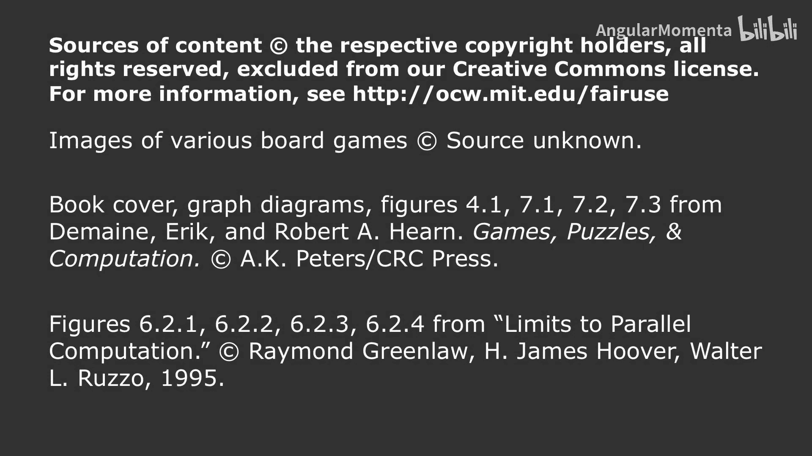

# 【麻省理工】算法下界 ｜ MIT 6.890 Algorithmic Lower Bounds, Fall 2014 p20 20. 不可判定与P-完全问题 -BV1dPYpz9E4V_p20-

The following content is provided under a Cative Commons license。

 Your support will help Mi T OpenCourseware continue to offer high quality educational resources for free to make a donation or to view additional materials from hundreds of Mit courses。

 Visit Mitopcourseseware at Ocw。mt。 Eduu。

Alright， so today we finish our game characterization。 We have this giant table。

 We've done two players，0 players， one player。 Of course， That's the oldest。 Today。

 we're gonna do team imperfect information games， which when you have a polynomial bound on the number of moves。

 you get an X time nondeterministic exponential time。 This is the exponential version of NP。😊。

And for games with unbounded number of moves， normally， I would say exponentially many moves。

 but in fact， this will be really unbounded could be close to infinitely many moves。

 We get undeciability。 So no algorithm whatsoever to solve it。

 We don't know any natural games in these classes， but I have a couple of question marks here。

 Bridge is an example of a game with imperfect information and teams in one hand。

 and it has bounded play once you play your cards， all the cards are down you're done。

 So potentially it falls in this class。 although I don't know if bridge is sophisticated enough。

 or it depends on your notion of the bidding ruless。And what can be communicated there。

On the other hand， for the unbounded game， one candidate problem is called Rgo Creekspeiel。

 Creekspeiel is blind chess。 Rgo Creekspeel is blind go with teams。 So there are two black players。

 two white players and you make moves without knowing what the other moves of any of the other players are usually by writing on a piece of paper and giving it to some referee who tells you whether that was valid。

 This is a game people actually play。 and I'm told I know Bob Hn has played it。 he likes playing go。

 and but it's open whether that problem is undecidable。 potentially yes。

 that seems more likely And then finally one other cell that we didn't do。

 which I'll get to after those two is this box。Which sounds pretty boring because it's just polynomial time things。

 polynomally bounded zero player games is just like game of life running for a polynomial amount of time。

 You can generate I mean， you can solve those problems in polynomial time。

 But there's a stronger sense in which all polynomial time problems can be represented。

 say by game of life。 And this actually is relevant to parallel computing。

 And it essentially says there's no good way to parallelize game of life among other problems。

 So I mentioned that way back in lecture 1。 And lots of people said， oh。

 what's this P completeness business。 And so today we will cover that as well。

But let's start with Nx time and undecidability。 Let's start with a bounded case。

So in the bandit case， is this cool paper by Peterson and Refe introducing a problem variation of。

Quat。诶。Number Qat also known as QBF， So this is D QBF。And it's a funny problem。First。

 I'll phrase it as a formula problem， and then I'll talk about it as a game。So normally in Qat QBF。

 we have N alternating quantifiers， and that's piece based complete。

 and every quantifier can depend on all the previous values。

But now we're going to have two sort of in parallel existential quantifiers。

 so we have two universal， as should mentioned， the capital letters that's a bunch of variables So there's like n bits here and bits here that has to work for all choices of those。

 Why do I separate them out because over here I'm going to separate them out and y1。

 the choice of y1 is only allowed to depend on x1 and the choice of y2 is only allowed to depend on x2。

And then we're going to have some CNNF formula on x1， x2， y1， Y2。

So we can think of that as this is one player， we'll call it could be two players。

 but it doesn't really matter。So make it one simpler， it's going to be a three player game。

 black makes these choices and then white player one。

Chosees the Y ones and the private information aspect of this game is that the white player one can only see the X1 variables made choices made by black you could maybe it's more intuitive to think of this as a four player game there are two black players and the white one player can see the values chosen by the black one player but not the values chosen by the Black two player and then over here we have white player2。

Who can only see。The variables chosen X2 question。 Does the black team have full information。

Black team has full information。 I mean， the black team goes first。

 so it doesn't obviously see Y 1 and Y 2， but they can see each other。 Yeah， so X 2 can see X 1。Yeah。

 so if， if I don't write a parenthetical dependency， then it can depend on everything。Yeah。

 really this is one player， so they get to choose everything in the X X size， Okay。

 so then the question is given this， I mean， this quantified formula is equivalent to saying can white force a whim？

😊，Where white wins if that formula is satisfied。And White collectively， needs to make these choices。

 But it， it's acting as a team with impartial information。

 So it's not acting as a single player anymore。 Unlike when we had full information。

 then three players was the same as two。Okay， so let's first observe that this is in n X time。

 And then furthermore， the claim， which I won't prove， is that this is N X time complete。So。

The idea is there are only exponentially many choices for these variables， so then I can guess。

Both player one and player two can guess what white 1 and white 2 can guess what the possibilities are for all possible choices of x1 and x2。

 so they're making exponentially many guesses for every state of X1 x2。

 guess what the right strategy is， and then just combine。

 then check whether everything is everyone plays properly。

 so then white can decide whether they can win。啊。That's cool。呃。

This can be reduced to a bounded team private information version of constraint logic， T PCC L。

 Let me。Define that。We're going to do this with。Three players。And a planer graph。

I think just and orgraph is enough。But it's team， there're going to be， again， two white players。

 one black player， and it's private information， meaning that each edge is marked as visible to white or visible to black。

 Now the figures， it's a little hard to draw。 So the figures。

 the color is just indicating whether that player is allowed to flip that edge。

 each player can only flip each white player can only flip white edge as black player can only flip black edges just like before。

Well， now it's white team can only flip。 either of the white players can only flip a white edge。

 so some edges are flipable by two players。But then in addition， some edges。

 some white edges are going to be marked as invisible to black and some black edges are going to be marked invisible to white。

 and furthermore， you can say invisible to this white player or this white player。Okay。

 so it's a little bit more general。 And the rules of the game are pretty simple。

 You can make moves just like before， but you must be able to know that that move is legal。

So unlike Ringow Creek Spiel， you're not allowed to make。Impossible moves。You， you must know。

Based on the information that you can see that the move is valid。

I don't think there are probably other variations that work。 but this is， a clean one to work with。

 So if you can see all the edges or you see that there's nothing coming way to an edge。

 then you can reverse one of the ones you have control over。嗯。So this problem。I mean。

 so a funny thing about DQBF is that there's sort of only one round to the game。 I mean， black plays。

 white plays， white plays， and then you see who won whereas most games we think of as having many rounds and particular bounded TPCL has many rounds。

 they play in round Rob and you've got black， white，1， white 2， black， white，1 Y2。

 you play in that sequence over and over， each turn， someone is just reversing a single edge。

 whereas over here you are choosing a ton of variables。Turns out this problem is also in an X time。

Essentially， because。If there is a winning strategy for white over here。

That winning strategy is deterministic and is just a function of the visible state。

And there are and at most n different edges that you can see。

 So the number of possible states is exponential。 So at the beginning， you just guess your strategy。

That's exponentially many bits to guess。 So in N X time， you can do that。

 And then you just play deterministically with that strategy。

 So even though the game may run for a very long time and you do many， many rounds， still。

 the information you need to guess was only exponential。 So you can do this in N X time。

 So it's funny thing here， there in this particular world， unlike all the other cells of that matrix。

One round versus many rounds is the same。 You get Nx time completeness in both cases。Okay。

 so let me tell you how we reduce from D Q B F。To bounded T PCC L。So many acronyms。嗯。

So the idea is pretty simple。Again， we want black to play first。

So there's a bunch of black variables here which are represented by this。

 These two figures are almost the same。 just these edges are black down here and white down here。

 that's going to correspond to the variable setting in this context。

 we only want variables to be set once you don't get to reset them because it's a bounded game as in all the bounded constraint logic games。

 you can only flip each edge once。Having like all。呃。

I don't have an intuitive reason why only that this game is in an extra time。

And this game is N X time complete。 I mean， they both are N X time complete。 So in that sense。

 they're equivalent。Yeah， so we're gonna simulate this one round game with multiple rounds over here。

But yeah， it's a little bit odd that alternation doesn't help。 It doesn't give you more power。

 All the other game settings that it does。It's just a weird thing about team。 Yeah。

 so your argument thatCLs in N X kind of relied on the fact that white doesn't learn anything from blacks moves when black moves on an invisible edge。

 So， it seems like in some board configurations black moves an invisible edge。

 you can actually learn something based on what moves for allowed。And not a lot of people。

Maybe I should say that passing is allowed in this game。Otherwise。

 the fact that you moved does tell you something。 but if you're always allowed to pass。

 you really have no idea whether something happened except by what was visible so's。

Make explicit passing is allowed。Geties are a bit subtle。Okay。

 so the intent is first we let black choose variables either by flipping true edge。

 flipping the false edge， we want to set it up so you can't do well you can't do both because of this vertex constraint So that's cool。

 as soon as as that happens， probably white will flip this edge and black will flip this edge。

 that's a split activating well not yet activating the formula part but enabling black to activate the chosen edge saying that this variable has been chosen and so black will sort of output that then in here so there's n such variables and B1 and B2 are both in here。

And we take the and of all of those chosen edges。 and that's this chosen wire。

So this black is motivated to do this。 Black wants to set their variables some way。And they could。

 I guess set them back and change the variables， but there won't be any motivation to do that。

 goal for black is to flip this edge， which is connected by a long path from the and of all the chosen wires。

 So basically B has to choose all the variables， get this and to be true and then just sit there flipping these edges until this edge is flipped。

 So that's a threat line， Once B has set their variables。 So B is going to erase to do that。

 Y is going to have just enough time to satisfy the formula and flip this edge if the formula is true。

 obviously。So。What happens next， White will basically sit there and and twiddle。

 twiddle their thumbs flipping some not some useless edge until all the black variables are set。

 They could actually do something else， but there's gonna be enough time to wait。

 So it's better to wait because then the white variables can depend on the black variables they can see。

 Obviously，Pretty much all the edges in here are visible to only one of the white players。

 if this is a B1 variable， then this is only visible to white one。

White one can see that it was chosen， but can't see which of these edges got flipped and can't see which of these edges got flipped or these ones。

Okay， so that's representing the visibility。 And so then white will set their variables。

 the same kind of construction。 And once。Chen。Is activated for both of them。

 We take the and here and we trigger the unlock paths。 It's going to unlock the white one。

 unlock the white2， unlock all the black variables。

And the unlock part is what lets you trigger the formula。Activation， so if。

 if true was selected here and this was flipped， once the unlock is flipped。

 then this guy can activate and start inputting all the true variables into the formula。

 then you sit the white will sit there and evaluate the formula has just enough time if it's satisfied to flip and be done。

So that's how we represent dependency QBF。 I mean， it's pretty natural。 It's just。

Some fun stuff to get these to happen in essentially two rounds。

 the visibility constraints of the partial， the privateness of visible information makes this part really easy to implement。

 So no big surprise。Questions。Let's go to the unbounded case， which is the much more exciting one。

And first， I will。This， so。I mean， undecidability is weird and unusual。

 It's weird in this context because this game has finite resources。

 all of our games in particular in constraint logic， you have some graph of size N。

And undecidability is about essentially simulating a Tring machine for arbitrary amounts of time。

And arbitrary amounts of space。 So， you know， it's not。

 it's bigger than 2 to the n iss bigger than 2 to 2 to the n is bigger than 2 tower。

 And it's bigger than any， I guess it's any commutable function of n is how far you have to go。

 So a little bit less than busy Beaaver。嗯。That's a lot of space。 So we， in the game graph。

 we can't represent the state of the machine that we're trying to simulate。 So I should say。

We haven't done undecidability at all， but the canonical problem to start from。Is a halting problem。

You're given a Tring machine。And here， I'd like to say algorithm。

 but we need some model of the machine growing to arbitrarily large sizes。

 And this trying machine is really ideal for this。G a turing machine。Does it ever halt？

So remember turninguring machine， you have some tape。

Let's say initially all of the tape squares are empty。

 you have some pointer into the tape starts at some canonical position and you can read in read and write right squares in the tape and you can move left and right and that's it this is the feeling is this correspondence this includes all possible computation and so deciding whether this machine will ever finish so there's an instruction that just says halt or whether it just keep going on forever seems it is provably impossible there is no algorithm to decide that essentially because it's an algorithm to study algorithms。

 but I won't prove that here I'm going to reduce from this problem and so I need to be able to simulate a to machine of arbitrary size and time。

Cool。While most of the time， I don't show you the， the source problem。 I think here it's。

 it's instructive to see， well， I guess I'm not proving this is undeciable。

 but it's instructive to see how we turn this into a game with bounded resources。

 So before I get to the constraint logic version， I'm gonna talk about something called。

A team computation game。This is from。Our book， Game Puzzles Compation。嗯。

That will allow us to simulate the halting problem， but using finite resources。

 This is where the action is going from here to constraint logic is not that hard and not super interesting。

 but this part is quite interesting。Okay， so in team computation game is gonna be three players，1。

1 black player，2 white players。 And the instance to the game， the sort of。The board set up。

 whatever is going to be。嗯。Here I could use any algorithm or turning machine。

 It's going to be machine and it has some space bound。Which I'll call K。

 K is going to be essentially a constant what， but it's part of the input。嗯。

And if this is an algorithm， it starts with blank memory， if it's turning machine。

 it starts with a blank tape。And then we're going to define black moves and white moves。

So remember there's one black player。And。The black player does or what the black player is forced to do is run the algorithm or the machine。

For K time steps。It's okay， obviously， as an input。So black is forced to do that。

Now that algorithm may return an answer。And the answer is always black wins or white wins。

 or it may not do anything in which case it wants to keep running And the next black move。

 it's going to run for another K steps and then the next black move runs for another K steps and so on。

 Think of k is constant。嗯。So。If there's output from this algorithm or machine。

That will determine the winner。Okay， and otherwise。Black actually gets to make a choice。

 This was completely forced what black had to do here。 You can think of it as part of Black's move。

 but it's really the the game mechanics make this happen。And。In this case。

 black can set two variables， x1 and x2 to be anything in the set A， comma B。Okay。

 so they black gets to choose two bits。If the machine doesn't say that the game is over。Okay。

 we'll see what those bits do in a moment。Okay， so that was black's move。Now， what about white？Again。

 there are two players， white one and white two。And white eye。Is basically blind。呃。

White eye can only see X。 So these X's are messages to the white players。

 and that's all that white can see。 Why can't see anything else about the machine。

It knows what the machine is and knows what it's doing， probably knows K。

 but that's because that's all part of the instance。

 but you don't know anything else about the state of the machine。嗯。

And white can also do one other thing。There's one memory cell in the machine called M1。

 and there's another one called M2， and player White eye can set MI。

And so that will communicate back into the machine what white eye did。

 and that is exactly the move of white eye。Why I move。It's just set。A I。

And I'm not specifying how big that is。 It's not just a single bit。 it could be。

Some stuff in particular is going to be one cell in the in the turing machine we want to simulate essentially but。

Okay， so now the question is， does white have a forced win。

So this is the problem I want to prove undecidable。By a reduction from。Halting problem。Okay。

So as the problem clear， we， we have a finite setup。

 which is this space K situation that the entire state of the game is， in some sense。

 encoded by that。state of that algorithm， it would seem。

And white I mean in black is just telling each in each turn white one， it says A or B， B 2。

 it says A or B， white one and2 then respond with some symbol， and then the game continues。

 so pretty simple setup。But amazingly， this can simulate any Tring machine。So let's do it。

So what we want to do。Basically， so this algorithm is going to be a function。

 given the Tring machine， we're going to construct the algorithm naturally。

 So we basically need a constant space algorithm。To check。That the white players。Produce。

So the white players are outputting a string of symbols。

 white1 is outputting M1 and then outputting something else M1 and so on That string of symbols for both white players。

Should essentially form a valid computation history。

 an execution trace of the Tring machine we want to simulate， the given Tring machine。

It's a little bit more complicated than that， but that's。The idea。

And we'd like it to end in a halt state， so there are lots of canonical ways to write down the state of a turning machine。

 basically write down the tape and where what instruction it' on， and that should be about it。

And we're going to put a special symbol hash mark in between each of these states。

 So this is the state of the machine at time 0。 It's going to be a blank tape。

 and you only have to write as many symbols as you need。 So in the beginning。

 you don't write any symbols。 as you start writing stuff to tape， this will get longer。And。Yeah。

 and then goes to get it to halt state， each of these states should be the uniquely determined state from the previous one。

 which is if I do one instruction， what happens？Okay， now。This is problematic。 So our goal。

 we we're trying to design this algorithm to confirm that these states are being generated correctly。

 That's really hard to do because we can't compute the next state from the previous one because we can't even store the previous state。

In space。 K， we have constant space。 very soon， the state is going to get huge。

 So you think of this as kind of a streaming algorithm。 we're just seeing these characters go by。

 And we can't remember the entire previous state。 So the fact to check that the next state is almost the same as the previous one is very hard。

And that's where we're gonna use this A B。Thing。This is not literally true。

 the sequence of characters M1 say will not produce a valid state。

 essentially what we want player white1 to do is to maintain two pointers into this state， A and B。

And when we so I'm identifying with black here， when we specify x1 equals a。

 we would like to know what character is being pointed to by pointer A。

 and then we'd like to advance a to the next character。Okay，When we request B with x1 equal B。

 we want to know what character is at position B and then advance to the next character。

 So there's one string that we're trying to look at。

 and each white player has to maintain an A pointer and a B pointer。And as black。

 we can make independent requests to each of the two。

 It's like you have two disks with two heads in the disc。

 and they both have the exact same data though they're supposed to。 And I can say。

 give me the next character at this pointer from this disk。

 and I can give you as for what is simultaneously I get one character from one of the two pointers on the other disk。

 and then it advances by one。seemsm almost the same， but that's what will make this undecidable。Okay。

啊。So here's the trick how we're going to build this algorithm。I mean。

 the real trick is that we have nondeterminism， we're asking whether white wins。

 that means or white has a winning strategy for white to have a winning strategy。

 that must mean it can win or the white team can win no matter how black plays。

And black is just non so basically black is non deterministically choosing between the A and the B pointer requests。

And so what this is saying is， no matter what sequence of A's and B's you get， white must win。

And winning is going to happen because we'll build this algorithm to only output yes when it gets to a halt state。

 basically。And so it must get get to we must。 the algorithm must not complain。

No matter how we choose the A And B sequence。So let me get to what we're going to do。So。

 the algorithm。Maintains。It's called this white one。

I would like to know when let me be specific when white ones a state equals white2s B state。

 but in fact， we'll do this for all pairs。 There'll be four different things。 A B here， A B here。

 But let's say I want to know when white ones A state is in exactly the same place as white2s B state。

 so。We have in some sense， there there are two of these strings， one for white 1， one for white 2。啊。

And I want to know when I have just read through a state。By white 1。

 And I've also read through the exact same state from white 2。So that will happen when， first of all。

 both white players should have just returned to Hah mark。And then hashtag， if you prefer。

 And then also while we were running through this tape。

 I I see whether they happen to always return the same result。 So this will basically happen when。呃。

So whenever both A and so if we just asked for a comma A and Y 1 returns a hash mark and y 2 returns a hash mark。

 then we're going to start paying attention to every single character we see。

If assuming we keep playing a comma A， is black， and this has to work for all possible choices of A B。

 so in particular， there will be an execution where we play a comma A throughout this entire state。

And as we're doing that， we just check character by character。

 are they returning exactly the same result， and have they so far。

 have they always since the last hash mark。Okay， and if they did， that's a constant phase algorithm。

 I just compare character by character。 Remember the end of all of those comparisons。

 If they were all the same and I reach a hash mark， that means I know that both。

But the W1 string and the W2 string just output the same state。

 So that means the A and the A pointers are in the same place。At this moment。Cool。

 that's not quite where I want them， but at least I can detect that。Okay。

 I can detect identical states。 Remember， I can't even store。

 I can't even count A And B because these could get to really huge numbers。

 That only buys me an exponential when I write things in binary。

 So I can't afford to write down the A D B pointers。 It's what I'd like to do。 But I can check， oh。

 did they just output the same state。So first so good。

 Now what I'd really like them to be is one step out of sync because what I do have a streaming algorithm for is if I have the previous state of a Tring machine and the proposed next state of this Tring machine and I compare them letter by letter。

 I can just check are all of the tape square is identical except for the one that the pointers on and that got changed by simple rule and then all the others should be identical So it's very easy in a streaming sense if I'm giving the previous state and the next state。

 I'd be happy。 So my goal is to get W1 state to be one step out of sync， one step behind W2 state。

Okay， so。How can I make that happen。Again， so， I mean， black isn't really making。 Well。

 black is making all possible choices among A And B at all times。 So in particular。

 we can consider the situation in which black plays， let's say a。

For on the W1 player and plays B on the other player。

 W2's A state does not change because we're advancing B。And then W1s a state is advancing。

And if I keep doing that。 and then at some point， I get a hash mark。

 which I can obviously detect in constant space。 then I。

 I advance my my finance state machine and say， okay， cool。 That means W1 is one step ahead。

 one state ahead of W2。😊，And now I'm going to compare。So when that happens。呃。

So then out of sync by one。And now what I'd like to happen next is x1 and x2 moves。

Then now I'm going to run my streaming algorithm to check that this was a valid transition。

So from whatever W2 is outputting to whatever W1 is outputting because W1 is ahead。

 that should be a valid state。 So basically， I had。I ran for some time who knows what happened。

 Then I got。This thing， which is identical to this thing。I detect that， and I see a hash mark。

 So I say， okay， they must be in the same state。 Now I'm going to skip over whatever state was written here。

And then I'm going to check that everything I get here。

Is a valid transition from whatever I get here。So this should go to that。 This should go to that。

 And I don't need any memory to do this。 I'm just looking at this square。

 knowing the state of this machine， looking at this square。

 making sure that that was a valid transition， usually it's just that this is equal to that except that the one place where the tape head is。

 which is written on in that little symbol and in that spot I do whatever the turing machine does to that symbol。

 if it writes to it， it might change maybe it moves the pointer left or right， but in constant space。

 I just need to know what's happening here and maybe it it's neighboring squares。

 I can figure out what should be written here。 And if white one ever does the wrong thing。

 if it's not a valident transition， then I will say black ones。Has this algorithm。So。

 for white to win。It can't make any mistakes。White has to conform to this idea that basically first it。

 well， basically as it's playing， it must be computing whatever the Tring machine that was。

 that's part of the game。 essentially， it's embedded in this algorithm。

 that that tuuring machine and so。We have to It has to be simulating the Tring machine。

 maintaining these pointers A And B and running through。 It has to do that because it has to win。

 no matter what black does。 And it could be that black does this really weird sequence of A's and B's in order to verify the one place where you lied about one of these being an invalid transition。

 It will eventually check for some choices of the A And B moves。

 It will check that it was a valid transition from here to here。And therefore。

 all transitions must be valid。So it's a pretty crazy use of essentially the universal quantifier that's given to black。

Black has to。White has to win， no matter what black moves are。So you might ask where。

Where is the Tring machine state， And it's essentially in the heads of the white players。

 which are not represented directly by the game。 The game is just。

 you know what is the state of this algorithm， And it's， in some sense。

 informed by the the history of the plays， the sequence of moves that have been made。嗯。That will。

That that's in some sense where where you can also see the this long sequence of moves。I mean。

 each of these got output at some point。But initially。

 you can sort of think of all the execution was in the players' heads。

 And then they're just maintaining these A And B pointers and playing。

 And there must be such an execution in order for white to win。

 So white will win if and only if there is a。The machine halts。Basically。

cause this algorithm will only output， yes， output that white wins when the machine halts。

 and it will re report that black wins if you ever cheat。

 So you have to not cheat and you have to get to a halting state。So it's pretty crazy。

 And this probably won't make sense the first or second time， but。It's clear to me again。

 every time I learn it's like， oh yeah， that's really cool。 Hopefully it will become clear to you。

 But if there are any questions， yeah。😊，Oh one stays in the first place， though。I mean， it's。

 it's not technically， the overall algorithm is not technically constant space because it needs to include the entire touring machine as part of it to know how to run。

 But the， I， I mentioned the checking algorithm is constant space。 And the， the point is really that。

The size of， of this space K algorithm has to be only a function of the given Tring machine。

It can't depend on the execution time or the execution space of the Tring machine。

 That that's all I want to emphasize。 So effectively。

 I mean if you think of the Tring machine as being pretty small。

 but it's running for some huge amount of time， like busy beaver time。Relative to that。

 we're thinking basically constant space and， and so， and in fact。

 we can get away with constant space。 That's for the checking part。 That's my point。If you。

 if you view the Tring machine execution as an oracle， so when I check that this goes to this。

 in fact， I have to run the Tring machine or on on this tape head input to see what it would output but。

The Tring machine is inside the algorithm， so。I can do that。AndCont time with the lookup table。

So the point is， really， you， you need effectively a streaming algorithm to do this because these states get to be really。

 really huge。Because we want this reduction to be polynomial time。And。It is。Basically。

 copy the turningring machine over， write some constant amount of code to do this checking。

 and that's all you need。I guess we don't need it to be polynomial time， but it is。

 So it's kind of nice。 but it， we need that it's finite time。

And there's no finite way to give an upper bound on the running time of a turning machine other than running it。

 so。呃。Polynomial time is good。Okay。Let me briefly mention a more formula oriented game。

Although this is not terribly exciting。T it down quickly。Basically。

 you can convert this problem team computation game。

 which is which where black is forced to run a particular machine。

 You can convert machines into formulas。 So it ends up looking something like this might be possible to simplify。

Right。This is one thing that definitely works。Okay so again。

 white1 can only see one variable x1 that is set by black and white 2 can only see one variable x2 that's set by black black can set a bunch of variables in one round and there's some condition that has to satisfy this will basically force you to simulate the Tring machine and not break any rules and if black ever satisfyes some thing which is when the Turing machines。

 hey black wins than black wins and you just turn that into a formula and then black sets some other stuff and so this is more in the style of the dependency QBF。

Again， you have this kind of dependency， but now there are multiple rounds。

 and now there's no bound in the number of moves you make。 we can reset variables many times。

And this is also undecidable by essentially simulating this machine。

Turning that machine into a formula。So once we have that。

 we can turn it into constraint logic version。 this is team private but not bounded。

 constraint logic， pretty much the same setup， black has these variables x and X prime。

1 has these variables Y1， Y2 has these variables Y2。

 they're fed into this formula and there are various things to that when those conditions I wrote down happen。

 you trigger the appropriate target edge and then black wins up there or white wins down there。

So not too exciting to go through the details of that。

 but the result is team private information constraint logic is undecidable for three players。

 and you can use a crossover and even make these planar graphs if you want。

Any more questions about undecidability？Are you ever going to give some examples of undeciciable like real games No。

 there are no known good examples of games。 These are the games I'm afraid， yeah。Sorry。

So I would like to switch gears and go to the extreme opposite。 instead of undecidability。

 when there's no algorithm， let's go back to good old fashioned polynomial time algorithms。😊。

I think you remember what P is。A。😊，But， let me tell you。A stronger notion of P。

 which comes up in parallel algorithms。 There are many different models of parallel computing。

So it's a little bit。You know， it's hard to write down one。

Good model of computation for parallel computing。 But fortunately， if we're proving lower bounds。

 it doesn't matter whether a model is good。 It really matters that our model is super powerful。

 If we can prove something is impossible in a super powerful model。

 That means it's impossible in weaker models， too。 So I'm gonna give you a super powerful model called N C。

😊，So N C is Nick's class named after Nick Pipppener， who did a lot of parallel algorithms and。

There are a few equivalent definitions。 Let me give you two of them。Yeah。

I would like my problem to be solvable with P。 We wanted things to be solvable in poly time。

 So a natural improvement is that I want to run in polylo time。For pal algorithms。

 given a huge number of processors， but not incredibly huge， just polynomial number of processors。

Okay， we can solve。If I was given an exponential number of processors。

 I could solve sat and all sorts of crazy things。 So shouldn't go too extreme。

 But let's say polynomial。Problems， but processors。Polynomial number processors is reasonable。

 maybe a little overkill。 but okay， with polynomial number processors， I'd like to get polylo time。

 That's a pretty natural， good situation。 I let these processors communicate however they want super fast。

 You can think of it。As a circuit。If you're thinking about the Pet。

 you'll be thinking about small weft circuits。Here it's just good old fashioned depth。

We want polylogue depth。 That will be the running time。

If every gate of the circuit can run in parallel。You still have to run in sequence along the depth liness。

 but if there are a polynomial number of gates。That should be of size。

Polyno the number of gates and polylo depth， then in particular， this gives you an algorithm。

 which processor just waits for the inputs to be ready and then writes out the output to the next gate or to whatever gates it has that is connected to via a wire。

And you'll get an algorithm that runs in polylo time polynomial number processors。

 So whichever you think of is more intuitive。So I have a small example here。

 Suppose we want to sort and numbers。In the comparison model。

You can do that and there are good algorithms to do it。 I will give you a not so great algorithm。

 but at least it works in NC。Namely， with n squared processors， I'm going to compare in parallel all。

Pairs of items。 I'm going to compare AI to AJ for all I And J。 Now。

 I know which items are less than which。And now for each item， I。

 I basically just want to compute how many items are smaller than it。

If they're I items smaller than it， let's say all the items are distinct。

 then that item should go to the Ih position in the array。So basically。

 I compute this matrix I versus J， each one says AI is smaller or greater than AJ。And now。

 for a given， what do I say， of a given row， I want to compute how many less than signs are in that row。

 This is basically computing a sum where I view less than as one and greater than a 0。

And you can compute sum of n items in log n time just by building a binary tree。

I add these two guys in parallel with these two guys and so on。And then I compute my sum。 So in。

 in log， and I can do each of these rows in parallel。 So in log n time。

 I can compute all of these sums， Then I know where every item needs to go and put it there。

So this is a little overkill that I use a ton of processors， but still polynomial。

 So in n square processors， I can easily in log n time sort and numbers。

 There are more efficient algorithms， but， but。It the point is when you have a。

 when there is a parallel algorithm in this powerful model， you can do it without too much effort。

 But what we're gonna show here is something called P hardness。

Which assuming not all problems can be solved in this。

 not all polynomial time algorithms can be solved in this model。

These problems can't just like N P hardness。 note， in particular， N C is contained in P。

 If I had such an algorithm， I could simulate this algorithm because I have parallelism only polynomial。

 I could simulate the whole algorithm in polynomial time still。 So this is stronger than being in P。

And peak hardness means that all problems in NC。Can be reduced。

In the usual carp style reduction and P reduction。 But now the reduction must be a parallel time reduction。

So it must be an N C algorithm。To your problem。So P hard means you're as hard as all problems in P。

 and reductions must be parallel algorithms。 It must be in N C。

And so this implies that you are not in NC。Assuming。NC does not equal P。Which is another standard。

 complex etheoretic assumption。Makes sense。 not all problems should be parallelizable。 So P。

 in particular， P hard problems would be such problems。 And P complete， of course。

 means you're in P and P heart。Okay。So。Should it be that all problems in P can be reduce by densityency elbow。

YesYes。Okay。All problems in P。 Yeah， cool。 So all problems。

 presumably including the ones that are hard to parallelize。

 not just the N ones can be reduced to your problem。

 And so that means your problem is probably in P minus N C。Okay。

So let me give you some base P complete problems。Starting with a very natural one。

General machine simulation。Sequential machine。Okay， so given a sequential algorithm。

 such as a Tring machine。Run it for T steps。Now， this is a little bit subtle。Let me write this down。

 and then I'm gonna modify it。Does the algorithm say halt？Within key steps。

Or does it keep running for longer than T。 So this is a version of the halting problem。 I mean。

 we've。We same thing with a non deterterministic Tring machine and running for polynomial time was a prototype for NP problems。

 we've done this kind of problem a lot。 We did similar thing with W1。 Does a run for K steps。

 and K was a parameter。 I want this problem to be in P。But if I phrase it this way。

 it would be X time complete。Because T could represent an exponentially large value。

 So what I want is for this to be encoded in unary。Which usually we're not supposed to do。

 but here I'm going to explicitly say， look， t is bounded by a polynomial in the size of the machine。

Or equivalently， it was written in unary。And now I can do this in polynomial time。 I just。

cause I have T steps to do it。 I'll just run the machine T steps。Okay， so this is NP P。

And if you believe anything is not parallelizable， then this shouldn't be because this lets you simulate all things。

 So pretty easy to reduce all problems in P。 You just， if they're in P。

 that means there's an algorithm to solve them。 sequentialial algorithm。 So you plug it in here。

 It's going to runfall only polynomial time。 So you can set t in that polynomial and boom you know。

 what the algorithm halting is， it's answering， yes。Or you could change this， too。

Returning yes or whatever。Okay， so that's actually how you prove this problem is P hard or actually P complete Is there any problem with symmetry between？

呃。here， yes and no are the same。Yeah， we don't。 I， unlike NP P N P had an asymmetry between yes and no。

 So I could also change this to return。 No。 That would also be as hard。Yeah。So。But， of course。

 this is not a very useful problem。 It's just a starting point。

 and it's a very natural MP P complete problem。More useful for reductions are these circuit value problems。

CVP。This is going to be like circuits set。So with circuit set。

 we were given an acyclic Boolean circuit。Which had one output。

Or maybe we're given a particular output we care about。

 and we wanted to know whether there was some input setting that made the output true here。

 we are given the input setting。So， I mean， the circuit actually has the the inputs written down like 0。

1，1。 And then let's say we take an and。And then we take an ore， something like that。

And we want to know， what is this thing at the output。 Of course。

 this can be solved in polynomial time。 You compute this n， you get a 0。 This was a1。

 So you compute this or and you get one。 So the answer is one。Okay。

 and you can do that in linear time。But to do it in parallel is really hard because it's really hard to know to predict what these inputs are going be。

 So you can't do anything on this gate until the inputs are ready。Basically。

 so presumably this circuit will not have polylo depth。 Otherwise it is in N C。

 but if you have a really large depth circuit simulating running it in parallel is just as hard as this problem。

 So you can reduce。A general machine simulation to circuit value in standard way of represent converting machines into circuits。

 That's the electrical engineering problem。Okay， well was the question is the output true？Okay。

 now there are many special cases of this that are also hard， for example。Nan CVP。Okay。

 we know how to build computers out of N。 We know how to build computers out of Nor。 Cool。

 So that's easy。More interesting。Is monotone CBP。So in monoone CVP， you just have and in or gates。

 You don't have negation。Or N or nor or X， or those sorts of things。 This is also hard。

 essentially by dual rail logic， representing the true and the false separate wires and manipulating them。

 you can get this to be hard。 Also kind of similar to constraint logic working。

But I won't prove it here。A little stronger is alternating monotone CVP。This alternates。And or。

Down any path。 So if you take a path from an input bit to the output。

 it alternates and or and or and or。 And furthermore， we can assume that it starts and ends with or。

It's nice to nail this down。 It's not hard to prove。Although I will prove it in a moment。

Once I tell you A。General enough version that I want to analyze。

This will just let us worry about fewer gadgets。 So up here we had to think about all Booleing gates now we just have to think about and and ore and we can always assume the output of an and is the input of an or and vice versa and that we only need to connect inputs to or gates and not like this picture and we only have to connect the output get the output from an or gate。

 so reduces the number of cases we need to worry about。Yeah， so is this without advantage？

Good question。嗯。Basically， bounded fanin doesn't matter with this model。

 So usually when N C is defined， it's bounded fanin。And fan out。

But and there's another class called AC， which is when you have unbounded fan out and fan in。

 let's say， but that only hurts us by a log factor。

 So it matters if you're worried about something called AC0 and Nc0 when this this is0 and you want constant height。

Please wait， I guess。It won't matter is the answer。あ。对对。

starting an ending with both and or starting with Oh yeah， I think you could also make this an end。

 although I haven't checked that。I don't think it's critical that this is or。

 but you could probably do one of them in or and one of them in end and all those combinations。

 But this is the one I've seen proved。 We'd need to check the other cases， but I think it's not hard。

This is called。A M2 C VP， great acronyms。um。Every gate has fan in and fan out too。So in particular。

 bounded， but also a nice and uniform。 Every single not less than or equal to 2。 This is exactly 2。

Okay， we'll prove that。And even stronger。Synchronous AM to CVP。I prefer A VP personally， but。

So this is Sam2VP。Synchronous means that all the inputs of the gate are available at exactly the same time。

 If you imagine running all of the gates of depth I at time I。Then you can do that。At time I。

 all gates of depth I will be ready。 They'll have all their inputs， in other words。

A gate of depth I gate of depth I has one of its inputs at depth I minus-1。

 but in a synchronous circuit， both of the inputs will have depth I minus-1。

 And so at time I you'll actually be ready to do it。This is useful， in particular。

 for things like constraint logic。Other constructions as well。One more。Planinar CVP。

I don't know how many of these things you can import into the planar case， probably many of them。

But just like planar circuits at out of Nandnda Nor， for example。

 you can build crossovers and so planar graphs， planar circuits are also hard。

But not actually not all of them， because planar。Monione。CVP。Is in NC。

So you can't take the monotone andorness with planarity。

Which is kind of annoying because that problem can be done in parallel。But planar with a Nand。

 then you've got negation， and you can。You can build a crossover。Okay。

 let me prove some of these things。 This was to give you a flavor for what's hard。

 Still all of these problems up。Are P complete。And we're going to do it in a series of reductions。

 So first。um。First， let's deal with starting and ending with or。 So this is the part you'd switch。

 if you want to start end with an and。 should be no problem。 So this is an input bit， either 0 or1。

 they're gonna be drawn with squares。 I should mention， by the way。

 there's a textbook devoted to P completeness。 It's a short textbook， but it's a nice read。

 and it's online。 So I link to it from the website now。 So if you want to learn a little more。

 check out that book。 These are figures from that book。 So if I have you know。

 some input being sent to some gates。 I'm just gonna put an or there。

And let's say or that bit with itself。 So now everything starts with an or。

Done if I wna make things end with an or and they end with an and。 I'll just put an or gate。

 I I don't know why I here we use only one input here。 we put two inputs。

 but could have just put one input up there。 I'm allowing for now， one input or gate。

 So I'm gonna fix that later question。Coming soon。 So this is just to start and end with or。

Next thing I'd like to do is make things alter。 So if I have two gates。 actually， before I do this。

 I need to do this later， it's important to get the sequence right。 First。

 I want to make sure the fan out is less or equal to two in this way。 This is a standard trick。

 If I have large fan out， I just build a binary tree。 And you could put orars or ands here。

 There's only one input。 So it doesn't do anything to it。

 But now I have fan out at most two fan in is whatever do we deal with large fan in not yet。So。

So I'm gonna do that first。 This will make lots of o's next to each other。

 But then whenever I have two os or two ans next to each other。

 I just add the opposite gate in between。 Okay， so now it's alternating fan out at most two。

So we've gotten this property in a week sense with it less than equal to 2。

 We're going to fix the ones later。 We haven't dealt with this yet。 but we have， I assumed。

 sorry that I'm starting with monotononees。 I just have ans and os。 No negation。

 I'm reducing from monotones， EVP to these other problems。

 I've got alternations starting and ending with or and found out at most too at this point。

Next reduction is to make fanin exactly2。So。Yeah， I guess I didn't write it。

 but we can use the same trick on the other side。 If you have fanin larger than two。

 then you can just take ans of ands of ans。 so you can also get fanin at most two Now if I have fan in one。

 which I've used all over the place。 Now I'm gonna get rid of it。 in two different ways。

 if I have an or gate with one input happens to be an and or original bit。

 I'll just add in another input of zero that won't affect things。 And if I have an n bit。

 I would like to put a one here。 but I'm not allowed to feed a number an input directly to an and gate because I want to preserve the property that I start an end with ors。

 So this is one thing that would be you have to tweak a little bit if you want to start an end with ans。

 but you can do I think a similar trick。 I want to build a one bit using an or gate。

 so I take  two1 bits or them together now I have a one bit fed into here。

 and then that will just pass through。Okay， so now I have fannon exactly two。 No one to worry about。

 Can imagine this is useful when you're actually building gadgets because then you don't have to do any work。

对在。 I haven't dealt with fan out too yet。This point， just fan into。 So variables。

 some of them still only have fan at one。But they will have it most too。

 So now we're gonna do fan out exactly2。So what I'm going to do is take my circuit。

 make two copies of it。There's the primed copy and the original copy。Okay。

 so now I just need to hook things up how I want them。 The inputs， which are not drawn here。

 If I have an input with out degree 1， I'll merge them into one copy， then I'll have out degree 2。

 If they already have out degree 2， just leave them as two copies。 Okay。

 so now all the inputs have out degree 2 or fan out2。 If I have an end gate with with degree 2。

 Again， I don't touch it， I'll leave them as two copies。

 If I have an end gate with one fan out of one。Then here are the two copies of it。

 I basically want to add an extra output that gets thrown away。So because I have to end with an or。

 I'm gonna to put an or here。 And then that's an output。

 It's not the the output that we're asking the question about。 where I want to know。

 does the output become true。 That's a specific output。 So for this reduction。

 I need to allow there to be multiple outputs in my circuit， but only one of them of interest。Okay。

 so now， and the rest is connected as before。 So now these guys have fan out， too。

 If I have an or gate with one output， this is a little trickier because I want to end with ors。

 I guess we're gonna combine these two bits。 And I have to alternate。

 So next thing is I have to go to an and。This also has to have two outputs。

 So I'm gonna put one of them here and one of them here。 I can these。

 these guys need two inputs because I don't want to violate the two input conditions。

 So I add another bit。 It could be 01 doesn't matter。 Fe it to both of them。

 Now this has out degree 2。 these have in degree2。 and this is an output。

 So output is You could think of there as being two of them。Yeah。

 you chain me outputs together so that there's only else。Oh， combine the different outputs together。

Finhar Ex I and Finn。Does that mean you're preserving the number of inputs。

So that you can't reduce those extra outputs to one。Yes， good。 So I think。

 if we tried to combine all the outputs together， we'd end up with a similar problem。

 I we'd basically have to do this construction again， and then produce more outputs。Yeah， so we。

 we violate fanin2， obviously， at the inputs。 But you're right， after the input level。

 the number of lines should be preserved。Okay， so never mind。 we do need multiple outputs。

 and exactly one of them is marked as the one we care about， whether it outputs true。Is that the end。

 Yes， that is at this point， we've proved AM2 CVP。Is peekably。Okay。

 so one more reduction is for the synchronous case。This is。Cool。

Let me maybe first say what we're doing。呃。So for this synchronous reduction。

 we're gonna make n over two copies of the circuit where n is the number of gates。At a high level。

 that's， that's what we're doing。 And basically， the I copy will feed into the i plus first copy。

 Well， not quite because we want to alternate ans and or's。 So in the I copy。

The eighth copy of this circuit。Will be。The depth levels， 2 I and 2i plus 1。

In the final circuit that I'm producing， where these are ands。And inputs。

And this level is going to be worse。Okay， so basically。

 I want to take it an and level and an or level from one copy。

 then an and level and or level from the next copy and so on。 The inputs are a little more subtle。

 but in particular， I'm at least gonna make the copies of the inputs and I'm gonna change them later。

And so the outputs of the or's from one copy will go to the inputs of the ans in the next copy。

And vice versa。So from the outputs from the ans stay within the same copy。

 and then the outputs from here go to the next copy。Basically。

 I want to this will force synchronization。 In a sense。 Now， the one tricky part is the inputs。

 I want everything。 I want the if copy to be triggered at time to I。Exactly， and so for that。

 I can't just have the inputs， you know， maybe some of the the gates in there taken input from sort of straight。

 I need to delay that input from coming and still preserve in fan in and fan out too。And alternation。

 So to do that， I'm gonna use this gadget。So normal， so I just have the same。

 the same bit written twice， and then I ore them with themselves and then add them with themselves and or them。

 okay， it seems innocent enough。 That latter obviously will not change any of the bits。

 So just duplicating those bits。At every time step， it's all about timing here。Now。

 here's the fun thing。 if this gate。Meeds this bit。

Obviously I can just take it out here that will still preserve fan out two here。嗯。And。

If I'm taking one bit from here， I'm gonna have to throw away another bit。And magically。

 this is very cool。 If I throw away a bit here， doesn't matter what that bit value is。

 this will still be X 2。😊，You can think of the two cases， either x2 is0。In which case， this is0。

 and then doesn't matter what this bit is， it will output 0 or this bit could be a 1。

Then I go here and I mean， it actually doesn't matter that it's preserved， but it is。

 I think it's kind of cool。 If this is a one， then this will output whatever that it is。 But because。

 again， this is this will be a one because it gets it from here。

 then the or will turn it back into a one。😊，So either way， the bit is restored。

 So you could actually reuse this gadget a few times if you wanted。

 but we can also be lazy and just make many copies of this gadget becauseuse we have polynomial size。

 So basically， we can get a 1 bit and also destroy an output， basically。

With with this kind of gadget。And get the inputs to be triggered at exactly the right time。

 So the I copy， all of the gates will trigger at time 2 I。

 and then all the and gates will trigger at 2 I。 and then all the or gates will trigger time 2 I plus one。

 they'll feed into the next。呃。The next copy， all those will trigger and so on。

 So it's a little bit redundant， but it works。And then the output is gonna be the output of the last copy。

 then over second， and over second copy。 I guess you call it。Okay， so。You can， of course。

 convert this into bounded deterministic constraint logic where each edge only flips once。

 Once you have the synchronous version of CVP is's very easy。

 I didn't draw a synchronous picture here because it's tedious to draw these pictures。

 But if you just set these whichever the1 bits are as your initially active edges。

 Those are the ones that just flipped， just reversed then things will just propagate and everything will be timed exactly right whenever you arrive at a gate。

 both of the inputs have just activated and then the output will activate。 So just like before。

 but now each edge only has to reverse once and you'll get the result at the end So deciding whether the last edge flips is the same as whether the output was a one in the circuit。

Open problem， I guess， would be to use bounded deteristic constraint logic to prove interesting games P complete or interesting problems P complete that hasn't been done。

But。I have for fun。え。An example of a P completeness P hardness reduction。

So suppose you want to find an independent set。 Independ set is hard。

 Suppose I want to find a maximal independent set， an independent set where I can't add any more vertices。

 So here's a way to do that。 I start with nothing。 I do a four loop。

Let's say the vertices are numbered， it's going to be important。And。If I can add that vertex， add it。

If figures is not adjacent to S， at it。Okay， I mean， this is。

 this whole world is weird cause it's all about polynomial time problems。

 Here's a polynomial time algorithm。 It produces what I would call the lexically first。

Maximal independent set。Because it adds one if it can， and then subject to that。

 it adds two if it can and so on。 I will always add one， I guess so with this labeling of vertices。

 it finds the lexically smallest one。Suppose you want to find the lexically smallest maximal independent set。

 Find a maximal independent set is can be done in parallel。

 but finding the leically smallest one cannot。This is P completelete。And the reduction is super cute。

Reduction。From。Nor。CVP。Suppose I give you a no circuit。

 and I want to know whether the output becomes true。

 What I'm going to do is build a special vertex called0。Which is connected to all of the zero inputs。

So the circuit has zero inputs and1 inputs。 I'm going to make the inputs into nodes。Okay。

 and so there are some one nodes。 Those are just gonna be nodes They connect to whatever the gates are。

 Then these things are combined with various gates and so on。

 I'm just going to replace a gate with a node。I'm going replace an input with a node。

 and I'm going add a special node 0， which is numbered first that connects to all of the zero inputs。

And then I'm also going to order the vertices in a topological sort。

 So this will have the earliest number than these guys and so on。 So any topological sort。

 Lemma topological sorting can be done in parallel。 There's an N C algorithm for topological sorting。

 We need that here because this reduction has to be in N C。But once you do that。

 I claim that V will be in S if and only if that gate outputs a1。P by induction。So initially。

 this is gonna be put in the independent set， which means these guys won't， but these guys will。

Becauseuse they're lexically first， or they're first in the topological order， and then induction。

Because there's only one type of gate here。 It's a no。 So basically。

 this guy will be circled if and only if neither of the inputs are circled。 So that's a no。

 And so then the decision question is， there's some last thing corresponding to the output。

 it's gonna be circled if and only if the circuit outputs  one。And that's it。

It's kind of beautiful reduction。 And just for fun。

 I have a list of some more P complete problems without proofs game of life。 obviously。

 when you're given a time bound that is written in unary， and I want to know， does this cell。

 is this cell alive at time T where T is written in unary by the proof we did already。

 that's P complete。 And just it's with the unary version。

 Also one dimensional cellular automaa same kind of thing。 generalized geography。

 remember that Pbased complete problem。 But if you have an acyclic directed graph。

 And you want to solve geography on an acyclic directed graph。 So it's two player game。

 that can be done in polynomial time， but is p complete。😊。

If I have a point set in the plane and I compute the convex hall， remove， remove those points。

 Comp the convex hall， remove those points。 It's called an onion peeling。 And I given a point。

 I want to know， is it on the ca layer。For some value K， that's P complete。 Basically。

 you have to sequentially compute the convex hall。Another good canonical one is multi list ranking。

 Suppose I give you K， say sorted lists of numbers。 and I want to know given an item。

What is its rank in the union of the lists， so items can appear in multiple lists。

 And I want to know， is it the case item in sorted order in the union， So basically。

 I want to sort the union。 That's P complete。If I want to compute A mod， B1， mod， B2， mod， B3， mod。

 B4， n times， so the repeated mod， I want to know whether that equals0， that's P complete。

If I wanted to do linear programming， that's polynomial time。

 this is P complete even when the coefficients are 0 and 1。 So this is called strongly P complete。

 You don't need large numbers。 whereasas something like max flow is weekly P complete and can be in the analogy to a fully fully P task。

 fully polynomial time approximation scheme， there is a fully RNC approximation scheme R means there's randomization。

 I think it's open whether you can get rid of that。

There's some fun open problems like deciding whether two numbers are relatively prime。

 conjecture to be P complete， but we don't know Comping A of the B mod C is conjecture to B P complete。

Maximum matching is conjectured to be。With large edge weights， is conjectured to be P complete。

 but there is a。Sudo R NC algorithms。 the weights are small， and you allow randomization。

 then it's then it's parallelizable。 Another open problem is graph iomorphism with bounded degree。

 which is polynomial time。 I didn't know that。 But bounded degree graph imorphism is easy in a serial setting。

 but a conjectures is hard in a parallel setting。 So lots of things out there。

 I don't see too many papers about P completeness these days。 But it's a fun thing。

 once you decide your problem is in P。 Next thing， Next level， you can find hardness anywhere。

 It turns out next thing is to prove P completeness for your problem。

 make sure there's no parallel algorithm， or find an N C algorithm。 If you do the upper bound side。

 Once you have N C， you want to get the smallest depth possible。 That's another story。😊，Cool。

 that's it for today。

