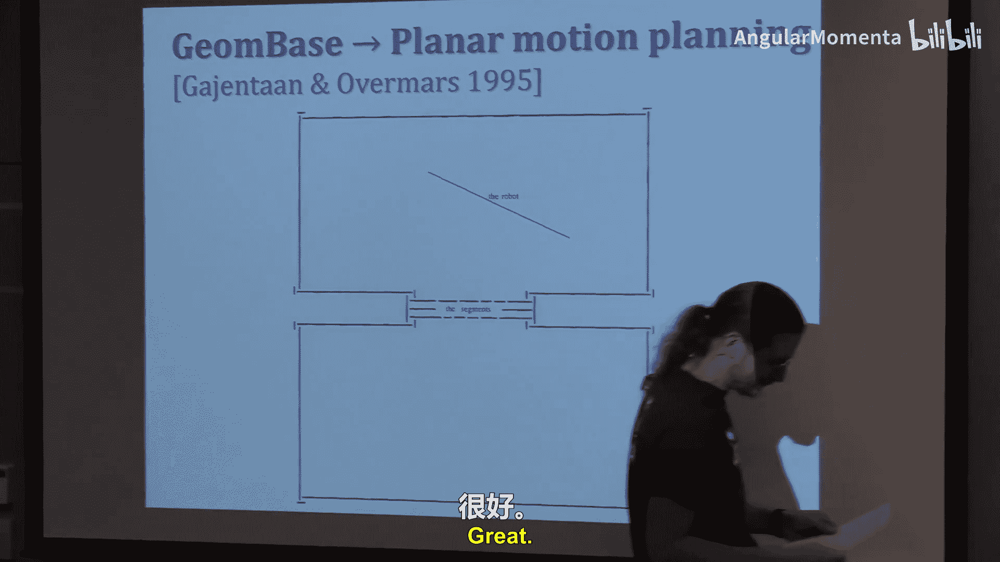
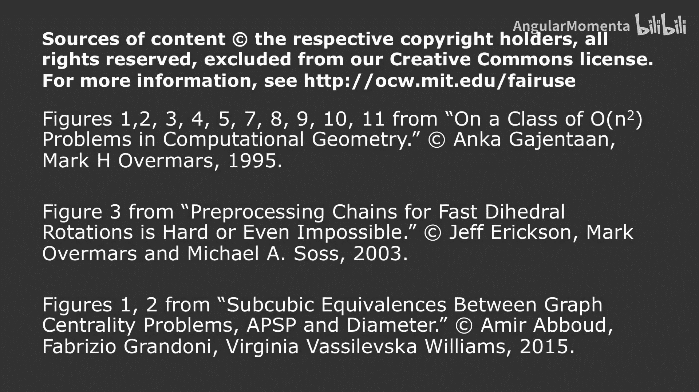

# 【麻省理工】算法下界 ｜ MIT 6.890 Algorithmic Lower Bounds, Fall 2014 p21 21. 3SUM与APSP问题复杂度 -BV1dPYpz9E4V_p21-

The following content is provided under a Cative Commons license。

 Your support will help Mi T OpenCourseware continue to offer high quality educational resources for free to make a donation or to view additional materials from hundreds of Mit courses。

 Visit Mitopcourseseware at Ocw。mt。 Eduu。

Alright， so today we're going to think about the even well。

 also the low end of the polynomial hierarchy。 So most of this class is about polynomial versus not polynomial and various notions of hardness。

 andp hardness and worse。 We look briefly at peak completeness， which is about parallel computing。

 today， we're going to be thinking about regular good old sequential computing。

 but trying to distinguish linear time versus non nonlinearar time。 And in particular。

 trying to find problems that are quadratic or cubic in n for sequential running times。

 And probably the most popular attack on this is called3 sum。Which is following。Problem you're given。

And integers。Let's say， and you want to know， do any three of them sum to zero。So of course。

 you can solve this in cubic time by testing all triples， whether they sum to zero。

 but you can also solve it in quadratic time。嗯。So it's not an algorithms class。

 I won't ask you to come up with the algorithm， but they're quite， quite easy。 first。

 order n squared， randomized。Is really easy。 You take all pair wise sums。 So first of all。

 you build a dictionary， a hash table of all the integers。 and then you。

Look at all pair Y sums for each pair Y sum。 you see whether the negation is in the hash table in constant time。

 So that gives you n squared randomized because if you know a。

Plus b plus c equals0 is the same thing as a plus b equal minus c。 So you look at all pairwise sums。

 see whether the neation is in the list of integers。Okay。

 you can also do order n squared deterministic。This is。A more fun puzzle。

But I'll split the answer for you just to give you intuition for why this problem is n squared。

For every possible target sum minus c， so if that's going to happen n times。

 I'm going to run the following linear time algorithm。Which is I start。

 So this is just two copies of the integers in sorted order。 I have n log n time to sort。

 So that's no problem。 I'm going to start from with my left finger here or my right finger here。

And look at the sum of those two numbers。 If it's too big。

 I have a particular target negative C in mind。 if the sum of these two numbers is smaller than negative C。

 then I'm going to advance this one because if this is in sorted order， that will make my sum larger。

 If the sum is too big， I will advance this one backwards。So in general。

 I have my right finger advancing left or my left finger advancing right in each step。

 one of the two advances， and this will not miss this will tell you whether that target sum is among the pairwise sums from this thing in linear time we have to do that n times once for each target sum。

 so that's the fancy quadratic algorithm。No fancy data structures required。Cool。

 so3 sum is quadratic， and the big conjecture is that you can't solve it any faster， well。You can。

 So its， it's not quite the conjecture。 The conjecture is that there is no。And to the2 minus epsilon。

Alberta。In general， in the worst case， let me tell you before we get to。

 and this has led to a whole world of lower bounds of three sum hardness。

 if your problem is three some hard， then you expect it also has no n to the2 minus epsilon algorithm because if it did three sum would and people generally believe that's the case for three sum。

But there are some exceptions。 So one。Thing is that the numbers have to be fairly large。

If all of the integers are in the range， let's say minus u to u。

That's the universe size then via FFT you can solve the problem in U log U time plus linear time。

 so your numbers better be at least larger than n squared and in fact we'll see n cube suffices。

 so they don't have to be huge， but they do have to be bigger than linear or quadratic。嗯。

More generally。There are a bunch of sub quadratic， but only slightly sub quadratic algorithms。

The first one。Achievees roughly log squared savings。

 although a little bit less is a log log squared in the denominator， this is a randomized algorithm。

In a model of computation called the word Ram。So。If you're interested in the word RA。

 you should take advanced data structures， but basically you can manipulate。

 let's say log n bit words in constant time， you can add them together multiply them。

 that sort of thing。And you assume that the numbers you're dealing with fit in a word because if you're going to compare them。

 you'd also need that assumption。That's a reasonable model。

 and it essentially affords a kind of logarithmic amount of parallelism。

 and so because it's a quadratic problem， roughly speaking。

 you get a quadratic amount in the parallelism of the model。So it's a little bit improved is by。

To former MIT students， Elot Barron and Miha Patrascu and myself。And。Very recently， this year。

 there's been another nice improvement。It's actually three algorithms， depending on your model。

But all based on a similar idea。Ohoops， do I get these backwards。I think so。So first。

 these two results， so these are results by Grland and Pety Sath Pety。

 you gave a talk here about it recently in a real ra model of computation。

 This is a weaker model of computation So the result is stronger in a real RA you're still you still assume that the numbers you're given。

 you can add them I think actually all you needs is the ability to add them and compare them。

 maybe subtract also subtract but no multiplication is really useful in that particular model because you can't extract bits out of the thing。

 So you don't assume that their integers。 you just treat them as real numbers and all you know how to do is add a bunch of them and compare those additions。

So that's a weaker model of computation and still are able to get a roughly logarithmic improvement。

 not quite as strong as the quadratic and log， but one advance is that this is the first deterministic algorithm to be n squared。

So randomization isn't necessary to achieve that， though there's is two/ thirds power。啊。

But the other advance is that you don't need to manipulate the individual bits。

 So even in the randomized model， that that's nice。And then， the major thing。

And sort of the first thing to call into question the3 sum conjecture。Which is that conjecture。Is。

 I wouldn't really call this an algorithm， but it's a thing。Which runs and roughly enter the 1。

5 time。But here it's a more powerful model， a super powerful model called a decision tree model。

 where the idea is that an algorithm is specified by an entire tree。

 the depth of the tree is this big each note of the tree says add you these five things compare them to these five things and see which is bigger and then branch。

 there's the left branch and the right tree， if you've ever seen comparison tree， same thing。

 but the comparisons are more interesting。啊。But this is not an algorithm because we don't know how to compute that tree efficiently。

 We can compute it in probably polynomial time， but definitely not。

 We don't know how to compute it in sub quadratic time or sub this time。So it's a。

 it's kind of a frustrating situation because we know that。This thing is sort of out there。

 But actually finding it is hard。 And there are actually several problems in computer science since the 80s。

 I think， where we know better decision trees than we know algorithms。 So my sense would be that。

The decision tree model is strictly more powerful。 The three sum conjecture is true for regular algorithms as if you define it this way or this way。

 But in the decision tree model， obviously， you can do a lot better question What's reasons like the model like。

Some bit that we like run a polymer time algorithm and like look at the bit and tells us the incident。

 Oh you mean like why why believe that decision trees are like？MoOh， no， you shouldn't。

Decision tree is not a model you should consider a reasonable computer。

 but it's interesting in that it suggests， you know。

 it gives you this tantalizing feeling that maybe you could turn this into a real algorithm that you could run on a computer。

 But definitely， yeah， you cannot。 if you don't know what the decision tree is。

 you can't run it on a computer directly。 So it's not。A model of computation in a strict sense。

 It's especially interest。 I mean， it's always important to see how the model of computation relates to the bounds。

 particularly if you're going to try to prove a lower bound。

 There are some lower bounds of n squared in restricted forms of the decision tree model。

 This says you can't extend those lower bounds to arbitrary decision trees。

 Decion trees are traditionally used as a lower bound model。 If you can prove a lower bound there。

 because it's a very powerful model。 That implies lower bounds in something like the real Ram。

 So that's why people care in some sense。 This says you can't prove a strong lower bound in that model。

 which is annoying。 Another question，I'm pretty sure in this model。

 you have a constant number of original integers。 You add them together and compare them to a constant number of original integers。

 does it depend the tree， of course， has exponential size。

 So you never would actually want to compute it explicitly。

 what you want to compute is after I've done some number of things。

 What's the next operation that have the Oh， yeah， N， right， the decision tree only depends on N。

Yeah。I mean， in some sense， the decision tree is encoding an adaptive algorithm that depending on the results of previous comparisons。

 tells you what to do next。If you think of it as the entire tree， then it's only depending on it。Yep。

But because it's so big。I mean， that doesn't help us。 You could imagine pre computing for n。

 but there's no way to store it or， and you couldn't really afford that exponential time。Okay。

 so that's a short story about the known upper bounds and also the known lower bounds on three sum。

 There are some weak lower bounds in a particular version of the decision tree model。

 when you can only compare。诶。Think sums of two items。Then you can get an n squared lower bound。

 but that's not especially interesting given this result。Any more。Let me tell you briefly about KM。

Which is the obvious generalization。Oh。Instead of three， do any K of them sum to 0 here。

 they're actually stronger or lower bounds。3 sum is the most popular thing considered for proving quadratic lower bounds because a lot of problems we care about are linear or quadratic。

 So3 sum gets a lot of the attention。 K sum is a little easier to argue about in particular。

 it's NP hard in general， right this in particular encodes something like partition。

If you you have n integers and their overall sum is0 and you want to know whether any n over two of them sum to0。

 or something like that would be roughly partition， so this is NP hard。

So definitely it's got to get hard for some， k？And in fact， you can show fixed parameter hardness。

 W1 hardness with respect to K。So in particular， if you assume the exponential time hypothesis。

 then you can get some lower bounds and the best lower bound known so far。

Is that there's no n to the little of K。Algorithm。Assuming regular E TH for this。

 we need to assume that K is less than equal to。Is not too giant。嗯。Cause I guess if K equals n。

 for example， this problem is really easy。 So I have to can't go all the way。 So this says， well。

 maybe we don't get the constant right， but there's some kind of n to the roughly K dependence。So。

You know， there's a reason that there's a number here larger than one。

 although we don't know how to prove that， the feeling is3 sum。

 K sum they require roughly n to some constant times K。 You could debate about what the constant is。

 but we have this theorem and。On the upper bound side。And what people believe is the right answer。

Is K over2 ceiling。At least randomized， if you want deterministic， you might get a log factor。

But you can definitely achieve this by the same kind of do all K over 2 y sums twice。

 and then look for collisions in a hash table。So the ceiling is what's making three sum into a quadratic thing。

But for some， it's just as easy as three sum。Because you can still solve it in quadratic time。Okay。

 but five sum conjecture is that requires N cube time。 this is an upper bound。Is known。 Yeah。

 and then the conjecture。Is that that's tight there's no。

And to the ceiling K over 2 minus epsilon algorithm。That's what we don't know。But yeah。

 algorithm is easy。So that's K sum。 and this gives you some more intuition for why you should expect these problems are hard in particular。

 if you could prove K sum requires， if you could prove this conjecture。

 you prove the exponential time hypothesis and so you prove P does not equal MP and you make a million dollars and lots of good things happen。

 So we should try to do this。Of course， as I mentioned。

3 sum is the one we use the most in this world because for NP hard problems。

 usually we use NP hardness and all the stuff we did。 You could use K sum。

 but that's basically partition。And。And。but this is sort of motivation for why you should think3 sum is hard。

 Ill leave it at that。So let me talk about threesome hardness。

So I'm going to call a problem three some hard if。If that algorithm has an end to the two minus epsilon。

Time algorithm。Then so doess three sum。Okay， this is what we want。 wantan。

 if I say a problem is three some hard， it means it shouldn't be solvable unless less in quadratic time。

Other than this polylo stuff。So this is the formal meaning， you can solve it in sub quadratic。

Truly sub quadratic time。 This is often called the minus epsilon。

 Then three sum can be solved in truly sub quadratic time， contradicting the three sum conjecture。

So if you believe this3 sum conjecture it means this is not possible for your problem。

And the way we're gonna do that， usually， is with。A3 sum reduction。There are other ways to do it。

 You don't have to follow this particular style of reduction， but most of them do。呃。

So it's going to be a multi call reduction， but we have to。In this world。

 we have to be careful about polynomial factors。 We don't want to call your thing n times and say that was a legitimate reduction。

 So we'll say you can call if you're reducing from A to B。

Then that means you can solve B using A and you're going to make a constant number of calls to A。

Sorry， other way around。It means I can solve a using B， usually we take an instance here。

 reduce it to an instance here， that's okay， but because we're going to want to solve not just decision problems。

 we're going to say okay， you take your instance of A。

 you can call an oracle for solving B a constant number of times as long as the thing you call it with is also not much bigger。

😊，So the n prime that you call this thing with should be linear and n。Because and the running time。

Of the reduction。Should be sub quadratic。Okay， prettyty much all reductions。 It's like n n log n。

 maybe n log squared n， but it should be strictly less than n squared。 Otherwise。

 the reduction doesn't tell you much。About whether the problem is quadratic or not。So。

With this much running time， plausibly， you could construct a larger instance。

 but this constraint says the thing you the instance of B that you call should be linear in size so that quadratic over here is the same thing as quadratic over here。

Okay， so those are the rules of the game。 We're not going to have to worry about these constraints too much。

 Most of our reductions are constant factor blow up and。Run in a reasonable amount of time。

 but we've got to be a little careful here to make sure that running time is not huge。

 usually we're allowed polynomial time。Okay， so if you have a three sum reduction from A to B。

And you know， A is three some hard， then B is three some hard。我可以。

N prime is the size of the thing that you're the instance you're calling with。

 So if you have an instance x over here， you have some x prime over here。

 and N prime is the size of x prime。 There's a constant number of them。

 but I want all of those instances to be linear size。Okay， so initially， a is going to be 3 sum。

3 sum is 3 sum hard。 if it has a sub quadratic algorithm， then so does itself。

 And so that's actually easy and， and be hardness。 That's not so easy。 But and now we're gonna。

 if we， but be be some other problem， then we'll prove hardness。 in this world。

 because we don't have any。😊，You know， solid lower bounds to work from。

 It's also interesting to go in both directions。 I'm not going to define a notion of completeness here just' because it hasn't been done。

 but you could define three sum completeness to mean you can reduce from3 sum and you can reduce to3 sum。

We'll see a few problems in that， usually people call that equivalence。Sub quadratic equivalence。

Okay， so let me start with some base three， some hard problems to start from。This all。

 a lot of this comes from a paper。This paper。By Guantan and Overmars， 1995。

 and they had been collecting over the years a whole bunch of mostly computational geometry problems。

 which are three sum hard in that you can reduce3 sum to all of them。

But in the center here is a bunch of core problems， 3 sum， 3 sum prime。

 which I would call ABC version of 3 sum， we've seen a few ABC problems in the past and a geometric version of 3 sum so let me tell you about those first of all3 sum is 3 sum hard。

 even when U is order n cubed。So that's nice to know the integers you're working with don't have to be giant。

This is based on a hashing argument， which we won't go into。Okay， so what is prime sum prime？

You're given。呃。Three sets of integers， ABC。Yeah。Let's say we're only using deterministic reductions。

 So randomized would also be interesting， you just have to weaken this statement。

 But here I'll say deterministic。 Yeah， I'm pretty sure you can deranize that hashing scheme。Yeah。

Pre I need to double check。 but yeah， that's the claim。Yeah， that is a good question。

So this is the ABC version of3 sum。We just want the three items to come from three particular sets and traditionally this one is phrased as a plus b equals C。

 although you could also say a plus b plus c equals0。

 it's the same thing you're just negating all the Cs and in this world because you know you have one item from each set that's actually it's really easy to just negate one subset of them。

So it doesn't matter whether you put a minus sign here or not， but I will not。

 because that's how3 sum prime is usually defined。So I claim three sum prime is three sum hard。

 Why I let。Capital A， if I'm given a three sum instance， let's call it S。 S is a set of n integers。

 I'm gonna let A equal S。 I'm gonna let B equal S。 I'm gonna let C equal negative S。Don。Okay。

 so that's a reduction from3 sum。ち。呃。Like if zero is in your list。

 the way the instance that you constructed it， you might choose some element X of the list from a。

 the same element X。From B and then y from C， and x plus x I guess， plus y might equal 0。

Whereas in the original list， you didn't have x twice。呃。

I was just getting the example of choosing zero three times as a convenient example。呃。

So that you can also detect in linear time。You can detect whether there are any such triples if you allow repetition。

Then you answer the question， right， your goal is to solve three sum So if you can solve three sum ahead of time。

 you're done。In linear time， you can check whether there are any pairs that allow with some duplication。

 a solution to3 sum instance。 so this is not addressed in the paper。

 which makes me think that this definition of three in this definition of three sum。

 we allow the items to we basically every item could be used three times up to three times。

 There's no requirement that they're distinct items。 So then this reduction is fine。

 I don't think that's a big deal。 and you can get rid of it， but。

That must be how it's normally defined。 I didn't specify whether it was。3 distinct items。

 But let's allow multiplicity there。 And then this reduction is fine。

Because that's what the paper does。Okay， with more effort， like adding big integers and so on。

 you can reduce in the other direction， reduce from3 sum prime to3 sum。呃。

I won't cover that because I just want to prove through some hardness about things。 But in fact。

 all these three problems are identical to each other。

 any one of them is subchodratic than they all are。

So that's nice because3 sum prime is really a special case to3 sum。Okay。

So next problem is the geometric problem。They call it geometric base problem。

So here we're in 2D and we're given endpoint。Whose y coordinates are all0，1 or two？

Imagine why there's three less。And so they all live on three horizontal lines。01 and2。Points。

And we want to know， is there？A non horizontal line。That passes through。Three points。Like this。Okay。

 so a claim。Gm B is threesome hard。And this is their proof。On the first line。

 we put A on the last line， we put B and in the middle line， we put every item in C divided by2。Okay。

 so if you look at。sorryrry， and this is a reduction from 3 sum prime。Right。

 so I have three integers I want to know whether you can ever get a plus B equals C。

So the idea is if I have two items A and B。啊。Then this point， I mean。

 if I just draw the line and intersect it with the y equals1 line。

 that point will be the average of little A and little B， so a plus B over 2。

 and so if there's an item C that matches A plus B， then the C over 2 will equal to A plus B over 2。

So there's going to be a line through three points if and only if through sum prime had a yes answer。

Okay， and you can reverse， you can reduce in the reverse direction。呃。In fact， just like this。

 you just multiply all these coordinates by two。 that gives you C。Alright。

So those are our starting points and we're going to use all of them。

 and I'm just going to run through a bunch of examples of three sum hard problems。

 so all of them shouldn't have subchodratic time algorithms unless three sum does。So。

The obvious starting point。Here is what's called degeneracy testing in computational geometry。

So usually， we like to assume you have endpoints in the plane there in general position。

 meaning no three are colonlinear。So the problem is given endpoints， are any three of them colonline。

Question Oh， integers and rational， same thing。 you just scale up。multily。 So everything here。

 I'm gonna，cause we're gonna go into geometry。 I will use rationals quite a bit。Yeah。

 so I can multiply everything by  two。To make it integers again。

But this problem does not say integers。 So that's why I'm allowed to do that。 I start with integers。

 and then I do this。But you could also add integers here it wouldn't make a big difference。Okay， so。

Given。And points in the plane。Or any three Kiline， this I'm guessing is the original motivation for defining3 sum。

This is really a harder version of the problem。 this is kind of a special case， but in particular。

It's not exactly the same because we forbid horizontal lines right we had to construct a very degenerate instance with lots of points on horizontal lines in order for this correspondence to work so the question is can you make something that is only degenerate。

 only has three points Collinear when the three sum instance has a solution。And。

This reduction is a little unsatisfying， and I don't have a great intuition for it。

 But it's very simple。 We're gonna take。This is going to be a reduction from。Regular old3 sum。

 not3 sum prime。So every number x， we're going to map to the point x comma x x cubed。Okay。

 cube because it's odd and not one， Basically。 And so we take up our。

X values and probably not a good idea to put zero in there， but whatever。

 And we just you know project them onto this x cubed curve。 x3 is odd。

 so it has this nice kind of picture and the claim is if you take any two points here。

 So here is an x coordinate one quarter and three4。 Of course they would actually be integers。

 but that's okay。 you can scale。 then。If you， so the sum of those is one。

 and if you look at my negative one， that will there you know。The cube of negative one， which is one。

 is exactly equal to where these two cube points would hit if you extended the line。Yeah。

 and now we have the problem that。If you want to use the version of threesome here。

 the three points have to be different。Yep， so we definitely need that those guys are distinct。

 I'm sure that those two versions of three sum are equivalent up to sub quadratic reductions。

 but I don't see how to prove it offhand。Okay， cool。 Now， why is this true， I， I checked it。

 It's true。 You can half a page of algebra and prove it。 I don't have a great intuition for that。

 Why this is true。 But there you go。😊，It's easy enough to check where this line should go。

 And it happens to go exactly to the place where the sum goes。Sorry。

I'm guessing it would also work for X to the fifth， but I didn't check that。Okay， so。

So thats three points on a line。Okay， so。Important life lesson about geometry is something called duality。

 So here we're interested whether there was one line that goes through three points。

 A complementary problem is， I give you a bunch of lines。

 Do any three of them pass through a common point。 Is there one intersection between three or more lines。

Okay， that is there a point that is on three lines。 If you know projective geometry。

 this is totally obvious is the same problem as this。 you just apply duality。

Now there are many different dualities I'll give you two today。 first。

 my favorite is projective duality。And the sort of the。The most standard， at least in math。

 if you have a point with x coordinate A and y coordinate B， you map that to the line Ax plus B。

y plus 1 equals 0。And vice versa。So if I have a line。Almost every line can be written this way。

 Every line that does not go through the origin can be written like this。

 and then you can convert it into a corresponding point。 So if you give me a bunch of lines。

 just translate so that none of them go through the origin。

And then convert into a corresponding set of points。

 And I sing about this duality is it preserves incidents。Meaning， if before I apply dual reality。

I have a point and a line that are touching， then after I apply duality。

 I will have a line and a point that are touching。So。That's great because in particular。

 the three way intersection or you know， a point that is on three lines will convert into a line that goes through three points。

 And so we get a reduction from here to here。That's kind of like magic。

 but it works essentially because， well， these， if you think of a line over here as just a pair of coordinates。

 usually written A B， then we're just taking essentially a dot product between those two things as a plus one。

 but doesn't matter which one was the point and which one was the line。

So that's very convenient and you can use that to convert a lot of line problems into point problems。

嗯。1， I won't mention K sum very much， but obviously。

 the D dimensional versions here are D plus1 sum hard。 So that's the。

These are sort of the more geometric versions of KO。Okay， so。Let's do some more problems。

Next one's called separator。So let's say we're given n line segments in the plane。Is there a line？

That separates them。Into any two non empty groups。And that line is not allowed to intersect any of the segments。

Okay， so youre not allowed to split a line， a segment into two parts。

 You just wanna partition the line segments into。A left chunk and a right chunk。嗯。

So there's actually two versions of this problem。 The first version allows in half infinite rays as segments。

 and then you can assume that all the segments are horizontal。

So I think that pretty clearly expresses it。 But we can in particular think that we are reducing from geometrymbase。

 right， We had this setup。We have points on three lines， we want to know whether there's a line。

It passes through them。 So I'm just going to take the complement essentially of those lines。

 omit tiny intervals wherever I had points before。 And now there will be a separating line。

 if and only if the original points had a line through them。Okay， if you make these tiny enough。

 you won't be able to do anything else， whoops， yeah， I def right。

 the way you could just split them into third， two thirds。 Yeah。

 I definitely need here that it's a non horizontal line。Thanks。Now。

 this requires having these half infinite rays。 Otherwise you could always， you could。

Make a line like this。 So you're not allowed to do that If these goes off to infinity。

 then you'd be cutting those rays。Okay， so maybe you consider that reasonable。

 Maybe not Depend on the application。 If you don't consider half infinite things reasonable。

 you can replace them with some vertical segments。 You build this little box。Essentially。

 a box like a pinwheel pattern。 So there's no way to cut it up except to go through the center。

So two versions， version 1， we allow half infinite things and every segment is horizontal。 version 2。

 horizontal and vertical segments all finite at length。

We'll use this version to reduce from a bunch of times， or we will follow this kind of reduction。

Essentially。Okay， next problem。Okay， next problem is called Strps cover box。

I like these names and problems， they're pretty clear。U。In fact， there's so。

 so clear here's a figure。 You have a box， which means axis aligned rectangle。 and I have strips。

 Strs are， I take two parallel lines， and I take the lines in between them。

 right All these parallel lines between here and here。 That's a strip。 So I'm given and strips。

 I'm given a box。 I want to know whether there's an empty part or whether it covers。😊。

Are you all them angles or just strips。 Oh， yeah， the， sorry， the angle， the strips are placed。

 I give you two lines for each strip。 And I mean， the region in between them。They're， they're on。

 they're on the plane。 You can't slide them around。 That would be a different。

 That would be a coverage problem。 It's it's pretty easy。

 I just wanna compute whether there's any point in here that is not hit by any of the given strips。

 yeah。Okay， so I should mention all of these problems。

 except where I say otherwise can be solved in quadratic time。

And so this is showing that that's essentially tight。

 so you can solve this problem by computing the arrangement of these lines in quadratic time and checking all the cells。

 whether they are in all the strips。 So that's not hard。

 but claim is you can't do any better than n squared if you believe the3 sum conjecture。Okay。

And the reduction is essentially this， but I'm going to modify it a little bit。诶。Yeah。

So remember this I rotated this 90 degrees for a reason because I want to use a particular kind of duality。

 the construction is going to be the dual of this， but remember I want here the goal is to find a line that does not hit any of these segments。

So here's and the segments are vertical or and they might be infinite half infinite race。Okay。

 so I'm going to start from that and then I'm going to dualize。Using a different dualization。

 this is probably the most popular one in computational geometry。

I think because everyone remembers y equals mx plus B。

 and so there's the obvious conversion between a point which has B and M to a line。

 which is Mx plus B。You could argue about which is which， but I think this is the more common。

 so what this means is。You， I start with a point。The y coordinate determines the slope of my line。

 and the x coordinate determines the y intercept of my line， that's B。And。

You can also convert in the other direction。 I don't think we'll need to here。

 And that will work for all non vertical lines。 This will not represent vertical lines in case you're curious if you want vertical lines here。

 or if you want。Lines going through the origin here。 You need points of infinity。

 That's the projective thing。 But we don't need that here。

Because we're just going to take these points。And convert each of them to corresponding lines。

 So this is a segment。 I'm going to get an infinite number of points。 Oh sorry。

 there's infinite number of points here。 So I'm going to convert into an infinite number of lines。

 That's actually okay because these points all have the same。诶。Sorry， opposite。

I really want the x coordinate to be M and y coordinate to be B for this picture to be the right picture。

 So all of these points have the same x coordinate， so they all have when I convert them into lines。

 they will all have the same slope and they'll also be right next to each other。😊，Namely。

 they will be strip。Is that cool。So when you do this stization， a vertical segment becomes a strip。

I think the fancy word would be here you have a pencil of points and you convert that into a pencil of parallel lines。

 The pencil of parallel lines is a strip。Now， a pencil just means like a continuous family。Now here。

These guys are infinite， so it's going to be a strip that goes off to infinity on one end。

 that's a half plane。So if we have array。Vertical ray that's going to convert into。Half plane。

 so that's the half planes aren't allowed， So we're going to have to do something with them。

 but there's only six of them， three down here， three up here。Okay。

 and we also haven't defined what our target rectangle is。But at this point。

 what we would like to say。So let's see what would it correspond to？A line here。

 noticeice the line will never be vertical。 What， what would be a line that happens not to hit any of these things in the duel。

 that line maps to a point。 And so that's saying that there is a point that is not covered by any of these strips or half planes。

So we want to know whether the union of these things is the entire plane。

So it's not quite the problem we want to reduce to， but it's not hard to fix it。

We essentially just need to take a really big rectangle。

 and then there will be an empty point in there if and only if there was a line in this problem。Okay。

 how big is rectangle have to be？ Well， conveniently。

 these half planes essentially narrows down to a hexagon。Ca you have six of them。

It might be less than a hexagon draw six， and we're saying know all of this stuff is covered。

All the things outside the hexagon are covered by those half plane。 So really。

 it's just a matter whether this has any empty points。 So take the bounding box of that hexagon。

 That's my box。A box。And now I don't have to worry about the hexagon， the。The half planes anymore。

I can restrict them。I should really use the color。I can just say， oh， well， now this is a strip。

Which covers， you know， in particular， I need to cover this part of the rectangle。

 I no longer need to go off to infinity。 So now I have a bunch of finite strips and a finite box。

 And it's just a matter whether that thing has any empty parts。 Yeah。Yeah。

 there would be an empty point， if and only if the original thing had a yes answer。Yeah。

 so they will cover if and only if you do not， if you have a no answer。Other questions。 Yeah。Yeah。

 right。 So what they say is this a reduction from geometrybase mimicking the proof of separator 1。

Yeah， theyre as I don't have a name for it， sorry。Yeah。

Projective dual functional described there also preservance。Yes。

 this duality also preserves incidents。I think it's a slightly perturbed version of the regular projected duality。

 It is also a projected duality， in a sense。But with an extra。

Moious transformations right in or something。But those also preserve incidents。Yeah。

 we obviously need that。O。So to make this a little more usable， I mean， strips can be nice。

 We'll use it in some situations， but geometers tend to like to think about triangles。

So we can also convert this into whether a bunch of triangles cover a given triangle。呃。Basically。

 so here we are going to reduce from strips covering a box， we start with the box。

And we're going to convert that。We'll draw on top of it。 So it's a little clear。

 I'm going to take a really big triangle。Which contains。That box。But then I'm going to add。

 and then will'll triangulate the exterior。Here。And add those triangles to my covering collection。

 So all of this stuff is covered for free。And so now what remains in order to cover this triangle。

 I just need to cover this box。Okay， so that's one part of it。

 And then the other thing is that we're given strips。 So if I have a strip， actually。

 do I have a figure for this no。If I have a strip in the original problem。

 which looks something like this。I really only care about the portion of the strip that hits the box。

Here， so I will just triangulate that part and say those triangles are in my set。Okay。

And then those triangles are going cover this triangle。

 The red triangles will cover the red triangle。 Big red triangle。

 if and only if the white strips cover the white rectangle。Pretty easy。

 All we need is that these have constant complexity。

 so we're not blowing up by more than a constant factor。Note here。

 all of the smaller triangles are contained inside the big triangle。

So you can even assume that these guys are contained in this guy， we'll use that at some point。Okay。

Possibly very soon。😔，So。problemble。Whole in union。 I give you a bunch of triangles。

 I take their union。 I w to know whether that's a simply connected polygon or whether it has a hole in the center。

哦。Almost the same as this problem。 I do have to do a little bit of work because maybe you actually pretty much that reduction will work fine as long as the outer triangle is strictly bigger than the strip。

 then I'll always have these outer red things， which make a region。

 and then there'll be a hole in there if and only if the rectangle is not fully covered。

 So I just need to enlarge that outer triangle slightly。

 then I have proof that this is three somewhere。Done。

Here we're also using that the red triangles are contained inside the big red triangle。

We don't go outside and possibly make a hole in some other way。Okay， another easy one。

Triangle measure。I give you a bunch of triangles， what is the area of their union？Well。

 it's gonna be the area of the big triangle。 if and only if the big triangles covered。

 So this is a reduction from triangle covers triangle。Okay， easy。Here's somewhat different problem。

Point covering。嗯。So here I am given a bunch of half planes。I of them。I want to know is there？

A K way intersection。You can think of this as a version of two dimensional linear programming。

 so this is all in 2D。You're given a bunch of linear inequalities， which are half planes。

 You want to know， not can I satisfy all of them， maybe that's not possible。

 but can I satisfy at least K of them。 So this is for approximating linear programming。

 There are a lot of algorithms for doing that。 You can do this in quadratic time。

 But the claim is you can't do it better， unless if you believe the threesome conjecture。Okay， so。

This is。Okay don't have a figure no。So we're going to reduce from strippss cover box。

So we're given a bunch this figure again， we're given a bunch of strips， we're given a rectangle。

 we want to convert that， whether the whole thing intersects to whether there's a Kway intersection between infinite strips on one side。

 half plants。Okay。So here's what I'm going to do if I have a strip。

I should maybe really draw it this way， whatever， a bunch of parallel lines， finite segment of them。

 but the lines are infinite in this this direction and this direction。I'm going to convert that。

Into the complement。ACom trick here， so we have a half plan over here。

And we have a half plane over here。Obviously， you cannot be in both of these at once because they're disjoint。

 So the best you can hope for is to be in one of them。Which means you are not here。And remember。

 the whole question here is whether there is a point that is not in any of the strips。

 So you're going to get。1。Point， you're going get a score of one。 If you're here or here。

 you're going get a score of0 locally if you're in the region that's that's already covered。Okay。

 now we also need to represent the rectangle in some way。So， if I'm given。A box。Draw this line。

 this line， this line， and this line and the half plans I want are the ones that contain the rectangle。

So the idea is you're going to get four bonus points if you're in the rectangle。

So and now the question is I'm going to set k to be n plus 4。 I want to know。

 are there any points that are in n plus4 of the half planes to do that。

 you'd have to be in all four of these In other words。

 in the box and in one of these for every strip because you can't be in both。

It'sJust to achieve that score of n plus4， so that means you're exterior to all the strips。

 but inside the rectangle， so it's the same problem。Cool。All right。Next problem。

It's a visibility problem。It's got a couple of visibility problems。

Both of these problems are about something called weak visibility。If you have two geometric objects。

 A and B， they are strongly visible to each other if every point over here can see every point over here。

Meaning。呃。C means you don't。 The visibility line doesn't cross anything else。

But what we're talking about here is weak visibility， which says there's some point over here。

 which can see some point over here。So I want to know， say given two segments。

 whether there's some point here， some point here where if I draw the connecting visibility line。

 there's no other segment blocking it。So this is A and this is B。

 this would be an example where A and B， they do weekly see each other because there's that。Okay。

So given in segments， you can construct what's called the visibility graph。

 which is all of these things in quadratic time。 if I want to know whether this segment can see another segment in this week's sense。

 that's threesome hard。Here's the proof。Yeah。Take exactly the same thing。 Just add two segments。

 This segment can see that segment， if and only if there is a line， okay。😊。

This is there's so many fun little things you can do。

 But these are problems that a lot of people have thought about。 And theyre always wondering。

 can we do better than quadratic Now， we know they're all sort of in the same bucket more or less。😊。

Okay， here's another problem。Okay。So the problem is I give you a bunch of triangles in 3D。

And let's see。嗯。And maybe I give you a point up here。

 and I want to know whether that point can weekly see a given triangle。And here。

 all the triangles are horizontal。 make it nice and simple， and it is possible to solve this。

 I think in n squared log n time， maybe n squared time， you can construct the visibility graph here。

And n squared。Because they're all horizontal。I want to know So givenbb's point。 I want to know。

 can it see any of T or is it completely blocked by these triangles， Sound familiar。

If we put that point way up near or at infinity， depending on what you allow me。

 near infinity will be enough， this will essentially be orthographic projection of these triangles onto this triangle。

 It's a question of whether these triangles cover this triangle。

So this is a reduction from triangle's cover triangle to visible triangle。Pretty easy。

 Just put all these guys really close， slightly different Z coordinate。

 so they're not overlapping and put the point far away。So visible triangle is through some heart。

All right， let's do some motion planning， robot motion planning。First in 2D。

So planar motion planning。I give you a segment that's the robot。And I have。

 so this is the special ones， the robot， then I have various obstacles。

 which the robot is not allowed to penetrate。 I give you a starting position for the robot and I give you a target position for the robot and want to know。

 can I go from here to here by some motion， a motion you allow rotations and translations。

So can I slide this robot somehow through this obstacle course， maybe here， do some parallel parking。

 whatever you can do lots of tricks to get from A to B。 This problem can be solved in quadratic time。

 Most 2D motion planning problems with， with just rotation and translation can be solved in in n square time。

Yeah。And that's tight。Because of this。Yeah。We build these frames。

 which are large enough that it doesn't constrain the robot。

 Robbo's big enough that it's gonna have to simultaneously pierce all three lines here。

 and we're done。Okay。Great。

All this buildup for。Very simple proofs。 Cool， one more。that one actually about garlic。Yeah呃。

You can solve this in quadratic time。Cubic is obvious。 there are three degrees of freedom。

 but I think in fact， quadratic time。That's， that's the claim of the paper I haven't。

Studied motion planning algorithms for a while。 so I I don't know exactly how it goes。But in general。

 constant dimensional motion planning with constant numbers of objects can be solved in polynomial time。

But yeah， youve can a debate about the constants。Okay。Which do matter here。

 But I think claim is tightness for that one。Here's another one which can be solved in their claim。

 here， they say n squared log n， so。Though it's， they say we can probably get n squared。

 but n squared log n is enough。 It's a particular version of 3D motion planning。So we are given a。

Vertical segment， that's our robot。We're going to have triangles。

 those are our obstacles because the triangles we can make polyhedra。 In this case。

 all the triangles will lie horizontal in horizontal planes and the segment position will be vertical。

 and here you're only allowed translation。The translation and rotation， you could also do this。

 but they restrict a translation only because there they can get an almost quadratic time algorithm with rotation。

 you have to add a couple of factors of n probably， but this version they can solve in squared log n。

And it's three some hard。By a similar kind of structure to the triangles covering triangle。Namely。

 we build this cage， the triangles aren't shaded in。

 but there's basically a triangle of triangles here and a bunch of them。

 the segment is a unit length。 and so there's know this many subdivide the space。

 they call this a cage， all of these triangles live in horizontal planes。

 but there's no way for this vertical robot with translation only to get out。It's too long。

And so the starting configuration is going to be up here。 The destination is going to be down here。

 And in the middle triangle here， we're going to put a whole bunch of triangles like this。

 So just squish this down， put them all in here。 and then you're going to be able to penetrate if only if there's a blank spot。

Then。Okay。And of this paper， I think we covered almost all of these proofs。

 we started with the base problems，3 sum，3 sum prime gm base， two versions of separator。

 which we weren't directly reducing from but we mimicked a zillion times we had the degeneracy over here。

 strips covering a box triangles covering a triangle hole in the union invisible triangle。

 Those are actually all identical to each other。 you can reduce in all directions。

 we talked about point， this was the linear programming， planar motion planning。

 3D motion planning happened to reduce from here instead of there and visibility。Cool。

A lot of fun little reductions。 And it gives you a flavor for n squared hard issue problems。

I think all the reverse directions are open。 I mean， you have to check all the papers since its 1995。

 but definitely in that paper， they're open。 and I haven't heard of any。

There isn't a ton of work in going the other direction， but it would definitely be nice too。啊。

Especially if， you know， three sum。It builds more evidence as the three sum is the right problem if you can do reductions in both directions。

Okay。I want to show you a couple more。I'll show you one more reduction。

Wwhich relates to a problem that we proved was strongly NP complete at some point way back when this is about fixed angle chains。

 you have this kind of linkage structure， these are rigid bars， these are rigid angles。

 but you can still twist one segment around another， so it preserves the angles and the edge lengths。

And so if I give you a structure like this， I want to know if I spin along this edge。

 if I take all this stuff and rotate it out of plane around this edge， does it hit anything？

Or can it go all the way around。 What about this edge， What about this edge， What about this edgech。

 This is a polynomial time fixed angle chain problem。

I want to know for every edge which ones spinning causes a collision。In fact。

 if I just want to know whether these guys cause a collision because if they do a plus b equals C。

I think that's maybe clear enough。 we threw B negative B over two in the middle。 in this case。

 we've shifted the the ABC is the X coordinate and this structure。

 And these are candidate foldings here where we miss， here where we collide。嗯。

We've separated things out by taking every item of a， subtracting a huge number from it。

 to put it over here and every item of C， adding a huge number。

Andca we're in the three sum prime problem， we know we get one item for each。

 So adding and subtracting and matching huge number will preserve all three sum pairs。

 three sum triples。So that lets us separate out this picture。

 and then you just have to check this reflection corresponds to adding in the right way because of the mi neation and then divided by two。

That's it。So， that's。Another。 and therere， there are a bunch of other problems。 Like。

 if I give you to polygons， I w to know whether I can translate this polygon to fit inside that polygon。

 That's also three Some hard。 proof is a little bit messy。 So I don't have， have it here。

Let me mention。嗯。Another more recent use of3 sum conjecture。Is some non quadratic lower bounds？

So we're still going to assume the three sum conjecture。

 but we're going to prove that a problem requires some time other than n squared。

So here are two problems。For this it been done。These are graph problems。

It's cool because everything we've seen so far has been a geometric problem。

So a weighted undirected graph， I want to know whether there's a three cycle。

 also called a triangle of given weight。 So I want to know， for example， is there triangle of 0。

This can be done in polynomial time， obviously， and。WhatThe lower bound says。

Is number of edges to the 1。5 instead of two or whatever you want to think about this， minus epsilon。

This what this is Mihapattraska， what he says is this。

 this problem finding this in this much time is three sum hard， meaning if this is possible。

 then three sum can be solved in sub quadratic time。

 So there's a gap between this bound and three sum bound introduced by the reduction。诶。

Here's another fun problem。Here we're given an unweighted graph， undirected graph。

 and we just want to find E triangles。Just list them for me， please。

Or tell me there aren't that many。That take， you cannot do that in better than E to the4/ thirds minus epsilon time。

If you believe the3 sum conjecture， so these are both three sum hard in a different sense from what we were using before。

Before it quadratic quadratic。 now with graphs， also， there's V versus E。 So。

 but neither of these are quadratic， no matter how you slice them。They're different。

So there are a small number of bounds of that form。 And that's kind of interesting and relatively。

Hot area。Lets I have people thinking about that in particular。um。

There's been a recent surge of interest in thinking about graph problems。Now for graph problems。

 there isn't a ton of work relating three sum， which is a very arithmetic based problem to graph problems。

 but this is a beginning of that。But there' are some other problems which people think are hard。

So that may give you some of them。Diameter。So here we're given a weighted undirected graph。

 I want to know。So Delta VW， this is like CLRS notation。 This is the。

Weight of the minimum weight path from V to W。And I want to know the max overall V AndW。

 What is the longest shortest path。That's diameter。嗯。Conjecture。No。V to the3 minus epsilon。然我得。So。

 here。There's a lot of interest around cubic problems because this problem seems cubic。

 Another closely related problem is all para shortest paths。I want to know Delta of Vw。

For all V AndW。This is， of course， a harder problem than diameter。 Also conjecture。

 This conjecture implies conjecture over here。 This one's a little more famous。

 The all per shortest path conjecture is that you cannot solve this in truly sub cuubbic time。

 There are， again， polylo improvements。😊，But you cannot beat。

 We don't know how to beat by a V to the epsilon factor and and to the epsilon factor。

Over the standard algorithm， which should be。It's called Fyd Warsshaw。

's a triply nested loop relax every edge and times is the standard V cubed algorithm for Sprse graphs you can do better。

 but for dense graphs， the claim is that's the best you can do。

And so there's a bunch of problems that are all pairs short as path hard。

 there are some problems that are diameter hard。Being diameter hard is a little bit stronger。

Obviously。Diameter can reduce to all pair shortest paths via now we want a sub cubic reduction。

 something n to the 3 minus epsilon time instead of n to the 2 minus epsilon。

 you can reduce diameter all pair shortest paths。 big open problem is whether you can reduce all pair shortest paths to diameter。

But you can reduce all pair shortest paths。To some cool problems。Let me。

I have an image of some reductions。嗯。So a negative triangle。um。

Is there a triangle of negative weight？Over here， we wanted a triangle of weight exactly 0。

 That helps you find things faster。 Over here， we just want a triangle of negative weight。

 There's more options for those。 Finding that is all pair shortest paths hard。 You can reduce。

All pair shortages path to that problem， kind of crazy。 And here。

 the reduction is not a single or constant number of call reductions like we've been doing。

This has a huge output。 This only has a yes or no output。 Okay。

 so this reduction is a little bit crazy， but basically。

 you take the sum over calls for this reduction and。You know。

 it just has to work out that if you could solve negative triangle in sub cubic time。

 then you could also solve all pair shortest path in sub cuubic time。Okay。

 so if you take the sum of the n primes。To the power。3 minus epsilon。 This should work out to。

And to the 3 minus epsilon。Okay over the different subca。

 the different calls you make to the negative triangle。 So it's a weaker notion of reduction。

 which lets you prove these things， kind of a big innovation from just a few this one hasn't even been published yet。

 it will be in Soda 2015 It's on the archive now。 And there have been a few papers over the last few years doing these kinds of reductions。

 Actually， the negative triangle one is from an older paper by Vesessco Williams and。And Williams。

It's a husband， wife team。Stanford， okay， some more problems， radius。For vertex V。

 the radius around V is how big a ball do you need to grow in order to cover all the vertices。

 I want to know what's most the farthest vertex W from V。

And then the radius of the graph is what is the best such vertex that minimizes the radius of the vertex。

 So closely related to this， but it is equivalent to negative triangle。

 Both of these are are this is a nu。 Well， okay， of course， you can reduce negative triangle to Well。

 it's not so obvious。 You reduce radius to all pair shortest paths because once you have all the deltas。

 you can compute that max min in quadratic time。So that means all these problems are equivalent to each other up to sub cubic reductions。

Okay， median is another problem very similar。 I just replaced this max with a sum。

So that's some other kind of central located vertex， that's median。And that's also equivalent。

To all these problems。So there's a growing list of problems that are。In this sort of cubic space。

 all the problems are conjected to be cubic， and a lot of them are equivalent to each other。

 though there's this divide between diameter and all pair stories past。

 There are some bounds assuming versions of assuming strong E TH。 So if you have strong E TH。诶。Then。

What？There's no。E to the two minus epsilon。Algorithm， this is not quite what we want。

 We want V to the3 minus epsilon。 This is， this is a statement about sparse graphs。

you can beat this for dense graphs。 for Sprse graphs， This is interesting。

 This for the worst case relationship between V and E。 So you get some things like this。

 you get this， even if you allow some appxiability。

 but we still don't have a way to actually prove this conjecture。

 Yeah you haven't said anything about it I assume that sum and this worlds no bridge between them I believe there's no bridge currently。

 This is the closest thing。 and they do seem similar。

 but And also here we have cubic there we have quadratic。 So maybe you can do it maybe with five sum。

 you could show some relation， I don't know。 but there's no no such theorem yet。

these problems sound very similar to these problems。 in particular。

 listing a bunch of negative triangles is just as hard as finding one。

 And so there's some similarity to over here。 but the constraint on the triangles is different here。

 we want negative ones here。 any triangle or triangle of0 weight。Yeah， so it's。

It's an interesting space ands still very ongoing。 a lot of all of these things that this stuff。

 this stuff is all within the last four years。 So it'll be interesting to see how it develops。

 but it's sort of these are the current approaches to understanding n squared and n cubed and sort of the low end of the polynomial spectrum。

 I think it's pretty interesting。 but also where we know the least and have the fewest general techniques for proving things。

3 sum is a little more established and there's a bunch of proofs like the one you've seen not too many out there actually。

But they're quite accessible。 this stuff is still， I think converging， but very exciting things。

 relating all these algorithmic problems to each other and kind of a nice way for us to end。

 this is my last lecture for 6890 and the next two classes are guest lectures by Coss about algorithmic game theory in a class called PPD and PPD hardness。

 which is his own universe but around economic game theory and very cool stuff he is the expert on it and he's a professor here。

 so he graciously agreed to do two lectures on it should be fun， I'm looking forward to it。Thanks。

