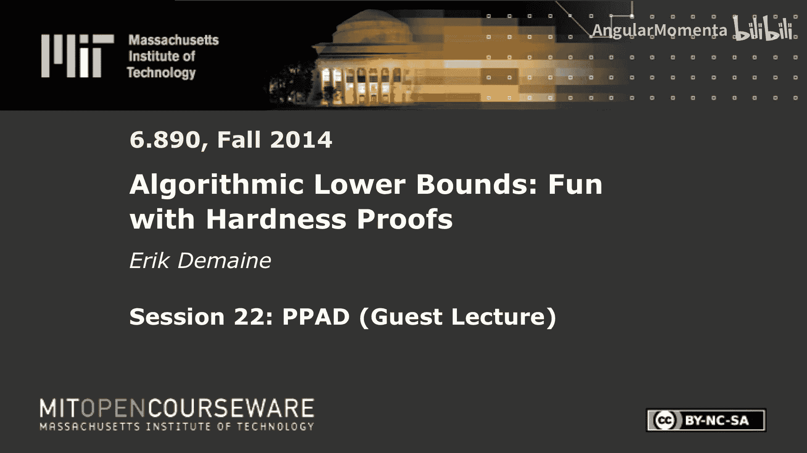
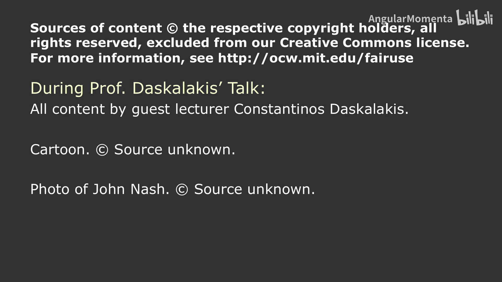

# 【麻省理工】算法下界 ｜ MIT 6.890 Algorithmic Lower Bounds, Fall 2014 p22 22. 磷酸烯醇丙酮酸羧酸酶 -BV1dPYpz9E4V_p22-

The following content is provided under a Cative Commons license。

 Your support will help Mi T OpenCourseware continue to offer high quality educational resources for free to make a donation or to view additional materials from hundreds of Mit courses。

 Visit Mitopcourseseware at Ocw。mt。 Eduu。

So welcome back to 6，8，90。 Today。 We have the first of two guest lectures by Costis Dascalacs about PD completeness。

 Take it away Costis。 Okay， thanks for the invitation to， to talk about PP AD。😊。

This is sort of an unusual class you haven't seen it before。

 So part of the lecture is to describe the class and the motivation behind its definition。

 if I start with definition itself。It may seem weird。 So instead。

 I wanna provide some motivation about the definition。

 And then sort of like towards the end of the lecture， we're gonna see the definition。

Were also going to see our first PPD complete problem in the end of this lecture and the next lecture I'm going to describe more natural if you want problems with our PPD complete。

Okay， so the motivation for me looking at this class is。Some beautiful theorems in game theory。

 economics and topology。呃。Namly Nas theorem， brow theorem and Spner's theorem。

And I want to describe those theorem before I get into the computational complexity of the resulting problems。

So let me start with Naash's theorem。So。This table represents a game between two players。

 the rows correspond to the strategies available to the blue player and the columns correspond to the strategies available to the column player and then every box in this table writes down the payoff that the two players get。

If they chose the corresponding strategies in particular， so this is a penalty shot game。

If the key if the goalie dives left and the kicker shoots right， then the goallly loses a point。

 the kicker gets a point。More generally。In the game， you have to specify the players N。

 the number of players N， the set of players N。Then for every player， he。

You have to specify the set of strategies available to this layer。And also for every player P。

 you have to describe a pay of function， U P。That maps the strategies of everybody。To the reals。Okay。

 so in particular， so U P。Over。嗯。Collection of strategies for all the players corresponds to the pay of the player pick gets if the player choose these strategies from the corresponding sets。

All right， that's the general definition of a game。

 but in that picture I have a two player game with two strategiess for a player for simplicity。😊，Now。

What game theory study and trying to predict。Is what happens when two players interact。

In the way described by a pay of table and have developed various notions of equilibrium that may arise as a result of this interaction。

 the one that is of particular interest to us in this lecture is what is called the Nash equilibrium。

Which is a pair of randomized strategies for the two players of the game。

Such that none of them has incentive to change their strategy。

 given the strategy of the other player。Okay in this particular example， the Naa equilibriumum。

 which is actually the unique one and Naa equilibriumlib which is a unique one of this game。

 is for both players to uniformly randomly play each of their available strategies。

And it's quite easy to check that this is a national equilibrium because。

Given so for the from the kicker's perspective， given that the goallly uniformly randomly dives left or right。

The expected payoff from shooting left or right is exactly zero。So in particular。

 any convex combination of these two strategies have has expected pay of0。

 and he cannot improve it by changing the mixing weights in any way。 Okay。

 so given what the goallly is doing， it's in the best interest of the kicker to play half half and vice versa。

You can do the same calculation from the goalish' perspective。 And given what the kicker is doing。

 the goallly cannot improve his expected player。Okay， so more generally in the general case。嗯。

Every player。あ。chooseoses a randomized strategy， a randomized strategy。

Is a distribution over the strategy set of the player。 So it's gonna be。This with this symbol。

 I represent a collection of distributions over this set。

And I can extend this function from to distributions。 I can。 So let's call this the。

 the extension of that。Function to distribution is when I get as input。

 a collection of mixed strategies。What I'm gonna do is I'm gonna look at the expectation where every I。

 you know， according to these strategies。You know， S1 drawn from x 1。

 S2 drone from x 2 and so so forth。As N drawn from Xn， you're going to look at the expected utility。

And their strategies， actions that are chosen according to this randomization。 Okay。

 so that's the expected。Uility of player P。If players choose these make strategies。And now。

 and na equilibrium in general， a definition。嗯啊。A collection。X1， X 2， etc cetera。

 of mixed strategies。Is a Nsh equilibrium。If normally for every player P。The expected utility that。

He gets。By declaring。By playing this strategy。Is at least as good as the expected utility he would get。

If he switchs to something else。Or any other mixed strategy he could possibly play。Okay。

 so given if none of the other players change their strategies。

 there is no alternative mixed strategy。For this player that may improve his payoff？

So if that's simultaneously true for all players。Then that collection is called the na equilibrium。

Okay， and that example is just a special case of this definition。

Any questions about what the natural equilibrium is？Okay。Now。😔，There are games in games， right？

 And this game is a particularly simpler one。 First of all， it has two players and two slots。

 but also， it's very symmetric， in some sense。😊，呃。If I look at every square of this table。

 the sum of payoffos in each square is0。 these types of games are called two player zero sum games and the existence。

Of equilibrium in these games was shown by Phon Neumman。

 So Phon Neumman showed that any two player 0 sum game has such an equilibrium。I mean， a priority。

 it's not clear if。In a given game， there is a collection of strategies that are in nakulibum。

The first one to establish such a result was Fon Nemo in the 20s， who showed that if。

 if a game has two players and it's a zero sum game。

 then there is always an a equilibrium equilibrium room in that game。By the way。

 the equilibrium wasn't called Nash equilibrium at the time because Nash wasn't around。 It was， it。

 it is known as the min Max equilibrium。Okay。And in fact， later on。

 when Danic was developing linear programming duality。Together for N Neman。

 they realized that this theorem is actually implied。By the strong LP duality。

They also noticed that using linear programming， you can compute equilibriumria in these types of games。

In fact， now， but that took many years more， we know that this statement and strongeduity are actually equivalent mathematical statements。

😊，Okay， so the existence of equilibrium 20 sum gives is equivalent to linear programming dualology。

All right。But how about general games， What happens if I go to the table and I change it or I consider a game with more than two players。

 So what happens for example， if I change this game in this way。Now。

 it gave a bit advantage to the goalie in the left， left。choiceice of strategies。Now， you know。

 you know， before NAS was around， it was unclear if， you know a game。

 a general game has a large equilibrium。This is was non na established in his。

Celebrated paper now showed that any game， any finite game has a mixed na equilibrium。

 So na equilibrium and equilibrium in surroundedomomy strategies。😊，Unfortunately。

 what is not known in this particular example， This is the natural equilibrium。 You can。

 you can verify that this is actually a natural equilibrium， what I'm showing there。

But the point the point of this slide is that there is a qualitative difference when you go from two player 0 sum games to general games in 60 or so years of work after Naash's theorem。

 we have no proof using LP duality。And we have no polynommal time algorithms for finding equilibriumria in general games。

So part of this lecture is to try to understand the computational complexity of this problem given a game。

How hard is it to find a natural Lib。Okay， so that's problem number one that I want to consider。

Question that Ma proved。Every game refers to any number of players。Right， any。

 any finite number of players， any。Strategy set。Any utility functions， no matter how it looks like。

 there' is always a na equilibrium。Okay。Other questions。 This is the。

 let's say the actor number one in this lecture。Okay。So the second actor is Ber's theorem。

 which I want to illustrate in the next few slides。The stadium of the theorem is very simple。

 it says that。Given a function that maps a convex and compact。

Subset of the Euclidean space to itself。So。I don't know in this setting。

 compact means basically closed and bounded。 So if you have a function that maps a convex closed and bounded subset of Euclidean space to itself。

Must have a point that doesn't move under the function。Okay。

And I want to illustrate this with a couple of examples。

 and for my examples I'm going to choose for d the disk。Okay， the unit disk。嗯。I'm going know。

 I'm going note that all conditions are needed actually for the theorem to be true。

 if you remove any of these things， closeness conves the。How。Or bondedness， the theorem fails。 Okay。

 so we're going to do a bunch of examples and you can think about what may happen if you remove one of these conditions。

So my first example is to map the disk to itself by just rotating the disc。Okay。

 now there is a simple。 There is a no fixed point in this map。Which is the center， right of you。

 imagine。There's actually no other fixed point。What if I take this disc and I shrink it and then I shift it。

Some were insidecited。Then I don't know。 maybe it takes a little thinking， but you know。

 you should believe me that there must be a fixed point somewhere there。Right。😔，Or you know。

 fixed one still exists。If if I kind of like。You know， kind of like crumble the disk and。Move it。

 right， As long as I don't tear it apart， that's a continuous map。 And there's still a fixed one。

 right， And you probably could locally have heard that if I take。A map of Cambridge。

 and I throw it on the ground。Then there is a point of the map that sits on top of the corresponding point that it represents。

This is a special version of this theorem。Because effectively， when I'm throwing Cambridge。

Cambridge's map to the ground， I define a mapping from real points to points in the map and by this theorem there is a point that doesn't move。

Okay。So that's what powers is saying。 Power' saying。And。

The proof of Nash actually uses this theorem to， to show that the naa equilibriumum exists。

 What Nash did is he used Ber CRorem。 And the next slide， I want to illustrate the way Nash gets。

To prove a the na equilibrium existence。By using Bar CRor。

 and I'm going to restrict myself to the simple game we saw in the beginning， the penalty shot game。

And as I said， for this specific game， you don't need B theorem to prove existence of equilibrium because this is a two player zero sum game。

 and you can even do it with linear programming duality。

But it's a simple enough example that will help illustrate the proof of NA's theorem。

 So what here is what Nash does。 He starts with the game。And then he defines a continuous function。

 in this case， from。The squared to itself from the unit squared to itself。

In a way that the fixed points of that function are actually exactly Nash equilibrium。

The way the function looks where basically what is the square and the square represents。

The probability， the horizontal line is the probability by which the kicker shoots right。

The vertical axis is the probability by which the goalie dives， right？And then， the function。

Is basically tracking。Which of the two players has incentive to change his strategy at every point in this square。

So in particular， let's consider this square over here。 This in this square， both players play left。

AndAnd the kicker is actually unhappy if both players play left。

 the kicker wants to increase the probability by which he is shooting right。

So this is what thisarrow represents。Okay， so you want to increase the probability over here。

You know， similarly， I don't know if you hear the play opposite actions， hence the goal it wants to。

Change and so on and so forth。 So this what， what Nash is。

 I'm not going to write down Nash's function， but intuitively， this is what it tracks。

 It tracks are every combination of mixed strategies。

Which players have incentive to change their actions。

 their mixed their randomizations and in which direction， this is what NAis。Function does。And。

 in fact， to help you a little bit， I'm gonna even call this。The unit square。

 depending on the direction of the deviation。So this is the kind of picture that I get。

It's very easy to locate the fixed point as the point where all colors meet。 And this is exactly。

Half half， which is exactly the natural equilibrium of the game。Okay， this is a schematic。You know。

 proof by picture。 So this is an illustration。Of na's proof。Any questions about bartdom or the proof？

Okay。The last actor， so the last actor is Perner is lema。It's a lema combinatorics。

 but it's very related to。Tropological statements。So。The limo。

Consider a there are multiple versions of the lemma。

 and I'm going to show it in two dimensions on the square。

 There are multidisal versions of the lemma。But I'm going to restrict myself to the plane。

 and the lemma is going to start with the triangulation of the grid。

And I'm going to color this triangulation with three colors。More generally， if I'm in n dimensions。

 I'm going to be coloring things with n plus one colors here， I'm in two dimensions。

 I'm coloring with three colors。So the way I'm going to call this square is the following。First。

 I'm obliged to use this coloring on the boundary。Notice that this boundary has the property that there is no red color here。

 There is no blue color here。 There is no yellow color here on that edge of the。G。But otherwise。

 I'm allowing you to color the internal vertices in whatever fashion you want。 Okay。

 All I want you is to respect the boundary coloring。

So Spner's Lema says that no matter how you color the inside of the square。

There is always a threechromatic triangle。In fact， it says something more。

 it says that there is always a nod number of trichromatic triangles。Can you see one in this picture？

You would also so， right， So there are there are five in this case。 Okay， here there are。Right。

And later in the， I mean， I'm actually gonna show the proof of spiderslemma because it's instructive for my purposes。

 later in this lecture。It's really remarkable， I mean， a priorityi， I mean。

 maybe you believe there is a charomatic one， but it's not at all obvious。

 there should be not number。😊，And the proof is actually gonna easily give also the odd number。

 as well。Okay， so that's dilemma。That's span as La many questions。 Yeah。

 so the legal coloring says that。Either fix the color to be like this。Or more generally。

As long as you don't use red here。Don't use yellow here， not use blue here。 You're good， right。ちの。

The general definition is that。Okay， so you have this。Square。There must be。So okay。

 so both are are no yellow in these vertices。There should be no blue on these vertices。

And there should be。No， it had。That's a general statement。As long as you respect that。

 then no matter what you do inside。There is a threechromatic triangle。

Or you can just fix the coloring to be that。 It doesn't really matter。 In fact， if you have such。

Coloring， respecting these three properties。You can enlarge the square barring an extra layer。

That has exactly the coloring I'm showing here。And you。

 you can notice that if your original coloring respects these properties。

 if I add this specific coloring in this extra layer。

 I'm not gonna creating any triangles in this layer。 So in fact。

 the twin I can reduce one instance to the other。Allright。

 so this is the statement of Sperner's dilemma。There is a multidimensional version in n dimensions。

 I'm using n plus one colors， but I'm not going to state it here。Okay。Now again。

 I'm going to hand wave to actually show you how the theorem is actually implied by spinernerslemma。

Alright， so， in fact， one proof of brow is actually going through Sperner。

Here is the high level proof of the argument。Given the functions。

 so I'm going to do it on the square on the unit square。I two dimensions。

So suppose I'm given a continuous function from the square to itself。

What I'm going to do is I'm going to prove for all epsilons。For all epsilons。

 I'm going to show that there exists an approximate fixed point with approximation epsilon。

And then using spinerard dilemma， that's what I'm going to do with spinerard dilemma。

 and then I'm going to use a compactness argument。To get this down to 0。 Okay I'm going to create。

 in fact， a sequence of approximate fixed points with smaller and smaller epsilons。

 And I'm going to use compactness。 This is， remember， this is a compact set。

To argue that there is an exact fixed point。 Okay， so Spner'lemma can be used for this first part of the proof。

 And roughly speaking， the way it's used is the following。What you do is you first triangulate。

The square。And the， the diameter of your triangles。

 which is very rough in this picture that the diameter of this will depend on you know， the， know。

 the constant of absolute continuity of your function。 Okay， so if it's lips。

 if the function is lipsses， you'll just， it's just going to depend on epsilon and the lips is constant。

Okay， so， you know， depending on the lipsness of the function。

 there's going to be a fine finer triangulation。No。

Having tarangulated the square and adding this extra layer outside。

You're gonna color the vertices that are inside， depending on the direction of the displacement F of x minus X using exactly the same coloring scheme I showed you earlier for the。

Illustration of how Nash showed the existence the existence of equilibriumlib using Ber。So。

I'm going to color those internal vertices using this coloring scheme。Depending on the directions。

And then for the， the extra layer that I added on the outside， I will just use my standard coloring。

And what's cool with the way I chose my colors here。 I mean， this is my standard coloring。 exactly。

 I have permuted the names of colors。 Sorry about that。😊。

I think you know red took the the roll of blue and stuff like that， but it doesn't really matter。

What is cool about the way it shows my colors is that if a point is here。

 I know that it's not going to be using， you know。Yeah， you know， essentially， if it's。

It can only be sort of like in the boundary between red and yellow， but it can't have。

 if you're here and the displacement。Is yellow。 You're going to be going outside。 That's a bad thing。

Okay the way I chose my colors， I know that。Some property like this is gonna happen that， you know。

 some of the edges of this cube are gonna missing some of the colors。 For example， here。

 there is no red， because if they were red， then I would be have to be going down outside my square。

And my function is mapping the square to itself。 so that can happen。 Similarlyly over here。

 I cannot have a I guess， you know， I cannot have a yellow and so on so forth so。

That's gonna be a valid instance of Spner's lemma。 And by Spner。

 there is a three chromromatic triangle。 And this scenario here it is。You know。

 you can see the fixed point out of the back。That's a coincidence， actually。

 because I'm gonna do a compactness after， but I'm gonna， you know， I'm gonna do spare as lemma。 Now。

 a trichromatic triangle is actually gonna one of the corners of the trichromatic triangle will have this property。

 If you choose the diameter of your triangles to be co。if it's correctly chosen。

So that's roughly speaking how the proof works。Yeah。

 the fact that Sperner's limit shows that there's an odd number of such tri there's an odd number oficular in fact that not carry over。

This car is over except except in degenerate games where it doesn't hold。

 But in a nondegenerate case， it will hold。Ex not not。

By direct use of Spners because Spner is always going to go through approximations。

So there is another way to prove the existence of naashquilibria in two player games using what is called the Lemkey house algorithm and this Lemkey house algorithm has a similar flavor as Spner and it also has another number of solutions and this is still true。

Okay， so for two player games， it is still true that there is a not number of solution if the game is nondegenerate。

I'm not sure what's the status of multiplier games because then there are irrational solutions and sort of like combbin aatorotics don't give you approximations but not exact fixed points。

Yeah。So yeah， so the fact that there is a not number solution is hold for this combinatorial problem Sperner。

 but once after you do compact this， then I don't know what happens right so all bets are off。

But for the specific case of two player games， there is an alternative proof that carries over。Okay。

 cool。Okay， so these are the three problems that I'm interested in。

 And now it's the time where I'm gonna get into a bit of complexity theory discussion。And in fact。

 this complexity discussion will lead to the fact that NP。

 the standard concept that we use for understanding complexity is not sufficient to address these problems。

And that will motivate PPD。呃。But first of all， let me sort of like give intuition about why Spner is hard。

 right， And here's the situation I wanna be looking at。

So I want to be looking at the grid of size 2 to the n。So in particular。

 I'm not going to be drawing the grid explicitly for you。

 and I'm not going to be listing the colorss of the internal vertices。As a list。Okay。

 so what I want to do is I want to。Create a succinct description of。

A coloring of an exponentially large instance in the following way。

 So I'm gonna be imagining the existence of this grid。With its boundary colored in this specific way。

And what I'm going to give you is I'm going to give you a second。Okay。

 the Texas inputs the coordinates of points inside this square。And output to color。F。Now。

So this circuit only decides the colors of the vertices inside。

And I fix the colors of those vertices to be what is shown in the picture。

That's a succinct description of a coloring of two to the two an vertices。

And this coloring satisfies the conditions of sperner is lemma。In particular， there is a。😊。

Track chrommatic triangle and what the problem is asking you to do is to find such a triangle。

Dcring this triangle。😊，It can be done with polynommal complexity because all you need to do is to output the coordinates of the three points。

Participating in the triangle。 So the output description， I'm not asking you to do something crazy。

 right， So the output is can be described in polynomial size。The input。The and， and， and what。

 what's problematic with this problem is that。The size of the graph we're working with is exponential。

In the input size。 Okay， so this circuit has and input bits。So the this graph is。

 in principle exponentially large in the description of the problem。So in particular。

 I cannot just go and check every triangle。About whether it is trichromatic or not。

 I have to do something smarter to solve this problem。And in fact， we have no other。

 you essentially no smart solutions， to this problem。Okay， so that's Sperner's Lemma。

 That's a way to define Spners the the the computational version of Sperner's lemma。 Similarlyly。

 you can define Nash and Ber。 I'm only going to define Nash B is a bit more complicated。

 So in the Nash problem， I'm giving game， which is described by the number of players the strategy sets。

Which I enumerate。And the utility functions of allt layers。 This is the product of all these sets。

And I'm also giving you an approximation requirement Epsilon。

 And I'm going comment on that in a second。What I want you to do is find an nepsilon Nsh equilibrium of this game。

Now， what's an Epsilon natural equilibrium of the game。

 An Epsilon natural equilibrium is a collection of mixed strategies such that No player has a more than an epsilon incentive to change this strategy。

So， in this definition here。呃。You know， I would add a minus epsilon here to make it an epsilon na equilibrium。

Rightright so I have not more than an epsilon incentive to change my mixed reality。

 That's what an Epsilon na equilibrium is。 Now， why did I。

 did I have to define the problem in this way， There is specific， complex thetic reason why。

I I'm defining my problem as a neptpson mass instead of an exact nash in room。What is that reason。

Yeah， all right。 So NASA's proof is via are Bra The， which is a topological statement。

And there is no guarantee that the output， if I were to omit this epsilon from this definition。

 there is no a guarantee that the output has polynommal size complexity。

Maybe a na equilibrium is comprised of irrational numbers。Which I can not specify。

Maybe it's not even algebra。 Who knows， right， but it is algebra， but。So approximation。 So in fact。

 N in his paper in 51， not the original one， but the one that appeared a year later。

 he actually provides an example of a three player game that only has ir rational equilibriumlibria。

Okay， so。I'm working with epsilons to avoid this issue。Coming back to two player games。

You can actually show that any two player game has a rational equilibrium。😊。

Whose probabilities are of polynomial complexity in the description of the game？

So in this specific case of two player games， you can actually omit the epsilon if you want from the description of this problem。

But for general games， you add it there to make this question computationally meaningful。Yeah。

 is it always the case that there's an equilibrium that's a root of a polynomial of bounded complexity in the description of the problem I believe this is true yeah。

3。Can you do the same thing You could， Yeah， you could， in principle， do that。

I'm not going to define brow， but you can imagine in brow similar things。

 you have to take care of similar things and define epsilon approximate fixed points et。

Now let's look at MP， the variant of NP that I'm interested in is that of search problems in N。

 so function NP。I don't wan to bore you， but I'm going to go through the definitions。

 So a search problem is defined by a relation of inputs and solutions right that's that a pair X and Y is in this language。

Defined by this problem， if y is a solution to x。So I expect you know all this and I'm going to go fast through these definitions。

But what's important here is this definition。When do we say that the problem is total。

We said the problem is total。 if for every input， there is a y that is a solution to the problem。

For example， spinners。😊，Problem is total， because， for any instance。Of Sperner's problem。

 there is actually a solution。We。嗯。For any input of this form。

You know by Sperner Lemma that there is a solution。Okay， so that problem is a total problem。

Similarly， for every input to Nash。There is a solution， so these problemss are total problems。

Let's see。O。Now。A problem a search problem is in F and P functional MP P。

 If there is a polynommal time algorithm。And poly normal function。So， that。

Two conditions are satisfied。First。If。The algorithm。On input x and y says1。

 then and only then y is the solution to x。And also。For every input to the problem。

 if there is a solution to that instance。Then there is one whose size is polynomial。

In the input of the problem。So you have solutions that are pretty normally large。And so this is F& P。

 And T F and P is the class of provos that contains all provos in N P that are total。

And based on the previous discussion， all the problemss we're interested in Spner Nas Ber are in。

T F&P， sorry T F&P， both both in F&P， but also。In TF。

And I guess let me remind you about n peak of F and P completeness。

 a problem in F and P associated with an algorithm and a poly orbital bound。

 polynommal function is poly time redducible to another one associated with an algorithm and different bound。

😊，These that exist to functions F and D。One of them is mapping inputs to L to inputs to L prime。

And also， you have two properties。 and it's important to look at these properties carefully。

Because they're related to a point that I want to make。So。For the reduction to be valid。

 you also need this property that。For every x and Y。

 if the algorithm of problem L prime on the transformed inputs。And y says one。

Then you can take that solution and transform it into a solution to the instance to L。

 or this is what it says。Well， this one says that if。The transform reasons has no solution。

Then the original instance also shouldn't have any solution。

And the third problem is F and P complete if it's both in F and P and its every problem when F andP is probably normal time redducible to it。

 and of course finding a satisfying assignment is F and P complete。

But now where reachs the point that I want to make。

What I want to claim is that the I cannot possibly reduce sat。

To any of the problems that I'm interested in。In particular， I cannot show that。

There is no car reduction from sat to any of these problems。And the reason is this property。

Recall this property was saying that。For every input to problem L。If。

The transformed in if y is a solution to the transformed instance。

Then I can convert that solution to a solution to the original instance。But now， if fairly sad。

And this is Spner。Then no matter how you transform the set instance to a sparener instance。

 there is going to be a triangle。That is trichromatic setting this to one。So。I would。

 I should be able to then convert this triangle to a satisfying assignment。

 But what if this instance is unsatisfiable。That possibly cannothold。

If your two problems are sat in Sperner， so there' is no reduction。

 there is no car reduction from SAAT to Sperner， so you can show if any of these problems for that matter。

 so you cannot possibly argue that these problems are F&P complete。

Another thing you may try is to get turing reductions from sat to these problems。

But that has other issues， it basically would imply that NP equals co N。So。Theres no。Way basically。

 this， these types of problems don't if you want type check， they don't type check。

 these are problems that are total， and these are problems that whose complexity really。

Res with the fact that it's hard to distinguish， satisfiable and nonsatiisfiable。Instances。Okay。

 so NP completeness is not the right language。 if you want。

 It is not the right framework to understand the complexity of these problems。

And the exercise through which we're going today。 and I think it's instructive is to how to go about characterizing problems that don't fit。

Into traditional complexity theoreticalore frameworks， okay。So in particular。

 what I want to understand is。How to go about defining a complexity theory of total search problems inside F and P。

Okay， clearly， these problems actually are inside F and P。 These are F and P problems。

 T F and P problems， right， So how do you go about。Coming up with a theory of。

Total complexity theory of total search problems。And the way you go about it is to。Look at the。

Proof of existence of solutions in these problems。And understand。😔。

Combinatorial underpinnings of the existence argument。

So if you want the hundred feet overview of the methodology that I'm going to follow is this。

That first， I want to identify the combin notatorial argument of existence responsible for making all these problems。

 total problems。And then I want to define a complexity class inspired by this argument of existence。

And the litmus test of my approach is if。The resulting complexity class actually tightly characterizes the complexity of these problems。

So all I'm going to do is I'm going to show you the proof of Spner's lemma。

And that's going to inspire the definition of P， P A D。Okay。

 so this is what I'm going to do in the next few slides。So here is the statement of the lemma。

 if your boundary is legally colored， then there is always a node number of trichromatic triangles in particular at least one。

Let me try to prove it for you。The first thing I'm going to do。 Okay。

 so is I'm going to introduce an artificial vertex at the bottom left of the。Square， okay。

 here it is。 And I'm going to call it blue。Now。😔，No matter how you call the internal vertices of this square。

Because I have fixed my coloring on the boundary to be the one you see here in this picture。

I know that by adding a blue vertex over here， I'm creating an artificial。😊，Traromatic triangle。

I'm going to call the triangle the beginning of my walk。

And now I'm going basically define a walk in this。gridri， Okay， consider this is a big factory。

 The factory is partition in triangular rooms。And I'm starting my walk in this factory from this vertex here。

 from this triangle here。Now， my walk is going be doing the following thing。

 It's gonna be going from triangle to neighbouring triangle。And the transition rule is the following。

I'm going to look in the room， amen。And I'm going to try to find a red， yellow door。

If I find such a door， I want to try to cross it。Having read on my left hand。

That's the rule of my work。Okay， red yellow doors。I want to cross them with red on my left。

 And that's important。I meant to say yellow on your left， sorry about。So。

 let' us go back to this picture， I created this artificial triangle over here。😊。

I knew it's going to bechatic because you know it only considers veres in the boundary and have fixed the column of the boundary to this this specific one。

I know it's going to have a red yellow door， which I can cross having yellow on my left。Okay。

 so let me cross that door。Now mentoring it to a new room。In this particular case。

 there's nothing interesting about this room。Because this still touches the boundary。

 So no matter how you call the internal vertices， you couldn't affect the coloring of this boundary。

 So its still， it's also gonna have a red yellow door， which I can cross having yellow on my left。

 And the interesting business starts now， okay。I entered into a new room and depending on your coloring。

 maybe it's already prettychatic。So if how do you color this into blue。

 this would already be3 chromatic triangle Y because you entered that room through a ra yellow door and you encountered a blue color。

What is cool about it， though， is if it's not blue。😊，Then there's going to be for sure。

 another doll which you can cross having yellow on your left。In this particular scenario。

 this was a yellow。 It wasn't a blue。 So it was this was not a trichromatic triangle。

 but because this was a yellow。I enter a room through a red yellow door， and I find a yellow。

 There is for sure， another red yellow door I can cross having yellow on my left。

So this is what I'm going to do。 and I'm going to keep doing this。Until work what can go wrong。

 right， So the the claim that I want to make is that if I keep doing this procedure。

I cannot exit the factory。For me to exit the factory， there has to be。A door on the boundary。

 which I can cross having yellow on my left。Now because and that's where you know the coloring of the boundary becomes important。

 because I have fixed the coloring of the boundary to be the one you see in this picture。

 you can verify that there is no red yellow door you can cross to go outside。

The only red yellow door that exists is this one。😊，But if you're inside。

 you cannot cross it going to the art side， having yelled on your left。

 And that's where having left on your left hand side is important。This is the only rad door。

 but you cannot cross it going outside， you can only cross going inside。

So you cannot exit the factory。Okay， so your walk is going to keep going。All right。And there is。

 there are two possibilities now， right。 So one is that， you know， it's gonna keep going。

 And then it's gonna enter into a new room in through a red yellow door。 and it's gonna find a blue。

 In that case， my lemma is proven， at least not the odd number， but at least， you know。

 I've proven to you。 There is at least one triangle because I entered into a room。 I found a blue。

I entered through a red yellow door。 that's a proof of existence。

But there is one thing that can go around， though， right， What is that I can loop around， right。

 So what I can do is I can sort of like， this is my， my factory。 You know， I started over here。

 I start wandering around this factory， right。😊，And then I sort of like got into a room that had already visited before。

 and then I get into a loop and I go forever。That that's the problem that may happen。

I claim when we there that this cannot happen。 Why can it not happen。は。Yeah， let's try to color it。

 right， So let's， that's for， let's zoom into here， right， so。

This is a room that I gone go into the beginning through a red yellow door having yellow on my left。

 right， So originally， I got into this room like this， having yellow on my left。Then。

I exited this room。Through a red， yellow door having yellow on my left， so。This door， so， you know。

 potentially， you know， it was。I read here， so I exit it this way。

 but then I cannot possibly enter through this door because that's a red red door。Oh。

 this could be yellow。In which case， I exit it from here。

 but still now I cannot get back from that door because that's a yellow， yellow door。 right。

 So this cannot happen。So my loop， my， my walk cannot。Get back into an already visited room。

And it cannot exit the factory。So the only thing it can do is is to stop because there's a finite number of rooms in this factory。

But the only way it can stop is if it finds a blue when it enters a new room。

 So that's the proof of existence。 If you follow my work and。

 you're gonna get into the triromatic triangle。This way， I finished the first part of the claim。

Any questions about that。Yeah， the argument give the odd though it does。 Yeah， what is it。いね。

Rightright， let's try to do that， right， So let's start from a different triangle。

 Let's start from here。But if I start from here， there's no red yellow door I can do。

 I can follow so that doesn't give me anything。 But let's start with somewhere where there are already red yellowor。

 So let's start with here。now I can follow the same kind of business。 I can。Get into doors。

I can cross red yellow doors having yellow on my left in this case。

 that got me into a trichromatic triangle。😊，Now let go back here and actually do the work backwards。

 right， so how going backwards， okay， having yellow on my left。So this is what happens。

 So I found a trichromatic time ago。And this actually came in Paris， right。

 The fact that this gave me a threeromatic triangle。

Must mean that this has to give you another one because by the same talkingken。

 I cannot sort of like get into a loop。Whilem going back。On the other hand。

 there are some tangs where where that would give you， you know， so you get another pair over here。

 these don't give you anything because if you start here you do you don't move。😊。

But here you can get the loops， right？If you start from the inside， you can' get into a loop。

 The point is that all triangles come in Paris。Except for this walk。

 which started with an artificial one。So all trichromatic triangles come in pair。😊，Except。

For the triromatic triangle that I found in my original work。therebyby。

 there is a not number of those。So it's kind of it's pretty cool， right？😊。

Let me actually try to abstractstruct this proof a little bit。😊，And so I like。

 focus more on the core you know， argument why this happens。 So here's what I did， really， right。

 So this is my space of triangles。This is my set of triangles。

I want to define a graph where the vertices are the triangles。And。The adjacency of triangles。

 So you know， two triangles are connected if they share a door。

And you can go from one room into one triangle into the other one through this door having gel on your left。

So for this reason， all vertices。Have art degree and need degree， atmost one。

Because every triangle has at most， no matter how it's colored， has at most one red yellow door。

 which you can cross having yellow on your left to go out。

And it has at most one door which you can cross。Having yellow on the left going in。

So just the mere definition of my transition rule， which was cross a red yellow door having yellow on your left。

 defined a graph on the set of triangles。That has in degree， not degree at most one。Now。

 a graph with in degree and not degree at most one。Is a very simple type of graph。

 It looked like this。It's a bunch of isolated vertices， a bunch of directed cycles。

 and a bunch of directed paths。When。And。In fact。The way I defined my transition rule。

 you can check that all degree1 nodes。Must be trichomer。If you tchmatic， there is either。😊。

One door you can exit one red yellow door you can exit having yellow your left。

 or depending on how the coloring is， one door you can use to enter。The triangle， having left。

So only threechromatic triangles。Can have。Total degree1。嗯。

Isolated vertices are those who don't have red yellow doors。And。

Deegreee 2 vertices are those who have two doors， one with which you can exit having area left and one with which you can enter having area left。

 so。The mere what I I want to summarize that the mere definition of my transition rule to this graph。

In a way that the all these unbalanced vertices are solutions。To the sperner problem。

All the vertices were solutions to the spiner problem。And， in fact。

 one solution was artificial because it was that triangle that I created by the extra node outside。

So all degree1 vertices are real solutions， except one of them。And by the structure of the graph。

 then。There has to be a odd number of solutions。This would be implies。 Okay。

 So to summarize the mere description of my transition rule。

 defined this graph in a way that all unbalanced vertices are solutions。😊。

And because these have to come in Paris， by parity。There is an even number of solutions。

 except one was artificial。 So hence， there is a not number of solutions。So。In particular。

 what I want to argue is that all these very beautiful。

 very interesting theorems that I showed in the beginning， Nas Brad and Spurner。😊。

The real argument of existence， besides sort of like mathematical work， mathematical offuscation。

 if you want。Right， is this trivial statement in combinatorics that if you have a directedive graph。

With some unbalanced vertex， then there must be another unbalanced vertex。

Do you obviously know this theory。 It'ss the proof of this theoryorem is pretty clear If you have a directed graph where some node has a different number of in outgoing and ingoing edges。

Then there has to be another such note。 And effectively。

 what I did over here is I described a directed graph。And I identified this artificial vertex。

 which was unbalanced。 It only had an outgoing edge， but no incoming edge。And by parity。

 I knew they must exist another one。So in fact， I didn't even have to， you know。

 use my walk argument and stuff。 All I had to claim is that the mere definition of my transition rule defined this directed graph。

And this directive graph has some unbalanced vertex。 And I know that somewhere in this graph。

 there has to be another unbalance vertex。But what I'm saying is that the core of it is this trivial lemma。

And now your next version will be。 But what the heck， thislema is trivial well， right， So， you know。

 it took so many algorithms， You know， cargis， class and so and so forth。 We work with graphs。

 We know how to identify these things， right。😊，Given a directed graph。

 it's trivial to find a unbalance vertex。But the point is that you can sometimes define exponentially large graphs。

Sucinctly。And you can ask people to find you unbalanced vertices。In exponentially large。

 in exponentially large graphs。So that's what PPD is about。In fact。

If I give you a sparener instance by providing you a circuit。

We're already working with exponentially， many triangles。In the description of the circuit。

So that's why the problem is difficult。The problem is difficult because。

The graph we're working with is exponentially large in the description of the problem of the instance。

So the PD glass class is trying to capture this structure。And we write write about。

At the point where I'm going to define the class formally。Okay， so you ready for this。 So the oops。

 the PPD class。😊，Defined by Paa Dimitry in the 90s， actually。

 this is the journal version of the paper。呃。The PPT class is giving you an exponentially large graph。

😊，The verex set of the graph is 0，01 to the n。The graph is specified in a weird way。

I'm going to give you two circuits。😊，呃。That get an n input bit。

 an N bit input and have an n bit output。And using these two circuits， I define a edge between。

A string and another string。 if weird condition is satisfied。So now I directed that from V1 to v2。

 if this condition is satisfied let me try to pass this this symbol there。

 but before that let me call this circuit the possible previous circuit and let me call this circuit the possible next circuit。

Okay， now this circuit， Texas input string。😊，And it outputs a possible a candidate， next。

A candidate neighbor on that string。And similarly， this sorry cultivate father of this ring。

And this text input is string。 and that was a possible child of this string。

 And I only established edgedge I directed date from string V1 to string V2 if。

String V2 believes that its father is with one。And。We one believes that his child is vioo。

If they agree on their sort of parenthood relationship。I add this edge。Okay。No。😔。

You may ask me what the heck， Why didn't you just， you know， define this graph in a different way。

 Why didn't you have to have this possible child and possible father relationships。

And discard the graph in this way。And the answer to this question is that。

So the answer to this question is no matter what circuits you give me。

 that always defines your graph with a very specific property that Im going to see in the next slide。

😊，um。Back to the definition so I'm going to explain the intuition behind this。

 but back to the definition， describe an exponentially large graph by giving these two circuits。

And I establish edges between nodes only if this condition is true。

 And what I ask you to do is the following。Given these two circuits。If the all0 string。

Is unbalanced in this。Exponentially large graph that are defined。

Then ask you to find another unbalance note。Which by partyity。Exists。

 if the zero string has is unbalanced in this exponentially large graph。Then bipart argument。

 there must be another unbalanced note。I'm asking you to find it。 That's the definition of。

This end of the line problem and P P D is the class of all problems that are in F and P。

That are polytime reducible to this problem。Now this sounds weird。

 so let me show you how the graph defined by these two circuits looks like。

And this will be awfully familiar。😊，So， you know， I'm coping here the condition for putting a net between two strings。

The set of things I'm looking at is 0，1 to the n。This is the condition from。

 for when I put the nets from string V1 to string V2。Now。Notice that by definition。

 every string has at most one possible child。And everything has at most one possible father。So。

The in and not degrees of this graph are at most one。Okay。

 so I'm implicitly describing a graph that looks like this。😊。

And what I ask you to do is to check the following， I ask you to check if zero。

 the zero string is unbalanced， meaning it either has a father but not a child or it has a child but not a father。

If it's balanced， you don't need to do any work。But if it's unbalanced。

 which is easy to check locally， you just query the candidate next child and check if that child believes that zero is his father or vice versa。

 okay？If0 to the n is unbalanced。Then by parity， because the graph looks like this。

 there must be some other unbalanced vers。At least one。

And asking you to find any of these unbalanced vertices。 So in particular。

 you don't need to find the unbalanced vertex that is in the other end of the path that starts at 0 to the n or finishes at 0 to the n。

You can give me any of the other unbalanced vertices， if there are any。But by parity。

 I know that there is at least one un balance vertex。So PPD is this problem。😊。

I describe an exponentially large graph。By giving you two circuits。Now。

 no matter what circuit I gave you。I know the graph looks like this。😊，Now， in this graph。

 if 0 to the n is unbalanced。 if the 0 thing is unbalanced。

 you know that there must be another unbalanced vertex。

 any of them is good as a solution to the problem。 Yeah。

 so how again do we know that like 0 to the end and points to like the previous illustration string that points to 0 to the n。

Like， how do we know it0 as the energy。 So in that， no， it can be it， it can happen。

 It could be that。This is 0 to the n。It has a。Child。

That believes that this is its father and also V believes that zero to the n is a child and zero to the believes that this is the father。

This creates0 to the n， which is balanced。😊，In that case。

 you don't need to do any work So the statement of the problem is asking you to do work only if zero to the n is unbalanced。

Right。So end of the line tells you if 0 to the n is unbalanced。

 which you can trivially check locally。 You don't need to look at the whole graph。To this。

 to decide whether 0 to the n is balanced or not。Alright。

 so to decide whether zero to the N is balanced。You need four queries。Yeah。

 but the point is that that's that's the whole point right。If I query， if， if you know， like if。

 if V is the possible pattern of 0 to the end and。You know， you is a possible child， possible。

Child of zero to the n。 then the state of the world could be this。Could be this now。

If also this guy believes that0 to the n is his father， I'm going to make this edge solid。That's the。

 the fourth query I'm going to make to my circuits。 If this child believe。

 if this guy believes that you0 to the n is his father， I'm going to also make this edge solid。

If both are solid， then 0 to the n is balanced and only very work。If this is missing。

 then 0 to  then is unbalance。 I need to do work and so on and so forth。 Okay。

 but with four queries to my circuits。So in polynommal time in particular。

 in the description of my input， I can decide whether0 to the n is balance or not。

And if it's unbalanced， then I need to do a lot of work。 And in fact。

 we have no better than exponential bound for how long it will take me to find the other unbalanced node。

Can you make all such graphs of this type with all circuits。嗯嗯。I mean， no， I mean。

 you're asking if I pick an arbitrary exponential graph is it's always。

 always compressible into poly normalmmal size。I mean， it depends on how you phrase the question。

 So if you allow me to get， you know， a huge P， I mean P is part of the input， right。

 P is part of the input。 So now if P is a lookup table。That's a trivial instance， actually， right。

 So the instances that are hard are those where P is a succinct thing is poly normallymly nu size。😊。

But still defines an exponential large graph。 If P is a huge thing。

 a lookup table that keeps track of all conivities of all vertices with each other。

 That' we're getting into algorithms territory， where I give you an adjacency list of you know。

 for every node。 So this is a purely， you know， algorithmic problem that we can trivially solve。

 So if， if I get into the regime where my P， my circuit description is polynomial in the size of the graph that's an easy instance。

😊，Right，But if you're asking the question， can I always compress an exponentially large graph into two circuits。

 P and N that are polynomal size， then that's not the case。 Okay。

 so PD notice that this end of the line problem is in F P， because I can just guess。

The unbalanced vertex different than the zero string， and I can check easily if it's also unbalanced。

With four queries。 So it is in F and P。And you know。

 I hope you believe me that Sperner isnt PPD because just the proof of Sperner。

Was exactly the same kind of thing。 right？ So I succinctly described this graph that had exactly the same structure。

 So really， what in the definition of this class is Spners， the proof of Sperner'slemma。😊，Now。

You know， I sort of argued that you can prove Ber via Spner I give this hand wave the high level picture showing that so and also NS through Ber。

 So in fact PD definitely contains the problems that I'm interested in。But all is the lipmus test。

 lipmus testis， I went through this exercise to define this class PD based on the existence proof of Sperner's lemma。

And I successfully got all these interesting problems inside PD。 But the litmus test is。😊，For。

 you know， the success of my of my exercise is whether。I get also tight reduction。

If I also get that these problems are， ask， how does any other problem P P D now I can call my thing successful。

 Okay， so rid as an example。 So the success of。The definition of N is that SAT is N complete。Okay。

 so NP was defined。With that in mind。Now， but it also captured exactly the complexity of S。

 So that was a successful definition of a complexity class。

 So the litmus test for this exercise that you know。

 I went through with you is whether actually those problems that I'm interested in are also PPD complete。

😊，So。What we showed with goldberg Paitu， you know， bunch of， you know， I guess，10 years ago。

 almost is that actually， the opposite reductions are also true。

That all these problems are computationally equivalent。 In fact。

 I didn't show that these are equivalent to PD。 These were already known。

 These results were already known since Paadimitry's original paper。

 that PD exactly is equivalent to Sperner and browser。

 What we showed together is that Nash also is equivalent is in the same league of problems。

 basically establishing that all these problems are computational equivalent。

 Finding a Nashs computational equivalent to Sperner's lemma。

 computational equivalent to any problem。 PD and so and so forth。And the high level of the reduction。

 I'm going to hand waveve about it。Is that we start with this genetic PD instance。

And what we do is we envision embedding this instance into some geometry。😊。

Because this second be aator problem， our goal eventually is to reduce it to brow and to na。

 which are， you know， you know， continues。Problems。

 so the first thing we do is we embed this graph into a cube in a way that sort of like every path or circle corresponds to sort of like。

 you know， you know， a path that moves around this cube without intersecting itself。

 So this is the first thing we do。Then we find a way to。Solve the resulting PP embedded PPD instance。

Ruce it to Spners， to a spinners， instance。And then， in fact， the， the core of the proof。

 and I'm gonna actually。Talk about this more is to reduce this problem into a problem that asks you to evaluate an arithmetic circuit。

Now， after you get that PPD reduceuces to this evaluation problem。

 it's really I call it approximate arithmetic circuit S。

 okay so I'm going to get into what this means， but it's really a satisfiability problem for arithmetic circuits。

 but after you get PPD to reduce to this problem， it's easy to get to Nash and all the other implications all the other known and PPD completeness reductions that people have a established。

 So what I want to describe is what this problem is about。It's the equivalent of circuit sets。

Which is MP complete。This is called arithmetic circuit sets and I'm going to show you what it means。

Question so do we in the course of this reduction， do we get a three player game？ash throughYes。

 so you get actually two players。 you can get two players N， yeah。

So it establishes that all games are if they're not two players zero sum， they are people a plate。

So the input to the problem is a circuit， okay。😊，The circuit comprises two kinds of nodes。

 variable nodes and gates。Okay， so gates are represented with solid circles。 variable nodes are with。

 I don't know， empty circles。Okay， so the variable nodes are X1 through X n。

 The gates nodes are G1 through GM。 Now， the gates can。

I can choose gates from the following set of possible gates。

I'm going to explain what these gates are meant to do， but this is an assignment gate。

 this is a plus additionion gate， this is a subtraction gate this is。Set equal to a constant gate。

 This is times a constant gate， and this is a comparison gate。

The subtraction and comparison gates are non symmetric in their input。

 So they have a special input 1 and special input 2。Similarly from the comparison gate。

And I also have directed edges that connect variables to gates and vice versa。

 but there are no edges between variables， so there are no edges between the gates。And also。

 the loops are allowed that's important。 Okay， so you can have loops， for example， in this picture。

 you have a loop between where this is。😊，And actually， there are no inputs to the circuit。Okay。

 and so it said， you have a bunch， you want to set the input so that the output is one and you don't have loops。

 You have a da and your gates are just binary gates Here。 we are in a different situation。

 We don't have inputs。Our gates can have loops。And they are not binary， they are arimetic gates。

The goal is to assign。Zero1 values。To the ver is the variables。

So that the gate constraints are satisfied。 So now what are the gate constraints。

So the output of an assignment gate should equal the input to the assignment gate。

If we have an addition gate。The output of the addition gauge should be the sum of the inputs。

 except everything should lie 01。 So it's the minimum between the sum of the inputs and one。

The subtraction gate is similar。 So the output to the subtraction gate is the difference of the inputs。

But you can't go below  zero。The cal gate is c equal to a constant gate is sets y to B。

 but it doesn't allow to live 01。And the multiply by constant gate multiplies the input with alpha they。

 but also， you know， doesn't allow to go below zero above one。And okay。

 these are pretty straightforward。 What is slightly weird is the comparison gate。

 which has a weird behavior and actually must have this behavior for the probe to be PP complete。

 You can show that。The comparison gate。😊，It has to be one。The output has to be one。

 if the first input is bigger than the second input， it has to be a0。 if the first input is smaller。

 but if they're equal， it can be anything。 It's allowed to be anything。It's actually。

 if you think about it a continuous gauge， you cannot just just jump from 0 to 1 without being able to take all the intermediate。

Values。Okay。Can be anything， any values allowed this thing patical。Okay， so that's the version。

 that's the， that's the that's the arithmetic circuit S problem thats。Is P de completele。

 First of all， this problem is total。 Okay， no matter what circuit you write down。

I can prove to you that there is always an evaluation that works。That's not a priori obvious。

 It's not a priori obvious that。No matter what circuit I describe you're using these gates。

Has a satisfying assignment。But I claim this is true。I'm not gonna show it to you。 It is true。

 though， and it must be true because this problem belongs in this family of P complete problems。

 So it has to also inherit all the properties that this clash of Pro shares。Now。

 let's try to work out the details of what the computation is。Okay so。

I want to argue that in this in this。I want to claim that。

The only satisfying assignment is that everything is equal to one half， actually。😊。

And let's try to verify it。So suppose that a was not。Actually， not。 I， I take that back。 Okay。

 so A must be one half and B can be no， actually， there only one half。 Sorry， sorry。

 the all one half。 don't take it back。 Okay， so let me try to argue that。 Okay。

 so suppose that a was bigger than one half。Bigger than。 So C must be one half， right。

 That's by the condition of the gates。This is set equal to one2。 So this must be one2。 Okay。

 that's obvious this。Now， I claim that a cannot be bigger than one house。

A they was bigger than one half。Then。This is bigger than this input of the comparison gate。

 so the comparison gate would output is 0。But this set equal operation would have to set this guy to be 0。

 So0 can't be bigger than one half。Okay。Let's do the other direction。 Supp a was smaller than1 half。

If a was smaller than12， then the comparison gave would up by 1。 this will set it to 1。

 So how can1 be smaller than12。So the only possibility is that it's actually one half。

And if it's one half and one half， then this is a setting one half。

 you can set because the inputs are equal to the comparison gate， you can set this to be anything。

So everything being one house satisfies all the conditions of the gates。

So that's the problem we're trying to solve， okay？The。

 the claim is that this problem is P decomplete。And this problem is going to be the starting point。

For all our reduction next time。 in particular， showing that Nash's theorem is PPD complete。

IWan to add the last point after we published our paper。

 Chet Deang and Tang actually improved this result。To。😔，Faser gates。So they actually we， we。

 we still， we allowed in our original paper exponentially noise in the output of the gate。

 So this is an easier problem now。 So I give you a circuit。

 and I want you to find me an assignment that satisfies all gates approximately。😊。

So in our original paper， we could accommodate exponential noise in the size of the input。

In the fuzziness of the gates， this guy showed that you can even accommodate any polynomial noise。

 inverse polynomial noise that you want。 And it's still completely complete。

 That's an easier problem than the exact problem。Obviously。But in fact。

 they are computationally equivalent because theyre both PP complete。

So now next time what I'm going to show is I'm going to use this problem to show that Nash and market equilibrium are prepared complete。

😊，I'm going to show that some promising combinators， such as。

Fraal hypergraph matching and scarcelema RPP recomplete。 And then if time have time。

 I'm gonna show you other existence arguments that give rise to different interesting complexity classes。

 Yeah， many people ask that。 So it means polynmal parity argument or directed graphs。😊。

That's a good question。 Yeah， I should have said that。Yeah， thanks a lot。

