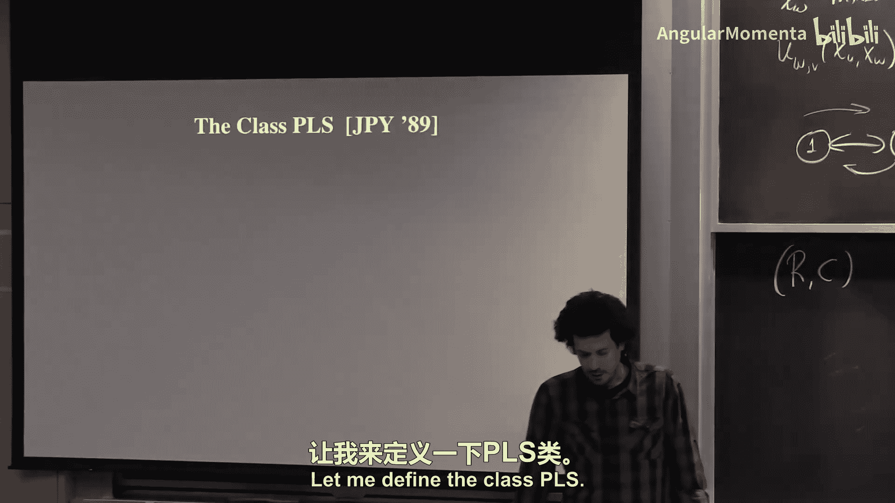
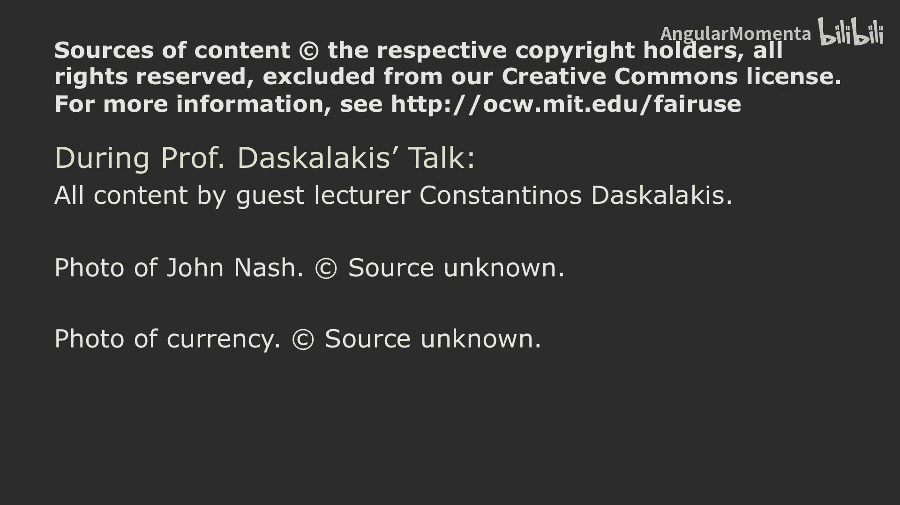

# 【麻省理工】算法下界 ｜ MIT 6.890 Algorithmic Lower Bounds, Fall 2014 p23 23. PPAD 归约 -BV1dPYpz9E4V_p23-

The following content is provided under a Cative Commons license。

 Your support will help Mi T OpenCourseware continue to offer high quality educational resources for free to make a donation or to view additional materials from hundreds of Mit courses。

 Visit Mitopcourseseware at Ocw。mt。 Eduu。

Alright， today we have lecture guest lecture 2 of2 by Costata Scacs。 Alright， I glad to be back。

 So let's continue on the path we followed last time。 Let me remind what we did last time。

 First of all。 So I talked about interesting theorems in topology， Nash Spner and Ber。😊，And I。

You know， define the corresponding。 So these were the theorems in topology or define the corresponding problems。

And because of this existing theorems， the corresponding search problems were total。

And then I looked into the problem scene in P that are total and。

I try to identify what in these problems make them total and try to identify a combinatorial argument that guarantees the existence of solutions in these problems。

Motivated by that argument， which turned out to be a parity argument on the directed graph。

 I defined the class PD。And I introduced the problem arithmetic circuit set。From which with。

 which is PD complete。 And from， you know， F， from which I promised to show a bunch of PD hardness reductions this time。

So let me remind you the， you know， silent points from this list。Before I keep going。

 So first of all， the PD class has a combinatorial flavour In the definition of the class。

 What I'm doing is I'm defining a graph on all possible and strings。 an exponentially large set。😊。

By providing two circuits， P And N， P is a circuit of possible。Father。

And N is the circuit possible child。And given these two circuits。

 I establish a directed edge between string V1 and string V2。

 if they agree on their parent relationship， meaning V2 believes V1 is his father and also V1 believes V2 is its child in that case。

 if this condition is true， I establish a edge between these two pair of nodes。

And I do the same for all pair of strings。 And in the end， I get a graph。

And the problem end of the line is given these two circuits and the corresponding graph that they define on this set。

If the old ze string is unbalanced。Meaning different in and out degree then。

I want you to find another unbalanced note。String。Okay。

Which is guaranteed to exist by the party argument。And PP。

 is a class of all search problems in F and P that are redducible poly normal time reducible to this problem。

I remind you I'll remind you also of the structure of the graph defined by these two circuits。

 it's easy to verify that if my edge definition is this。

 then every vertex has in degree and out degree at most one so the graph that' is induced by these two circuits will have this form and basically I'm looking for all red points。

I mean， for any of these points， any of these red point strings are solutions， any unbalanced string。

 except for the old zero string。 If the all zero string is not unbalanced。

 then I don't want you to do anything。 if it isn't balanced。

 then I'm looking for any of these red vertices。 So that's the class PD。

 and it has a combator flavor。 Okay， so I'm defining a huge graph。 We are these two circuits。

 and I'm asking you to find any of these red points。 Okay so。On the other hand， sort of like the。

 the problems we were targeting nash equilibrium browers serum were， you know。

 had a more continuous flavor。 So instead of working directly with this problem end of the line and trying to reduce the this problem to Nash and two brower to establish beauty hardness deductions。

 I actually introduced a problem that's actually， if that's closer to this problem， which is。

 it has a continuous flavor， and it was the problem arithmetic circuit set。😊。

There were a bunch of prongs last time but the definition of the pros I decided to be more explicit about what it is。

 So basically I'm giving you a circuit that has two types of nodes， variable nodes。

 V1 through VN and gate nodes， Z1 through GMM。 Now every gate node has one of six possible flavors。

Okay， it can be an assignment assignment gate。Ladiian gate， the subtraction gate。

Set equal to a constant gate， multiply by a constant gate and comparison gate。Depending on the type。

 it's going to have from zero to three inputs to two inputs。 and it always has one output。 Now。

 what I wanted to emphasize is that this graph doesn't have inputs。Input variables。Okay。

 the loops are allowed。And what I want to emphasize。

 which I didn't emphasize last time is that variable nodes have in degree 1。And gates have 0。

1 or two inputs， depending on their type。Otherwise， you know， for instance。

 the art of a note could be arbitrary， the fan out could be arbitrary， doesn't matter。Okay。

 but you have to respect this every no every variable node has in degree 1。Every gate node has0。

1 or two inputs depending on the type。There are no edges between gates and gates and variables and variables。

 that are only edges between variables and gates and gates variables。 Okay， that's the input。

 The input is a circuit that has this form。And what I want you to do is I want you to find an assignment of。

Real01 values to the variables of the circuit。Such that the co the the。

 the constraints of the gates are satisfied。 And here are the constraints of the gates。 Okay。

 so if the gate is an assignment gate， I want that the output node。

 the node who's connected to the output of that gate。

Has equal value to the node that's fitting into that gate。If the gate is additionion gate。

 I want that variable node who。The output of the connected to the output of the game。

To be basically the sum of the values of the inputs。To the addition gate。

 except I'm also going to threshold it。 I'm not going to allow it going above one and so on and so forth。

 So these are the gate conditions。Okay， so now what I said last time is that。

A satisfying assignment always exists for this problem。It's not a prior。 so it requires work。

 It actually it is going through a fixed point to argue that there is a always a solution to this problem。

What I also claimed last time is that it's P decomplete to find a satisfying assignment。

 So it's a natural starting point for reductions。What I also said last time is that in fact。

 I can allow some noise in the error in the gate constraints， I can allow plus minus epsilon。

Dviation from the gate constraints。And okay， so this will be a minus epsilon， sorry about that。

And this epsilon is part of the input okay so can I can sort of like I can give us input both a circuit and an epsilon。

 and I will ask you to satisfy the gate constraints within epsilon。No。

Last time I also showed you the structure of the hardness proof for Nash。

 which basically took the generic PPD end of the line problem。

Genetic PD complete from end of the line。 it embedded it into geometry， into the 3D cube， then it。

Deine a version of Sperner's lemma， which then introduced reduced to arithmetic circuit set。

And I didn't show this part of the reduction， and I'm not going to show it because that's the complicated part。

But what I'm， I'm gonna show is how to go from this problem。

 the arithmetic circuit set to na equilibrium。 Okay。

 just to show how easy it is to work with this problem reduced to other problems。Okay。

 so that's where I wanna go for on。 So， okay， so that was the， that's the review from last time。

 And this time I wanna talk about， I wanna show the PPD completeness of na equilibrium。

I'm going to briefly give。Two other examples。That haveve come from combinatorics。 And then lastly。

 I'm going to talk about other existence arguments and the complexity classes that they defined。

So I'm going to introduce this class PPA， PPP， and PLS。Before I do that， also。

 that was a question from last time P P this stands from polynommal parity argument in directed graphs。

 Okay， corresponding to the fact that this class is defined with this parity argument on directed graphs in mind。

 Okay， cool。So let's focus on this reduction from circuit to Nash。

I want to introduce a concept before I show the reduction。

 That concept is graphical games in poly matrixtrix games， special case of graphical games。

So graphical games were introduced in 2001 by Ks Lippman and Singh is something very natural。

 Basically， they tried to capture situations where the payoff of a player only depends on the actions of a few other players because of。

 you know， geographicalal communication or other constraints。 So in a graphical game。

 the players are nodes in a graph in a directed graph。

And a player's payoff only depends on her own strategy。

 as well as the strategies of the players that point to him。Okay。For example， this guy is payoff。

Depends on this guy's， this guy and this guy's action。

 because all of these guys point to him as well as his own action。呃。

A special case of these games was actually introduced much earlier。😊。

So polyms games are graphical games where the pay of functions of the nodes are actually adss by separable。

So for instance， the payoff of this guy。As a function of everybody's mixed strategy。

Is just separable over all edges that point to him。Of some pairwise。Ba of function。

That has to do with。His action and his neighbor's action。Okay， that's what's written here。

And it's not very hard to see that any。嗯。So， this is。A utility function that depends on。

The two mixed strategies， right？And， you know， by assumption。

 these players randomized independently of each other。 So any such。

Expectation over a pair of player strategies。That a product can actually be written as a quadratic form。

do you see that。So if let me write it on a board。So again， so x use the X v。Is the mixed strategy。

Of player V。X W is the mixed strategy。Of W， what I mean by U。W V。X U comma Xc。

X W is basically an expectation of an in actionction。As u drone from X U and action S W。Sorry。

 S v drawn from X v， S W drawn from X W independently。Of。ああ。And that's just a sum， right。

 overall as used and overall as。Ws of。A you know you W。PW。And then the probabilities。

And that's a quadratic form， if I right， so。That's what I mean by this line。

Because players play independently from each other。Any expectation。With respect to that。

 product distribution is a quadratic form。I'm not saying something interesting。Okay。Good。😊，Okay。

So then a poly matrix game is really because of this is defined by a directed graph。And then。

 for every directed edge。And every there is a matrix。That defines the quadratic form for that edge。

Okay， so poly exam this is easily described。 It you can。

 you can describe by specifying the graph and then giving a matrix for every directed edge。

So by matrixtri here is our two player games。So that's why these are called poly matrixtri because you have many matrices。

 okay。The two player game。 you only need to give two matrices。

 one for a two player game is just player one。Pear 2。

 and you give one matrix for this direction and one matrix for that direction。

 So that's a by matrix game。This is a polymetrics game。Okay。Okay， good。Now。

 what I want to do is I want to。Before sort of in order to reduce arithmetic circuit set to Nash。

 instead， what I'm going to do first is I'm going to reduce arithmetic circuit set。

To finding a na equilibrium in a polymes game。That's what I want to do first。After I do that。

 then I w， I'm gonna reduce it to。 So here I have many players。 I wanna go down to two players。

But the first step is to just go to many multiplayer naa equilibrium。

 Then that reduction is the easy part。Actually， also， this is an easy part。

 The hard part that happened before。Okay， good。 okay， so now how do we。

 how can we reduce an art arimetic circuit cell problem into a polyime game na equilibrium problem。

Like in L completeness， for like， you know， in reductions for N P comp LP hardness proofs。

 you have to give gadgets， right， You have to identify objects。

In poly matrixtrix games that simulate the operations that happen in your circuit over here。

 So what I want to introduce is， I want to introduce what is called the game gadget。

These are small polymetricx games that do values arithmetic operations。

Which I can then put together to simulate an arithmetic circuit set。Problem。hu。

So what I wanna do is I'm gonna give you， you know， a flavor of these gadgets。

 I'm gonna give you the addition gadgets。 So I w give you a。Polymetrics game that does addition。

So it's gonna have this game is gonna have。Four players。Every player will have just two strategies。

0 and 1， two pure strategies。 hence the mixed strategy of that player is going to be a real number in 01。

 which corresponds to the probability by which this player plays one。Okay。

So here's the structure of the gadget。 Okay， so this gadget。

 I'm showing it here embeddedbed into potentially bigger poly matrixtrix game。

 But the gadget itself is gonna have four players， X， Y， W and Z。Now。

 X Y are what is called the input to the gadget， so these are players who point to w。

But don't depend on the actions of W and Z because there are no directions going the other way。

 So these guys are don't care about what these players are doing right and they serve as an input to the gadget。

Now this player W gets us input all know player strategies in this gadget。

Well he only cares about what W is doing。Okay， so X and Y are gonna be called the input players to the gadget。

 This is gonna be the is gonna be called the output player to the gadget。

 And w is gonna be called the auxiliary player。Now， what I wanna do is I wan to define。 So what。

 the only thing I'm gonna define is the pay of function of W and the pay function of Z。

 And I'm gonna define these pair of functions in a way that addition somehow happens。

At a na equilibrium of this little game。嗯。So I'm gonna define the pair succinctly。

 but then I'm gonna convince you that these really correspond to tables。

So I'm gonna say that W is paid and expected。Depending on what he plays。 So he plays 0。

 he gets paid and expected。Probability x equals 1 plus probability x equals y equals 1。If he plays 0。

 but if if he plays one， he， he only gets paid probabilitybil equals $1。 Okay， in some sense。

 if he plays 0， he looks to the left。 If he plays one， he looks to the right。

 His payoffs are the sum of these two guys probabilities of playing one。

In one case and one and this pro this guy's probability of playing one in the other case。 So that's。

 that's the pair function to W。Now you would ask me， you know， maybe。You know。

 how can you implement these pair of functions and that's actually very easy。

 So here is the table for player W。So when w plays1 plays 0。I'm gonna his payoff。

 depending on the strategies of x。And why。I'm going to define it to B 0，1，1， and 2。Now。

 notice that in expectation over these over x's and y strategies。Hiss payoff so if he plays zero。

 his expected payoff over x and y strategies。It's just the probability that x plays one plus the probability that。

Why place one？ Do you see this from this matrix。So what's the expected payoff？To W。

When he plays zero。Well， this is one if y plays one。But x plays 0。And it's one if x plays1。

But y plays 0。And it's two， if they both play one。And I claim that if you appropriately correct collect the terms。

 this is just equal to probability Y it plays one。And X play the one。Right。So that's what I learned。

Okay， so I covered this line。😊，This line is also easy to cover by saying that when W plays 0。

 his path just depends on what。See is doing。And it's going to be like this。Oops。So when w plays1。

 his expected payoff is exactly the probability Z plays1。Right。

 so what I've written here is actually consistent with some tables。That I'm hiding from this slide。

Okay， so that's， I guess that's what I。What what what right？And then similarly。

 Z is paid to play the opposite of W。 What do I mean by that。 I mean that。

This payoff when he plays zero is exactly1 half no matter what W does。But if he plays one。

 his payoff is1 minus。W plays one。Which again， you should be able to see that there is a table。

 a little table implementing this pair of functions。Okay， now that sounds weird。

 Why did I define it this way。 Here's my claim。In any na equilibrium of a game that contains this little gadget。

The probability that the output player plays one is basically the sum of the probabilities that the input players play one。

Tresshold at one， of course。Okay， so if this little gadget are defined here。

It's part of a bigger game。Now， what does the bigger game。

 What can the bigger game do So it can fit star， It can fit something into x。

It can take the value of Z and use it in some other way， potentially looping around。

 doing anything at once， except。You know， the only inputs to Ws payoff are X， Y and Z。

 and the only inputs to Zs payoff is W。 But otherwise， the game can be arbitrary。Okay。

So if this game that I defined here is embedded within a bigger game。

Then in any natural gl of that bigger game。The probability that this guy plays one is exactly the sum of the probabilities that these two guys play one。

 threshold are one。Now， how can we see this？ Why is that true。It's a little case analysis。

 It's very simple。 Let's try to do it。Let's say that。So suppose that probability that z plays1。

I smaller。Then the probability x plays one。Plus， probability， white well。Actually。

 let's do something else。u。It's smaller than the let see， the min。Between this and the one。

What happens in this case So is So what happens if the is smaller than the minimum of these two valuess？

What is W going to do in that case？Yeah。Yeah， because 0 gives him much higher payoff。

 it gives him higher payoff than this guy， right， But because of that condition。So this implies。

That W。I's going to play 0 with probability1。Now， what does this imply。If w plays 0 with Rob to 1。

 what does z do？If you plays zero a guess point 5。 what if you plays one。How about this get。

It gets's one。Right， because without condition。So。He's gonna play what one。 right。

 So this implies that。But how can one be smaller than the minimum of one and something else that can't be。

 right？ So this is impossible， is that。So let's do the other side。

 or maybe you already trust me that it's okay。呃。Let's try to argue that this cannot be the case。

I don't need to do the mean anymore because it can' possibly be that this guy plays more than one probability。

So this is the only case I want to consider now。Co。So what happens in this case？The same logicic。

What does W do。PI to play one，ca that's a better strategy。And what does he do。感知。

But0 can't be bigger than to the sum of two probabilities。 So this and that can't happen。

 hence the only case that's possible。Is this one。Yeah。Okay， so it's very simple。 Okay。

 so the only realization one had to do is that。You know， like， you know。

 where the arithmetic happens right， than happens in the mixed strategies chosen by the players。

 That's where the arithmetic。So， then。呃。Okay， so this is the addition gadget。 Similarlyly。

 one can define other gadgets。 For example， the subtraction gadget is really， really similar to this。

 except with one change。I replace this plus with the minus。Okay， that's the only change I need to do。

In other words。I'm not sure I want to do it， but in other words。呃。This table。For。

 for only change this table。To have。0 here and -1 here。

And I'm exactly implementing that the subtraction。And the proof is exactly the same。

 you can argue that in any na equilibrium of a game that contains this gadget。

The probability that this guy plays one is actually the difference。

Of the probabilitybabilities that x plus 1 and y plus 1。Apply tra at 0。Any questions about what。

Taking place。What we're trying to do is we're going to want to take a arithmetic circuit。

 that instance。And we want to create a polymx game that simulates that circuit its cell instance。

 And what we need for that is gadget。 so a little。Polymes games that implement various operations。

And I showed you addition and subtraction， but I claim。That you can implement bunch of other gates。

 So to。You know， sort of like give my not to to have a more succint notation。

 I'm gonna use probability that some node plays one。 I'm。

 I'm not gonna differentiate down within x and the probability that x one。Okay。

 so with this notation， I claim that we can implement all the gadgets that we need to simulate a circuit cell instance。

Okay， so let's look at this table。 So in all these lines of this table。

 Z is the output player of the gadget。X and Y are the input players of the gadget and potentially the gadgets implementing each of these gates use auxiliary players like in the addition case I was using one intermediate player was the auxiliary player。

And the claim is that， you know you can implement gadgets such that if any of this gadget is contained in a bigger poly matrixtrix game。

😊，Then are any natural equilibrium of this bigger E poly matrixs game？

These conditions are satisfied by the output and input players of the gadget。Okay。

 and this is as long as you don't mess up with the gadgets。

 meaning that the bigger game can have edges into the input players of the gadgets and edges out of the output players of the gadget。

But I claim that you can implement all of the gadgets that you need。So in particular。

 if you have an instance for arithmetic circuit set， you can create。

That poly matrixtri game by composing。Gdgets。For each of these case。

So that any national level of this poly mat game， all gate conditions are satisfied in particular。😊。

You are by finding a natural contributor of this game， you are solving。

The instance of a of arithmetic circuit set you started with。So that's the idea。

Any questions about what what happened。So far in the lecture。

Questions about these reduction or how the gadgets work。Yeah。

 does this seem a valid proof that every instance that our athletic circuit set has a satisfying assignment。

 Yeah， that's that's correct。Because this is a game， so by na theorem there is a na equilibrium。

 hence there is a solution to that， because na equilibrium is a solution to that。

So that's exactly right。 So that's how we get it。One thing that' is not exactly obvious。

 what you can argue that its true is that actually not only there is always a solution。

 but there is a solution in rational numbers。With polynommal description complexity in the input size。

 So that requires some linear programming。Techniques， but that's also easy to show。 So you know。

 a priori， but Na The will give you that a solution exists。

 We wouldn't give guarantees about the description complexity of that solution。

 But using linear air programming。 And you can argue that there is always a rational solution with normal description complexity。

Are you interested in seeing any of these gadgets？D yeah， I've only showed addition。

 Do you wanna see anything else。Do you believe me that I can actually do that compare someone that has arbitrary output for certain conditions。

 It seems interesting。 Okay， I can show that。 So let me try to do the comparison gadges。

 They're actually simpler than the addition gadge。So yeah， so I want to implement comparison。

 So I'm gonna to have the input players。And the output layer。

And the payoff of the the payoffs of the output player are， let's see。Right， so if he play 0。

 then his payoff is only depends on x。It looked like this。 if you place。Well， let's see。

 let's see if it works。 I haven't。 I haven't prepared it， but it says it to the console， I guess。

Wheres case sell backpack。Okay， so now what I want to argue is that。

Let's bring up the conditions that I need to satisfy。Okay， so I want to satisfy those conditions。

So let's see if I do satisfy these conditions， Okay， so。I messed it up a little bit， I guess。

 so I have to。It place X here。And why here？Okay， now let's see if it's true。 So I claim that if。

Probil X。Is bigger than probability。Why。Then what what do I prefer to play。I prefer to play Z， right。

Similarly for the other case， when they equal， anything is possible。I that's that simple。

 there's not much threeing going up here。Okay。Cool。

 so I've established that this direction of the this， this part of the direction。 Now。

 I wanna go down from a poly matrix game。😊，To to player game。Thats the next part of the lecture。

 how do you go down to two players？Well， the first thing to note is that。All the。Gates can be。

Implemented with bipartite graphs。 Okay， so if you remember my addition gadget。嗯。

So remember my addition gadget it had the input and the output players on one side and the auxiliary player on one side。

 my comparison gadget does not satisfy this property because the input players and the output players are on different sides。

But I claim that you can implement actually comparison by adding a next an additional step with a bipartite graph。

 So I claim that all gates can be implemented with。

Poly matrix game that have input and output players。On one side， an auxiliary vertices on， on one。

 on the other side。Okay， so our claim that。Oh my god， it's actually bipartid。So in particular。

 I can color this graph with two colors， blue and red。😊。

And what I want to do is I want to create these super players， I'm going to call them lawyers。😊。

I'm gonna have。I'm going to have a red lawyer and a blue lawyer。Okay。

And the red player is going to represent all the nodes that are color red in here。

 Well the blue layer is going to represent all blue nodes。嗯。

And what I want to do is I want to define the lu game in the next slide。Okay， so every lawyer。

 so the red lawyer， his strategy set， is the union， not the product。 the union of the。

 that's important。 Otherwise， my reduction would be exponentially large。

 my reduction would' be polynomial。So every lawyer and that poses actually technicalities in the construction that I'm about to present。

 but every lawyer will have as a strategy set， pure strategy set。

 the union of the pure strategy set of the client that he represents So the red lawyer has one strategy for every strategy of every red node。

 the blue lawyer has one strategy for every strategy of every blue node。😊，Well。😔，Now。

 what I want to do is I want to define the payoffs in the lower game。

 What are the payoffs in the lower game。Well， what happens if the red lawyer decides to play strategy the eye of red。

Client， you。And what if at this， the the blue。L here plays strategy J of Blue node V。😊。

What are the payoffs of the two layerss in that choice of strategies？Well。

 it's going to be exactly the corresponding payoffs of the nodes of the poly matrix game。If。😔。

So the red lawyer get will get the payoff that you would have gotten in the polymetrics game if if the two these two players play played INJ and the blue lawyer is going to get his client's value So these value under the same the same choice of strategies。

So in particular， if there' is no edge between these two nodes that blue and red lawyers chose to play。

Nobody gets anything。That's the， the， the pay of here is gonna be 0。 You know。

 if there is a directed edge from V to U， then this is gonna be 0。 And that's not gonna， you know。

 that's whatever it is and vice versa， but you get there if。

If the blue lu decides to represent a client and the red lu decides to represent。Another client。

 and the payoffs of the lawyers are the corresponding payoffs that the clients would have gotten had deployed the strategies that the lawyers decided to play for them。

That's the definition of the lowerrry game。Is it clear。Now， the wishful thinking is。😊。

That if x and y is a na equilibrium of the lawyer game。Then if I look at the。

Marginal probability distributions。On the different nodes。From the different clients by their lawyer。

 then these marginal probability distributions are a na equilibrium。So the wasteful thinking is that。

If I start with the non equilibrium of the lower game， then if I look at。The distribution that。

The red lawyer， the marginal probability distribution that the red lawyer places on every red node separately。

And the marginal probability distributions that the blue layer places on all blue nodes separately。

 So all this collection of marginal probability distributions。

That this collection is a natural equilibrium of the polymer matrixtrix game。

That's a wishful thinking。你。Questions about what the whistle thinking is。Okay。Okay， of course。

 this is that useful thinking because we know how lawyers behave。

They only represent the lucrative clients， right， And， you know， our priority， there's no reason。

That the red lawyer would。Have incentive to choose。At least some strategy for， you know， to place。

Positive probability mass on every node here represents maybe in a na learn of this lower game。

 some of these marginal distributions are actually undefined because the lawyers are ill defineded because the lawyers place zero probability mass。

On the strategies of those nodes。Okay， so that usefulful thinking isn't going through。

 but there is some truth to that。 So there is a way to fix it。

 So here's how we're gonna fix the lower game。So we got， we know what lawyers like。 They like money。

 okay。So we're going to define a high stakes game。That the learns are going to play on the side。

At the same time as the actual game that we're interested in。 Okay， so for a lot of cash， Okay。

 so these are the stakes of that game。We're going to do the following so some terminology first。

 so suppose that without loss of generality， suppose that every lawyer has n clients he represents okay so and let's label the red lawyer's clients1 through n and the blue lawyers clients1 through n if you know one of the two lawyers have fewer clients and we can pad this with you know dummy players and that doesn't change the polymetrics games equilibriumria。

😊，So。Suppose that both lawyers represent the same number of players， clients。

 and let's label both lawyers clients one through n in an arbitrary way。Now。

The high stakes and the st of the high stakes game are exactly the same as the st of the game that I showed in the previous slide in particular the red lower has the union of the sts of all blue nodes。

 the red and the red lower has the union of the str of the red nodes Now what's the high stakes game。

😊，Suppose that the red layer plays any strategy of client J and the blue layer plays any strategy of client K。

😊，Then， if。They choose different clients。They both get $ zero dollars。

But if they get choose the same client， I mean， it's not the same client。

 It's the same label of a client， right， because they each represent different clients， right。

 But if they choose different labels。Then they both get 0。 if they choose the same label。

The whoever it was the。Red lawyer gets a lot of cash， and the blue lawyer loses a lot of cash。Right。

Okay， again， so this game has the same strategies as the。

Lawer again that I showed in the previous slide。Except now in this game。

 all the lawyers care about is the labels of the cl of the。Clients whose strategies they choose。So。

 if the。Choose a strategy。Of a client that has the same label。

 then the red lawyer gains a lot of money and the blue layer loses a lot of money。

 but if they choose strategies of clients with different labels， then they both get zero。

In other words。In some sense， the blue letter is trying to avoid。

The red lawyer and the red lawyer trying to catch the blue lawyer， okay。If you want。

So now this is a simple zero sum game and it's not hard to see that in any nash equilibrium of this game。

😊，So the unique na， I mean， in any na gl of this game the。Lawyers is gonna are gonna represent。

Every client with the same probability， so。It's lower as signs probability exactly 1 over n。

To the set of his strategies corresponding to each of his clients。

So the high stakes scheme has the property that the lawyers represent。Other clients。

With the same probability distribution。And you can divide those probability distribution in an arbitrary way。

 within the。Strategies of each of their clients。In this game。That's easy to see。

Just by the symmetry of the game， this has to be， right？And。With these two definitions。The game。

 really the game that I'm going to do for my reduction from polymex games to two player games is going to be the sum of these two games。

Okay so this is the game that I defined earlier right and this is this matrix is a block matrix。

 so this is a block of strides corresponding to this matrix is a matrix that has a constant matrix。😊。

Where everything is big。And this block corresponds to these are the strategies of client with label  one for the red lawyer。

 And this is the， the strategist of the。Client of the blue lawyer with label1 and so so forth us。

 So this is a block matrix and。There are Ms and minus ms in these diagonal blocks。

 and everything else is 0。So that's the high stakes game。 It's played among。

Blocks of st diss all located to is the label of the client I'm choosing for each of these lawyers。

Well， this is a more fine grained game where I not only care about which clients I'm choosing。

 but also which strategies of these clients I'm choosing。And。I'm going choose a name that overwhelms。

The payoffs in this game。 So this condition is okay for what I'm about to say。

 But think of M as huge compared to the maximum utility in this game times the number of threat of clients in that game。

Yeah， just sure I understanding this so far。 So in the naiveive game if the two if the red guy chooses strategy and the blue guy chooses strategy and the two vertices they choose from are not connected by an edge。

 they just both get zero。And if they're connected， they get payoffs that the corresponding nodes would have gotten with these two ex。

 yeah。Right。Cool， any other questions about yeah， even really large up a little bit yeah。

 it will miss mess it up a little bit。 So the national equilibrium of this game。

 the additional of these two games is not gonna have the property that this game by itself had。

 but it's gonna be very close。 and I'm gonna be specific about it。

Even for arbitrary large M I can't actually quite show that the lawyers represent their clients exactly equally。

 but they come really close and the larger Ms， the closer they come So in particular I can show the following statement that in any naash equilibrium of the combined game。

If x use the total mass that the red layer places sum on the union of strategies of node U。

 then that's about1 over n。But there is a matter that decays with them and similarly for the blue lawyer。

All， so approximately。They're representing all their clients。And if I choose M huge。

 then at least my marginals are well defined now， right。

 So there is probability mass on every client。And I can define these marginal distributions。Now。

 whether these distributions are useful or not， we are about to see。Okay。

 but what I'm saying here is that as far as。Deciding how to split。The pie into my clients。Really。

 the large game is what matters。 The high stakes game is what matters。 because if I make a mistake。

You know， M is huge， some hugely punishist。 So for splitting for decide how to split my total unit of probability mass into my clients。

 only the high stake games essentially only the high stake games matter。On on the other hand。

When it comes to， you know， having decided had how much mass to put on the union of a particular node strategies。

 deciding， you know， about the fine grain， you know， the fine grain decision of how to allocate that。

X U into the different strategies of that node U。 Then actually only the small game matters。

And the reason is that。The pay of difference of the red， let's say， red lawyer。From strategies U。

 I and U J， so to distinguish between strategies I and J of node U for the pay of difference between these two choices。

Doesn't have M in it。 If you， if you actually look at it， M goes away。

 There is no M in the pair of difference between these two。Opts。

So which one is better doesn't have eminent， okay。嗯。Essentially， it doesn't have a minute。

 There is some me here。 I mean， because this。You know。I'm soundming over all nodes。

 and different nodes have。Different。Some of probabilities， but。I'm going to get to that。Okay。

 but just trust me that when they red lawyer。Is trying to decide how to allocate。This X U。

Probability that he has decided to allocate on the different strategies of node U。

He looks at this difference。 That's the difference in the two paos。 And essentially。

 there's no M in this equation。 So we're going see where M gets into the picture and why。

But this is just from the definition of the game， I claim this is exactly true the difference of the twoeos is exactly this。

Now。From that equation， it follows that if the learn decides to put positive probability mass on a particular thread the I of that node。

Then this， for all Jays， for all alternative strategies of that node that he could choose。

 it better be that this pair of difference is positive。And that is really。

 really looks like the condition of the na equilibrium condition for the client。😊。

If you think about it because。If I define， you know， the marginal。Probabilities。

Of now do on these two strategies on these strategies。

Then this is really the Nash then you know the Nash equilibrium condition。For that node you。The only。

 the only problem is to go from this equation for。The un marginalginalized probabilities， the Y V L。

To the marginals， I'm dividing with something and that something isn't equal for all these。

So if it was equal， then these marginals would actually be directly in na equilibrium。

Because this condition I could just divide by you know1 over n。

 and this would be made a marginal probability and that's exactly the equilibrium condition for client U。

The problem is that these XVs are not all equal。Why why vs are not our equal。

 so I can just divide by one over n and claim that the equation is still true。But because。

 but the point is that this error doesn't create too much problems in the equilibrium conditions。

 And okay， it's not going be an exact nash equilibrium for the polymes game。

 but it's going to be an approximate one。And because I can take m to B as large as I want。

 I can make this approximation go to0 as as fast as I want。

 and you know remember this arithmetic circuit side problem allowed some error in it。

So what effectively is going to happen here is that， okay。

 so I'm going to get an approximate equilibrium of the polyimes game。

 so that would correspond to an approximate equilibrium of the arithmetic cell problem I started with。

 but this approximation can be accommodated and the problem is still PP hard。😊。

So that's approximately how the argument works。So this you know。

 the fact that the distribution aren't uniform doesn't really matter as long as M is chosen large enough。

I went a bit too fast so I I didn't mean this to be sort of like very detailed。

 but I meant to convey the you know bigger picture and the bigger picture basically says that you can analyze what happens in this lower game in two steps in one step you argue that the lawyers approximately represent all the clients。

In the other step， you have to decide how these lawyers allocate。

There probabilities to the different strategies of a particular node。

So that leads you to write down this difference of payoffs。

That the lawyer is experiencing when he switches。The that， you know， this。

 this is tracking how much better the expected pay from this strategy is compared to that strategy。

And by the equilibrium conditions of the lawyer game。

You get the inequality I showed in the next slide， that。

If the lawyer decides to place positive probability mass to a the I of node U。

 then it must be that there is no alternative strategy U J that would give him a better payoff so you get this condition。

And that's essentially what。😊，That's essentially the equilibrium condition for the polymes game。

Except that you need to normalize these guys。And when you try to normalize these guys。

 you run into the problem that you know the lawyers don't don don't play uniform strategies over their clients。

 they but they play approximately uniform distribution of their clients。

 So this inequality gets messed up a little bit。 So effectively that means that the players are almost best responding。

The marginal distributions are an approximate na equilibrium of the polymetrics game。Hence。

 you also because the polymetrics game came from a arithmetic circuit sat problem an approximate evaluation of that problem。

 but these are all PP hard as I pointed out earlier。That's the high level idea。And， you know。

 trust me， the details are not hard at all， okay， so。You just have to trust me that， you know。

Approximate uniform distributions， the approximate uniform distributions that I claim are true and that dividing。

 you know， dividing by you know。Approximately one over and here it doesn't mess up this condition too much。

So this was， this was the end of the proof。 Basically， that that's basically how a proof goes。So。

 if you have。If you have this， it's easy to to do this。 and then it's easy to go here now。

Any questions？Now， the reduction I showed you was not from the original paper it was from it was established by follow up paper by Che and Deang。

In our original paper， we actually reduced took this problem and reduced it to former player Nash。

And the only reason the proof is identical to the one I showed you。

 the only reason that we went to four players instead of two players is that we had our gadgets were fourheid instead of pie apartid。

 so we had four colorss and four layerss。😊，Now， why do we have four apartid gadgets Where we well being a bit silly。

 Okay， so we had in our arithmetic circuit， we had an extra gate， which was multiplication。

 not by constant， but multiplication of two numbers。 And you can show that this。

 but but we didn't use it。 were very bit silly。 Okay。

 so we had this gadget here that we weren't using。 And it was hard to map it it was， it was actually。

 it's impossible to make it into a bipartid gadget。 Okay， so， you know， in our original paper。

 we made it into a four apartheid gadget。 And then in a follow up paper。

 we actually managed to reduce it to a three apartid gadget。😊。

But then this multiplication guides that actually you can show cannot be reduced to bipartid。

 So these guys observe that actually， we are not using multiplication。So， you know。

 you can implement all gaes that we actually use with bipartgraphs。 So you can go down to2。

 two layerss instead of three lawyers。Okay。So， you know， it was you know。

 it felt like living money on the table。 but that's okay。Gu。Okay， that's。

My discussion of the PD completeness of Nash。Yeah， obviously zero sum games。

 it's easy to find an equilibrium， is there something in between zero sum games and general juar games for which any hardness result is known？

Yeah。A natural way to。Interpolate between zero sum games and general two player games is the following。

 So in in a zero sum games， let's go R and C。The pay of matrices of the two players。

 the game is0 sum。 If R plus C， the sum of these two matrices is identically0， as as。

 I showed as claimed in the the very first slide I gave last time。Now you can call a game run。R。If。

R plus C has rank。2。Okay， now what is known is that a rank 1。Games。Can it be solved in P。

I believe that it's known that rank three games。Our PD hurry。And you should look at the paper byruta。

Sorry。By咩有打咩。In 14， I believe。Wherehy she shows that。She might， might even be showing two rank2。

 but I'm not sure， maybe theres some。Gap there。Maybe maybe it's even。Okay， you know。

 so there is a constant where it's already P hard。Not。And， and you know， while I'm here， I mean。

 if you're interested interest， I mean， an interesting open question is。呃。

Approximate equilibriumlibra。 So interesting open problem。So， approximate na equilibrium。

Even in two player games， we don't know how to find them。 So let me remind you what they say。

 So and na equilibriumlib is a pair of strategies such that no one has an incentive to change his randomization。

 given what other player is doing。An epsilon na equilibrium。Is。

When these conditions are true to within an additive epsilon。 Okay， so no player has an incentive to。

 to more than epsilon additive epsilon incentive to change his strategies。Now。Okay。

 so u most additive。Apsilon incentive to change。Now， what do we know about these problem well。

 you know if the input to your problem is a game and an epsilon。

Then it falls from those results that that's PPcomp okay。Now。

 it's even true that if your input is a game。And you have a predetermin prespec epsilon。

 that's inverse polynomial。In the size of the game。

 so the input is a game and there is an inverse polynommal function and that's your epsilon and you want to find an inverse polynomial national equilibrium of this given game that still be complete。

But what is not known is Epsilon constant。How hard is it to find equiria when epsilon is a constant。

And if your matrices。Have entries in0，1。Then we know how to do this in time N to the order loggan。

Over absolute square。We know that there is no F P task for the problem because of actually。

 these results。FF up results to these results I what I claimed earlier about inverse poly normalmal accuracy prohibits an FP task for the problem。

But a ptas is possible what we have is the quasi pittas。

 so if you have a nethology game and youre interested in some constant epsilon then we can get you an epsilon na equilibrium and to the log over epsilon square time。

And because I'm looking additive epsilons， I'm also normalizing my payos to be 01。

 so that epsilon is。Related to the maximum payoff of the game。So that's what we have。 And it's a。

 you know， great open problem， if you can。Improve this。Or you know， also a lower bound。Okay。

 that's a great open problem。Speaking of which， if。The rank of this game is up to， I believe。

 logarithmic。 We know how to get a pits。Okay。Now I don't have too much time left。

 so I guess I had two options for today。 One was to talk about different problems that you can show PPD hard。

Or。To talk about other existence arguments。And I think I only have time for one of the two。 So。

 you know， right， So one is to。The other option is to show other arguments of existence in TF andP。

 So two examples or other arguments。What do you guys vote。So who wants two other examples。Okay。

 who's keeping the count？呵。I who wants that exists arguments。Okay。

 so I think there's a slight majority for other existence arguments。 I'm going to show that。Okay。

Cool， so PD is founded on the directed parity argument。

Other natural arguments of existence in cop aorotics are the following。

And each of them is going to correspond to a different complexity class。

This is a parity argument on an un graph。If an undirect graph has a node of odd degree。

 then it must have another node of odd degree。AlsoAlso known as the handsh gl， I believe。呃。Well。

 this is another simple one。 If a， you know， any dog has a sink。

That's gonna give rise to the class P， L S。呃。And that's the pigeonhole principle。

 If you have a function mapping n elements to N -1 elements， then there is a collision。

That's going to give rise to PPP。 So VPA stands for polynommal parity on undirected graph， PL S。

 polynommal local search， PPP， polynommal pigon principle。

And I'm going to define them formal in the next few slides。

So I'm going to start with VPAA just because it's very similar to PD， except there's no direction。

And。The input to the problem is a circuit。That induces a graph overall all and width strings。

So the circuit gets us input and nos。outputputs。2 strings。So， ks equal one string up it two strings。

Now， this circuit induces a nondirective graph over all possible strings in the following way。

There is a net between thing 1 and S 2， if。V1 is in the output list of V2。

 and V2 is in the output list of V1。Okay， so this circuit gets n bits as input and has two n bits as output。

And no matter what it is， it doesn't use a graph over strings。

That places an edge between these two strings。If V1 is in the output list of V2 and vice versa。No。

In the same reasoning as last time， in the same spirit， as last time。

 any input C is going to reduce a graph with a particular structure。 What's that structure。

The out degree of every node is what at most two。Hence。

 the graph that is induced by any given circuit has got a big collection of isolated vertices。

 cycles and paths。The odd degree node problem is the following if the zero string is has odd degree。

Then I want you to find me another node with odd degree。

 which we know exists by the handshking lemma。Otherwise， if0 to the n has even degree， you know。

 just say yes and you know， call it a day。Now PP is the class of search problems。

And P that are reducable poly time reducible to this problem， the odd degree node problem。

Whose graph structure is know like very similar to PD， except there are no directions。

So any circuit C defines graph of this form。Except the graph is over exponentially many vertices。

 so we cannot just go and。Check every no。Every node degree。 So the question is if0 to the n is。

Has odd degree， then there must be another node of odd degree。

 Any of these nodes is a valid solution to the problem。

Something that I didn't mention before for PPD， but it's useful to mention。

 and I'm also going to mention it for PPA。If I insist on finding the other end of this path。

 of this specific path that started at 0， the problem is not in F and P。Okay。So it's crucial that。

Given the unbalancedness or the odd degree of this node I allow you to return any other unbalanced or any other odd degree node that's very crucial if I insisted on you returning me the other endpoint of the path that starts at0 thats above andp basically because there is no sort certificate that this node is in the other end of the path starting at0 okay so it's very crucial that I allow you to return any odd degree node。

Okay。Now， an interesting problem that is in this class。😊，And as far as we know， not in PPD。

Is the pro Smith。Which is。Given a Hamiltonian circuit。In a three regular graph。

 find me another Hamiltonian circuit。In this graph。Now， this graph is not exponentially big。

 It's actually a graph that you can write down。 Okay so I give you a graph。Explicitly。

And I also give you Hamiltonian circuit in this graph。

I claim that there is another Hamiltonian Circuit。OkayThe question is， find it。Now。

 why is there always a Hamiltons？ Well， that follows from a theorem by Smith。Say that。

 a theorem by Smith implies that there is always another Hamiltonian。P。

 and let me actually show it to you。 It's very simple。

So here is actually a copy from Pabariittri's 94 waiver。I guess there is a missing apostrophe here。

 In。 So here's the input graph， okay。And obviously， I mean， obviously， this。

Is the Hamiltonian Circuit， right？I I'm following the outer boundary here going inside。

And then coming back here。 Okay， that's the Hamilton circuit。 And here is the same circuit。

 except I've removed one edge， X and Y。And here I'm。

 I'm showing a bunch of operations you can do to this Hamiltonian path， circuits。 I mean。

 this is a Hamiltonian path。To。Create another Hamilton in path with the same edge missing。

Hence adding that edge， you get another handton in circuit。

And the series of variations is very simple。😊，So。What you do is the following。 So you know。

 So you start with， you know， it doesn't matter。 I can start with an arbitrary nodes， but all this。

 all this， all the circuits， all the circuits I'm gonna be defining。That。

We'll have x as one of the two endpoint。 but the other endpoint is going to be moving around。

And in the end， it's gonna get back to the， this vertex。

 Hence I can add that edge back and get the circuit。 Okay， so I start with the circuit。

 I remove one edge， X and Y。And I'm about to show you that there is another Hamiltonian path that misses the same edge。

 but is different than this one。 So it's going to be that one。 Okay， now。

 let me try to argue that there is another Hamiltonian path that is missing the same edge。

How am I going to do that well？😊，In the sequence of Hamiltonian past are going to define X is going to stay fixed。

 Y is going to be moving around。 Now， let's land somewhere in the middle here。Okay。

 so now why is this guy？Why， because the graph is3leg。😊，And why is an end point？

There is exactly one edge that's used in the Hamiltonian path。

And there are two edges that are missing。I'm going to try to add both of them。

And have and get a circuit。And get a path， a Hamiltonian path。 Okay。

 What would happen if I tried to add this edge。Into this path。Well， that wouldn't be a path anymore。

So because this guy would have degree 3 if I had that。

Now I have to kill one of the two edges adjacent to this node。

And I'm going to kill the one that maintains the fact that the graph is connected。

So if I add this edge。And I kill this edge， I'm screwed。The path is not。

 The graph is not connect anymore。 So very kill that edge。 So it happens here。I read that edge。

 and I killed that edge。And this is what I got。If I try to add this edge。

Then this node will have degree 3。 I have to kill either that edge or that edge。

I can kill exactly one to avoid disconnecting my graph。And I'm going to be killing that one。

 and that's going to bring me here。So， every。Hamilton and path。A。

Has exactly two neighbors corresponding to。Adding one of the two missing。

edges from the y end point of that path。And there's only one way this thing can stop。Well， you know。

 by arriving at y， okay， which will give me if I don't arrive。

 if I don't get end point Y to come back to its original position， like I， I'll keep going。Okay。

So this this， in other words， like my proof of Spner。

 what I did here is I defined a neighborhood relationship between Hamilton and paths。

 which was adding an edge。😊，One of the two missing edges from the endpoints。

And I know that the only stopping condition is if I get here。AndThat's why Smith isnt PPPA。Now。

 it's a very interesting problem。To show that this is PPPAA complete。You。😔，呃。

Let me define the class PLS。That was defined earlier by Johnson Papari Miri Yanakakiis。Now。

 I want to implement a class that exploits this argument that every duck has a sink。

 The way I'm going to do that is I'm going to give you two functions。

Function C is going to take both of them are have n bits as inputs。

This guy C is will I put a list of strings of list of case strings。

Okay so it has n bits as input and K n bits as output。While this guy is upbring some real number。

I mean， some rational number， whatever。 but I interpret the output of this circuit as a number。

 I interpret the output of this circuit as a list of other strings。Now。😔。

Add a net between given these two circuits that induces a da acclaim in the following way。

A net from V1，2 V2， if。V2 is in the adjac list of V1。And。The score of V2。

Is better than the score of V1。That's and only then， then and only then I N from we1 to B2。

And obviously， this is a dina， because。I'm increasing my score as I go along， right。

 So I cannot come back to where I started。So the problem that I want to define is the find sync problem。

 which is given two circuits as above。Find an X。That。Has better score。

Than any of the adjacent vertices。And such a thing has to exist because if I define this graph and find any sink of this graph。

 this will satisfy this property。The class PLS are all sorts problems in NP。

That our polynommon time redducible to this problem， finds sick。The picture for this problem。Is this。

Exponationial in large graph。But there is a da that' is implicitly defined by these two vertices。

 by these two circuits。And all of these are solutions。Interesting problem in this class。

 An interesting problem in this class is the local max CAt problem relative of the well known max CAt problem。

 which is NP complete in the local max CAt problem。 I'm giving you a variedied graph。😊。

And I want a partition that's not globally optimal， but locally optimal。

 meaning there is no single node I can move from one to the other side of the cat to improve the cat value。

Now。😔，If the weights were bounded and integral。This wouldn't be a hard problem。

But for arbitrary weights， it iss actually P L S complete to find。A local Max in Mucat。Okay。

Final problem， And I'm concluding。Is final class is the class PPP that's trying to implement the pigeonhole principle。

Here I'm giving you a circuit that has end bits in end bit inputs and end bit outputs。And。

The collision problem that I want to define is given such a circuit。😊。

Either find me a X that maps to the zero string。Or find me a pair of X and Y that mapped to the same string。

Now， clearly by the Pionhole principle， if nobody goes to zero， there must be two guys that collide。

Okay， so this problem is also total。By the biical principle。

So it always has a solution no matter what this circuit is。

And the class PPP is all promising N P that are aducible to this problem。Finally。

 the hierarchy of problems I define is this。😊，P， F and P， so this total F and P somewhere here。

 which I don't show。 And these are the relationships of these problems I haven't shown。

But these autos are。True that this is a subclass。 P， this is a subclass of these two classes。

 This is easy。 This is a simple exercise。 So you can think about it， okay。

This is basically my introduction to PPD and related classes。

The final thing that I wanted to point out is answering a question that was asked after the previous lecture。

 which was。Why did you define these classes and not just a T F and P complete problem。

Why did you have to？Pay special attention to the precise existence argument that gives rise to the total。

 like the guarantee that your problems are total。And the reason for that is that， actually。

T F&P is not what is called a syntactic class。In other words。If I give you a problem with TF& P。

If I give you a language， if I give you。At hearinging machine。

 you cannot decide whether that is computing a total problem that no matter what the input to that machine is。

 there is always an output。Okay。So I had to pay attention to the specialized existence arguments because for specialized existence argument。

I know a priority。That the， the problem is started。So in particular。

 no matter what circuit I give you here， I know I don't even have to check anything no matter what input you give me。

 I know there is a solution。No matter what pairs of circuits you give me here。

 I don't need to do to check anything I know that the answer to this problem there there is always an answer to this problem and so on so forth this no matter what you give to me as input。

It' is important to define complexity classes for which you can show hardness results。

To find complete problems。Oh。Otherwise， you would have， you know。

 sort of like what is called promise classes， which are not amenable to showing completeness results。

Sure。And with that brief note， I want to stop， Thanks a lot。

