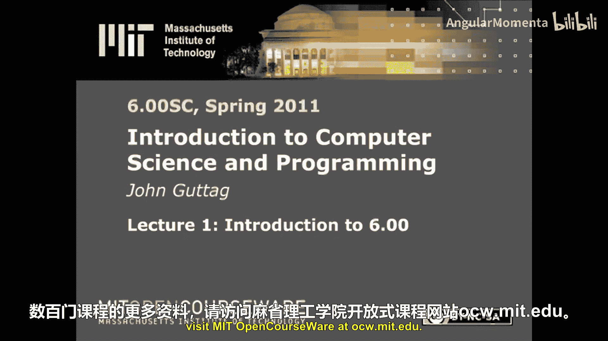
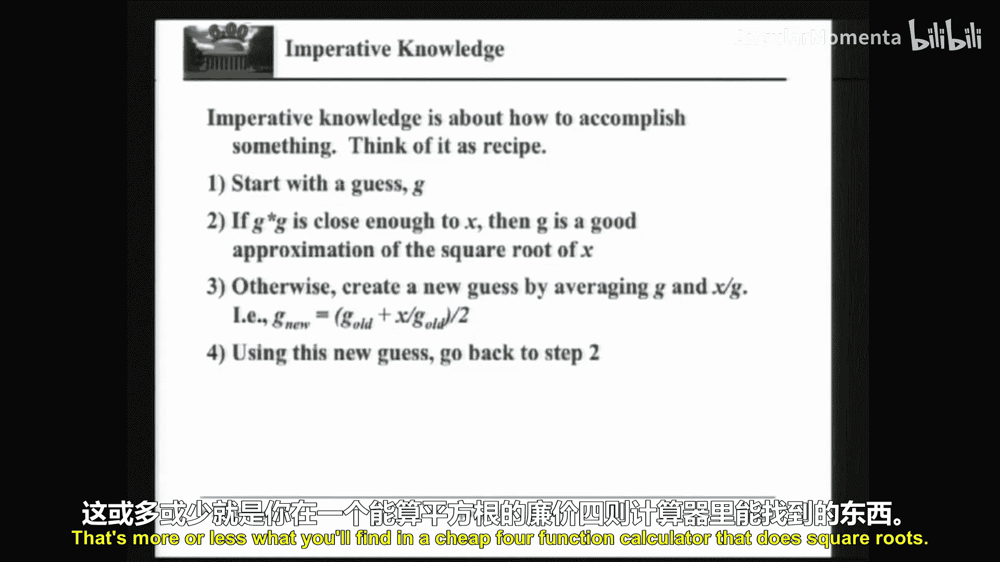
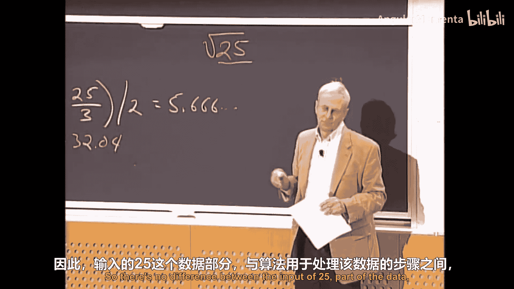
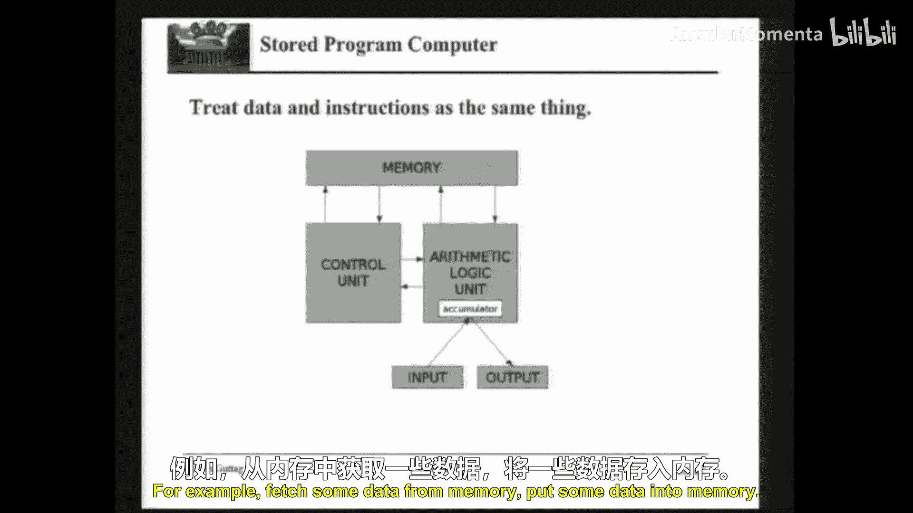
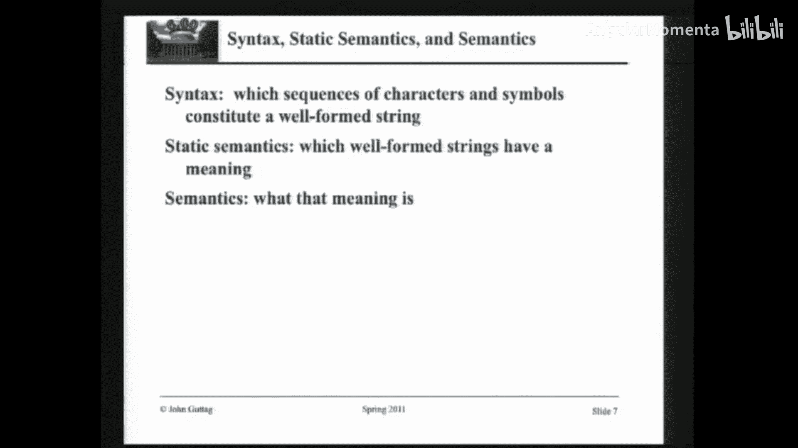
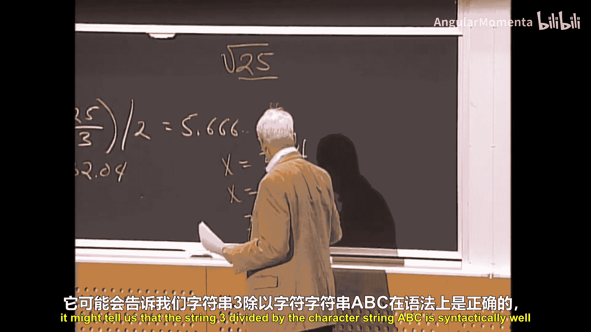
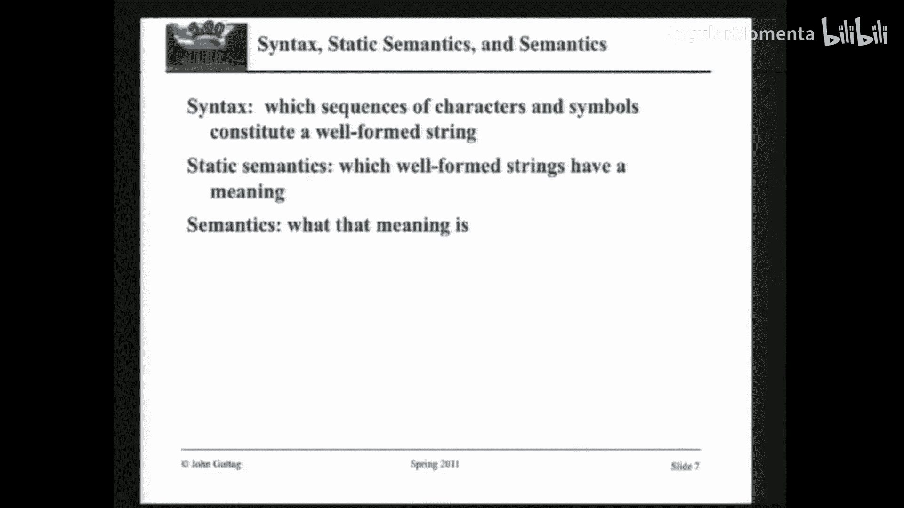
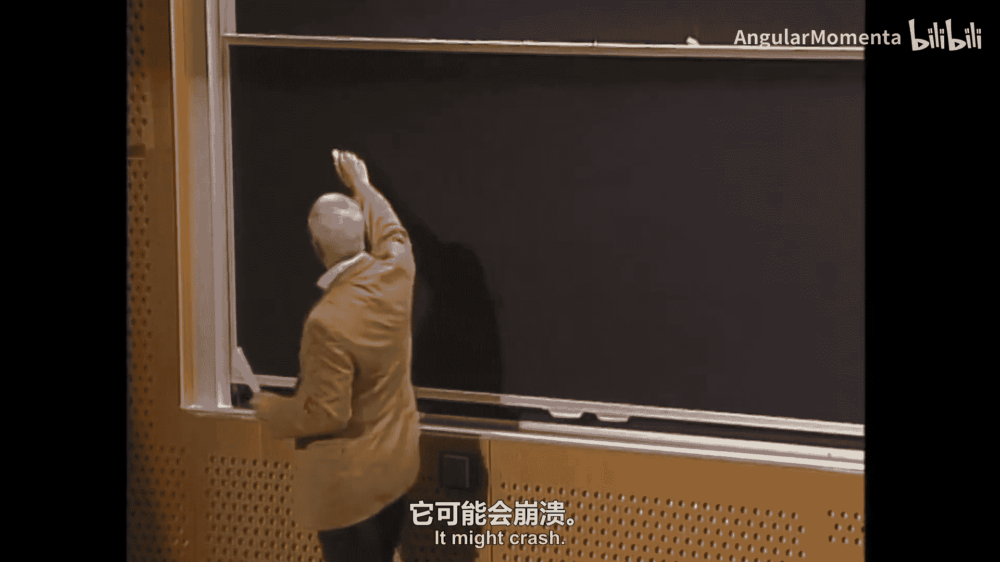
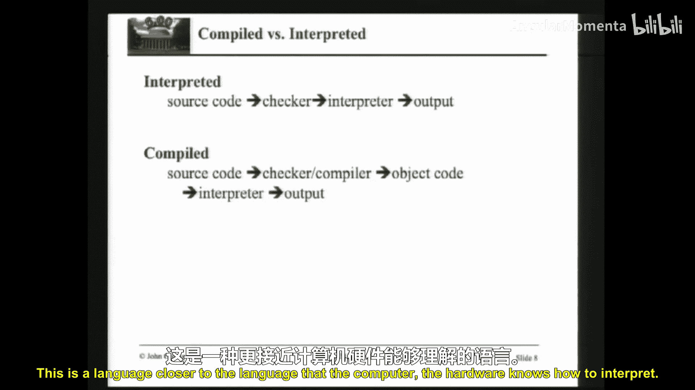
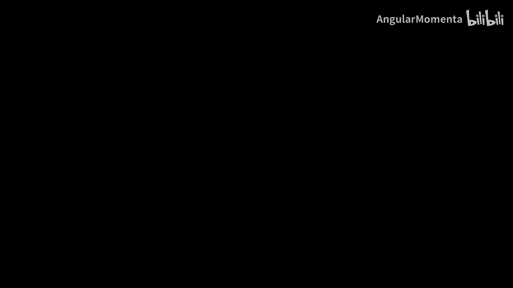

# 【麻省理工】计算机科学与编程导论 ｜ MIT 6.00SC Introduction to Computer Science and Programming p01 01 -BV1a5BZBkEP6_p1-

The following content is provided under a creative Commons license。

 Your support will help M I T Open Coseware continue to offer high quality educational resources for free。

To make a donation or view additional materials from hundreds of MI T courses。

 visit M I T OpenCourseware at O C W。t M I Tt E Du。

Good morning。This is 600， so I hope any of you who thought this was a different course。

Find where you really belong。My name is John Gutag， and I'll be lecturing the course all semester。

Okay， today I want to accomplish several things， cover some of the administrative details。

Talk about the goals of the course。 What I what I hope you'll learn。

And then begin talking about the conceptual material in the course。

 It will seem a little bit slow because it will be a little bit slow。 I promise starting on Thursday。

 we're going to pick up the pace considerably。So let's start with the strategic goals of the course。

嗯。The official introduction to Cose 6 is 601。Historically。

 students who arrive at MIT with little or no programming experience。Find 601 an ordeal。

And the point of this is to prepare freshmen and sophomores for entering course6。

 that's the electrical engineering and computer science department in a gentler。

 kinder way so that 601 is not so much of a problem。I want to help students feel justifiably。

 and I want to emphasize the word justifiably， confident in their ability to write small and medium sized programs。

So at the end of the term。You should all feel comfortable writing programs。

The real theme of the course and what I spend most of the time on is how to map problems into a computational framework。

There's going to be an emphasis on scientific problems rather than say commercial problems。

But there will be some talk about some non scientific problems as well。

How to take a problem that may not at first blush。Appear to be attack attackable with the program and show you how to formulate the problem in such a way that you can use computation to get insight into the problem。

It should not take you very long。All of the problem sets involve programming in Python。

 a programming language， which I'll say a little bit about later today。

The first problem set basically， is getting Python installed on your own computer。

Most of the people will want to just use whatever their own laptop is to do the problem sets on。

Don't get fooled by the first two problem sets into thinking this is a gut course。It's not。

It starts out gently to lure you in。And then life gets pretty hard， pretty quickly。So。

 don't be fooled。The quizzes， and there'll be two evening quizzes in a final。Our open book。

 open notes。When you get to be my age， you get very sensitive about how difficult it is to remember things。

And so。We won't be asking you to memorize stuff。The course is about solving problems。

 knowing how to solve problems， not how much you can remember。

For many of you who are majoring in biology or course 20。

It's going to be kind of a shock that this course isn't about how much you can remember。

But it's about how well you can solve problems。 And that's what the quizzes are really going to be focused on。

Probably the most unusual thing about this course is the collaboration policy。Which is。

Liberal in the extreme。You can collaborate with anybody you want on any of the problem sets。

Not in the quizzes， but in any of the problem sets， you can work with each other。

 which is what I recommend。You can work with your parents if one of them happens to be a software engineer。

You can work with friends in Co six， whatever you want to do。嗯。

The goal of the problem sets is to help you learn。What we've seen in the past is people who are a little。

 shall I say too collaborative， i。e。 they just copy the problem set from somebody else。

Live in a fool's paradise， which comes crashing down the first quiz。

People who don't spend enough time thinking about the problem sets themselves。

Cannot take the quizzes successfully。So， it's a fine line。But。Our goal is not to be policemen。

I tell my Ts their job is to help you learn， not to prevent you from， quote， cheating。

So to solve that problem， we've eliminated the concept of cheating on problem sets。

There is no way to cheat on problem sets。 So just go and do them。

There is no textbook we will be posting readings on the web。For the most part。

 these will be pointers to websites。 Occasionally， we'll post readings that we wrote ourselves。

doesnn't mean you shouldn't buy a textbook。 In fact， there are a number of Python texts。

It might will recommend a few of them。 It might make sense to buy one and bring it to a quiz because it will have an index that will let you look things up quickly。

 that sort of thing。But again， a lot of students never buy a text and do just fine。

We will not be handing out class notes on a regular basis。

A lot of studies have indicated that students learn more when they take their own notes than when they're handed out。

And so as a matter of what I think is good pedagogy， we don't hand out detailed lecture notes。

We will be using after today a lot of handouts with code on them， which we'll make available。

But it's not intended to make any sense outside the context of lectures。It's not self contained。

 The main purpose of this course is to help you become skillful in making the computer do what you want it to do。

Once you acquire this skill， your first instinct when confronted with many tasks。

Will be to write a program to do that task for you。

I always tell people I became a computer scientist in part because I'm lazy。

And there was a lot of stuff that I found it was easier to write a program to make the computer do it rather than do it myself。

So I do that a lot， you know， if I need to do something， I say。

Can I just write a quick program to do it？And I'd like you to be able to acquire that skill。嗯。

And remember that。Programming is actually a lot of fun。

So I should say that in addition to learning a lot in this course。

 I hope most of you will find it fun。Kind of a strange thought。MIT course， fun。I it。

Maybe it's an oxymoron， but I don't think so。 I mean。

 I really do think you can have a lot of fun writing programs for this course。嗯。

There are many people who believe that。How shall I say this？

Program is the most fun you can have with your clothes on。It really can be a lot of fun。

 so think of it that way。All right。So the primary knowledge you're going to take away is computational problem solving。

So to start with， we might ask the question， what is computation？😡，And to think about that。

This is interesting。There's where the chalk is。I was afraid I was going to be confronted with a sea of blackboards and erasers and no chalk。

But there is chalk。So， if we think about it。There are essentially two kinds of knowledge。Thelarative。

And you're going to see， I'm not a great speller。And imperative。Declarative knowledge。

Is composed of statements of fact。For example， a good healthcare care plan improves the quality of medical care while saving money。

As we know from doings in Washington， it's a lot easier to state that goal than to know how to achieve that goal。

So the key thing about declarative knowledge is it says something that is true。

 Otherwise it wouldn't be knowledge。 it would be misinformation。But。Doesn't tell you how to do it。

In a more mathematical sense， say y is the square root of x。If and only if y times y equals x。

All right， perfectly clear statement of what it means to be the square root。

But it doesn't tell you how to find this square root。Interestingly enough。

 it does tell you how to test whether or not you have the answer to the square root。😡。

And so if you had some。Way of generating guesses， you can at least check whether they're correct。And。

 in fact， starting in the next lecture， we'll talk about the fact that a lot of。

Computational techniques involve something called guess and check。

Where you have a way to generate guesses and a way to check whether they're right。

Iperative knowledge。In contrast。Tells you how to solve a problem， how to accomplish something。

So you could think of it as like a recipe in a cookbook。

So it's one thing to say a chocolate cake is something that tastes delicious and is bad for you。

That's declarative knowledge。 But you can open a cookbook and get a recipe that tells you how to make a chocolate cake。

That's imperative knowledge。Now。Below， we have a recipe for finding not a square root necessarily。

 but an approximation to a square root。And one of the themes of this course is that a lot of problems we cannot solve precisely。

But we can find answers that are good enough for practical purposes。

And those are called approximation algorithms。So here's a way。

 this is a very old method for finding the square root。In fact， it's believed that。

Herron was the one who did this， Heron of Alexandria。嗯。In the news much today。

 Alexandria was the capital of ancient Egypt。He was the first one to write this method down a long time ago。

嗯。Though it's believed that even before Heron， the Babylonians know how to do it。

So you start with a guess， G。Any old guests will do。Then you say is g times G close enough to x？

If so， you stop。So okay， I've got a good enough approximation of the answer。If it's not。

 you create a new guess。By averaging G。And x divided by G。So， G new。Is going to be G old。

Plus x divided by G old over 2。And then using this new guess， you go back to step 2。

So let's quickly run through an example of this。We can start with this。Pretty easily。

 we'll take a guess， let's say G equals 3。So we look at three times three。Nine， and we say。

 is that good enough？Well， let's say we're looking for the route of 25。

Iues I should have started with the problem statement。 Sorry about that。Well。

9 is probably not close enough to 25 that we're happy， maybe good enough for government work。

 but not for most other purposes。So we'll reset G。And we'll set G to3。Plus。25 over three。

All of that over two。Which equals 5 point。6，6，6，6， etc cea。All right， so now we'll multiply that。

By itself。And that gets to be about 32。04。啊。Close enough to 25。Probably not。

So we'll take another step。And we'll set G equal to。Well， when we're done with it all。

 I'm not gonna to bore you with writing the formula again。 It'll be 5。04。If we square that， it's 25。

4。We decide that's close enough to 25 and we're done。What we say at this point。Is that the algorithm？

And that's an important word。An algorithm is a description of how to perform a computation。

We say that the algorithm。Has converged。Which is a fancy way to say it's halted。What we've got here。

If you think about it。Is a set of instructions。Steps that can be executed。And。A flow of control。

The order in which we execute them。So if we look at this。There's a default order of execution，1，2，3。

4。But then there's the go back to step two。And start over。And。There's a termination condition。

Tells us when to stop。And of course， that's important。

They've always been amused that if you look at a shampoo bottle。

 you'll see an algorithm that says something like lather rinse repeat。And if you follow it literally。

 you never get to stop。Which I suppose makes sense if you're selling shampoo because people will use a lot of it。

But really， there ought to be some termination condition there。Okay。

 so now how do we capture this idea of a recipe？😡，In a mechanical process。

One way would be to design a machine specifically， to do square roots。

So if I knew how to design circuits， which I don't。I could sit down。

 Probably many of you could sit down and design a circuit that would implement this algorithm。And。

 in fact。That's more or less what you'll find in a cheap four function calculator that does square roots。

Not quite this algorithm， but a similar algorithm。Is just part of the circuitry。To go compute that。

And， in fact。This used to be the way that all computers worked。😡，So， the initial。Computers。

Were what are called fixed program computers。They were designed to do very specific things。

And that's what they did。So for example， one of the very first computers designed in 1941。

By Atson often and Berry。Solve systems of linear equations。

For the purpose of plotting artillery trajectories。And that's all it did。You know。

 if you wanted to balance your bank account with this computer， you couldn't do it。

 but you could figure out how to drop a artillery shell somewhere。Also during World War I。

 Alan Turing。Built a machine specifically designed for breaking the German enigma code。Actually。

 a fascinating story of， of science， how that was built。 But again， that was all it could do。

These computers were useful， but。Only in a very limited way。The big breakthrough。

 the thing that made computation really important to society。

Was the invention of the stored program computer。It took people quite a while to figure this out。

 But once they did， it seems obvious the basic notion of a stored program computer。

Is that the instructions。Are the same as data。So now there is no distinction between the program that implements the algorithm and the data。

On which that program operates。So there's no difference between。The input。Of 25。

Part of the data。And the steps of the algorithm。Used to do that。Once that was possible。

 the machines became infinitely flexible。You could change the program anytime you wanted。

And furthermore， programs could produce programs。Because programs can produce data。

And if program and data are the same thing， that means programs can produce programs。

And we were off running。And that's really what made computers what they are today。

Once this became clear as the paradigm for computers。

People began to think of the computer itself as a program。And in particular。

 as a kind of program called interpreter。And we'll get to more on this later today。

An interpreter is a program。😡，That can execute any legal set of instructions。And consequently。

 can be used to describe。And accomplish anything you can do with the computer。So roughly speaking。

 this is what a stored program computer looks like。This is 6004 and 40 seconds。It's got memory。

Lots of it today。A control unit。That basically tells it what to do。 for example。

 fetch some data from memory， put some data into memory， send some output to a screen。

 all of those kinds of things。

What for historical reasons we call the arithmetic logic unit。😡，This is， in some sense。

 the brains of the computer， the thing that actually。Does computations。An accumulator。

Which is part of the A L U that stores results。And a bunch of input and output devices。

The things that we actually see when we use a computer。And that's it。And again。

 the key thing to notice is there's only one kind of memory。

 There's not a memory for program and a memory for data。 There's just the memory。

The nice thing to think about here。Is given a small set of instructions。

You can then build any kind of program you want。So typically， the computers have。

A very small number of built instructions。You know， order of dozens。 and that's it。

And by combining those instructions in very clever ways， you can do arbitrarily complex things。

In much the same way， a good chef。Can take a very small number of ingredients。 And from those。

 produce a variety of interesting。Eibles。Alan Turing。In the 1930s。

 very famous British mathematician of whom you will hear more。Showed that， in fact。

There were six primitive instructions。Each of which operated on one bit of information。

And with those six primitive instructions， you could do anything that could be done with a computer。

Kind of amazing。There was six instructions。 There were things like read。Right， plus。I don't know。

 Maybe minus。 I forget what they were。 And that was it。 That's all you needed。

We will not make you write programs using only six instructions， will'll give you a much larger set。

But still。It's really quite remarkable。It's what makes programming such an amazing。Endeavor。

So what instructions will you be using？Well， that's what a programming language does。

So a programming language provides a set of primitive instructions。

A set of primitive control structures。So， instructions。

And mechanisms for controlling the order in which they get executed。And that's all。

And then you can do whatever you want with them。And what distinguishes one programming language from another is what these things are。

What are your instructions， What are your flow of control， and how do you combine them。

 What are the combining mechanisms。And in fact， it's the combining mechanisms more than anything else that separate one language from another。

The most amazing thing about programming。😊，And this has its good side and its bad side。

And it's something you need to remember as you do the problem sets。

Is that the computer will always do exactly what you tell it to do。It's remarkable。

 You don't have any friends who will do whatever you tell them to do。I tell you。

 my children certainly don't do whatever I tell them to do。And my wife doesn't either。

Sometimes she probably thinks I do whatever she tells me to do， but。

A computer will do what you tell it to do。 So that's very empowering。It's also very annoying。

Because it means if your program doesn't work， it's your own darn fault。

You got nobody else to blame but yourself。Because it's not the computer's fault。

 You may want to curse the computer， but you shouldn't。 It's just doing what you told it to。

So be careful what you wish for。All right， the programming language we're going to use。

In 600 is Python。

It's a relatively recent addition to the universe of languages。

I want to emphasize that this course is not about learning Python。

I will spend relatively little time in the lectures telling you about Python。It's about。

Computational methods is what this course is really about， and Python is merely a teaching tool。嗯。

Once you learn to program in Python， it's easy to learn to program in another language。

 It's a very easily transferable skill。If we think about what defines any programming language。

It's got a syntax。A static semantics。And the semantics。Are any of you here linguistics majors？

Not not a one。 All right。 then I can make up whatever I want about these terms。

 and maybe you'll believe me。All right。So。The syntax。

Tells us which sequences of characters and symbols constitute。A wellform string。

So it would tell us maybe that we could write something like。X equals 3 plus4。

And that's syntactically correct。It's well formed。It might also tell us that x equals 3 blank4。

Is not syntactically correct。It's not a legal string。So， by analogy with English。

The syntax describes which strings of words constitute wellform sentences。

Well formed。Not necessarily meaningful。So it would tell you that some sentence， like。

Susan is building。Is syntactically well formed， it may not be very sensible。嗯。The static semantics。

Tells us which wellform strings have。A meaning。That our wishstrings are meaningful。So。

You can think about that as also making sense。So in Python， it might tell us。That。Some strings。

Which are syntactically fine， don't mean anything。So， for example， it might tell us that the string。

3e。Divided by the character string， ABC。

Is syntactically well formed。Because it's。Value， operator value。

Sort of like noun verb noun is syntactically well formed in English。 But it would tell us that。

There's no real meaning to this。 Diding a number by a string doesn't mean anything。

And so you would get an error message。Saying syntax is okay， but the static semantics is broken。So。

 for example， in English， the sentence， I are big。Is somehow syntactically well formed。

You noun verb noun。 But we might say it's。Not， it fails a static semantic test。

 We don't want to assign a meaning to it。The semantics of the language looks only at the strings that are both syntactically correct。

And static semantically correct and assigns a real meaning to them。In natural language。

Sentences can be ambiguous。

So one of my favorites， when I have to write a recommendation letter for a student that maybe I don't think is so good。

 I might say something like， I cannot praise this student too highly。

Well you can interpret that however you want。It keeps me from getting sued。But I can also claim。

 well， I don't like the student at all。And English is full of those things。

Programming languages in contrast are designed so that every well formed program has exactly one meaning。

There is no ambiguity。So you can't typically talk of a program as having a semantic error。😡，It is。

If it is well formed， it means something， and that's what it means。On the other hand。

It's easy to talk about a program meaning something other than you wanted it to mean。

And you will discover in the problem sets most of the time。

 the programs don't mean what you want them to mean。That is to say when you run them。

 they don't give you the correct answer。And then you will go through this process of debugging them and learning how to do it。

So what might happen？When we write a program。That doesn't do what we want it to do。It might crash。

By that， we mean stop running and produce some palpable indication that it has done so。😡。

So you've all used programs that have crashed， right？You've sat there。

Using your email program or word or PowerPoint or something。

 and suddenly it just goes away and you get a message on your screen。An invitation to。

Send Apple or Microsoft some。A file explaining what went wrong so they can fix it。Am。

In a properly designed computing system， when one program crashes。

 it does not damage the overall system。So you'd like it to just be local。What else might it do。

It might never stop。Now， if you have no idea how long a program is supposed to run。

 this can be hard to diagnose。But again， I'm sure you've all run into this。

 I've certainly run into it every once in a while I'll say try and write a PowerPoint file。

And it'll just sit there。Or I'll try to read a file and it willll just sit there and never finish the job。

Or。I don't have enough patience， but probably it would never have finished it。Again。

 you will all write programs that do this。😡，It's a good idea to know how long you expect your programs to run so that you can recognize this。

Typically， we say that these programs have in them an infinite loop。

And we'll talk about that when we get to flow of control。Finally。A program， right。Run to completion。

And produce the wrong answer。These problems are kind of in ascending order of badness。嗯。

If it crashes， at least you know that something has gone wrong。😡。

An infinite loop can be very annoying because you just wait for a long time。

 But the worst thing that happens is when you think everything is good and it's not。

There have been lots of examples of this。This is the sort of thing that costs lives。嗯。

There was a radiation therapy machine。That produced the wrong dosage of radiation。

And actually killed quite a few people。Because they put in the correct input。

 and it would dose the patient with radiation and。A fatal dose of radiation。

That's a really bad mistake。There are buildings that collapse because people run programs that do the structural engineering。

 and the programs give the wrong answer。Lots of bad things can happen。

 So one of the things we're going to spend time on this term。

Is what you can do to avoid writing programs that have this rather unpleasant property。

How do you test them， How do you write them in such a ways that this is the least likely event。

That's not what you want to happen。Okay， some programming languages。

Give you a lot of help in avoiding。These things。Python is kind of mediocre in that respect。

 It's not the best。 It's not the worst。It's somewhere in， in the middle。

Because what you'd like is a program with very rigorous static semantics。

Such that if you pass those tests。It has a high probability of behaving， as expected。So for example。

 it's a good thing。That Python doesn't allow you to do this。Because。

Who knows what that's going to do， Something weird。 You'd rather be told， no， you can't write that。

And then you have to write something that's more obviously meaningful rather than it just making up an interpretation。

As we will see going forward。Python is not， for example。

 as good at Java as Java is at weeding out meaningless things。

Or things that have surprising meanings。On the other hand， it's better than C。

So kind of in the middle， as these programming languages go。

Why do we use Python in this course if it's not the best in that respect。

It's got several good features。One of them is it's easy to learn。It's much less complicated than。

 say， Java。 So the learning curve is much steeper。 That's a good thing。 You。

 You get up to speed faster。It's。Very widely used today in a lot of areas of science。

 particularly the life sciences。It has probably become the most popular language in biology in the other life sciences。

And therefore， for those of you who have careers in that area， it's the most useful language to know。

It's also widely used in other areas as well。It is easier to debug than most languages。😡。

And the reason it's easier to debug than most languages or than many is it's an interpreted language。

So you'll remember， I talked about a computer as an interpreter。

Something that you feed in a bunch of instructions。That called the source code。You do some checking。

And then it executes the instructions， including the flow of control instructions。

 produces some output。The nice thing that goes on there is if something untoward happens。

The interpreter can describe in the language of the source code what went wrong。

The source code is the code that you wrote。😡，On the other hand。The way a compiler works。

Is you take the source code？You check it， but then you translate it into another language called the object code。

😡，This is the language。Closer to the， the language that the computer。

 the hardware knows how to interpret。

Then the hardware interpreter interprets the compiled code。The object code and produces output。

And the problem here is if something goes wrong。It wants to give you an error message in terms of the object code。

😡，Which you've never seen in your life。And that can make it very obscure。So the advantage。

 why do we have compilers， typically compiled languages are more efficient。😡。

Because they go through this extra step， they take less time to run those programs。

You can compile Python as well if you want to get an efficient version。

But it's not designed under that assumption。 And so it works well when it's interpreted。

 which is why we use it。

