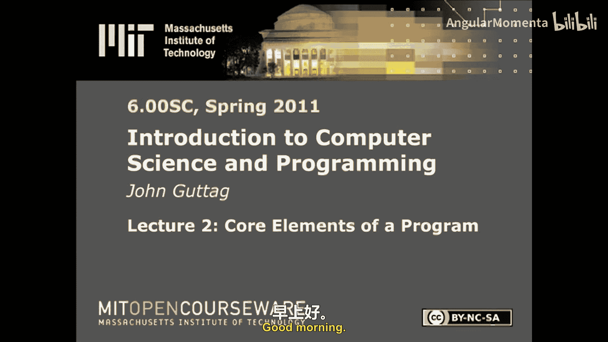
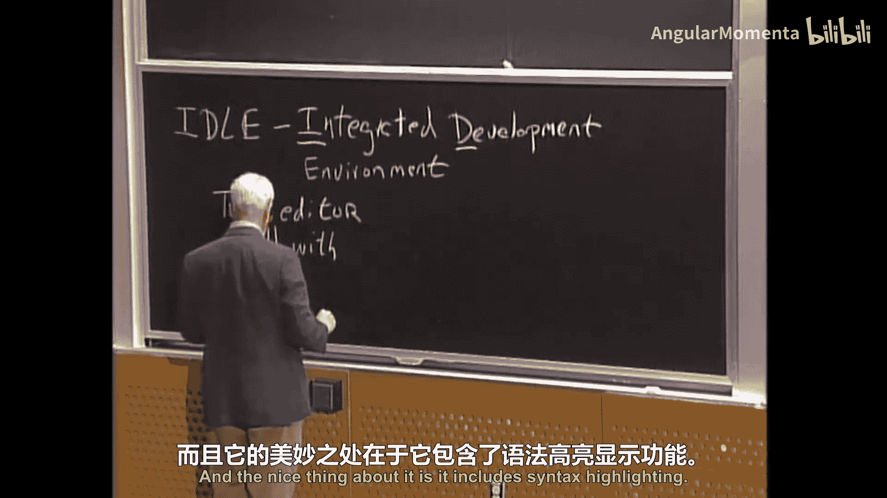
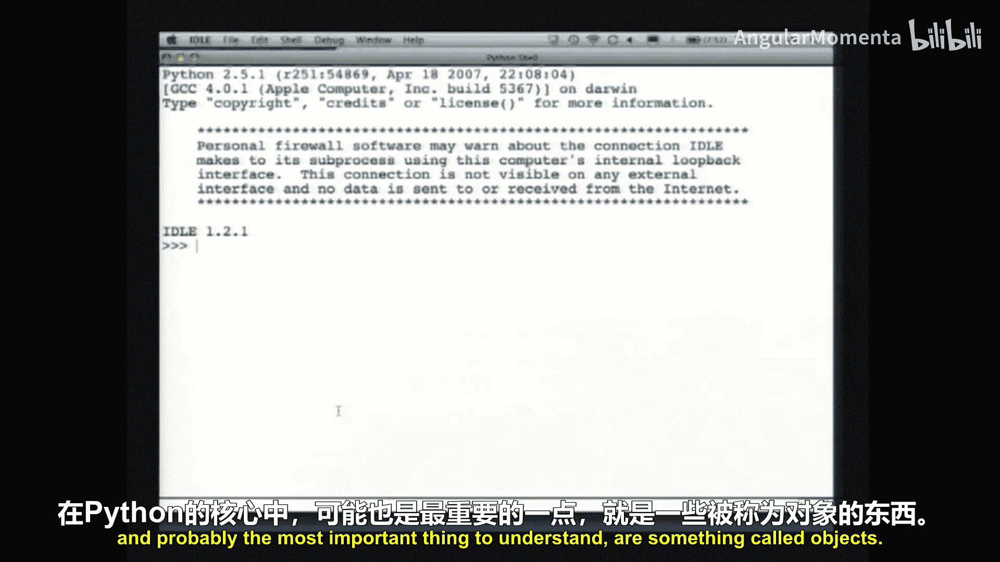
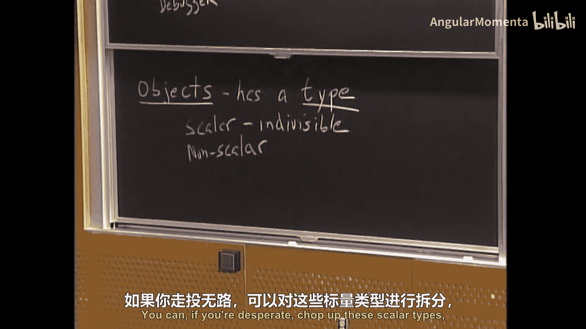
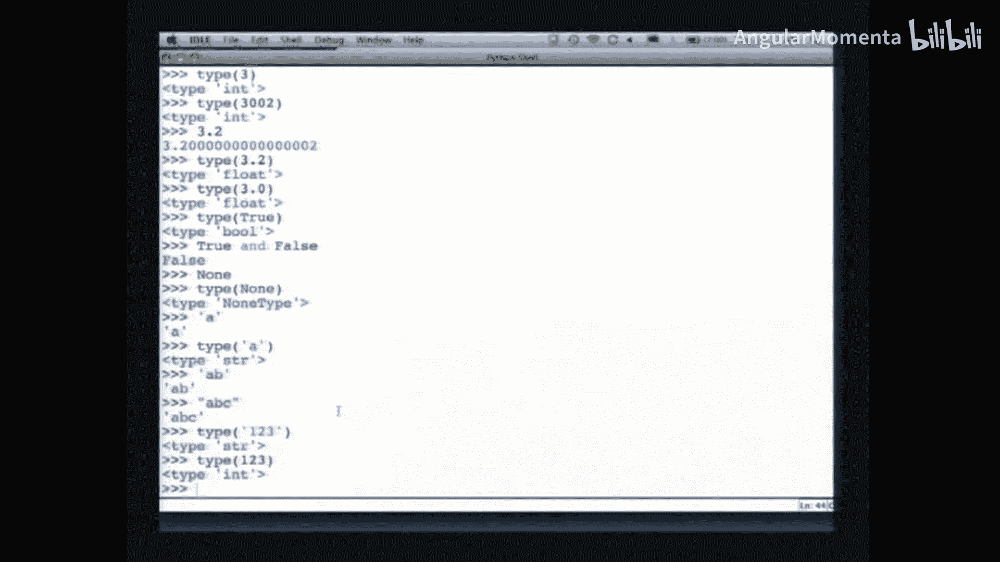
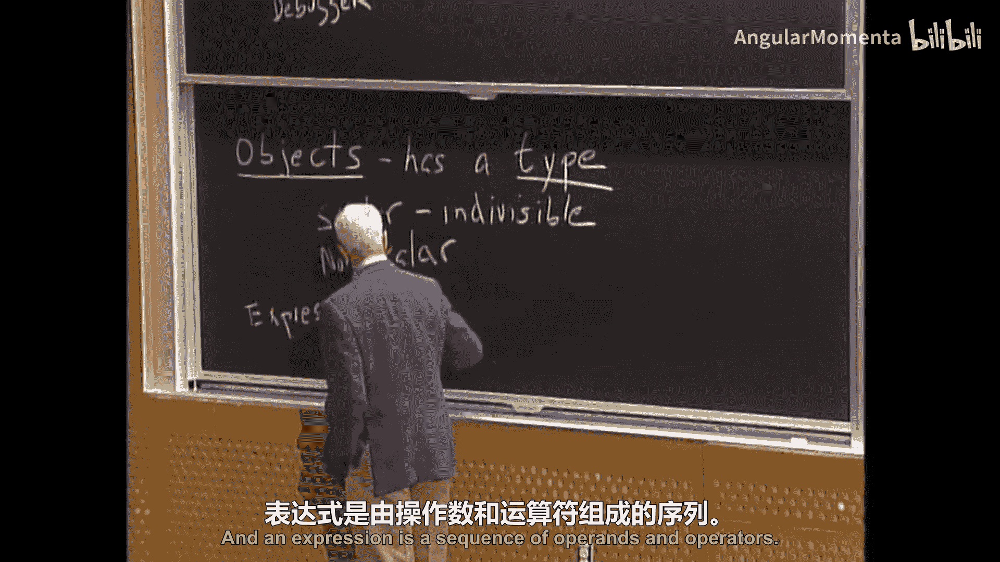
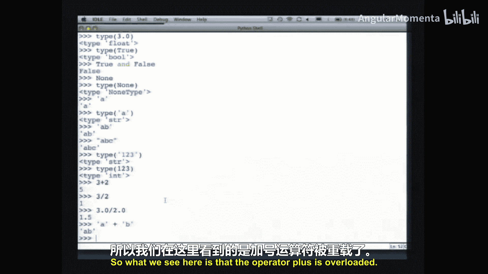
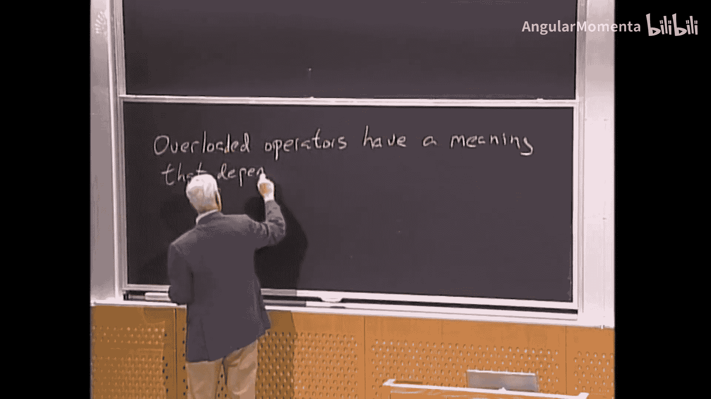
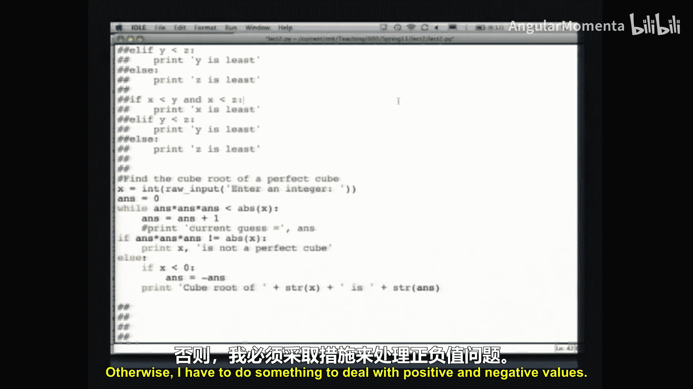

# 【麻省理工】计算机科学与编程导论 ｜ MIT 6.00SC Introduction to Computer Science and Programming p02 02 -BV1a5BZBkEP6_p2-

The following content is provided under a creative Commons license。

 Your support will help M I T Opencourseseware continue to offer high quality educational resources for free。

To make a donation or view additional materials from hundreds of M T courses。

 visit M I T OpenCourseware at O C W dot M I Tt E Du。

Good morning。Thank you。Okay， so we're about to launch into learning some basic elements of Python today。

The elements I'm going to talk about are common to every programming language that I know。

At least in concept and， of course， slightly different in detail。But as I said last time。

 everything you're going to learn about Python should be。Readily transferable。I'll be using。

For all of the examples I present。Something called an integrated development environment。

And in particular。1 that's built for Python。Called idle。Usually。

 we talk about these things as Ide Es。I'm told， I don't know if it's true that the I DE for。

Python is called IdL after Eric Idol of Bty Python。Which was also， I'm told。

 the inspiration for the name of the programming language。嗯。

So what is an integrated programming environment in this case？It includes a specialized text editor。

That provides highlighting auto completion， smart indent。

 and you'll see shortly while that's very important。

 and a few other amenities that make it easier to use this to type Python than typing it into a generic text editor。

It includes something called a shell。Which is the environment that actually interprets the Python code。

And the nice thing about it。Is it includes syntax highlighting。

So the shell gives you some information about the syntax。As does the text editor， of course。And。

 finally。It includes an integrated debugger。This could be useful in the unlikely event that your programs have errors when you write them。

Though truth be told。I've been programming in Python for years。

 and I don't know that I've ever used the debugger。It's not that I don't make mistakes。

 It's just that I'm kind of a luddite。 And I typically use print statements for debugging。And。

 in fact， almost every programmer that I know and push comes to shove ends up using print statements。

But if the debugger is there， should you care to take a try？All right。

 so you'll see on the screen here。An idle shell。In the shell， we can type things。

 What are we going type。Well， the first thing to understand。Is that at the core？

Of Python and probably the most important。Thing to understand。Or something called objects。

Everything in Python is an object。So every kind of entity that you can create in Python is an object。

And in fact， Python code itself is an object。😡，You remember。

 we talked about stored program computers last time and the concept that a program is data。

 just like a number is data。Each object。😡，Has a type。That tells us。The kind of object it is。

And in particular， what we can do with it。And then there's a built in function。Called type。

That can be used to find out the type of an object。As we'll see。

There are two fundamental kinds of types。Scalalar。And nonscalear。

We'll start with talking about scalar types。And the key thing to think about there。

Is that they are indivisible。Think of them as the atoms of the programming language。Now。

 I know that some of you have studied physics and know that atoms are in principle， divisible。

But of course， only at great expense and with serious consequences。

And we've seen the same thing here。 You can， if you're desperate， chop up these scalar types。

 but it almost always leads to something bad。

All right， well， let's look at some。Well， the first one you'll see is used to represent integers。

 and that's called int。For every type or every built in type。There is a notion of a literal。

 which is how we type it。So for example， we can type three。And。That will now tell us it is。

The value 3， you'll note it's typed it in blue， and I can ask what the type of three is。😡。

So you'll notice as I type things into the shell， it's using colors to give me a hint。

So it's this fusia color for the word type telling me that's a built in function。And now if I ask it。

It will tell me that the type of the literal three is quote int， quote。So it's an integer。And I can。

 you know， use other sorts of things。All right， there's also a type float。

So those correspond to the real numbers so I can do something like that。And we'll talk about this。

 in a second。But you'll notice if I do T of 3。2， it tells me it's af floatat。And for that matter。

 I can do type of 3。0。And it will tell me it's afloat。So there's a difference between 3 and 3。0。

1 is an int， and one is a float。Now you'll notice something kind of weird here。😡。

When the interpreter printed back the value of the literal 3。2， it gave me 3。2 and a bunch of zeros。

And then this funny two standing at the end。In a few lectures， I'll explain why it does this。

But for now， you should just take this as a warning that floats are not the same thing as real numbers。

You learned about reels， presumably in middle school or high school。

Floats are a computer scientist's approximation to reels， but they're not quite the same。

The good news is almost all the time you can pretend that a floating point number is are real。😊。

But as we'll see in a few lectures， every once in a while， it can really。Sit up and bite you。

 if you believe that。But for now， we'll just pretend that they're reals。U。There's bulloles。

 a nice scalar type， of which there are only two values。One of them is true。

And what do you think the other Boolean value is？Thank you。 So somebody said false。

 I have no idea who。 But whoever it is， there's probably some candy to be at oh。

I managed to find one place in the room where there was an empty。

I'm hoping that people will now scramble and fight for it， like。A foul ball at a baseball game。Now。

 people were too polite thus far， all right。So we have true and false as the type Booleions。

And then we can do operations on them。 So， for example， true and。False is。False， as you might guess。

Finally。There's this funny value， none。Which doesn't print anything when I type it。

And if I look at the type of none。We'll see it's the nun type。Not very interesting。Fundamentally。

 as we'll see， that gets used when you want to put in something temporary。

 when you don't yet know what its value is going to be， you know it's going to eventually have one。

 so maybe you start out calling it none。And then you can check and we'll see how we might do that。

So those。Are the fundamental scalar types。The indivisible ones。Interestingly enough。

Python does not have what is a common scalar type in every other language， called char。

Short for character。Instead， what it has is strings。

That can be used to represent strings of characters。So for example。

 I can write the string quote a quote。And if I ask for the type of it。

It tells me it's an STR short for string。Happens to be a string of length one。😡。

Which we might usually think of as a character。But there is no type cha。 So it's not a problem。

 We just have to remember it。Literals。Of type string can be written with single quotes。

Or with double quotes。There's no difference。Just a convenience that you can do it either way。

And we can build strings of things。It's worth noting。That the type of， say， the string 1，2，3，3。

Is STR？Whereas the type of 1，2，3 without the。Quotes is int。

So we have to be a little bit careful sometimes as to whether we're dealing with strings or inks。

When we look at these literals。You can only get so far with literals， things you can type。

So of course， Python has in it something called an expression。Again， this shouldn't surprise anybody。

And an expression。

Is a sequence。Of。Operans。And operators。The operarans are objects。So， for example。

 we can write the expression 3 plus 2。And when we type an expression into idol。

 it automatically evaluates it and prints the value of the expression。In this case， of course。

 it's 5。One thing to be a little careful about。😡，Is if I type the expression 3 slash2。

Slash is the divide operator。I get one。Whereas if I type the expression 3。0 divided by 2。0。I get 1。5。

So dividing two integers in Python 2。 x。Gives you essentially a floor operator。In 3。0， by the way。

 integer division is not allowed。It always converts it to floats and does a floating point division。

But for many of you， this will be something that will trip you up as a bug。

If you want to get real division。Right。Floating point numbers。Otherwise。Unpleasant things may happen。

Some other interesting things I can type。Just as I could type 3 plus 2。I can type。A plus B。

What do you think I'll get there。It does concatenation。So what we see here。😡，Is it the operator plus？

😡。

Is overloaded。So， overloaded operators。Have a meaning。That depends upon the type of the operarans。

And， of course， we've already seen that with the slash operator。

Which means one thing for ints and another thing for floats。And， of course。

 we see the same thing with plus。What do you think will happen here， three， blank three？Any guesses？

Id get a syntax error， remember we talked about that on Tuesday。It's not a valid Python expression。

So we get an error。How about this one？That is syntactically valid。

 It's got operaand operator operaand。What do you think it'll do when I hit return here。Somebody。

这个是那些。法院不到是没睡。A static semantic terror， and because of the light I can't see who said itva raise your hand。

哦，干嘛？We way back there。All right， I have the most chance of car with one of these。I'm going to lie。

 Those of the you who are watching Open Cose wear it was a perfect throw。Okay， so。Indeed。

 we get a static semantic error of a particular kind called a type error。

Saying you cannot catnate an S TR and an int。Type errors are actually。Good things。

The language does type checking。In order to reduce the probability that a programmer will write a program with a meaning that will surprise its author。

So it looks at it and says somebody might have a weird guess what this means。 but just to be safe。

 we're gonna disallow it rather than it could， of course， make up some funny meaning if it wanted to。

But it doesn't。 And I think you'll find tight checking。

Saves you from a lot of careless programming errors save as you go on。All right， let's continue。

 Let's look at some other things。I can write this。Because that's just two strings。

 And it just concatenates them。 The string A and the string 3。More interestingly， I can do this。

So now what we're seeing is that you can take any type name。

Use it as a conversion function to attempt to convert one type to another。

So this is now converted the int3。😡，To the STR， quote3 quote。Similarly， I can do something like this。

And here it's converted the string， quote 3， quote to the int3。On the other hand， I could do this。

And it will tell me。It's not。 It's a static semantic error。 It can't convert， convert 0。

0 into an int。Similarly， it can't con convert。2。1。Or can it。So now I've given it the float 2。1。

 and I've tried to convert it to int。Not the string，2。1， but the float， and it succeeds。

And it succeeded by essentially， truncating it。Is this a good thing or a bad thing？啊。To me。

 it's kind of a bad thing。If I've typed something like that or I've evaluated some expression that happened to work that way。

More than likely than not， I'm confused。 And I would probably have preferred to get a type error rather than it deciding how to do it。

It's one of the things I don't like about Python。It's too generous。It lets me get away with stuff。

 It shouldn't let me get away with。Other languages， for example， Java are much stricter。

This is a design decision， and it is the way it is。 And we have to live with it。Yes。The same。

you turn into one Yeah， exactly， it is the same reason that that happened。

This will never go back farm。Yeah， exactly it's the same reason the question was。

 is it the same reason that three divided by two？Doesn't give you the answer you would get with floating point。

 And it's because Python has tried to help you。Again， Python 3。

0 is a little stricter about these things。We'll talk much more about this， during the term。

This is close to the last time you'll see me typing things directly into idle。For the most part。

 as you write programs， you'll use the text editor to produce them and then go to the shell to run them。

 But you'll want to。Obviously， if I had 10 line program。

 I wouldn't want to sit here and retype it every time I needed to change it。

So instead I use the editor and iddol to produce the programs。And then， I can run them。

And that's what I wanted to start doing。I should probably mention。

That what most people call a program。Some Python programmers call a script。

Think of those two things as synonyms。But you will see people use both of them。

I will typically call them a program。All right， let's look at an example。

So first thing to say is that。Things look a little bit different when they're executed from a script than when you execute them directly in the interpreter。

So I happened to have a script here。If a line in a script starts with a sharp sign or a number sign。

 that makes it a comment。So， it's not executed。So I've started here。

Just by commenting out everything。But now， whoops。What happens if I just put the number  three here。

We saw when I typed it into idle。It echoed it in some sense and gave me what it was。

 Or just to be clear， I'm going to put in。The expression type of three。I'll save it。

And then I'll hit F 5 to run it。And it does nothing， right？ You saw it move。

 It didn't print anything。So when you type an expression into the shell， it prints the value。

But when it executes a script with an expression， it evaluates the expression。

 but does not display it on the screen。Well， so what do we do about that？

There is something called a print command。So I can do this。Print type of three。And now， if I run it。

It will actually appear。So whenever you want to get something to appear。

 you have to use the print command。Not a very complicated concept。A program or a script。Is。

A sequence。Of commands。Each one tells the interpreter to do something。So a command is print。

 for example。Okay， so that's there。 That's kind of boring。 I'll get rid of that。The next command。

Is a really interesting one。It's an assignment statement。

A key concept in every or almost every programming language。Is that of a variable？

Different languages have different notions of what a variable means。In Python。

A variable is simply a name for an object。And what an assignment statement does in Python is it binds a name。

To an object。So the assignment statement， and you see here binds the name X to the object 3。

The next statement。Rebinds the name X to the value of the expression X times x。

 So it takes the old value of x， evaluates the expression。And then binds the name X to the new value。

 So at the end of the second statement， X will be bound to 9。 By the way。

 these are really stupid comments I've written here。

I put them in just to show you what these statements are doing。 for goodness sake。

 when you write comments in your programs。Assume that the reader can read Python。

 and you don't have to explain the programming language in your comments。That's not to say。

 you shouldn't write any comments。The purpose of a comment。Is to make the program easier to read。

And so typically， comments are there to explain things。Not to explain the language or its semantics。

 but to explain your thinking when you wrote the program。What is the algorithm you've used？

And we'll see some useful examples of comments， probably not today， but， but later。All right。

 so let's execute this script。Sure enough， it printed9。Just what we would have hoped。All right。

 now let's try some other things。Print lets us output things。Raw input lets us input things。

Get things from the keyboard， essentially。So the statement here is making a request to whoever is using the program to enter a number。

There are two kinds of input statements in Python，2。 X。Theres raw input。

 which is the only one you will see me use。And input。Raw input， by the way。

 is the only one that exists in 3。0。So please just use raw input。

The difference is raw input always expects， interprets what the user types as a string。

So itll see here。 it says y equals。Float of raw input。Enter a number。 So， let's run it。So。

It's taken the argument to raw input。The string enter a number， ask me to enter a number。

I'll enter a number。And then。It's converted it。To afloat。Suppose I get rid of that。Suppose I do this。

That should work。So now something has happened。 It's printed。 both of them as 3。0。

It looks like they're the same。But， in fact， they're not。And this is something to beware of。

What we've seen here。Is when it prints。A string。It does not print the quotation marks。

So even though if I were to put this in here。I'll put in two print types of y。

And I'll comment this out， because I'm getting。Kind of tired of seeing 9。

You'll note that one is a string and the other is a float。Again。

 I point this out because this is something that can confuse people when they're debugging programs。

Because you think it's a float when， in fact， it's a string。Okay， nothing deep。

 but these are the things that sort of get people in trouble。Now。

 the kinds of programs we've been looking at so far。Are what are called straight line programs。

What distinguishes a straight line program。Is it's a sequence of commands you execute one after another。

You execute every command without making any deviations。

 without going back with any loops to execute a command more than once。So in a straight line program。

 every command gets executed exactly once。There is， a very elegant and even useful theory。

That talks about different layers of levels of complexity of programs。And says， for example。

 what kind of functions can you compute with straight line programs。We'll talk more about that field。

 which is called complexity theory later in the semester。But for now。

 the thing to realize is that straight line programs are just dead， boring。

You can't compute anything Inter with one。Last time we talked about a recipe is an analogy。

For a program， imagine a recipe。With no tests。So every recipe or almost every recipe。

 I know has some decisions。 You know， if it tastes it and adds salt if you need it or poke it a meat and see if it's done。

Or cook it until the thermometer says some degree on it。

Those are the kinds of tests we need to make interesting programs。

The most primitive kind of test we see is what's called a conditional statement。

And those are written using the word， if。And optionally， as we'll see， the words elf or EF。

Standing for else， if。So let's look at an example here。We' my mouse on there it is。Yes。

Someone has a question。I was just wondering， when the user is prompting to put in they。

I said for you。It's in like a strength。Because you define it as like。How does it interpret it？

OkayI didn't get the question it says the argument to Ryan Boy or the response to Ryan Boy。So yeah。

 for the dog clip where you find it as a float， I use a person a string。还是。

It will interpret as a string containing quotation marks。😡。

So typically you don't type a string because everything it interprets everything you type as if it were a string。

😔，So don't bother typing strings。😡，Good question， thank you。Alright， so let's look at this。

So here I'm going to get an int or at least a string。 I'll convert it to an int。

Then I'll say if x remainder2， that's what the percent sign is， it's a remainder or a modD operator。

Is equal equal 0。That's important。 You'll notice that we used an equal sign to do assignments。

If we want to do a comparison to whether two objects have the same value。

 we don't write a single equal。 We write a double equal。

So whenever you're testing for quality of objects， you use double equal。

So it says if the object x mod 2。😡，Has the same value as the object 0， print even。Else， print odd。

And then just for fun， I'm going to see whether or not it's divisible by three。Why don't I do that。

Just to show you that I can nest conditionals inside conditionals。

So in one of the branches of the conditionals， I'm now doing a test。

So what this does is it if comes down， it does the test。If the value of the test is true。It executes。

The block of code。Following the if， in this case， just print。And then it skips the else。

 It does not execute the else。 So it executes one or the other。If the test is false。

 it skips the block of code following the if。And executes the block of code， following the L。

So it does A or B， but not both。The indentation is important。😡，Python is very unusual。

In that the way you indent things actually affects the meaning of them。And you can tell that if。

 if I were to type this in the editor。You'll notice here it's on that line。 But if I hit return。

 it automatically indentense it。That's the auto indent feature I mentioned earlier in the editor of Idle。

And this tells me how these things line up。So the fact that this is here。😡。

Tells me I execute it only as part of the El clause。

The program would mean something quite different if I wrote this。Then it would mean。If x。Mod 2 is 0。

 print even。 Otherwise print odd。 and whether or not it was even or odd do this teston the of statement。

So the indentation。Actually affects the meaning of the program。Now， a lot of other languages。

 almost all other languages don't do that。 They have some punctuation。For example。

 C uses set braces to designate what's called a block of code。If you look， however。

 at a well written piece of C code or Java code or any other language that I know。

 programmers are trained to use indentation to show the structure of the program。

Even though you don't need it， you could line up everything right at the left edge and just use the punctuation。

People don't do that。 And the reason they don't do that。Is programs are intended to be read。

Not just execute。 Why are they intended to be read。Because the only reason。

 the only way you can debug a program is reading the code in it。😡，Typically。

 you want to write your program so that if you look at it from a distance。

The visual structure of the program reflects the semantics of the program。

And that's why people use indentation when they don't need to so that you can see the structure of the program by looking at it on your screen。

And not having to parse each symbol。The authors of Python made what I think is a very good design decision。

 And they said， well， if that's the way you ought to write your programs。

 let's force people to write their programs that way。

And guarantee that the visual structure of the program actually matches the semantic structure。

The problem with languages like C and Java。Is that you can indent things and fool the reader or the program。

By making it look like something is under something else when， in fact。

 it really isn't because of the punctuation。So here we have a guarantee that the visual structure matches the semantic structure。

And I think that was one of the really。Good design decisions in Python。Okay， people see that。

So we could execute this program。 Let me get back to what it was before。Controls Z is the go back。

And now we can enter an integer， say 14。And it will tell us， it's even。I can run it again。

And now I'll put 5，15 in。And it will tell me， it's odd。We'll try it once more。We' put in 17。

It was odd。 and it's not divisible by three。These kinds of programs。Orre called branching programs。

And that's because the structure of them is you go down， you execute some statements。And then。

 there's a branch。Which says， execute these statements or execute those statements。

And then typically， it comes back together。And continues。Of course， branches can have sub branches。

We could do this。And then， join further down。As we've seen here。Now。

 branching programs are much more interesting。Than straight line programs。

We can do a lot of things with them。But fundamentally， nothing really interesting。

And we can think about that。By thinking about how long it takes a branching program to run。

So let's first ask the question， how long does it take a straight line program to run。14 seconds。 No。

 it's not the way to think about it。How would we think about how long it takes it to run。

 What governs the length of time a straight line program can take。Exactly。

 the number of statements or commands in the program。Since it executes every command exactly once。

If you have 100 commands， it will have 100 steps in it。

Now there's some variation of how long each step will be。

 some commands might take longer than others。But the length of time it can take to run has nothing to do with its input。

It has to do only with the number of lines of code。And that tells us it's not very useful， because。

Well， we can only type so many lines in our lifetime。Well， branching programs have the same problem。

In a branching program， each command is executed at most once。So again。

 the length of time it takes to execute the program is governed strictly by the size of the program。

Why isn't that good enough。Well， think about a program， say to compute the。

 the GPA of all the students at MI I T。Well， how long is that going to take。Think instead about。

A program to compute the G of all the students at。The University of Michigan， which is probably。

1en times bigger than MIT。Well， you would expect that to take longer， right。

 because you have to look at more students。And， in fact， it's true。

 Most programs that are interesting。The amount of time they take to run should depend not on the length of the program。

 but on the size of the data that you want to evaluate using the program。

So you would argue that the amount of time taken to compute the GPA of the students at M I T should be proportional to the number of students。

Not proportional to the length of the program used to do it。

We'll talk a lot more about that later in the term， and of much more。T away。

 But it's important to get that。As something you think about。

So the fact that branching programs are not proportional in time。

To the input means that they're limited in what they can do。

So that gets us to the final concept we need to write every program that could ever be written。

Or at least to compute every function。They could ever be computed。

And that's some sort of a looping construct。Once we add loops。

We get to a class of programming languages or programming constructs that's called Turing completele。

And I mentioned this last time。Any program that can be written or any function that can be computed。

 rather， can be computed in a touring complete language。So let's look at an example here。

This concept， by the way， is called iteration。And if we look at languages with iteration。

What we'll see。Is a more complicated flow of control。You execute some statements。

Maybe you do some branching， if you want。But then you're allowed to go back。

And execute statements you've already executed。Typically， what you have is another branch。

One branch goes back， and one continues。So now we see we can execute a statement more than once。

Suddenly， we have enormous power at our disposal。So let's look at an example of that。I， by the way。

 am skipping some of the code in your handout， but。That's probably fine。Because you。

 it's there for you to be able to read。 And what I would recommend， by the way。

 is that we will post the handouts on the Web。But at the end of every lecture。

Within a few hours or a few days， at least， go through the handouts and make sure you understand everything in them。

Because if you don't， you're probably missing something。

 you'll need to understand to do the problem sets。So here's a little program that finds the cube root of a perfect cube。

This， by the way， is a useful comment here。 right， Tell you what the program is intended to do。

So we get an integer。😡，We set the variable ants to 0。And then while ants times ants times ants。

Is less than the absolute value of x。We're going set ants to ants plus  one。

We could print where we are。 I put those sort of things in， as debugging statements。

If n' times n's times s an's is not equal to the absolute value of x。When I finished the loop。

Then I'll print。 X is not a perfect cube。Otherwise。

 I have to do something to deal with positive and negative values。

Now。I know that this was fast and that most of you probably don't fully assimilate this program。

Do not worry。It will be discussed in in recitations tomorrow。So， tomorrow。

The recitations will review the Python concepts we've just。We've discussed today。

 but we'll start by emphasizing how these loops work。Okay， thanks for coming。

 Enjoy recitation tomorrow。😊。