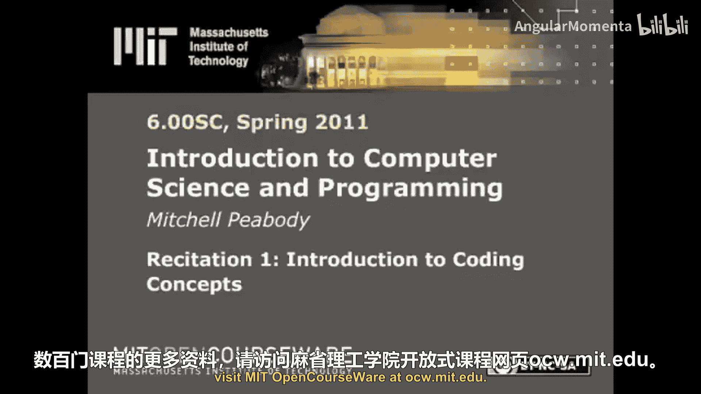
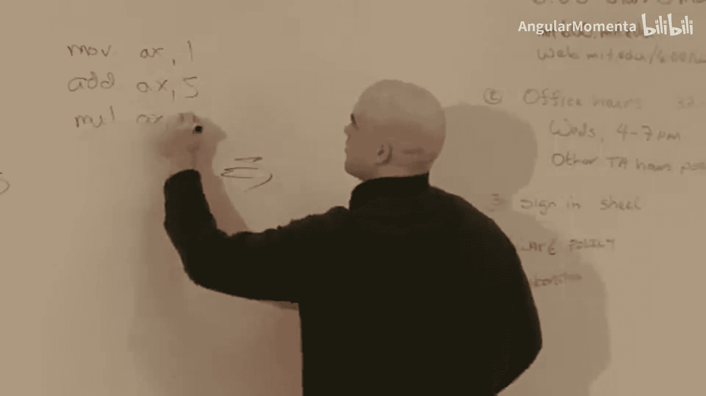
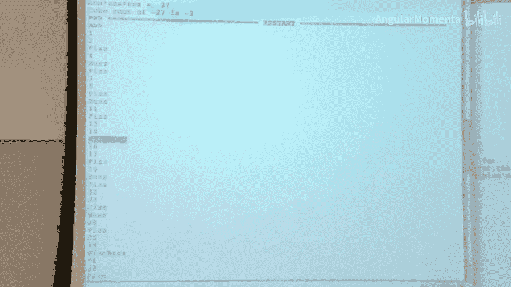
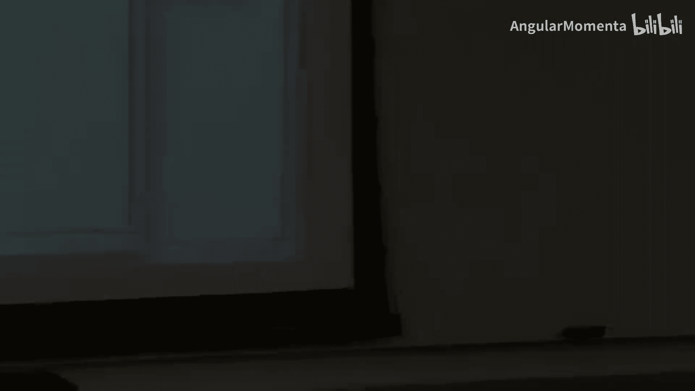

# 【麻省理工】计算机科学与编程导论 ｜ MIT 6.00SC Introduction to Computer Science and Programming p03 03 -BV1a5BZBkEP6_p3-

The following content is provided under a creative Commons license。

 Your support will help M I T Open Coseware continue to offer high quality educational resources for free。

To make a donation or view additional materials from hundreds of MI T courses。

 visit M T OpenCourseware at Ocw。 MT Eduu。

So the way that I envision recitations going is I'll start off kind of reviewing some of the points。

 some of the high points from lectures might go into detail on some of the more important topics。

 and this is also a time for you to ask questions。 There's only 25，30 of you here。

 So you should feel a little bit more comfortable asking questions。

 and there are no stupid questions here。For the most part。

 you're all beginners at program programming。 Am I wrong， Has anyone programmed here before。Okay， so。

Presumably， none of you have any experience with what we're talking about。

 and so if you ask a question， no matter how basic you think it is。

 it's not stupid because everyone's been there， including me and the professor when we started programming。

And we've made ourselves really stupid mistakes too。That said。

 we started out by talking about the purpose of the class。

 which is to teach you how to take problems， real world problems， break them down， abstract them。

 and diving them up so that you can solve them with a computer。And when we talk about computer。

 we're talking about us。Very simple model where， and this is the only time you'll see anything。

Related to hardware in this class。 when we talk about a computer。

 we're talking about something very simple with a CPU in memory。And maybe some input。And output。

All right。And when we talk about programs， these are sequences of instructions。

That are loaded into the computer's memory。Which can be divided up into little cells like this。

 All right， And what they might look like is。This actually doesn't mean anything， but it's just。

You know， for the sake of demonstration， this is what a computer would see。

As the CPU starts running a program， it looks at whatever is in this memory location and says this is an instruction I can handle。

 so I'm going go do this， So this might be like add two numbers together and produce a result。

 something very simple， very basic。And as it moves along in a straight line fashion。

 it just executes this instruction， this instruction， this instruction， et cetera， et cetera。

The problem is， is that while the computer is perfectly happy to look at this。

 this is gibberish to us。 And most people， most sane people。

 if they're actually looking at computer code can't decipher this。

 So this is where programming languages come in。😊，We can move up a level。

 we can abstract away from this and maybe。Say something like this stands for move a number into a register or whatever something like that。

 You don't have to know what this means。 All you have to know is that this is a little bit more readable than this。

 and it represents an instruction that the computer can understand。 The problem is。

 is that even at this level， this is still very atomic and very low level and really。

 you can't understand what's going on， so。Just so I can fill this in。

We move into say， I'm going to say x is equal to1， and I'm going to add x plus 5。

And then multiply by two。This is a lot easier for us to understand and this is what we're talking about when we're talking about any sort of programming language that will be studying this course and we're studying Python。

 so there are hundreds of languages that allow you to express these concepts in that form similar to that。

And all it does is it allows us to talk to the computer in this language。

Is everyone good with that cool？All right。So。When。We have these programming languages。

They're put together。In specific ways。 So does everyone remember the term syntax。

Can anyone tell me what it means or means？In terms of programming languages。

I could guess is you have the way that the string is structured？Yeah。

 it's the way the parts of the language are put together。 So let's say that。

I take a very simple statement。 I take， I'm taking a variable plus this variable。

 This is a valid piece of syntax for Python， for example。Or say， arithmetic or know。

 a bunch of different languages。So this is good。I can't write。On the other hand， if we say variable。

 variable plus。This isn't valid in Python， for example， It might be valid in another language。

 but the syntax of Python wouldn't allow this。 So this is。Bad syntax。All right。

 so does everyone kind of understand what syntax is？Allright， what about static semantics。

Talked about that in class。Can anyone give me kind of a rough view of what that is？

Can I choose someone。When we talk about static semantics。We're talking about valid。

 syntactically valid statements that actually that mean something。 So let's say that。

I have variable A。It's equal to5 and b is equal to 2。

A static a statement that's syntactically correct。 and is also meaningful with respect to static semantics could be something like。

A divided by2 right or a divided by B。A valid statements， syntactically。

And we know that 5 divided by 2 or a divided by B。 They're both numbers。 They mean something。

 on the other hand。Let's say that I had。This。I'm going to say that this variable D is a string fo。

 right。This。C divided by D， where C is a number and D is a string。

 That's something that's not meaningful， right， What does a number divided by a string mean。Nothing。

So that's what we're been talking about with static semantics。So。

These two aspects of computer programs are pretty easy to check for a compiler interpreter because they're pretty explicit rules。

 right？The part that we spend most of our time in。Is the semantic part。And this is where。

The syntax checks out the statements are meaningful in and of themselves。

 but the program as a whole or the whole kind of recipe doesn't work。 So as an example。So。This。

 as we know， is fine。 That's correct。 Well， let's say we have this。So A is6 c is0。If I do that。

What's6 divided by zero？It's an error， but。Syyntactically， this is fine。 And by its static semantics。

 this is fine。 So this is what we're talking， this is the type of thing we're talking about with the semantic。

Aspects of a program。Does it work properly？And before I jump into Python， I just， you know。

 one thing， one tip to keep in mind is that when you're writing programs and you're trying to do your problem sets。

Your program。Is very explicit。 It's not ambiguous， so。

A program will do what you tell it to do and know more no less。Yes。In a statement。

Doesn't mean two things。 So like， if I make the statement in English， you know。

 I cannot say enough good things or recommend this person highly enough。 if you write that out。

That can be considered a statement with two different meaning。 One of them is not too compliment。So。

When you're writing your programs， if it's not doing what you think it's doing， this is the part。

 one of the skills that you need to learn throughout the semester is to be able to read the code。

And try to follow along in your mind what's going on。 It's not magic。Okay， so now we're to Python。

 we're past kind of the generic introductory scaffolding stuff and now we're onto something that's actually going to be meaningful for you for the next。

12l， 13， 14 weeks。All right， so Python is a general purpose language。

It's used for all sorts of things。Web development， small device development， desktop programs。

 etc cea。It's an interpreted language， which means that if I have a program。Blah， blah blah， blah。

 blah。Then。Python executes it for me right straight away。 some languages。

Compiled languages have to go through a compiler。And then you have to run them。It's an extra step。

 Py， the nice thing about having an interpreted language is that as you make changes to the code。

 you can instantly see what's going on with your program。So。See。

 it's got a very simple syntax and it's also very widely used and it has been getting more and more people have started using it over the past。

 say 15 years。10 years ago， when I first heard about it。

 it was kind of like this little cute language。 And now it's kind of blossomed into this wonderful language that everyone uses and loves。

嗯。So。Programs in Python in， in all languages are。Sequences of expressions， right。

So this is getting back to。Syntax。And these expressions。

 they are composed of operas and operators and functions。 So let's say。For example。

This is an expression。This is a variable name， this is the assignment operator。

 and this is a string literal， right？When I say operaand， what I'm referring to。

Are things in the language， that's what a literal and a variable are。And then if I say operator。

This is something that does something to things。 So it's。

This is an example of what we call an assignment operator。What it does is it？

Says take what I'm referring to on my right hand side here。Create a name called MyV。

And say that every time that I reference my ver。I get this value。We'll talk more about that later on。

嗯。Let see， where am I going？So。One important thing to know about Python is that everything。

 So these things are objects。For now， you don't have to get too familiar with what an object is。

 just， you know， if you know anything， especially for the first quiz。This is something to know。

These objects， they have types， right？ So some types that we have in Python are ints。

 What are example of ints or integers。What十。It rattle a few optionss of seven， zero， negative one。

 two， et cetera。Now there's another number type。F。So this is what we normally think of as real numbers。

When you're talking about real numbers on a computer， they are kind of dicey to deal with。

 and we'll actually cover that later on in the semester when we talk about kind of the inexactness of these。

 But for now， just know that。These are numbers with like decimal points， right。Okay。

 where am I going next？Actually。Stactically， yes。So。

One thing that you might encounter when you're dealing with your programs。

 this is kind of off on a tangent is。When you say。Assign a number to a variable。不。

When you have a literal like this number here， zero。Python infers what type you're talking about。

 so in this case， it's going to create a number and it's going to call it a type integer。Allright。

If it sees。This。It's going to create this variable， and it's going to have a type of float。

NowIt might seem like something minor to you right now。

 but when you start doing some of the math on problem set one。If you divide by an integer。

You might run into problems。All right。In。Computer land，5 integer divided by two integer。Is equal to2。

Whereas in the real world。Sequal to that。So just be aware when you're working with numbers that you need to be aware of their type。

Especially when you're talking about the different operations you can do on them。

So for these number number types， you have addition， subtraction， multiplication division。

For integers。Exponentiation， which is represented by two asterisks。And for integer， modular。

And then for floats， plus minus。Same thing except no modular。All right。So back to the list。Yeah。

 could you explain why like maybe briefly why like five and five by two is two。

 you said in computer land， like what is it doing some sort of word rounding or like why is that different？

This is because the type of the variable is an integer。 And when you say something as an integer。

 you're talking about only these numbers， right so。Two and a half。As an integer doesn't exist。

It only exists as a float。When you have an opera in like this that takes two numbers on both sides。

 if both numbers are integers。This produces a result that is an integer。So诶。嗯。When you have。

These math operators， these produce a result， right？So that result has a type as well。

Because I can take that result and I can say。You know， C is equal to5 and a half。 Well。

 C is now a variable in the language。 that means that it has to have a type and。

Python says that because I did this operation with two integers。

I'm going to give it a type as an integer。 And the closest representation to two and a half in integer terms is 2。

I thought it was。So I assumed that it would rather be free。Oh yeah。

 you're talking about a separate issue。 It's not necessarily that it's closest。But it's。

 it truncates。 So when it converts the， yeah， it just truncates the decimal。

Well what happens if you're like fire my？So when you get into stuff like that。

 Python is going to look at， see it's an integer and a float。

 and this is something that we're going to have to actually test out when I turn on the computer。

 it should convert it to a float， but it might not so we'll test that out actually that's one of the nice things about Python is that if you have a question like that you can test it out instantaneously so。

Remind me。And's divided by float。And we'll demonstrate it。Okay。All right。

 so another data type string。Anyone know what a string is or can tell me？Shout it out。

S to alignment sequenceequs or characters， so it's something like。This。All right。

 and you can is anyone mind if I were racist。So in Python， you can specify strings a couple ways。

 One is with single quotes on the sides。And the other is with double quotes。This is useful。

 for example， if you need to embed quotes inside a string。 So if I need to say。

Have this is a quoted string。I would have single quotes on the outside and then double quotes on the inside。

 or vice versa。 I could do double quotes， and then single quotes。

The point is that Python needs to know when and where the string starts and where the string ends。

Were good？If I put into it。So if you put。That。If you write this。

 Python' is going to call that a string。 It's a string that contains the character too， though。U。

I guess you're asking because of the input。With the Poer。W to that one。So in your program。

 there's a point where you have to enter in numbers for Pro set one。They didn't start。嗯。Well。

 there is a place where you have to enter numbers。So。Raw input。For example。

Is going to return a variable。And the type of this is going to be a string。

 So if you need to use it as an integer or as a float， you can convert it。So now this is an integern。

 you can do math with it。Or you can also say。Does it makes sense。

That's something that'll be useful in your problem set。So。Just FYI。All right， another data type。

Williams。Yes。Does anyone know what a bulloleion is？What's up。It has to do with this then statements。

 but it's a variable， it's a type that only has two values。True or false。Okay。

And we'll talk about this or all of these when I start talking about operations on them。

Last one that you need to know of right now is the nun type。

The way to think about none is that it's sort of like dark matter。It's there， we know it's there。

 it holds a place， but we can't do anything with it。嗯。

It's there just so that you know that there's a variable that should refer to something。

 but that something doesn't exactly exist。you'll see more of it。

 but just it's nothing but it's there。And then later on in the semester， there's other data types。

 I mean， there's， there's a lot of data types。 But these are the big big ones that you need to know right now。

 Other data types that we might look at are lists。Tups。And dictionaries。嗯。

These are other major data types in Python。 you don't need to know them right now because Professor Guuttag will go over them in lecture。

But just and keep them in your brain。Okay so。We've already talked about the operations that we can do on numbers。

 We can also do operations on strings so we can do something called concatenation。

So concatenation is just a big word for sticking two things together。 So if I have。S1 and S2。

 and I want to concatenate them together。I use a plus operator。So。

The other thing that I want to kind of point out is that。We've used we have a plus operator for ints。

 we've got a plus operator for floats， we've got one for strings。I don't think they work for bulls。

 but they work for lists and tus。This is what's known as an overloaded operator。

 so it changes shape or it changes its behavior depending on the data types of its operaans。

So that's， you know， why when you're dividing an int by a float， you know it's。

Some languages will convert it to a float for you。 Other languages will convert it to an int。It。

 it's something that varies。 That's why I'm not sure of my answer right now。No。

 if your computer blows up in your face and that's。You know， an issue， know。

's that's a separate issue。All right。So。Some other operations that we have。

And they relate to bulloles。Our comparison operations。

What these mean are these take two operas and compare them。 So if I want to see if。Yes。

If I say a less than B and A is 2 and B is 3， then this is going to return。True。

 the value of this expression。Becomes true。You know and。If I say A greater than B。Obviously。

 it's going to be false， right？And all of these operators work in basically the same way。

 They take two operas and they give you a boolean value back， right。Any questions on that？Sorry。

 a boolean value is always true or false， always true or false。

And I'm actually going to get to that now。Buoleion values。

 And this is kind of the last major one we're going to talk about have。Three operators。Yeah。

And or and not。Actually， these should be a lowercasebook。嗯。These and an or take two operarans。

Not takes one and what they do。Is。If you have。Yeah。Something like A is true， B is true， C is false。

If you say like A and B。Then this entire expression is going to return true， right？If I say A and C。

This will be false。And returns true if and only if both operas are true， false otherwise。

If you say a。Or C。Or returns true if。Both or either both operas or one opera is true。

 So if any of them are true or both are true。If they're both false， and it returns false。

And not all this does is， if I say。Not a。It'll return false， it reverses it。

Now we can combine these together。These。Are very simple expressions， but we can also combine them。

 So we can say like A and。B。Or C， right， So if both A and B are true， then this becomes true。

 and then this entire expression。Becomes true if this part is true or this part is true。

 So you can build up pretty complicated expressions。

And then the way that they relate to these logical operators is remember these。

Take numbers on either side and they produce boolean values。If I have。I can say D is less than E。

 This is going to give me a boolean value， right？Which I can then use。The and operator on。

And I can say。So what this does is it says if D is less than E and E is less than F。Then return true。

This， by the way， would check to see that these numbers are in order。You know，3，4，5 as opposed to 5。

43。So。I everyone good on all that， Did I lose anyone？ No questions。All right。

So the last couple things， then I'm going to turn on the computer and actually walk through some code with you and we'll be done for the day。

So。This is kind of the crash course in basic syntax or basic types for Python。So。There were three。

So what we have now is a way to create programs that run in a straight line， right。

Can anyone give me kind of a synopsis of what a straight line program is？我收。Go Go online by line。

 Do everything once。All right。The problem is， is that this doesn't allow us to do anything， right？

 So we have branching。This is implemented by something called an if statement。Now。

 the way you use an if statement is。This is the full version of the E statement， it's saying。

If this condition is true， I'm going to execute the code in this block。If this condition is true。

 if this condition is false， and this condition is true， then I'm going to execute the code here。

And if none of those were true， then I execute what's here。啊。You don't need to have an LF。

 and you don't need to have an L。 You can just have an F。Or an if and an else， So the three。W is it。

Three versions of this。Branching。Now when I。Just by way of explanation。

 well I draw like a line like that， I'm talking about a block of code。

Can anyone tell me how Python represents blocks of code？dentYeah， so indentation， right。

 he kind of talked about that on Thursday。So。Blocks of code or chunks of code that belong kind of logically together。

 So what this saying is that if I execute this， all this block is going to get executed。

 all this block is going to get executed， etc cea。So。If I were to represent this pictorially。Then。

This is kind of the main part of the program， and then this is the if statement。And the block。

 and it goes back to whatever code is down here， right？If I represent this pictorially。

This would be the true part。So this part of code。This would be else。

And then this part would be multiple excursions。It would look a little bit like a tree。All right。

 so different branches can。For the different bits of code。

Did everyone puzzle on that or anyone puzzle on that？Okay。

And there was a last bit of flow control that we talked about。 what was it？

So if we want to do something multiple times。Iterations are loops。So。It's called a loop。

Because it looks like a loop in the code， right？And there's two variants。

There's a while loop and there's a four loop。A for loop is when you want to iterate over a finite set of elements。

嗯。So。What this for loop does is it says， I'm going to take， this is the range function。

We'll talk about this a little bit later， but all it does is it gives me all the numbers from one to9。

It。Goes one past， so， but you don't need to know it just yet。What this is telling Python， though。

 is that we're going to execute this block of code。9 times， right。

And on each iteration through this block of code， we're going to set I to one， and then set it to 2。

 set it to 3，4，5，6，7，8，91。Anyone lost by that？We'll see an example of it pretty shortly。

And then the last one。Is a while loop。On while loop。Executs as long as a condition is true。So。

It's useful。Don't want to do that。It's useful when。

You're not necessarily iterating over this finite set of elements。

 or you you don't necessarily know how many times you need to execute a specific loop。

 You just know that you need to keep executing this code while something is true。

And we'll see an example of that pretty quickly。So I've basically shotgun blast you。

 blasted a whole bunch of stuff at you。 Is there anything that people want me to touch on before I pull down the screen and we start looking at code。

All right，Has everyone been able to get Python set up？All right。

So you all know that this is the editor window right， it's what we use to edit longer script。

And you know that this is the interactive prompt before I forget。

Let's see what happens if I divide the integer5 by the float2。

So Python does what you would hope it would do。 It turns it into a float。 If I do this so。You me too。

So it's an easy way to test。呃。So we've got two chunks of code here。That I want to go over。

One of them you've already seen。It's the。Program that tries to find the cube root of a pureic cube。

And。Why don't we just walk through it and read the code， right。

 So here's that raw input function that I told you about。

Now it's going to take a string and it's going to print the string out on the screen。

 and it's going to say enter an integer。And。Comment us out。So let's enter， what's the perfect cube。

The return type of raw input is a string， right？So that int will convert。2 x。Now。

Here is an example of a loop， the wall loop。And because we don't have。

Kowledge of what the user is going to input when the program is run。

A while loop is an appropriate kind of control loop to use， right？Because we can test a condition。

Where。Our guess， which is what's represented by ants。If we cube it， is it still less than x？

All right， explainplain that a little bit incorrectly。

What we're doing here is we're making a guess and we're calling an ant right now or we're going to set it initially to zero。

And then we're going to enter this while loop， and we're going to say。

We're going to take ants and we're going to multiply it three times。 We're going to cu it。

And if the value of ants cubed is less than whatever input the user gave us。

Then we're going to keep looping。And on each loop。We're going to increase the value of our guests for ants。

Right and if it turns out that。X is a perfect cube eventually by just iterating through all the integers from one to whatever。

Whatever the cube root of x is， we will find the answer。And we'll know we find the answer because。

Answer cubed is going to be less than x。Now， can anyone tell me why we have abs here？そざ。Right。

 so let's say that the user entered in like negative 27， right？Still， it still has a cube， right。

 It's still negative 3。But the way that we've set up our loop， if we were to take this out。

The program will just continue executing forever。Well， for actually a very， very long time， but。

The universe would die before it finished。So we have this absolute value here。

 has anyone puzzled by this， do I need to belabor the point？Okay。

So eventually I've entered 27 and we can actually， you know a good way to kind of check ourselves is to print out diagnostic input。

So it guesses one， that's not you know the one cubed is obviously not 27，2 cubed， it's not 27。

3 cubed is 27。When we get to that point， we leave the loop， and now we're down in this bit of code。

All right。Now， because we're asking for cube roots。We need to check the condition for when。I'm sorry。

看来是。Mixed up here， sorry。嗯。So when we exit the the while loop。If we've had。

A number that's not a perfect cube。Then。We know that the value that answer stopped on。

Is not going to equal the。The cube of it， so。By way of explanation。So my last guess is three。

Cd is 27， let's run it again。Let's say that I have 20。Right。

So what happens is it gets to four so4 cubed is 64， right， that's obviously not 28。

And that's what this condition checks。 And so it knows that if it gets to that point。

 it's not a perfect cubee。Now。This LF statement here says， okay。So， if this。Turns out to be true。

 That means that it wasn't a perfect cube。 but let's say that it was a perfect cube。

This will be true， and Python will then look at this and say， well， let's look at this if condition。

 or actually I'm sorry。This condition will be false。If it's a perfect cube， right？

And Python will say， look at the next part of the if LF statement and we'll say well。

 was x less than0。 What it's doing here is it's checking to see that we've entered checking whether or not we've entered a negative number or not。

So if we entered negative 27。What it would do。Is it would enter this branch and then it would negate whatever answer it got because we found the answer for a positive。

 perfect cube， right？Did I break it？We are having technical difficulties。No， okay。

Not sure what happened there。そ。Anyway。So。We go about trying to find the cube root of 27。

 which absolute value of 27， and we， of course find it it's three。But then。

Because we've entered a negative number， it's to Python's going to enter this branch and negate whatever answer we got。

 because we know that in order for it to be negative。

 then it would have to have been a negative number， right？Has anyone lost anyone good？或者。Oh。

 this one。So this is one of the comparison operators。 This stands for not equal to。 So if I have。

Do a little Python work here， Phi of a is equal to 5 and B is equal to6。If I say a is double equal。

 that's going to check and see if they're the same value。Obviously， they're not。

 So it's going to return false。 On the other hand， if I say not equal or bang equal。

 sometimes we call。This will return true。Any other questions。お案内理。They're 28 for。

 shouldn't they not print。就是。Oh。Yeah。So。Yeah。Should it be indented？Because if we indent it here。

 right？Then what's going to happen， It's only going to print out the cube root for negative numbers。

So。What。What's it。Well， again， if we put an L statement。

 then it won't print out the cube root for negative numbers， what we could do， and this is kind of。

You know， a hackish way。Is writing it like this。But that's kind of ugly， right。

 because you're repeating yourself。And one thing about computer programmers is that we are the laziest people on the face of the earth。

We'll spend 20 hours writing a program to do something in five minutes。

That we could have originally done。In 10 minutes。Its。Just our nature， so anyway。

So we're repeating ourselves。 And while I'm speaking， you know， this is the solution I came up with。

 If I were to go back and rewrite this， I probably。Make it a little bit。Less。Convoluted。

 so maybe let's try this。So we're going to check if we were successful。

 and then we're going to check if x less than  zero。Now we're not repeating ourselves。

And we catch all the cases。So let's make sure that my fix works because oftentimes when you write programs。

 you'll introduce bugs of your own。So we've tested when it is a cube， let's test it when it's not。

Okay。So there we fixed it。I think。One thing about computer programs is that， you know。

 this is a very simple case， but for longer， more complicated programs。

 it's almost impossible to get out all the bugs， but in this case。

 pretty confident that we were successful， right？So does anyone else have any other questions on this？

B， right？last thing that I'm going to go over is something called a FISBuzz program。This is just。

A silly little program。 This is the English specification。 and this is。

Kind of a first instance of where we're going to take English and kind of break it down into code。

Figure out how to break it up， chunk it up and abstract it into something that actually works。

So the problem is to write a program that prints the numbers from  one to 100。

But for multiples of three print friz instead of the number and for multiples of five print buzz。

 And if they're multiples of both three and5， we're going to print fs buzzuzz。Allright。

If it says numbers from 1 to 100， this when you see something like this。

When you're trying to figure out how to write your programs。

 the first thing that should go off in your mind is I probably need a for loop。

Because I'm iterating over a set of numbers。So we know that we happen to know the numbers 1 to 100 and here's the range function again。

 and we'll talk about range next week， most likely， and all we're going to do。Is。First。

 we're going to get the string value of this number。

 so remember how earlier you asked if or one of the students asked if we had a number and a string。

 if that was a number or not。So like this。That's what that STR function does。

 So if I have a variable， A is equal to1， I can say S is equal to STR。

A and S is now going to be that。Alright。And then what I'm going to do here is I'm going to check the integer value。

 so I。And see if it's evenly divisible by three or five。

And the way that I check that is I use the modular operator。 That's what that percent sign is。

 What this operator does is it takes two integer values， and it returns the remainder。

After you've divided the left integer by the right integer。If I have six modo3。

 what's that going to be？Should be 0， right， because you can divide6 evenly by 3。 The other hand。

 if I say five modular3。Then that's going to be two， right？I have to think about it for a second。

Okay， so that's all this does and these are。Two expressions that return a boolean value， right。

 because。This mod operation is going to return an integer。

 and I'm going to use the equality operator to compare it to a number， another integer at zero。

And that's going to give me a boolean value。This expression also gives me a boolean value。

And then I'm going to combine them into using the ore operator for Boolean values into a larger expression。

And if this is true。Then， I know that。I'm going to have to at least print Fiz buzzuzz or FizBuzz because I'm not going to print the number。

Because it's a multiple of three or five。And so all this code does is just figures out。

If have to if it's evenly divisible by three， then I know I print fizz。

 so I'm going to concatenate my final string onto it。And then， if。

It's evenly divisible of five then I know I need to print buzz。

 so then I'm going to attack tack buzz onto my output。

And then I'm just going to print whatever I'm left over with。 So to see this。

Inaction because we are way out of time right now。So one， two， fizz， four， Buzz， six， Phiz，7， eight。

 and then we have Fizz buzzuzz for 15， so it seems to work。Everyone follow that， we good。

So， I'm done。For this recitation。

