# 【麻省理工】计算机科学与编程导论 ｜ MIT 6.00SC Introduction to Computer Science and Programming p04 04 -BV1a5BZBkEP6_p4-

The following content is provided under a creative Commons license。

 Your support will help M I T Opencourseseware continue to offer high quality educational resources for free。

To make a donation or view additional materials from hundreds of M T courses。

 visit M I T OpenCseware at O C W dot M I T dot E Du。

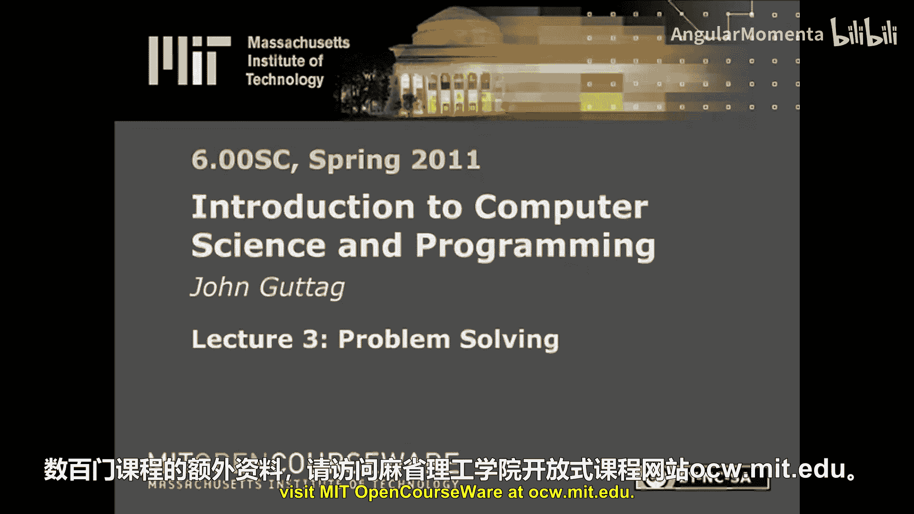

I apologize to those of you watching on Open Coseware。 I forgot to turn on my microphone。

And you miss some incredibly brilliant things。But such is life。All right。

Let me go back to where I was， which was we were looking at this code to find the cube root of a perfect cube。

😊。

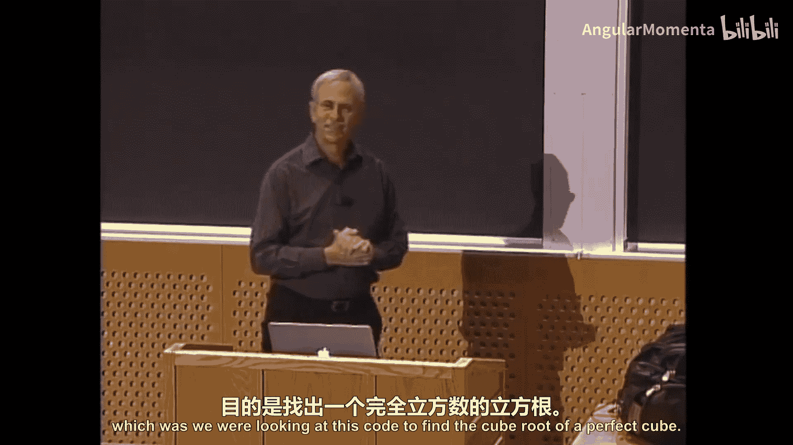

We saw this last week， and indeed， you also saw it in recitation。 I'm not going to belabor it。

I do want to ask you the question。For what values will this program terminate。That is to say。

 the only input is to x。 for what values of x is this program guaranteed to always stop。

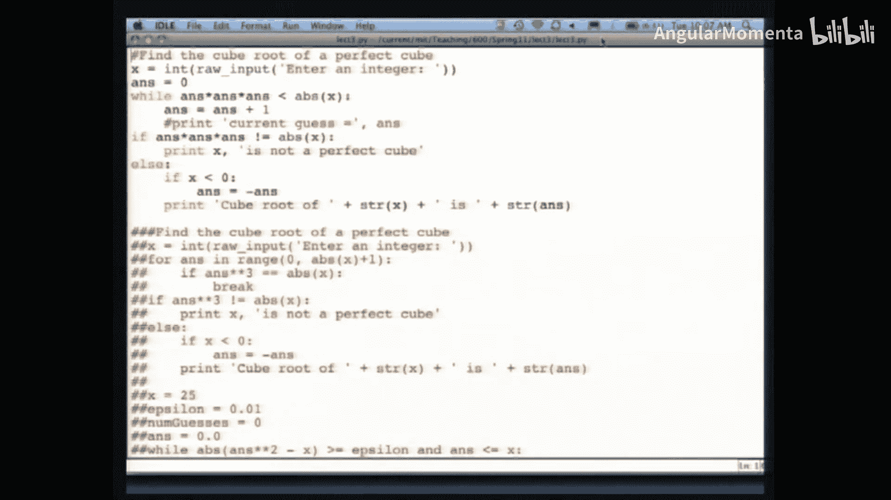

Anybody want to volunteer and answer to that？Ask a simpler question。 Let's assume that x is a number。

 In fact， let's assume that it's an integer。Will it terminate for all positive integers。

 all positive values of x。

Yeah， all negative values。As far as I can tell， how about 0， Yeah， So， in fact。

 it terminates for all values of x。How do I know that。

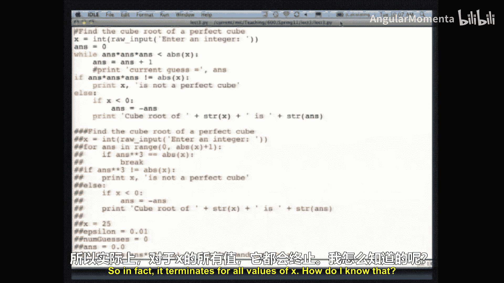

And that's a key question。I know that， because I've used。And I mean by used as a mental tool。

 something in my head。The notion of a decrementing function。And every time I write a loop。

I think about one of these。Because that explains to me why the loop is guaranteed to terminate。

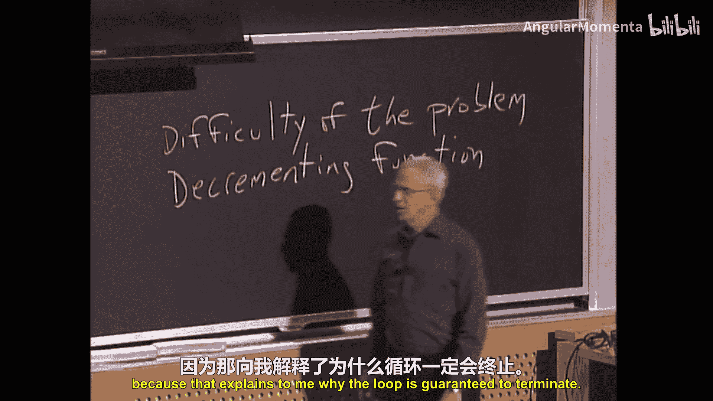

We'll go over here where we have a bigger board。And look at the properties。

That a decrementing function needs to have。1。It will map。Some set of program variables。To an integer。

2。When the loop is entered。For the first time， or when I encounter the test of the loop for the first time。

Its value is non negative。3。When its value gets to be less than or equal to 0。The loop terminates。

And finally，4。It's decreased each time， through the loop。

So what we see is if it starts to be a positive value or non negative。

And it's decreased every time I execute the body of the loop。That， eventually。

It's got to reach 0 or something less than 0。 And when it does， the loop stops。

If such a function exists， then the loop is guaranteed to always terminate。Now， of course。

 one can count up to a value instead of down。But there's always a trick we can use of subtracting to make it the same。

So what's the decrementing function for this loop。How did I know it will always terminate。Yeah。

Answer equals answer plus one。I don't think so。Does that satisfy all of these properties。Remember。

 a function is going to map some set of program variables。2。An integer。

So what are the interesting program variables here， Well， there are only two。Ants and Xs， right。

At least that's all I can see。So what would be an interesting function。Somebody。

Surely there's someone who can figure this out。Yes。😊，Or no you're just scratching your head。

 you fooled me。I can't see because of the light， but I'm sure there must be dozens of hands up if I could only see them。

😔，Actually， I don't see any hands up。All right。This is not so hard， guys。

It's the absolute value of x。Minus。Answer cubed。So what does this value start at。Let's pick a value。

 Let's try。 Sose that x is equal to。eight。What is the initial value of the decrementing function。Wow。

Come on。 Let's be a little cooperative， please， yes。So it's 8 minus0， which is equal to 8。So。

 it satisfies。Conditions 1， and conditions 2。What happens to this value every time through the loop。

X change？Does answer change？And how does it change。It's increasing what does answer start at。

 It starts at zero， and it increases。So I know that answer Q will always be positive。Right。

 so I know that every time through the loop， it will be 8。The first time through will be 8-1 cubed。

 which is 7。And the next time through， it will be 8 minus。2 cubed。Which is 0。

 And then I exit the loop。And it's that kind of reasoning that I use to convince myself that this loop terminates。

And every time I write a loop， and I hope every time you write a loop， you will。

Think about what's the reason the loop is going to terminate。

 and you will do it by thinking about what the decrementing function is。All right。

 people get me on that。And。Whoever finally answered a question surely deserves to be fed。

I obviously have to bring better candy to encourage better responses。Okay。Now。

 let's go back and look at the program itself。Now that we know it stops。

And you can take my word for it that it actually computes the correct answer。

Let's think about what kind of algorithm this is。 What's the method。

This is an example of guess and check。And it's a particular kind， called exhaustive enumeration。

Each time through the loop， I'm taking a guess to what the value is。

 And I'm checking whether it's true。But I'm enumerating the guesses in a very systematic way。

 They're not just random guesses。 I'm enumerating all the possible answers。

If I get through the entire space of answers， a possible answers。

 and I don't find a solution then I know that it doesn't exist。 and it's not a perfect cube。

So that's why it's called exhaustive enumeration， because I'm exhausting the space of possible answers。

DoesThat make sense to everyone。So， let's try it。Let's try it with， say， a very large value of x。

Because that's always an issue， of course， when we do exhaustive enumeration。

So I'm going to enter this value。Al right， is that a perfect cube。Who thinks it is。

Who can tell me what it is。 What's the cube root of that， All right。Well。

 this is a question I did not expect you to answer。But。It's 1251。That'll be in the first quiz。

 So make a note of it。Notice how quickly the computer did this。

Found the cube root of quite a large number， very quickly。

And so while one might initially think that exhaustive enumeration is a silly technique because。

Takes a lot of guesses for an awful lot of problems。 We can actually just。

Write a pretty stupid program that solves it by exhaustive enumeration。

 We typically would refer to such programs as brute force。

And brute For is often exactly the right way to solve a problem。Why does it work。

 Because computers are really fast。How fast are computers。Well， today。

 a good computer can execute in a single processor on the order of 100 million instructions a second。

How fast is that， And now we're going to see if Mitchell has answered the question I asked in the way into class。

How many instructions can a computer。Execute between the time I say something and the time the people in the back row hear it。

Mitch thinks it's 400 million instructions。I think that's about right。 It's hundreds of millions。

 at any rate。That's kind of amazing between the time I say something， the time youll hear it。

 hundreds of millions of instructions。😊，It's mind boggling how fast that is。

 And that's why we can often use these kind of solutions。Next lecture， actually。

 even a little bit later in this lecture。I hope to get to an example of why that doesn't really get the job done。

At least not always。 Before I do that， I want to look at one more programming in construct。

And that's a variant on the while loop。So if we think about what the while loop we were just looking at did or does。

As the decrementing function told us， it's looking at all the possible values of answer ranging from 0 to the the absolute value of x。

And at each step， testing and doing something。We can abstract this process using something called a for loop。

Alright， so let's look at this code。It's essentially exactly the same algorithm。

I got bored of typing ants times， ants times ants。So I use the Python notation for exponentiation。

Which you'll see is star， star。Now， it's easier to read if I get rid of。来。So， but other than that。

 the interesting thing I did was replace。The wild loop by a four。

So you'll see this line of code there。For ants in range 0 to abs of x plus 1。What that says。Is range。

Is a built in function of Python。That generates。In this case， a sequence of integers。

Something called a tuple， which we'll be looking at。In a lecture or so。 But for now。

It's pretty simple to think about what you get。Is if you look at the expression range。Of x to y。

That gives me a sequence of values。X。X plus 1。Up to y -1。No， it's not up to y， but up to y -1。

So it gives me a length， a sequence of length， y。Well， starting。Assuming that's 0， right。

Doesn't have to be 0。 It can be anything can be another value as as well。0， in my example。And then。

 the for loop。Execcuts it on this value， then the next iteration on this value。 And finally。

 at the very end， on that value。So， it executes it。

One iteration of the loop on each value in this sequence of values generated by the range statement。

And normally， it does all of them， however。You'll see， I've added something called a break here。

A command in Python。 And what B says is exit the loop。

So it exits it prematurely without executing all of the values generated by range。You can nest loops。

 just like you nest if statements。 And if you do that， break always executes。Are always exits。

 rather， the innermost loop。So what this does is it generates a set of values to test。It。

Checks whether or not it's got the answer。 If it does， it terminates the loop。And eventually。

 you exit the loop， and then it just checks as before， whether or not it found a correct answer。

And does the right thing。So， you'll find。Particularly when you're iterating over integers。

 but later we'll see when you're iterating over a lot of other kinds of things。

4 loops are a very convenient， shorthand。

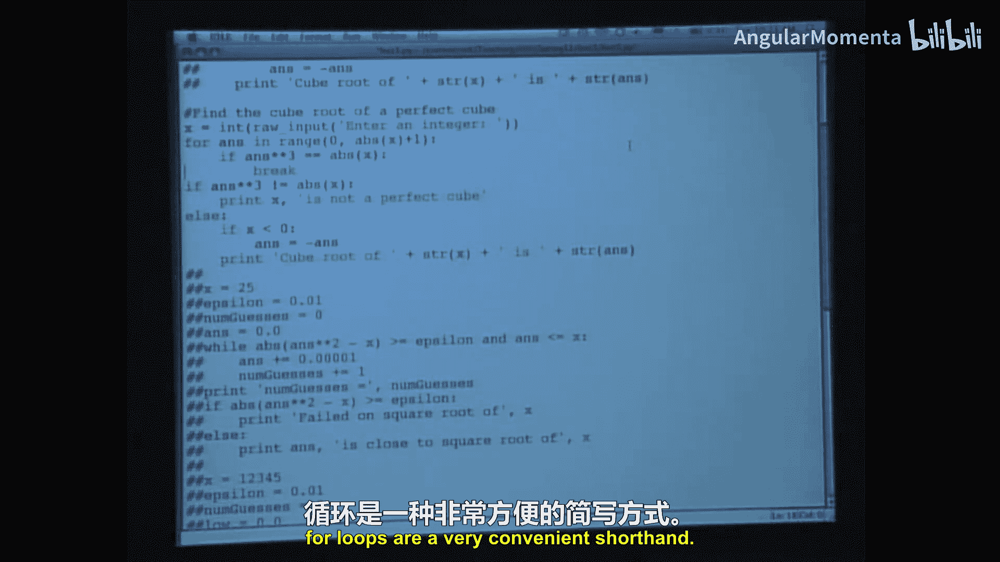

There's nothing you can't do with the while loop。 You don't need four loops。

But they do make life easy。 And over the semester， I think you'll find you'll end up writing a lot more for loops。

Then you will while loops。Okay， any questions about this。If not， I'm gonna move right along。

 So this is the moment。Alright， I'm going to move right along。

So we've now got a program that does something really silly， really。

It finds cube roots of perfect cubes。That's not typically useful， right？ I mean。

 you've even got these。50 cent4 function calculators that find say square roots。

 And they don't insist that you only give it perfect squares。

So now let's think about how we would take this kind of program and indeed。

 this kind of method of writing programs。And use it to find。For now， we'll look at the square root。

Of any number。Of any floating point number。Well， the first question we need to ask is。

 what do I mean。That's kind of a subtle question。 What does it mean to find the square root of a number。

What does it mean， for example， to find the square root of 2。Well， we know that。

That was an endless series of digits。Before we can find the square root of two， right。

 it does not have a nice answer。So we can't just say we have to find something that if we multiply it by itself。

 it will equal 2。Ca we can't find such a thing。So we've got to think about a different notion of what we mean。

Furthermore， even for some numbers for which there is a square root。

It might be a million decimal places long and consequently， really hard to find。So we need to think。

About a different kind of concept here。

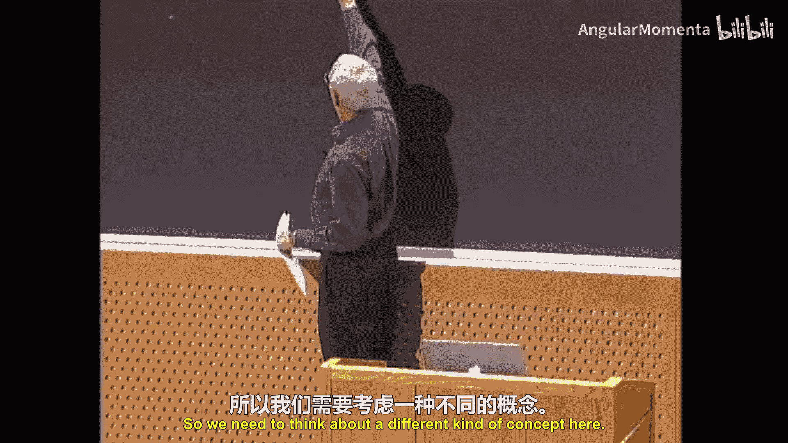

And it's the concept of an approximation。Finding an answer that is good enough。So。

What should we do here， How do we think about this。Typically。

 what we do when we think about an approximation。Is we define how good an approximation we're willing to accept。

So。For example， we might want to say， all right， I want to find a square root that lies within epsilon of the true square root。

So。Find a why。Such that。Why。Times y。Is equal to what。What does it mean。

 How would I express it within epsilon of the perfect answer。I don't want to say it's equal to X。

 because。That may be impossible or too time consuming to find。So really。

 what I mean is x plus or minus epsilon。Right。So that's what I'm asking。

 Find one that's close enough。And that's what the next piece of code I want to show you does。Whoop。

 excuse me。So， I'm starting。Just giving it a value for X。 So I don't have to keep typing one in。

 Let's say it's 25。I'm gonna take epsilon to be 0。01。

So I want it within that distance of the true answer。

I'm going keep track of a number of guesses here， not because we needed to actually compute the answer。

 but because I wanted to then discuss how many iterations of the loop we're doing。

Going to start by setting my first guess at 0。0。 Again， this is going be a exhaustive enumeration。

Then I'm going to essentially encode this。As the test of my while loop。

While the absolute value of answered squared minus x。Is greater than equal to epsilon。

And answer is less than equal to x。 So it's now a more complicated test。 I've got a Boolean value。

 Two things have to be true to execute the body of the loop。

I'm going to increment answer by a tiny amount。Increment the number of guesses just so I can keep track of it。

嗯。Maybe I'm going comment this out for the first go round just so we don't see too many print statements。

And keep doing it。And when I'm done， I'm gonna to see whether or not what I found is indeed a square root or close enough。

So if we think about why this loop terminates， why am I guaranteed that this loop will terminate。

What's my decrementing function here。Somebody。What's the decrementing function。

What am I guaranteed to reduce each time through？ And when I get through， I'm done。Yeah。啊。No。

 close sort of。But， I appreciate your trying。That's worth something， just for the effort。

Somebody else。Remember， if we look at the properties it has to have。

It's going to guarantee me that when it gets to the right value， I exit the loop。

Which suggests it's going to certainly be part of the test of the while。

Just look at this piece over here， at the end。Right。Answer starts at 0。I keep incrementing it。

Eventually， answer minus x。Will hit a value， right。Eventually。

 I'll get to the point that this condition must be true。Must be false rather。

 And then I exit the loop。So this piece is not really the key。

It's this piece that guarantees me I'm going to get out eventually。This piece can get me out sooner。

It's kind of an optimization， if you will。Alright， so I'm just gonna go until I find the answer。

 Let's see what happens when I run it。Alright， it tells me that 4。99， etca。

 is close to the square root of 25。So there's some things to， to note about this。First。

It didn't find 5。

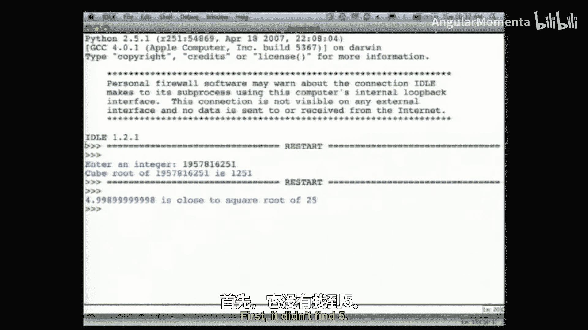

25 happens to your perfect square。 yet。 I didn't find it。Is that okay。Yeah。

 because that wasn't what I said。 What I said is find a why that has these properties over here。And。

 I did。I didn't say find the Y that gets closest to the square root of X。 I said。

 find one that has these properties。Effectively。What this is is a specification。Of the problem。

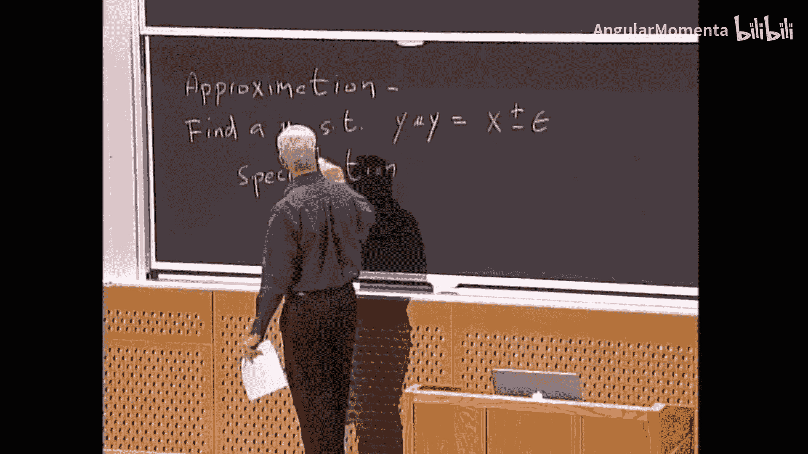

And I've now written a piece of code that meets the specification。 It does what I set out to do。

 And that's good enough。Now。Wes。Turn this comment。This print statement， back on。

Took almost a half a million guesses to get there。嗯。But it was still blindingly fast。So once again。

 exhaustive enumeration seems to be O。Suppose， however。I choose a， a bigger number。Now， first。

 let's choose something。That。Doesn't have a。Good answer。 Let's see what it does for that。Allright。

 pretty good。Also， pretty fast。Not too many guesses。But now， let's try this one。Well。

 it's gonna to wait。 It's gonna to get done， but it's going take a little bit longer than maybe we want it to take。

Why is it taking so long， There it is。 It found an answer。Which， I think， is good。But as you can see。

 it took quite a few guesses to get there。So why， Well， let me at first ask this question。

Can we look at the code。And。Anticipate how many guesses it's going have to take。

We're going back into this issue of computational complexity。 But here， not of the problem。

 but of the solution。So this is algorithmic analysis。 We're analyzing the algorithm。

This exhaustive enumeration algorithm and trying to figure out how long it's likely to take to run。

What does the running time of this algorithm depend upon。Yeah。It depends on the actual square root。

Yes， but in particular， the distance of the actual square root from the starting point。

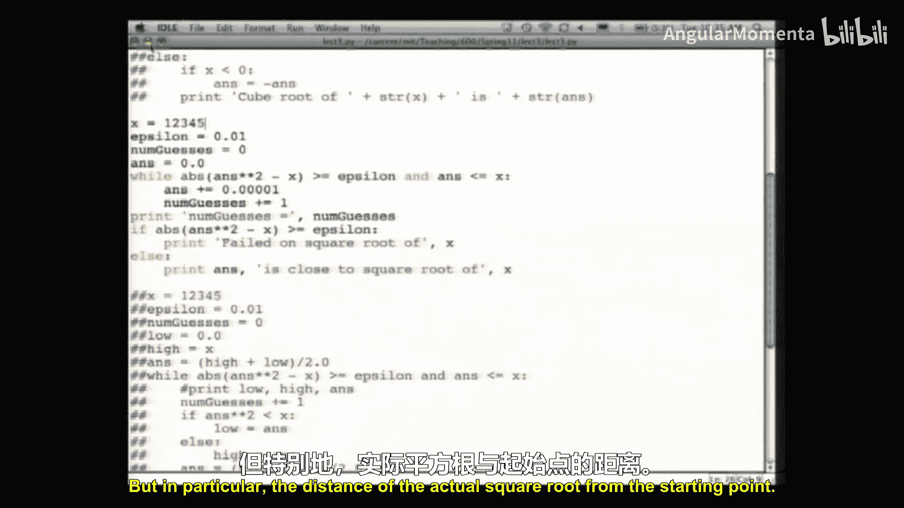

So that's one factor it depends on。But that's not the only factor。 What else does it depend on。Oh。

Do we have an injury。We had a dropped pass and a deflection there。Alright， yes。

It also depends on the level of accuracy of how you define epsilon。

 It also depends upon the value of epsilon， absolutely。That。How long it takes to run？

Someone with a concern for safety， all right。It depends upon the actual value of epsilon。

 because if epsilon is small。😡，Well， we may have to take more steps to get a precise enough answer。

 and it depends upon one more thing。Yeah。The increment。The increment， exactly。

 because the number of times we go through the loop is going be related to how big a step we take each time through。

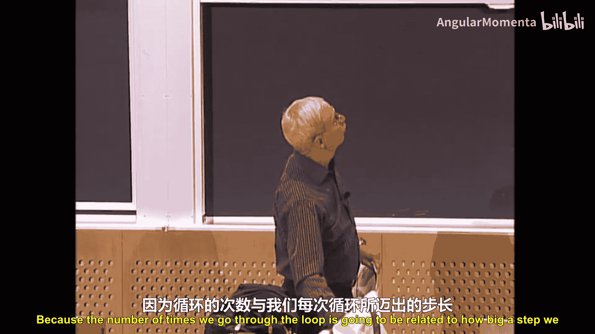

No applause。Thank you。Alright， so it depends upon all of these things。And here。Since。

We're trying to find a pretty br square root。And。A sortr of precise answer。

 But we're taking tiny steps。 It's going take a long time to execute。So we could make it faster。

For example， suppose I change the step size to。To this。Plus。

 equal by says increment the value by whatever the right side is。 So I'm gonna increment it by one。

Well， it was really fast。But it didn't work。It failed。Alright， that's not so good。

So I can't just do that。 And， of course， it's not surprising because I ended up jumping over。

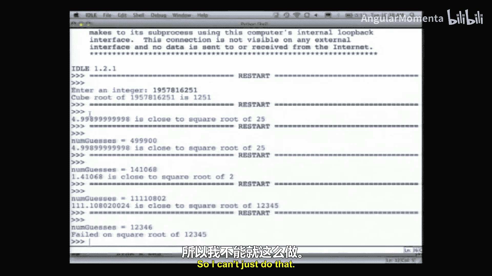

The answer。I could make epsilon smaller， but that seems like cheating。嗯。So really。

 what I need to do is find a better algorithm， a better way to attack the problem。Fortunately。

 I don't have to invent it。 Some people a lot smarter than I am figured out a long time ago。

 a good method for solving this kind of problem。And they。Doing it。

 using something called bisection search。As we look at this particular implementation of it。

 we're going to use two algorithmic techniques that you'll use over and over again because they're generally useful。

So the first one related to bisection search。Is we'll cut the search space。In half。Each iteration。

So with my brute force algorithm。We're trimming the search space only a little bit each step。

So if we think about it， what it looked like。We had a space of values to search for the answer。And。

I started here。 And each step， I just trimmed off a tiny， tiny little bit。0。001。

 leaving me a lot of space to search。And that's why it took so long。When I do bisection search。

The basic idea。Is each step I want to cut the search space in half。

Get rid of half of the search space， each time。So。One way I could do it is I start with a guess， say。

 in the middle。Just pick some guests that's in the middle of my search space。And now I say。

 is it too high or too low。I can easily answer that question。 I square it。 see。

 is my result bigger than the actual square root or smaller than the actual square root。

And that tells me whether my guess is too big or too small。Once I know that。

I know which side of the guest the right answer is on。So if I knew that my guess was too big。

Then I know there's no point in looking over here for my next guess。

So I can get rid of this whole half in one step。Now， what should my next guest be。要。

My next guest should be half。Way through there。Exactly。哦。And now you'll note， let's say this time。

 my answer is。Too small。Then I know I can get rid of this。

So now I am very quickly pruning my searchch space。If I think about that。

How many times am I likely to have to prune it。It's much faster， right。As we'll see later。

 it's basically log base 2。If I have some number of values to look at。And what， by the way。

 how many values do I have in my search space to start with。What determines it，Clearly。

 the first value and the last value。But also， how small I'm dividing it up。Right。

 so I have to think about that， too。 What is the precision。With which I do this。

Am I looking at every one millionth？Of a number or every。01， that will tell me how big it is。

Once I know how big my search space is。I know that if I search it linearly looking at every value。

 my worst case is I look at everything until I get to the end。But my best case。Well。

 my best case is I get lucky。 and my first guess is right。But if I use bisection search。

 my worst case。Is going be log number of values in that space because each time I throw half of them away。

We'll see that in more detail。Later on， let's go back and look at the code now。

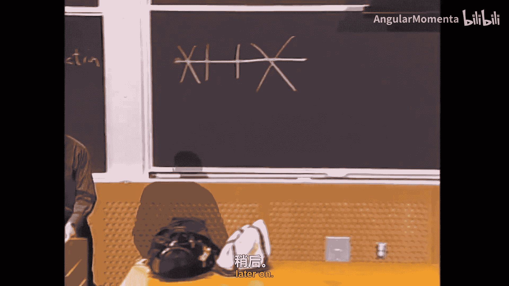

So it star as before with the value for epsilon。But now I'm going to take a lower bound。Here。

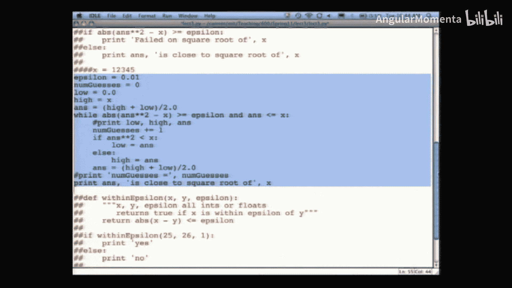

And an upper bound on my search space。

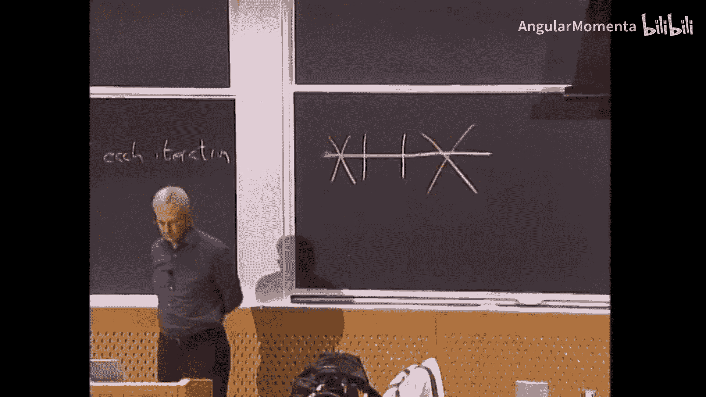

I'm going say my initial guess will be the upper bound plus the lower bound over 2。

Halfway through my search space。And then I'm just going to work my way through it。

Until I get to the answer。Or don't find it。So should we look at what's going on here。Let's try this。

Well， let's first make sure it works for。A small value。

 Never test your program first on something big。 Always try your program on something small first。

Let's try it on that。Got an answer。Notice that it's different from the answer we got last time we looked for the square root of 25。

But， that's okay。Because it still meets the specification。

It's still within epsilon of the actual square root。

 And I didn't have to say that I wanted it below or the square root or above。

 just said within Epsilon， sure enough， different algorithm， different answer， but equally good。But。

 a lot faster。Now， let's try it for the big value。Well， that was a lot faster， wasn't it。

It got me an answer。Probably not exactly the same answer as before， but pretty close。

But it did it in only 26 guesses。Pretty cool。And， in fact， we'll see over and over again。

That bisection search is a really good technique。For finding quick answers。Alright。 And again。

 why is it 26。Where we had some number of guesses to start with。After one， it was half as big。

 and a quarter is big。And eventually， log2 of the size。But what was the size。Was it。The number 1，2，3。

4，5。No， we already sort talked about that。What was it？Let's look at the code。

And let's think about what was the size of our initial search space。

It's a little bit tricky to think about this， right。Now we have to think a little bit harder。

About when we exit the loop。Because then fundamentally。

 that's telling me the size of the search space。So what determined the size of the search space。Well。

 we talked about the upper and the lower bound。But what's telling me。Roughly speaking。

 how many divisions I have。It's epsilon。Right， it's not 001 because when I square it。

It gets to be has to be smaller than  point01。But that tells me roughly how many I have。

And so it's going to be roughly 1，2，3，4，5， divided by 0。01 squared。Which turns out to be 26。897。

 more or less。So。We could predict it and son of a gun。 When we ran it。

 we actually matched the prediction。That's a great thing about algorithmic analysis。

 We can actually get accurate guesses as to how long a program is likely to take to run。😊。

This is an important thing because sometimes we do that and we say， oh， it's gonna to take a year。

 I better not even try。 I better find a smarter algorithm。Or we do it and say， well。

 it's going to take almost no time at all。 I'm not going to waste my time looking for a smarter algorithm。

 I'm gonna live with the 1 I've got。It's important。 And again， as I said。

 it's a topic we're going to get back to。Of course， whether it's 26。

27 or even 50 doesn't really matter。What matters is it's not a billion。Right。

 because we don't really care small differences。 Whether it takes 25 or it takes 50 will be an imperceptible difference。

It's whether it's a huge difference that matters。And that's really the kind of things we're going after is orders of magnitude。

Now， I have a question about this program。I've been obsessing about whether it's fast enough。

 and we've shown it is。But does it work。Kind of more important。

 It's always possible to write a really fast program that gives you the wrong answer。

The problem is to write a fast program that gives you the right answer。Does this program always work？

Well， it worked for 25。 It worked for 1，2，3，4，5。Is that good enough。Probably not。

 We might want to try it in some other values。I'll ask a simpler question。 Does it always work on。

Positive values。All right， I'll give you a hint， no。It does not。I'm not going to， however。

 tell you why it doesn't。Because I want you to think about it。

 and I want you to tell me why it doesn't in the next lecture。But because I'm not a complete status。

 I'll give you a hint。When we use bisection search。Or that matter， Any search method。

We are depending upon the fact that the answer lies somewhere in the region we're searching。If。

 indeed， the answer is out here。Or out here。Then it doesn't matter how carefully I search this region。

I'm not going to find the answer。And so this program doesn't work。On some potential values of x。

 because the actual square root of x will not lie in the region that the program is searching。

I leave it to you to think about what that such values are。 And we can talk about that on。

The next lecture。Suppose I want to use this program to find a cube root。Suppose it worked。

 And I wanted to use to find a cube group。What would I have to change。

 How would I change it so that it found cube roots instead of square roots。

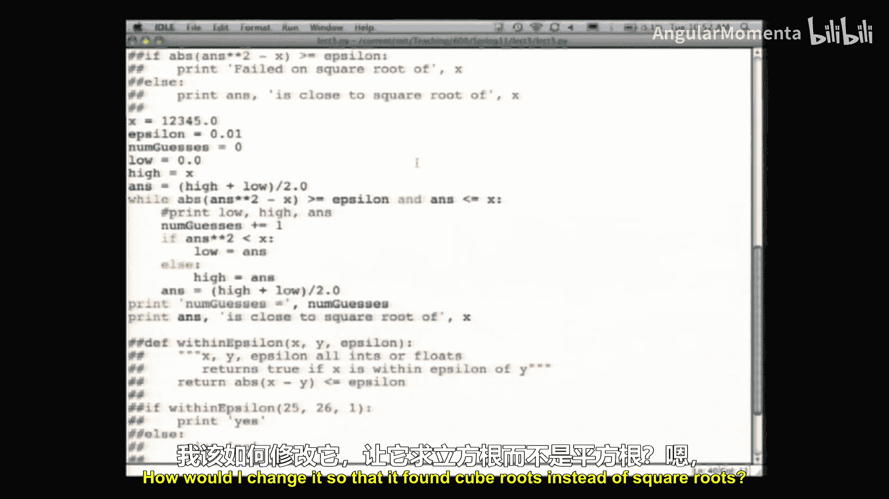

Well， I could take it up。 I could use。Cut and paste and paste it into my editor and get a new program。

 And how would I change that new program to make it do cube roots。Not very hard。

I think only two places have to get changed。

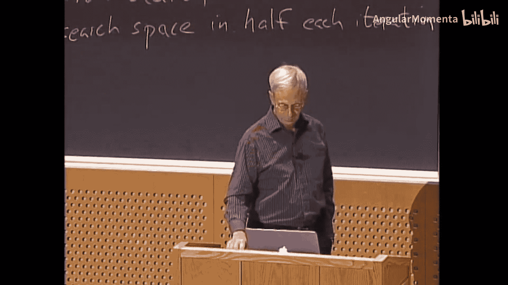

Let's for the simplicity， say， cube roots of positive numbers。I think you said the right thing。

All I have to do is change that two， to a three。And that two two a three， and I'm done。

And I should probably change the message to say， cube rootot。

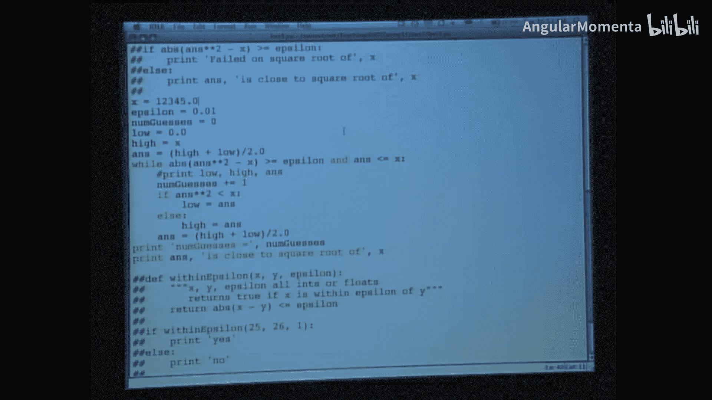

Pretty easy。On the other hand。Suppose I also wanted to find the fourth route and the fifth route and the sixth route。

However， many roots。Well， I'm gonna get pretty tired of cutting and pasting and building。

A whole bunch of things。So really， what I want to do is find a way to write the code。That will find。

The end through。Of a number for any N。To do that。I'm going to introduce。A new programming concept。

And that concept is the function。And that will be the main topic of Thursday's lectures。

