# 【麻省理工】计算机科学与编程导论 ｜ MIT 6.00SC Introduction to Computer Science and Programming p05 05 -BV1a5BZBkEP6_p5-

The following content is provided under a creative Commons license。

 Your support will help M I T Opencourseseware continue to offer high quality educational resources for free。

To make a donation or view additional materials from hundreds of M T courses。

 visit M I T OpenCourseware at O C W。t M I Tt E Du。

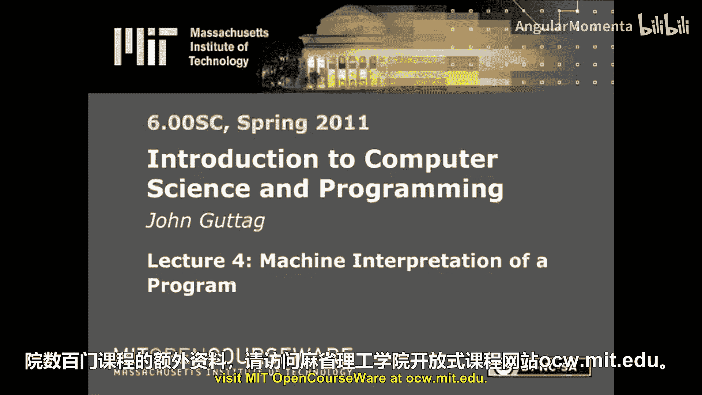

For those of you who are unaccustomed to seeing it， that blue stuff through the window is called sky。

嗯。Okay， I left you last time。With the question， I've shown you a bisection。Search implementation。

 or I should say， putative implementation of the square root。

And told you that it was flawed and asked you to think about what was wrong with it。So first。

 I'd just like to take a poll。 How many of you know what。

 what the problem is or at least what a problem is。Okay， that's a good start。

And I won't ask how many of you don't know， because I presume that's the rest of you。

So let's look at it Now。 I'm not going to ask you the answer because I want to show people how to find it。

So， here's a。Slightly simplified version of it。Just get rid of this stuff here so it doesn't confuse the picture。

So this is roughly the one we looked at on Tuesday。

 But I just took out some print statements and things and simplified it。And。Let's just run it。

And we'll run it with。Trying to find the square root of 0。5。See what happens when we run it。Well。

 not much happens when we run it。 Actually， quite a lot of it's happening。 We just can't see it。

So this program is running longer than I expected it to。

So if you go to the keyboard and you hit control and C。It will interrupt the program。

 It generates what's called a keyboard interrupt。And。It stops it。

And it tells us where it happened to stop it。 It happened to stop it in line 7。

The test of the while loop。And the problem is， the program just seemed to be running forever。So。

 despite my。Perhaps persuasive argument last time about the decrementing function。

 There's clearly a flaw in my logic。And in fact， it does not always terminate。

So what do we do about it。Well， this is the main trick。 And one of the things I。

 I I sort of need you to understand this semester。Is perhaps the most important thing you'll learn is how to debug programs。

Too many people sort of think the hard part is done when they write the code the first time。 Now。

 that's actually the easy part。The hard part is actually getting it to work。

So the thing you need to learn is how to debug code。And the nice thing is it's a transferable skill。

 It's also fine for debugging lab experiences or family members or anything else that can be seriously awry。

😊，So the way I do it when I program is typically with print statements。So。

The fact that the program was running forever suggests that I'm not exiting the while loop。

So clearly， I need to print something in the while loop。

And the only three variables it seems to be using or answer。Low and high。

Those are the three that change。 So let's see what the value is。Notice， by the way。

 that I actually went to the trouble。To type， you know， ants equals to ant， low equals low， etca。

A lot of people would just say， okay， I'm going to print and they'll ants comma low， comma high。

And then when they run the code， they'll forget which is which。

The most common problem that people have in debugging programs is that they are lazy。You know。

 they try think they're saving themselves work。 And， in fact， they're creating work。

So my first piece of advice to you as debuggers is， don't be lazy。You know。

 maybe you heard this from your， your mother at some point in life or your father。

 But now you're hearing it from me。 Try and just do it right the first time。

So let's run it and see what happens now。Well， at least it's printing some output。

And it's chgging away and ch oh， oh。So， now。We see we have a real problem。

We've reached a fixed point。Where every time through the loop， nothing is changing。Well。

 the first time we go through the loop and nothing changes。

 we know we're in trouble because nothing's gonna to ever change。 And therefore。

 we're gonna be in the loop forever。So we see， I've gotten to a stage where everything equals 0。5。

And now， if I go back and look at the code and I I ask myself the question， well。

 what happens when everything is 0。5。And I can see the problem。It's this statement here。Yep。

 turn it around， maybe。That facts's never going change now， because it's 05 plus 05 divided by 2。

Is 05。And it'll just stay there forever。So that's my problem。

 I have to somehow change my code now so that this doesn't happen。So what is the problem？Now。

 somebody can tell me simply， what is the problem here。

What was the flaw in my reasoning when I first set this program up？😡，Yeah。Loudder， please。

So the common was， I don't have a high minus low is less than or equal to epsilon。True。

 but that's not really sort of the real flaw， yeah。Its greater。F so the solution。

 it's not in a search state， exactly。So， the answer。Is the problem was that。

I did a search in a region， and the answer wasn't in that region。Because the square root of 0。5。

Does not lie between 0 and 0。5。Silly me， when I thought about it。

 I didn't think of finding the square root of numbers less than one。So what's a simple fix。Well。

 what I can do is the following。I'll go back and say， hi is going be the max。Of x and one。

So now I'm going to ensure that the square root actually does lie in the region I'm searching。I hope。

 let's run it。啊。Alright， Well， I got to some stuff at the end， which you shouldn't worry about， but。

It found something that。I guess is's a good enough answer。We'll get rid of that。

Coode I put in this morning， which is。We'll get to this later。Okay， so I've now。Fix the program。

 everyone with me on that， Any questions。And the thing to understand is conceptually what was wrong with my reasoning。

That I'm doing a search in a region where the answer doesn't lie。 So I'm not going to find it。

 And the other thing to sort of understand is my systematic way of finding the bug。 Now。

 I confess I knew the bug was there when I wrote the code。 So I kind of cheated with the debugging。

 But even if I hadn't known。 this is what I would have done。

 I would have put in that print statement。All right， so now we have。Actually。

 a pretty good piece of code for finding square roots。And as we looked at on Tuesday。

 I can use the same piece of code。 I can modify it to get cube roots or fourth roots。

 or fifth routes。And so I have sort of a general framework for doing things。But。

It's pretty unsatisfying， in that sense。Because let's look at it。

If I wanted to find the square root of some number other than 0。5， I have to go and edit the code。

Replace X by。The assignment to X by whatever I'm trying to do。If I want to do cube roots。

 I have to cut and paste and edit and do things。嗯。There's no very good way to now embed this piece of code inside a larger computation。

Imagine that I've got some。10000 line program that needs to find the square root 6 or seven times。

 Well， now I'm gonna have 6 or 7 copies of this code in my program for every time I need the square root。

Clearly， not what you want to do。

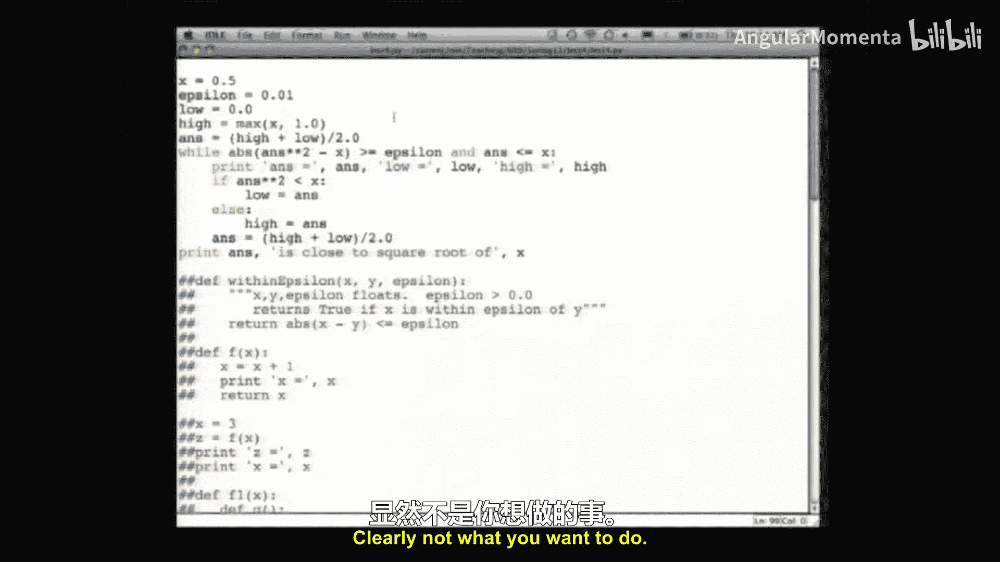

In general。Having more code is a bad thing。So it's not like you're giving an essay to write。

 And someone tells you it's got to be 5000 words。 and you' just sweat blood trying to figure out how to stretch it to be that long。

In code， it's the other way around。 Most of the time， we want to make it shorter， not longer。

And the reason we want to do that。Is the difficulty of getting code to work。

Is growths maybe even goes quadraically or worse with the size of the code。So the more code you have。

 the harder it is to get it to work。😡，So one of the thing good programmers learn to do is write less code。

And so we don't measure productivity of a programmer by the number of lines of code they produce each day。

But we measure it by the amount of functionality they produce each day。

And we give them bonus points if they achieve the desired functionality with less code。

So let's talk about how we can。Write less code。And accomplish more。Well。To do that。

 we're going to look at a new language mechanism， actually not new， but new to this class。

Called the function。But before we do that。I want to pull back。

And talk about what it is we hope to accomplish by introducing functions into our programming language。

We want to provide a mechanism。That provides for two things， decomposition。And abstraction。

What decomposition does。Is it creates structure。It allows us to break our program up into something called modules。

And the module we'll focus on today is function。 But later。

 we'll see there's another important kind of module in Python called a class。

And the advantage of a module is it should be self contained。And reusable。

So it's a self contained unit of functionality。That can be used in multiple contexts。Abstraction。

Suppresses details。It allows us to use a piece of code。As if it were a black box。

That is something whose interior details we can't see。

Don't need to see and shouldn't even want to see。We only need to understand what it does。

 not how it does it。And that lets us use code that other people have written。Easily。And， in fact。

 use code that we have written easily。You know it。It's one of those few occasions where I think Thomas Gray was right when he said。

 ignorance is blis。Sometimes knowing less is better。

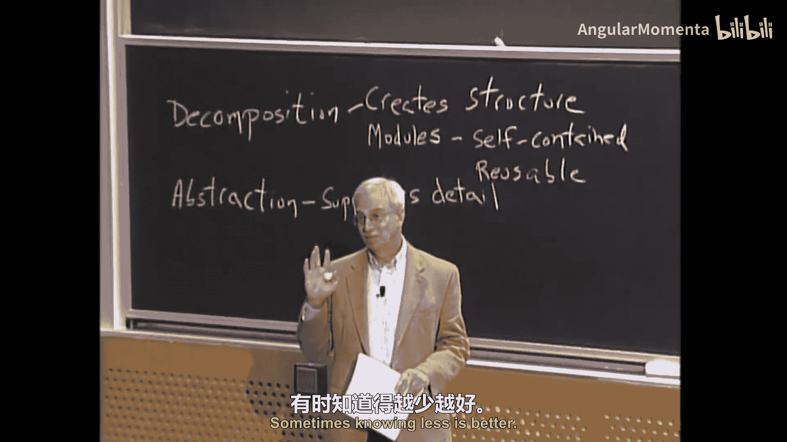

Allright， so let's look at the way functions work。The functions let us break code into reusable。

 coherent pieces。Now， we've already looked at similar kinds of things。When we looked at， say。

 floating point numbers。And we wrote operations like plus or divide， whatever。

 We didn't worry about how they were actually implemented in the machine。We said， Ok。

 they do something。 They're kind of like dividing real numbers。 Let's not worry about the details。

We do that with a lot of things。 We looked at strings。 We concatenated strings。 Well。

 we didn't worry about how did Python go about doing that。 We just assumed it did it。

 and it had the meaning we wanted it to。What functions let us do is extend the language in some sense。

 by adding new primitives。That we can use。Just the way we use the built in primitives。

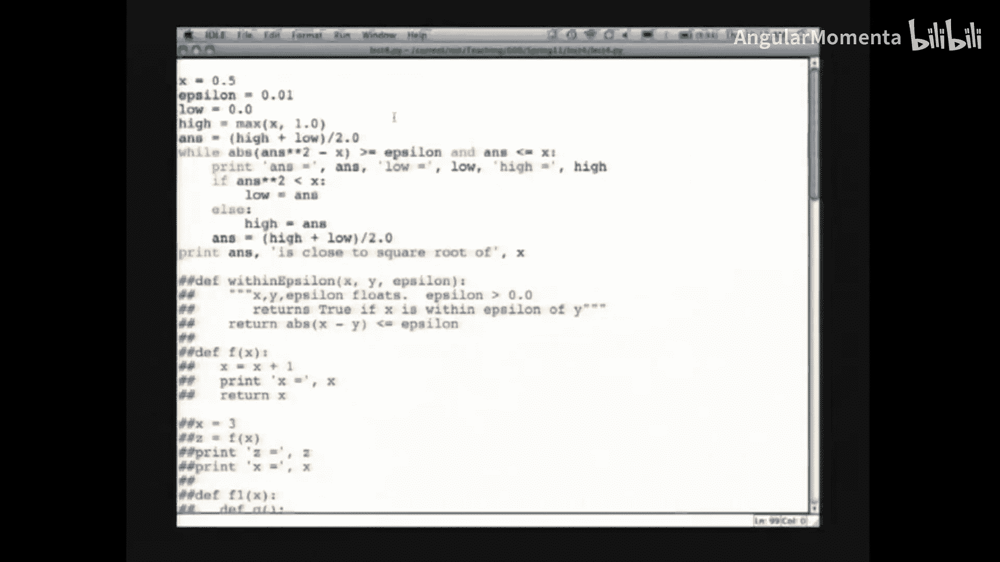

So let's look at an example here。

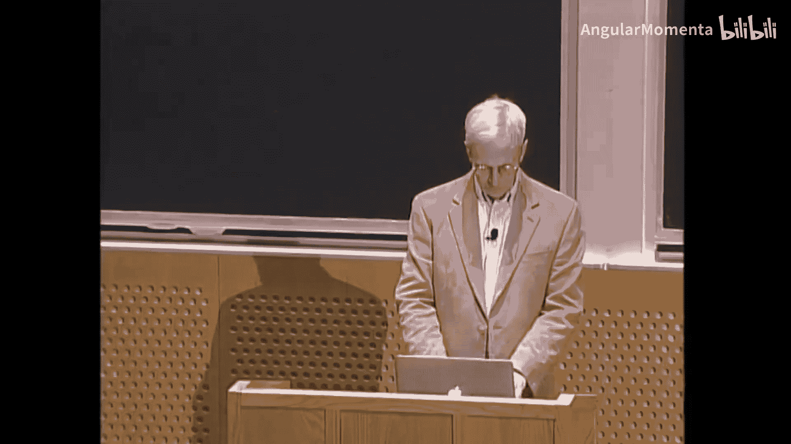

I've written a very simple function。Does something that we actually did or did already when we looked at square roots。

I've called， it's a function called within epsilon。

And let me comment this out while I'm thinking about it。 So we don't have to live with it later。

And I now want to sort of walk you slowly。Through what this function does。So， at the start。

It uses the key word， de。Short for define。Following that is a name。I chose the name within Epsilon。

You can choose any name you want for a function。嗯。I' strongly encourage you to choose mnemonic names。

 That is to say names that have a meaning。So in some sense， you see， it says within Epsilon。

 you know what it does already。Following that， it has three things called formal parameters。

I'll come back to in a minute， in what that means。

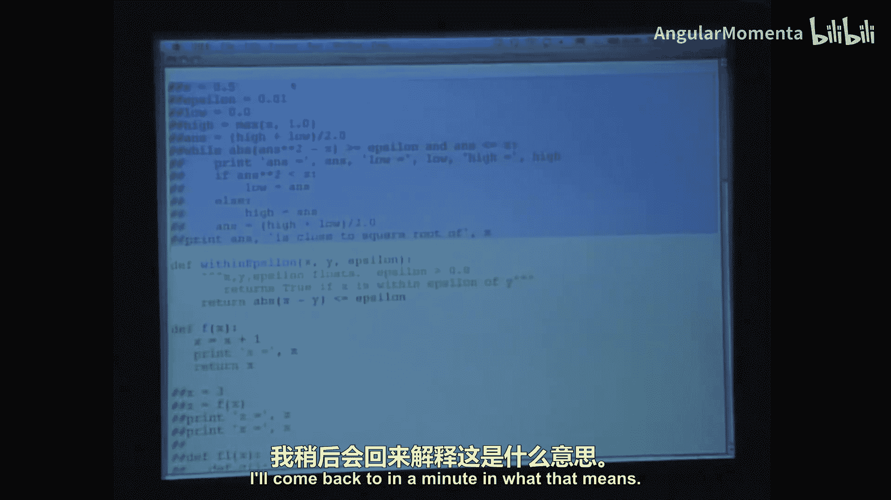

And then after that， it's got something called the function body。

So we see that a function has a name。It has parameters。And it has a body。The body is the code。

It's part of the function。

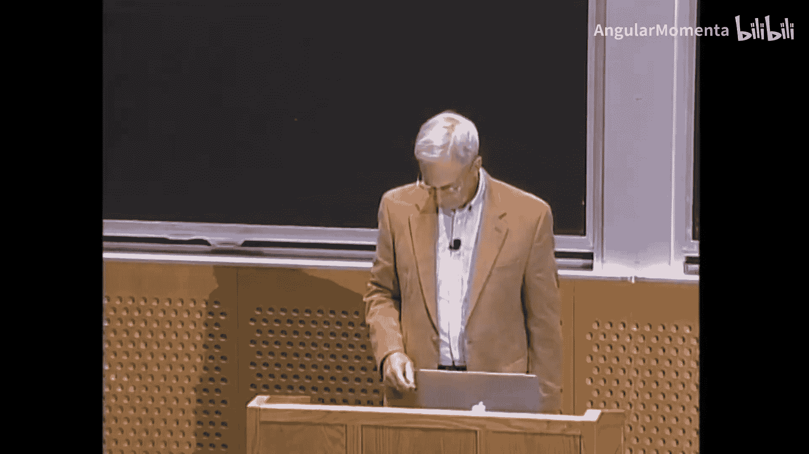

In the body。It you can write any code you want。 Plus。

 there's something you can't write outside of a function called return。

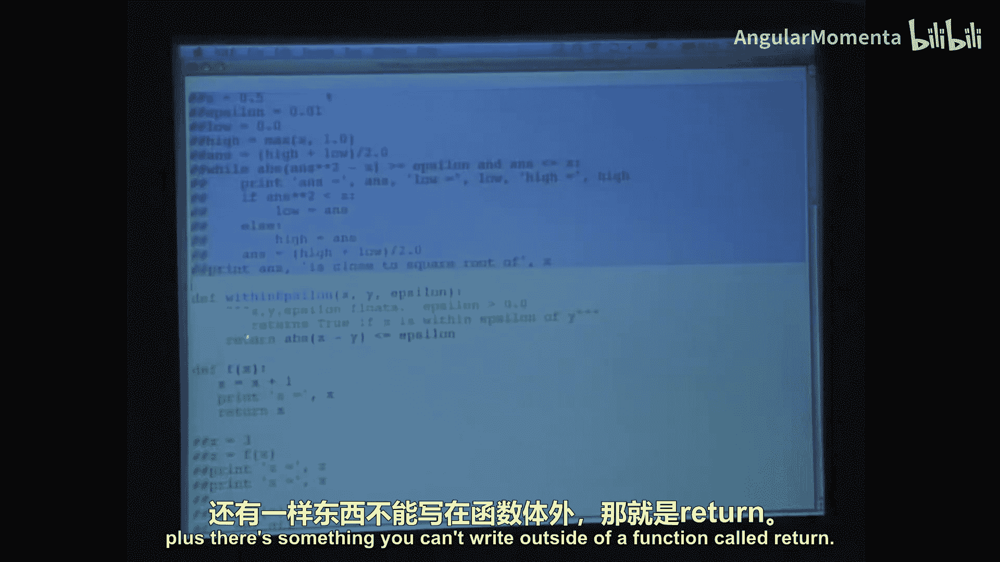

That's a special command。That says， whoever calls me has called me to have me computer value。

 I'm going to return the value that this person would want。

And then here we see something that's very important。This is where we get abstraction。

And that's the specification of the function。

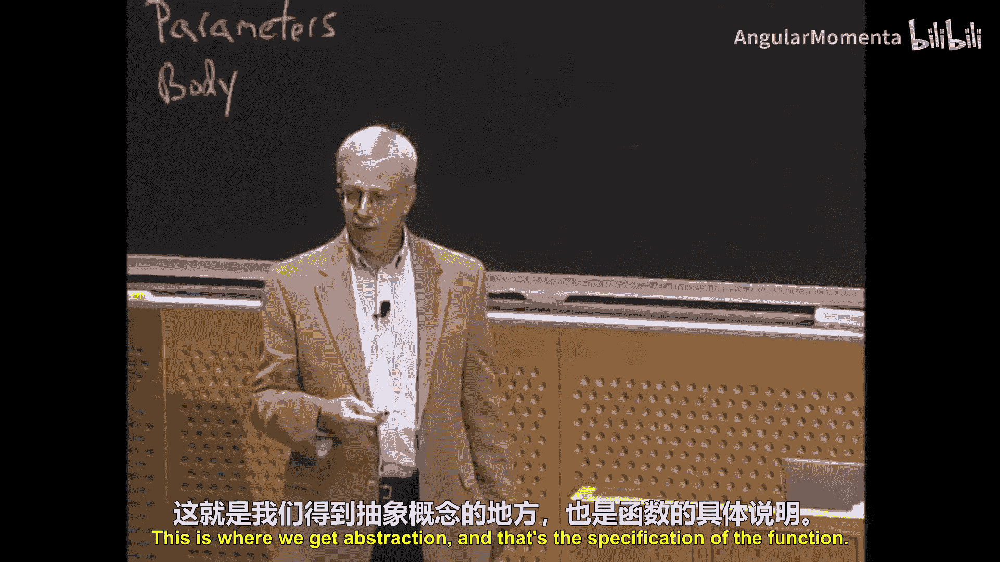

And it says here there are two pieces to it， One that its parameters， X。

 Y and epsilon are all floats。And furthermore， epsilon is greater than 0。

You can imagine this is important。And it returns true if X is within epsilon of y。Otherwise。

 it will return false。If I want to use within Epsilon， I don't need to look at the code。

I look instead at the specification。Now， here where the code is one line。

 maybe I haven't gained a lot by looking at the specification instead of the code。

 But you can imagine if the code were 1000 lines， I'd much rather read the specification in the code。

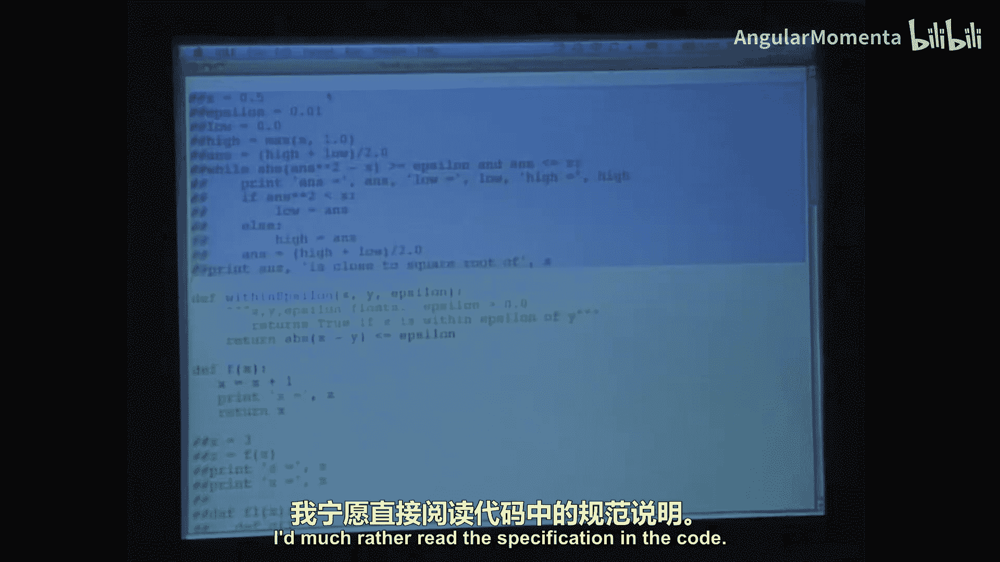

We'll also see for other reasons later， why it's， in fact。Dangerous to look at the code。

How do I use it。I use it by invoking it。So I could， for example， write something like。

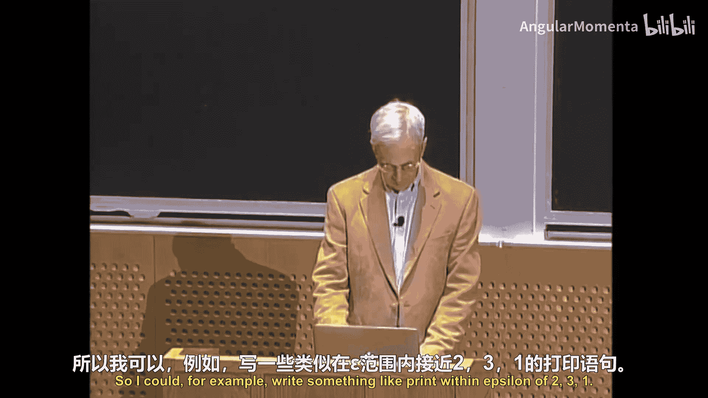

Print。Within Epsilon。Of 2，3。1。What's it going to print。

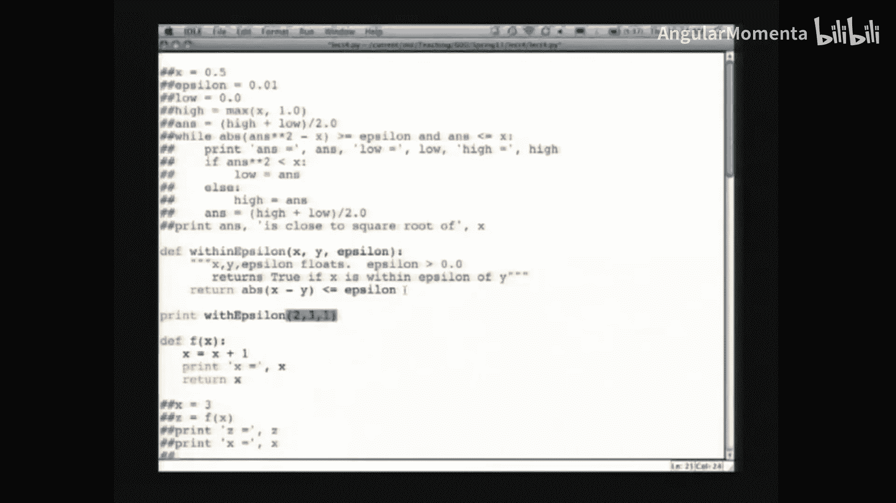

Buten。

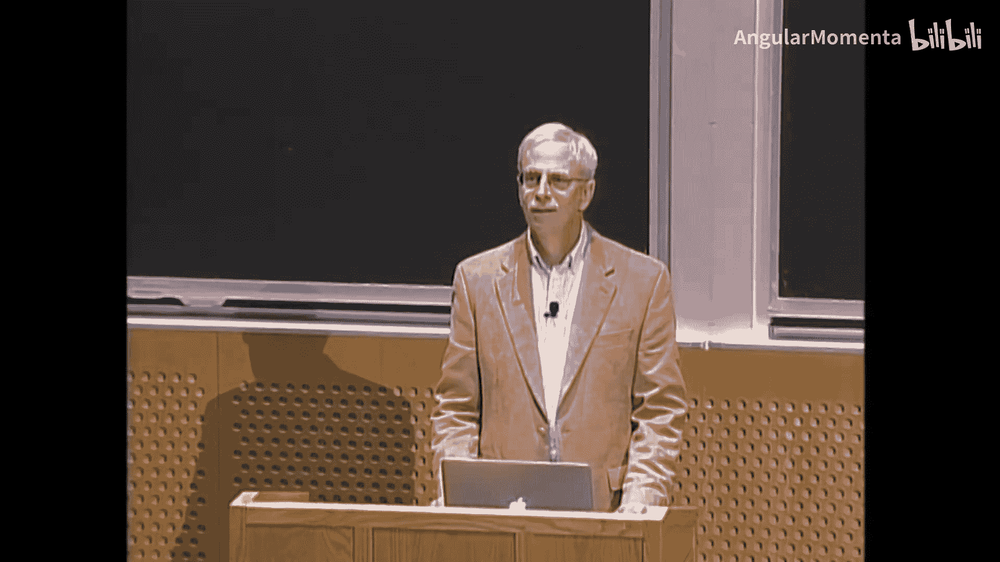

Why is it going to print in error do you think？I typed it wrong， thank you。You're correct。

 it would have printed an error。Now， what will it print？是不是呢？I could also。If I chose。

 write something like。Vow equals。That。And then if I won， I could print vowel。

Now it's going to print false。So within Epsilon is just like plus or something else。

Does some computation returns the value。 I can use that value any place I could have used an expression。

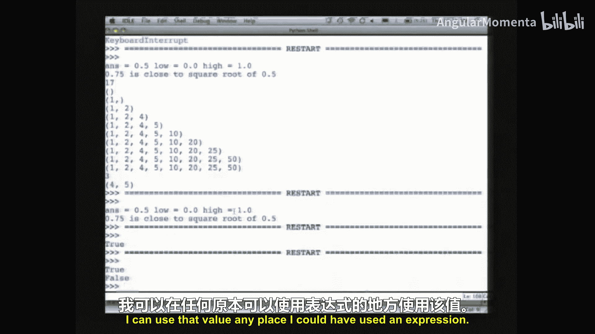

Now， one more thing to look at with this。

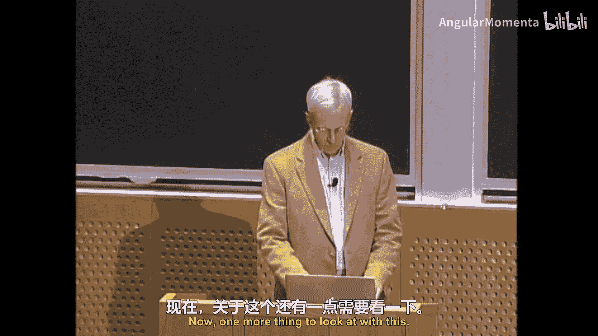

Suppose。I don't return anything。Anyone want to guess what it's going to do now。

I point this out because this is a very common error。 People write lots of code。

Calculate some wonderful value， and then forget to return it。What's it going to do now？

Let's run it and see。That， by the way， is a good habit to get into。

It's going to return the special value。 None。 Remember， we looked at that earlier。

 meaning I don't have a value。

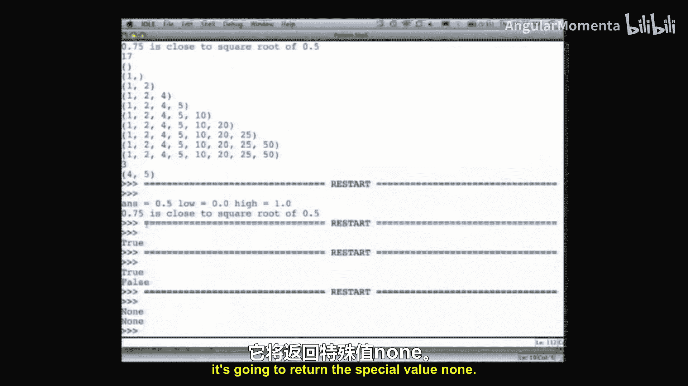

So if you see in your code some nonen popping up where you don't expect it to。It's probably because。

You forgot to return a value。So just keep that in mind。All right。Now。

 there's a big advantage of this。 Once I've written this code。

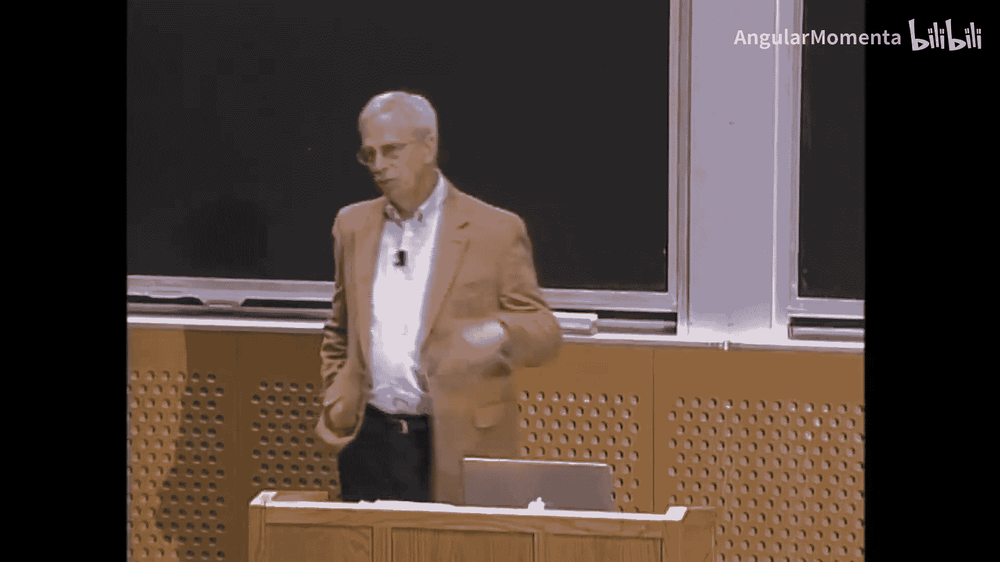

I can now， anywhere I want， call within Epsilon。 And I don't have to duplicate the code。

I only do it once。As I said earlier， maybe I'm not gaining much because the body is so short。

On the other hand。I'm still gaining something。Notice that when I look at the code down here。

It's easy to read I printing within Epsilon，2，3， and 1。

And I don't have to decode this and tell me that that's what that's doing。

So if I have a function and I choose the names properly。

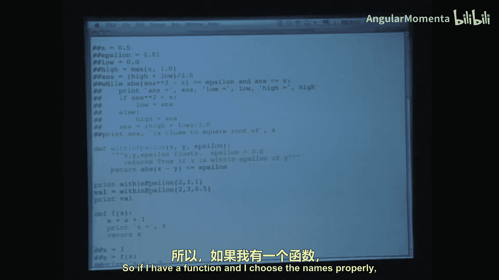

Code that uses the function is much easier to read。And that can be a big value。

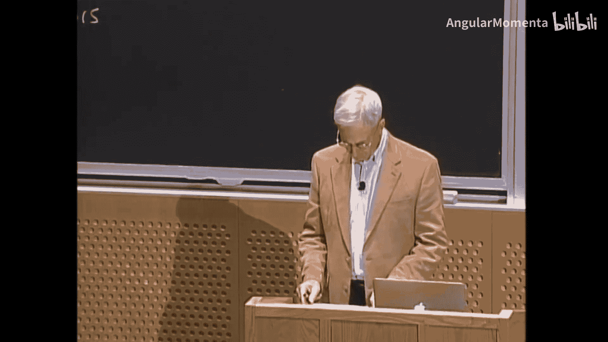

All right， let's look at。Another example。So here， I've got this function。F。

I chose a non mnemonic name because there isn't much meaning to this function。嗯。

What F does it is a formal parameter， X。It sets x to x plus one。 Then it prints X and returns x。

Pretty boring。So let's see what it does here。So now I'm going to set x to 3。Set Z or Z。

 if you happen to be Canadian to F of X。And then print the values of Z and X。Also， in F。

Before I return X， I'm gonna print it。So let's see what happens when I run this one。It prints 4，4。

 and then 3。Allright， what's going on。Why did it do that。Well。

 it's pretty easy to see why it printed for here。Because I called。

X called F of x with an x equal to 3。And then I ecremented it by one， and then I printed it。

It's probably also sort of easy to understand。Why Z。Was4 because I returned the value of x here。

Which was4。 And it printed it。But why is this X 3。And the answer。Is this X and that X。

Have nothing to do with each other。Right。I could just as easily have chosen some other value for the formal parameter。

Say George。And said George is equal to George plus1。 Prince George， return， George。

There is no relation between the name of the formal。And in this case。

X defined in the calling environment。

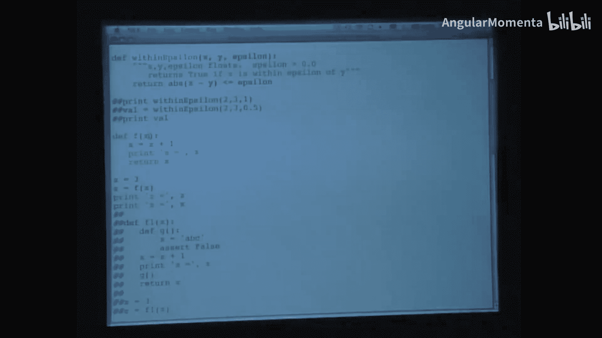

So now let's think about that by working slowly and carefully。Through what happens。

When we call a function。So the first thing that happens at the call。

And I'll just work it through this one。Is the formal parameter。X， in this case。Its bound。

And I'll come back to the what binding means。 That's a critical concept here。To the value。

Of the actual parameter。So these are important terms， actual and formalal。Which in this case。

 also happens to be called。X。But what's happening here is when you enter a function。

Upon entry of the function。A new scope is created。What's a scope。A scope is a mapping。

From names to objects。

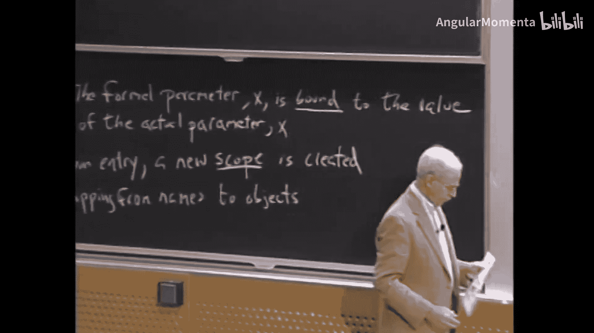

So if we look at what's。Going on over here， we can draw a little picture。Well。

 before I draw a picture， I'm going to look at a slightly more complicated example。 Well， yeah。

 let's do that。This one is not in your handout。But it is illustrative of， I think。

 the what's really going on here。

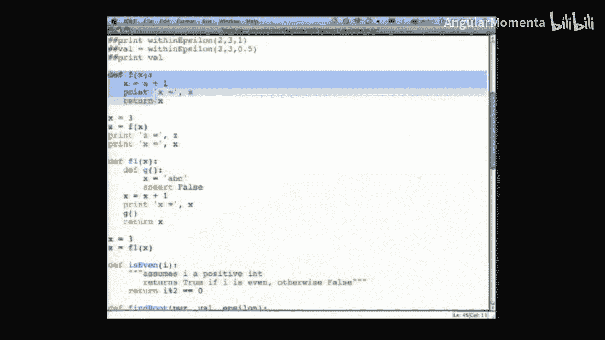

Here， I've got another beautifully named function。 In this case， F1。

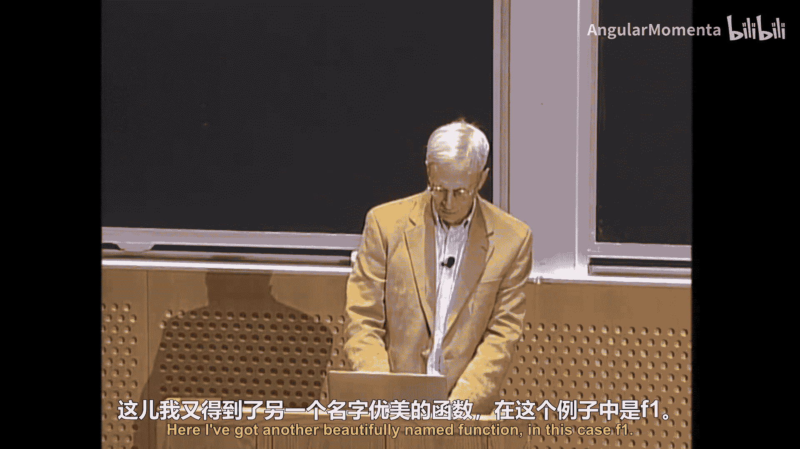

And inside it， I've defined another function。Called G。Which takes no arguments。I've set X to ABC。

Then I haven't shown you these assert statements yet or haven't talked about them。

Assert is a command in which the。

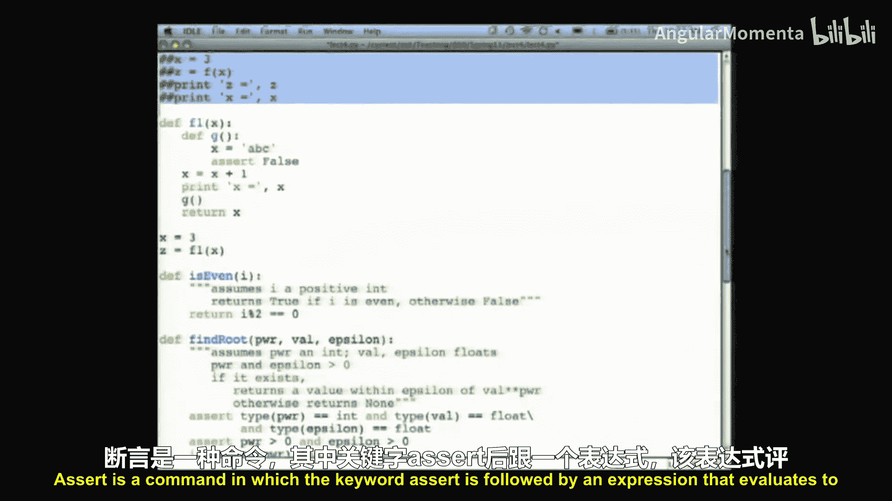

Keyword assert is followed by an expression that evaluates to either true or false。

If it evaluates to true。It does nothing。 It just continues。If it evaluates to false。

 it stopped your program dead in its tracks。So I've just used it here as a trick to make my program stop when I run it。

In general， you'll find that I use assertts quite a lot。

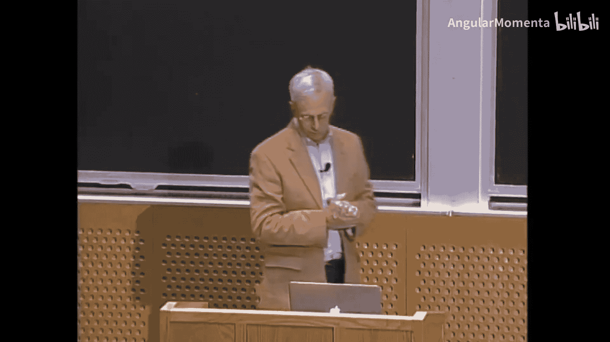

So， for example， in the next piece of code。Which is called fine root。It takes the root。

 Is it square or cube， whatever， the value and epsilon。

It assumes that powers in int and v and epsilon float。In the specification。

 And then you'll notice I start by putting in an assertion here。

And what I'm asserting is that the actuals to which these formals are bound have the properties the specifications says they do。

This is what's called defensive programming。In principle， I shouldn't have to do that。

Because in principle， nobody should call this with incorrect values。

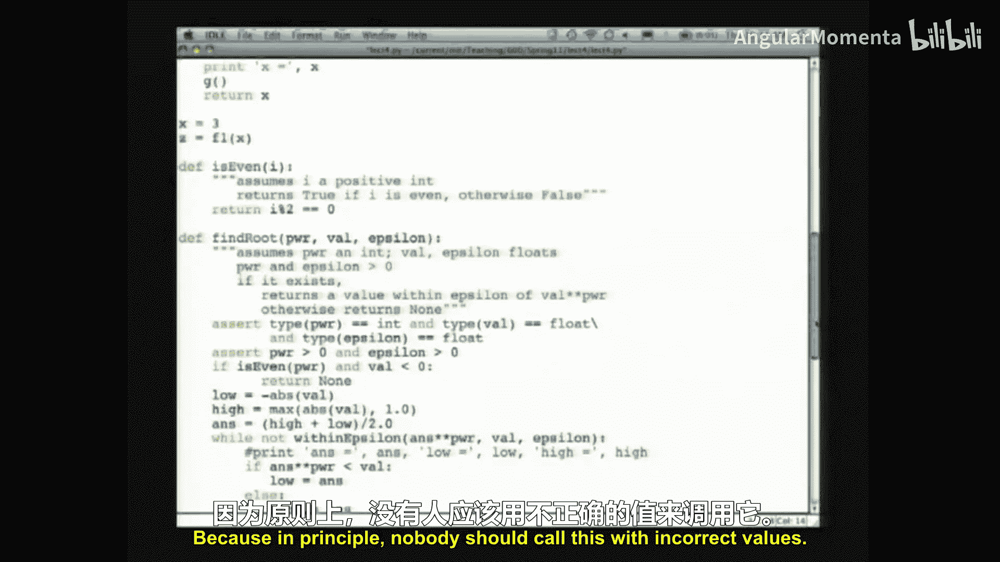

But， in fact， it can happen。Programmers occasionally make mistakes。

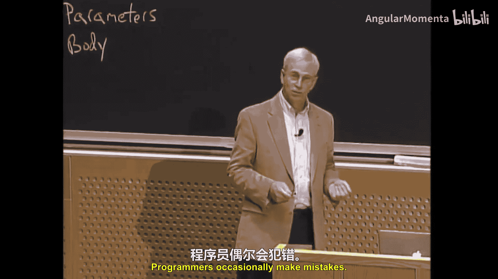

And so I'm protecting myself by checking that the assumptions are met。

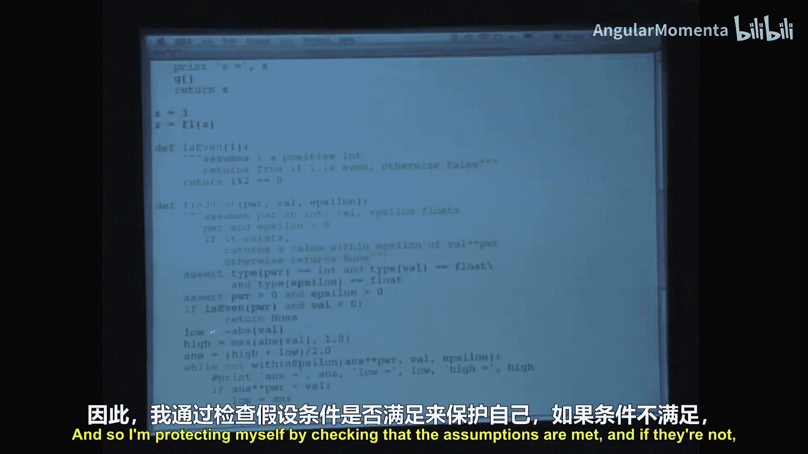

And if they're not， my program will just stop。Then I can go hunt down the fool that called it with the wrong parameters。

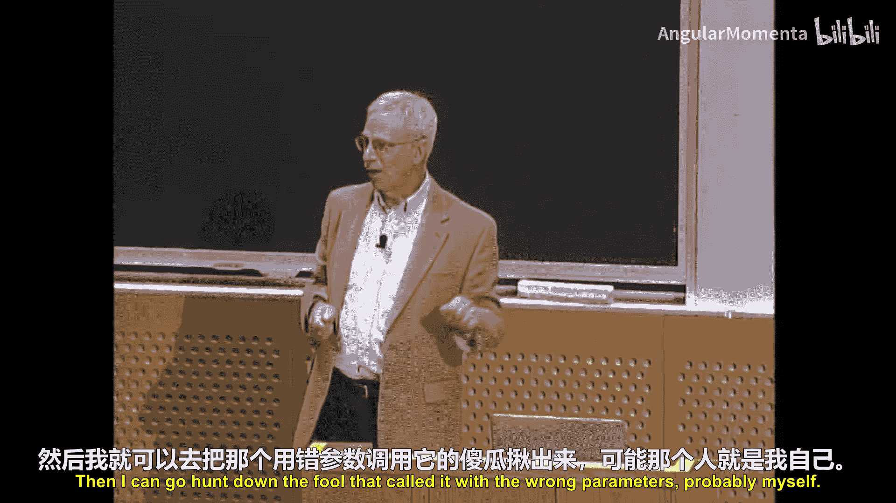

Probably myself。So asserts are good for that。 And I'll use them a lot for these kinds of things。

I'll also use them when I think I know what value something should be in a program at some point。

 And I'm not sure it really is。 I'll assert that it has the value。 I think it is。

 I'll assert that X is 6。 if I think it should be 6。

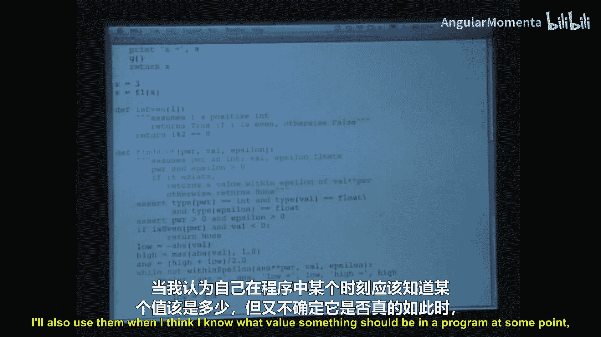

And then my program will conveniently stop for me if it's not true。Allright， so that's a ct。

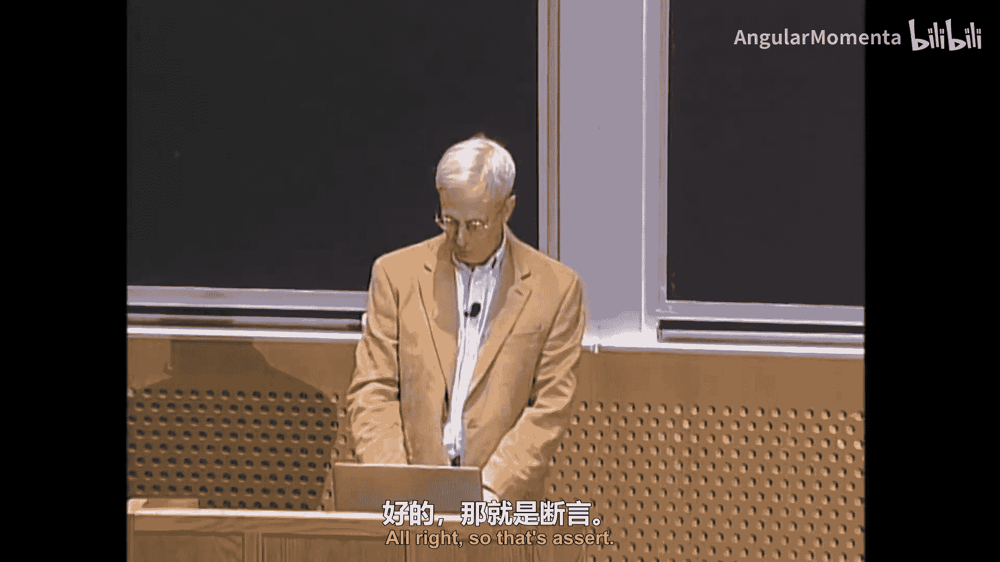

Other than that， I think there's nothing here you haven't seen before。So。What's going to happen？

 We're going to step through this。Peace by piece。So， initially。As we look at it。

We enter the main body of the program。Which is not wrapped in a function。

So what iddol will do or the interpreter will do is that willll start by。

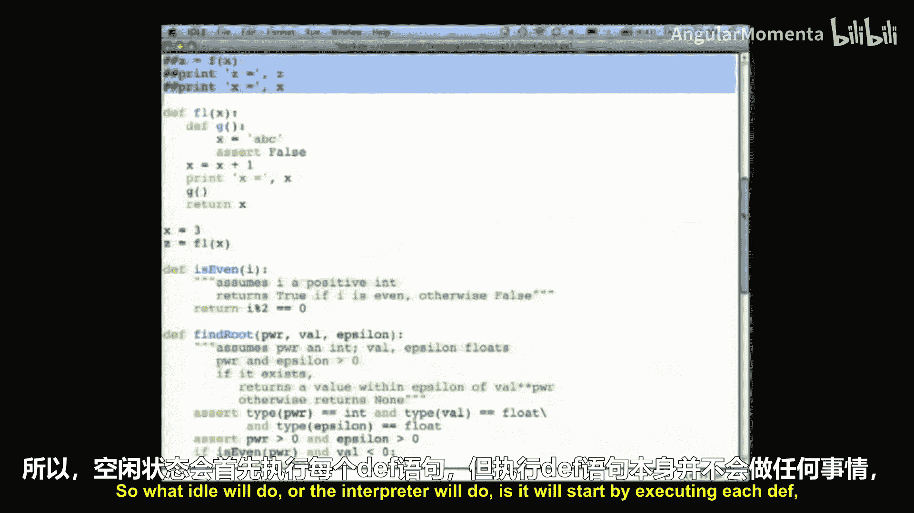

Executing each death。But executing a de doesn't do anything but put some names in the environment。

Then it will go and start actually running and interpreting the code that's not nested inside a function。

So the first thing that will happen。Is the interpreter will build for me what's called the scope。

I've already mentioned that。 That's a mapping。From names to objects。So in the outermost scope。😡。

It will， first。Find the name。F1。And it will tell me that F1 maps to an object that happens to be a function。

So it will come over here and it will map。 And I'm just going to draw。

Some picture will assume that's kind of the memory of the computer。

And it will map to something that happens to be a bunch of code， if you will。All right。

It will then stop。It will then notice that。 It's got。At the outermost level， a variable called X。

And that will map to an integer。Which will initially have no value in it。And then。

 after the assignment。It will now be bound to the object。th3。😡，It will then create another object， Z。

But before it combined a value to it， it will invoke the function F1。Now。

 the interpreter starts to execute F1。When it does that。It will create another scope。

So this is the main scope。It will next create a scope。Called the F1 scope。In that。

It will have another name。Gi。Which will be bound to some code。It will have a name X。😡。

Which will be initially bound。To the。Actual。So in this case， it will be bound to the object。th3。

It will then eventually do a print。It will invoke G。😡，Which will now create the G scope。

And the G scope will create。A name X。Which in this case， will be bound to the string， ABC。

It will then start executing。G， and it will stop。

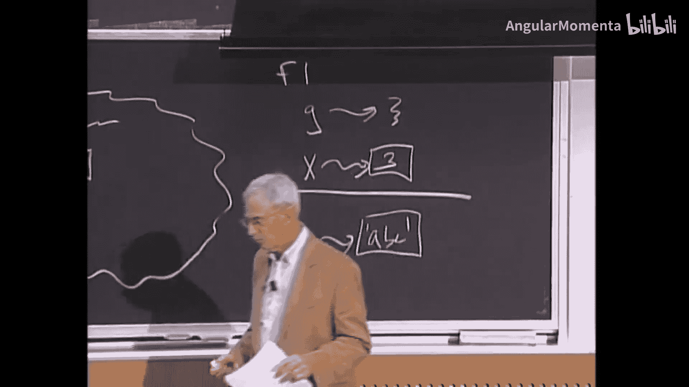

So let's see what that looks like。Sure enough， it got an assert false， gave an assertion error。

What I can do now is go up to this debug here。And go to what's called the stack viewer。

Each of these scopes。😡。

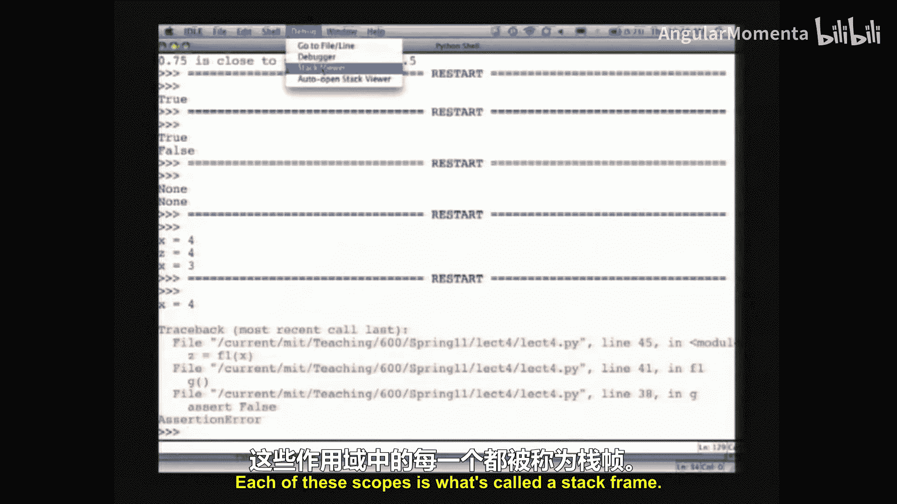

Is what's called a stack frame。Now， why is it called Why are they called stack frames。

Because when we do it。We begin。With the main scope。We call F。And we get the F scope。F calls G。

 and we get the G scope。When G completes， which alas， it doesn't because of the error。

It pops the stack。And gets rid of the G scope。And now the stack is the F in the main。

And then when F completes， it will have just the main。So it's last in first out。

 which is typically called a stack in computing。Or a LO， if you're， course。

15 major and do accounting。

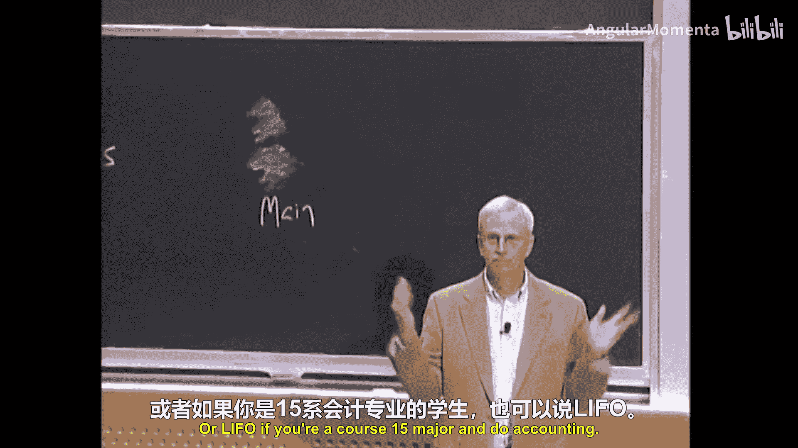

So let's look at the stack viewer。And I apologize for the small type font。

 but I was unable to make it look bigger。So it says at the top， we've got an assertion error。

And then you'll note。It's got three stacks， the main。The F1 stack and the G stack。

I forgot I called it F1， not， not F。Then I can inspect them further。

So the G stackack has local and global variables。The local variables include X。

 which is equal to ABC。Globals will get to later。If I look at F1。It also has a local called X。

 but its value is now 4， not ABC。And it has a value called G， which is a function。As we discussed。

And if I look at Maine。It has a bunch of things， but。

It has everything that's available in the interpreter。

 which because we've looked at when it's in epsilon， it's there。 But you'll notice its x is 3。

All right。So this stack viewer can be very handy to sort of look at what you've got when you've got a bunch of calls。

Now， if we go back to our code here and we'll。Take this out。And。Suppose what we do is。

We assert false here。Now， if we look at the stack viewer。We see that we have F1 in Maine。

 but G is no longer there。It's gone。All those variables don't exist anymore because I'm no longer in G。

This is a nice thing， because it means if you call something a thousand times。

 it doesn't use up all your memory。Every time it's finished， it gets rid of what it no longer needs。

All right。If that makes sense， This is an important thing to get。 Yeah， thank you， question。

Where did I。put this other assertion where did I put the other assertion， I you look at the code。

You'll see， I put it after I called G。And G is， by now returned。But before I left F1。

 which is why the F1 stack is still present。That makes sense to you。Which stacks？Exist。

 which stack frames exist depends upon which functions are still active， yeah。

How come we don't either return under the GO。Oh， because they're not doing anything interesting。

It's useless。Right，Why don't I need a return under G， Well， if I wanted it to do something useful。

 I would need to return something。But I'd probably also want to pass it some arguments rather than have to take no arguments as well。

So it's here just to be the simplest thing I could put that created a stack frame。

But don't try and interpret it as being anything meaningful。要。

Would you run into problems assuming that G did something to X？

you want to tell us that you name the right？In other words to use x you want to know if an X exists or any variable exists within a function body。

 when you leave that function， that variable is gone forever。

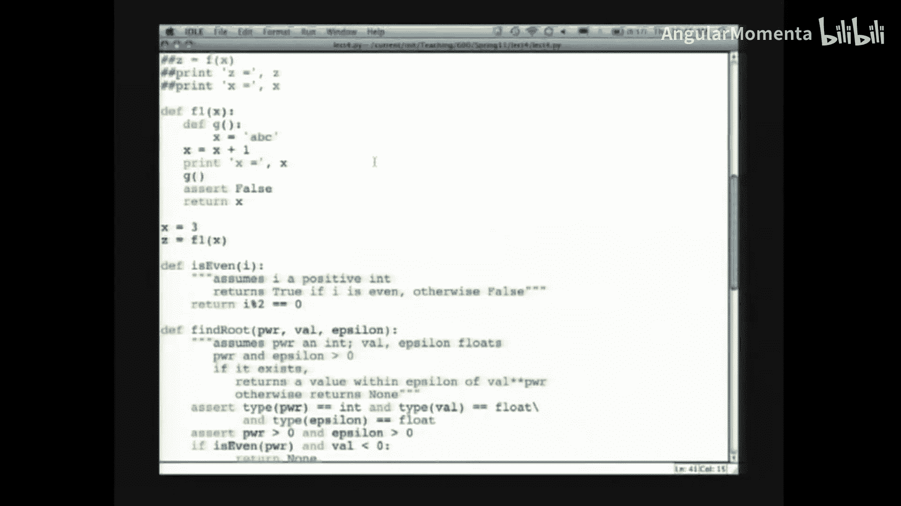

These are just names。They have no intrinsic meaning。So one of the ways to think about it。

And we'll see this later， when we get to。Classes a lot later， you could， if you wanted。

 think about this as really the name G dot X。And you could really think of this as the name of F1 dot X。

 And you could think of this as the name of main dot X。Indicating that they're really not the same。

But it would be kind of a pain to write them all that way。Okay。

So different scopes have different names available to them。You can use the names in the scope。

 and you have to keep track of what they mean。Okay， any other questions？ These are great questions。

 And I really do appreciate them。Yeah。This also happened。Its like if you say。In range。

We you use X later？You can use answer。Ats will be available outside the loop。

This was youd said 4 x in something iss X available outside the loop， yes。And， in fact。

 you'll often want to test what the final value of x is when you leave the loop。O。

 the next thing on your handout， and I'm not going go over it。

Is using functions to implement something that finds roots。

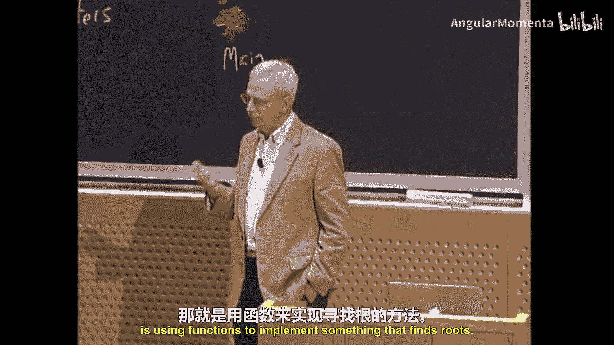

There's no real point in I walking you through this code in class。I did include it in the handout。

 And by the way， the handouts are all available after lecture online。

Is that I think you should work through it on your own and make sure you understand it to get a sense of how functions work。

And it's certainly related to the current problem set。

 which would be another good reason to work through it。The problem set that will be posted today。

 The new problem set， PS2。Note again， how careful I am about the specifications。

And I should point out that this。Something interesting。Whoops， excuse me。If I type find root。

Open well let's do this here。Ops。Let's clear things up。Let's get rid of。

Things that will cause the program to halt。Notice that when I type， find root open parenten。

It's given me the values， the names of the formal parameters。

Which I've chosen in such a way that will remind me what their values should be。

And it's also given me。Part of the specification， the piece in the triple quotation mark。To tell me。

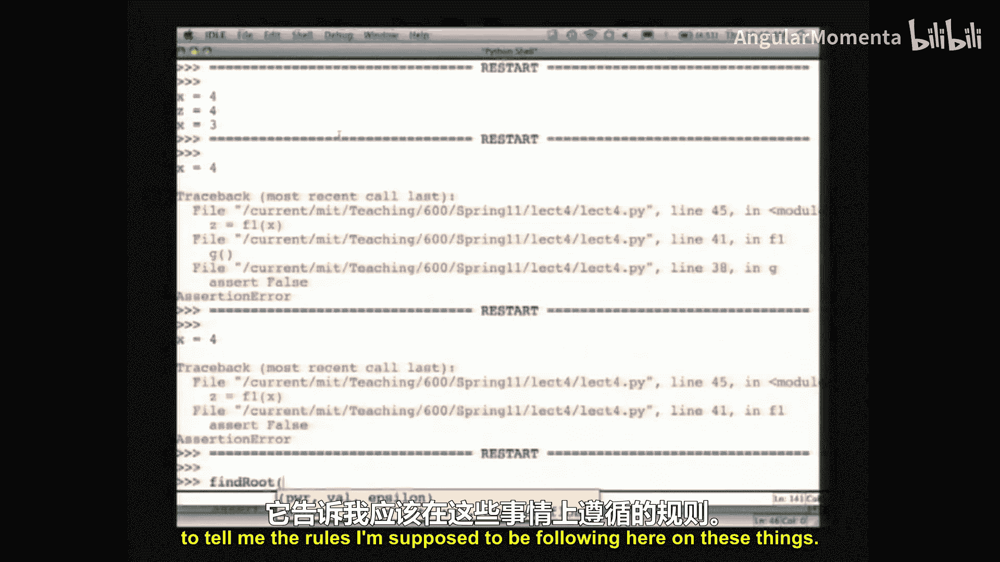

The rules I'm supposed to be following here on these things。So it's a very handy thing。

 And as you use idle， you'll get used to the fact that this is a convenience。All right。

Work your way through that code。 Make sure you know what it does。Finally， today。

 I want to switch gears。And。Talk about something else。Up till now。

 all of the programs we've you looked at have been numeric。They've played with numbers。

 And I've done that because I assumed you guys all had some intuition about numbers。

I've used strings as a primitive data element to sort of print things。

 but we haven't done anything very interesting with things。However。

 strings are indeed quite interesting。In that theyre the first nonscalear value we've looked at。

And you'll recall nonscaler values or values。

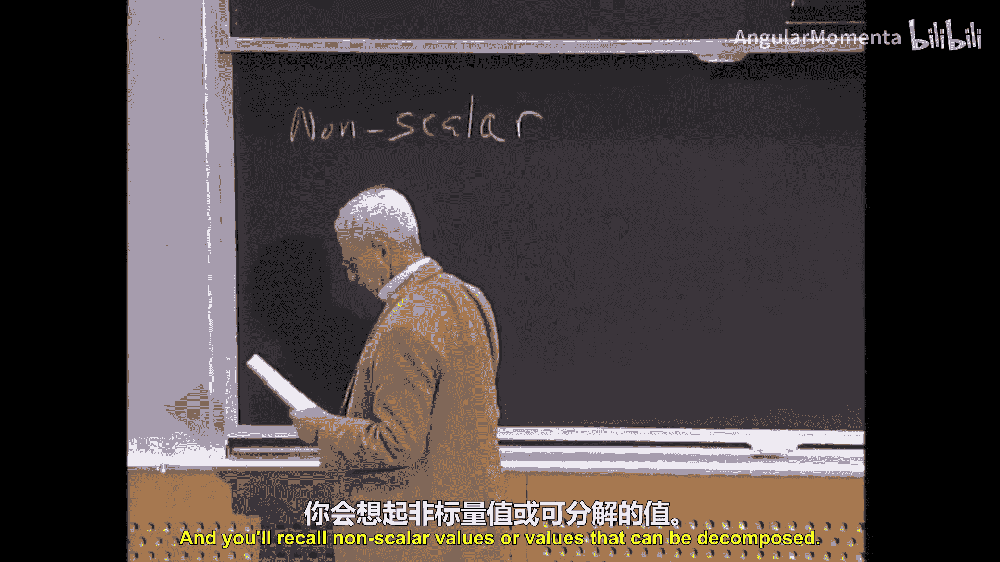

That can be decomposed。So if we now look at the code again。

I've got this little piece of code called some digits。😡。

So before the four statement we looked at was4 x in range。Well。

 you can apply it to a force statement to any type。That has a way to enumerate its elements。So。

 for C in SR。Actually。Of 1952。So I've taken the number 1952 and converted it to a string。

So itll now be quote，1，9，5，2。I can now do something。To every character in that string。

And what I'm doing is converting it back to an int， and then adding it。

So this will give me the sum of the digits。17。This is a very convenient mechanism。

 And you'll use for。A lot this way。You'll use it， in fact。

 more for this sort of thing than you will for， for ants。Now， I can also select values。So。

 if I look at。What's going on here。Every once in a while。

 when you go back and forth between the editor and the shell。The shell hangs。

 and you have to go try it again。 If I go to S equals。ABc。I can look at。Individual elements of S。

 for example， S sub 0。Which will be a。I can also look at slices of S。So， for example。

 S from 0 to one。That's interesting。Why is what is it doing now try and infer。

 I'll give you another example。So you'll remember when we did range from x to Y， it went to y -1。

Same kind of thing is happening here。So that's why S from 0 to 1 gives me only one character。

 but S from 0 to 2 gives me the character string， A B。

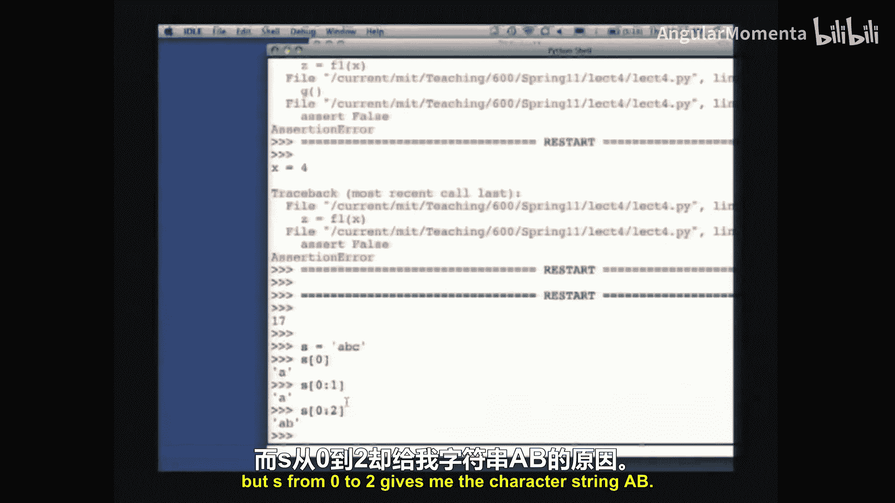

This is what's called slicing。And it's very common。What a slice does is it makes a new copy。

Makes a new object in this case， which is a substr of the original string。

There are many other things I can do on strings。 I can do something like S dot find。

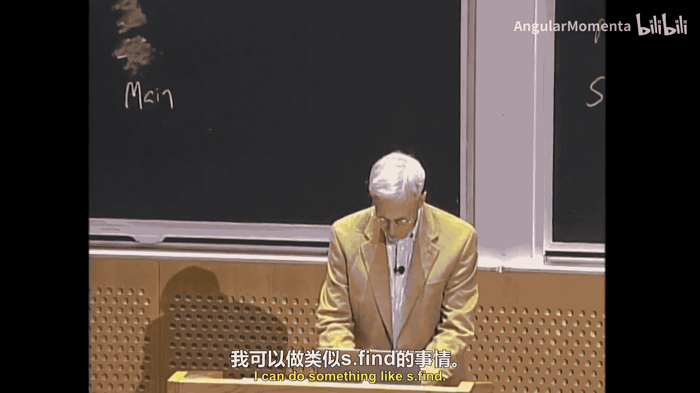

And it will tell me that B is at position number one in S。So， use。Google。

 whatever you use to find the Python web page that describes strings。

 And it will give you all of the operations you can do。

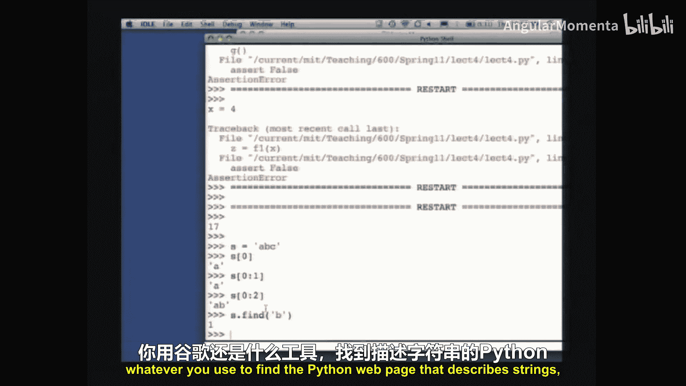

And they're quite convenient。One other scalar type that you're going to need for the problem set is tuples。

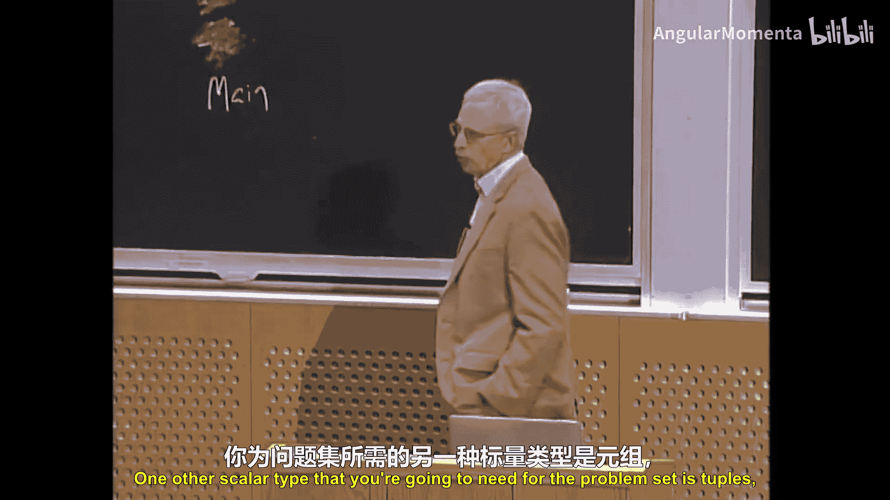

And that will be discussed in recitation tomorrow。Okay， thanks a lot。

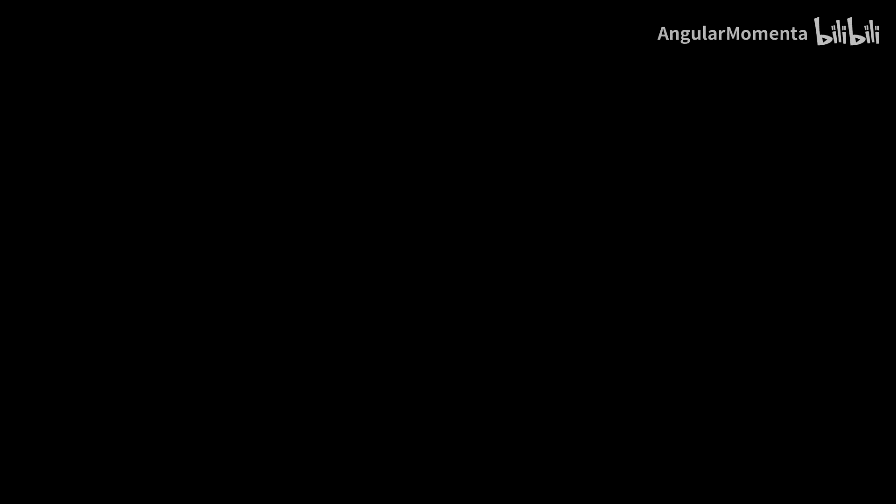