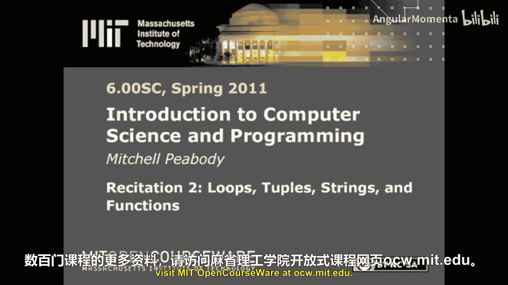
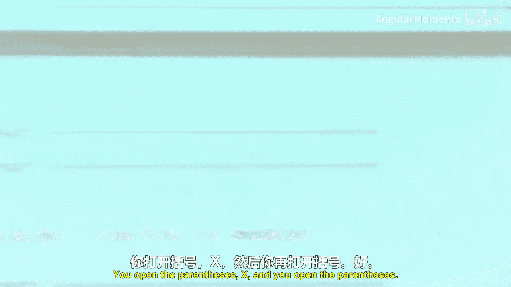
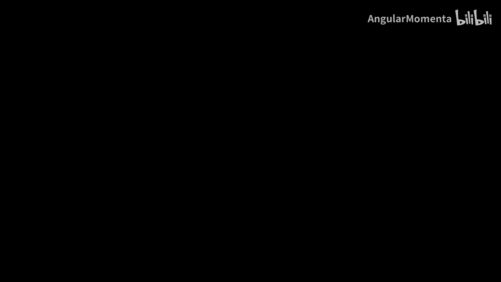

# 【麻省理工】计算机科学与编程导论 ｜ MIT 6.00SC Introduction to Computer Science and Programming p06 06 -BV1a5BZBkEP6_p6-

The following content is provided under a creative Commons license。

 Your support will help M I T Open Coseware continue to offer high quality educational resources for free。

To make a donation or view additional materials from hundreds of MI T courses。

 visit M I T OpenCourseware at O C W。t M I Tt E Du。

So by way of review， we're going to start off with loops。

So what are two loops that we've covered in lecture or two types of loops？たし。Okay， yeah。

 so four and while， so I'm going to start with while loops because that's what I have first。嗯。

Can someone walk me through the syntax of a while loop？So。

While condition and what type is this condition？Okay， and then I have。And then。A block of code。

 right？Indicated by invitationation。Okay， so next question is。What does this code do？So。嗯，你。Right。

 that's a little bit too high level， but kind of specifically what does this lead to？

I see even numbers from two to 10。Perfect。So that's exactly the kind of comment we're looking for when you're doing you're in problem sets or you're just coding in general。

 you want to have a comment that。Describes in an abstract way what's going on in chunks of code。

You don't want to have a comment that says like。Asign。2，2，8。Continues looping。Until A。

Comments like that aren't really helpful because you can get that from reading the code。

So that's exactly right。It's perfect， I don't have candy to pass out though。So the next question is。

 what's the decrementing function？So the way to think of a decing function is that it's a statement that moves the loop closer to termination。

So， in this case。Well， in this case would yeah， 10 minus a or a plus equal2 right so we're moving。

 you know as we're incrementing A， we're getting closer and closer to 10。

 and that's going to cause us to kick out of the wood。everything else。Okay， next thing。

Is A a good variable name？So the answer is no， otherwise it wouldn't have asked it。

But a better variable name might be even number， right？Because。Instead of just。A being an integer。

 now we know what it's supposed to represent in the code。And it becomes clear。

When to go to execute them。Or run it。So。F loops。Same thing。

Can someone walk me through the syntax for a for loop？And first question， does this？

Loop do the same thing as a while loop。So if this is our while loop。Does this loop do the same thing？

O，我 see。So the while loop printed out。F， six， eight，10 and 12。So this is going to print out。

8ight and 10。The reason is where we have the increment， right？If we had done this。

Then they would print out both the same。But little aside， that was the bug I just caught。All right。

So someone walk me through this int4 for loop。So four keyword。And then what do we have here？

A variable of some sort。And then we have N keyword。And then we have this thing here。So。

We're going to get to tus in a second， but this is a tuple literal， right？And for four loops。

 a four loop requires something that's innumerable， which means that we can take。

One element after the other， and assign it to the variable I。

So four loops iterate over enummerable four loops enumerate over or iterate over ennumerable items。

 thank you。That's exactly what I was talking about， if I'm speaking too low。

 just jack your thumbs up。All right。So this construction， though， is kind of inconvenient， though。

 because if we wanted to list。All the numbers that we wanted to print like so2 to 10 it's not too hard。

 but let's say we wanted all the even numbers between2 and 100。I don't want to have to write out all。

 you， 50 of those。So。We get to the range function。And you've seen this before。

 We just haven't ever explained it， right。So all the range function does is it takes between one and three parameters。

And returns a list of integers。So let's say that I pass at one parameter。

So I'm going to give it the integer of 100。This is going to give me nothing because I didn't print it out。

This is going to give me。Integers，0。To 99。If I give it two parameters。

 what it's going to do is give me the numbers or integers between1 and 100。So in this case。

 it starts off at one and it gets to 99。 So one important point is that when you give it two parameters。

The first one is inclusive and the second parameter is exclusive。Does everyone follow that？All right。

And finally， the third form is。With three parameters。And I have a start。

And end start inclusive and exclusive， and then a step。Alright。

This will give me all the odd numbers between 1 and 100。Right here。And we can also go in reverse。

So if I wanted to go。Count down from 100 to one。I can give it a negative step。And if you want。

Help on using the range function。 There is a handy command called help。

Which you can type in the interactive prompt。And this gives you the syntax for using range。

 You can do this for any function in Python。And it's going to tell you， here's the name。

Here's a parameter start， here's a parameter stop， and here's a parameter step。

And then this little arrow here means this is what it returns， a list of integers。

When you see your type helpp and you see one of these square brackets。

 that means the parameter is optional。So。A start is optional。 Step is optional。Stop。

 we always have a stop。 So we always know when we're stopping a range。And that's why we can pass one。

 two or three parameters。Has anyone confused on that？If you on。Right， if you only put one parameter。

 then it will start from zero， so the zero the start is implicit。We get on this。So。

We can code our for loop。Like that。Which for 10， like I said，5 numbers is not too inconvenient or。

 or convenient。 But if we have like， you know，500 numbers。Makes it a lot easier to just change one。

Endpoint than it is to type in 500 numbers， right？Okay。行。It's a good question， we should try it。

So why don't we give it a shot？So let's say， so the question was， can we make a range of floats？

So let's try 1。0 to 10。0。Well， it'll give us an answer， right， but it also gives us a warning。

Says that an integer argument is expected。And so， let's say。I do this。Will this work？Well。

 what it's going to do is it's going to truncate the floats。

So it's going to truncate the start to one， and it's going to truncate the end to 10。

 and then it'll just return the integers as required。So you can。

 but it doesn't work the way you think it would。All right， so moving on。

You guys hit tuples in lecture this week。 So we're kind of done with the with the big。

 with the old review stuff。So can anyone tell me what a tuple is？Its a。Non scalar data type that。

Can hold many items。Okay。What does nonscalear mean？This is multiple。30。So well。One value。

So you're both right， so a scalar can hold only one element at a time。

 so a non scar can hold more than one element at a time。

Tups are actually the second scalar data type that we've seen， right？A string is the first。

 but a string can have multiple characters。So tuples are flexible， we can have tuples of numbers。

Which we can specify this is this syntax， the parentheses with a set of elements separated by commists。

This is the literal syntax for a tuple。And all we're saying is that my two of numbers has。

 the approximation to pi to one negative 100。You know， et cetera。We can have tus of strings。

We can have actually tus of anything， but we'llll get to that in a second。So。Yes。

 we're going to get to that。So。We can so other question was。

 can you mix data types and the answer is yes， we'll get to that in a second。So。

To access individual elements of a tuple， we do something called indexing。

And we specify an index by if I have tuple of numbers， my variable name。

I have a left square bracket and a right square bracket， and then I have an integer。In between。

And this will give me the。Item in the tuple that exists at index zero。

Now twoples are indexed at starting at zero。And in increments of one。When I say tu of numbers zero。

 what should this print out？Right， so it'll print out 3。14159。Now， if I change this to one。

 what will this print out？Exactly。So， and it doesn't matter what data type is contained in。ATupple。

If it's string。It'll just print out whatever's here。Which is what？Now。

 you can also use negative indices。Negative indices tell Python that I want to go to the very one past the end of the tuple。

So in this case， tu of strings， I'm like out here somewhere and then walk back one or walk back however many of the integer is。

So I have here tu of strings minus1， so Python's going to go to somewhere around here。

And then walk back one。And give me name。Right。What if I do？-3。What's that gonna print out。Yes。Now。

See who's paying attention。What's this going to do？It's my name or name。Well， remember。

 we index twos at zero， right， so it's going to tell us index out of range。

We have four elements and two of strings， zero， one，2，3。Whoops。We're off。

So you can get outside of a tuple and get an error。To avoid that。Sorry。

 the thing is like when you said print equal of numbers or six one， it's printed three。No。

 I switched it。So。Just to make you， make you feel better。You got it。Okay。

It's always possible that it made an error。Okay， so in your code， in order to avoid that。

 you can check yourself by getting the length of tu of numbers， so there's a function lens。

And it's going to tell us that tu of numbers has six elements。 We can count with them，1，2，3，4，5，6。

 So what's the last。Index of this tuple。5ive， right？Now， back to your question。

Two poles can hold different data types。Or。This is they can hold different data types that are different from each other and then wording that improperly。

But。So here we have a float and three strings。 Okay， this is a heterogeneous data structure。

A homogeneous data structure would be one that you would say only holds ins or only holds floats。

But tus are very flexible。 So we have a float here and some strings。

 And then you can also have tus that contain other tuples。So。In this case。

How many elements does tuol of tus have？3。You have the first element is a tuple。

The second element is got。And the third element is real。So what should this print out？Yeah。Okay。

I had to sanitize that quote。Well， Python's behavior。

 when it sees a tuple data type and you call it with the print statement is it represents as a string。

 a tuple the way you would literally see or literally write out a tuple。

Stuff just is a tuple with the two strings stuff and just。

 So Python is going to print it out the literal representation。Of that tuple。So if I were so。

Another way。And'll try and explain it。Let's say that I print out the entire twoole。

What should this look like？Well， it's going to be just the literal representation of the tuple。miss师。

Alright。What does it mean for a data type to be immutable？停止。You can't change it。

 So if I try to change the first element of tuple of numbers。

It's going to tell me it doesn't support or Python is going to tell me it doesn't support item assignment。

And you'll see this error。All right。Tups support something called slicing。Which means that。

If I have a tuple of numbers and I give it a。Where I normally put just a single integer for an index if I give it a start index。

And an n index separated by this colon。Python is going to get。The item at index1。

To whatever this end element is minus-1 so。It helps if I just print it out。

And to make it a little bit easier to follow。Right， so。

I've told Python that I want to slice out of this tuple of from one to three。

And what Python is going to go do is look in tu of numbers。This is element zero。This is index1。

 so it's going to pull in two。This is index 2， so it's going to pull in one。And then three， well。

 in Python， we go one past the end of the range that we want。So it's going to return a tuple of21。

 this is slicing a tuple。Anyone confused by that？Well， wow。So。

There are many different ways that we can slice a tuple so we can have an implicit start。

So if you see this where there's no number before the colon。

And that tells Python started at index zero。And then。In complementary fashion， if you see this。

We have an integer on the left side。And nothing on the right side。

It tells Python go from index1 all the way to the end of the tuple。What happens if。I do this。

What's that telling Python to do？Yeah， it looks kind of redundant but it will become important to us when we get to lists and something called aliasing。

But what this does is it tells Python to take a slice， that is the entire tubule。

And then when we do these slices， we can also use negative indices。

So this is going to tell Python to go from zero to。The last element minus1， so it'll look like that。

Everyone following， be good。So it was minuses from the end。I wonder if this would work， actually。

Actually， don't know。没有。Has unexpected behavior。So I don't know why I have to look that up。

So tus are also， you know， we already said earlier that they're renewable items， right。

 so we can use a floor loop with them。So if I want to print out all the numbers and tu of numbers。

I have my for loop， my variable。And then my innumerable object。Okay。So I have a question now。

Who thinks this will work。We know that tuples are immutable。Right。So it's going to work。

I still have front up here。So what I'm doing is I'm taking twople numbers， and I'm printing。Before。

 and then。What I'm doing here is I'm telling Python to take this tuple。And this tuple。

And add them together and reassign it back to tu of numbers。It looks sort of like。

I'm modifying the tuple。But in reality， what's happening is I'm modifying or I'm creating a new tuple。

So let's say I have ton here。Ton is short for a tuple of numbers。Originally it's。Telling Python。

That' some chunk of memory。Has a tuple of， one， two， three， four。Okay。When I say。

A statement like ton equal ton。Plus。Another twople。What it's telling Python to do is create。

Another chunk of memory that includes ton， whatever's in ton。And。The other two will。All right。

And then this assignment statement。Tells Python that ton now points to this new object。

You had a question。It's an advanced question， but the question was does Python have a garbage collector to discard this memory that's no longer being used。

 and the answer is yes。And if you don't know what a garbage collector is， don't worry about it。

 you don't need to， but to answer your question， yes， it does。嗯。Only good。Too far into it。

Does everyone follow that？That also is going to be important when we get to lists and aliasing。

That type of object creation modification。So。But we won't get to that for a while。

So everyone's good with this， I can move on， all right。

Python has what some would be considered a wart。When it comes to tus。

And that is when you want to create a tuple with a single element in it。So。

Just people just starting out with Python would sometimes mistake a the tu literal of a single element to be this。

 So parenthes with a single integer。The problem is is that parentheses are the grouping operator in Python。

But they're also used for making tus， they serve a double dual purpose。And what Python will say is。

 oh， I've got a number between two parentheses。 Well。

 this person really wants this integer to have high precedence。

 So we're going to make an integer 50 and assign it to Oopsy。But。It's not what we want。

 we want a tuple with 50 as one element and the way you do that。

Is you have a lone comma after the first element。So if we print out what or if we run this and we look at what it prints out。

You see that Oopsy。Has the integer 50， which is not what we want。We want what's in onesie。No。Anzi。

Anyone confused by that？系。We're zooming along here。So。Strings。They're actually a lot like tuples。

They're immutable， so you can't change them。Nonscaler， they have multiple characters within them。

So if I print it out， everyone's seen this。I can get to individual characters。

 So if I want to get to the first character in name。I use 0。

 If I want to get to the second character， I can use one。And then， of course， they're mututable。

 so that's going to tell me that I can't do that。Right。And they also support iteration。

So if I want to print out all the letters in name。One on each line， I can do this。Not too useful。

But it works。You look confused。How did that happen？So。Name is a string， right， fall that。

Stringng is just。A bunch of characters。And it is innumerable。

 meaning that we can go one character at a time。Through the string。And that's what the for loop does。

Okay， the question was， do spaces count as characters and the answer is yes， they do？So， if I。Right。

 space is there。And I run this again。As I iterate through the string。

I got a space where I'm supposed to。Okay。Is everyone good for this。Okay。And like dpleles。

You can take slices。That's going to give me it。Strings also have。A lot of。Are many functions。Alright。

So this is an incomplete list of functions that you can use on string objects。

So I can make everything uppercase。Lowercase。I can also find。Characters。Os。Go。Right。

So what fine does is it finds the index。Of the less blessed character。 So if I want to find I。

Says it returns one because I is at index1 in the string。And I can also do something like this。

I can find an entire string。And T C， H， the substr starts at index 2。hIf it doesn't find it。

So let's put in garbage。Negative one。Right。We can also call a replace function。

 So if I want to replace M with P。ItDoesn't make sense anymore。

I can do that the question is how would I use this to change the string？

So think back to how we modify the tuple。We created a new object and then we assigned it to a variable。

 the same name， right？So if I know that replace is going to return a string with M replaced。

Can do that。Soone follow that。It's a good question。

And that also gives me a perfect opportunity to demonstrate to another command that you'll find helpful。

So if you're working with an object like string。You can use a command in the interactive editor called Drr。

 if you type D STR。It's going to return。All of the symbols that exist within the STR object。

You can also type。Help STR。And it will give you a nicer。Version of this， so。H。In this case。

 the first character indicates what you're trying to replace and the second is what you're replacing。

Right， so we can do help do STR replace。And it' will tell us。The count in this case would be。真。Yes。

Right。You know， if I were particularly a narcissistic that day。I could replace it multiple times。

So let's demonstrate that because， some people might confuse。Let's say I want to replace。E0。

And I'm going to replace it with R。Whoops。Well， why didn't they replace these two Ts here？Right。

 so in strings， you differentiate between lowercase and uppercase。

so if I wanted to get the behavior that I was hoping for。I could do it this way。So。

Now I have something that's not even remotely looking like English。Or I could do something like this。

I'm going to make everything lowercase。And then， replace the tea。Yeah。Well。

 remember what I said first recitation that， know computers will do exactly what you tell them to do and nothing more or less。

So there we go。Python is。A very nice language。 It's one of my favorite languages right now because it's not as fussy as some other languages。

Like Matt Lab。Or she。Or C++ or tickle。Any one of those。So is everyone good on strings？I can move on。

Just remember if anything， if you need help on any of these commands。

 just remember you have the help command at your disposal It'll automatically default to do everything unless you it only like letters。

Yes， oh， yeah， we didn't demonstrate that。And demonstrations are worth 1000 words。

 So I finally wanted to， for whatever reason， only replace the first two T's。

 I could tell it to only replace two T's within the string。And it leaves the other tea alone。

The last tea。TheQuestion。I don't have a ready answer for you。Usually， you see these。

Functions with R in front of them。The strength。Object often has functions that will start from the right side as opposed to left side。

 So like the find command I showed you。It has an Rfin command as well。This guy right here。 So I'm。

 you know， I'm blanking on if there's the analog to replace。ButCan I get back to you？

Because I don't want to spend all time searching for this and then fail spectacularly。

So I'll get back to you on that。Is it possible， Yeah， is there like a one minorr function。

 I can't tell you at the moment。But again， that's why you have Dern help。

You can find this out on your own。All right。So。Next thing， break。So we're done with strings。

 We're done with tus， and we're still working on loops。 So everyone's seen this function before。

 right。This is our finding。ACe of a perfect or fine cube root of a perfect cube。Function。

 so if I give it 27。And I tell Python to stop printing my name。All right， that's what this does。

And as a toy example to illustrate the brake statement。First of all。

 can someone tell me kind of in English what the brake statement does？Well。

 it doesn't stop the program， but it kicks you out of the loop。So。

We can rewrite the CuUBE Ro program。To work like this。So， instead of。

Our stopping criteria being answer cud less than the absolute value of the number。

We're just going to tell the for loop to go from a range0 to the absolute value of the input plus one。

 Why do we have the plus one there。Yeah， because otherwise it would go to one before the absolute value of x。

And then we break out this loop。If answer cubed is equal to absolute value of x。

 So as soon as we see that it's equal to 2 x。We're going to call break and that's going to immediately kick us out。

To hear without executing any more of the for loop。

Do people understand that are people good with that？当时会。Yes， good question。

Does it break you out of the innermost loop or all the loops and the answer is the innermost loop？

When he says innermost， what he's talking about are nested loops。

 So let's say I have something like this。We're creatingating on the fly now， so excuse。

My inability to type。So what is this going to do？This is an example of a nested loop。

We have an outer loop here， and then we have an inner loop here。

And all the outer loop is doing is it's going from the integers 0，1，2，3 to 9， right。

And then we have an air loop， which looks like it should go from the integers 10 to 100。

But we have the statement in here， if J mod2， right， that's what the percent sign is modulus。

Is equal to 0。 So what we're saying is if J is evenly divisible by 2。We're going to break。Now。

 the question is。This is obviously going to break when。You know， J is 10。 so， I mean。

 this loop is going to execute once。The question is。Does it print out？Only one。Set of IJ values。

 or does it print out 10？And so。That I'm getting to the answer to this question is if break statement breaks out of all the loops。

 then we would only see。One print out of I andJ。But if it only breaks out of this inner loop。

 then we should see 10， right？Followed by here。So it breaks out of the inter loop。So long answer。

 but demonstration。Okay。Is anyone confused by that？Is anyone too shy to admit it？

There's office hours。Or you can talk to me afterwards。Okay。All right。

 so now we're going to get to functions， which are triple underlined and circled over here because they're extraordinarily important for you to understand。

What can someone kind of winging it and tell me what they think a function is？I track。

That takes some input doesn't。Ch。Perfect。It's a bit of code， it's named。

 so you can refer to it that takes input。Does something with it and returns something some value。

And the way that we do it or define a function in Python is like so。Let's say I have a function cube。

It consists of a few parts， we've got the deaf keyword。We've got a name， cube。

 name should be meaningful for functions like variables。You knowName should mean something。

This would be a bad name。For this function。We want it to be meaningful。Has a set of parameters。

 In this case， it only has one parameter。 This is， this is what we。

Pass to the function when we call it。And we'll talk about that in a second。It has this string。

 this is called a dock string。It's the specification for this function， and when you write functions。

 it's good to have this string here。Because what it allows you to do is describe what the function does。

What it expects for input。And what it gives you as output。And in this case， it's very simple。

This is the body of the function again， you know we denote the block by indenting。

And all it does is it takes number， which is passed into it。And raises it to the third power。

And then this return statement tells Python to send that back to whoever called the function。So。

As an example of this working。What's。Look at this line of code。 What it's doing is it's， you know。

 we've seen the print statement。 So we know what it does。It's going to take。It's going to name cube。

And it's going to call it。 And Python knows what's calling it because it's got the name of the function with the input parameters。

 So3。Is being passed。To cube。To be well cubed。And what's going on here is that Python is breaking out of its normal flow。

Of execution。Sending three and， calling it number in the function and then raising it to the third power。

 So if we' run this。We see 27。And。We can pass it any number。That we want。So。

Is anyone confused on this？倾住我哋。在这个。They don't do anything， so the question was。You know these。

 this string here between the quotation marks， this doesn't do anything。 No， this is a comment。

 This is so that you can tell yourself you know， six months down the road what you were thinking or so that you can tell another programmer what this function does。

It's a way of documenting your code。But like Cuba in this case。Yeah， this is just a toy example。

 know I wanted to keep it simple。So。You know， just I'm illustrating concepts。So yeah， I mean。

 it wouldn't be too hard just to do， you know。Yes。All right， so I'm going to move on。

Everyone's good with functions。你唱。啊哼。Right。下支。Actually， I was just getting into that。

 so the question is， do you have to use the return function？And the answer is。Well。

 it depends on what you want to do。So。Let's take a look at a new function。Now。

 can someone tell me what this does？Well， first， what does the function do？

Or what is it supposed to do？Right， and you got that by reading the writing on the wall， right？

Really。It's too easy。And in the body of the function， all it does is it。

 it creates a new variable answer， and it assigns number times  two to it。Okay。

Now what's going to print out here？Now， why don't we run it in the sea？

That's not doing what we wanted。So when you don't have a return statement。

Python returns implicitly none。To whoever calls a function。Okay。So in this case。

 this function obviously doesn't have a return statement。So Python says， okay， well。

 I'm just going to return none and whatever work it did in the function is lost in this case。

So to get the right functionality， we have to add a return statement。Okay。And it works。

Was that what you were getting at，Anyone confused， can I move on？はい。So。

functions have something called variable scope。And I apologize for the punt。 I was。

Getting tired when I wrote this。So。This chunk of code， I define a global variable， all hope。

All right。I also define a function。That takes a parameter variables。

And it says it steals all the variables， but I don't know how it does that in a computer。

And it doesn't return anything。In the body of the function。

 I create another variable called my variable， right， and I assign it， a string。And then。

I'm not actually returning anything， right because I've said I'm not returning anything。

 All this is doing is it's just printing stuff out。

So it's printing out what the parameter passed into it was。It's printing out。

 so it's printing out variables， it's printing out all hope。

 which is a global variable that we define up here。And it's printing out my variable。

Which is a local variable in the function。All right。Down here， defining a variable， old meme is old。

And then I'm calling the function。So it does what we expect it to do。What I want to illustrate。

 though， is。What happens if I do this？Well。As you might expect， it's going to give me an error。

 right？The reason is is that。My variable has local scope to this function。

All errors are belong to us。Is anyone confused by this， No one's confused by this。Okay。So。

Let's try something else。Actually， I was not do that。All right， so if I。Rund this code。

We can tell from the function。That is taking one parameter。It's incrementing that parameter。

It's incrementing this global int that we' to find up here and it's returning。

The parameter that is just incremented。R。Corney humorer。Now， the question now is。

Let's say that I have a variable， Y。And it' I give it a value of 10。

 and I'm being completely arbitrary。If I call the variable ink it。On why。First of all。

 what's going to print？And then。If I print out the value of why， what's going to print。No。

 why don't we run it。Oh。I'm failing。So。I am stepping on myself here。

This is why you don't debug code on the fly。So if I have a global variable and I need to reference it。

It is a global keyword。 You should never have to do this， so。So initt is going to return 11， right。

 because it's taken y， which is 10。And it's called ayalx plus1。And then it's returned this。X。

But if I look at what y is after I've run this， y is still 10。This is， you know， because。

One we've passed in。X here。And we've called x equal x plus  one。 It's actually shadowing itself。

 It's overriding what's in the local parameter。But it's not overriding。The actual variable Y。

We'll get more into this later on。But。The important thing to understand in this case is that the changes that you make to this parameter stay within the function。

What good。So I need to move pretty quickly now。Gotchas。

Guarantee you someone's going to make this mistake。Print is not return。Alright。

When you run when you call print， print is not returned， it's going to call this function。

And it will print out this string。But it's not actually returning this string。

What it's returning is none because there's no return statement， right？

And that's where this nun comes from。Return is not print。 So if I， you know。

 say print this return value， it will print。 this will return a string。 But if I just call。This。

It's not going to print it again。It's going to print nothing。You'll just have to make a mistake。

Right。One thing to be careful of in Python is。Functions， remember， I said everything is an object。

 Functions are no different。 Functions are objects。So if you just。Reference the function's name。

 cube。Which is not defined now。It's going to print something out that looks like that。This is。

The object of or the what the object looks like to Python in order to actually call it。

 you have to have the parentheses with the parameters。Python is not going to complain。

 some programming languages will complain， Python won't。

So it's possible when you're running your code， if you're trying to call a function and you forget that you forgot the parentheses and Python's just not complaining。

 it will merrily do what you tell it to do。What's it。I'm sorry， he you speak。不。Yeah。Okay。

 so is X defined？

O。Yeah， it's yeah。

