# 【麻省理工】计算机科学与编程导论 ｜ MIT 6.00SC Introduction to Computer Science and Programming p07 07 -BV1a5BZBkEP6_p7-

The following content is provided under a creative Commons license。

 Your support will help M I T Opencourseseware continue to offer high quality educational resources for free。

To make a donation or view additional materials from hundreds of M T courses。

 visit M I T OpenCseware at O C W dot M I T dot E Du。

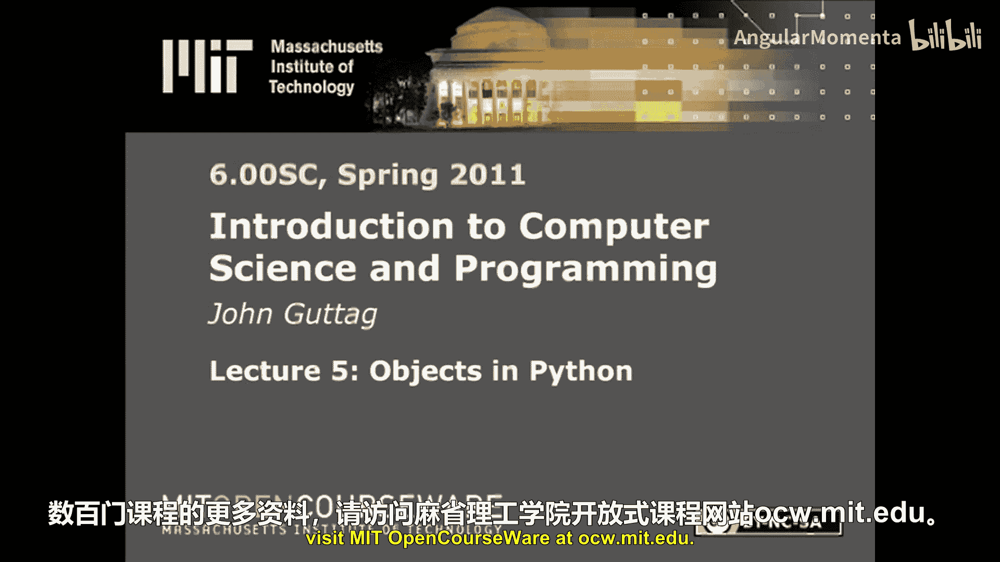

Happy Valentine's Day 11。Actually， maybe it's a little smiley face， combined with an1。

Did any of you leave this here for me or am I just？Stroking my ego。

 and this was left for someone yesterday。Sking my ego， all right。Okay。Last lecture。

We looked at a program for finding roots。And put in a little debugging statement that along the way printed various approximations to the root。

Well， now suppose that instead of printing things。We actually wanted to collect the approximations。

For example， to be able to go back and look at them later and analyze them。

 do various kinds of things。To do this。 and this is the sort of thing we do a lot。

 we need some data structures that can be used for amassing collections of items。There is。

3 data structures in Python that are used to collect items。

I'm going to try and cover all of them today。Two both。5S。And dictionaries。

We'll start with tus and lists。And what they have in common。Is they are ordered。Sequences of objects。

So the key notion here is they're ordered。😡，It makes sense to talk about the first object。

 the second object， the last object， etctera。When we get to dictionaries or dicks as they're spelled in Python。

 we'll see that they're not ordered。Alright， let's look at tus first。 They're the simplest。

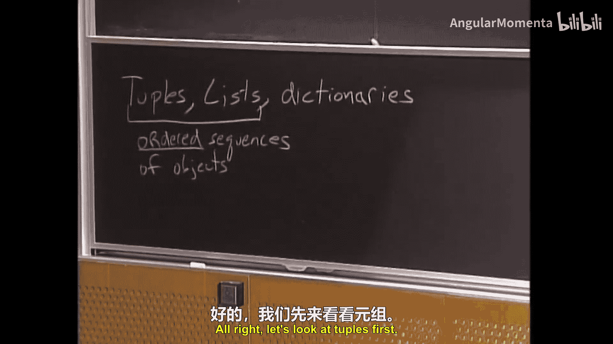

So， if we look at it。It's a very simple example at the top。 I have this tuple called test。

And I've just said that's the sequence of ins 1，2，3，4，5。I can then index into it。 For example。

 look at the first element， which is the zeroth element。Or I can look at the next element。

And we can print them。 So let's just do that。And you can see it prints one and2。Not surprisingly。

 I can print the whole thing if I want。That lets me。Look at the entire tuple。

I could also look at this。And that gives me the last element。

Without my having to know what the last element is。I can ask about the length of a tuple。

And it tells me， it's 5。Similarly， I could write something like this。Ptest。Why was that out of range。

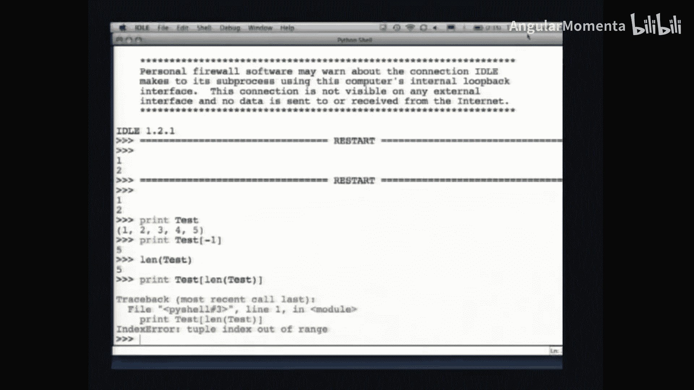

有。Because I'm indexing from zero。So that's why I have this sort of more convenient way of writing -1。

Otherwise， I'd have to do L -1。 Good grab。

Okay。Let's look at a little example of how we might use this sort of thing。

So here I've just written a little piece of code。It finds divisors。

Going to find all the divisers of 100。Collect them into a tuple。

Notice this kind of funny piece of syntax here。I comma。

I need to do that to say it's a tuple of length  one。Why can't I just write open parent。

 I comm open parent。Because that would just take the expression I and parenthasize it。

As we often use parentheses for grouping， when we write things。So by inserting this comma， I say。

 I don't just mean the， in this case， say the number I。I mean， the tuple of length 1。

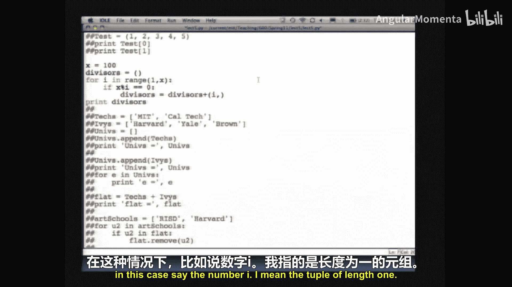

So it's a sort of a special case piece of syntax that you need for tus of length 1。

 Then I can print the divisors。So， let's run that。

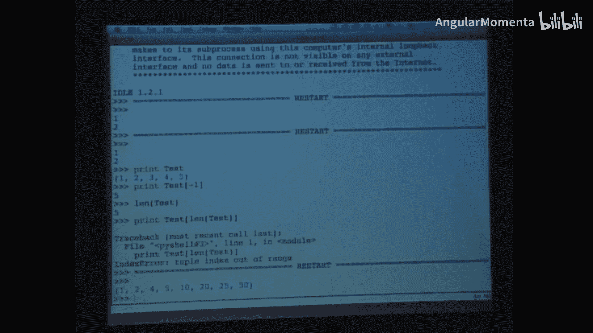

And it now prints the tuple for me。So I've run through。 I've computed all the devicesiss。

 and I've collected them。Nothing very interesting。But kind of useful。

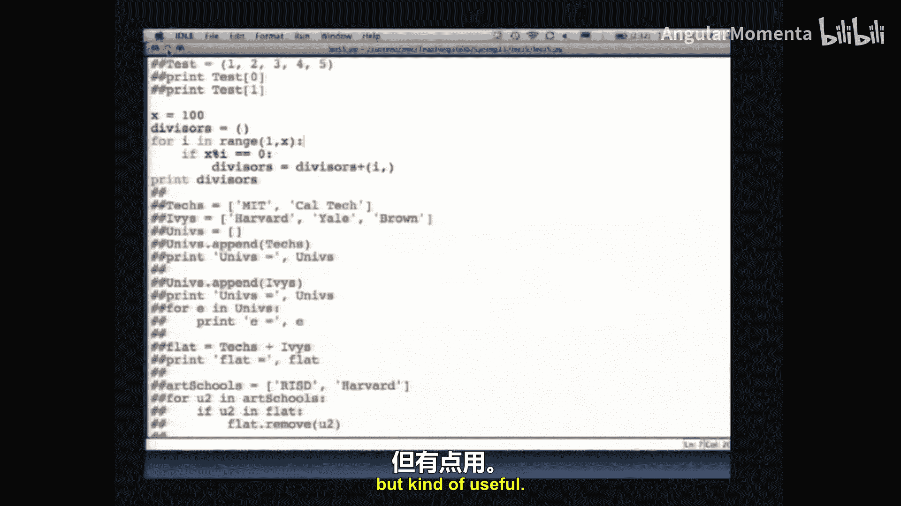

We can also， I've shown you how to select elements of tuples。I can also， if I choose。

Get what are called slices of tus。So a slice gives me a range of values。Or a， in this case。

 a sub sequenceequence。Of the tuple， as we'll see， we can also slice lists。

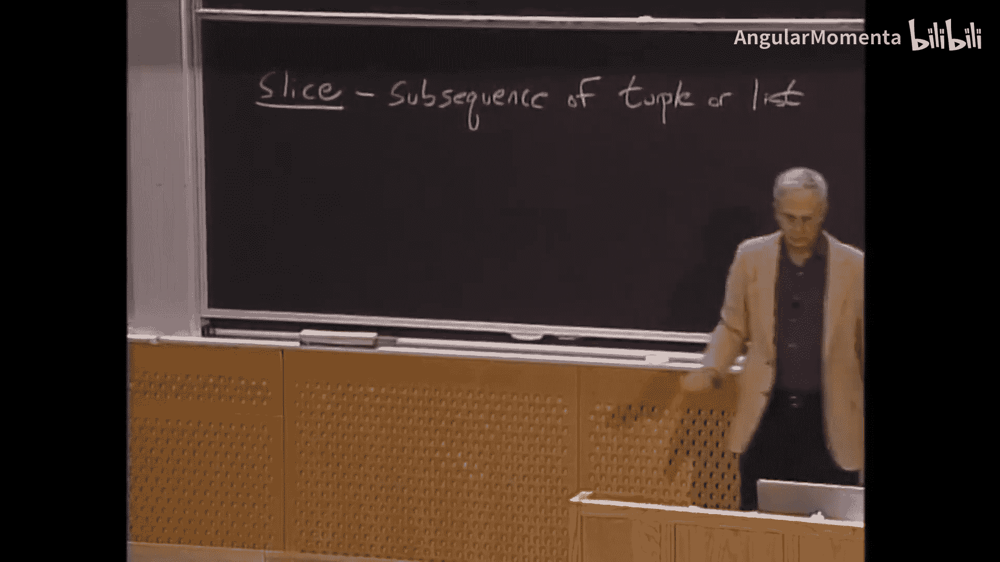

So let's see。 We have a tuple called divvisors here。Yeah， okay。 I'll save the source。 Oh come on。

So if I wanted to do what did I call I called it divisors。

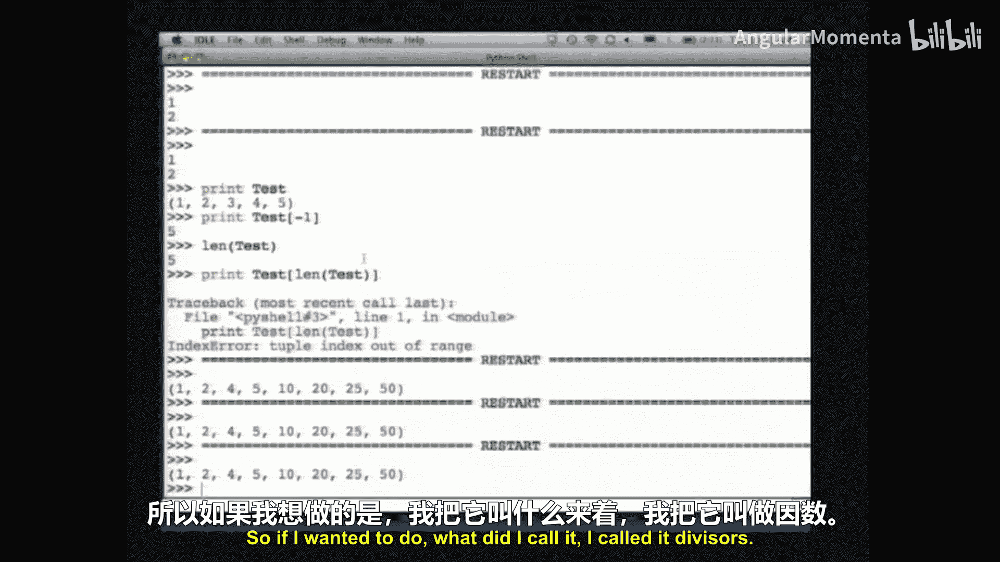

So I can do something like divisors 1 comma 3，1 colon 3， rather。

And you'll note that gives me those two elements。At the appropriate places。

And so it's a very convenient way to。Take pieces of it。All right， any questions about tus？

Not very deep。Lists。Are， I think， more useful in tus。And also， ala， more complicated。

And they're complicated。Because the big difference is that tus。Are immutable。And by that， I mean。

Once you've created a tuple。You cannot change its value。You can create a new tuple。

But you can't change the value of the old tuple。In contrast， lists。Are mutable。

Once you've created a list， you can actually change it。It's the first mutable type we've looked at。

Because you'll recall assignment。Didn't actually change the value of an object。

It just changed the object to which an identifier was bound。Mutability。

Is the first time we've seen in a way to actually change the value of an object itself。And that's。

 as we'll see。Both a powerful concept。And an opportunity to mess yourself up by committing serious programming blunders。

Allright， so let's look at。An example here。First of many we'll be looking at。So first。

 we won't worry too much about the mutability。So here I'm creating a list。Called。Text。

Which happens to be， in this case， a list of strengths。

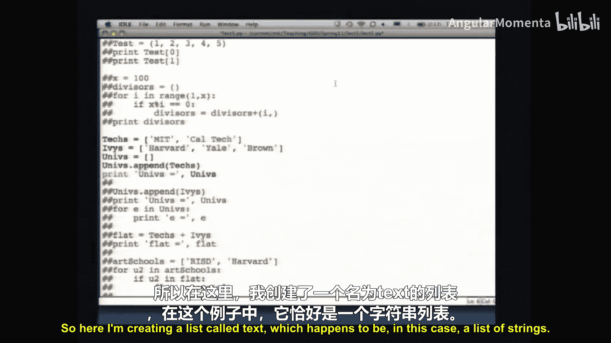

Ls need not be homogeneous， As we'll see， you can mix strings and floats and ints。

 And most interestingly， you can have lists of lists。Then another list called IVs。Then I'm gonna say。

 I'm gonna have these ununs。 yet another list。 This list empty， containing no elements。

Then I'm going to append。Text。To eye these。Notice this syntax， Unis dot append。What that means here。

Is that append。Is what Python calls a method。As we'll see when we get to classes。

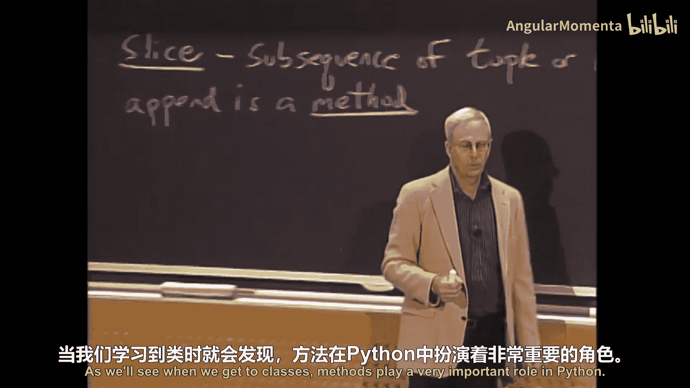

Methods play a very important role in Python。But to a first approximation。

 it's quite safe to think of a method as an alternative syntax for writing a function。So。

 instead of writing something like。Append。A list。 and an element。I write。L dot append。The element。

And just think of this L over here as。Fancy way of denoting the first argument to the function ofend。

The first actual parameter。When we get to classes in a few weeks。

We'll see why it's highly useful to have this specialized syntax。But for now， just think of it as。

 as a piece of syntactic sugar， if you will。The thing I want you to think about， though。😡。

Is this is not equivalent to assigning something to L。This actually mutates the list。

And we say it has a side effect。Up till now， since we've only been dealing with immutable types。

 every function we've looked at。Its job was to take in a bunch of values。

 do some computation and return a value。It didn't change anything。

And then if we wanted to take advantage of what the function did。

 we had to assign the value it returned to some variable， and then we could manipulate it。

 or we could print the value it returned。 We had to do something with the value it returned。Here。

We invoke aend。And。Rather than worrying about it， what it returns。

 we're invoking it for the purpose of its side effect。The modification it performs。On the list。

So let's look at what we get when we run this。So you'll notice what Uniez is now。It's a list。

Of length 1。And the one element in it is itself a list。

Because I have appended a list to the end of the empty list。Not the elements of the list。

 but the list itself。Okay， so it's important to notice the difference between。

A list that contained the elements， M I T and Caltech。

And a list that contained a list which contains the elements， M I T and Caltech。Okay。Yes。

Do two both together。

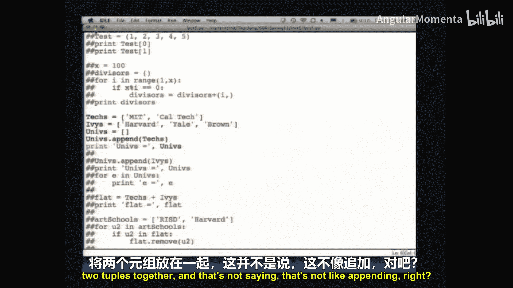

And that's not。Saing that's not like a bending， right， because when I concatenated two tuples。

In order to do something useful with that value， I had to assign it to something。

It did not modify anything。It produced a new tuple， which was the value of appending them。

And then it assigned it to a new tuple。 So it's quite different from。Aend。

 which is actually having a side effect on the list。Does not produce a new list。

 It modifies the old list。So we can look at this。Draw a little picture here。So we had text。

And that pointed to a list with two elements in it。Which I'll abbreviate as M I T and Caltech。

Both of these elements were strings。Then I。Created a new list， called Eivs。

And that was initially bound to the empty list。A list with no elements in it。I then did an append。

And the effect of the append。Was to modify un Nes so that it pointed。Now I had one element。

 and the element it was， was this list。Notice it didn't copy this list。 It actually。

Included the list itself。

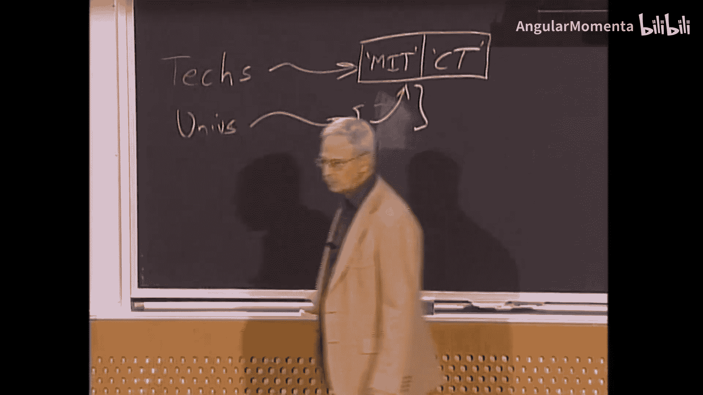

So let's look at the ramifications of doing it that way。Ops。

So what I'm going to do now is append another element called Is。I'm going to then print it。

And then for E in Un Ne。 So here's a kind of a nice thing you can do with lists。

You can iterate over the elements in the list。So you might think。

 and that the way to do that as well， I'll go for I index in range 0 to length of list。

 that would be equivalent。 but it's， in fact， much easier to just write this way for E in Us。

That will do something to every element of the list。 I'm going print what the element is。

Let's look at that。So now I have a lift。As we see here。Of length，2。Contains two lists。

 And if I print the elements， I print each of those lists。Nothing very magical there。Now， suppose I。

Wanted it flattened。You asked the question about the tuples where I did concatenation。 Well。

 I can do the same thing here。I'll let flat。Equal text plus Is。 And then I'll print flat。

And you'll mode here。What concatenation does。Is it just takes the elements of the list。

And creates a new list。And appends it。Oh thats an append in this case， it assign it to flat。 Exe me。

So， that's kind of convenient。Poor old plus is overloaded with yet another meaning。Alright。

 let's keep on trucking。I， of course， can do this myself。

 So here I've got another list called Art schoolss， includes RISD and Harvard。For you。

2 in art schools， if you2 in flat， I'm gonna remove it。Alright， so again。

 I'm gonna iterate over everything in art schools。What's this going to do， do you think。

What will I get when I print it here。No new concepts here， this is all the stuff we've seen。

Somebody out there， yeah。Yes。😊，The answer， the correct answer was flat without Harvard in it。Wow。

 almost a good catch。just， just almost there。 Alright， so let's confirm。Yes， we'll save it。

 Thank you。Alright， So we've now removed the art school。Alright， look at one more thing。Actually。

 we'll look at far more than one more thing， but well。Look at one more thing， for the moment。

So I'm going to invoke another method。 This is a built in method of Python that works on。

Sequence types。And it's called sort。So you can do this will have a side effect on flat。And it will。

 as you might guess， put them in。Order， so let's run that。Actually。

 we'll comment this out for a moment。So you'll now note that it's put them in alphabetical order。

This is something， again， that you will find convenient throughout the term， the ability to。

Have the side effect of sorting a list。

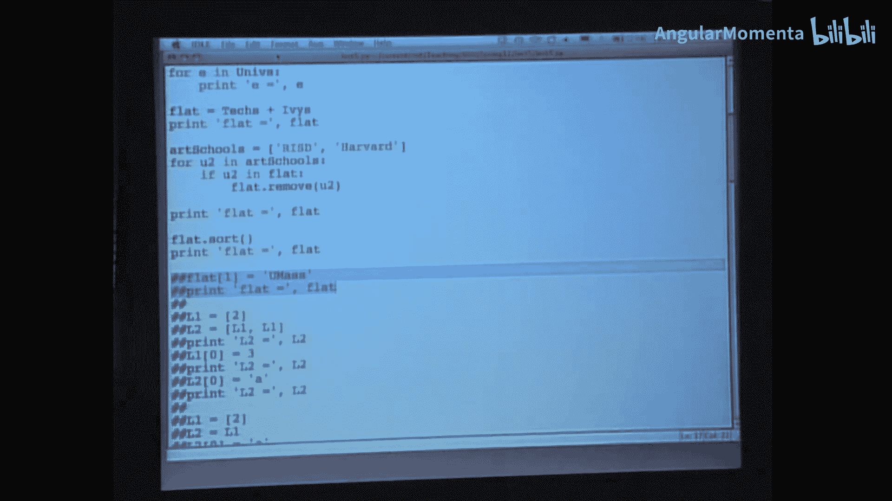

Now。I'm going to assign something to flat sub1。So let's think about what this is going to be doing。

It's going to replace。The first element of flat。By a new value。So， it's having， again。

A side effect on flat。So you have to be a little bit careful as you think about this。

 that I've written something that looks like a conventional assignment statement。But， in fact。

 flax of one is not an identifier。So this is not binding the name Flax of one to Umass。

It's actually modifying the object。That is the first element of flat。

So wouldn an identifier just be the flat？Well， I think the way to question is。

 would the identifier just be flat。No。Don't think of this as an assignment at all。Because remember。

 what an assignment does is swing one of these pointers to point to a different object。

We'll see an example of that。 Where here， I'm actually modifying a piece of the object。

That the identifier appoint to。So it's not an assignment in the sense of a rebinding。

It's actually having an side effect of modifying the object。Let's just run it。

 and then I'll be happy with the question。So here you'll see， I've changed flat sub1 to now be Umass。

Yeah， question。So。As you've drawn on the blackboard here。

 you've drawn an arrow to the actual object that's text right so if we change text will we change unions。

 Yes， the question was if we change text， will we change unitss？Now， in some sense。

 that's a philosophical question。From the philosophical point of view， maybe you could say， no。

 unitsez is still the same object。So the binding has not been changed。

 but the object to which it has been bound is now different。Same object， but it has a new value。

All right。So this is the key thing to keep in mind。

 Assignment has to do with the binding of names to objects。

Mutation has to do with changing the value of objects。

We'll see that pretty graphically in in the next example that I wanted to work my way through。

So I'm going to work through a kind of a dull example。 But I think it illustrates the points。

And I do， by the way， very much appreciate the questions。

 even if I forget to throw you candy in return for asking。But it's good。 If you have questions。

 please do ask them。And I'll try and remember to feed you。

So let's work through what this code is going to do。So first， I'm going have the list L 1。

So the first thing I'm going to create an object。Which is a list of length 1 containing integer 2。So。

 L 1。Will be bound to the lift。Of length 1 containing the into2。

I'm then going create another lip or not create。L 2。Which is going to be of length 2。

 And the first element will be L 1。And the second element will be L1。

So what will happen if I print L 2。What will I get？

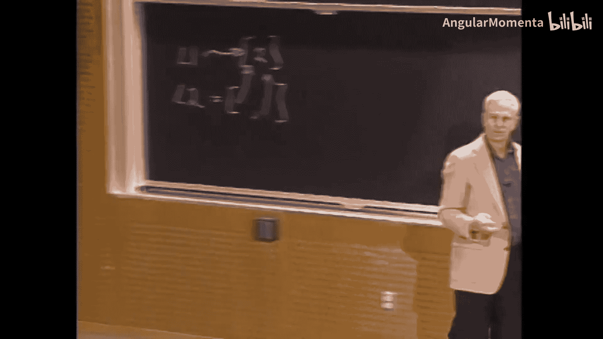

I'll get。List2， comma list 2， right， we can look at it。If I print L2， excuse me。Alright。

 just what we would have。Expected。Now。I'm going to change。The zeroth value of L1 to be 3。

So I'm going to mutate L1。Now， if I print L 2。I will get a different value。3，3。Not surprising。

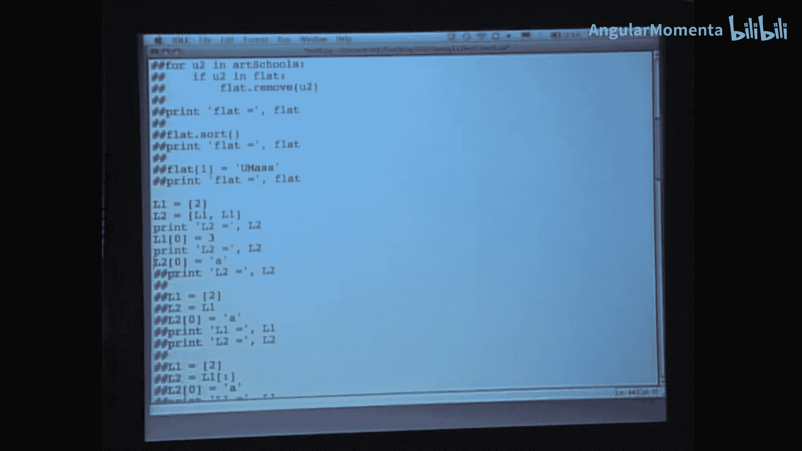

It's something to keep in mind。喂。Will can be useful， but can also be confusing。

Because if I'm looking at my code， it doesn't look like I changed L 2。

When I have a side effect on L 1。And so it can be kind of mystifying when you're trying to debug。

 You print L2， you do a bunch of。Execute a bunch of statements。

 none of which apparently deals with L 2。And you print L2 again and get a different value。

This is both the beauty and the peril。Of mutation。Now， let's see what this does。So， here， I've now。

Mutated L2。So that。Its first element。Is no longer the list L1。But is now。

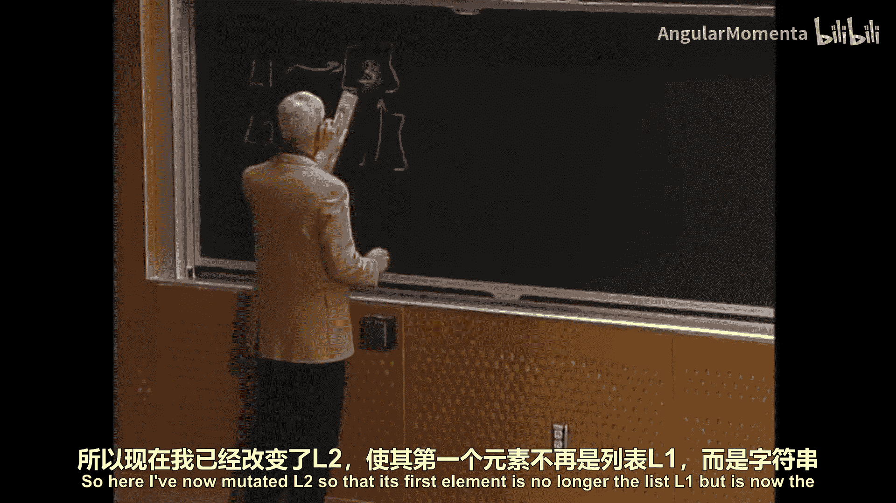

The string。A。

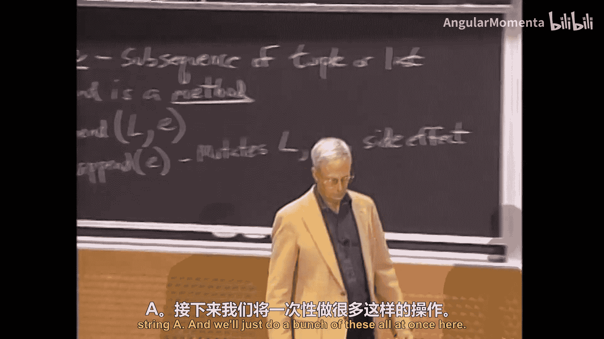

And we'll just do a bunch of these all at once here。Now I'm going to change L1。To be。2， length 1。

So what do you think will happen， by the way， if after this， I print。L 2。what。

What do you think is going to get printed here。

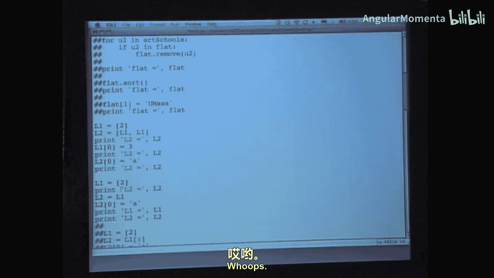

Alright， this is important。 You need to figure this out。What's going to get printed here。

 A volunteer pleased， yes。Well， its supposed to aim in。A and N 2 is one conjecture。Let's find out。

A and N 3。Why。😡，Because what happened here。Is when I did the assignment to L 1。

What that effectively did was swing this pointer。To point to the new list containing the element 2。

But had no effect on this object。Right， I was changing the binding of the identifier。

 I was not mutating this object。And so， this。Element still points to the same list。

 which was not mutated。That makes sense now。So you have to get your head around the way all this stuff works。

3。Does that anybody have a question about why this is what it did。All right。If not。

Will just roar right along。So， now。We can do various things， and we'll get some stuff。O。All right。

 moving right along。Here's a kind of interesting little program， not in your handout。

Let me get rid of all this craft。So here's a function copy list。It takes a source list。

 and a destination list。And for E， in the source list。

 it appends it to whatever the destination list used to be。

And then I'm just putting in a little print statement so you will be able to see as it runs what it's doing。

So I'm going to say L1 is equal to the empty lift。L 2 is 1，2，3。And I'm going to copy list L 2 to L 1。

Print L 1 and L 2。So what am I going to get when I print those things。This is the easy question。

Don't tell me， I have you so intimidated that you think I'm playing。 This is not a trick question。

Pardon。One， two， three for both of them。Who said that。Raise your hand。Some back， oh。

 good grief all the way in the back。 All right。Oh no， not even close。

Off by a row in about four people， too。Okay。So， let's try it。1，2，3，1，2，3。So， exactly as predicted。

Now。Comes the trick question。What is this going to do。Pent。Well， we'll print L1 here。

What do you think it'll do when it gets to that print statement。Will it get to that print statement。

 Let me ask that question。Will it ever get there。No， bingo。 let's run it。

And you'll see Ldes just gets longer and longer and longer。Why is that happening。

Because what it's attempting to do。Is look at L source。

And copy the remaining elements of L source to Ld。But every time I go through the loop。

What we have as a situation。Where。The formal L source。An Ld。Are now pointing to the same object。

So every time I modify L D， I am modifying the object to which L source points to。

And I keep finding yet another thing to copy。This is an example of what's called an alias。

One object with two names。Or in general， multiple names。When you have。Imutable objects。

 aliasing is perfectly harmless。If you have。58 different names for the object 3。It doesn't matter。

Because you can never change what3 means。Here， where you have multiple names for the same mutable object。

You can get massive confusion。When you modify it through one name， and then。

Forget that it's being accessed through another。So it's something to worry about。Okay。As with tus。

 you can slice lists。 You can index into lists。You can concatenate lists。

 You can do all the usual things。 I'm not going to list all of the operators。

 and there are a lot of very nice operators， but we'll post readings where you can find what operators are available。

I now want to move on to the third built in type。That collects values。And that's a dictionary。

A dictionary。Diffs from a list。In two ways。1。The elements are not ordered。And 2。More profoundly。

The indices need not be integers。And they're not called indices。 They're called keys。

They can be any immutable。

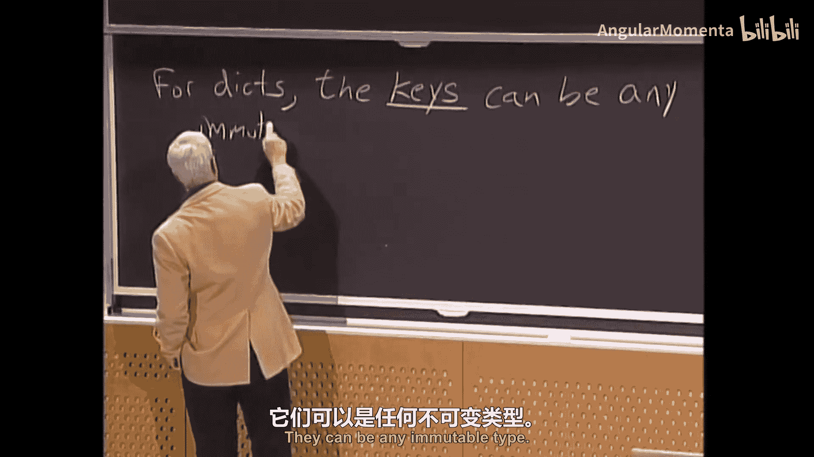

タイpe？So we look at a simple example， first。So here I'm creating a new dict。

We use set braces rather than square braces to remind ourselves that the elements are not ordered。

And I'm saying the first key is the number one。And that's bound。To the object， the string object。1。

 quote，1，1。And then the second key is the string object du， which is bound。To the string object 2。

And the third one is the string object pi， which is bound to the float，3。14159。Now， I can then index。

Into it。So， for example， if I choose to。I can write something like。Print。D sub。Pi。

I'll just stop it here with my old trick of asserting false。And you'll see， it will print。

The value with which the key is bound。To which the key is bound。So what we have here。Is。Addict。

Is a set。Of。K。Value pairs。And I can access it by looking at the keys。I can do an assignment。

 D1 equals D。Just as I can with lists。 And now I remember， this is a real assignment。

 So now I have an alias two objects pointing to identifiers pointing to the same dick。I can then。

Print D1， sub1。I are print it， or I could assign to it。So let's do that。 First， we'll print it。

Just to show what we get。Then I'm going do an assignment。Saying， okay。

 I want to now change the binding in D of the key1。To be uno， rather than one。

And we'll get something different。 Let's just run this。So you'll note， as we would have guessed。

With mutability， we see it showing up。So so far， just like lists。The difference being。

We have key value pairs rather than you could think of a list as being int value pairs。

 The indices of a list are always inks。 associated with each of those ints。 We have a value。

Let's look at a kind of a more fun example。Showing what we can do with dictionaries。So。

 here I have a very。Simple dictionary。Called E to F for English to French。

And we can do some things with it。So， I can print it。And that's be kind of interesting。

 Let's see what we get when we print it。

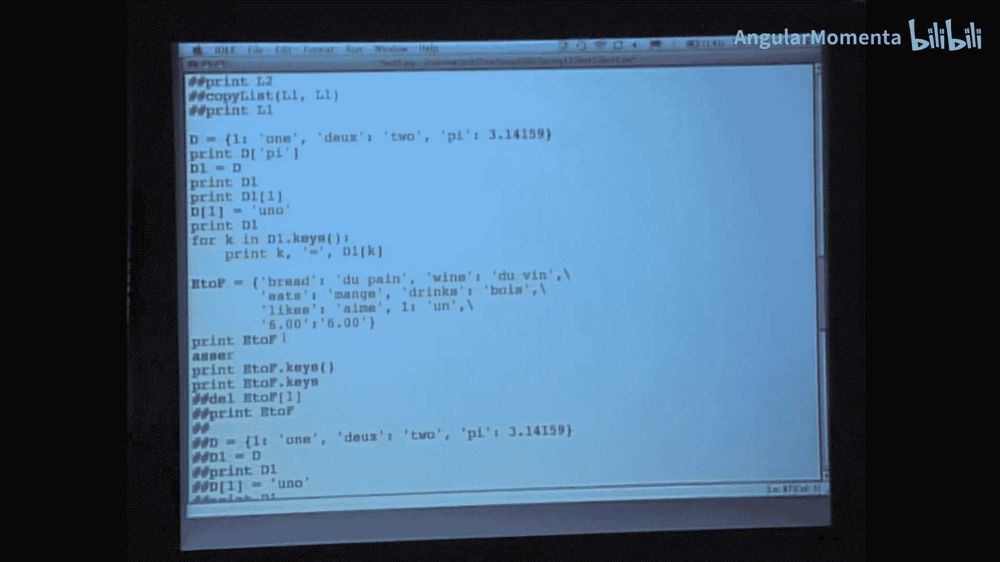

So it's printing it。 And you'll notice the order in which it's printed the key value pairs。

Is not the order in which I typed them。That's okay。

The order in which it prints them is not defined by Python。So there's no way to predict the order。

 And that makes sense， because by specification。Dictionaries are unordered。 They are sets。

 not sequences。I can print。Keys， E2 F dot keys， open close。Keys is a method。On dis。

That returns the keys。 And then just for fun， I'm going try to print E to F dot keys without the open clothes。

So you'll see when I first printed it with the open clothes， I got all of the keys。

In an order that was not necessarily predictable， certainly not the order in which I typed them。

But that's nice。 I now have。This sequence of keys that I could do things with。

When I typed it without the open close， and I wanted you to see this。It just says， it's a method。

A built in method。 It does not execute the method， right。That's fine。But again。

 you have to be careful。That you'll find this happening when you write code。

 you'll forget to write the open close。And you'll wonder why your program isn't doing what you expected it to do。

Remember， it's not saying that the method keys has no argument。 It has one argument。In this case。

 E to F。And the open close is basically saying， all right。Call the method， rather than。

The method itself。Again， this will be very important when we get to。Classes。Alright。

 let's get rid of some of these print statements now。Suppose， I want to。Delete something。

I can delete。Something， so delete E to F sub 1。Dell。Is a command， much like print。That says。

 remove something。From E to F。So， I can do that。And now something has disappeared。

 The key value pair where the key is one is gone。So that's how I remove things。Yes。

The keys have to be immutable。😡，You cannot use a mutable type for a key。啊。

We'll see the reason for that in a couple of lectures when I talk about how dictionaries are implemented in Python。

They use a very clever technique called hashing， which would not work if the keys remable。

So in order to get an efficient implementation of dictionary lookup， we need to have immutable keys。

And so， that's required。Let's get another example。So here， I'm， again， setting a dictionary。

And now what I'm going to show you is that I can iterate through the keys。And print the values。

For key and D1 dot keys， nothing very fancy here。Okay。1 equals uno pi equals 3。1459， and do equals 2。

All right。So nothing very dramatic happening here。Finally。

 just to illustrate why this sort of thing is particularly useful。And， in fact。

 you'll find it quite useful in the upcoming problem set。I'm going to do some translations。This。

 by the way， is not the way Google Translate works。It's a bit more sophisticated。

So I'm gonna have two functions。 Trans word。Which。If it finds the word in the dictionary。

 returns the value associated with the key。So note， if word in dictionary says。

 is there a key whose value is word。If so， return the value associated with that key。Otherwise。

 don't even try and translate it。 Just leave it the way it was。And then， translate sentence。

Will set the translation equal to the empty string。And word equals to the empty string。

Then it will just collect all the characters until it finds a blank。

Translate the word using translate word and append it。And when it's done， it will print it。So。

 we can now。Do these translations quite simply。What could be easier。

 You never again have to learn a foreign language。 Just use Python to do the translations for you。

All right， actually it for today。Remember， there is a problem set that you should be working on and another one that will be posted。

 Take care。

