# 【麻省理工】计算机科学与编程导论 ｜ MIT 6.00SC Introduction to Computer Science and Programming p08 08 -BV1a5BZBkEP6_p8-

The following content is provided under a creative Commons license。

 Your support will help M I T Opencourseseware continue to offer high quality educational resources for free。

To make a donation or view additional materials from hundreds of M T courses。

 visit M I T OpenCseware at O C W dot M I T dot E Du。

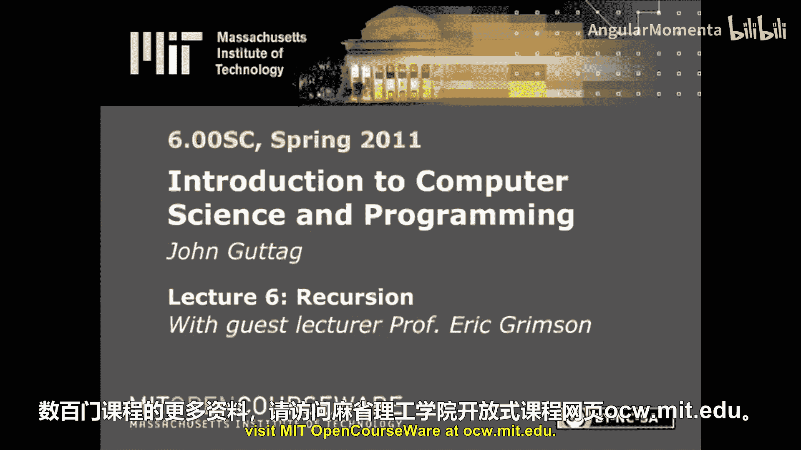

Good morning。Professor Goodtag has to be out of town today。My names Professor Grimson。

 I'm going to be subbbing for him。 And just to show you how much we value education here at MIT。

 and especially in EEC S， you get the incoming chancellor as a substitute teacher。

 So how cool is that。All right， maybe not very cool。

But I'm going to talk to anyway for the next 50 minutes。At the end of last lecture。I think John。

 Professor Goodtag introduced dictionaries to you。Really powerful type。It's got a great capability。

 which is it's a tool， a data type that lets you associate almost any kind of structure with a key。

So it could be that you're associating keys with numbers。 You're sociating keys with strings。

 but you could be associating keys with other things， including dictionaries。

And I don't know if he showed this to you or not， but those keys themselves can also be really powerful。

 It could be just a string。But the key could also be a tuple or a list。

An X and Y coordinate or a set of names or other things。

 So it's a really great data structure to use。Now。One of the things you could or ask， though， is， ge。

 what if。Python or whatever language you're using didn't come with dictionaries。

 Could we still get the same power。And the answer is sure。 So I want to show you a little example。

 So's on your handout。 If we look at this little procedure up here at the top， key search。

I could build it out of list。Right， I could just use a list as my way of storing it。

 So let's look at what this procedure says， it says。Okay。If I've got a list。And I've got a key K。

I could write a little loop that just walks down the list saying。

 is the first part of each element equal to the key I'm looking for。And if it is。

 I'll return the second part of that element。And if I get to the end of the list， I haven't found it。

 I returned none。So notice I'm making a choice here。

 I'm assuming that I'm storing in the dictionary things that are lists too long。

 Key in the associated value， Another key in the associated value。

 another key in the associated value。 But this would work fine。 So if I didn't have dictionaries。

 I could build them。If I wanted the things make things that had a more complicated lookup。

 I'd have to make sure that that equality test it。 But you could see how I might do it。Alright。

 so the question then can be， So why did we bother with dictionaries if we could just use it with lists。

And here's my question to you。 So how long in this implementation is it going to take me to figure out if something's in my dictionary。

Oh my God， He's asking questions at 10 o'clock in the morning。 This is really terrifying。

 So somebody help me out。 How long。Yeah。Probably on average。

 the part we order the size ofable list right on average。

's going to take me half the size of the list， but that's the same thing as being the size of the list。

 So if that list is really long， I'm toast。If it's not in the dictionary， in fact。

 I'm going to have to go all the way through the list before I get to the end and decide it's not there。

 So this is not as efficient an implementation as we'd like。Now， the flip of that is you can say。

 okay， how long does it take for the dictionaries， the built and associative retrieval that you have inside of Python。

And the interesting answer there is that that retrieval is constant。

 takes the same amount of time independent of the size of the dictionary。 And that's wonderful。😊。

We're not going to talk about how today。 You're going to see that later on in the term。

 But it is something that drives home。 if you'd like the point that different data structures have different costs。

And while some are easier to implement in， they may not be as efficient。

 Some may be a little more difficult to implement in， but they are much more efficient。

 And that's one of the great things about dictionaries。O。

 the second thing I think you saw the end of last lecture。

 And I want to just highlight in a slightly different way。

 as I believe Professor Goodtag showed you a little example of a very simple translation function。

Right， we had a little dictionary。 I'm going to give you a version right here。

I'm going to uncomment it。 In fact， there's a little dictionary。That。

Simply associates English words with French words。 And， yes， it's pretty simple。

 but it's a little way of pairing those things up。And the idea would be， if I had a sentence。

 just a string。That consists of a bunch of words。 I'd like to translate that English sentence。

 if I can into French。 And let's look at the code that's going to do it。 I'm gonna， again。

 un commentment it here。 It's on your handout。 I want to walk you through it。Okay。So。

First thing I'm going to do is actually write a little procedure that says， given a word in English。

 I want to find the corresponding word in French。And that's pretty easy。 right， It says。

 if you give me a word and you give me a dictionary。I'm just going to look it up in the dictionary。

That's just that As retrieval。 It does all the work to go into the dictionary。

 say if that's a key for something in the dictionary， it's going to give it back to me。

 And in particular， I can get it back by simply retrieving it out of the dictionary。Now。

 notice I'm doing this a little more carefully。 I'm not just directly going and saying。

 give me the thing corresponding to the word in the dictionary because it might not be there。

 So that test basically says if the word is in the dictionary， it'll return true。 And in that case。

 I get out the corresponding element。It's not in the dictionary。

 I'm just going be stuck with the English words。 So it'll just return word。O。

 now let's look at the more fun part of it。 I now want to translate。He sentence。

AndThe sentence is a spring of， of words。I need to find where the words are。 I need to look them up。

 I need to gather together a translation。So notice what the heart of this thing does right down here in this part of the loop that I'm going highlight right there。

 I missed did that。 Let me try it again。Right there。What's that doing。It's walking down the sentence。

 Sens is some big long string。 And it says for each character see in the sentence。

I need to find where the word is。So I'm gonna to keep walking along until I find a place where there's a space。

So that first test they are saying， if C is not a space。Just added on to the end of word。Oh， yeah。

 I need to have initialized word， which I did right up here。 I said。

 let's set word to just be an empty string。 So I'm just walking along the sentence until I find a space。

Until I do that， I'm just gathering together all of those characters。

 So I'm building up the word When I get to the place where， in fact， C is a space。😊。

And here's what I'm gonna to do。I'm going to translate the word。Using that procedure I just wrotete。

 it looks it up in the dictionary。 It either gives me back the French word。 if it's there。

 And if not， it just gives me back the English word。And， oh， yeah， I'm doing a whole long sentence。

 so I need to add it together。 So I'm simply going to add it to the end of what I've translated so far。

And I'm doing a slightly funky thing in there。 I'm inserting a space in between just to keep the word separate。

And， of course， I need to have initialized translation up here， which I did to be an empty string。

So what's this do， walks along character by character When it gets to a space that says I got a word。

 find the translation， Add it to the end of this other internal variable， and keep going。

 And I'll do that till I get to the end of that sentence。 And then I'll just return the translation。

Nice little iterative loop。 And it's simply using two pieces to make all of this happen。

I lied to you。 So I， I didn't lie。 I misspoke to you。Okay， which is。

 what's that funky thing at the end。What is it returning。

 It's returning this strange thing that says translation， starting with the first element。

 a copy of all of that， plus。A translation of word。

So what assumption am I making about the inputs that causes me to do this strange thing at the end。

I'm actually making two assumptions about my input。

 but I'm making a particular assumption Why do I not just return translation when I'm done。

 Why am I doing this last piece。Anybody help me out。Boy。

 I notice everybody sits way back at the back where I can't make any eye contact。

How do I characterize words in my string。Have to end with the space。O。

 is there a space at the end of my examples。 Well， I guess I haven't shown you an example。

 but I'm assuming if I give you a sentence， you don't usually have spaces at the end of sentences。

 So I'm making an assumption is that the words， except for the last one。Are characterized by spaces。

 So this last little piece here is to get the very last word。And translate it， because it won't be。

A space。Right， let's try a couple of examples。 Let's just untranslateator or sorry。

 uncom these and let's see if this does it。Oh， yes， commenting them again is not a good idea。

 We'll go the other direction。Okay。Looks like it did it right， right。Jean。

 we should have translated Jean into Jean。 I don't know what the hell Eric is in France。

 but Jean Marge Dupin。Eric Bois du v， John has that right。 He eats bread。 I like to drink wine。 And。

 of course， Tulimon aim Cs 0，0。 Or in this case， everyone likes 6，0，0。 You just got has credit。

 by the way for you know， listening to me do French really badly， right。O， as I said。

 I made an assumption， which is that the the words end in spaces。

 What's the other assumption I made here。I know you're just looking at the code。

 but I made another assumption inside of my code。 And it's always good to figure out what those assumptions are。

要。That the postcard is enough。I didn't assume that I could if I was doing more clever translation。

 but I actually making no assumptions linguistically here。Well，'ll give you a hint。

 How many spaces do I have between words。Just one， right。

 I'm sort of building that into this assumption。 It's a reasonable assumption to make。

 But it points out if I wanted to improve the code， I should think about these other cases。 And。

 of course， to build a real translation system， I need something much more sophisticated。All right。

So this shows you a little example of using the dictionaries。

 But I want to use this to lead into the the main part of today's lecture， which is。

 why did I write this separate little procedure up here called translate word。

I could have buried that inside the coat。And the answer is。2，ful。First one is， it saves。

Sll amount of code。 If I don't have to use it， sorry， I'm going to use it in multiple places。

 I don't want to rewrite the code。Okay， and that actually is valuable not just to save you typing。

 It means I only have to debug it once。It's one piece of code。

But the real reason I wanted to introduce it is it gives me what you might think of as modular abstraction。

 Those are fancy words that basically say， I am isolating that function in one place。

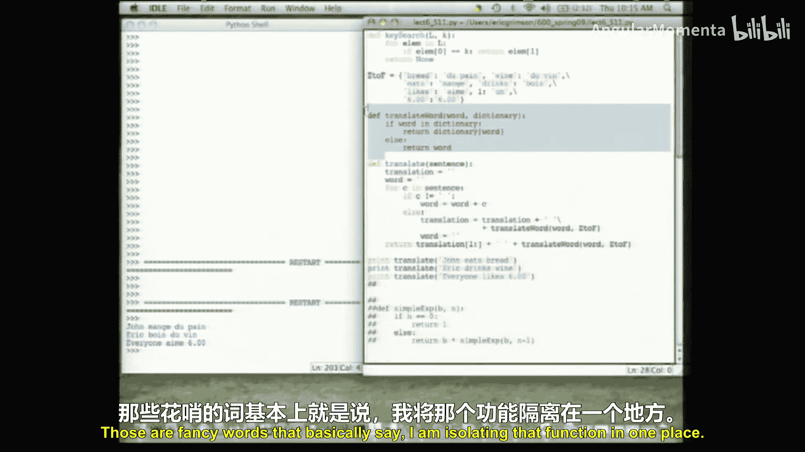

If I decide to change， how am I going to translate words。

I don't have to search through all of my code to find all the places where I was using that。

 I just need to change the definition of that procedure。And I agree。 in a simple example like this。

 It looks pretty simple。 But if you've got a million lines of code。

 you're using it 10000 different places， you don't want to have to find all the places to change。

 So this is an example of。Modular abstraction， isolating where that thing is。 And that is an example。

In fact， of a general problem solving principle we're going to use。

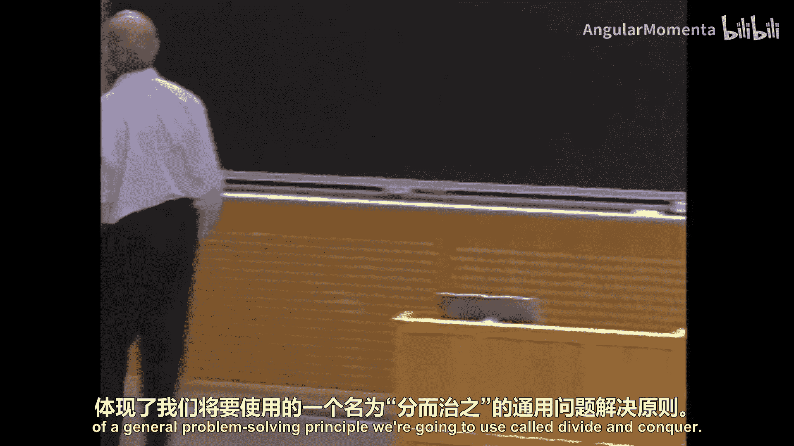

Call divide and conquer。哎。Dividing conquer is basically the idea of taking a hard problem and breaking it up into some simpler pieces。

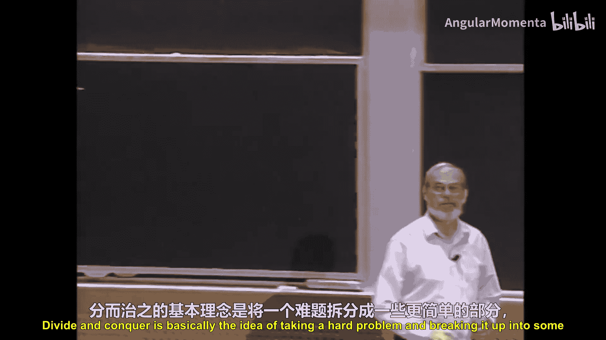

Or into smaller problems where those smaller problems have two properties。

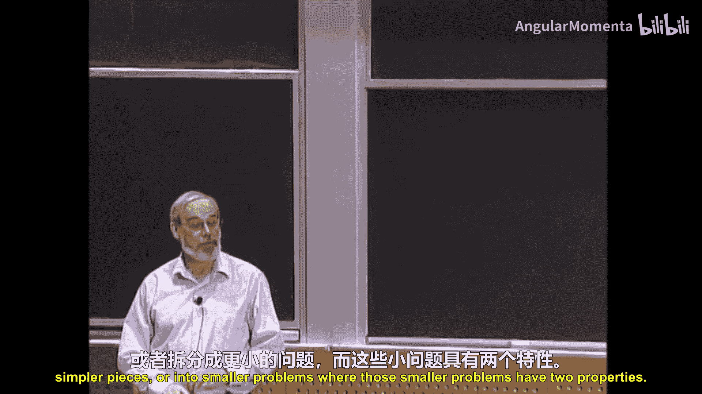

Small problems are easier to solve。

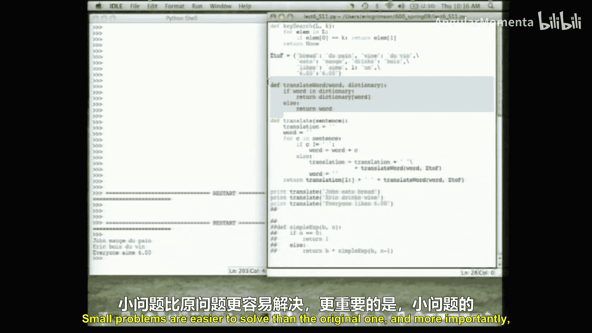

Then the original one。More importantly。The solutions。To the small problems。Can easily be combined。

I want to stress easily。To solve the big problem。And we're going look at a bunch of examples today。

 to show them。This is a really old idea。Julius Caesar used it。He did it in Latin。

 My Latin' is terrible， but it's something like Davide E Ipirra。Which literally means divide rule。

 That's how he created the Roman Empire。 The British knew this really well。

 That's how they controlled the Indian subcontent brilliantly， for several decades。

Ben Franklin actually knew it。In particular， he knew how good the British were at this。

 So there's a famous quote。 I mean， you may well remember when he signed the Declaration of Independence。

 he said， quote， we must all hang together or assuredly， we will hang separately。

Meaning divide and conquer is going to be a real problem。Okay， so second has credit for you。

 we just did some history。Why are we going to use it today， Boy， you're a tough audience， I noticed。

 by the way。 That's all right。We're going to use it today because we're going to use it as a tool for problem solving。

 And in particular， we're going to use it。With one particular example。

 you're going to see divide and conquer later on in the term when we talk or when Profesor Goodtag talks about algorithm design。

Today， I'm going to show you one great technique for doing divide and conquer kind of algorithms。

 And that is the technique of recursion。😊，How many people here have heard that term used before by computer scientists。

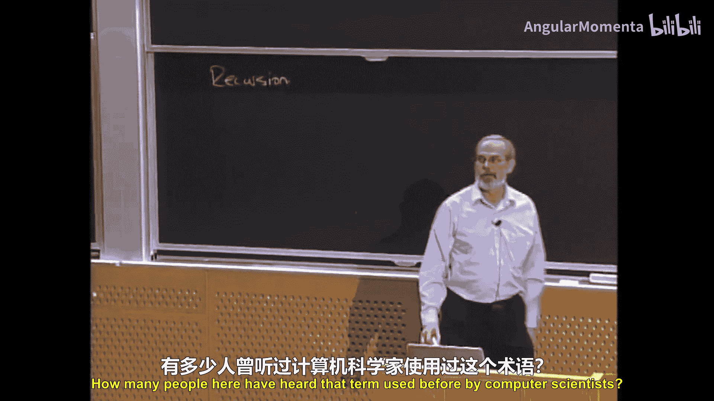

Okay。Not to worry， if you've heard it， you probably think that it's a really subtle programming technique。

I'll let you in on a secret。That's a PR job。So what computer scientists tell you to make you think that they're much smarter than they really are。

It's not subtle， and it's much more than a programming technique。 And we're going to talk about it。

Okay。Now， it gets used not just as a programming technique。

 It gets used to other ways in computer science。 And we're going to talk about both。It's both a way。

Of describing or defining problems。So it's a way of characterizing a problem independent of how we might implement it。

And it is a way of designing solutions。So an example of divide and conquer。

Let me give you an example。 I is to show you why's a way to defining a problem。Com。Consider the。

Part of the legal code that defines the notion of a natural born US citizen。

And remind you to be eligible to run for president， which I hope you all do。

 You have to be a natural born US citizen。Definition has two parts。Part number one。

 anyone born within the United States is a natural born citizen。Part number two。

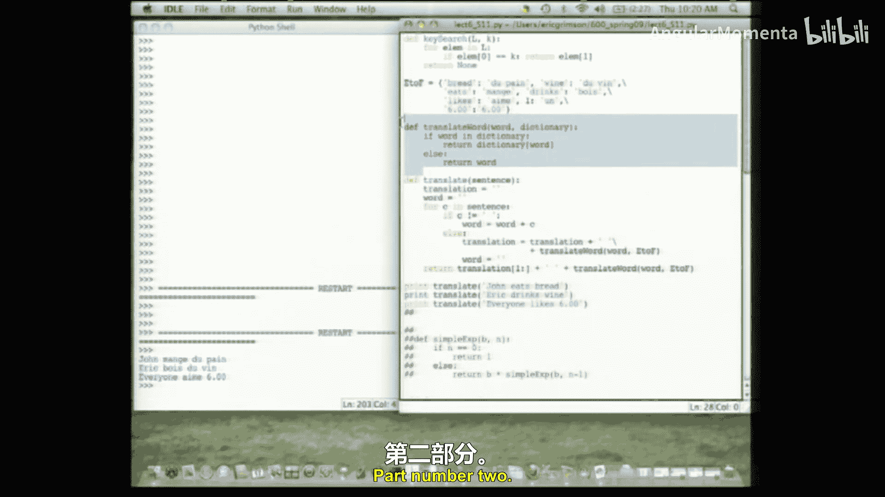

Anyone born outside the United States， both of whose parents are citizens of the United States。

Is a natural born citizen as long as one parent has lived in the US。Okay， a little more complicated。

 What that actually say， Well， it's got two parts。 And that's what a recursive definition has。

The first part is simple。You're born here， natural born US citizen。Notice the second part。

 it says if you weren't born here， you might still be a natural born citizen。

 But what do you have to do， You have to decide if your parents are US citizens。

Which they could be by having been born here， but there are other ways to be naturalized。

And that may require you determining if your grandparents are US citizens， which may require you to。

So you may have to chain down a several sets of problems。

Those two parts are what exactly we're going to use when we talk about recursive definitions。

 There' is what we call a base part。Which typically describes the simplest version of the problem。

And then there is a inductive part that tends to describe。

How you reduce the problem to simpler versions of the same problem。 So， in fact。

 let me write those both down。We have。It's called a base case。And this， typically。

Gives us a direct answer。Just tells us very simply， using very simple methods。

 whether this is something that satisfies that recursive definition。And then there is the recursive。

Or inductive case。And here。You reduce。To a simpler version of the same problem。Plus。

 some other simple operations。Okay， again， a bunch of words。 Let me show you some examples。

I'm going to start with， well， I'm going start with three or four different examples。

 just to show you how quickly we do this。 What I want you to see in all of these examples is that when I describe the problem。

 I'm describing it in terms of what's the simplest case。

 and then how do I build solutions to bigger problems。

From solutions to smaller versions of the same problems。Okay， here's the first case I'm going to do。

Suppose I tell you， I want to build a little procedure。To do exponentiation。Integer exponents。 Okay。

 I want to compute B to the end， but I tell you， I got a really cheap machine。

 And all I can do is multiplication。 Okay， so I can't use X。Mathematician， of course。

18 person would say， what's B to the N。That's B times B。Times B。In times， right。

How could I solve this， Well， recursively， I'd like to say。

 suppose I could solve smaller versions of the same problem。

 And if somebody gave me a solution to that smaller version。

 how would I build a solution to the bigger problem。Oh， that's easy。That's the same as。B times。

Me to the M -1。Alright， I can see you're all going， well， duh， you know。

 I guess is's what chancellors know。 They're not very bright。 Of course， you know that。

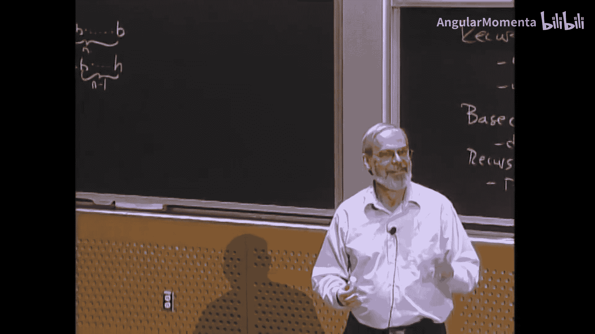

But notice what I did。I've now reduced it to a simpler version of the same problem。 recursively。

This basically says， I wanted to solve B to the N。It's B times B to the n -1。

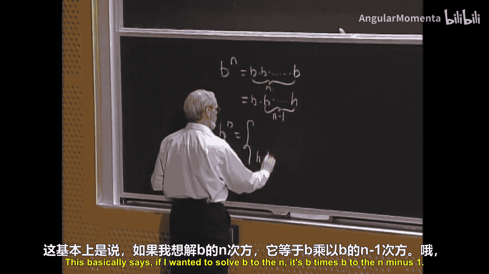

Oh， yeah。 But I got to figure out when to unwrap this。 So there's an if there。

And that's true as long as ends greater than one。Actually， as long as the n is greater than 0。

 we'll do it that way。And。If n's equal to 0， I know the answer is just one。

I know you don't believe me， but that's really cool。

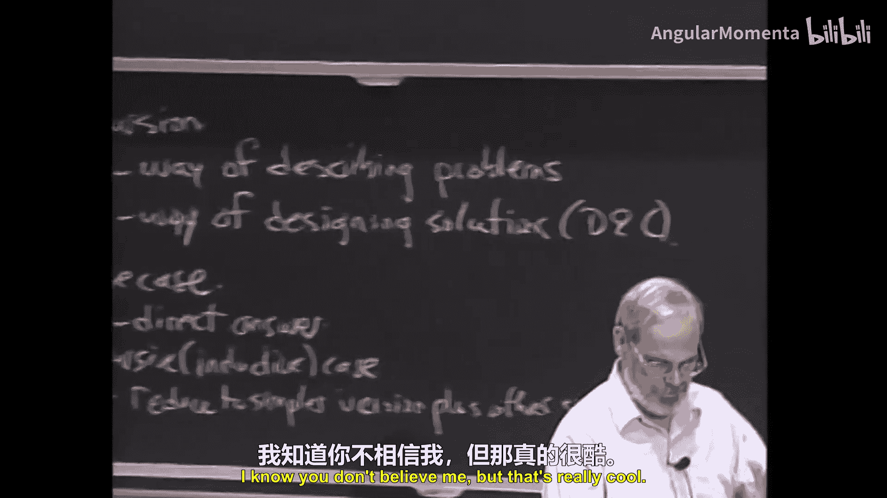

Why is it really cool， What do I have， I have a base case。Ands equal to 0。

 I know the answer right away。If an's bigger than 0， oh， let's assume。

That I got somebody who will give me the solution to that smaller problem。 When I get it。

 I can just use it do the multiplication， and I'm done。And so， in fact， here is。

A simple piece of implementation of that， which I know is not in your handle。

 but I'm just going show it to you。Because I simply want you to see the form of it。It's an exact。

Python translation of what I just said。Says if I want to take an exponent of B to the n。

 if n is equal to 0， just return  one。If not。Solve smaller version of the same problem， right there。

Same call or not same call call to the same procedure， same function， the different argument。

 And when I get that answer back， just multiply it by B and return that。This may look a little funky。

 right， This is the kind of thing that your high school geometry teacher would wrap your knuckles with。

 although they're not allowed to do that anymore， right。

 You don't define things in terms of themselves。This is not geometry， this is programming。

 and this is a perfectly legal recursive definition of a problem。

 It will stop because it will keep unwinding those recursive calls till it gets down to the base case。

And I'm going to show you an example of that， in a second。

I want to show you a much nicer example of recursion。 And again。

 part of my message here is when you get a problem， don't instantly start writing code。

 Think about how do I break this down recursively。 So I have brought some very high tech tools with me today。

😊，This is my version of the Tower of Hanoi problem。 How many people know the problem。

 the Tower of Hanoi。Only a few， okay， so here's the story。There's a temple in Hanoi。

Staffed by a bunch of monks。In that temple， there are three tall， jewel encrusted spikes。

 Min aren't nearly as fancy。And there are 64 golden disks， all of a different size。

Stack starts out on one of those spikes， and the monks move one disk at a time。

 Their goal is to move the entire stack of 64 from one spike。To another。And the rules are。

 they can move at one disk at a time， but they can never cover up a smaller disk with a larger disk。

Okay。I have to tell you， I don't know what happens when they move the entire stack。 I mean。

 the universe ends， or you all get A's and 600 or something equally as cool。The question is。

 could we write a piece of code to help up the monks to tell them how to move them。Right。

 so let's figure this out， and I'm going to show you in some examples。

I want to move a stack of size1。 Well， that's not very hard。Watch carefully。

 because you're gonna to write code and do this。 right， I want to move a stack of size 2。

 So I got to just make sure that I move the bottom one off。 That's not so hard。Now。

 I want to move a stack of size 3。 I got to be a little more careful because I can't cover up the smaller one with a larger one。

 but that doesn't look very hard。You got the solution right now。 We go for stack of size 4。

 This one definitely takes a little bit more care because you really can't cover it up。

 But as long as you do it right， you can actually move the oops and I didn't do it right。

 Youve got to move the pieces in the right way。 I do this for to taking money off of Harvard students in Harvard Square。

 by the way， right。G it。Really easy to see the solution。 right。

 You could write code for that right now。 I'm not going to do 5。

 but right it's really easy to see the solution。Yeah。😊，Okay。I blew it， Too。 I did one half move。

 I had to backtrack on。Let's think about this recursively。What's the recursive solution？

Break it down into a simpler problem。Or a problem with a smaller size。

Here's the solution to solve this。 I've got a stack。 I've got a stack I'm going to。

 I've got a spare stack。 What's the solution。 You take a stack of size n -1。

Move it onto the spare stack。Now I got a simple problem。 I can always move a stack of size 1。

And then I move a stack of size n-1。To the target。And， of course， how do I move a stack of size M -1。

 Well I just unwrap it one more。That's a really easy explanation， right。

And it's really easy to write code to do exactly that。So let me show it to you。And again。

 I know this isn't in your hand up， but I just want you to see it。And you could write this yourself。

I'm going to write a little procedure right here， called Hanoi。What are my arguments。

 I'm going to tell how big a stack there is。 That's M。 And I'm just going to give it labels。

 the from stack， the two stack and the spare stack。Look how simple the code is。

Says if it's a stack of size 1， just move it。 I'll just print out the instruction。

 move it from the from stack to the target stack or the two stack。If it's bigger than one。

 what do I knew。I move a stack of size n-1 onto the spare stack。I move a stack of size1。

 which is what's left onto the target stack。 And then I move that stack over here that's on the spare stack over to the target stack。

It's what I just showed you right there。开。So， let's try it。OhYes， I know I still like French。 Okay。

 we're gonna do Hanoi。 we have a stack of size 1。 And we'll just give this some labels just from to and spare。

Well， you just move it there。Alright， let's try a tack a stack of size 2。It's just what I did。

 I'm sure you remember that。That have to be a little more daring here。

There's the solution to move a stack of size 5。 I'll let you check it separately。

Make sure it's right。One of the things you can also see here。 I'm not going to talk about it。

 You might think about it， ask your T A in recitation is how long does it take to solve this problem。

 How long is it going to take those those monks to actually move a stack of I 64。

 I'll give you a hint。 The answer is measured in billions of years。This is an exponential problem。

 And you can kind of see that growth right away。That's a separate topic。 But notice。

Coming up with that solution on your own， maybe not so easy。 Think about it recursively。

 very easy to think about。 And that's the way we want to look at it。Okay。

Let me give you another example of breaking a problem down recursively and then writing the code to do it。

I want to decide if。A sentence。Is a palindrome。Remember what a palindrome is。

 It is not an ex governoror from Alaska。 It is a string of characters。 I guess an airport in Alaska。

 It's a string of characters that have the property that they read the same front to back。You know。

 the most famous one in English， which is， of course amusing because it's attributed to a Frenchman is Napoleon supposedly saying。

 Abel was I ere I saw Elba， Okay， same thing back to front。

How would I write a piece of code to decide if something is a palindrome。

I'm going to do it in a second。 You got it on the handout， but let's think about it for a second。

What would the base cases be or base case。Somebody help me out。 what's a good base case here。

What's the shortest possible sentence I could have。I。A。

 don't worry about whether there's a legal sense or not。 I I need a verb in there， right， B cases。

 presumably， if I've got a string  one character long， it's a palindro。

If I got a string 0 characters long， it's probably a palindrome as well， okay。

How would I take a longer string and break it down into a simpler version of the same problem to decide if something's a palinme。

Anybody want to help me out。Is that a hand up there， or you just scratching your head。OK。Well， yeah。

 maybe take a first the last element see if they're equal， if they are， then cut them off。Yeah。

 what's a palinro， The easy way to start is take the things at the end。 First and last character。

 if they're not the same， it doesn't matter what's happened in the middle。

 this thing can't be a palin。 So let's check those。And， oh， yeah。

 if those are the same character and I pull them off， what do I have。

 I have a smaller version of the same problem。 I have a new sentence that's now two characters less。

Do the same thing。 Some say， is that a palin。So if these characters match and that's a palinrome。

 I'm done， How do I tell if that's a palindrome， check if there two n characters match and the things in the middle。

OK。So。Look a little piece of code to make this happen。I'm going to do it in a couple of pieces。

Here's the first piece I'm going to write。 I'm going to walk you through it。Okay。

First thing I got to do， and I'm going to do this outside of the recursive call is I need to convert a string that's put in to make sure that。

 in fact， it's in a form I want。 So I don't care about the spaces。 Abel was I era I saw Elba。

 The spaces aren't in the same places。 That's the case。 really are the characters。

And I don't really care about capitalization。 So this little procedure basically says。

 given a string。Convert it all into lowercase。 And if you haven't seen that。

 I'm just importing from a module called string， built in procedures。

 And this one simply takes the string and makes it all lowercase。And then what do I do， Well。

 just like we did before， I'm just going to walk down that string。

Gathering together all of the characters。So this little loop just says。

 let's initialize ants to be an empty string。 And then for each character in S。

 if it is a lowercase character and that little test simply does that。

 it says if it's in this set of lowercase characters。I'm going to add it to the end。

And when I'm done， I'm just going to return adss。I'm going to return the answer。Right。

 little procedure。 And by the way， this is a nice piece of programming style as well。

 I want to separate out things that I want to do once from the things I'm gonna to call multiple times。

 So I don't need to。Re check every time that my string is all lowercase。

 I'm just going to convert it out。All right， now let's look at。How do we test this。Well。

 it's literally。Just a translation of what we said。 But let's look at the pieces。Says if I give you。

Just a string of characters。 I've gotten rid of the space as I made it all lowercase。

 What does it say to do， I've got to check for the base cases。 And here。

 I'm actually going to be careful。We could have discovered this if we program。

 There actually are two base cases here， which is， is the string of length 1。Or is it of length 0。

Why would I end up with two base cases， Why don't not I just check for a string of length 1。要。

Exactly， but have an odd and even number of characters。 So I on clipping them off the ends。

 I might end up with nothing in the middle， or I might have with one in the middle exactly。

 And we might have discovered if we tried programming about right， exactlyly right。

 So I can capture that by just saying if the length is less than or equal to one。

 which gets both of those。 in that case， we know。A pallorome returned true。Otherwise， what do we do。

 Well we do what the gentleman over here suggested。

 we take the first and the last character of the string。Gaying to remind you。

 S with an index of -1 goes backwards1， if you like， and gives me the last character。

 If those two characters are the same。I've now reduced it to a simpler version of the same problem。

 So I simply say， if that's true and。Everything else。Is a palindro return true。Now。

 if you've not seen this particular little funky form right here。That is taking string S。And saying。

 give me a copy of everything starting with the first。

Which means not the zeroth element and ending with everything up to。

 but not including the last element。You'll use this to make copies of other kinds of lists。

 But that's all that's doing is saying， give me what's in that string。

 throwing away the first and the last element。And that gives me exactly the recursive call I want。

 I'm now saying what， if the first and last character are the same and if what's left over is itself a palindrome。

 I'm golden。OK。😊，Now， let me just wrap all of that up in a little piece here。

I going to uncomment this。Okay， which is simply going to say。

 I'm going print out put a comment in it。 And I'm simply going to put the two pieces together。

 Given a string， I'm going convert it into all lowercase characters。 And then I'm going to check。

 is this thing a palindrome。So again， let's。And let's try some examples。

So we'll pick on Professor Gutag。His name is almost a palindrome。But not quite。

So we're going to give them a name change。helpsps if I can type。How good。哎。Good tag is not。

 but good tug， whatever that means in German is， because the G's， the U's and the T's all match up。

Oh， and let's see。 let's try a couple of other ones here。 And I actually type these in。

 We'll check to see if Napoleon really was right when he used his palindrome。

And if you can't read this last one， it says， are we not drawn onward， We few drawn onward to。

 and I can't read the tail end of that。To new era。Okay。And if we try both of those。没有。

What's my point， you're wondering。I solve this problem by simply breaking it down into simpler versions of the same problem。

 That's the tool that you want。If you were just trying to think about how do I keep track of my indices as I'm walking along。

 I'm gonna to come in from both ends。 So I got to add in some track。

 And I got to make sure I'm checking things。 You could write a nice iterative loop that would do it。

 Actually， I'll take back the word nice。 You could write an iterative loop that would do it。

 but it is not crisp。 It's not clean， and it's really easy to screw up。Or you could say。

 let's take advantage of recursion。 Let's just break it down into a simpler version of the same problem。

 you get a very nice， simple piece of code。Now， this may still feel a little mysterious。

 And I wouldn't blame you if it did。 So let's。Do the following。

I'm going to comment these out so that we're not constantly looking at them。

And I'm going to show you what happens if we actually look inside of this thing to see what's going on。

 So just give me a second here。 We're gonna comment all of those out。

And let's build a version of this。That just prints out as we go along。Okay， so I'm going to show you。

Right， here。Okay， it's the same。Basic pieces。 And actually。

 I realize I need to leave is characters around。 Let me go find my is characters' part。

Or two characters part。 Sorry， give me a second here。We're going to need that。

So we'll uncomment that region。 that's just doing the conversion for us。I think this is going work。

 Let's look at what we're doing here。This is exactly the same thing。

 but I'm just going to put some print statements in it， which as Ive。

 as I'm sure you've already heard from Professor Goodt is a good thing to do as well。

 I want you to see what happens。 So the only changes I'm making here are when I come into the thing that's doing the checking。

 I'm gonna to print out a little thing that says， what are you calling me with so you can see how it does the work。

And then。With it's a base case， I'm going to print out a statement that says I'm in the base case。

 And otherwise， I'm just going to print out something that says。

 here's what I'm about to return for the piece of the string I'm looking at。

So it's just instrumenting。 if you like what I'm gonna to do inside of here。

 And the other piece I'm going to do is I'm going to have a little space called indent。

So that every time I call a smaller version of the problem。

 I'm just going to indent over a little bit so you can see how it unwraps it。OK。And if we do this。

Just run that through。Let's try。Okay， so if I call。Here is palandrome。Print。It's a good talk。

It would really help if I could type， wouldn't it？Yes， it would really help if I could type。

 you're all being really polite， goingh he missed a character there， but we're not going to tell him。

Cause he's gonna have to figure it out for himself。Administrators cannot possibly do this。

Notice what it did。This is how you can see the recursive unwinding， right， It said。

 I'm going to check this thing out。It said way up there。 Actually， I'll just do it here。 It said。

 I want to call it initially with Go tech。Oh， the two Gs worked。 So that recursively。

 and noticed the push in here， said， I'm calling it again with U T T A。Oh， that one didn't work。

 So I didn't have to check any further， and I pushed it out。The other hand， if I do。This。哈。

You can see all of the stages。 You can see it unwinding it， right。

 It says that decide of good tug is。A palindrome。 Well， I check the ends， and I got to check U T T U。

 I don't know what that is。 Something interesting， which says， I got to check that。

And having decided that that， sorry which means I got to check。 oh。

 there's that base case of the empty 1。 I can now return true。

 And I'm gonna open this up so you can see it from the base case。 True for that。 True for that。

 True for that。Let's do one last one again， assuming I can type。I can't。Well， you get the idea。

 right。It's a little messy， but we go up a little bit。

 you can start seeing I'm obviously just going to run out of those pieces there。

 but notice what it's doing。It's retriing off each of those characters in turn。

 You can see how deep this goes in， which is why you got all those weird spaces there。

 as I keep going in。 But it starts off by saying I' want to look at that。 Oh， to look at that。

 I got to look at Bwa below the web， which says I got to look at Lele was all b。 You get the idea。

 But notice the key thing。 I'm simply reducing it to a simpler version of the same problem。

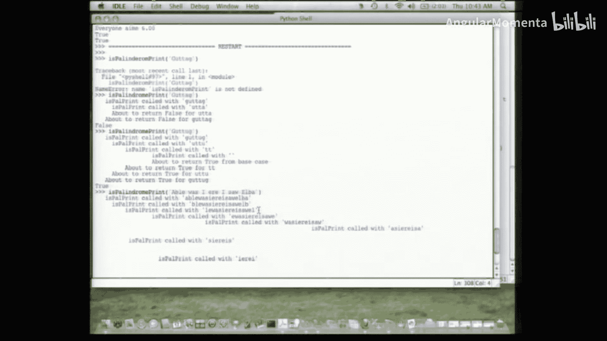

You can also see that to get the answer out， I got to stack up a whole bunch of things。

 All those indents are basically held operations。 which is one of the properties of a recursive procedure。

You have to hold on to intermediate things。 And that can cause in some languages。

 some efficiency issues。 But in terms of solving the problem， this is really easy。

 I've just broken it down into those simpler pieces。 And that's really nice。Okay。

So let me finish up with one last example of a recursive procedure。 Again。

 my goal here is to let you see， what am I doing。 I keep repeating this， but it's important。

Solve a problem。Figure out how to break it down into a simpler version of the same problem。

One of the classic examples of recursion is Pibonacci。Many people here know the Fibonacci numbers。

A few more。 good。 All right， for those of you who don't， here's the story。

Prob heard the phraseThey breed like rabbits。Alright。

 it's been used to describe a population that the speaker thinks is growing too quickly。

It works with rabbits， it works as if you put two pennies in a drawer。

 there's a whole bunch of ways in which this happens。Okay。

 the the history of this is actually very old。 It goes back to 1202。When a mathematician。

 an Italian mathematician named Leonardo of Pisa， also known as Fibonacci。

Developed a formula that he thought would help him quantify the notion of how rapidly do rabbits breed。

And here was his model。 His model is not great。 and we'll see that in a second， but here's his model。

You start with a newborn pair of rabbits，1 male， one female。You put them in a pen。

You assume that rabbits are able to mate at the age of one month。

And you further assume that they have a one month gestation period so they can produce offspring at the end of a month。

Finally， let's suppose that these mythical rabbits never die。

And that the female always produces one new pair that is a male and a female every month from its second month on。

And the question is， how many rabbits will or how many female rabbits will there be at the end of a year。

嗯。Okay， let's see if we can figure this out。Oh， I've got。O， a month 0。 when this starts off。

 there's one female rabbit。And one male rabbit。At the end of the first month。

There's still one female rabbit， but she's now pregnant。啊。So， there's still。

At the end of the second month。What do we have， Well， that initial female is still there。

 and she has produced one pair。 So there is a second female。The end of the third month。

That initial female。Has the game been pregnant and has produced。And these two are still there。

So there are three。 at the end of the fourth month。Both of these females。Have now produced offspring。

And those three females are now pregnant。There are five。AtThe end of the fifth month。

Those three females have produced offspring。 Those five are now pregnant。There 8。

And at the end of the six month。There are 13。What did I just describe。I just described a nice。

 recursive relationship。Okay。That says， gee， there ought to be a base case。And there ought to be。

A recursive case。 And， in fact， in this case。We can describe this very nicely。

The number of females at month end is。The number of females there were two months earlier because they've all given birth。

 So that's that many new females。Plus。The number of females there were at the previous month who are now all in help。

That's a recursive relationship。 If I wanted to figure out how many females there are at month end。

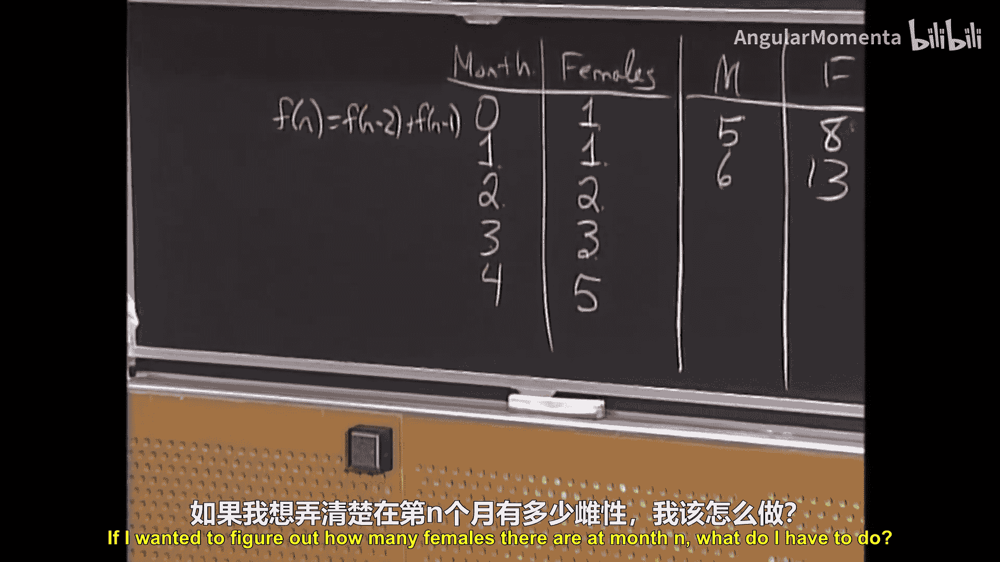

What do I have to do， Well， I just have to say， what's the base case。

 because there's the recursive case。 and the base case is。A month。 Yeah， so let me do it this way。

 If n is equal。To zero or1。It's one。And as a consequence， I should be able to figure out。

How quickly do rabbits breed， at least according to。12th century Italian mathematicians。Okay。

A coupleup of things to notice here， by the way。Sort of similar to what I saw in the Towers of Hanoi problem。

 I'm going to have multiple recursive calls。Right， to solve this problem of size n over here。

 I've got to solve two smaller problems and then do the simple operation of adding together。

 That's okay。It's going to change the complexity of my algorithm。

 but it's perfectly fine to have multiple recursive calls。And as I saw， in my case of the palindrome。

 I may have more than one base case。 That's also O。 as long as I can ground this out。Alright。

 so let's just look at it。 How would we write this， Let me get rid of that。Comment that out。Well。

 we can write a little procedure。To compute Fibonacci。Okay。And there's the procedure。

 which in your handout。 I've got some things up at the top here that are just making sure that I got the right kinds of arguments to pass in。

 which is a clean or crisp way of doing it。 But what do I say， I see say if either x is0 or x is1。

 two base cases， just return the answer， which is one。Otherwise， solve 2 right there。

Smaller sub problemsm。And what's the simple operation。

 just add the two things together and return it up。Okay， and if I do this。

 we can check to see if we actually compute Fibonacci properly。All right， let's do a test Fb。Of 0。嗯。

Says Fi  zero is one。Let's do a test。Fib of one， there's my other base case。A says there they go。

And now， let's do。Something a little larger。And there it is， as it gets each computation is doing it。

 It says to get Fb of 0， or sorry， Fib of 3， I've got to solve fib of 0， Fb of 1 and Fb of 2。

 And there's the answer。 And just to make sure we're really doing this well。

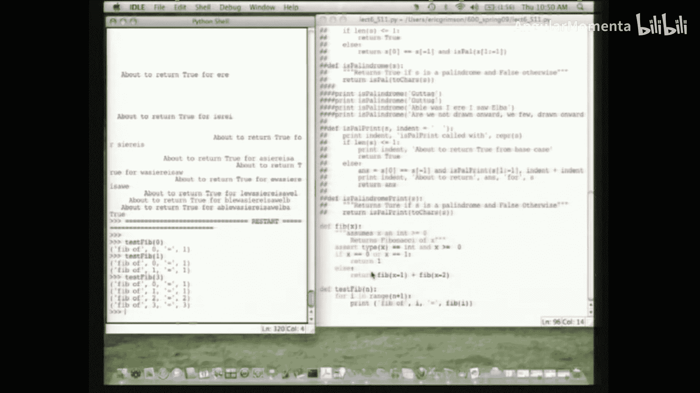

Just reproduce my table over there。Do I expect you to get all that code right away， No。

 although it's pretty easy to understand， what I do expect you to see， though， is notice what I did。

 I took a recursive problem。I broke it down into simpler pieces。

And then I used the solutions of those pieces。To give me the solution to the larger problem。

By the way。Leonardo， Pisa had it wrong。嗯。In 1859， as I'm sure， many of you know。

 a wonderful Australian or sorry， Yes， Australian farmer named Thomas Austin。

He imported 24 rabbits from England to use his targets for hunting。10 years later。

 there were 2 million rabbits being shot and trapped in Australia。And Fb， while it grows fast。

 doesn't go quite that fast。 So Leonardo A Pia had it wrong。 Of course， as you probably also know。

 Australia。 and I think New Zealand have the wonderful property of having more sheep than people。

I don't know what that says other than it's a great recursive problem。Bibbonacci， by the way。

 actually shows up in other places。 again may not be a perfect model of rabbit populations。

 but it has some other really interesting properties。One of them is。

 if you let n get close to infinity and you look at the ratio of fib of n over fib of n -1。

ItSounds like a strange thing to look at。 It basically tells you how quickly does Fb grow。

 Any anybody know the answer to this？Golden racial。One plus root。I' plus root 5 over2。Which Leonardo。

 the other Leonardo， the really good Leonardo， by the way， used to design buildings with。

 So there's a very strange connection。 The other one thing thing I like about this is that Fibonachi shows up actually a lot in nature。

 So， for example。Did you know that the number of petals on most flowers is a Fibonacci number。

For example， Black eyeed Susans。13 petals。Daisies field daisies，34 petedals。You might ask why？Oh。

 sorry， I'm out of town。 I'm out of time。 I won't answer it today。

But you can ask Professor Goodtag next time around why it is that petals come in Fibonacci numbers。

What's the message of this lecture。Recursion。Divide and conquer。

 break a problem down into simpler versions of the same problem。 Life is really easy。

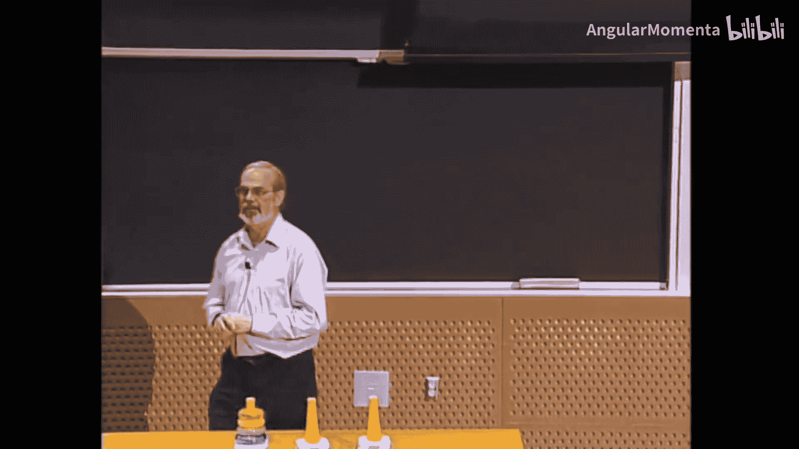

And you'll see Professor Goodtag next time。

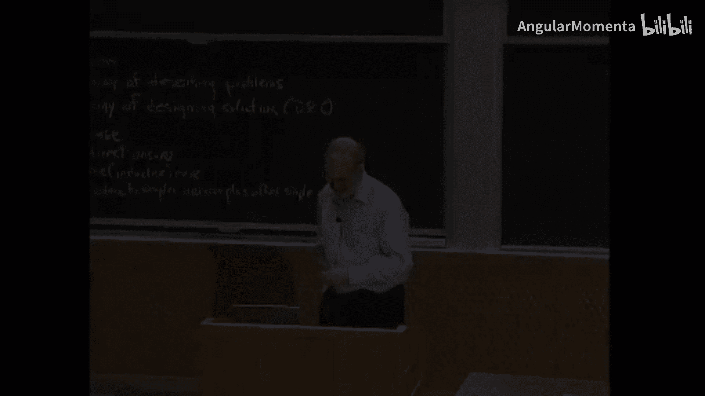