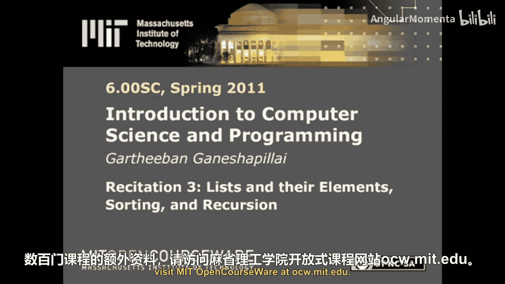
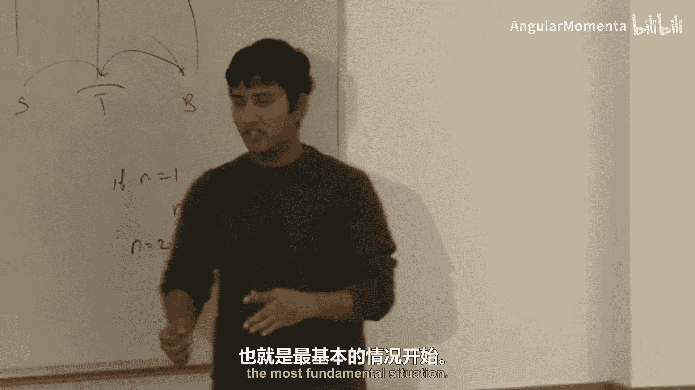
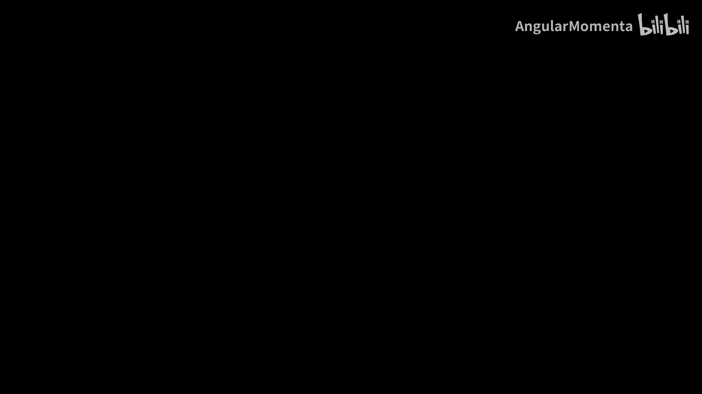

# 【麻省理工】计算机科学与编程导论 ｜ MIT 6.00SC Introduction to Computer Science and Programming p09 09 -BV1a5BZBkEP6_p9-

The following content is provided under a creative Commons license。

 Your support will help M I T Open Coseware continue to offer high quality educational resources for free。

To make a donation or view additional materials from hundreds of M T courses。

 visit M I T OpenCourseware at O C W。t M I T Eduu。

So， let's start。I mean， for the first question， you can answer what is tuple。

 You can go through that later。 Can a tuple contain a list。割り得て。Can a tuple container list。Yes。

 it can。So we will go through the examples later and lets see this first example。We have two tuers。

 the tuple B contains2 Palay as well as a list。Okay， so it can publish， let's say。Let's pin the to。

Okay， so for the first example。We try to access the elements0 and 2 of the twopo。And later。

 we use  -1 to access which element。Okay。And 0 is the first element， of course。 And remember。

 now we are using like 0，1。 It's like we are accessing the。It's， it's now， okay， what is Tple B。

It's a two dimensional。To put。Yeah， exactly， it has a list and a twople insight。

So the first element has a。 first element is a twoer， and the last element is a list。

 So now it's sort of like two dimension。😊，But if you look at the second sorry。

 our first element of it， the MIT word is that doesn't have any dimension。Does it？It's string。

 so you can again access， but not this way， but still you can access。

And we have the we are using this notation to access a portion of the list。

 a part of the part of the two per actually here。It's called slicing。So here。

0 to1 gives you which element。Just one element， right， It's a first element。0 to2 gives you1 and 2。

Okay。This is the interesting usage of。They're slicing。This is used to access the whole tuer。

Now you might wonder why we need that we could just the handouts are here。

So why we need to like copy or why we why we need to access the list through the call an operator like this。

We， well look at the later。 It's， it's very essential when we， when we have lists。

For the time being it's okay when tus are like immutable soil it doesn't have like a special usage。

 but later on we will be using it。Then if you look at this part， this is the most interesting part。

How do you iterate through a toer。You use a follow up， and you call like item in toper。

 the element in toper。The element is initialized with every element。

When it goes through the iteration at every iteration。

 it will be instantiateated with the the corresponding element in the tuer。

But you're using the same name anyway。 It's item。This is equal into exersing the tuple like this。

Going one by one in the range and accessing the corresponding element in the twoer。

 So this is a simpler way to access that。Do you have any questions in that part？Okay啊。dont。Okay。

 that's correct。 So the thing is okay。Suppose two has three elements。 So， for example， in this case。

 two pal A， how many elements are in the two pal A，3 elements。 So what would be the length of two A。

3， but what would be the range 0，1，2， right， so you have to type0 to 3。So that's why I put B。

That is3。Like the in a suit。First is zero， if you don't specify zero。Okay。

 now lets go through the list。So if you go through the questions。

What is the difference between a list and a twoer。What is the difference between a list and a toper。

Anyone。哦。Okay， lists are mutable and because it's mutable。

 it tells like special functions to like access the elements。

 add elements and like modify the list itself。How would you add an element to a list。

Suppose you have list。诶。How would you add three to this list。Okay， lets roll up hand。Okay。

That's correct。Okay。How would you remove the element？

From the like top of the list or the last element。 How would you remove this three from the list。

This one。Let's see。You know how to check the。Specation of a function， right？Sorry。😔。

So it's not the right function， right， because it says it removes the first occurrence of a particular value you passing to that function。

Okay， there's another function just called。List。Dot pop。That removes the last inserted value。

 So it pops from the top。Okay。So remove can be used to remove a particular element。 So here。

 suppose we want to remove one。So， we could say。Let's still remove why。Okay， so in this example。

 actually I have comment out this line。😊，This would be an error if I execute， why。Why is like Q&A？

It is an x。😡，So the problem here is we can't access an element in the list unless we explicitly assign something or create something。

But。Suppose we want to pass a list of 10 elements to a program so that it can assign values on the fly。

 and it can modify。Okay， so how would you pass an empty list of 10 elements。Okay， the problem is。

 if you are passing something like this， you need to know。

How this list should be like instantiateated。So you should know what are the initial values of these elements。

Okay， suppose you want to create a list of 10 zeros。Then the easiest way to create the list is。

So it will create a list with 10 elements。But if you don't want to waste memory or if you don't want to like keep anything particular。

 you could do something like this。Now， this will create a list of empty list。

And they always tend such empty less。And you could pass this list to a program so that you will assign the elements。

Okay， you can iterate through the list the same way。But lists are interesting why they are mutable。

So they can be actually used to create interesting mathematical objects， for example， like matrix。

So how would you create a matrix using this。Any ideas， how would you create say2 by  two matrix？

If you consider this example。This creates a matrix。4 by2。

 so there will be like four rows and two columns。But how can you go and access the。

Inner element or inner matrix。So if you suppose you want to access2，3， that is the third row。

Then how would you access？How to。call them。Entry。And three gives you two or three。

Suppose you won't access the three in the two，3。Then。そ。Yeah and three give you two dreams as before。

 sorry。外边。Okay， this is like computer sciencestone Mes。You got it right。

 why it's on trades too because。Okay， that's fine。 So like I'm asking now， like。

 how would you access the three。In the 2，3。Box。Not the Beck。Okay。That is more。

So you can like you can access matrices like this。Great， great。Wech。

So this actually gives you a summary of functions， mean essentialial functions。For example， the pop。

 I explained earlier。Remove， removes a particular element。Extant， that's interesting。

Can you tell me what it does here？The method extent， unless。What does that matter take？

He takes another list。So which means it's going to merge。

The list you are passing with the list you are calling the method on。 That is L A。

So it's going to come the。Let's see。So this corresponds to this。So two is circumed。

So these methods actually useful， right， because you don't have to write yourself most of the things you can easily do。

Now， the question is， why Ter didn't have。These methods。喂hy。

Why why we didn't have these methods for twoers。They are immutable， so you can't extend。

 you can't happen。 So when you extend what will happen， it's going to create a new tuer。Actually。

 you can do that。 but like this， for example， you have two per。哎。Which is1 comma2。

 and suppose you have twople B。3 comma  four。 if you want to combine them， how would you do？

Tupple A plus2ple B。That conates this operator is overloaded for twoers。

So lists are mutable so you can do all of these things。Let's look at few other examples， too。Okay。

Okay， there's an interesting part here。Ls are mutable that that we understand。But how。

How these lists are actually stored in the memory。For example， suppose you have a list。LlastT。Sorry。

0，1 apple。How do you think it's stored in the memory。So you have three elements。

But these elements are actually not stored in the list itself。They're actually in the memory。0。

1 apple。But you have the pointers to those lists。To， sorry， to those elements。So actually。

 you can modify these values。Without changing， changing the list itself。

Because the list actually points to this part， the container。So， in this example。

You have list A and B。But the list B actually contains list A。Okay。Since list stay is immutable。

 you can go and change it。So here first you print list list A and B。

 but you are going to change list a0 elementement。After changing the element， the lister becomes。

P with its first element changed to 88。Okay。Fine。What do you think the list B would be？Okay。

 that's righted。It contains the88， right， the modified value。Why？Because。

List B actually had a pointer to list A。Which， again， had pointers to other elements。

And we modified this value to 88。So you are still accessing Li B。The pointers are not changed。

That we can see here in the second example， the problem of aliasing。So， we are list X。

And we call it by list y as well， and we are now changing the list Y。Sorry。

 we are changing the list X。But it's going to affect list X， as well as list Y。Sa。

Because it's just a reference。The actual object is this。You can call it by two different names。

 it doesn't matter， but the actual object is here。That's where we need this operator。

So if you just point， okay， for example， we had list X。If you just assign list Y to list stacks。

 it's not going to copy the elements。 Just going to copy the reference。Which means。List X and list Y。

 both will be pointing to the same。Object。If you want to copy these elements and put in a new one。

Say， list Z。Then we need to copy one by one every element。For that， we can use。This operator。

It's called full slicing。It's not。 It's not going to modify elements。 It's going to copy the whole。

List of elements。the same line。This's another small example。That tells you how to cost。

A list into tuple and a tuple into list。So you had a tuple，1，4， apple， zigga， and you cast into list。

 Now， the type is list。It's very simple operation。 Can you do that yourself？How would you do it。

 Like if you want to write a function to cost， how would you do that。

You go through element by element and add to a twoer。And concate two twoers。Right。

So I guess you can write probably as a homework， try that。

Like try how to convert a list to a twoer without like explicitly calling the casting function。Okay。

Similarly， you can convert a tuple back into list。So it' is pretty straightforward and suppose you are getting input from the user as a tuer。

 then suppose you want to make it as list。 You don't have to write your function。 You can just call。

This casting operator， right？So it'll be like。It will save some time。Okay， great。

Let's go to the dictionaries now， So we。So we have the third data type dictionaries。

Or you didn't get the second one。So we have another data type dictionary array。

And why do we need dictionaries in the first place？Do we need another data type？

Can't we like just get away with two pull lists？Yes， because you can actually make a list。

 sorry make a dictionary out of list。And Ray Grson and Professor Grson went through that in the lecture。

If you want， you can come and ask in the office of us。 but first try whether you can do that Joseph。

But the problem is。Actually， not just the dictionaries。

 but other high level data structures are actually available in Python as like built in data structures or as classes。

Just because like they will have these methods on these data structuress implemented。

 So it would save some time for us。Plus， those methods are guaranteed to be like state of art for example。

 if you want to go through all the layerss。Then the search function or the lookup function that you write。

May， may not be like that efficient， right， but they might use those efficient algorithms in the standard implementation。

 So it's why you should always like look for the standard data types。 If you can't。

 you can like write yourself1， but it's good to use the available data types so that like they will have these efficient methods implemented。

Okay。So in this list， sorry dictionary。We have like two elements。 One is key， One is value。Okay。

So these keys actually have a special property。 What is there。The keys should be。An immutable object。

You can。 So you can actually have a twop as a key。 You can have a string as a key。

 but not a list as a key。So you need an immutable object for the case。What about the values？😊。

They can be anything。Vals can be even a dictionary。It can be a list。But。The keys must be mututable。

Do these keys need to be like unique？Yes。No。Okay。The problem is this。Dictionaries have the same type。

 I mean same structure。This is a key。And this key points to a place in the memory。

Suppose you call it K。Okay。If you assign another value to key， A。

That will actually replace the content in the memory， right？😊。

So that's why keys are going to be unique。 It's by construction。

by the construction of the dictionary， the keys are going to be unique。Because you have to。

 if you want to assign something different， you have to call it by a different key。

 called by a different name。CKB。What about the values？😊，Do they need to be unique？Now。Of course。

 otherwise no use of key and no use of dictionaries， right？

What is the order of the items stored in the dictionary？Can you give a guarantee？Like in less。

 in less， items are stored from 0 to the length， right， length -1， actually。What about dictionaries？

Surely you can't guarantee the order， but you can modify the order。Okay， so thing is first。

 if you look at this example。First， we had the stuff。dictionary。And。When I print the length。

 it gives me three fine。 Then I'm， I'm like doing fair things。 first， I。呃。I changed that dress。

By calling its key。And dictionaries mututable so you can change the values。

Then also we are adding a new element。Fine。If you wanted a new element。

 you call it by the key that you want assign。 If the key already exists。

 it will just modify the value。Otherwise， it will create a new key and add the value。

You can also check whether this particular element is in the dictionary。But this must be the key。

 whatever you are calling here should be the key， not the value。 It won't search for the value。

 will will search only for the key presence of a particular key because you access the values through keys。

Again， here if it is not in the list。Actually， I' am adding an element。Okay。In， okay。

 to compare in the list。Suppose I have a list。0， comma 1， comma 2。

If I want to check whether one is in the list， how would I check？

Do you have to go through element by element？No， there's a shortcut。If one。And。Less， right。

If I want to check whether one is not in the list， if I want to negate this。I would write if one not。

In less。We just ignore the verbs。 It's pretty much like English。Okay， we just remove the verbs。Okay。

The diction are？We do the same thing through keys。If。키에。And okay， I'll call it， say D1。And you。

Actually， call or use search for the keys， not the。Okay。That's an interesting part here。

If you want to modify the order， actually I told you the order C earlier。

 we couldn't guarantee the order， right。😊，It was not the order we typed。

Because it starts with hammian。Because we add it at the end actually， right， actually。

 you can't guarantee the order。But， we can sort it。But how do we sort it。We call the keys。

And we sold the keys。Because， remember。Every values。If you want to access the particular value。

 you access it through key。Actuallyly， if you call the dictionary。

 it doesn't know where these values are。 just to go to the key to access the value。

So if you want to do something on the dictionary itself。You can do that only on keys。

So if you want to sort the dictionary， you sorted by keys。So you call the keys function。Sorry。

 it's method for the dictionary。So it returns the list of methods， list of sorry keys。

 And you solve them。This is called chaining methods。 So I have chain the methods。

I would read like two methods， right， I call keys。 This first part actually returns you on these tough keys。

Then， you saw them。Yes。It個 veryな。Oh on this， sorry。Let's see。Cos。Okay， let's see。Okay。Ts。

Now they' solded。O。What was the problem？What was the problem there。Why it wasted。2 one。水。

Call it the keys， and then sort。嗯。Okay， the problem is in the logic。

You actually are when you call this function method。

 you are actually sorting the keys returned by this method。

 you are not actually going to sort the dictionary itself。

You are sorting only the list that was returned。Right。The list of keys。

Although the dictionary is mutable， it was inserted。Do you say the爸爸。So， that's why when I called。

Keys， equal could stuff not keys。 I'm getting a list of keys。

Then Im sorting the that list and Im printing that list。But if you want to go through。

 if you want to like go in a particular order or if you want to access the dictionary in a particular order。

 what could you do is you could do something like。Keys is equal to star dot keys。

Then you can start keys。Then， for。K， in case， you can go an it read now， right。

So you can save plain K and。Suff K。Okay。So you can do this。But actually。

 the Python provides a way through iter rate， both keys and value pairs。😊，That you do。

By calling both。Both elements。Over the methodered items， the items return a list of。Key value pay us。

If you're called。D1 dot items。You get a list of key value of pairs。You see that？And we are going to。

Itererate through individual elements。 So first， we start with a second this。Okay。

 so there's a simpler way to access。Every element in the dictionary。Great。Okay。

Now we are the interesting part， recurion。Okay， what's the principle behind recursion。Anyone。

What's the idea of recursion？Yes。カで。Yes。哦。The idea of recursion is， if you have a problem。

Try to express the problem。In a simpler version of the same problem。

 So if you want to find say factorial n， try to express it in terms of factorial n -1。

 So you could keep there keep on doing this till you come to say factorial1。

 for which you know the explicit answer。So you try to express the problem in its simpler form。

It will be useful like in many cases， actually。In your next piece， that you will have the problem。

But。Be mindful。What's what like makes it possible for you to use the recursion。

Only if you can express in terms of the simpler version， otherwise， you can't。

This is probably quite like the induction you might have studied， mathematical induction。

 I don't know whether you study in high school， but it's quite right。Okay。

So there are two parts in recurion。The first one is the base case。So， for。A factorial problem。

We can express the factor， say。Enth factoria。As n into n minus-1 factor。Okay。

So this will be our recursive case。So what is our recurringcursive case？

Suppose we want to define a function。Factia n， okay， so what will be our recursive case。

I'm asking the recursive function， what be that？Ending two。Factorial in my sword， right？

And you just returned this。What be our base case？If n is equal to 0， we know factor of 0 is  one。

 right。Whathy is factor of。1。喂。Okay。But why in this program， we didn't have that particular line。

Why we didnt have n equals 1， Why we didnt have that。It will always go to 0， right。

 because you can express one in terms of0 as well， right。

So you don't need to actually write this explicitly， why？

Because your recursive function only depends on its previous value。

So you need only one value in advance， which means you need only one value for your base case。But。

So you I mean， you can understand this program， right。I'm not going to go through that。

 but anyway like when you write a program， always check its base case So you have to start with factor zero for this case。

😊，And check one by one， then you would know whether the program is running correctly or not。

So always start with a simpler case。But remember in Fibonacci serious。Okay， for Fibrinal。

 can you give me the can you give me the recursive function。Yes， why this Fibonacchi series？Okay。

 yeah， that's go。So， Ill return。Say F of n-1 plus f of n -2。 What is the Fibonacci series。

 you start from 0 add you add these elements。 So one you add last two elements2。

 you add last two elements 3， you had last two elements， right。Okay。So you add last two elements。

 So for if you want to find F of n， you return f of n -1 and a plus f of n -2。But here。

 since you have。Like two elements， or you need to access two previous elements。

You need to define your base case accordingly。So for your base case。F of 0。Yess what。Actuallyly。

 that depends on whether you start here or here。You could do this。I will go through an interesting。

Requisive example。Okay， it's called recursive exponation。 so actually。

You can do an exponciation through recursive multiplication。Suppose you want to find。3 to the power。

 say 10。Then how would you do that。You start by。Like expressing it in terms of its simpler version。

 right， So it will be 3 into10 to the power 9， sorry，3，29。Okay。So if you want to find the。

Andth power of number M。You would say。A mean too。M to the power n -1。

So now you have your acursive case。What is the base case？Yes， if n is equal to 0。In Python。

 you would test this by。Okay。Two equalss。If n is equal0， then what？Return one。Okay。

Why we have only one base case here？十。Yes， and because you're accessing only one previous area。

 unlike Fibrilan in this。Similarly， if you want to multiply something， Okay， here。

 what we did is like。We replace this operator by recursively using this operator。Okay。

Can you do the multiplication by recursive addition？So can you do。

 can you replace this operator by this operator。Yes。So how would you do this， for example。

 say three into2。Fight。So how would you do it here？特别。What be this。3 plus。这一单。Here。Come on。Okay。

 it's simple， right？I mean， start here。Okay。What's the best case。That is interesting。

What is the best case？If n is equal to 0。Okay。If n is equal to 0， there is I mean， that is 0。

 but that's fine， but theres another problem。The problem is。

You don't know whether these values are positive or negative。

So you can't just keep on adding like this。This will work if it's positive。But if it's negative。

 actually you have to check， which is sort of tricky。

 It's just if you want to use the same recursive function。 Otherwise。

 you could have like had a if condition here。If say n is less than greater than0， do this。Okay。

 else safe。You multiply n by -1。 you negate that。 So it it be。

 it becomes positive and do it the same way。 And then like。reverse answer， right。

 so you could do that。😊，But。If you want to do it in the same recursive case。

 then you have to follow this。 If you have any questions， come to the office of。 on that。

The final question is final example is the Han example。Okay。That's very interesting。

So here we have three towers。Source。Target。And buffer。Suppose you have like three disks。

You want to move them from source to target。And you can always have a smaller disc on top of a bigger disc。

Then how would you move， Okay， So can you express this。Problem and its simpler version。

 So now you have three disk。 You want to move them to target。

So can you express it in a simpler version。Come on。Just in plain English， how would you do that？

We start looking at the program。Because Python is very ver， so if you read the program。

You get it in English。So。Any ideas。Okay。We have to anyway move the last thistri target， right。

 but that's the hardest part。So before doing that， you have to like move this somewhere else。

 so let's move it to buffer。对。How would you move this？Now you can move it to target。Okay。Now我 you。

Okay， sorry。Okay。Now， what would you do？You can only move this。To the buffer， right？Not the target。

Okay。So we made some mistake earlier。两咧。The problem is， because。We didn't think recursively。Okay。

Let's think recursively。Sauce， target b。Sorry。Suppose we have only one disk。

Then you can simply move a target。Okay， so our condition is if there is only one disk。

 just move it to the target。So if n is equal to 1。We always move from。Move source。To target。Okay。

Suppose you have two。Then what would you do。You move the top one to buffer。Okay。So move。

Souce to buffer。Then you move the next disc from source a target。So now it's source to。Target。

And finally， you move it from the buffer。Right。Now we have a very nice recursive case。F 2。

We move from source to buffer。Then so to target， then from Waalta。So if you look at this example。

I'm checking if n is equal to 1。F is one， just I'm moving the from source to target。

If it is greater than n， what would I do？ And the first assert statement is just there to make n is greater than 0。

 Otherwise like it's meaningless， right， you， you need to have this。

 You can't have like negative disk， okay， so。😊，What would be the next step？If you don't have。

 if you have more than one disk， suppose you have two this， then what what would you do。

You move the top disc or whatever on the top to the buffer。For this simple example。

 it was just one disk。But suppose you had more disk on on top of the last disc。

 So you would have moved all of them to buffer。 You don't have to worry how you move it。

 but you had to move it anyway。After moving that， you can leisure surelyly move this big disk the top to the target cell。

Okay， finally， you you bring back all of them here， right。For your first operation。

For your first operation from source to target， you have to move all of them， right， the bulk。

You could have used targett as your buffer。Okay， so that's why。In the。In this line。

I'm using source as source。But the second argument， which should have been the target。

 is now buffer because my current target is buffer for the top n -1 disk。

But my mob buffer is now the target。Okay， because I can use the target as buffer for that movement。

Then I moved from social targetet， the last big disk。Okay， for that， I can use buffer as my buffer。

Okay。Then finally， I bring back from buffer to target using source as my buffer。Okay。So， thing is。

If you want to handle a recursive problem， you can do it in two ways。

One thing you can start like start thinking like how to express this problem in its simpler version。

 like how we thought about the Fibonac series， for instance。Or S， you can start from its base case。

 the most fundamental situation。 So here's n equal to one， but this doesn't give you enough context。

 So you go to the next level and is equal to 2， and you have the answer。

Right。

