# 【麻省理工】计算机科学与编程导论 ｜ MIT 6.00SC Introduction to Computer Science and Programming p10 10 -BV1a5BZBkEP6_p10-

The following content is provided under a creative Commons license。

 Your support will help M I T Open Coseware continue to offer high quality educational resources for free。

To make a donation or view additional materials from hundreds of MI T courses。

 visit M T OpenCourseware at O C W dot M I Tt E Du。Okay。

 I want to remind you that there's a quiz one week from today。嗯。Yeah， I know it's soon。Open book。

Open notes。No no computing or communication devices allowed。嗯。Between now and then。

 probably tomorrow， in fact。Or at least over the weekend， I'll send out a summary。

Of what I think we've covered so far and what you'll be responsible for in the quiz。Roughly speaking。

It's anything covered in lectures， problem sets or recitations。

I will also post some practice questions that you can work on。And。

 I'll tell you now that we will not be posting answers to the practice questions。Instead。

 we'll be holding some quiz reviews。Okay。Couple of I wanted to cover two different topics today。

 The first topic is just a tiny bit on floating point numbers。In Python， but in fact。

 what I'm going to tell you is true about all programming languages。In fact， all the computers。

 really。 And then after that， we'll spend most of the lecture on the topic of debugging。

So let me start with a quick review of binary numbers。

Because you have to understand binary numbers to understand floating point。

So when you first learned about numbers， you learned about base 10。

And you learn that a decimal number is represented by some combination of the digits 0 through 9。

The right most place is the 10 to the zero place。 And then it's the 10 to the one place。

 the 1 to the two place， etc。So， for example， the number 302 or the digits 3，0。

2 represent  three times 100 plus 0 times 10 plus。Two times one。Alright。

 binary numbers are exactly the same。Except we only have two digits to choose from。

Typically written as 0 and 1。And everything is represented by a sequence of those digits。

The right most place is 2 to the 0。The next place is two to the one， two to the two，2 to the three。

2 to the four， etca。So， for example， if we look at the binary number 1，0，1。We see。 that's equal to。

One times 4。Plus0 times 2。Plus one times1 or5。So one of the first things we'll notice is binary numbers take a lot more digits to represent them or take more digits than decimal numbers。

In fact， if I give you n digits。And binary digits。How many different binary numbers can I represent with those n digits。

Where， if I gave you in decimal digits， how many different numbers can I represent。

 How many different values can I represent。玩儿。10 to the end， and so for a binary number。

 it's going to be。就是脸。That's important because we'll see as we get to talking about the complexity of various algorithms。

 how long they take to run or how much space they use。

 we'll frequently be resorting to arguments of this sort to understand them。Now。

 the reason floating point numbers cause problems for programmers。Is that people。

Have learned to think in base 10。Computers do everything in base 2。

And that causes a cognitive dis dissonance sometimes where people are thinking one thing and the computer is doing something slightly different。

So why do people work in B 10。I don't know。 Maybe it's because we have 10 fingers。

But we also have 10 toes。 So why didn't we work in base 20。You know， we have one head。

 I don't know why， but we do it。 We work in base 10。I do know why computers work in B 2。

And that's because it's easy to build switches in electronic hardware。

A switch is some physical device that has only two possible positions on or off。

We can build very efficient switches in hardware。 And so it's easy to represent a number。

As a sequence of on and off bits， which is either on or off。Originally， they were reallays。

 Then they became transistors。 Now， there's something altogether different。

 But all what they all had in common was they were stable in the off position。

 They were stable in the on position， and they never had to get in between。Hence。

 we represent everything in computers in binary。So now let's think about why that causes some confusion。

And it does only for fractional numbers。So， for whole numbers。Binary and decimal， It doesn't matter。

Ints are never confusing。 They sort of do what。You know。

 God told us integers should do or whoever told us integers。All right。

 But now let's look at other things。So when I want to start。By looking at the decimal number。0。125。

What sat is a fraction， by the way？Happens to be one， what。8 okay。

 we'll see why that actually matters in a minute。So what is it。Mean， in some sense， in decimal。

It's equal to。One times。10 to the -1。Plus2 times 10 to the -2。Plus，5。Times 10 to the -3。

So it works exactly the same way that things work on the other side of， in this case。

 the decimal point。Suppose we want to represent it in binary。So instead of a decimal point。

 we have a binary point。What does it look like then？Well， it's equal to。What。1。Times if it's one/8。

 what's it going to be， one times what？10 to the minus three。😡，Or 0。001。Right。So so far， so good。

Not much difference between the two。Now， let's take a different decimal number。

What about the decimal。0。1。I have to tell you that it's a decimal， because。

Could also be a binary with just euros and ones。Well。We know how to represent that in decimal。

How about in binary？What's the equivalent， You know， that's one10th， of course。

What does one10th look like in binary。

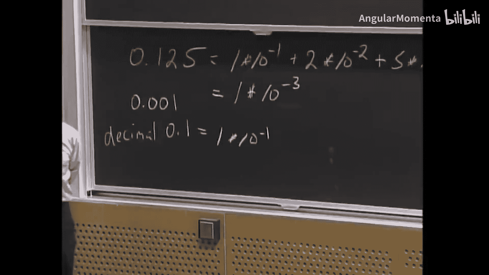

Any takers？Well， I'll give you a hint， it's so long that I don't want to write it on the board。

In fact。It's worse than long。It's infinite。I guess that's kind of long。It's this。Repeating。

Binary fraction。There is no finite combination。

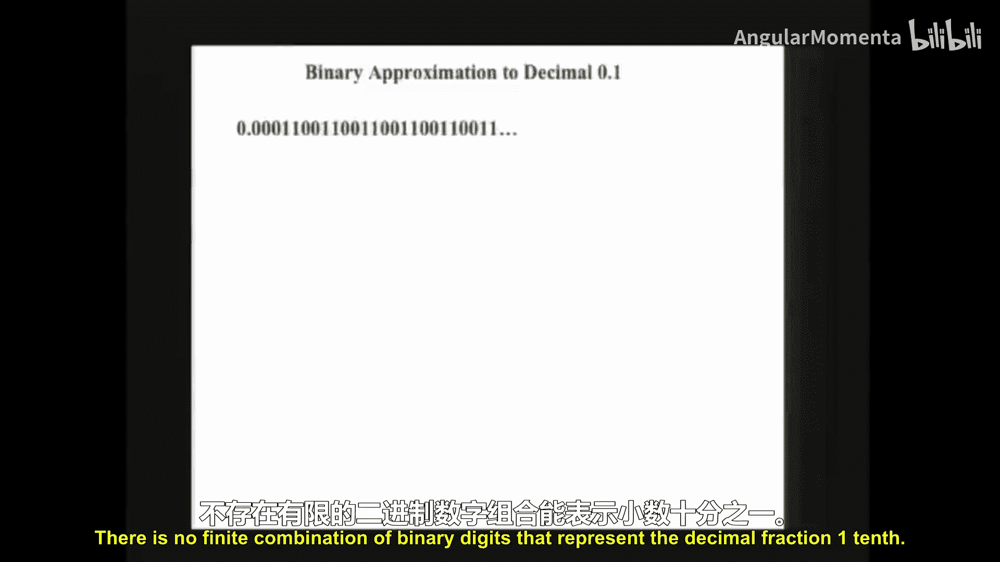

Of binary digits that represent the decimal fraction 110th。There's no way to do it。

And that's why things get a little hairy。

So we can stop at some finite number of bits。And in fact。

 that's what happens in the internal representation in Python。It ends up representing one10th as。

Something equivalent to this decimal fraction。If I take the number of。

Binary dis that are inside the computer。And then I translated back to decimal。

It turns out that it's using this approximation。For the decimal fraction 110th。So， for example。

 some of you in your problem set where you were computing。How much you had to pay on a credit card。

Would get answers that were eventually off by a penny or something from what we expected in some。

 And that has to do with the fact that。

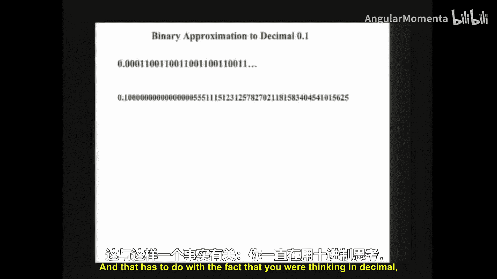

You were thinking in decimal。 And， in fact， you were writing your program in decimal。Yet internally。

 things were happening in binary， and when you thought you were writing one/10th， for example。

 you were actually getting something like this inside the computer。Pretty close to one10th。

But not exactly one10th。Now。When we print it， we get yet something else。

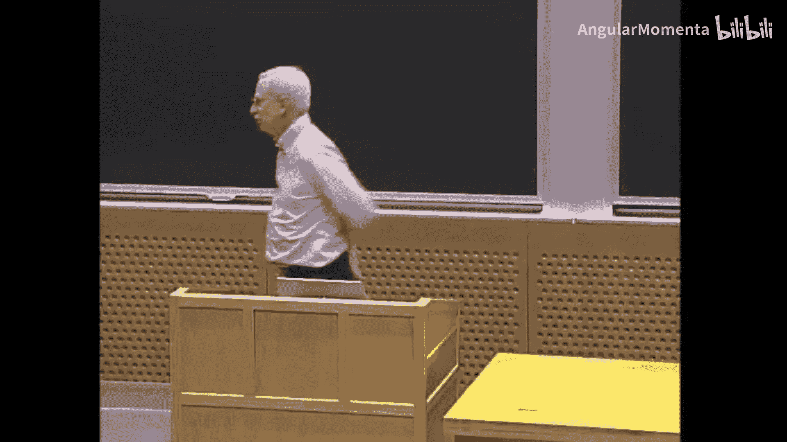

Because the print statement uses an internal function that， by default。

 rounds these things to 17 digits。And so you end up getting something。Like that。Or you might。

 depending how you do it。So let's look at an example here。So I can do something like this。

And it prints that。Because it's doing some rounding for me。

But if I really look at what's under there。And look at the representation。

 the R EPR function is convenient to get a sense of what's really going on in inside。

It tells me that， well， that's its best 17 digit approximation。And now。

 so that's what's really lurking there。So， a hint。

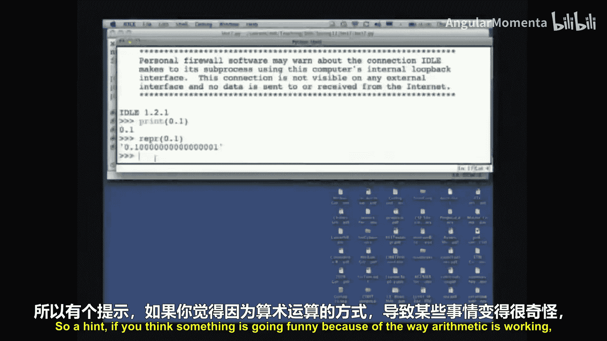

If you think something is going funny because of the way arithmetic is working。

Instead of just using print， you can use。Print of R EPR。To see。

 to get a better idea about what's really going on。All right， now， does this matter？

Usually， it doesn't。Most of the time， it's safe just to pretend that floating points work the way you learned about arithmetic when you were in third grade。

Oral。Probably in kindergarten， if you were educated in Europe or Asia。But now。

 let's look at an example。Where you can get in trouble。So I've got a little program here。

I initialize x to 0。Then I'm going to go through a loop a lot of times。Where I increment X by a 10th。

And then I'm going print X。And because it's going to do automatic rounding， it's going to print。

10000。Or actually， it should print 100000， right。Now，10000。 I'm only increment it by 10th。 Excuse me。

But then I'm going to print our EPR of X。And then I'm going to do a comparison。Now。

 if floating point arithmetic work the way reels work。

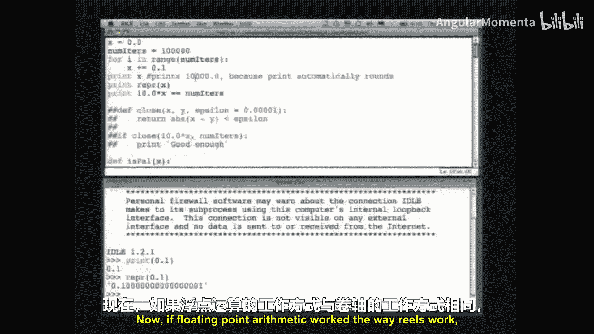

We would think that 10。0 times x should equal the number of iterations。Because I'm starting at 0。

 each time I'm incrementing it by a 10th。

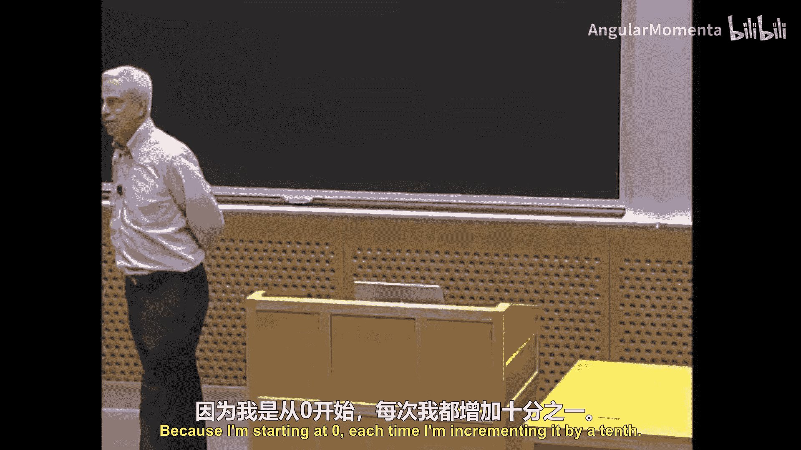

And so if I multiply the result by 10 at the end。

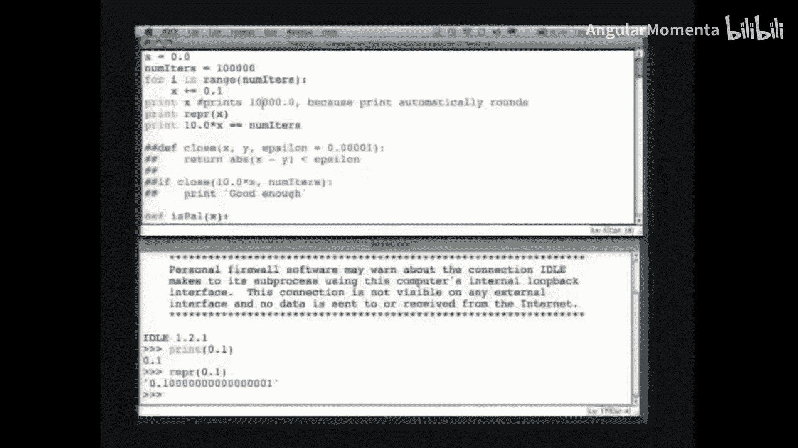

I should get the same as the number of iterations。Does that make sense to everybody。

That， that's what。You would normally get。If you did this with。Pence on paper， of course。

 would take you a really long time to do 100000 increments。Let's give it a shot。

And what we'll see is that if I print it， it looks okay。 It's 1000。But if I print R PRR of it。

 I see it's， it's not。 sorry。 It's 10000， a bunch of zeros。 And then。1，8，8，4，8。And of course。

 consequently， when I compare it。I get something that says false。

And that's because if I look at R EPR of 10。0。Times。X。Well。That's interesting。What's going on here？

It kind of looks like the same thing， doesn't it。But it's not because way out there at some other digits。

 we're not seeing。Something different is happening。Okay， what's the moral of this？

It's not complicated。It's not okay。 Write your programs thinking deeply about what's going on in those bits way out there at the end。

 It's don't ever test whether two floating numbers are equal to each other。Instead。

Do something like this。Define a function called cloth， or whatever you want。It takes two floats。

 and some epsilon。And I've given here Epsilon a default value。And then just return。

 whether the absolute value of x minus y is less than epsilon。

So whenever you're comparing two floating numbers， the question is， shouldn't be， are they identical。

 but are they close enough for your purposes。And if you do that。

 then you don't get tripped up by this kind of rounding and things like that。Not a complicated story。

 but keeping this in mind will get you out of trouble when you're doing floating point arithmetic。

Let's run this and see what happens。And indeed， they're not equal， but they're good enough。

 close enough， if you will。

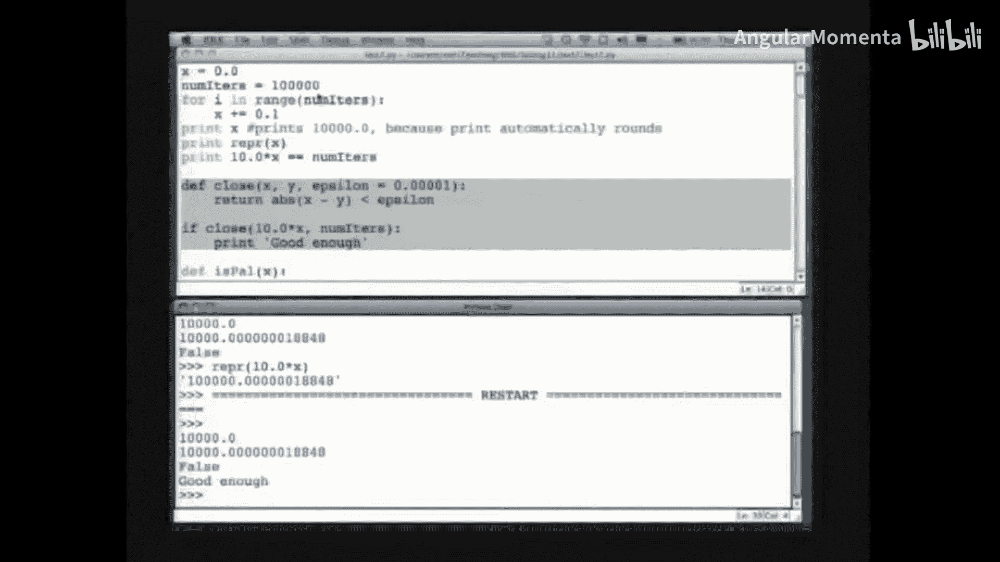

Okay。One of the dangers， the reason this went wrong is these little differences can accumulate if you go through a lot of iterations。

Sometimes they balance out。 Sometimes it rounds up。 Sometimes it runss down， but not always。

 So very simple answer。 Just don't get caught up in this problem。Of floating point numbers。

 All right， Any questions about that。All right， yes。Change for 5。217。Don returning。0。1。な情ま。In 2。7。

到没有sorry。嗯。But the moral remains the same。 Whatever is going on。

 don't test floating point numbers for equality because you'll have a high probability of getting false when you should get true。

Okay， you almost never get true when you should get false。All right。

 I now want to move on if there are no more questions to debugging。嗯。

I never know when to give this lecture in the term。

 So what I'd usually do is I wait until the volume of email and complaints and office hours bills。

 And I realized people are ready to learn more about debugging。If I do it too early。

 people don't pay any attention because they don't realize it's a problem。And if I do it too late。

 they get irritated with me because they say， well。

 why don't you tell me this earlier in this semester when it would have done me some good。

So I pick a time。 And right now， it looks like the。

 the need has built up enough that it's worth doing。There's a very charming urban legend。

About how the process of fixing flaws in software came to be known as debugging。

It's one of those stories。 It's so nice that you just want it to be true。

So let's look at the story， because it's fun。All right， what you see on the screen now。

Is a photo of a book now at the Smithsonian Museum。

Of the lab book from the group working in the Mark 2 Acon Relay computer。At Harvard University。

Pardon， oh， I see it on my screen。 Now you see it on your screen。 Thank you。So there it is。

It was September the 9。Yeah，1947。Even before I was born， that was that long ago。

And so you can see that they're running their computer and they've started to do an ArcT computation。

And it's kind of interesting that they started it at 10 o'clock，8 o'clock in the morning。

 and it ran for two hours， And then it stopped。Wow。

To an Arc tan Tell you something about how fast this computer was。Then it went on。

 then they started the cosine tape。And started to do a multiple adder。And then。

 something bad happened。嗯。It stopped working。Whoops。All right。Hold on a second。

And they spent a long time trying to find out why it stopped working。

And then they found out the problem。They found。A moth。Stuck between two one of the reallays。

So it had electromechanical relays for their switches， the on and off。And they were debugging。

 they didn't call it debugging。 And they found the software had failed because the hardware had failed and the hardware had failed because a bug had been stuck in one of the reallays。

They debug it as in remove the， the moth。And the program ran to successful completion。

And as you can see， the comment was written in this book， First actual Ca of a bug being found。

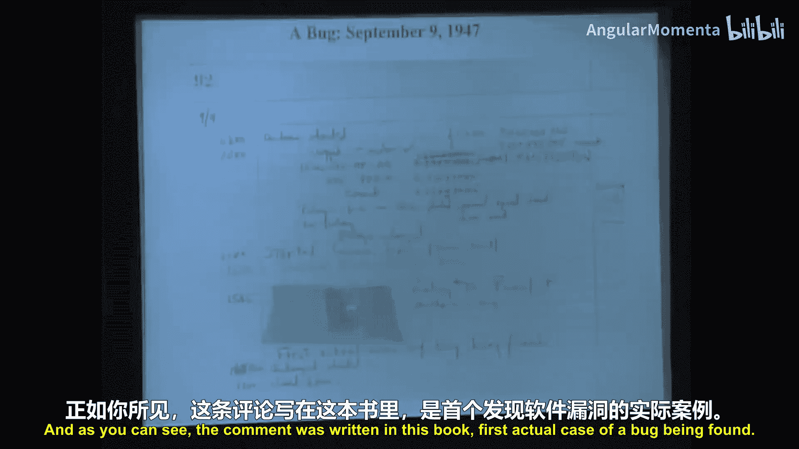

Hence， we call it debugging。This was， by the way， Grace Murray Hopper's lab book。

She is often described as the first programmer。It's unclear if that's true。

 What is true is she was the first female admiral in the US Navy。

She was a Navy programmer who eventually rose to the rank of Admiral。

So it's a charming story that this is why we call it debugging。 Turns out it's not at all true。

That the phrase debugging had been used for a long time。

And could easily be traced back to the 180s when people were writing books about electronics and talking about debugging。

 even in those days。And in fact， you can go back to Shakespeare， who talks about a bug bear。

 meaning something causing needless exercise or。NeNeedless or excessive fear or anxiety。Well。

 that's a good description of a bug。All right。 And he actually called it a bug when he had Hamlet vettch about bugs and goblins in my life。

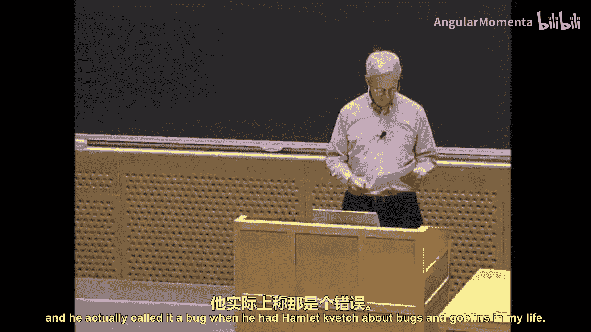

All right。So I want to start now。 Oh， by the way， just for fun。This is what the Mark 2 looked like。

This was the computer that took an hour or so to do an Arc T。You can see it filled。

 made it a little hard to see in this light， but you can see it filled an entire room。Qu。

 quite amazing。And here's a picture of Admiral Hopper in some， some unidentified male。All right。

 if anyone knows who this is， it would be good to know so I can update my archives。All right。

So now on on to some practical aspects of debugging。

The first thing I want to do is dispel some myth about debugging。There is this myth。

That bugs crawl unbidden into our programs。That we write perfect programs and somehow the a bug just sneaks in and。

 and and ruins perfection。That's not true。 In fact， if there's a bug in your program。

 you put it there。So it would be almost better not to call it a bug。

 which sort of sounds like it's not our fault， but it's a mistake。It's a screw up。

So get that through your head。 Similarlyly， bugs do not breed in programs。

If there are multiple bugs in your program， it's not because a couple of them got together and pro created。

 It's because you made a lot of mistakes。嗯。Keep that in mind。 With that in mind。

We should think about what the goal of debugging。And it's not。To eliminate。One bug quickly。It is。

To move towards a bug free program。And I say this， because。They're not always the same strategy。

That you would follow for these different goals。And I also carefully say to move towards a bug free program。

Because in truth， be told， we are hardly ever sure that we have no bugs left。

Debugging is a learned skill。 Don't despair。 Nobody does it well， instinctively。

evolutionvolution did not train us to be debuggs。So a large part。

 probably the largest part in many ways of learning to be a good programmer。Is learning to debug。

And what that has to do is thinking systematically and efficiently about how to move towards a bug free program。

The good news is， it's not hard to learn。And it is a largely transferable skill。

The same skills you use to debug software。Can be used to debug laboratory experiments。

I actually give lectures sometimes to physicians about how to debug patients。

How to use debugging techniques to find out what's wrong with people when they're sick。 It。

 it's a very good and useful life skill。Now， for four decades， maybe five decades。

People have been building。Tools called debuggers。And you'll find that built into idle。

 there is a debugger。That are designed to help people。

Find out why their programs don't work and fix them。Personally， I almost never use one。

The tools are not that important。What's important is the skill of the craftsman in this case。And。

 in fact， most of the experienced programmers I know， rely on print statements。

So it's O to use the debugger。But I think the best debugging tool is print。And I have to say。

 I've been。Surprise。That's a mild word here。At how few print statements you guys seem to use。I。

 I get these emails or the staff gets these emails。Kind of plaintifftive。

 Why doesn't my program work。You know，And then there's a little piece of code。

And the answer I send back when I reply before one of the T As do。

 and they usually get there first is usually put in a print statement here and see what happens。

And I'm just amazed that when the code arrives， it doesn't have these statements in it。

My favorite response was I sent an email to a student who shall go nameless and he or maybe it was a she。

And I said， insert a print statement here and see what happens。 And I got back a reply。Saying， no。

 I't don't need a print statement here。 I know what the value of this variable is。Well。You know。

 my reply was that if all the values were what you thought they were。

 you wouldn't be sending an email saying， why doesn't my program work。

Put the darn print statement in， and see what happens。And then I got a gracious email back saying。

 more or less， whoops， I see。 But please， you know。

 when you send us some code and you want some help。

 send us code with some print statements already in it to at least show us that you've tried to find the bug yourself。

😊，Alright， so what we're essentially doing when we insert print statements in a code。Is searching。😡。

For the place in our program where things have gone awry。

And the key to being a good debugger is to be systematic in this search。

So you saw that and we looked at algorithms for things like exhaustive enumeration。We said， well。

 if we're searching for an answer， we have to search the space carefully one at a time。And we said。

 if we want to search it efficiently， maybe instead of starting at the beginning and just going to the end。

 we should use something like binary search。The same techniques can be used when you're searching for a bugs。

So I recommend searching for bugs。Using some approximation。To binary search。

And we'll see an example of this， as we go forward。But as we look at the example。

 what I want you to think about。Is what are we searching for。But we know our program doesn't work。

So the question that I like to ask。It's not。Why didn't it produce the answer I wanted it to。

But how could it have done， Would it have done。This is a subtly different question。

And it's an usually and much easier question to answer。Not why didn't it do the right thing。

 But here it did something。 So I already know what it did。 And I say， I didn't expect it to do that。

 So why did it do that。Once I know why it did what it did。

 it's usually pretty easy to think how to fix it。So that's the first question I ask。

I then go about it。Using something akin to the scientific method。

 which we all learned about many years ago。And basically， the scientific method。Is based upon。

Studying available data。The data you have。Is， of course， the program text itself。The test results。

You ran some test and got the wrong answer， which is why you knew you had a bug。

And then you can probe it。 You can change the test results by using print statements so that you have more data to study。

Keep in mind。That you don't understand this program， because if you did， it would work。

Once I study this。I form a hypothesis。That at least， I think， is consistent with the data。And then。

I go and design。And run。A repeatable experiment。And I want to emphasize the word repeatable here。

And again， the key thing， as with the scientific method。The experiment to be useful。

Must have the potential。To refute。A hypothesis。

Why might repeatability be an issue？Well， as we'll see pretty soon。

A lot of programs involve randomness。Where you're doing something equivalent to flipping the coin。

Somewhere in the program， which might come up heads or tails。

 and the program would do different things。We'll see why that's an important programming technique。

 soon。And once you do that。You can get different results with different runs。More subtly。

 there can be various kinds of timing errors。Deep down in the operating system。

 where you have multiple activities going on at the same time。

This is usually the reason that you'll see， say， windows crash。

Or word or PowerPoint or something else。Because there's some timing error that occurs sometimes。

And probably most commonly because there's human input。Somebody typed something。

 and they might type something different。So one of the things you want to do when you're systematic。

Is make sure that you can replay things。And we'll talk more about this when we get to randomness。

About how we go about doing that。All right， now let's try and put this all together in a little program。

If you've been studying your handout。As at least one of the Ts did。

You've been kind of mystified by the fact that there's a pretty crummy looking program in it。

And unlike， sometimes when I。Make mistakes。 I don't know I've made here。

 I intentionally made some mistakes。So let's look at the each program。

I wrote a function called I palindrome。That takes in a list and is intended to return true if the list is a palindrome and false otherwise。

Then I've wrote this little program called Silly that uses his pal。Takes in a number。

Request that the user repeat that many or in make that many inputs。Then， calls is palwell。

To find out whether or not the resultant list is a palindrome。Not too complicated。But now。

 let's run it。We'll do silly。Of five。And it tells me ABC， D， E is a palindrome。All right。

 I have a bug。

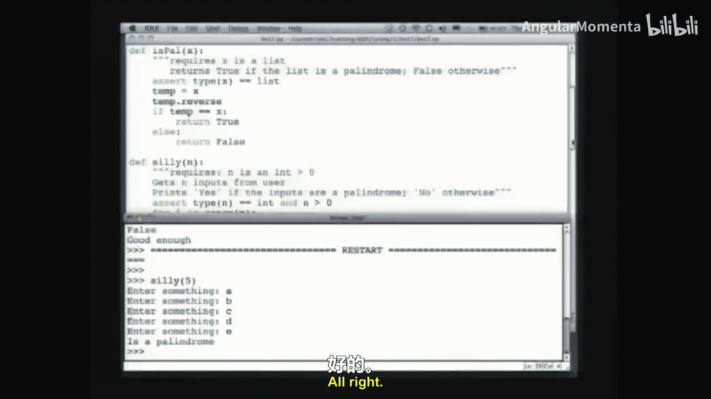

Now， I need to go try。And find that bug。So the first thing I need to think about when I'm looking for it。

Is to try and find a smaller piece of input。That will produce the bug。

So I want to find small input on which program fails。Why do I want to find a smaller input。Well， a。

 in this case， it's less typing。B， if it's a real program。

 it's probably less execution time to make it run。But C。

 it'll be easier to debug because there's fewer kinds of problems。

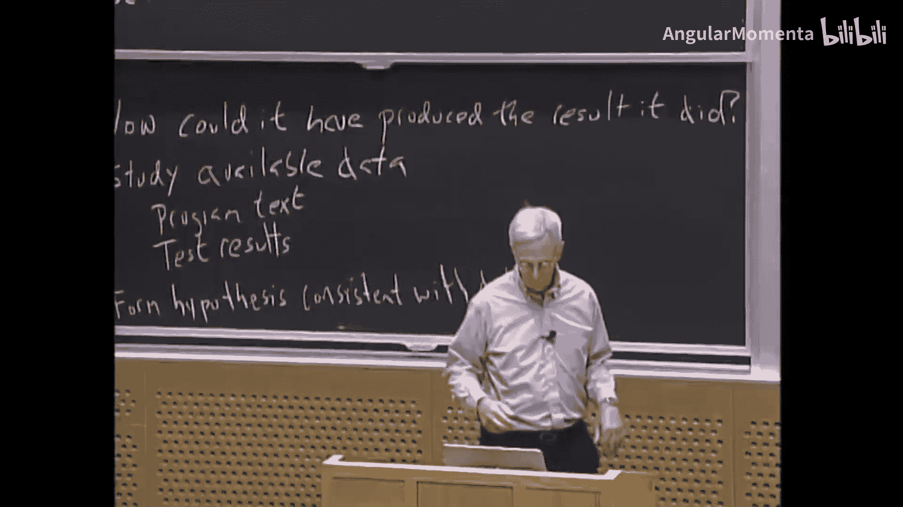

So let me try it on a small piece of input。 say silly of one。Oh， doesn't gets that right。So。

 that's no good。Let me try something else。 Let's try silly of two。 I'm sort of sneaking up。

Gets that one wrong。Alright， so I know I contest test it on a small input。So that's a good thing。

 I now have a simple test。Now， in this case， the code is so short and so stupid that you could probably look at it with your eyes and just find the bug instantly。

But the point of this exercise is not to find the bug， but to kind of show the process。

So now I want to go through this process of binary search to try and find。The bug。

So we'll start with silly， the top level program。And I'll look for something about halfway through。

Maybe here。And try and now answer the question that I've got a lot of code。

And I'm going to find a point halfway through it and try and ask。

 is the bug above this or below this。So I need to find some intermediate value。 I can check。

And at this point in the program， the only thing I have done is accumulate the input， right。

So there's nothing else to ask。So my hypothesis is that everything is good。

And that the input will be A B。So let's try it。Let's print result here。 And well， actually。Yeah。

 I'll put result here every time through and see if we get what we。Wanted to get。Ha。All right。

That's not what I expected。So， something is wrong。What's wrong。Why is result always the empty list。

I can out wait you， yeah。大。Right， so every time through the forward load， it's reinitializing pool。

假这。For those of you who are watching MT TV， I just hit a person who was heads down。

With a piece of candy。 Fortunately， it was not a hard candy。All right。So you're right。

 Let's get that out of there。Put it where it belongs。Run it again。Okay。

Were we happy with that result？Yeah， because I've done that before the append， right。And now。

 just to be sure， we'll take this print statement out here。 And let's put it here。

We're now searching elsewhere。Well， the good news is， I now have the right result。😊。

For the value of the variable， but the wrong result for the program。It's still telling me。

 it's a palrome。So。The moral here。Is。There is no such thing。As the bug。

Never use the definitive article。There is a bug。I I， this is a story that I've heard。Related to this。

 you know， as far as finding a bug， you can imagine that you're at someone's house for dinner。

You're sitting at the dining room table。 you can't see the kitchen。

And suddenly we hear from the kitchen。What the hecks at。Your hostess walks out and says， don't worry。

 I just killed the cockroach on the turkey。Well， your immediate reaction is the cockroach on the turkey。

Where there's one， there is likely to be more。Every time you find a bug。The more bugs you find。

 the probably the more bugs you are still left。Because you've shown that you make a lot of mistakes。

All right。Onward we go。 So what do we do next。Well。

 we now know at least that things look O to this point。Which suggests that the problem must come。

Below this in the program。 Well， the only thing that's going on below this is the call to Iz Powell。

So now we'll say， okay， we've now isolated the bug to is pal。That's a good thing。Let's try and ask。

Where things are going on there。So we'll take a point halfway through his pal。

And we'll print some things here。So， let's print。See what we have here。But before I do that。

 I've gotten really tired of typing A and B。So I'm going to use something called。

A test driver or a test harness。And I recommend that you do this kind of thing whenever you're testing a program。

 write some code。

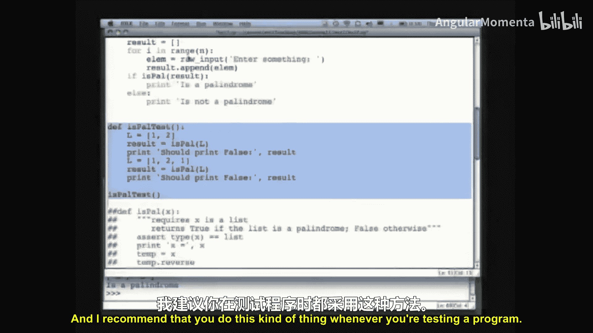

That has nothing to do with the program itself。But makes it easier to test and debug the program。

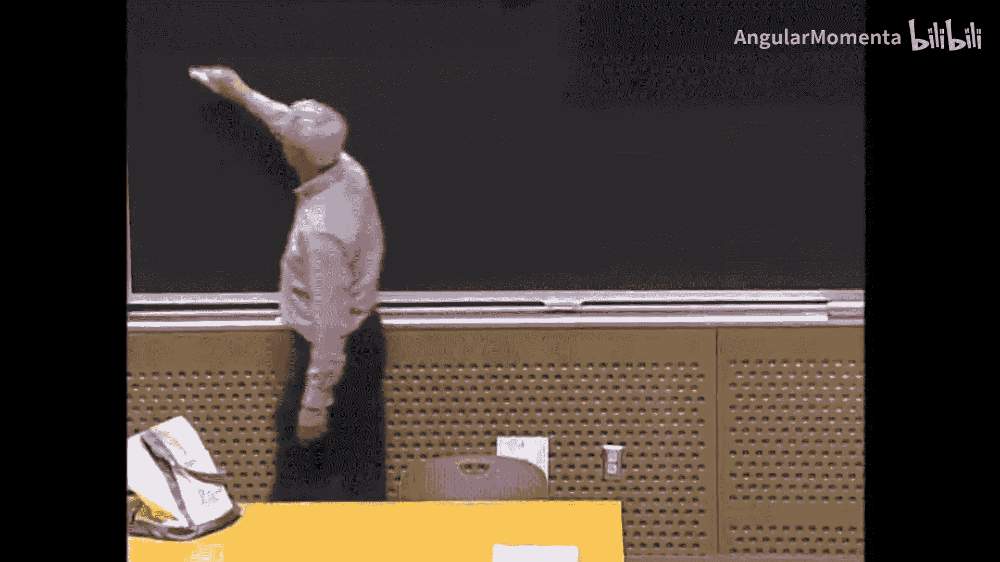

，Pretentious word for this is a test harness。All this is is code that helps testing。

One of the things that you see in industry。Is。About half the code that gets written。

Is not intended to be delivered as part of the final product。

But is there merely for the purpose of testing and debugging。It's a big deal。

 So don't feel bad that you're writing code that's not part of the solution to the problem set that is there only to help you make your code work。

It seems like it's extra work， but， in fact， it will save you work。So。Let's call it。

We'll call Iz Powell。 and it's going print some things that I think it should do。InF。

 we'll look at what it does first before we look at the print statements in。Is pal。

 So for the moment， let me just comment these out。And what we see here。

Is it should print false and it prints true。Well， Prince。Should it print false the second time。No。

 right。 So it should have printed true， and it did。So this is an important lesson。

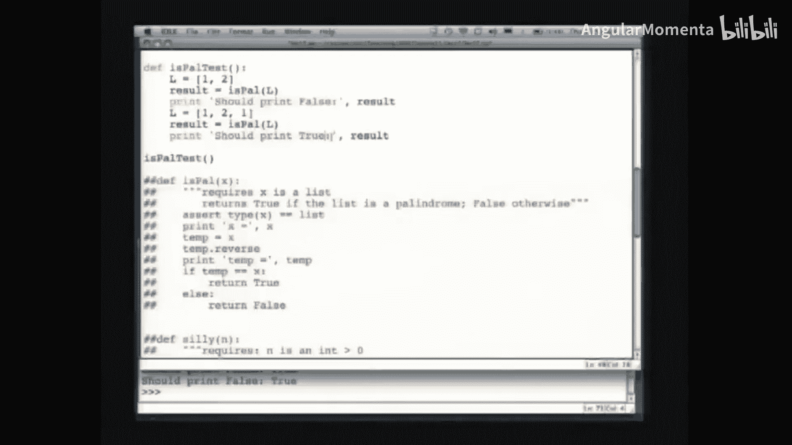

Make sure that when you put in these debugging statements。

 you write down as part of the print statement， what you expected to print。

So that when you look at your output， you can quickly scan it。

And see whether the program is behaving， as you thought it would。So， now。Works once。

 doesn't work the other time。So we'll go back and turn on。The print statements up here。

And see what we get。So it's printed。 temp is 1，2，1， and x is 1，2，1。

So kind of okay that print and X are the same。 We expected that。But。We thought we reversed it， right。

We've entered  one to one， and it is this。 What's going on， What's wrong。Well。

 now what we can do is let's see where it went wrong。 We'll put in another print statement here。

See what value is there。Well， it was 1，2，1 before reverse， and it's 1，2，1 after reverse。How come。

Why isn't reverse reversing temp。Yeah， do you need for us the after reverse， exactly。

I need parentheses after her。Whoa， close。Because without the parentheses。All， all reverse is doing。

Is。Nothing。That's just the name of the method， not an invocation of the method。Right。All right。

 now let's run it。Good news and bad news。What's the good news。It has， indeed， reversed。1，2。Right。

To make it 2，1。But。It's also reversed X。So naturally， since it's reversed X。

 temp and X will be the same。 And I get the wrong answer。What's wrong now。Yeah。

 so I think you'liasing。Intro。Because now remember how mutation works， now Ten x。

Both point to the same object I reverse the object。😡。

Doesn't matter whether I get to it through X or I get to it through temp。

 It will still have been reversed。So， in this case。What I need to do is this。Clon it。And now。

 when I run my code， it works。No applause。

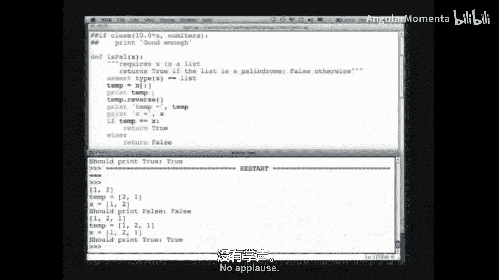

Al right， A couple more things about debugging next Tuesday。

 And then we'll move on to some pretty interesting topics in the next phase of the course。

