# 【麻省理工】计算机科学与编程导论 ｜ MIT 6.00SC Introduction to Computer Science and Programming p11 11 -BV1a5BZBkEP6_p11-

The following content is provided under a creative Commons license。

 Your support will help M I T Open Coseware continue to offer high quality educational resources for free。

To make a donation or view additional materials from hundreds of MI T courses。

 visit M I T OpenCourseware at O C W。t M I Tt E Du。

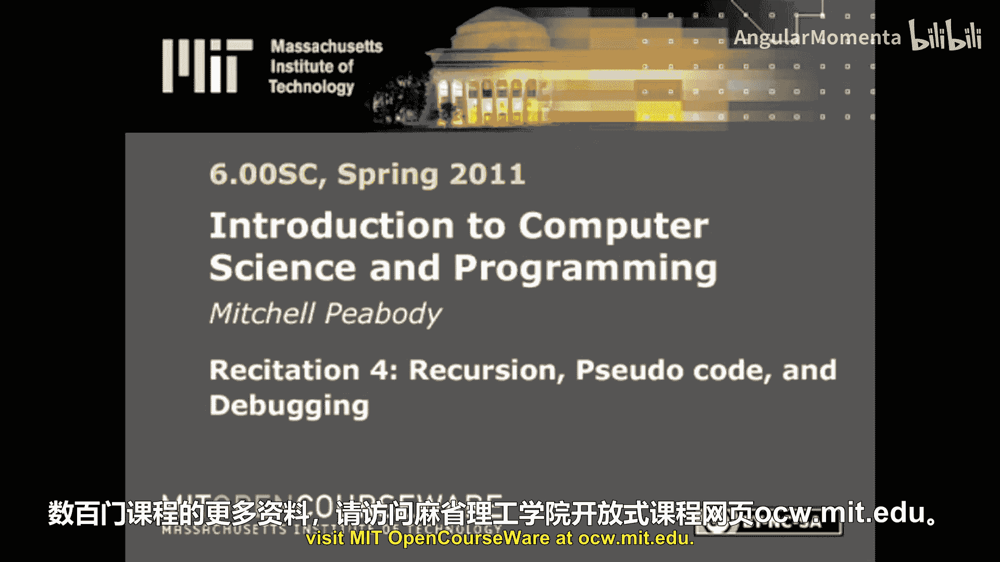

So we're going to pick up where we left off last Friday on recursion。And。We're going to， well。

 first of all， can anyone tell me what recursion is or what a recursive function is？No one knows。

Okay。Okay， it's a divide conquer technique， how does it do it？Yes。Recursive function。Right。

 so it's a function that calls itself and it works by one identifying a base case。

 which is the smallest subprom that possible。And then in the other case， the recursive case。

 it tries to chunk the problem down into smaller subprom and it then solves by calling itself。So。嗯。

So we went over a few examples and one of the things that we wanted to talk about is that for many problems。

 a recursive function can be written iteratively and actually for most problems。

There usually is some sort of a subjective choice in how to write a function and it really comes down to ease of understanding。

 so what we've done is we've taken a couple of the algorithms that we showed last week and we've written them iteratively。

And else have the recursor version and we'll kind of compare。

And contrast and kind of see where we would want to use a recursive function。So。On the screen。

On the left here。We have the multiplication version。

 the recursive multiplication that we showed you last week。

 it's a little different because turns out there's a couple of simplifications you can make。

But did anyone？Well。Can someone walk me through how this works。What's my base case first？Zero right。

 and so obviously when n is zero， we're going to， you know， if we multiply by zero。

 then our result is zero。Now， there are two recursive cases。And。

Not really sure how to explain this intuitively but。Let's say that my n is positive， right。

 So I'm multiplying by a positive n。Well， then all I'm going to do is take M and just。Add it to。

A recur the recursive version of itself n minus-1 times。It's kind of how to read that。Right。And then。

Anlogously， if N is less than。Or equal to one。 Then I'm going to take negative M and add the recursive result of。

N plus 1 times m。It。It is not too intuitive， right？If we implement it iteratively though。

I think it's a little easier to understand。Now this is also a subjective judgment。

 so you might disagree， you're free to。嗯。Here's our base case， again。

 n is equal to0 or M is equal to 0 returns0。In this case， though， if。We don't have the base case。

 then we're going to initialize a result variable。And then for NSS。Greateaer than or equal to one。

We're just going to enter a while loop。And keep adding M to result。En times。O。

A little bit easier to understand， I think， than the recursive version。And then same thing for。哦。

I have a bug here。Same thing for n is less than equal to negative1。All right。

I'm going to run the two versions of this function。All right。Here's a recursive version。

And here's the e version。They both return the same exact thing they both work。Generally。

 the same manner， it's just that in one case， we're using recursion to solve it。Which， I don't。

I don't find too intuitive， and in the other case， we're using wild loops。Alright。So。In this case。

 in my opinion， writing this iteratively， it makes a little bit more intuitive sense。

But in other cases。Let's say。Good old Fibonacci。We can write the recursive version and then the iterative version。

All right， so here's recursive Fibonacci， we have our base case。Or case says。

And then we have a recursive case， right？You can almost rewrite。

The mathematical formula from this directly。All right， now。冇意思。

So here's the iterative version of Fibonacci。

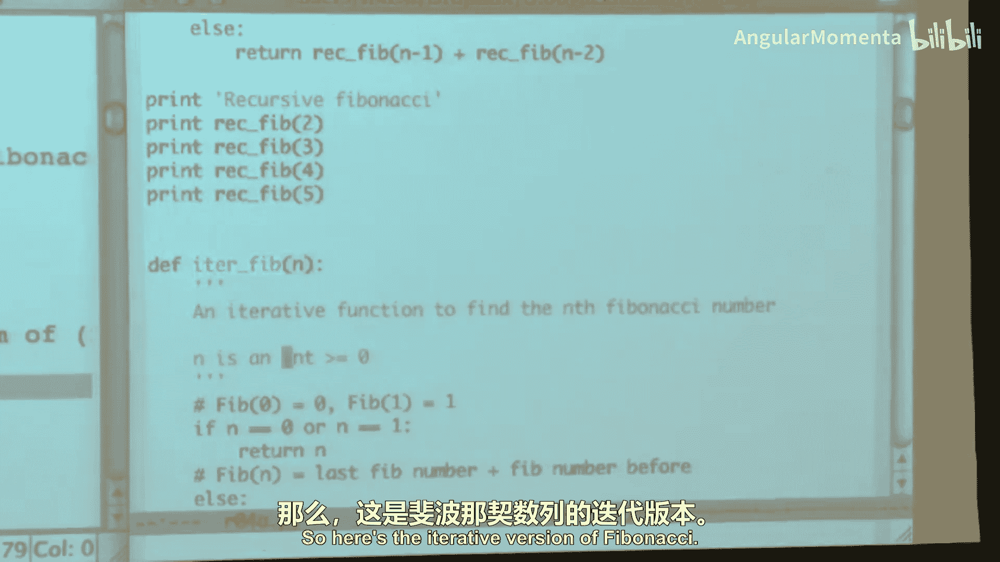

What we still have our base case。All right， but when we get to what was the recursive case？

We have to do a lot of bookkeeping。We have to save off of the previous Fibonacci。

What we're currently computing。And then we have to iterate。You。

 get the next Fibonacci and then save off。The prior versions of。

This is all stuff that in the recursive version gets done for us by virtue of just calling another function。

So this is an example of a case where your recursive version is actually a little bit easier to understand。

It doesnn't mean that it's more efficient and later on in the class we'll actually use this to talk about complexity。

But。The left version， I think is easier to understand than the right version。

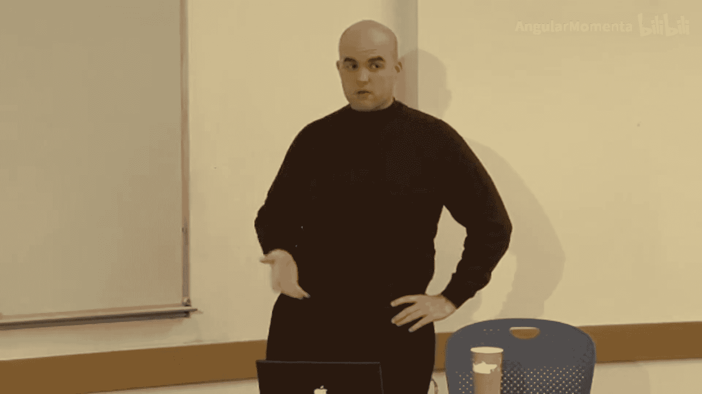

Are there any disagreements？If you disagree， I'm not going to bite you。So anyway， we can run this。

And we can see that the output's identical。X range。嗯。

Probably something I shouldn't have put in there X range X range is like range。

 except that it returns what's known as a generator object that you can iterate over。So。

So that I don't have to explain that。Right now。We'll actually， we'll probably talk about it later。

The semester。The difference is efficiency。Range will return an entire list to you。

Whereas X range is a little bit more conservative in how it manages its memory。For these purposes。

 but it you know changing it won't make a difference in the program。And for this for。

Program as simple as this range is perfectly fine， I just use X range out of habit。

So we'll do one last example， and then we'll move on to a different topic。嗯。

If I didn't mention it before， in problem set4， recursion is highly recommended for the final portion of it。

So。It's kind of important you understand what's going on anyway。So。Remember。

We we looked at bisection early on in the semester。

And we showed you an iterative version of bisection。This shouldn't really be unfamiliar to anyone。

At this point。So all this is doing it' finding the square root of a number。Using bisection search。

 right， and we set our low and our high。Get our midpoint。

And we just keep looping until we get a value that when we square it is close enough to x。

And on each generation， we set our low in our highs。Right depending on。How good our guess was。Now。

 the recursive version looks like this。It has a few more lines of code。And。Before I launch into it。

Did we explain default parameters to you？For functions。So。All right， Python has this of。Feature。

Where if you have a function such as Re bisection search。You can specify that certain parameters are。

Optional， or you can give default values to them。 So let's just show a simple example。So， I can。

Get passes。So。So if I define this function， this one's really easy。

 all I's going to do is print out X。I can call。It like this。

In which case it's going to pass 150 in and x will be 150 when the function is executing。See。

 I'm not lying。Or I can call it like this。And it'll be 100。So that's in a nutshell。

 what default parameters do for you。 They're useful in some instances， as in this example。

And this recursive version。Of bisection sort。Yesし。Square root，m sorry。

We have a low and a high parameter that we specify。

 It's exactly equivalent to the low and a high parameter in the siterative version。

And all we're saying is that if we're calling it for the first time。

 this is a common idiom for recursive functions in Python。If we're calling it for the first time。

 we're not going to specify in a low and a high。So low and high will be none coming into this function。

 and then we just set them as we did in this iterative version。And then we set the midpoint。

We have slightly different structure here。If。The midpoint that we guess is close enough to。

The square root of x。Then we just return the midpoint。On the other hand。If it's too low of a guess。

 then we're going to recursively call ourselves。With the same x， same epsilon。

 but we're going to use midpoint for the low parameter so。Midpoint in this case， is here。

And the same high parameter。And then if we've guessed too high。Then our low parameter is low。

 and then our high parameter is a midpoint， so it's doing the exact same thing as the iterative version。

We have recursive， iterative， recursive， iterative。Same thing， just different forms。All right。

 before I leave recursion， does anyone have any questions？Or want to ask anything or。

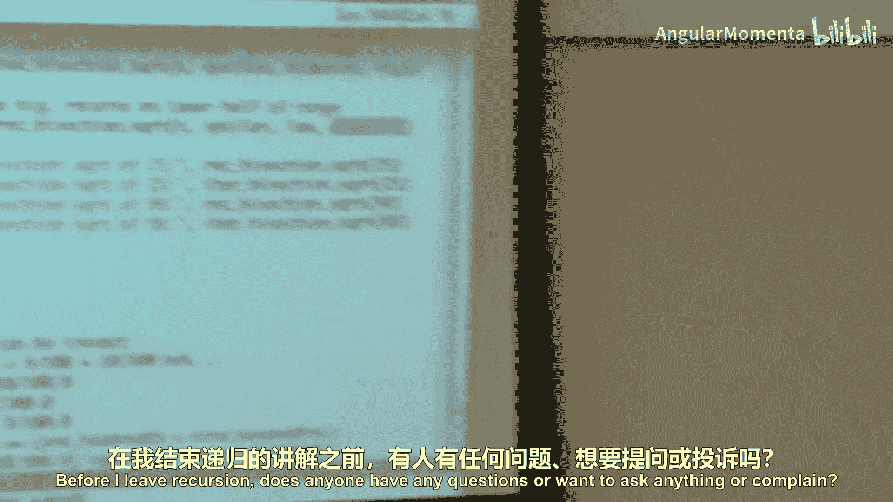

Complain。No， all right。Work like。Good news it really。IIt's case like case， it depends on the problem。

And what we were trying to show here is that。There are some problems that are better expressed recursively than others。

Ex iteratively。And by better， it's a very subjective term。In my mind， it means more intuitive。

 easier to understand。系い。Allows you to focus on solving the problem rather than filling with code。

On the other hand， sometimes efficiency comes into play and we'll talk about we're going to be talking about that pretty shortly and in that case。

You might want to do a recursive version because it's easier to understand。

 but it takes too long to run so you write auteruter version。So。

It's computer programming in a lot of cases， actually in all cases is a bunch of trade offs。

Oftentimes you'll trade off speed for memory， elegance for efficiency。That sort of thing。

Part of the skill of becoming good computer programmer is figuring out where those balance points are。

So， and it's。It's something that I think only comes with experience。All right， so。

We've talked about floating point， I think， to death。But。

We just want to really emphasize it because it's something that even for experienced programmer still trips us up。

So。The thing that we want you to understand is that floating point is inex。 So you can't。

 You shouldn't。Compare for exact equality。So looking at the code here。

I have to find a variable 1000s， which is just 10 over 100 and 100， which is this one over 100。

And then 900s with9 over 100。And so。In real math。This condition would be true。I add 00。

 100th and 900s， I should get 1000s。So if we were not dealing in computer land。This would print out。

But because we are dealing in computer land。We get that。And the reason is。

Is because of Python's representation。 Now， when you write print X， if x is a float variable。

 Python does a little bit of nice formatting for you。

 it kind of saves you from its internal representation。And。But you can look at， so here is 10100s。

As you would just print it out， its just it's what you would expect it to be。

But this is what Python sees when it does its math。And it's not just Python。

 this applies for anything on a binary computer， it's an inherent limitation。And you know。

 we can get。We can get arbitrarily close， but never exact。嗯。And then。Again。We have 100 and 900s。

Python will show as 0。1。 so when you print these out， they'll look fine。

 know if doing if you were writing debugging code and you were wondering why， if you compared x to y。

 it wasn't exactly equal， you know you would naturally print out X and then print out Y。

 but it would look equal to you， but the code wouldn't be working properly right。Well。

 the reason is is that the internal representation that Python is using to compare them。Is that。So。

What's the solution？It's an actual question。 I don't know the answer。有就抽斯了。Right。

 so we're going to do we're going to say good enough right and the traditional way of representing that is epsilon epsilon。

you've seen it in your problem sets and you've seen it in code before and if you've come to office hours someone has probably explained it to you。

 epsilon is the amount of error we're willing to tolerate in our calculations。In Python land。

 you can， I think， have arbitrary precision。Don't quote me on that， though。But。

For purposes of this class， if you're using an epsilon， that's like 0。0001。

s we're not going to get too upset。U。

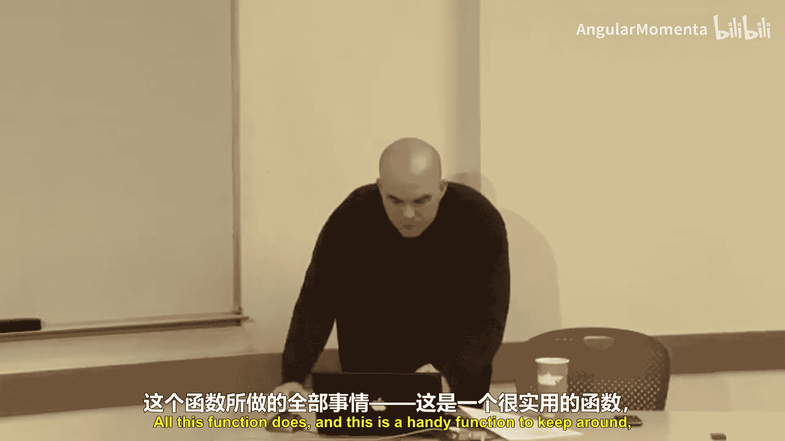

All this function does， and this is a handy function to keep around。

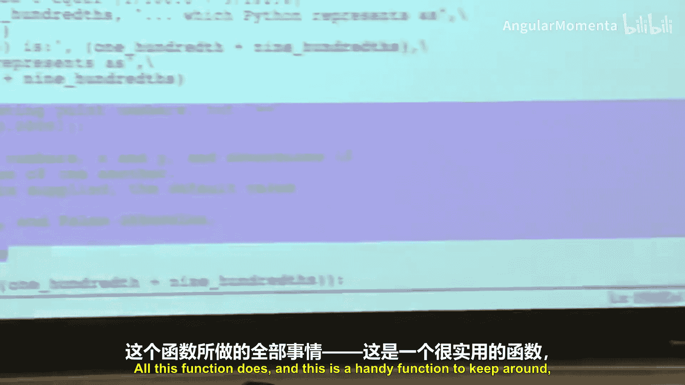

Is。It just tests to see if the distance between。X and Y are less than epsilon。If it is。

 then we say they're close enough to each other to be considered equal。

So I don't like the function name compare， I don't think it's intuitive。

Close enough is probably better。But it's also going to break my code。So。Oh。This is an actual book。

One，2，0，3。What do I do to myself。I commented out my definitions this way。All right。

So if we compare the two values is 100s and 100th plus 900s， and we use our close enough。

Our compare function。Then， yeah， it's within epsilon。嗯。Again。

 notice here that we're using a default parameter， so if we don't pass in something explicitly。

So I can say something like this。嗯。Let's make Epsilon really tiny。So if I make Epsilon really。

 really tiny。Then I' was going to say no。嗯。How you determine Epsilon really depends on your specific application。

嗯。If you're doing high precision mathematics or you're modeling like faults on a bridge or something。

 you probably want to be pretty precise。Because if you have the wrong epsilon。

 then know you might have cars falling off the。Bridge or the bridge collapsing。

 and it would just be a bad day。嗯。So。Are there any questions so far about floating Point？No。

The only go close。What， can't get us close。How can you make the error that small？好看。Well， yeah。

 that's what it means。 so there is a limit to how close you can get and it depends on the language and it also depends on the hardware。

There are， and this is getting a little bit more technical than I want。

 but you can define pretty precisely。The smallest value that epsilon can be。嗯。In a language like C。

 it's defined as the minimum difference between or the minimum difference between two floating point variables。

That's representable on the host Mas hardware。So。Yeah， there is a limit。

There are some math packages though， and we'll be using something called nuumpy。

Later on in the semester that allow you to do pretty high precision mathematics。

JustYou know keep that in the back of your mind， but yeah， you're right。

 you do eventually hit a limit。

Okay。So the last thing that I want to cover on floatinglo point is。嗯。

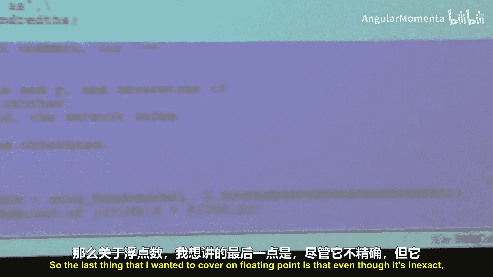

That even though it's inexact， it's consistent。So。Let's say I define a variable 900s plus 100th。

And it's exactly what it says， 900s plus 100。 Now we know that this is not going to equal， you know。

 1000s， right， we' just demonstrated that at nauseum。And also。It'top the time。The question， though。

 is， if I subtract 100th from。This variable that I've defined this 900th plus 100th。

Can I compare will 900s now be equal to 900s plus 100th？So in other words。Will this be true？And。

The answer is。Yes。And the reason is， is that。If if I'm adding or I'm subtracting。

 even though 100 we know is an inexact representation， it's still the same。

And so when we do the subtraction， we're subtracting the same in exact value。So。嗯。This。嗯。

Appeared as a quiz question at one point。Probably won't this semester， but。You know。

 it's something to keep in mind。So。Any questions on Fing point？If if you're a Matthew type。

And you want to。Look up IAE。754， and this will give you all the gory details about representation and mathematical operations on floating Point。

And if you don't， then don't worry about it， it's not required for the class。Okay， so。

The next topic we want to cover is pseudocode， so can someone take a stab at defining pseudocode for me？

Gathered。It's basically like you're just kind of writing out。でい。整个时间。

I wouldn't say it's normal English， buts it's an English of sorts。 So the idea is that。

And a lot of the difficulty that programmers have with writing programs or new programs is that。

We don't naturally think in computer languages。YouYou think in English or well。

You think in a human language。So what pseudocode allows us to do is to kind of be in the intermediate right。

 we still want to develop kind of a step by step process for solving a problem。

 but we want to be able to describe it in words and not variables and you know syntax。

 which sometimes what will happen is programmers will get so wrapped around kind of getting the syntax right that they'll forget what the problem that they're actually trying to solve。

So。Let's kind of walk through an example。Let's talk about pseudocode for Hangman。

And because you've all done this on the problem set。I don't have to explain the rules， right？

So what would be a good kind of English first step for Hangman？ちと。Right。

Let's not be too specific we'll just say。Select random word。Okay。Now。

 what would be another good step next up？Display。Display the amount。Let it like without spaces made。

So it display like a masked version of the word， exactly like hide the word could display it。

Hide the word but display。Its an idea now。You probably want to state how many letters are in。

Oh that's like the point where should that go that should really be before the display。So。

Tell how many letters。Now， what would come out for this？Dplay。

See how many letters you have to choose from。Okay。First time。At first time we don't。

 but you know the nice thing about pseudocode is that we can kind of。

Barsh things on the paper and then rearrange them as we。It's sort of like brainstorming in a sense。

 right？You're trying to derive the structure。And it's easier to do like this than to。Try and do it。

So， but you got， you're， you don't have。So。L you would ask the person to input a letter。

Should you want to check if it's yeah， check if it's in the word。If it is。If it is。

Let's say two correct letters guess。Okay， and if it isn't。感觉。嗯哦。Let's say you want to remove it from？

So the options。So if it's not， then we're going to remove from options。lenders re mating。

I probablyably want to tell the user they're wrong too。And you色。我 said你 want to user。

And you maturity if you have like a set amount of charges， Okay。

 so we're actually going to get to the that I said last。I actually played all of her hair。

That's great。😀呵。So。So again， yeah， you're right， so we have a number of guesses that are remaining。

And the thing is， is that。We know that。The user has a certain number of terms。

 so we're probably going to repeat a lot of this， right so。At some point。

We probably want to have a while。It'll just say while， you know。We have。Guesses left。Remaining。

By the way， the reason why I program computers is because my handwriting is horrible。

So while we have guesses remaining。We're going to keep doing。All this right。

 and then we're going to remove。But is this the only stopping criteria？What if say went。

So while they have guesses remaining and。The word。Is not guest。So。This is in essence。

 your hangman program。 It's English language。It's not easy to read because that's my handwriting。

 but it's kind of easy to understand it at an intuitive level。Right。

And the thing the reason why we're talking about this is because we're going to get to some more complicated programs as we。

Move through the semester and a good starting off point for a lot of you when you're trying to do your problem sets is you know instead of trying to jump right into the coding portion of it to sit down with a piece of paper。

 index cards or a whiteboard and kind of sketch out a high level view of the algorithm。And。

So that we can see this in。Kind of。Code form。So。Let's say that I want to write a function。

That tests a number to see if it's prime。First question is what is prime number？Right， so yeah。

 a number that is only divisible by itself and one。嗯。Are even numbers prime， can they ever be prime？

Right。What about two。So two is one of our special cases， all right。So。

What would be maybe a good starting off point for pseudocode to test primality？Knowing those facts。

So。Can I era this or should I leave it up， because I can go over there。

It's not like I'm erasing any deep， dark secrets。There's no magic here。All right。Test number。If。

What equal to equal to。Say what，2。Yeah， why not。And maybe three。嗯。Now， what do I do if？It is。

Are they prime？So I'm done， right？We going to return true。Now。

 what do I do if the number given is not two or three？You're talking about the module operator。

Right so yeah， we will use that that will tell us whether or not an integer divides evenly into another integer or the remainder。

After an integer is divided into another。But。我完现在的 question。

What is the maximum value of an integer divisor for？A non prime number， so for a composite number。或者。

嗯。😊，Okay， excluding the number itself。啊 for。Let's say that I had N is the number I'm testing。

Square root of it。Because I'm not going to have。A factor that's larger than that。

So and I ask that because there's a loop involved。So。

How would I about go about this systematically I probably start。Is say five。Okay， and then test。

N modular。Let's say five。Is equal to zero。Now， if n is evenly divisible by5。

 then that must mean that n is composite， right， because5 is a factor。So。If it。Is。Then。Return。False。

Okay。Now。What if？It isn't。So that means that n is not evenly divisible with5。

 does that mean that the number is automatically prime？So after five。

 what would be a good number to test to move to。six。Yeah， that wouldn't be it， right？

If it's divisible or if it's。If six is a factor， then obviously it's not。Whatever。

So we're going to move on to seven， right？So basically， we're going to test all the odd numbers。

And this is going to be the same as Anne。This repetition indicates here that I probably need a loop。

 right？So。Instead of doing this。I to say。I want to say x is equal to5。W。X is。Less than。We're not。

Test。If。X。Evenly。Divdes。And。And if it does。Return false。And if it doesn't， then we just increment X。

And repeat。Alright。And。What happens when x becomes greater than square root n？Well。

 the wild loop's going to stop。And that also means that。If I've made it to that point。

 then I've not found any numbers between。You know，5 and square root of n that will evenly divide。

And so that means that。And this prime。So。If I translate this。Decode。

It would look something like this。Now。ちょっとな性。So first。

 we're going to check if n is less than or equal to three。If it's two or three。

 then will' return true。If it's not two or three， then that means it's1 or0， so return false。

So you've got those cases。And then we're going to iterate。 or if n is greater than3。

 we're going to iterate。Now， why would you go from to？No。

We're going to iterate through all the possible divisors。And check for divisibility。

And if we evenly divide it， return false， and if we make it through the loop， we have return true。

Yes。Because well think about what return is doing。You're in the function test Priity， right。

And as soon as Python sees return。It。That's telling Python to kick out of the function and return whatever is after the return statement。

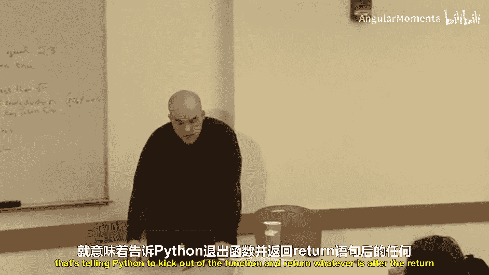

This false here， you know， it says return false， that means that doesn't matter where you are。

 it's just going to kick out of the innermost function or the function that encloses that return and return that value。

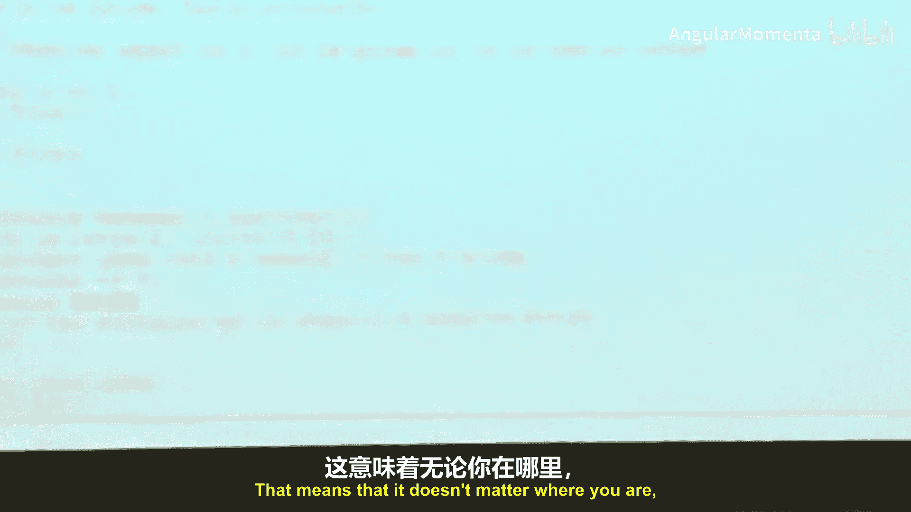

Any questions。So。So testing primarily， one is false， two is true。Three is true。

 four is false and five is。True。So it looks like the program works。And。If no one has any questions。

 I'm going to move on to the last major topic。Everyone's good on pseudoonee。All right。you' ready。

非常にワさ。Box。So the question was， is writing pseudo code useful for just understanding a program yourself or for explaining it to other people。

 the answer is both。嗯。It's。I don't know it' it's the difference between showing someone。

The derivative of a function， and then explaining that what you're doing is finding a function that gives you the slope。

Of the function at that point。So its you know one is more intuitive for some people than the other。

Mathematician would understand the former pretty quickly。

An English major would understand the latter。Maybe。Um， so like if I。

When I explain my research to people， I don't tell them that I mess around with Gaussian mixture models and hidden Markov models。

I tell them that I'm trying to figure out how people mispronounce words when they're speaking foreign languages。

A lot easier for people to digest。With debugging。Whatat are bugs。Mistakes and if you have many。

 if you see one bug， there are probably many more， right？All right。When you're debugging。

 your goal is not to move quickly。This is an instance where the maximum fast is slow and slowest fast comes into play。

You want to be very deliberate and systematic when you're trying to debug code。

You want to ask the question why your code is doing what it does。

And remember the first recitation I said。That your program or your computer is not going to do anything that you do not tell it to do。

呃。It's not something that people do naturally， like if you watch some of the Ts and you know sometimes a student will say。

 how do you find the bug so quickly， well， it's because I've been programming for 18 years。嗯。

Professor Gut's been programming for longer than that。 So a lot of it is experience。 and it's just。

 you know， when we've debugged our own programs and when we were learning to program。

 it was was as painful for us as it was for you。So。That said。You want to start with asking。

 how could your code have produced。The output that it did。

And then you want to figure out some experiments。That。Are repeatable。

And that you have an idea of what the output should be。So。After you do that。

 then you want to kind of test your code one by one on these different test cases。

And see what it does。And in order to see what it does， you can use a print tape。So。

When you think you found a bug and you think you have a solution in your code。You want to make。

As few changes as possible。At a time。It's because。As you're making corrections。

 you can still introduce bugs， right？嗯。Let's see a useful so a useful way to do this is to use a test harness。

 So when we actually grade your problem sets， a lot of the time the TAs will put together a set of test cases for your code。

Um so。One of the things is a lot of the times when you get one of the problems or when you look at the problems。

 it'll have some example input and output。But that doesn't necessarily mean that we only test on that。

There's additional test cases that we use， and it's not to trip you off。

 it's just because there's a lot of different variations。And it's also。

If you read the specification and you follow the specification， then you'll be fine。Moving on。

 so let's look at an example。 I have a function here is palindrome。

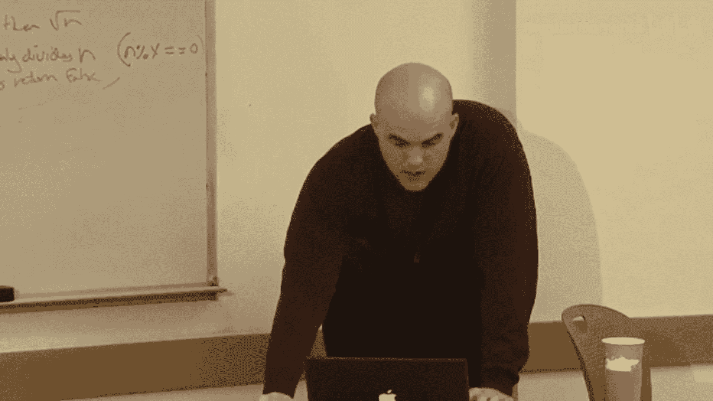

All right， I think you've seen this before， right？Yes， yeah， okay。So。

It's supposed to return true if stringing us as a palindrome。And so I've written this function。

 and I've also written a test harness。Now。There's a lot more code in the test harness。

 but it's pretty simple code。嗯。I'm going to think of when you're writing functions。

 you want to think of。The type of input you can receive。And。

You want to think of what are kind of the boundary cases so the extremes of input that you can get。

 we call these boundary cases， edge cases for the is palindrome function。

 it would be like the empty string。Would be one。Or just a single character。These you know are。

Kind of the minimum we can have or we could think of。On the opposite end of the spectrum。

 we can have an in。Theoretically， we could have an infinitely long string。

So we're not going to actually test for an infinitely long string。Anyway。

 all we're going to do is in our test harness， we're just going to run the function on these inputs。

And we know。That an empty string should be true。 We know that a single character string should be true。

We know that。You know， if I have a string that's two characters long and they're the same character。

 that should be true。If there' are two characters and should be false。

And what I'm going to do now is I'm looking at kind of expected what we call expected input。

 so after I've hit my edge cases。I'm going to look at all the strings of an even length。

And make sure that the function works properly。And then I'm going to look at strings with an odd length。

And then once I get to this point where I've tested。You know， a number of different lengths。

 and in this case it's just two through five or zero through five if you want to include the edge cases。

Then I'm going to say， well， it looks like all tests are passed and I think that this function works pretty good for anything we can expect it to encounter reasonably。

So。The way that you kind of use test harnesses is you want to every time you make a change to your program。

 you want to run the test harness。

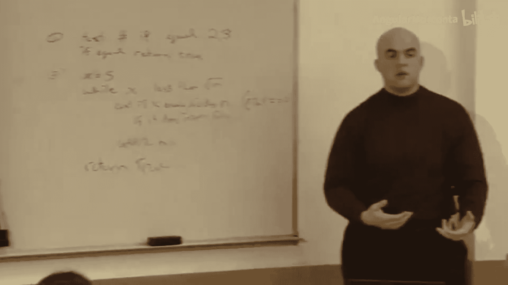

Because that'll catch any bugs you may have introduced。

 And so I'm going to finish up with this really quickly because I know。It's my time's zone。嗯。

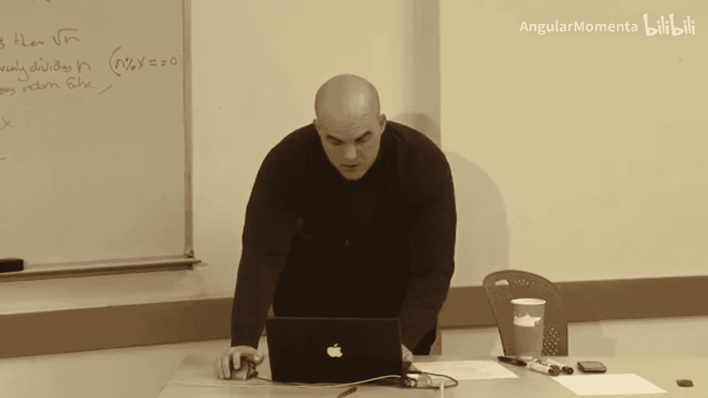

So I got a buck， right， it's telling me that one of my test cases failed。So line 299。Which is。

This test case。So。What we can do。Is now that we know that fails。We can say。Maybe print out our input。

And see what we have。And。Instead of just running。I'm just going to run。

That one test case that failed。Okay。So obviously this should be true。

And what we're seeing is that on the first call I palinrome。S says Ava。

And then on the recursive call to it。We only get BBA。That means that we've only chopped up the front。

Character， right， so you see the bug。Well， here。So。有 we go。

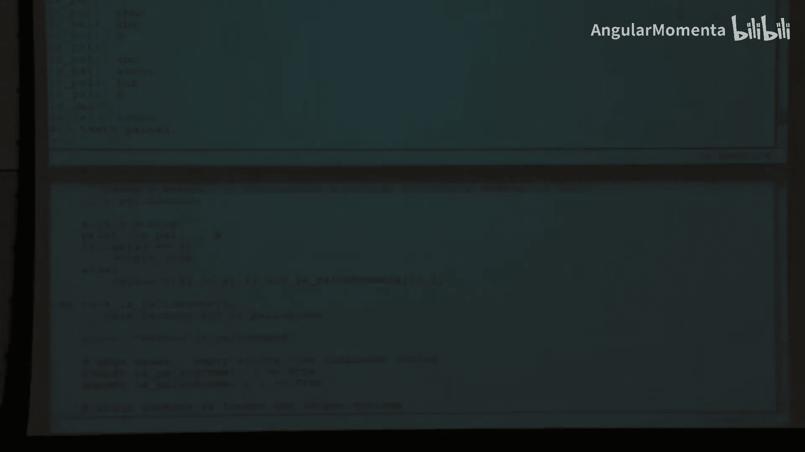