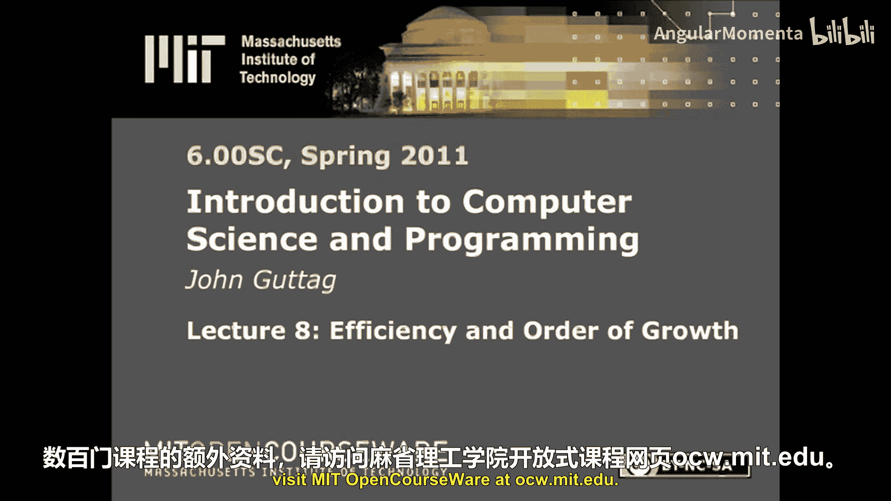
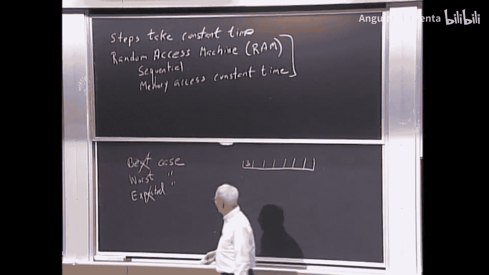
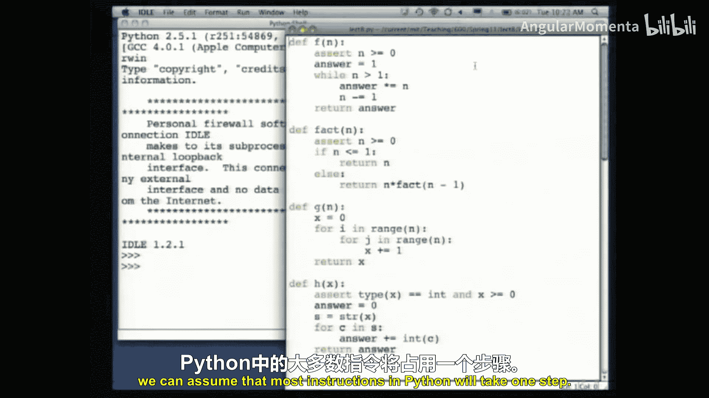
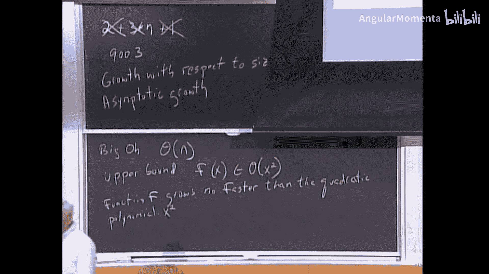
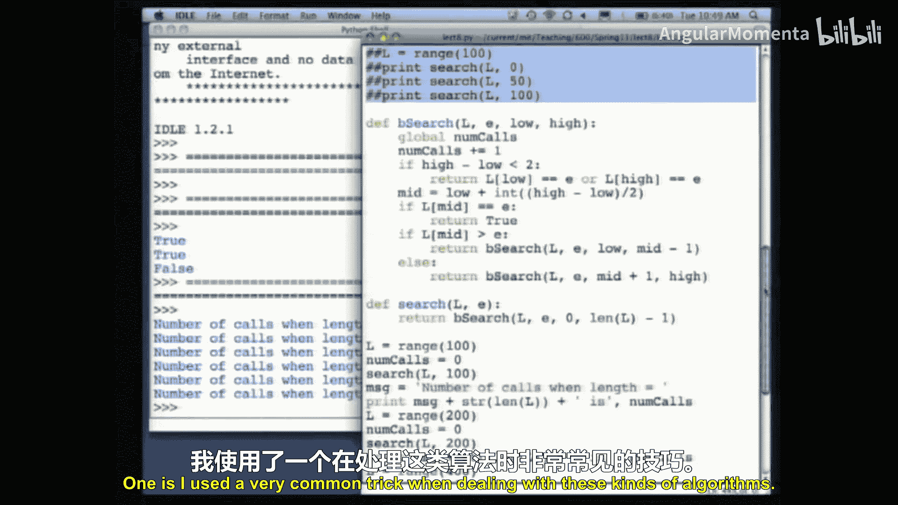
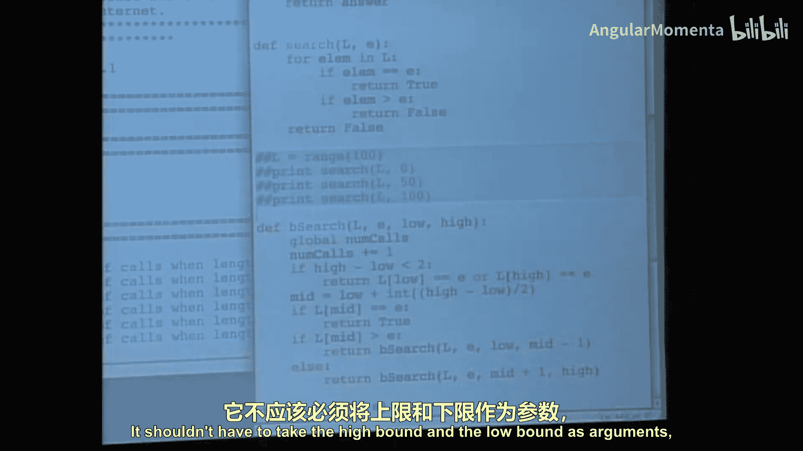
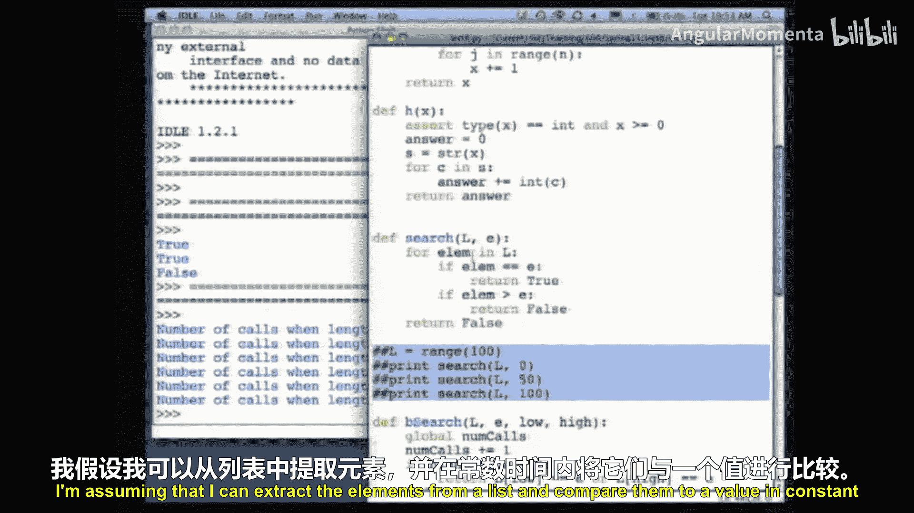

# 【麻省理工】计算机科学与编程导论 ｜ MIT 6.00SC Introduction to Computer Science and Programming p12 12 -BV1a5BZBkEP6_p12-

The following content is provided under a creative Commons license。

 Your support will help M I T Open Coseware continue to offer high quality educational resources for free。

To make a donation or view additional materials from hundreds of M T courses。

 visit M T OpenCseware at O Cw。t M I T Eduu。

Today， we're moving on to what will be a major unit of the course。Which is the topic of efficiency。

Thus far， we focused our attention on the。Admittedly more important problem of getting our programs to work。

I need to do what we want them to do。For the next several lectures。

 I want to talk about how do we get them to work quickly enough to be useful。It is。In practice。

 often a very important consideration in designing programs。

The goal is not to make you an expert in this topic。 It's hard to be an expert in this topic。

 I'm certainly not an expert。But I want to give you some intuition。

About how to approach the question of efficiency。How to understand why some programs take much longer to run than others。

And how to go about writing programs that will finish before you die。

And we'll see that if you write things wrong， the programs could， in principle。

 run longer than you can。So why is efficiency so important。Earlier in the term， I started。

Spend some time talking about how really fast computers are。

And showing you that we could use brute force algorithms to solve fairly large problems。The problem。

 the difficulty is that some of the computational problems we're confronted with are're not fairly large。

But enormous。So for example， in my research group where we work at the intersection of computer science and medicine。

We have a big database of roughly a billion and a half heartbeats。

And we routinely run computations that run for two weeks on that data。

And the only reason they completed in two weeks and not two years is we were really careful about efficiency。

So it really can matter。 And increasingly， it matters as we see the scale of problems growing。

The thing I want you to take home to remember。Is it efficiency？Is rarely。About clever coding。

It's not about some little trick that saves one instruction here or two instructions there。

It's really about choosing the right algorithm。So， the take home message。Is that efficiency。

It's about algorithms。Not about coding details。Clever algorithms are hard to invent。

A successful computer scientist might invent maybe one in his or her whole career。啊。I have to say。

 I have invented 0。Important algorithms in my whole career。Therefore。

 we don't depend upon being able to do that。Instead， what we depend upon is problem reducing。

When confronted with a problem。We want to reduce it。To a previously solved problem。

And this is really， often the key。To。Taking some problem and thinning into a useful computation。

We sit back and say， well， this looks a little bit like this other problem。

 How can I transform my problem。To match a problem that some clever person already knows how to solve。

Before I spend time on problem reduction。However， I want to draw back。

And look at the general question of how do we think about efficiency。When we think about it。

 we think about it in two dimensions。Space and time。And as we'll see later in the term。

We can often trade one for the other。We can make a program run faster， by using more memory。

Or use less memory at the cost of making it run more slowly。For now。And the next few lectures。

 I'm going to focus on time。Because really， that's mostly what people worry about these days when they're dealing with complexity。

So now， suppose I asked you the question。How long does some algorithm implemented by a program take to run。

How would you go about answering that question？Well， you could say， all right。

 I'm gonna run it on some computer。On some input and time it， look at my wife。

 and it took three minutes。I ran this other algorithm， and it took two minutes。

 It's a better algorithm。Well， that would be really a bad way to look at it。

The reasons we don't think about computational complexity。

And that's really what people call this topic。In terms of how long a program takes to run on a particular computer。

And that it's not a stable measure。To do that， it's。Influenced by the speed of the machine。

So a program that took one minute on my computer might take 30 seconds on yours。

It has to do with the cleverness。Of the Python implementation。

Maybe I have a better implementation of Python than you do。 So my computer will。

 my programs will run a little bit faster。But most importantly。

 the reason we don't depend upon running programs。Is it depends upon the input。

So I might choose one input for which the program took two minutes。

And another seemingly similar input on which it took an hour。

So I need to get some way to talk about it more abstractly。The way we do that。

Is by counting the number of basic steps。So we define some function， say， time。

Which maps the natural numbers to the natural numbers。The first N， in this case。

 the first natural number， the argument。Corresponds to the size of the input。

How big an input are we running do we want to run the program on。And the result of the function。Is。

The number of steps。That the computation will take for an input of that size。

I'll come back to this in a little bit more。Precise detail， momentarily。A step。

Is an operation that takes constant time。And that's important。So steps are not variable。

 but they're constant。So we have lots of these， for example， an assignment， a comparison。

 an array access， etca。In。Looking at computational complexity in this course。

 we're going to use a model of the computer。That's known as random access。A random access machine。

Frequently abbreviated as Ram。In a random access machines。

 instructions are executed one after another。That is to say， they're sequential。

Only one thing happens at a time。And。We assume constant time required to access memory。

So we can access at random any object in memory in the same amount of time as any other object。

In the early days of computers， this model was not accurate。Because memory was often， say， a tape。

And if you wanted to read something at the end of the tape。

 it took a lot longer to read something at the beginning of the tape than something at the beginning of the tape。

In modern computers， it's also not quite accurate。Modern computers have what's called a memory hierarchy。

Where you have levels of memory， the level 1 cache， the level 2 cache， the actual memory。

And it can differ by， say， a factor of 100。How long it takes to access。Data。

 depending upon whether it's in the cache。The cache keeps track of recently accessed objects。

Nevertheless， if we start going into that level of detail， we end up losing the forest for the trees。

So almost everybody， when they actually try and analyze algorithms， typically。Works with this model。

We also know in modern computers， some things happen in parallel。But again， for most of us。

 these will be second order effects。And the random access model is quite good。

For understanding algorithms。Now， when we think about。How long an algorithm will take to run。

There are several different ways we could look at it。We could think of the best case。

And as we think about these things as a concrete example， we can think about linear search。

So let's say we have an algorithm。It's using linear search。We've looked at that before。

To find out whether or not an element is in the list。Well。

 the best case would be that the first element is 3， and I'm searching for3。

 and I find it right away， and I stop。So that would be my best pace。Deest pace， desk case complexity。

It's the minimum running time over all possible inputs is the best case。

I could also look at the worst case。What's the worst case for linear search？It's not there exactly。

 So I go and I have to look at every element。And whoops， it's not there。

So the worst case is the maximum over all possible inputs of a given size。

The size here is the length of the list。And then I can ask， what's the expected or average case。

What would happen most of the time。The expected case seems in principle。

 like the one we should care about。But the truth is。When we do algorithmic analysis， we almost never。

Deal with the expected case， because it's too hard。If we think about the expected case for， say。

 linear search， we can't talk about it。Without some。

Detailed model of what the list itself looks like， what elements are in it and what the distribution of queries looks like。

Are we most of the time asking for elements that are not in the list。In which case。

 the expected value is out here somewhere。We it's far。

 or are we most of the time looking for things that are in the list。In which case。

 the expected value will be somewhere near halfway through the length of the list。

If we don't know those things， we have a tough time modeling expected value。

And one of the things we know is that frequently， we don't。 when we release a program。

 have a good sense of how people will actually use it。And so we don't usually focus on that。

Similarly， we don't usually focus on the best case。It would be nice。

 but you can imagine that it's not really what we care about。What happens when we get really lucky？

Because we all believe in Murphy's law， right。It。If something bad can happen， it will。And that's why。

Complexity analysis almost always focuses on the worst case。What the worst case does。Is it。

Provides an upper bound。How bad can things possibly get。What's the worst that can happen。

 And that's nice because it means that there are no surprises。

You say the worst that this thing can do is run in， is look at every element of the list once。

And so if I know that the list is a million elements， I know， okay。

 it might have to do a million comparisons， but it won't have to do any more than a million。

And so I won't be suddenly surprised that it takes overnight to run。嗯。Alas。

 the worst case happens often。We do frequently end up asking whether something is in a list。

 and it's not。So。Even though it seems pessimistic to worry about the worst case。

 it is the right one to worry about。All right。Let's look at an example。

So I've got a little function here， F。You can see it here。 It's on the handout， as well。First of all。

 what mathematical function is F computing。Just。Force you to look at it for a minute。

What's the computing， somebody。It is a function that should be familiar to almost all of you。Nobody。

Pardon。Exponentiation。啊。Don't think so。But I appreciate your trying。 It's worth some candy。

Not a lot of candy， but a little candy。Yeah。Factorial， exactly。It's computing factorial。Great grabs。

Alright， so。Let's think about。How long this will take to run。In terms of the number of steps。Well。

 the first thing it does。Is it computes。It executes an assertion。And for the sake of argument。

 for the moment， we can assume that most instructions in Python will take one step。

Then it does an assignment。 So that's two steps。Then it goes through the loop。

Each time through the loop， it executes three steps。

The test at the start of the loop and the two instructions inside the loop。

How many times does it go through the loop。Somebody。Right， in times。So itll be 2 plus。Three times n。

 And then it executes a return statement at the end。

So if I want to write down the function that characterizes the algorithm implemented by this code。

I say it's 2 plus three times n plus1。Well。I could do that。But it would be kind of silly。Let's say。

 n equals 3000。Well， if n equals 3000， this tells me that it takes 9000。Well， what is the take。

90003 steps， right。Right。Well， do I care whether it's 9000 or 9003。I don't really。So， in fact。

 when I look at complexity， I tend to， I don't tend to。 I do ignore additive constants。

So the fact that there's a two here and a one here。Doesn't really matter。So I say， well。

If we're trying to characterize this algorithm， let's ignore those。

Because what I really care about is。Growth。With respect to size。

 how does the running time grow as the size of the input grows。We can even go further。

Do I actually care whether it's 3000 or 9000？Well， I might。 I might care whether a program takes。

 say， three hours to run。Or 9 hours to run。But， in fact。As it gets bigger。

 and we really care about this as things get bigger， I probably don't care that much。

If I told you this was going take 3000 years or9 or 9000 years， you wouldn't care。

Or probably even if I told you it was going take 3000 days or 9000 days， you'd say， well。

 it's too long anyway。So typically， we even ignore multiplicative constants。

And use a model of asymptotic growth。That talks about how the complexity grows。

As you reach the limit of the sizes of the inputs。This is typically done。Using some notation。

Using a notation， we call big O notation。Written as a single O。 So if I write order N， O， N。

What this says is。This algorithm， the complexity， the time growths。Literally， within。With the。

Doesn't say whether it's three times n or two times N。 It's linear in n is what this says。

Well why do we call it big O。Well， some people think it's because， oh my God。

 this program will never end。But， in fact， no。This notion was introduced to computer science by Donald Cannuth。

And he chose the Greek letter， Omicron。Because it was used in the 19th century by people developing calculus。

啊。We don't typically write Omicron because it's harder to type。

 So we usually use the capital Latin letter O。Hence， life kept simple。What this does。

Is it gives us an upper bound。For the asymptotic growth of the function。So formally。

 we would write something like。F of x。Where have is some。Function of the input X。Is order。Let's say。

 x squared。I would say it's quadratic in the size of x。Formerally， what this means。

Is that the function F。I should probably write this down。The function F。Grows no faster。

And the quadratic。Polynomial。X squared。All right。So let's look at what this means。

I wrote a little program that talks about some of the， I should say， probably most popular。

Values we see。So some of the most popular。Orders we would write down。We often see order 1。

And what that means is constant。The time required is independent of the size of the input。

Doesn't say it's one step。But it's independent of the input。 It's constant。We often see order。Login。

Loarithmic growth。拿起。Border N。Lineer。One we'll see later this week is in login。

This is called log linear。And we'll see why that occurs surprisingly often。Order N to the C。

 where C is some constant。This is polynomial。A common polynomial would be squared， as in quadratic。

And then。If we're terribly unlucky， we run into things or order C to the N。Exponential。

In the size of the input。To give you an idea of what these classes actually mean。

I wrote a little program that produces some plots。Don't worry about。

What the code looks like in a few weeks， you'll be able to write such programs yourself。嗯。

Not only youll be able to， you'll be forced to。嗯。So I'm just gonna run this and produce some plots。

Showing different orders of growth。Why isn't it producing these plots。 all right。 excuse me。 I see。

There it goes。Alright， so let's look at the plots。So here I've plotted linear growth versus logarithmic growth。

And as you can see。It's quite a difference。If we can manage to get a logarithmic algorithm。

It grows much more slowly than a linear algorithm。 And we saw this when we looked at the great advantage of binary search。

 as opposed to linear search。😊，Actually， this is linear versus log linear。What happened to figure 1。

s3。 Well， we'll come back to it。So you'll see here that log linear。Is much worse than linear。So。

 this factor。Of and log n。Actually， makes a considerable difference。In running time。Now。

 I'm going to compare log linear to quadratic。The a small degree， polynomial。And as you can see。

 it almost looks like log linear is not growing at all。

So as bad as log linear looked when we compared it to linear。We see that。Compared to quadratic。

 it's pretty great。And what this tells us is that in practice。

 even a quadratic algorithm is often impractically slow。And we really can't use them。

And so in practice， we worked very hard to avoid even quadratic。

Which somehow doesn't seem like it should be so bad。But， in fact， as you can see。

 it gets bad quickly。Yeah， this was the log versus linear。Not surprising。And now。

If we look at quadratic versus exponential。We can see hardly anything。

And that's because exponential is growing so quickly。So， instead。What we're going to do。

Is I'm gonna to plotlo。The Y axis logarithmically。Just so we can actually see something。

And as you can see， on input of size，1000。An exponential algorithm。Is roughly ordered 10 to the 286。

That's an unimaginably large number。Right， I don't know what it compares to the number of atoms in the universe or something ridiculous or maybe more。

But we can't possibly think of running an algorithm。 It's going to run this。 Take this long。

It's just not even conceivable。So exponential， we'd sort of throw up our hands and say， we're dead。

We can't do it。And so nobody uses exponential algorithms for everything， yet for anything， yet。

 as we'll see。There are problems that we care about。That， in principle。

 can only be solved by exponential algorithms。So what do we do， as we'll see， Well。

 we usually don't try and solve those problems。 We try and solve some approximation to those problems。

Or we use some other tricks to say， well， we know the worst case will be terrible。

 But here's how we're gonna avoid the worst case。We'll see a lot of that towards the end of the term。

The moral is。Try not to do anything that's worse than log linear， if you possibly can。All right， now。

Some truth in advertising， some caveats。If I look at my definition of what big O means。

 I said it grows no faster than。So in principle， I could say， well， what the heck？ I'll just write。

2 to the X here。 And it's still true。 It's not faster than that。It's not what we actually want to do。

What we actually want is a tight bound。We'd like to say it's no faster than this。

 but it's no slower than this， either。To try and characterize the worst case as precisely as we can。

Formerally speaking， the theorists used something called big theta notation for this where they write a theta instead of an O。

However。Most of the time， in practice。When somebody writes something like。F of x。Is order。X squared。

What they mean is。The worst case is really about x squared。

And that's the way we're gonna use it here。 We're not going to try and get too formal。

 We're gonna to do what people actually do in practice， when they talk about。Complexity。Alright。

 let's look at another example now。Alright， here， I've written factorial recursively。

Didn't even try and disguise what it was。So let's think about how we would analyze the complexity of this。

Well， we know that we can ignore the first two lines of code because those are just the additive pieces。

 We don't care about that。The first line。And。The if in the return。So what's the piece we care about。

We care about the number of times that factorial is called。In the first implementation of factorial。

 we cared about the number of iterations of a loop。Now， we've， instead of using a loop。

 use recursion to do more or less the same thing。And so we care about the number of times factors called。

How many times will that happen？Well。Let's think about why I know this doesn't run forever。

 because that's always the way we really think about complexity， in some sense。

I know it doesn't run forever because each time I call factorial。

 I call it on a number one smaller than the number before。So how many times can I do that？

If I start with the number N。In times， right。So， once again。It's order N。

So the interesting thing we see here is that essentially。

 I've given you the same algorithm recursively and iteratively。Not surprisingly。

 even though I've coded it differently。It's the same complexity。Now， in practice。

 the recursive one might take a little longer to run because there's a certain overhead to function calls that we don't have with while loops。

But we don't actually care about that。This overhead is one of those multiplicative constants。 I said。

 we're going to ignore。And， in fact， it's a very small， multiplicative constant。

 It really doesn't make much of a difference。So how do I decide whether to use recursion or iteration has nothing to do with efficiency。

 It's whichever is more convenient to code。In this case， I kind of like the fact。

 the recursive factorial。 It's a little neater。So that's what I would use and not worry about。

The efficiency。All right。Let's look at another example。啊。How about G。What's the complexity of G。Well。

 I can ignore the first statement。But now I've got two nested loops。

 How do I go and think about this。The way I do it。Is I start。By finding the inner loop。And say。

 allright， how many times do I go through the inner loop。Or how long does。Each。

 I go through the inner loop。N times， right。So to execute the inter four statement is going be order n。

The next question I ask is， how many times do I start the inner loop up again。That's also order。

 n times。So what's the complexity of this？Somebody。Yes， I think I heard the right answer。

It's quarter。N squared。Because I execute the inner loop N times or each time around is n。

 And then I multiply it by n because I'm doing it。The outer loop n times。

 So the inner loop is order n squared。Okay， does that make sense。 So typically。

 whenever I have nested loops， I have to do this kind of reasoning。Same thing。

 if I have recursion inside a loop or nested recursions。I start at the inside， and work my way out。

Is the way to do the analysis。Alright， let's look at another example。 It's kind of a different take。

How about H。What's the complexity of H。Alright， first of all， what's H doing。

Kind of always a good way to start。What is answer going to be。Yeah。まかなめ。Right， exactly。

 it's going to be the sum of the digits。Spring training is already underway， so。

Alright it's gonna some of the digits。 And what's the complexity。Well， we can analyze it。Right away。

 we know we can ignore everything except the loop。So how many times do I go through this loop。

Pds upon the number of digits in the string representation。Of the int， right。Now， if I were careless。

I would write something like。Order N。We're in。Is the number of digits。In s。But I'm really。

 I'm not allowed to do that。 Why not。Because I have to express the complexity in terms of the inputs to the program。

And S is not an input。S is a local variable。So somehow I'm gonna have to express the complexity。

 not in terms of S。But in terms of。What X。So that's no though。 So what is it in terms of X。

How many digits， yeah。It's not constant， no， because I'll have more digits in a billion than I will in four。

Right， log， in this case， base 10。Of x。The number of digit。

 decimal digits required to express an integer is the log of the magnitude of that integer。

think about when we looked at binary numbers and decimal numbers。Last lecture。

 that was exactly what we were doing。So that's the way I have to express this。Now。

 what's the moral here， The moral is not。The thing I really care about is not that this is how you talk about the number of digits in an int。

What I care about is that you always have to be very careful。

 People often think that they're done when they write something like order in。

But they're not until they tell you what N means。Because it can be pretty subtle。 You know。

 and in this case was not， you know， if order X。Would have been wrong。

Because it's not the magnitude of the integerx。It's。This is what controls the growth。

 So whenever you're looking at complexity。You have to be very careful what you mean。

What the variables are， This is particularly true now， when you look at functions。

 say with multiple inputs。Okay。Let's look at some more examples。So we've looked before at search。

So this is code you've seen before， really。Here's a linear search and a binary search。And， in fact。

 informally， we've looked at the。Complexity of these things before。

And we can run them and we can see how they will grow。But it won't surprise you。

So if we look at the linear search。Whoops。P the values here just， just shows it works。But now。

The binary search， what we're gonna to look at is how it grows。

 This is exactly the search we looked at before。And the thing I want you to notice。

And as we looked at before， we saw it was logarithmic， is that as the number of。

 as the size of the list grows。Doubles， I only need one more step to do the search。

This is the beauty of a logarithmic algorithm。So as I go from 100， which takes 7 steps to 200。

 it only takes 8。1600 takes 11。 And when I'm all the way up to some very big number。

 and I'm not even sure what that number is， it took 23 steps。But， very slow growth。So。

 that's a good thing。What's the order of this。It's order n where n is what or order log n。

 where n is what。Let's just try and write it carefully。Well， it's order。Length of the lift。Right。

We don't care what the actual members of the list are。Now。That's。An interesting question to ask。

 Let's look at the code for a minute。 Is that a valid assumption。Well。

 it seems to be when we look at my test， But let's look at what I'm doing here。

So a couple things I want to point out one。Is I used a very common trick when dealing with these kinds of algorithms。

You'll notice that I have something called B search and something called search。

All search does is called B search。Why did I even bother with search。

 Why didn't I just when my code down here called B search with some initial values。The answer is。

Really， I started with this search。And。A user of search。

Shouldn't have to worry that I got clever and went from this linear search to a binary search or maybe some more complex search yet。

I need to have a consistent interface for the search function。

And the interface is what it looks like to the caller。 And it says， when I call it。

 it just takes a list in an element。It shouldn't have to take。The high bound and the low bound。

As arguments， because that really is not intrinsic to the meaning of search。

So I typically will organize my program。By having。This search look exactly like this search to a caller。

And then it does whatever it needs to do to call binary search。

So that's usually the way you do these things。 It's very common with recursive algorithms。

Various things where you need some initial value that's only there for the initial call。

Things like that。 All right。The other thing I wanted， let me finish one wanted to point out。

Is the use of this global variable。So， you'll notice down here。I define something called numb calls。

Remember， we talked about scopes。So this is now an identifier that exists。

In the outermost scope of the program。Then in B search， I used it。But。I said。

 I'm going to use this global variable。 This variable declared outside the scope of research。

Inside research search。So it's this statement that tells me not to create a new local variable here。

But to use the one in the outer scope。This is normally considered poor programming practice。

Global variables can often lead to very confusing programs。Occasionally， they're useful。Here。

 it's pretty useful because I'm just trying to keep track of the number of times this thing is called。

And so I don't want a new variable。Genrated each time the， it's instantiated。All right。Now。

 do you had a question。要。Checking the order length L， the size of the list。

That's the order of the linear search。Right， the order of the binary search。Is order。Log base 2 of L。

Sorry， not of L， right， doesnn't make sense to take the log of a lift。Of the length of the list。

Typically， we don't bother writing base， too。If it's logarithmic。

 it doesn't really very much matter what the base is。 You'll still get that very slow growth。

Log base 10 log base 2， not that much difference。So we typically just write log。All right。

 people with me。Now。For this to be true， or， in fact， even。If we go look at。The linear search。

There's kind of a。Assumption。I'm assuming。That I can extract the elements from a list。

And compare them。To。A value in constant time。Becauseuse remember。

 my model of computation says that every step takes the same amount of time， roughly。

And if I now look， say， at binary search。You'll see。

 I'm doing something that apparently looks a little bit complicated。Up here。

I am looking at L of low and comparing it to E and L of high of comparing it to E。

How do I know that's constant time， Maybe it takes me order length of list time to extract。

The last element。So I've got to be very careful when I look at complexity。Not to think。

 I only have to look at the complexity of the program itself。 That is to say， in this case。

 the number of recursive calls。But is there something that it's doing inside this function。

That might be more complex than I think。As it happens。In this case。

 this rather complicated expression。Can be done in constant time。

And that will be the first topic of the lecture on Thursday。

