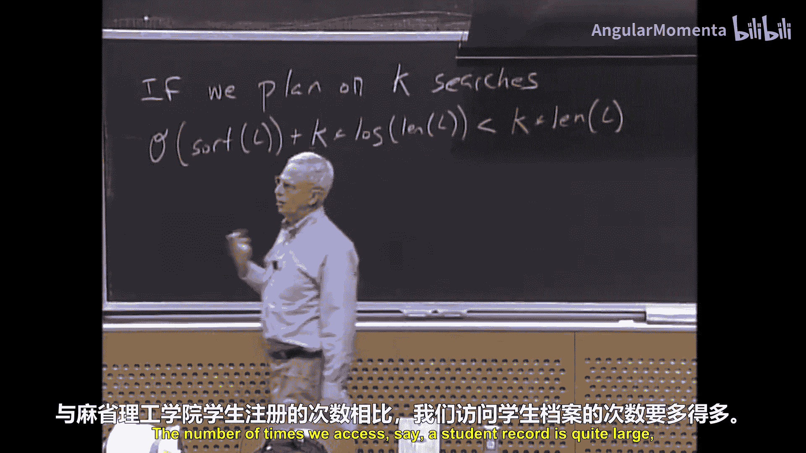
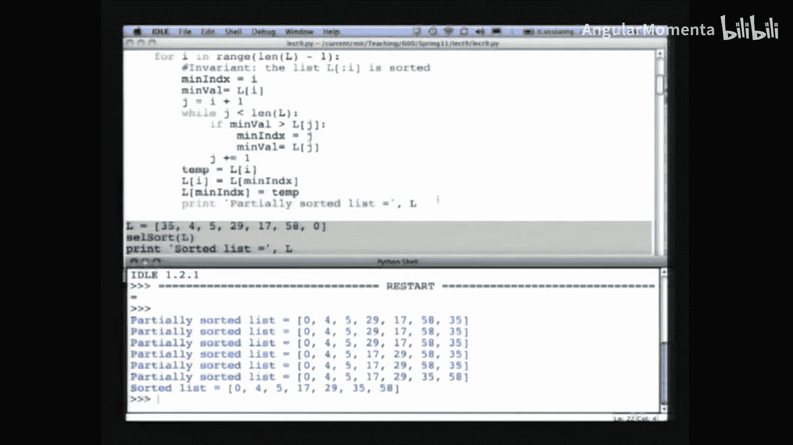
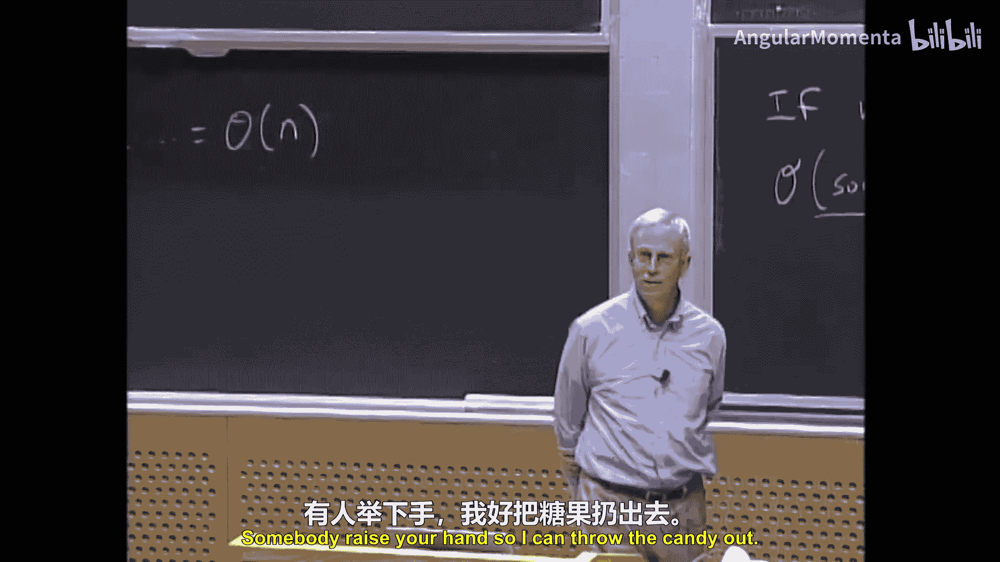
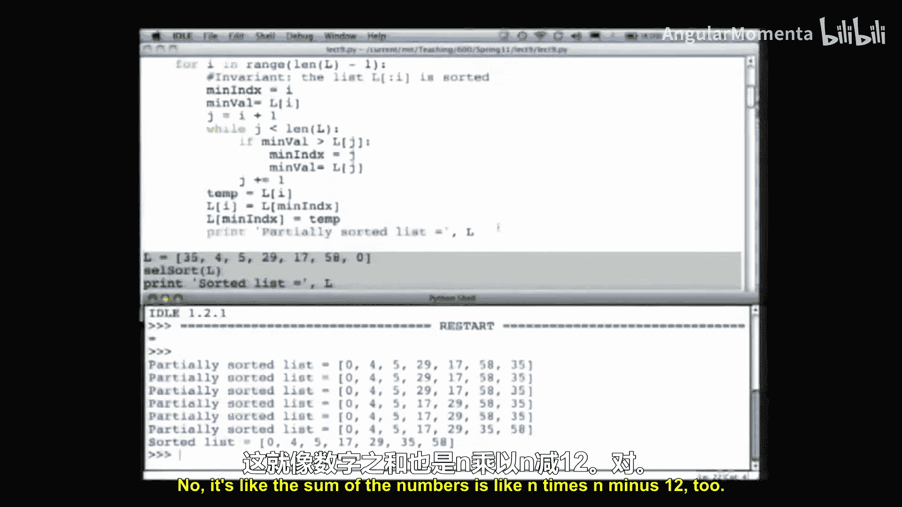
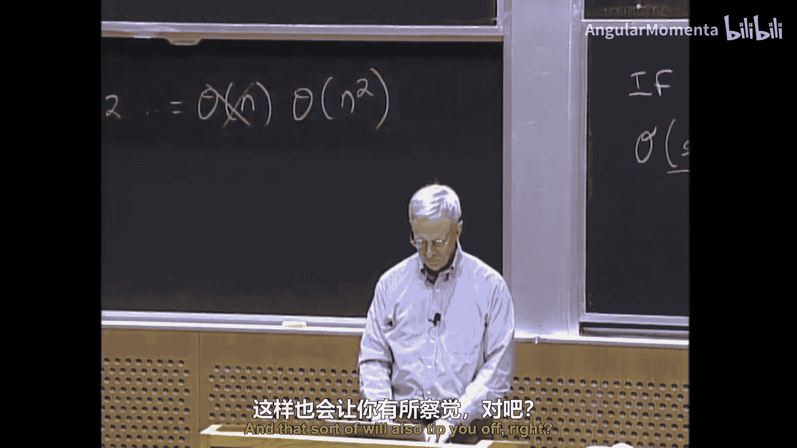
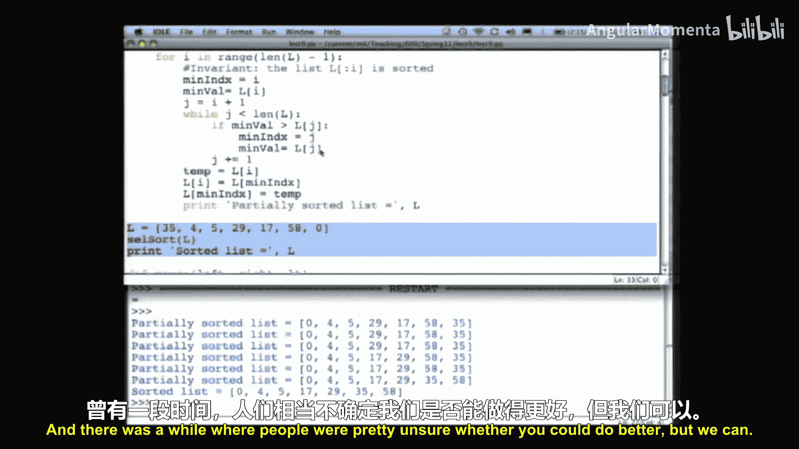
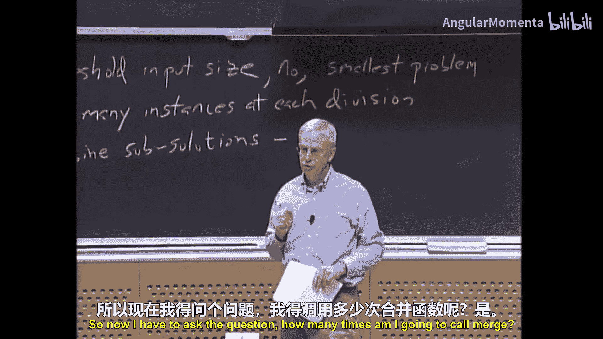
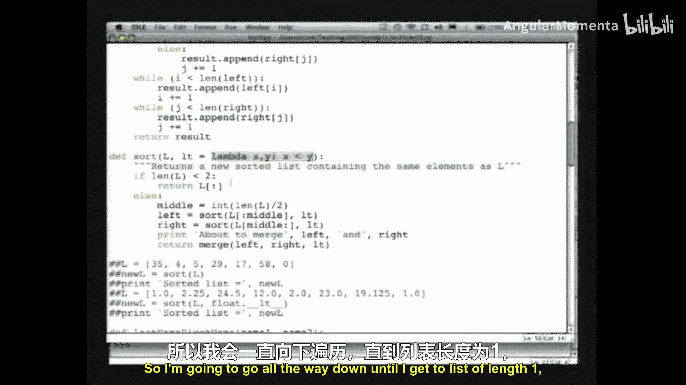
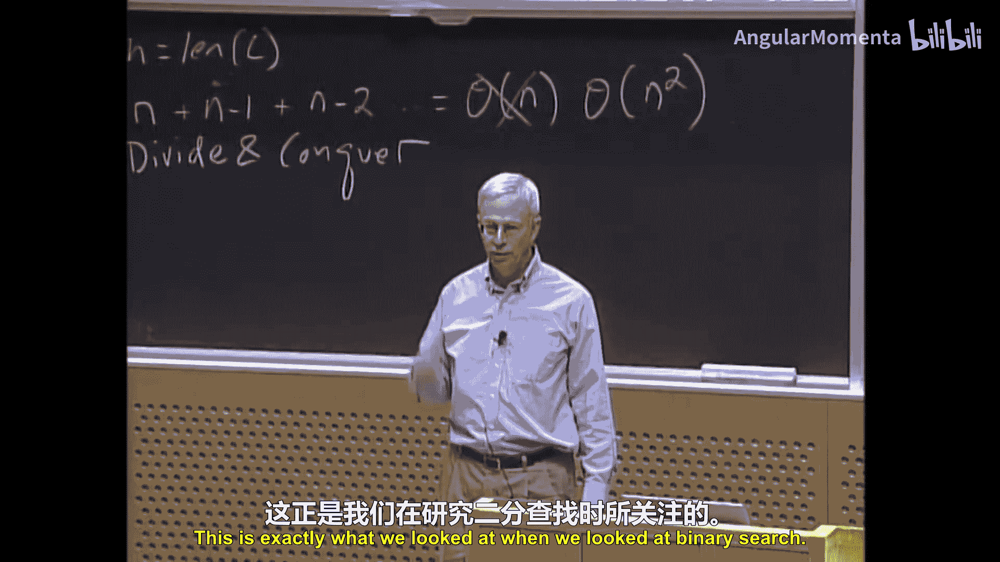
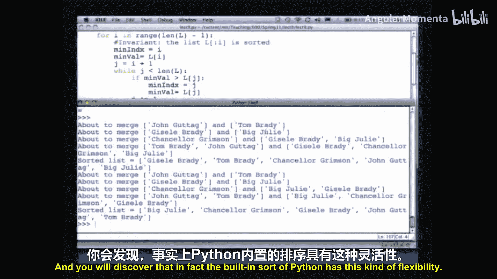

# 【麻省理工】计算机科学与编程导论 ｜ MIT 6.00SC Introduction to Computer Science and Programming p13 13 -BV1a5BZBkEP6_p13-

The following content is provided under a creative Commons license。

 Your support will help M I T Open Coseware continue to offer high quality educational resources for free。

To make a donation or view additional materials from hundreds of M T courses。

 visit M T OpenCseware at O Cw。t M I T Eduu。So in the example we looked at。We had a list of ints。

That's actually quite easy to do， in constant time。If you think about it。An int。Is。

Always going to occupy the same amount of space。Roughly speaking， either 32 or 64 Bs。

Depending upon how big an int the language wants to support。So let's just。For the sake of argument。

Assume an int occupies four units of memory。And I don't care what a unit is。 It's a unit 8 bits。

16 bits。Doesn't matter。4 units。Now， how would we get。To the eighthh element of the list。

What is the location。In memory。Of L sub I。Well， if we know the location of the start of the list。

And certainly， we can know that。Because our identifier， say L， in this case， will。

Point to the start of the list。Then it's simply going to be， thell start。Plus，4。Times I。

My list looks like this。I point to the start。The first element is here。

So that's start plus 4 times 0。Makes perfect sense。The second element is here。

 So that's going to be start plus  four times 1。 Sure enough， this would be location 4。

Relative to the start of the list， etc cetera。So this is a very conventional way。

implementmplement lists。But what does it。Correctness depend upon。

It depends upon the fact that each element of the list is of the same size。In this case， it's 4。

 but I don't care if it's 4。If it's 2， it's  two times I， if it's 58， it's 58 times I。

 it doesn't matter。But what matters is that each element is the same size。

So this trick would work for accessing elements of lists of floats。Lists of ints。

 anything that's of fixed size。But that's not the way lists are in Python。In Python。

 I can have a list。That contains ints and floats， and strings。And other lists and dicks。

 almost anything。So， in Python。It's not this nice picture where the lists are all homogeneous。

In many languages， they are， by the way。And those languages would implement it exactly as I outlined it on the board here。

But what about languages where they're not， like Python。One possibility。

And this is probably the oldest way that people use to implement lists。

Is the notion of a linked list。These were used way back in the 1960s when Lisp was first invented。

And effectively， there。What you do is a list。Every element of the list is a pointer。

To the next element。And then， the value。So what it looks like in memory。Is we have the lift。

And this points to the next element。Which maybe has a much bigger value field。But that's O。

 This points to the next element。Now， let's say this one maybe is a tiny value field。

And then at the end of the list。I might write none。Saying there is no next element。Or nil， en Lisp。

 speak。Well， what's the cost here of accessing the n element of the list。

Of the I element of the list。Somebody。How many steps does it take to find element I。I sta exactly。

So for a linked list。Finding the I element is order。I。That's not very good， right。

That won't help me with binary search。Because now。If this were the case for finding an element of a list in Python。

 binary search would not be log length of the list， but it would be length of order。

 length of the list， right。Because the worst case is， I'd have to visit every element of the list。

Say to discover something isn't in it。So。This is not what you want to do。Instead。

 Python uses something like the picture in your handout。And the key idea here is one of indirection。

So in Python， what a list looks like。Is it as a lift？Afection of memory。A list of objects。

 each of the same size。Because now what each object is， is a pointer。So we've now separated in space。

The values of the I， of the members of the list and the pointers to， if you will， the next one。

So now it can be very simple。This first element could be big。Second element could be small。

 We don't care。Now， I'm back to exactly the model。We looked at here。

If say a pointer to some place in memory is four units long。T to find L of I。

I use that trick to find， say， the I pointer。And then it takes me only one step to follow it。

 to get to the object。So I can now， in。Constant time。Access any object into a list。

 even though the objects in the list are of varying size。

This is the way it's done in all object oriented programs， programming languages。

That makes sense to everybody。This concept of indirection。

Is one of the most powerful programming techniques we have。It gets used a lot。嗯。Now。

 my dictionary defines indirection as a lack of straightforwardness and openness。

 And as the synonym uses deceitfulness。啊。And it had this pejorative term until about 1950。

 when computer scientists discovered it。And decided it was a wonderful thing。

And there's something that's often quoted as people who do algorithms。They say， quote。

 all problems in computer science can be solved by another level of indirection。So it's sort of。

 whenever you're stuck， you add another level of indirection。

The caveat to this is the one problem that can't be solved by adding another level of indirection is too many levels of indirection。

Which can be a problem。As you look at certain kinds of memory structures。

The fact that you've separated the pointers from the value fields。

Can lead to them being in very far apart in memory。

Which can disturb behaviors of caches and things like that。So in some models of memory。

 this can lead to surprising inefficiency。But most of the time。

 it's really a great implementation technique。And I highly recommend it。Okay。

 so that's how we do the trick。So now we can convince ourselves that binary search is indeed order log n。

And as we saw Tuesday， logarithmic growth is very slow。

So it means we can use binary search to search enormous lists。And get the answer very quickly。

All right。There's still one catch。And what's the catch。There's an assumption to binary search。

Binary search works only when what assumption is true。The list is sorted。

Because it depends on that piece of knowledge。So， that raises the question。How did it get sorted。

Or the other question it raises， if I ask you to search for something。

Does it make sense to follow the algorithm of one。Sort L 2。Use binary search。Does that make sense。

Well。What does it depend upon， whether this makes sense from an efficiency point of view。

We know that。 that's。Porter log。Length of L。We also know if the list isn't sorted。We can do it in。

Order L。We can always use linear search。So whether or not this makes a good idea。

Depends upon whether。We can do this。Fast enough。So it has the question is。Order question mark。Plus。

 order。Log。L of L。Less than order L。If it's not， it doesn't make sense to sort it first in sum。

 right。So what's the answer to this question。Do we think we can sort a list fast enough。As in。

 and what would fast enough mean。What would it have to be。For this to be better than this。

We know that we have to be able to sort a list in sublinear time。Can we do that。Alas。

 the answer is provably no。No matter how clever we are。

 there is no algorithm that will sort a list in sublinear time。And if you think of it。

 that makes a lot of sense。Because how can you get a list in ascending or descending order without looking at every element in the list at least once。

Right， logic says you just can't do it。If you're going put something in order。

 you're gonna have to look at it。So， we know that。At。We have a lower bound on sorting。

 which is order L。And we know that order L plus order log length L is。The same as order L。Which is。

Not better than that。Alright， so why do we care if this is true。

 why are we interested in things like binary search at all。And the reason。

Is we're often interested in something called amortized。Complexity。Now。

 I know that there are some course 15 students in the class who will know what aorturization means。

But maybe not everybody does。The idea here。Is that。If we cansort the list once。

And end up searching it many times。The cost of the search can be allocated a little bit to each of the different time of sorry。

 the cost of the sort。Can be allocated。A little bit of it to each of the searches。

And if we do enough searches。Then， in fact， it doesn't really matter how long the sort takes。

So if we were going search this list a million times。

Maybe we don't care about the one time overhead of sorting it。

And this kind of amortized analysis is quite common and is what we really end up doing most of the time in practice。

So the real question we want to ask。Is。If。We plan on。Performing K searches。Is。

Who knows how long it will take to sort it。But we'll take is order of whatever sort。Of the list is。

Plus。K。Times。Log。Length of L。Excuse me。Is that less。Then。K times。Lnneelle。

If I don't sort it to do K sort， searches will take this much time。If I do sort it。

 it will take this much time。The answer to this question， of course。

 depends upon what's the complexity of that and how big is K。that make sense。In practice。

K is often very big。The number of times we access， say， a student record is quite large。

Compared to the number of times students enroll in MI I T。So if at the start of each semester。

 we produce a sorded list。It's pretty。 then it pays off to do the searches。AndIn fact。

 we don't do assorted list。 We do something more complex， but you understand the concept， I hope。

All right。For now， we have to say。How well can we do that。

That's what I want to spend most of the rest of today on now， is talking about。How do we do sorting。

 Because it is a very common。Operation。So first of all。Let's look at a way we don't do sorting。

So there was a famous computer science who op scientist who opin on this topic。嗯。

We can look for him this way。AWell known technique is bubble sort。Now， actually， stop。

 We're gonna need sound for this。Do we have sound in the booth。DoWe have somebody in the booth。Well。

 we either have sound or we don't。We'll find out shortly。Other way。Come on， shouldn't oh there。

Thank you。Now， it's hard to get a job as president。 And I mean you're going through the rigs now。

 It's also hard to get a job at Google，We have questions and we ask our candidates questions。

 and this one is from Larry Swmer。What。You guys think I'm kiddings right here。

What is the most efficient way to sort a million， 32 bit integers？Well。I'm sorry。 maybe no， no， no。

 no， no， no。 I think I think I think the the bubble sort would be the wrong way to go。Come on。

 who told is there。Okay。I didn't see computer science we've got our spies in there。Well。Why okay。

 let's ask a different interview。All right。So。As he sometimes is， the president was correct。

Bubble sort， though， often discussed， is almost always the wrong answer。

 So we're not going talk about bubble sort。I， by the way。

 no Larry swimmer and can believe he did ask that question。嗯。But， yes。

 I'm surprised someone had obviously warned the the president， actually， the then future president。

 I think。Alright， so let's look at a different one。that's often used。

 and that's called selection sort。This is about as simple as it gets。

The basic idea of selection sort。And it's not a very good way to sort it， but it is a useful。

Kind of thing to look at， because it introduces some ideas。Like many。Algorithms。

It depends upon maintaining， establishing and maintaining an invariant。

An invariant is something that's invariantly true。The invariant we're going to maintain here。

Is we're going to have a pointer into the list。And that pointer is going to divide the lift。

Into a prefix。And a suffix。And the invariant。That we're going to maintain。Is it the prefix。

Is always sorted。We'll start where the prefix is empty。 It contains none of the list。

And then each step through the algorithm。Will decrease the size of the suffix by one element。

And increase the size of the prefix by one element。While maintaining the invariant。

And will be done when the size of the suffex suffix is 0。 and therefore。

 the prefix contains all the elements。And because we've been maintaining this invariant。

We know that we have now sorted the list。So you can think about it， for example。

 if I have a list that looks like。4。2，3。I'll start pointing here。And the prefix。

 which contains nothing， obeys the invariant。I'll then go through the list。

And find the smallest element in the list。And swap it with the first element。So my next step。

 the list will look like2。4，3。I'll now point here。My invariant is true。

 The prefix contains only one element。 So it is in sending order。And I've increased its size by one。

I don't have to look at this element again， because I know by construction， that's the smallest。

So now I move here。And I look for the smallest element in the suffix。Which will be 3。I swap 3 and 4。

And then I'm going to be done。Does that make sense。So it's very straightforward。 It's， in some sense。

 the most obvious way。To， to sort a list。And if you look at the code。That's exactly what it does。

I've stated the invariant here。And I just go through。And I sort it。So， we can run it。Let's do that。

So I'm going to sort the list 3，5，4， etc cetera， or 3，4，5， etc cea，35，4，5。Go to call selection sort。

And。I don't think this is in your handout， but just to make it obvious what's going on。

 each iteration of the loop I'm going to print。The partially sortded list。So we can see what。

 what's happening。So the first step it finds4 and puts that in the beginning。Actually finds 0。

 puts it in the beginning， etc cetera。 Allright。So people see what's going on here。

It's essentially doing exactly what I did on the board over there。And when we're done。

 we have the list completely sorted。What's the complexity of this。

What's the complexity of selection sort。Well， there are two things going on， right。

 I'm doing a bunch of comparisons。And I'm doing a bunch of swaps。Since I do。At most。

 the same number of comparisons as I do swaps or swaps as I do comparisons。

 I never swap without doing a comparison。We can calculate complexity by looking at the number of comparisons I'm doing。

You can see that in the code as well。So how many。Comparisons might I have to do here。Well。

 the key thing to notice。Is。Each time I look at it。Each iteration。

 I'm looking at every element in what。In the list。No， every element in the suffix。So。

 the first time through。I'm going to look at。Let's just say in。Equals the length of the list。

So the first time through， I'm going look at。And elements。Then， I'm going to look at。N -1。

Then I'm going to look at n -2。Until I'm done， right。So that's how many operations I'm doing。

And what is the order of。N plus n -1 plus n -2。Exactly。Order in。So selection sort is order N。

Is that right。Somebody said order， and， do you believe it's in。Is this really in？It's not in。

 What is it。Somebody raise your hand so I can throw the candy out。

Yeah。It's not in factorial。You said that with the question mark。い voice？As some of the numbers。え社全な。

Right， it's really。Exactly。It's a little smaller than n squared， but it's order n squared， right。

I'm doing a lot of these editions。So I can't ignore all。

 all of these extra turns and say they don't matter。

It's almost as bad as comparing every element to every other element。Alright。

 so selection sort is order n squared。And。You can do it by understanding that sum。

 or you can look at the code here。

And that sort of will also tip you off， right。Okay， so now。Can we do better？

And there was a while where people were pretty。Unsure whether you could do better。But， we can。

嗯。And if we think about it now。It was a method invented by John Von Neuman， a very famous guy。And he。

Back in the 40s， amazingly enough。And he viewed this as a kind of divide and conquer algorithm。

And we've looked at divideivide and conquer before。So how。

 what is the general form of divide and conquer。Afraid youve heard me use many times。Popular。

 popularized， by the way， I think by Macchiavelli in， in the prince in a not very nice context。

So what we do， and they're all the kind the same。We start with one。

 Let me get over here and get a full board for this。First， we have to choose a threshold size。

Let's call it n0。And that will be essentially the smallest problem。So we can keep dividing。

 making our problems smaller。This is what we saw with binary search， for example。

Until it's small enough that we say， oh， the heck with it， will'll stop dividing it。 Now。

 we'll just solve it directly。So that's how small we need to do it， how。

The smallest thing we'll divide things into。The next thing we have to ask ourselves is。How many。

Instances。At each division。So we have a big problem。 We divide it into smaller problems。

 How many are we going divide it into。So we divide it into smaller problems until we reach the threshold where we can solve it directly。

And then， the third。And most important part is， we need some algorithm。

To combine the sub solutionsution。No goods solving the small problem。

 If we don't have some way to combine them to solve the larger problem。All right。

So we saw that before， and now we're going to see it again。And we're going to see it in particular。

 in the context of merge sort。If I use this board， can people see it or is the screen going to occ it？

Is there anyone who cannot see this board if I write on it。All right， then I will write on it。Okay。

So， let's first。Look at。This problem。What Von Neuman observed in 1945。Is given two sorted lists。

 And amazingly enough， this is still the most popular sorting algorithm。

Are one of the two most popular， I should say， given two sortred lists。You can merge them。Quickly。

So let's look at an example。I'll take the list，1。fi。12。18。19 and20。At list one。

And I'll try and merge it with the list 2，3。4 in 17。So the way you do the merge。

Is you start by comparing the first element。To the first element。And then you choose， all right。

1 is smaller than 2。So that will be the first element of the merge list。I'm now done with one。

 and I never have to look at it again。The next thing I do。Is I compare 5 and 2。

The head of the two remaining lifts。And I said， well， two is smaller than5。

I never have to look at two again。I then compare 5 and 3。I say，3 is smaller。

Never have to look at3 again。I then compare 4 and 5。4 is smaller。I then compare 5 and 17。

5 is smaller。Et cea。All right， now。How many comparisons am I going to do this time。Well。

 let's first ask the question， how many elements am I going copy from one of these lists to this lists。

Copy each element once， right。So the number of copies。Is order？Len of the lift。So that's pretty good。

 That's linear。That's sort of at the lower bound。But how many comparisons。

That's a little trickier to think about。Ben。At most， the length of the longer list。

Which would also be， we could claim to be order。Len of。I sort of cheated using L。

When we have two lists， but just think of it as the longer list。 So you think that many comparisons。

So you think we can do this whole thing in linear time。And the answer is， yes。So that's our merge。

So that's a good thing。Now。That takes care of this step。But now we have to ask。

 how many times are we going to do emerge。Because remember， this worked。

Because these lists were sorted。 And so I only had to compare the front of each list。Now。

 when I think about how I'm going to do。The binary or the merge sort。

What I'm gonna to do is take the original list。Break it up。 breakreak it up， break it up。

 break it up until I have list of length 1。Well， those are all sorted by。Trivially sorted。

And then I'll have， at the end， a bunch of lists of length 1， I'll merge pairs of those。Now。

 I'll have sorted lists of length， too。Then I'll merge those getting sorted lists of length 4。

Until at the end。I'll be merging two lists each half the length。Of the original list。Right。

That makes sense to everybody。So。Now I have to ask the question。

How many times am I going to call merge。

Yeah。Yes。😊，I'm going to call her。我。Length of the list time， whos。Right， so if each merge is order。

Log n， where n is the length of the list。And I call merge。 sorry。

 each merges order N where N is a length of the list。And I call merge。Log in times。

What's the total complexity of the merge sort？And log n。Thank you。Alright， let's see what。

 I have to choose a heavy candy because they carry better。Not well enough， though。 All right。

 you can relay it back。So now let's look at an implementation。So here's the implementation of sort。

And I don't think you need to look at it in detail。It's doing exactly what I did in the board。

 Actually， you do need to look at it in detail， but not in real time。And then， sort。Now。

 there's a little complication here because I wanted to show another feature to you。For the moment。

 we'll ignore the complication， which is。Well， it's in principle working。But it's in not very bright。

I'll use the mouse。What， we see here。Is whenever you do a sort。

You're sorting by some ordering metric。Could be less than could be greater than could be anything you want。

If you're sorting people， you could sort them by weight or you could sort them by height。

You could sort them by God forbid GP， whatever you want。嗯。

So I've written sort to take as an argument。The ordering。I've used this funny thing called Lambda。😡。

Which。You don't actually have to be responsible for。

 You're never going to probably need to use it in this course。

But it's a way to dynamically build a function on the fly。And the function I've built。Is， I' said。

The default value of Lt。Is x less than y。Lambda x， lamb lambmbda X。

 Y says x and y are the parameters to a function。And the body of the function is simply return the value X less than y。

All right。Nothing very exciting there。What is exciting is having a function is an argument。

And that is something that you will be doing in future problem sets。

Because it's one of the very powerful and most useful features in Python。

 is using functional arguments。All right， Kevin got past that。

What we see is we first say if the length of L is less than 2。That's my threshold。

Then I'm just going to return L。Actually， a copy of L。嗯。Otherwise。

I'm going to find roughly the middle of L。Then I'm going to call sort recursively。With。

The part to the left of the middle and the part to the right of the middle。And then， merge them。

So I'm going to go all the way down till I get to list of length 1 and then bubble all the way back up。

 merging as I go。

So we can see that there will be the depth of the recursion will be log in。As observed before。

 this is exactly what we looked at when we looked at binary search。

 How many times can you divide something in half log n times。

And each recursion。We're going to call merge。So this is consistent with the notion that the complexity。

 the overall algorithm is in log n。Let's run it。And I'm going to print as we go。

 what's getting merged。Oops。嗯。my， Hol on。Get rid of this one。 This was our selection sort。

 We already looked at that。Yeah。So what we'll see here。Is。The first example。

I was just sorting an list of integers。Maybe we look at that all by itself。

I didn't pass it in a second argument。 So it used the default less than。

So it was first merged 4 and 5。Then it had to merge 35 with 4 and 5， and 29 with 17。58 and 0。

And then the longer list，1729 with 0，58。0，4，5，35 with 0，17，29，58。 And then we were done。So indeed。

 it did a logarithmic number of mergers。The next piece of code。I'm taking advantage。

Of the fact that this function。Cansort risks of different kinds。

And I'm calling it now with a list of floats。And I am passing in the second argument。

 which is going to be， well， it's for fun。 Wo what happens if I make this。Greater than。

Let's see what we get。Well， now you note it's sorted it in the other order。

Because I passed in the ordering that said， I want to use a different comparison than less than I want to use greater than。

And so the same code did the sort the other way。I can do more interesting things。So， here。

I'm assuming I have a list of names。And I've written two ordering functions， myself。1， that orders。

First compares the last names， and then the first names。

A different one that compares the first names， and then the last names。And。We can look at those。

Just to avoid cluttering up the screen， let me get rid of this。So what we can see is we got。

We did the same way of dividing things initially。 But now we got different orderings。

And so if we look at the first ordering I used， we start with Gielle Brady and then Tom Brady。

And Chancellor Grimsson， et cea。And if we do the second ordering。

 we see among other things you have made between Giselle and Tom。

Not a bad outcome from my perspective， but。啊。But again， a lot of flexibility。By using。

This functional argument。I can define whatever functions I want。 And using the same sort。

 get lots of different code。And you will discover that， in fact， the built in sort。

Of Python has this kind of flexibility。

And you'll also find as you write your own programs， increasingly。

 you'll want to use functions as arguments。Because it allows you to write a lot less code to accomplish the same tasks。

