# 【麻省理工】计算机科学与编程导论 ｜ MIT 6.00SC Introduction to Computer Science and Programming p14 14 -BV1a5BZBkEP6_p14-

The following content is provided under a creative Commons license。

 Your support will help M I T Opencourseseware continue to offer high quality educational resources for free。

To make a donation or view additional materials from hundreds of M T courses。

 visit M I T OpenCseware at O C W dot M I T dot E Du。I want to finish up。Our little excursion。

Into searching and sorting。A very important topic in computing。 How do you sort lists or databases。

 How do you search them。And I want to finish it up with hashing。

Hashing is how dictionaries are implemented in Python。And this leads to a very efficient。

 at least most of the time， search。But it comes at the cost of space。

So this is an example where one can trade。Space for time。

So I want to start with a simple example to explain hashing。

And I'm going to begin by assuming that what we're hashing is。A set of integers。

So we want to build a set of integers and detect whether or not a particular integer is in that set。

 And we want to do that。Quickly。So， the basic idea。Is we're going to。Take an integer。Call it I。

And we're going to hash it， and I'll tell you what that means in a minute。

And what a hash function does。Is it converts I。To a different integer。Perhaps， in some range。

So it say converts I to some integer in the range。Try that again， some integer in the range zero。

To K。For some constant K。We're going to then use this integer。To index。Into a list。Of lifts。So。

 each list。Each of these is called a bucket。And a bucket will itself be a list。

So this together is called a bucket。We've already seen。That we can find the I element of a list。

In constant time。So when we ask whether some integers in。This set。Will'll hash it。

Will go immediately to the correct bucket， The bucket associated with that integer。

And then we'll search the list at that bucket to see if the integer is there。

If this list is short enough， it will be very efficient。Al right， I realize that's very abstract。

But let's look at the code， which will make it much less abstract。

So the code starts with something very ugly that I'll apologize for。But。Very soon。

 we'll see how to get rid of that。 I'm using a global variable here。

To say how many buckets there are going to be。And I've very arbitrarily chosen 47。

I then have a function called create。Which uses this global variable。And creates。A list of lists。

Each element of which is empty。Because initially， we have no elements in the set。

When I want to insert an element in the set。I'll call the function insert。

Which will hash the element。Doesn't actually even need to use the global nu buckets in this case。

 in fact。And then appended to the correct list。So it calls this function hash Ellum。

Which could hardly be simpler。It just takes the remainder。

 the modulus of the element and the number of buckets。So that will give me a value between 0。

And nu buckets， -1。Gives me one of the list， and I'll just insert it at the end。

When I want to check for membership。You'll see， it's quite simple。

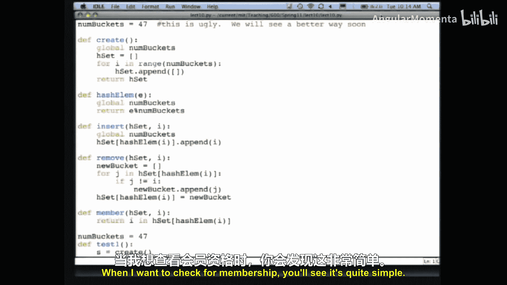

All I do is。Asked the question， is I。In the list。Associated with the correct bucket。

Remove is a little bit more complicated， but， in fact。

 we don't need to spend much time looking at it Now。 It's just some code。

 And the only reason it's complicated is insert doesn't look whether or not the element is already there。

 so it may occur multiple times in the list。So I would have to remove each one of them。Okay。

People see the basic structure of this。Why a list of lifts。Why don't I just say， have。

A list of Booles。Where I hashed the the integer and。It's true or false whether or not I've seen it。

 depending upon the value of that bucket。 Why can't I do that。Somebody。Well， what's the property。

 this hash function。The key issue here is the hash function。Is。Many to one。That is to say。

An infinite number of different integers。Will hash to the same value。Since after all。

 I have a set in which I can store any integer。Or any positive integer， at least。And。

There are only 47 buckets。So it's pretty obvious that many integers will hash to the same bucket。

When two different。Elements。Hashed the same bucket。We have what is called a collision。

There are lots of different ways to handle collisions。

What I've shown you here is probably the simplest way。Which is called linear rehashing。

And'm not actually rehashing。I'm just keeping a list。Does that make sense？Yes， thank you for。

 I'm glad somebody has a question。You have to ask loudly。关。啊。0。Well， sorry。

 it depends what I'm hashing。Right， sorry， I thought you were saying that if I ask 47， mod 47。

If I take 48 mob 47， I get one。If I take 49 mod 47。 it's the remainder。

Maybe I should have called it just the remainder。Look up， I'm about to throw something at you。哦。

I threw a curveball。O。What's the complexity here of the membership test。Kind of hard to analyze。

Roughly speaking， or exactly， it will be the length。Of the bucket， right， the size of the bucket。Now。

 I don't know how many elements will be in the bucket。 but what will this depend on。

It will depend upon the number of buckets。If I have a million buckets。

I'll get a lot fewer collisions than if I have two buckets。Right， so let's look at an example here。

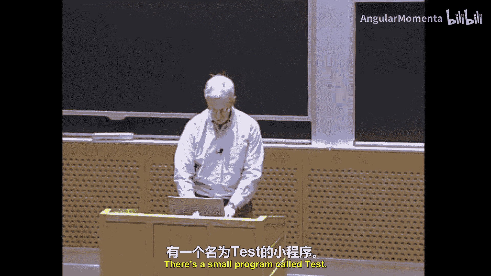

There's a small program called Test。I set none buckets to 47， in this case。And then。

 I'm going to create it。Create a set。 And then I'm gonna to put。A bunch of integers in it。

Thenhan a few more， just for fun， including one very big integer just to show that it works。

Then I'm going to show you。What the set looks like。 And， in fact。

 what we'll do is we'll stop it here。And see what we get。So what we'll see here is。

 as you would expect， with that number of buckets， each of the small numbers hashes to a separate thing。

That's just the way remainder works。Not surprisingly。 In fact。

 it would be disappointing if 325 didn't hash the same value。 both times。 I inserted it。

So we see we happen to have one bucket that's got two elements in it。 happen to be the same。

 But this very big number。Happened to hash the same value of 30 as 34。

So here we have two elements in it。A good hash function。Has the property that it will。

Widely disperse the values you hash。So， they end up。In different buckets。

Rather than some stupid hash function that tends to put everything in the same bucket。Now。

 let's see what happens。If。I changed the number of buckets to say，3。Well。Not surprisingly。

 we get some very big buckets。

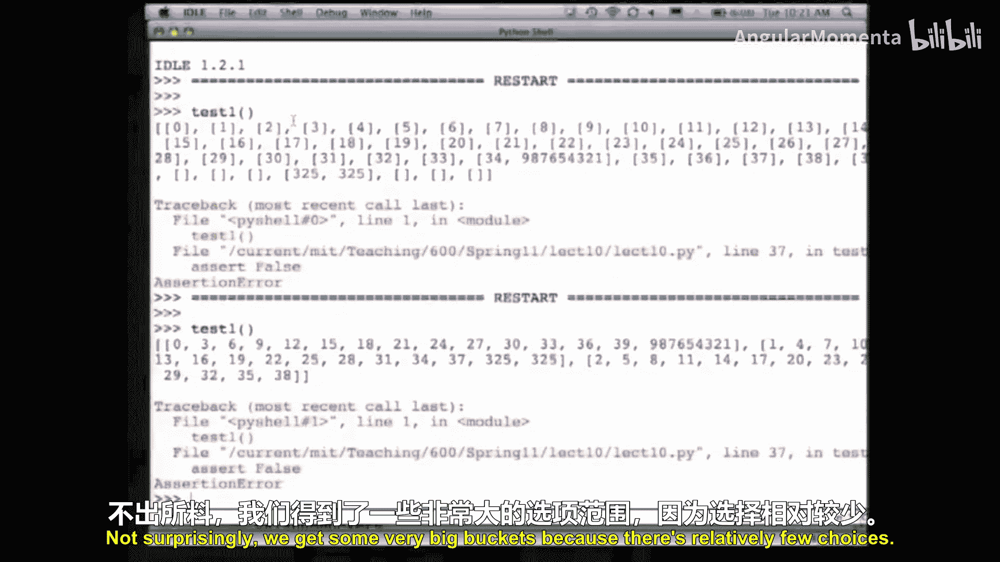

Because there are relatively few choices。So what we see here is we have a genuine trade off between time and space。

If the number of buckets is large。Relative to the number of elements that we insert in it。

In the table。Then looking whether or not an element in it is roughly order 1。

Because these lists will be very short。So we can actually look up something in constant time if we dedicate enough space to the hash table。

If the hash table is very small。You know， the reductioide absurdium case of one bucket。

Then it's order in。是哪？It's not constant time。 It's linear in the number of elements， right。Typically。

 when people use hash tables， they make the hash tables big enough。That for all intents and purposes。

 you can assume that looking something up is constant time， order  one。And that， in fact。

 is what Python does with dictionaries。It hashes the keys。And chooses a big enough table。

So that looking up whether or not something is in a dictionary can be done in constant time。

If it then notices。That the table is too small because you've ended up putting a lot of elements in it。

 It just。Redoes it and gets a bigger table。So hashing is an extremely powerful technique。

And it's used all the time。For quite complicated things。

Now， is it useful here only when we want to store ints， No， I mean。

 it would be kind of bad if that were the case， in fact。

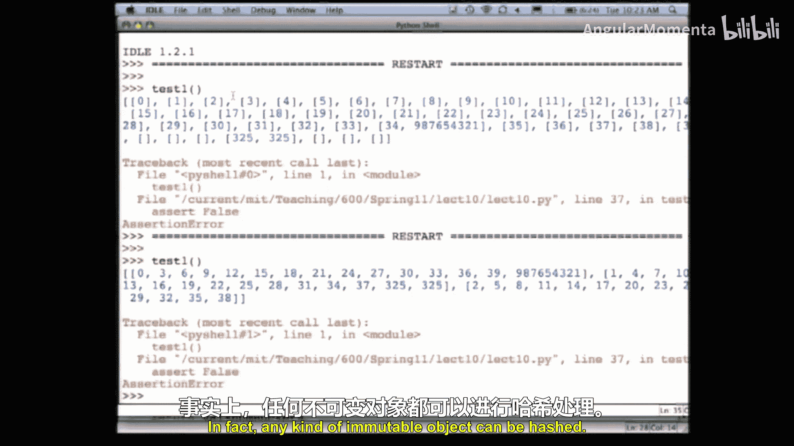

Any kind of immutable object can be hashed。Now， you may have wondered。Why。

The keys in dis have to be immutable。 And that's so that they can be hashed。

Why does it have to be immutable， Well， imagine that you use a list as a key。

You'd hash it when you put the list in the hash table， but then you might mutate it。

 And the next time you hash it， you'd get a different value。

And so you wouldn't be able to find it again。So you need it to be a kind of object where every time you apply the hash function。

 you get the same value。

Okay。I don't need to show you that this works。 You'll just believe me， I'm sure。

Let's look at a slightly more complicated hash function。Here。

 I want to hash something that could be either an int or a string。

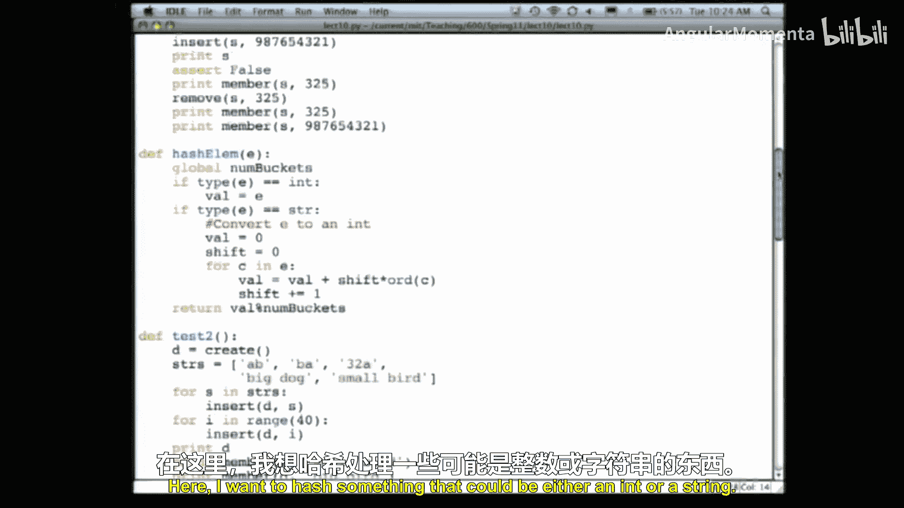

So I first check and see if it's an int， if so。I'll set the value to be E。Then down at the bottom。

I'll do the modulus operator again。But if it's a string。I'm going to first convert E to an int。

And this is basically the trick that people typically use when they're doing hashing。

Is they convert whatever thing they have to some integer。People do this with all sorts of things。

 For example， this is the way airport security systems today。To face recognition。

They hash every face to every picture of a face to an integer， and then look it up。

So we can see it here。The way I'm doing it and the details don't very much matter is I'm going to do it a digit。

A character at a time。Do a shift or of C takes the ASI the internal representation bits of each。

Character， and again， I don't care if you understand how the code works here。

What I just want you to see is that it's not very long。And， in fact。

 it's typically fairly simple to hash almost any kind of an object。Because deep down。

 we know that every object is represented by some string of bits in the computer's memory。

And we can always convert a string of dips to， to an integer。All right， so that's hashing。

A very powerful and extremely useful technique。All right。Yeah。

There are many different ways of doing hash。All the hash element has to do is。

Function has to do is convert。Its argument into an integer in some way or another within a fixed range。

It happens to be that remainder is a very simple way to do that。And is often used。

 And there's a whole theory about hash functions。 You can read about them in gory detail in Wikipedia。

The math can actually be quite complicated， and there's no real need to understand it。

I typically do something like dividing by a prime number， which is known to have good properties。

But again， you can get carried away with this。 and it's usually not worth the trouble unless you're。

Very deeply involved in something。Okay。And then I've got another program that that does this。

 But again， I don't think much would be served by running it for you。Any questions about hashing。Yes。

そうですそ。Some time list to search。😔，So the question is that because Pyth gives us constant time look up for lists is the key to making this work。

Every programming。Which I know has some concept that's similar in say， C， it's not a list。

 but it's an array。And so in C， you would use the array for this purpose。 or Java。

 you would use the arrays for this purpose。But， yes， you can do this in any programming language。

Because every reasonable programming language has some way to create。

The equivalent of a list in which you can。Get a particular index in constant time。So it's。

 it's a universally useful technique。Good question， anything else？If not。

We're about to abandon searching and sorting and， in fact， abandon algorithms in general for a while。

Bouanced right off his hands。

I will not assign you to a baseball contract。嗯。Pardon。I threw Yes。

 I threw him a butter thing of it terrible。Well， your jokes are worse than mine。All right。

I now want to move on to the last， go back to Python away from algorithms。

 away from computer science in general， and talk about the last three major linguistic concepts in Python。

 exceptions， classes， and then later iterators。Let's start with exceptions because we've already seen them。

 and they're pretty simple。Exceptions are everywhere in Python。You know。

 and we've certainly seen plenty of them all semester already。You know， we。We get them， if we。

Set some array to some list。To say1，2。And then I asked for test of 12。Again， an index error。

This is an exception。We've got exceptions when we've tried to convert things to incorrect types。

 So if I go into of test。I'll get a type error。Anything that ends in the word error is a built in kind of exception in Python。

We've got them when we access nonexistent variables。A name error。

So there are a whole bunch of these things。

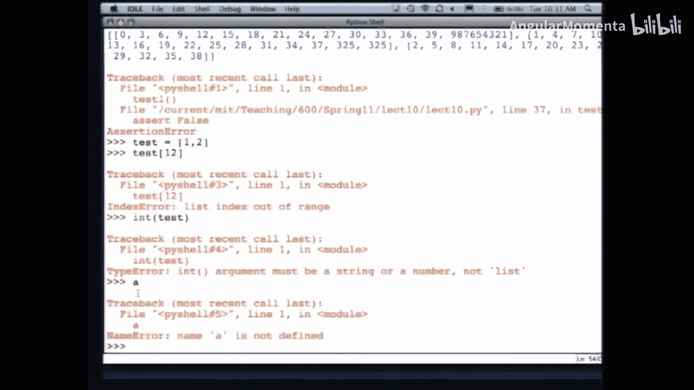

In each of these cases here， I' was just kind of playing around in Python。

And it had printed an error message， and it stopped。These kind of exceptions。

Are called unhandled exceptions。Where they caused the program to effectively crash。

The program just stops running。And I suspect。That some of you have written programs in which this has happened。

In fact， is there anybody here who has not written a program that crashed because of an unhandled exception。

Good。For those of you watching on TV， no hands went up and。I almost every day。

 I write a program It crashes because of an unhandled exception。On the other hand。

Once my program is debugged。Once your program is debug， this should never happened。

Because there are mechanisms in Python for handling exceptions。And in fact， as we'll see。

 it's a perfectly valid flow of control concept。You will sometimes write programs that are intended to raise exceptions。

And then you'll catch the exception and do something useful with it。The way we use exceptions。

Is in something called a try accept block。So you write the word try。And then you have some code。

And then， accept。And then some more code。It， what the program vote interpreter does is it starts executing this code。

If it gets through this code without raising any kind of an exception。It jumps to the code。

 following the accept block。On the other hand， if an exception gets raised here。

It immediately stops executing this code。And jumps to the start of this code。

The code associated with the accept。And executes that。And then when it finishes this。

 it again goes to the code following the accept。Just like an if， you can nest these things。It's。

Just a control concept。It's nothing more。Let's look at an example。

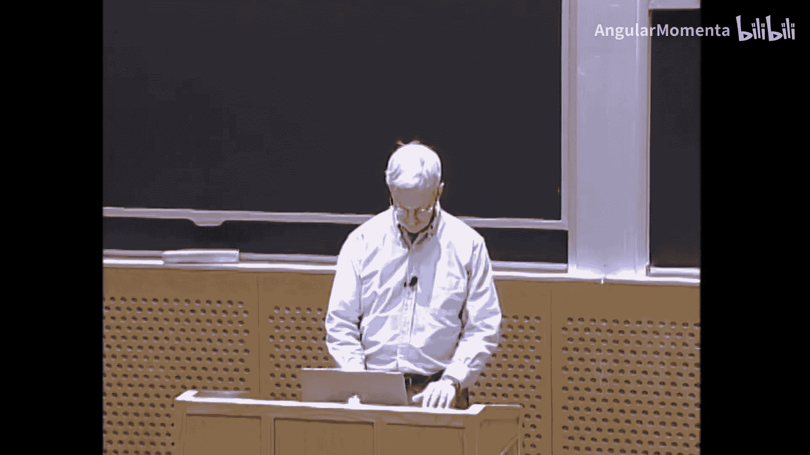

So here's Re Val。

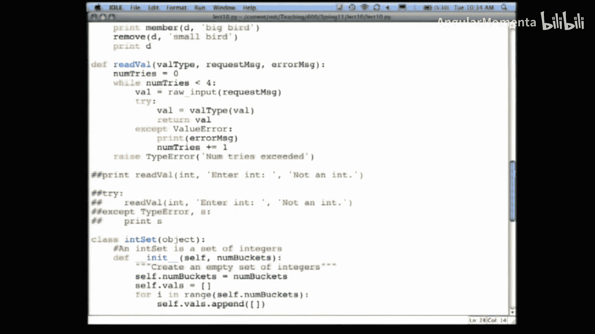

This is a function。It's a polymorphic function。Its first argument is of type， type。Remember。

 and you'll hear me say this1 thousand more times， at least。In Python。

 everything is an object and can be manipulated by the program。It's one of the beauties of Python。

 It's something that's not true in many programming languages。So， types。

Are objects just like ints or floats。So the first argument to read Val is a type。

And then there are two strings。 The request message in the error message。

It then sets a local variable， nu tries to 0。

And while numb tries is less than4。It sets vow equal to raw input。Printing the request message。

And then it tries to convert。Val to vowel type， whatever that happens to be。And if it succeeds。

 it returns it。On the other hand， if during this attempt to convert it。An exception is raised。

 for example。The user is asked to input an integer， and they type in the letter B。

 which can't be converted to an int。

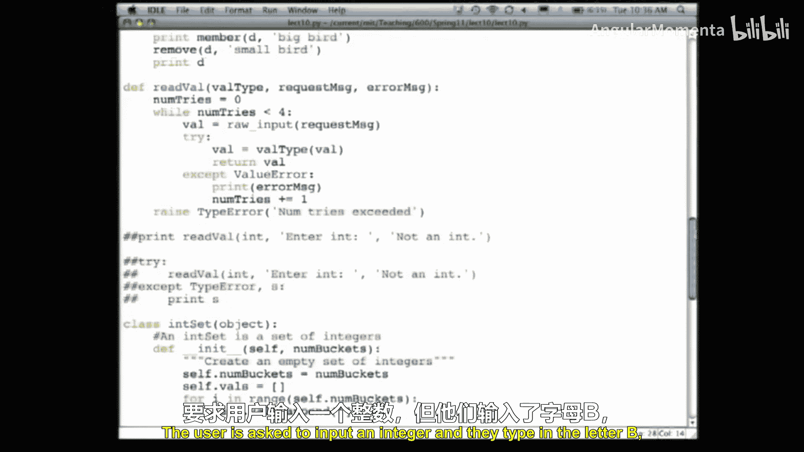

Then a type error exception will be raised。嗯。Or a value error exception。

 And if a value error exception is raised。It prints the error message。

Seets increases numb triess by one and goes back to the top of the wild loop。

If it goes through this while loop too many times。It leaves raising the type error with the message of the argument。

 numb tries exceeded。

All right， let's run this and see what happens。You know， every once in a while。Funny things happen。

 when that happens， somehow clicking in this window。

And then clicking back in that window tends to make it work again。This is a bug in Python。

So it's now asked me to enter an in。If I enter an int。Everything is good。It just prints it。

On the other hand。If I run it。And I enter the letter， A。It will give me another chance。

And now I can enter an int。And it's happy。All right， now， suppose。I。

Unhappy with the fact that if four times in a row， I fail to enter an int， something bad happens。

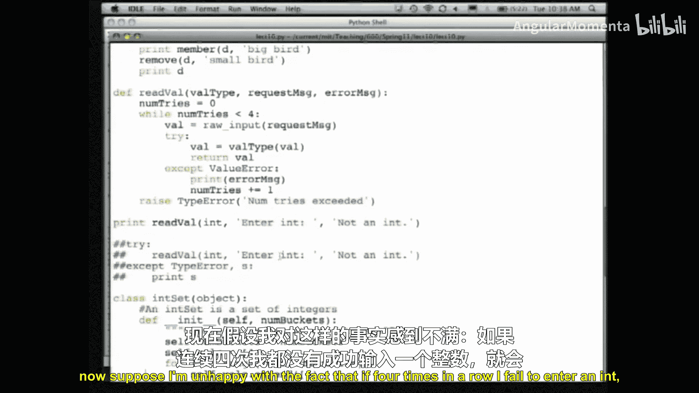

It comes back， and it raises an exception。 Well， I can catch that。

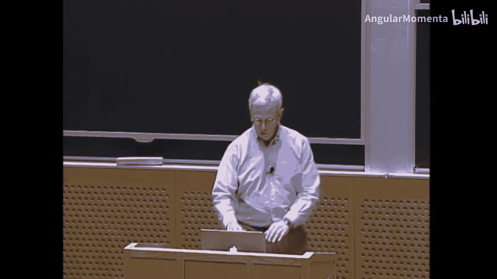

In the code。That calls。Read vow。 So here at the top level， I'm going to try read Val。

And then I'm going to say， except if a type error is raised。

Print the argument returned by that exception。So this is what's called the handler for the exception。

And so I don't have to crash when the exception is raised， but I can actually deal with it。

And do something sensible。

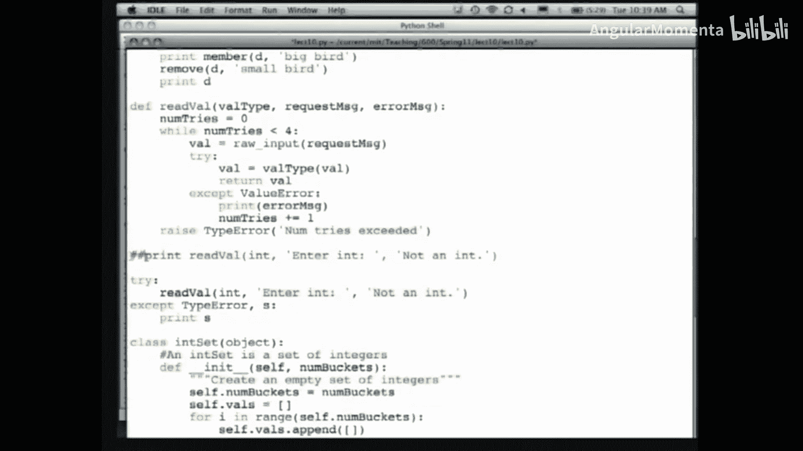

If following the word except， as you see over there， I have not listed any exception names。

Then I'll go to the accept clause for all Excepts。 Doesn't matter what the exception is。

 I will go there。So I can write code that captures any exception。O， usually。

 that's not as good a thing because it shows that I did not anticipate what the exception might be。

But you can see that this is a pretty powerful programming paradigm。

I can write this fairly compact read vow function。That's pretty robust。It's polymorphic。

It can take in what the error messages are， and it can try as many times as I want。Yeah。

After days there。You'll note that when I raised the exception type error after it。

 I had an open print， and then a string。So what this basically says is that an exception。

Can have associated with it a set of arguments， a sequence of arguments。

And I've just chosen to call the first of the arguments。S。So that I could then print it。

So this is a fairly common paradigm that you associate a message with an exception。

 explaining the exception。Since， after all， type error doesn't， is not all that meaningful。

And this tells me why it was raised that I tried too many times。Okay， so it makes sense。

Anything else？要。我要。What we'll see when I type something like assert。

 when I execute something like at false。It's actually raising an exception。

It's raising an assertion error， exception。And so I can actually catch that and do something with it。

I've been using these asserts just basically to stop the program。

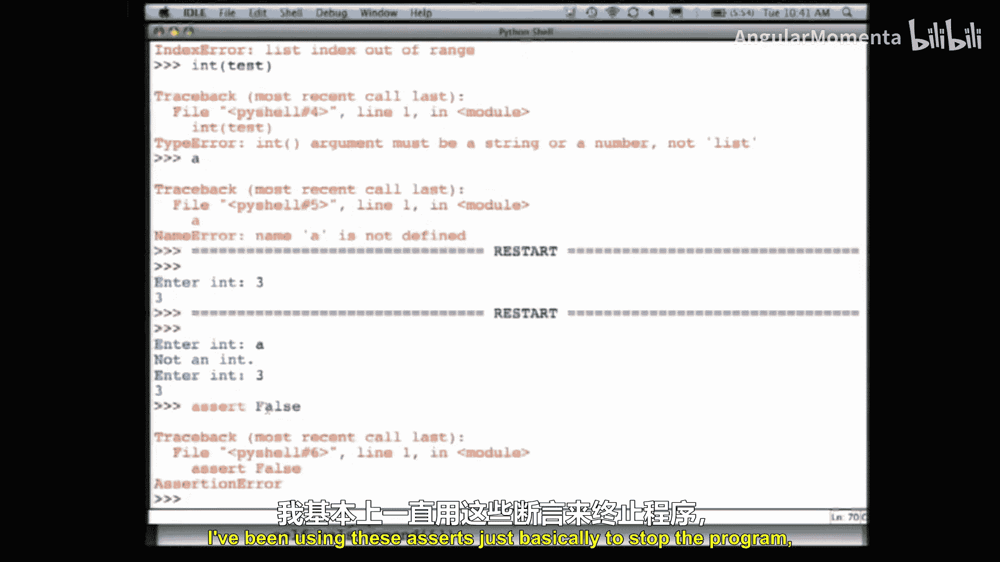

But we've also seen that sometimes with functions， we use assertions to check the types of the arguments。

But if you don't catch that exception， then the program crashes in the wrong arguments without doing anything useful。

Because it's just an exception。 I can catch it。And then do something useful。So it's， again。

 just an example of that。Allright， we're gonna try your hands once more。

 I'll throw you a different kind of candy。And this time， he caught it。2 for two。Okay。Very powerful。

A very useful mechanism。嗯。You can use them for sort of catching errors， as we've done here。

They're frequently used for in situations where you are getting input from a user。So， for example。

If you were writing a text editor and you wanted to open up a file。And you typed in the file name。

 and it didn't exist。You would， in Python， get an error message when you tried to open that file。

 It would raise an exception。File not found， basically， which you could then catch。

And then print to the user a useful error message saying file not found。Similarly。

 if you try and write to a file that already exists。You can get an exception saying。

 do you really want to overwrite this file and ask the user。

So it's very commonly used in a lot of programs as a mechanism。And now。

 as we go on and see more and more code， you'll see that I'm going start using exceptions fairly frequently as a flow of control mechanism。

That makes certain kinds of code easier to write。All right。That's all I have to say about exceptions。

Simple but useful mechanism。Now， on to something that's even more useful， but not so simple。嗯。

It is probably the distinguishing thing， not only in Python。But in a whole class。

Of modern programming languages。And that's the notion of a class。I'm not going to finish it today。

 I'm barely going scratch the surface of it today。But we're going to start leading up。

 and I will pretty much finish it on Thursday。We've already seen the notion of a module。

Which has been a collection of related functions。So， for example， we've seen code。

That includes something like import math。And that provided me。

With access to functions like math dot log。What the module mechanism does in the import mechanism。

It makes it convenient。To import a lot of related things at once。And then we use this dot notation。

To disambiguate。To tell us。Well， which log typically is probably only one log function。But certainly。

 you might imagine。That set dot member。And table that member。

Would be different and that both might exist。And as we said before。

 the dot notation avoids conflicts by disambiguating。Okay。That's a module。 What a class is。也。

Is like a module。But it's not just a collection of functions。A class。

Is a collection of data and functions。Functions that operate on that data。They are bound together。

So that you can pass an object from one part of a program to another。

And the part of the program to which you pass it。Autoomatically gets access。

To the functions associated with that type of object。And this is really the key。

To what people call object oriented programming。A very popular buzzword。

So we've already seen that kind of thing where if we pass a list。From one function to another。

 we can write something like L dot append。Some value。

The data and functions associated with an object。Or call that that object's attributes。

So you can think of this as a way to associate attributes。With objects。Now。

 I've been talking about data and functions as if theyre different kinds of things。In fact。

 they're not really because they're just objects。In Python， everything is an object， including。

 as we'll see on Thursday， the class itself is an object。

When people talk about objects and object oriented programming。They often use。

A message passing metaphor。And I want to emphasize， it's nothing more than a metaphor。

And I almost hesitate to bring it up because it makes it all sound more complicated than it is。

 But you will see this phrase in the literature。 People will use it。 So you need to know what it is。

The basic metaphor is。That。When I write something like L dot append。

I am passing the message Append E to the object L。And then there's a mechanism for looking up what that object means。

What that message means。 And then the object L executes that message。And does something。So。

 for example。If I had a class called circleircle。I might。Passt the object C。The message area。

Which would cause this object to return the area of its， its own area， the area of the circle。

 That is that object。Again， nothing dramatic going on here。

 If you just think of this as a fancy way of。Writing functions， you'll be absolutely correct。You。

 and， but I did think you should hear about this metaphor。So， I am， by the way。Should have。

I've been using the word。Meth。Is a， is a function。Associated with an object。So， in this case。

The method area is associated with the object C。And purists would say。

 always refer to aend as a method。Rather than a function。

Because we use the dot notation to get to it。 And it's always associated with some object of type list。

Okay。Now， just。As data。Can have types。Objects， as we know， have types。What a class is。

Is it's a collection of objects。With identical characteristics。Lettter。That form a type。

So we can use classes to introduce new types into the programming environment。So， as you think about。

Existing things。Now， I won't put that up because it will disappear behind the screen。

We've looked at things like lists。Inict。What these are are built in classes。

They happen to be classes。That are so useful。That somebody decided they should be part of the language。

 They should have efficient implementations。 They should be built in。

 People shouldn't have to re implementplement them themselves。And， in fact。

 through are a whole bunch of interesting built in classes in Python。

And there are a whole bunch of libraries of classes you can bring in。

 And we'll look at many of those that extend it。And that's the beauty of the class mechanism。

 It lets you add new types to the language that are every bit as easy to use as the built in types。

So in effect， the language can be extended。To add new and useful types。

And we'll look at several examples of that starting on Thursday。

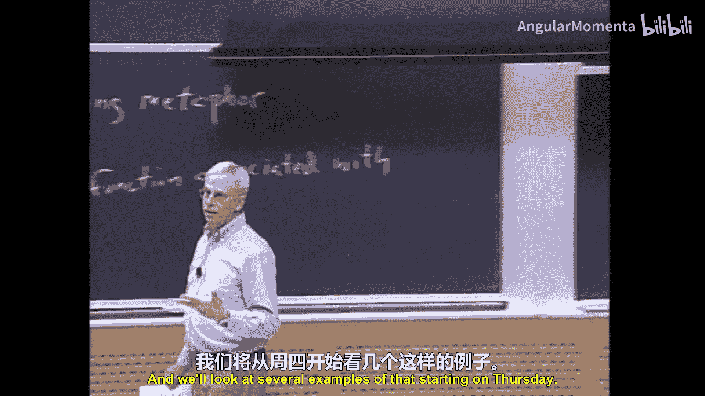

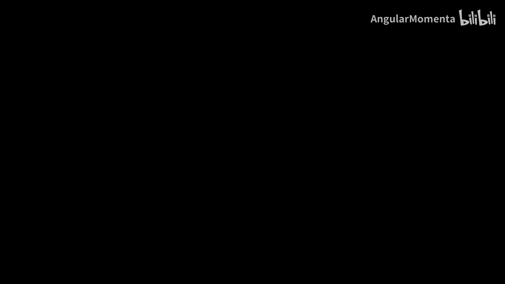