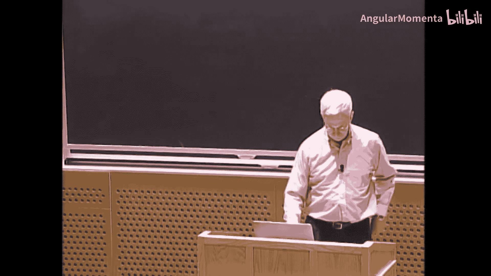
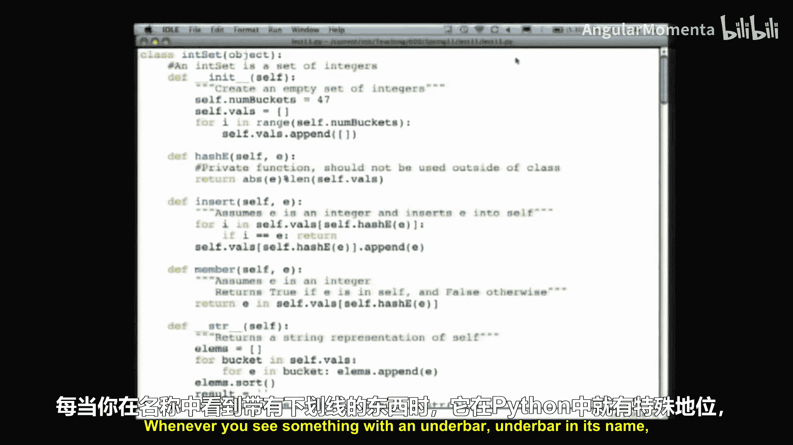
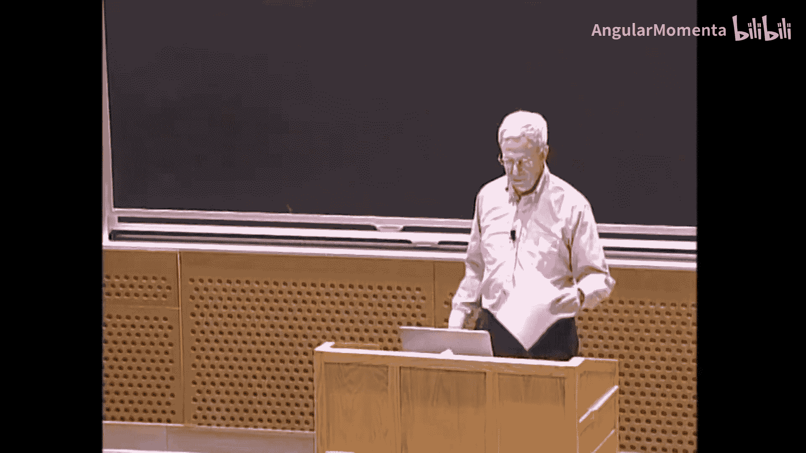
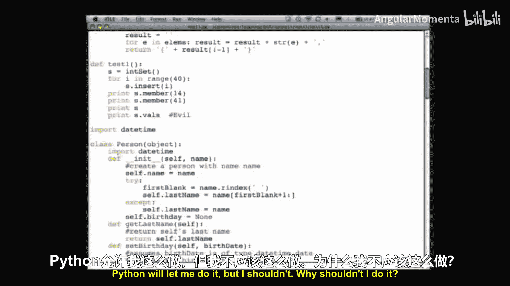
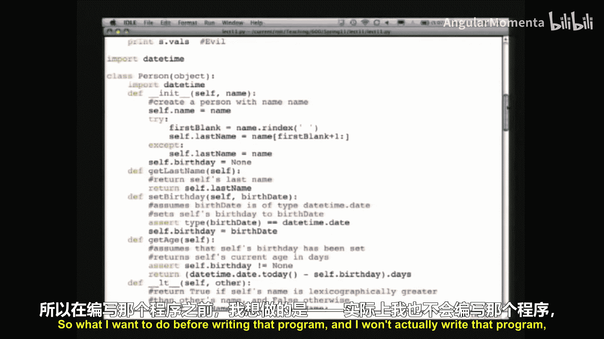
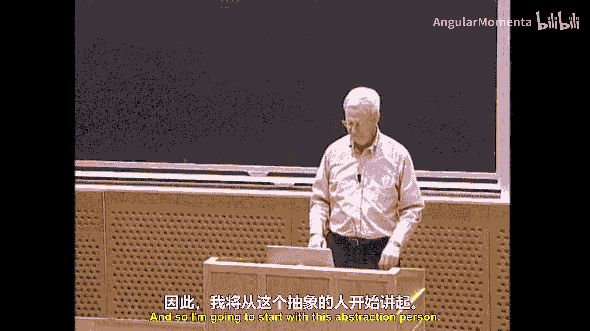
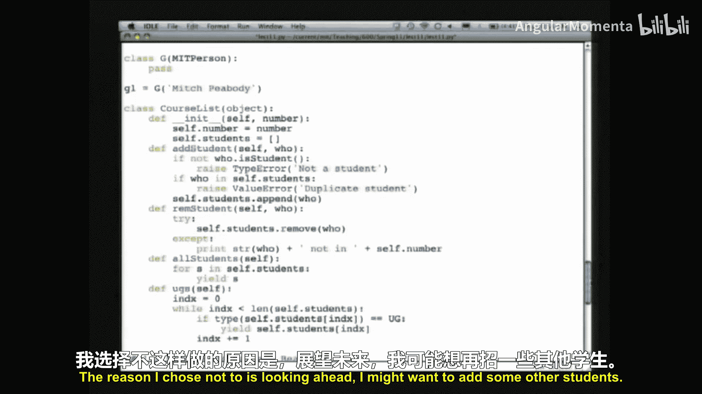
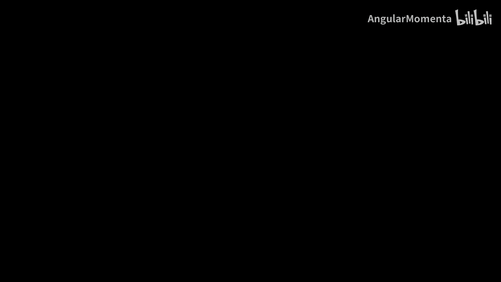

# 【麻省理工】计算机科学与编程导论 ｜ MIT 6.00SC Introduction to Computer Science and Programming p15 15 -BV1a5BZBkEP6_p15-

The following content is provided under a creative Commons license。

 Your support will help M I T Opencourseseware continue to offer high quality educational resources for free。

To make a donation or view additional materials from hundreds of M T courses。

 visit M I T OpenCourseware at O C W。t M I Tt E Du。Good morning， everybody。

Let's go back to where we were。We were talking about abstract data types and the notion of object oriented programming。

And in particular， the role of classes in in all of that。

A lot of people think this notion of object oriented programming is a new notion。In fact， it's not。

 It's been around for probably at least 35 years， maybe even longer。

But it's only been widely practiced for maybe 15 years。 even that。

 to most of you will seem like a long time。嗯。It started in the mid 1970s when people began to write articles explaining this advantage of the approach to programming。

And at about the same time， the language small talk was developed at Xerox Park and K developed at MI T。

And they were the first languages that in an elegant way。

 provided linguistic support for this style of programming。

But it didn't really take off in the public until the introduction of Java。Considerably later。

 and Java was the first popular language to support object oriented programming。After that。

 there was C plus plus， which supports it in。Not a very elegant， but a usable way。 And today。

 probably Python is the fastest growing language supporting object oriented programming。

It's used widely and that's one of the reasons we teach it here。As I said， at the bottom of it all。

The most fundamental notion is that of an abstract data type。

And the idea is that we can extend our programming language by adding user defined types。

 and we'll shortly see why that's such a useful thing。

And that these types can be used just as easily as any of the built in types。

Why do we call them abstract data types rather than just data types。

And that we do that because were essentially going to define for each type and interface。

And essentially， what the interface does。Is it explains。What the methods。Do。

What do I mean by what they do。What they do at the level of the user。Not。How they do it。That。

 of course， is the way the built in types work。 It wasn't until Tuesday that you understood how Python made Dix do what they do。

Before then， I just explained that you could put in a key inner value and you could look it up and do an associative retrieval。

It was maybe not magic。But it was wonderful that you could do this and not have to bother your heads with how it was made to work。

😊，And that was because we provided or the designers of Python provided an interface that let you use it。

We'll do the same thing with the abstract data types。

The key idea here is when we've talked about before。And that's a specification。

It is the specification of a type。Or of a function or of a method that tells us what that thing does。

And we'll now， till the end of the term， try and maintain a very clear distinction between specifications and implementations。

All right， let's look at an example。

So the examples should be familiar to you。You will remember that on Tuesday。

 at the start of the lecture， we looked at how we could use hashing。

To implementmple a set of integers。And I explained to you that I wasn't very happy with the implementation because of the way it used this global variable。

Now we're going to see a much more elegant approach。

So I'm going to define a new abstract type called intset。

I do that by writing the name the word class。Followed by the name of the class。

And then there's this funny thing saying that it is a。Subclass of objects。Ignore that for now。

 And I'm going come back to it later。But fundamentally。

 what it's saying is that every instance of interset is an object。That's not very interesting。

Because everything in Python is an object。 So from an information theoretic point of view。

 there's no information here。Later， we'll see that we can use this mechanism in a more interesting way。

Alright， now let's look at the methods。So first， I tell you a comment。 It's a set of integers。

 Then I've got this funny method called underbar， underbar in it。

Whenever you see something with an underbar underbar in its name， it has a special status in Python。

😊。

That lets us do elegant things with the syntax。What will happen。Every time I create a new object。

Of type interset。The underbar， underbar， in method or function of the class will be executed on that object。

What it will do in this case is。Introduce two attributes of the object。The attributes are nu buckets。

Which is now replacing the global variable we looked at last time， and I've arbitrarily chosen 47。

And vowels。This will be the hash table itself， containing the values。And then exactly。

 as we did on Tuesday， I'm going to initialize， excuse me。

 the values so that each element of this list is now the an empty list。Now。

 what's going on with this funny notion of self。 Let's look at an example here。

I'm going to say S equals。Inset。Open close。This will create a new inset object。Execute the underbar。

 underbar in knit。So if， for example， I print。Self dot nu buckets。Whoops。

 can't do that because self is not defined in this environment。Self was a local variable to underbar。

 underbar in it。 In fact， the formal parameter。But I can write self or S dot nu buckets。And I'll see。

 it's 47。Numb buckets and vow。Are now attributes。Of S。

Attributes of the instance S of the class inter set。And I can。What we would expect， yes。

It said you didn't put any object in between the parenthees。The question is， well。

 it looks like the underbar underbar inset。Our underbar underbar in knit has a formal parameter。

 and I've given it no corresponding actual parameter。Yes， let me finish。

 So that's what it looks like。And that's the magic。Of the syntax。It automatically。

Passsses it in implicit。Object， or it creates one。 It's a very special role for underbar。

 underbar in it。😊，Self is used to refer to the object being created。😡。

I'm going to come back in a minute to discuss more fully the concept of self and how it's used here。

So just give me a minute to， to get there。The next thing we see。Is hash E。

 This is something we looked at again， on Tuesday。嗯。It's a private function， in this case。

That I don't intend to be used outside the class。So if we think of the specifications here。

 the interface of the class， it does not include hasshy。That's what private means here。

This is a convention。 It's not enforced by the language。And unfortunately， as we'll see。

 a lot of useful things are not enforced by the language。But nevertheless。

 good programmers follow the conventions。And we expect you guys to do so， as well。Because， of course。

 you're good programmers。So this doesn't do anything very exciting。 It's just what we saw。

Insert is more interesting。 Let's look at what that does。It， apparently。Takes two arguments。

The formals named Se and E。And inserts E into。Self dot vowels。However。

If we go look at the code that uses it。In say， test 1。What you'll note is。

 I'm saying for I and range 40。 This is just like the test1 we looked at yesterday our Tuesday。

 I'm going to say S dot insertive I。It looks like I'm calling insert with only one argument。

But as we discussed last time， this S。Before the dot is actually the first argument to the method insert。

And so it's getting two arguments， really。And by convention。That implicit， first argument。

Is always called self。In Python。It's not enforce。 You could call it George。

 if you preferred or Alice or whatever you like。But if you do。

 you will confuse the heck out of anybody who ever reads your code。

 including any T A you ask for help。So please do use self。It's just a name。

It has nothing to do with what a philosopher or a psychologist or a ethicist might think of the concept of self。

 this wonderful， elevated concept。 It's none of those。 It's just a name。But stick to using that name。

So if we go back。I can insert a bunch of things。I can then， I'm gonna then print S。

 That's kind of interesting。Underbar， underbar， F TR， underbar， underbar。

It's one of those special names， as well。The code is pretty simple。

All it is is returning a string representation of the set。And it could be anything you want。

 I chose a sort of conventional way of denoting sex。What's interesting is that it gets。

I automatically called by print。So when I write the command， print S in test 1。

The Python interpreter is smart enough to know， oh， I better take S， convert it to a string。

 and then print it。How does it know to convert it to a string， It automatically invokes the underbar。

 underbar S TR method。And then the other operation is member， which， again。

 is exactly what we looked at before。But you'll notice in this code that uses insects。

I make no reference to the。Data attributes of the class， directly。Or， I shouldn't。

You'll notice that I wrote evil next to S Dot Vals。Python will let me do it， but I shouldn't。

Why shouldn't I do it？

Why， why am I saying this is evil。Well， would you be happy？If。

You've got a message saying Ile has changed， please download a new version。

And the new version happened to have a different implementation of lists or Ds。

 and it caused all of your programs to stop working。You would be pretty unhappy。Now。

 why won't that happen。Because your programs don't depend in any way on the way in which。

People chose to implement those built in types。Because you program to the specification of the types。

 not to the implementation。The specification of inset did not mention vows or numb buckets。Therefore。

 as the implementer of that class， I'm entitled to go back and change it。Oh。

 I'm not going to use a hash table at all。 I'm going do something else。

 I'm gonna to use a red black tree， or some other fancy implementation。I'm allowed to do that。

And if I make that change and valves disappears and numb buckets disappears。

Your program should continue to work so long as I still meet the specification。

The minute you go in and directly access the variables of the class， those attributes。

You have used things that do not appear in the specification。And if I change the implementation。

 your program might break。So you shouldn't do that。 Does that make sense to everybody。

It's a very important concept。The concept is known as data hiding。

It is really the most important development。Of that makes abstract data types useful。

That makes them gives them the same status as the built in types。The minute you choose。

To ignore this， you do so at your own peril。Some programming languages like Java provide a mechanism to enforce data hiding。

The designers of Python， for reasons， I do not understand。Chose not to。I think it is。

 is a flaw in the language。

The things we're hiding。Are the instance variable。Those are the variables associated with each instance。

Of the class。We should also。Hide class variables。We haven't seen those yet， and we'll see them later。

The instance variables。We get a new copy of each time we create a new instance of the class。

 a new insightet in this case。The class variables。Are associated with the class itself。

 And you get only one copy of them。Later on， we'll see an example where class variables are useful。

All right， so let's run this just to make sure it works。Does what we would expect true， false。

 And then you'll see this nice。String representation of the set。

And then just to show you what happens when you do the evil thing。 I printed， as we did last time。

 the actual。List that came out。Alright， let's now look。At a more interesting example。

And the idea I want to convey here is how we use classes and abstract data types。To design programs。

So imagine that you're writing a program to keep track of all the students。

 faculty and maybe staff at MIT。It's certainly possible to write that program without using any classes。

For each student， you might give them a family name， a given name， a home address， years， grades。

 etc。And you could do this with some complicated combination of lists and dictionaries。

But it wouldn't be very elegant。So what I want to do before writing that program。

 and I won't actually write that program。 I'll just write some of the classes we can use。

I want to pull back and think about what abstractions would be useful。

So this style of programming in which you organize your programs around abstract data types。

Says before we write the code in detail， we think about the types that would make it easy to write the code。

So， for example， if you were a finance student and you wanted to write some code dealing with。

Markets， you might want to have an abstraction of a government bond and another abstraction of an equity and an abstraction of a call option。

 whatever you wanted。But you'd say， I want to think at that level of abstraction。

I don't want to think about lists and dicks and floats。 I just want to think about。

Options which have a strike price and a date and things like that。Similarly。

 as I'm working on this database for M I T， I want to think about。

Abstractions of students and faculty and staff。I'm also going to use what's called inheritance。

To set up。A hierarchy of these。And the reason I'm going to do that。

Is I want to be able to share code。I know that。There will be certain similarities between students and faculty。

Some differences， too。啊。But I want to begin by saying， what's not different， What's similar。

 What's the same so that I only have to implement it once。And get to reuse it。

So if I pull back and say， is there an abstraction that。

Covers the shared attributes of students and faculty and staff。I might say it's a person。

 They're all people。And it's arguable whether every faculty member is a human being。 But for now。

 let's pretend。Allright， and so I'm gonna start with this abstraction person。

I'm going to import something called date time。I'll show you what we're doing when we get there。

 But it's like we've imported math before。 This is a class somebody else wrote that deals with dates and time。

In a， in a fairly reasonable way。Alright， so I'm gonna import that here into。Person。

Probably didn't need to import it twice。 Maybe I'll just simplify it by getting rid of this one。嗯。

Underbar， underbar a knit here。Will create a person with name。Name。And you'll notice。

What I'm doing here is。Introducing an extra attribute。 last name。Self do last name。

 And that's because I just want to make life easy for myself。

 I figure I want to find the last name frequently。 Let's once and for all get it and put it in something。

And I'm gonna initialize birthday to none。The next attribute or the next method。Is get last name。

I have that here。Because。I don't want users of this abstraction to even know that I have an attribute self dot last name。

 That's part of the implementation。And so I have this method that catches it。

And you'll see as you build classes that you often have things called get。

And those are typically methods that。Return some information about an instance of the class。

You'll also frequently have set methods。For example， set birthday。That。Gives values。

Two instances of the class。More interestingly， I have get age。

And that's using some of the built in operations on date time， conveniently。It allows me to subtract。

One date from another。And get a number of days。So this will allow me to return somebody's age and days。

嗯。Then， I've got another。Underbar underbar method we haven't seen yet， L T。Stands for less than。

 not a big surprise。And I'm going use this to order。Names or order people。

Why am I using a special operator rather than just putting in the method， L E， S， S， T， H。And， y。

 I'm doing that。Because I want to be able to write。Things like。P1 less than P2 in my code。

And Python will take that。And turn it into the underbar， underbar， L T。Better yet。If I have a list。

 say， of persons。I can use the built in sort operator on that list。

And it will be smart enough to know when it's comparing two people to do the sort。

To use the underbar underbar LT。Very convenient kind of thing。Okay， let's look at an example。

 Let's look at some code。So， I'm gonna to set me。To John Gutag and him to Barack Hussein Obama。

 heard a Madonna， and will print some things。O， so I printed him。

 and I printed him dot get laugh name。I can now。Set some birthdays。嗯。Let's look at this line。

How do you feel about him dot birthday equals 8，4，61。We'll come back to it。

 but I want you to think about it。And we see that Obama is。Well， we see their ages here， right。

Actually， we see that Madonna is older。She looks really old。 And you look at that number of days。

 doesn't it。Maybe she is。 All right。Now， what's going happen here。I messed up。

And I messed up because I went in and directly accessed the instant variable and assigned it what I thought was a reasonable representation of a birth date。

But I shouldn't have， because that's not even the appropriate type。Right。

 it's a string rather than something from date time。So， again。

 we see the impact of my having done this evil thing of violating the abstraction boundary。

And stuck in there。Tried to directly access an instance variable。We can do some comparisons。

And what we see is that。I'm not less than。Maonna， I guess that's okay。Okay， you with me so far。

I can make a list。Of these things。And print the list。

So it does a fairly nice job calling the under underbar S TR operator。And you'll note。

 I had no trouble throwing。Objects of type person into the list no different than putting ints or floats or any of the built ins。

 It all works nicely。And then I cansort it， and print that。

And now the lists come out in a different order， because it's using the underbar underbar L T operator to sort the elements。

All of this is just by way of showing you how convenient it is to write code that uses a data abstraction。

If we go back and look at the code。We'll see that， once again。Person。Was a subclass of object。

That's why we can do all these things we've been doing with it。

But now I'm going to start using the hierarchy。M I T people are special。I。

 I hate to say that because I know we have non M T people in the room， but M I T people are special。

Well， here's at least one of the special attributes of M I T people。 They all have an I D。

So I'm now going to say an M I T person is a special。Subclass of person。

So it has all of the properties of a person。And the way we describe that is it。Inherit。

The properties of the superclass。And it adds a property。We can now。Assign an I D number。

And now we're going to see the thing I promise to show you， which is a class variable。Next。

 I Dum is not associated with an instance of M I T person。But it's associated with the class itself。

It's a class variable。I can do that because objects or or classes are themselves objects。

And the advantage of this is every time I get a new instance of this class。

 I can assign a unique I D。Similar to the way we were using global variables earlier in the term。

Typically， once we have classes， we'd stop using global variables。

Because we have these class variables， which can serve very much the same purpose， many cases。

And so now every time I get a new M T person， I give them an I D and then increment the I D number so that the next person will get a different one。

So， I added。A property。This I D number property。Which I find by get I D nu。

I've also overridden an existing property。You'll note that I've changed。The definition of underbar。

 underbar L T。So it's now saying we're gonna compare two people not on the basis of their names。

 but on the basis of their I D numbers。So let's look at some code that uses this。Yeah。

Get rid of the other code so it doesn't clutter up the screen。So we'll look at some things here。

We'll get some M I T people called P1， P2 and P3， and we'll print their I D numberss。

By calling get I Dum。And you can see that Barbara Beaaver gets 0， and the first Suon gets one。

 and the second Suon has I D 2。I can create even a third such person。And now。

 let's think about what happens here。I'm going to print。

Whether or not P1 is less than P2 and whether or not P3 is less than P2。

What should we get when we do this。Somebody。Partner。I heard a true false。And indeed， that's right。

 ideas。Now， suppose I want to compare names。I could， if I chose。Do this。I couldn't call person。

Underbar， underbar L T。 And what this says is， don't use the less than of the super class of the subclass。

Go up and use the superclass 1 to do the comparison。All right。So it's going up and doing that。

I can do other things。I can compare things for equality。Let me， just。Whiip through all of these。

And see what we get。Whoops。Surprise。Well， before we get to that surprise。

 and it's not actually a surprise。 I shouldn't have uncommented it。 Let's look at the other ones。

We can say， is P1 equal equal to P4。 And we discover it's not。 That's good。And we can say。

 is P 4 less than P3。At all works。 It's not。But， I can't say。P3， less than P4。

And why can't I do that。Why did I get an error message when I did that。Yes， someone did that yeah。

Did you say that more loudly， Shes a person not MI。Thisside heard idea。Exactly right。The answer。

I hit somebody right on the head。Now， there's going be a traumatic brain injury。

 I'm going to get sued。 It's going be messy。ATime to leave the country。All right。

Because it looks at P3 less than P4。Looks at the first argument， which is P3。And says， okay。

 what's the underbar， underbar L T associated with P3。It's the one associated with MI T person。

Let's go execute that。 And then it triess to retrieve the I D number of P 4。

 which is not an M T person。And it gets an error message。Alright， nothing subtle。

 It's the same kind of thing we've seen all along when we've used type errors。In this case。

 it's called an attribute error。Because we've attempted to access an attribute of an instance that doesn't exist。

And so we could catch it。 We could。 It's raised an exception。

 We could catch it as we looked at Tuesday， but we're not going do that because it's really a programming bug when that happens。

Okay， let's continue。We were interested in students。So we're gonna continue our hierarchy here。

And now I'm going to introduce a subclass of an MIT person。Called an O。Short for undergraduate。嗯。

Underbar underbar and knit is going call MI I T person under bar underbar knit。

 which will give the Ug an I D number and a name。And it's can introduce yet another instance attribute or field。

Called the year and say the year initially is none。Then I can set the year。嗯。

Though if I try and set it as something greater than 5。

 I'm gonna to raise an overflow error called Too many。No student。

 No undergraduate should be a year greater than 5。And I can get the year。Let's。

 let's look at what happens when we do that。So I'll have twougs。 Both happen to be named Jane Doe。

 And then the same M I T person as before。Let's run this code and see。 Well， what's going happen。

 What am I gonna， What's going to happen when I say print U 1。

The first thing it's going to do is it's going to say， is there an underbar。

 underbar S T associated with。Ugs。And the answer is， no。

that's okay because I know an Ug is also an M T person。If I don't find it at the lowest level class。

 I'll bounce up and say， al right。 I there an underbar underbar S T associated with an M T person。No。

 that's okay。 I'll go up another level。And say， well， I know an M T person happens to be a person。

And then they'll say， oh， good。 There is an underbar underbar S T R associated with person。

 So I'll use that one。So it looks at the class。 If it doesn't find it， it goes to the superclass。

 It doesn't find it。 It goes to the super class。And it does that all the way up till the end。

 where at worst， it will use the built in thing for printing objects。Because remember。

 everything is a subclass of objects。You don't want to do that。

 right You want to have something more elegant than object at location  X， E 3。

45 or whatever it would have printed。Then it will do some comparisons。

 It will first look for the most local and then work its way up as needed。Okay。Let's keep going。

 We're gonna introduce another kind of person called the graduate student。

And I'm going to write pass。What that means is。A G is。An M I T person with no special properties。

All the usual properties of an M T person。Does not have a year because graduate students could be here more or less forever。

WMch goes like this when I say that。嗯。Why did I introduce the type in the first place。

Because it lets me do type checking。I can now check。Whether or not a person is a graduate student。

Because they will， an instance of G will have all of the properties of an M T person。

But it will have a different type。 It will be type G。And so I can now ask the question。

 is the type of this object a G or is it an M I T person and get a different answer。So I can do this。

And if I go type of G1。Well， that's interesting。It says class main dot G。Okay。It's going to。

 it's a class。And the class is defined at the outermost level， which is called main。

 And the class's name is G。Which is what we expect。And so I could write something like that， well。

Type of G1。Equals equals G。And I get true。Okay。So it's a handy thing to be able to do。And， in fact。

 I'm now gonna bounce back。To M I T person。And add another method to it。

And this happens all the time when I'm programming。That。I go to a class， think I'm done。

 and then some time later decide it would be convenient to add something new， another method。

In this case， I'm now adding the method is student。

Which returns type of self equals equal U or type of self equal equals G。

So this will let me distinguish an M I T student or student from another kind of M I T person。So。

 for example， if I want to have a course list。Another class， this is a subclass of object。

You'll note， I have an ad student method。Which takes self and who。 Maybe it should be whom。

And it says， if not， who dot is student raise type error， not a student。

So I'm getting some leverage now out of this。Now， I wouldn't need to necessarily do this。

I could have said， if not。嗯。Type of who equals G or type of who equals U。 But I chose not to。

The reason I chose not to is looking ahead， I might want to add some other students。

 I might want to add special student， for example。

Or I might want to add cross registering student as separate types。Now， the nice thing is。

I don't have to make a lot of changes。 I know there's exactly one place in my code that defines what it means to be an M I T student。

I go back and I change that method。 And even if I ask whether somebody is a student in 100 different places。

I only have to make one change to fix my code。So I'm getting some modularity by associating the method。

With the class M I T person， rather than。Every time I need to use it。

