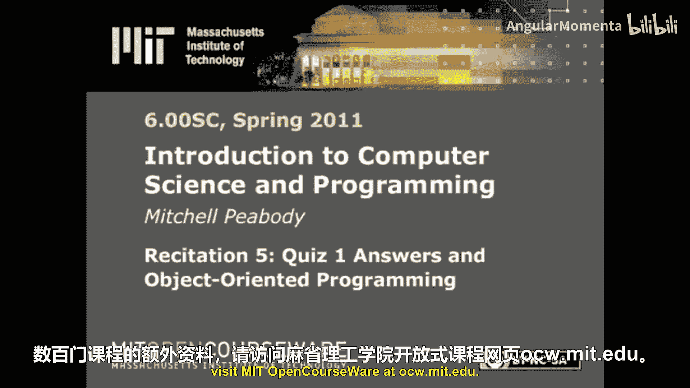
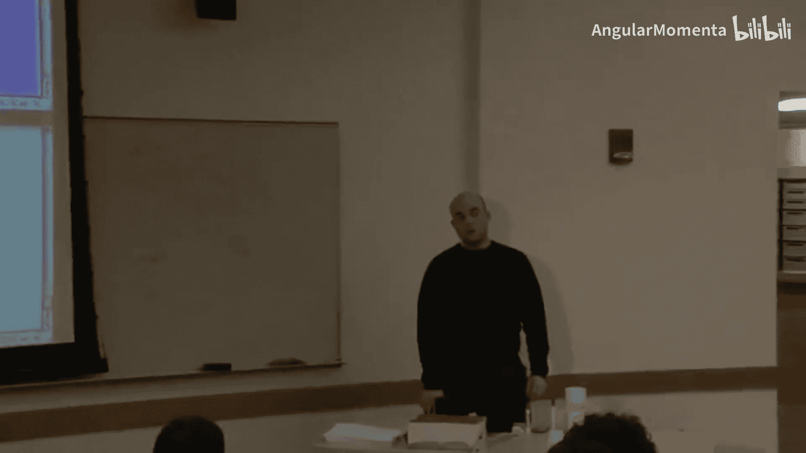
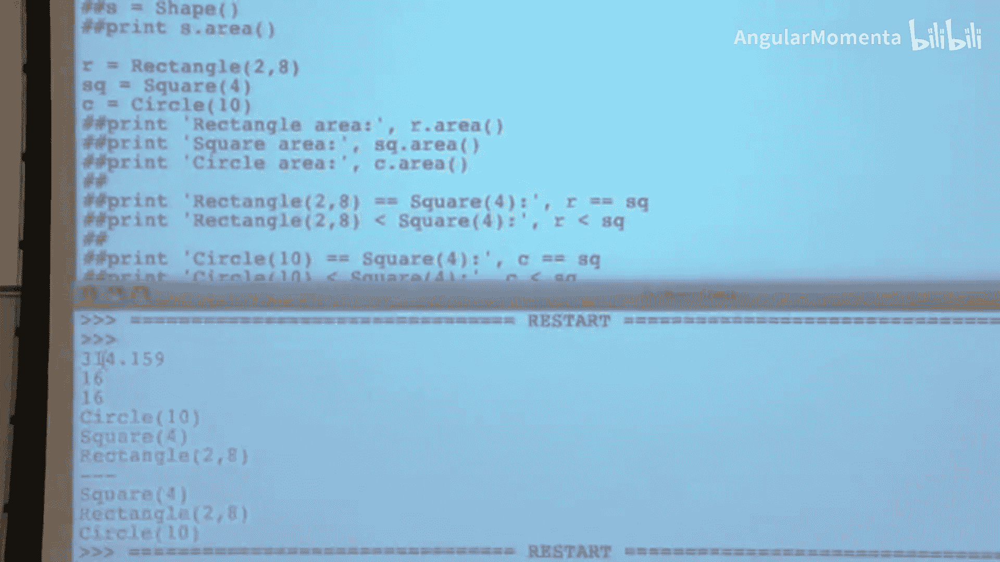
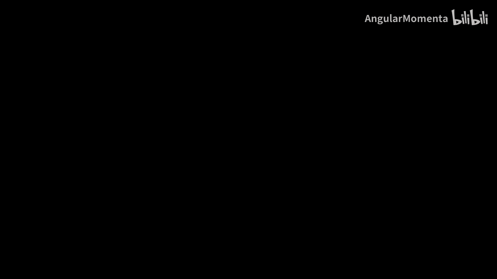

# 【麻省理工】计算机科学与编程导论 ｜ MIT 6.00SC Introduction to Computer Science and Programming p16 16 -BV1a5BZBkEP6_p16-

The following content is provided under a creative Commons license。

 Your support will help M I T Open Coseware continue to offer high quality educational resources for free。

To make a donation or view additional materials from hundreds of M T courses。

 visit M I T OpenCourseware at O C W。t M I T Eduu。

So there's too many things that we're going to start with today。

 one is we're going to review the quiz and we'll be real quick on that and we're going to talk about object oriented programming。

Which is something that you'll probably be more interested in for your problem set。

So just going down problem one it。False。True， false， false， false。

Does anyone have any questions on this？No。Everyone good with that。

 anyone wonder why something's true and why something's false？大出席。Is it also， it's true。Because。

And this is an English thing or a language thing， so it can kind of trip people up。

 but it's basically saying that there are some problems that you need to use recursion or iteration to solve。

What you always。Why would they become。Well， if you have a large number of inputs。

 so the inputs are variable。I mean the point is is that there are certain problems that you would need to use recursion or iteration to solve them。

There are some that you don't。But this is just asking if there are problems that exist。Well。

 bru force usually involves some sort of iteration。

Because you have to iterate through all the possible solutions。Any other questions？Okay。

So the next one， this was just an exercise in code reading。And。

We can actually just look at how it runs。If I run it like that， also if you don't have your quiz。

 I have them up here if you want to pick it up。But that's just the output of that code。

Does anyone not see how that works or what me do step through it？Okay。Okay， question three was。

The double recursion question。And those are the two answers we were looking for。

Does anyone not see how that works？We'll want to try and walk through it。Okay。So。

And the way to tackle this problem is just you've got to step through it or kind of walk through it in your hand。

 right？So let's take the first。Insteadst of input。Alright。At the top， that's your initial call。Now。

The string ass。Here is's not less than one， right？You're going to go to this double recursive call here。

So that means that you're going to get。As you return。Right。And。

The way I got this AT is I'm just taking s from one to the end。Okay。So。

What this means is that this part is going to execute first， and it's the same thing。

Go into the function， this is now S， this is obviously not only one character long。

 so we're going to have again， another double recursive call。And it's going to look like this。

All right。So。Now I've got this call to contend with。Now this string is one character long。

 so what does it do？It just returns the input。So this function call。I's just going to return T。

And then this function is going to get called with T again。

And we already know what happens when you pass a T， that means that this whole function here。

Results in T。And then we tack on the A， so that means this function called AT。Returns T。

And then we pass that into this outer function here。

 and we can already kind of guess what this is going to return because for this input it just reverses the characters。

 it just flipped them， so for TA， it's going to flip them again。So the entire。Function call here。

Results in A。And then we just append M to it， so the entire return for this one is ATM。So。

It's tricky， but you've just got to step through the code and step through the functions and look at what at each step。

 what the function is getting as input。This was the coding question， right。

 Most of the questions up until now have been， can you read code and understand what it's doing This one I asked you to actually implement a function。

And。When you start with these questions， you should always start from the specification。Right。

This function is assuming that we have a list of words in lowercase。

Elter is a string of lowercase letters。All the letters in Elster are unique。

And that the return of the function are going to be all the words in word list。That have。

A one to one mapping between the letters in the word and Elster。So。In English。

Let's say that myelster is raft。Okay。And。Assuming that I have a fairly complete word list。

I'm going to have。Two words。That are going to meet that criteria， right， I can say there's an R， A。

 F， T， that's pretty obvious and we have a TF。AR。So that's what we're looking for。A lot of you did。

Something where you iterated through all the words， and then you had another loop inside that that。

Tried to find this correspondence。The way that we solved it and there are multiple solutions to this。

 so if your solution worked， you got full credit， but the solution that we came up with is，First。

 we're going to take the letters in Elster and we're going to sort them。 So we're going to have AF。

Rt， right？Alphabetically， and then for each word in word list。We're going to do the same thing。

All right， so RAft becomes AFRT， farRT becomes AFRT as well。

Then it becomes just a simple string comparison。And all we have to do is iterate through the word list。

Does that make sense to everyone？So。Our solution has a trick， you don't need to use this trick。

 a lot of people didn't， they got full credit， but this is one way of doing it。So question five。

This was the one where we asked you。To find the problem with this code， or rather we ask。

 does this code meet the specification？And so。When you get a question like that。

 the first thing you should do is actually look at the specification， right？And you should look for。

What this code needs to do because the specification is going to tell you what the function needs to do if it doesn't say you need to do something。

 then it means it's undefined。Right so in those cases， you can do whatever。

As long as you meet the specification。The first requirement is it returns a list of the point why some of the elements。

 so that's the first requirement of the specification。

And then it gives you two kind of implicit requirements， one is this example where it says。

 if I'm given two vectors。This is what I expect the return to be。 in this case。

 the vectors are at two different lengths。So it's also saying that your vectors are not always going to be the same length。

And in that case， you take the point why sum up to the shorter of the two lists。

And just tack on the remainder from the longer list。Okay。So that's the second requirement。

 The third requirement is if you have two empty lists， you're going to return an empty list。

And finally， your fourth requirement is does not modify inputs。

So now you know the four requirements from the specification。

And now you need to look in the code and see if this code matches all this requirements。

So the first one， does it return a list containing a point why some of the elements？

This is the portion of the code that does that。And it looks like it means that specification。

Result is going to be the longer of the two vectors。So in this case， if V1 is longer than V2。

 we set result to V1 and other to V2， that's the shorter。And then if V2 is the longer。

 we should result to V2。And other to the shorter of the two vectors。Does everyone see that？

So we iterate through and we get the point where some， so we meet the first requirement。

The second requirement is that if we're given two vectors that are of different lengths。

 then we're going to sum up the furthest that we can。

 so up to the length of the shortest one and then tack on the remainder。Well， again。

 this forlobe here that does a point why sum， it only goes up to the length of the shorter list。

Right。So second requirement met。Third requirement， two empty vectors， returns an empty vector。

If I have an empty vector here， this is going to be  zero。

 this four loops never going to execute and my result。It's going to be empty。Okay。And then finally。

 that leaves the fourth requirement does not modify the inputs。What's the result？

Result is what we're ultimately returning， and that's the only thing that we really modify。

In this function。Well， results in this case。Is V1 or V2？But they're alias。

 So it's modifying the input。 And that's the violation。 So the answer to this problem。

Is a total of six characters。Some of you wrote like entire read definitions of the function or like copied Ryan's code from the reviews perfectly acceptable。

 but way too much work。Rememberber。Programmers are lazy。That's all we were looking for。

If you use the code from Ryan or you had a different implementation that met the specification。

 but it was completely different， you got full credit。Any other question？

这个。distinction。好 size。前は。Dot copy applies only to dictionaries。So if we。

Try and do a dot copy on a list。Go so I think we took like one point for that or something。

 it wasn't like we knew what your intent was， but you just。喂。You didn't have your。IDE there with you。

All right， so question six was another exercise in code reading。And。The way。

That I would attack this one is to figure out what the two functions do first。

So let's take the easier of the two add up。Takes a dictionary's input。

And it has a variable result that it initially sets to zero。

And then it iterateates through all the keys in the dictionary。And adds them to result。

 So basically it's taking it's assuming that the values in the dictionary are or some sort of number and it's summing them up and returning the total。

And then。This F function here。Takes on a dictionary。It zeros out any of the keys it might have。

And then it iterates to all the characters in ass。And if the character is already in the dictionary。

 then it's going to add one to it， so it's going to increment it。

And if the character isn't in the dictionary， then it's going to set it to zero。

And then it's going to return。The resulting dictionary。

So knowing that the function becomes pretty easy， right？F of ABBC for D1。

 which is an empty dictionary。Just walking through it。We don't have to。

If we starting from this point， if we iterate A。It's not going to be in the dictionary。

So we're going to set d of a to 0。Then we move on to the next character B。B is not in the dictionary。

 So B becomes D of B becomes 0。 Now we move on to the second B。 B is now in the dictionary。

 So we increment B， So now D of B is1。And then we move on to the final character C， again。

 not in the dictionary， so we set D of C to zero。Then we return the dictionary。So。

That means that in my dictionary， I have three keys， A， B， and C。And they have values zero，1。

 and zero， respectively。So add up is going to return。1， right。And same process for all of these。

question I have here is what happens when Python gets to that line？Anyone。都啊。

It's going to be an error， why？Right，It result as a local variable to add up。So。There we go。

I don't good on。So again。The approach to this problem is to figure out which each of the functions to do。

And then walk through the code。Yes。Did anyone have trouble with this or want me to actually step through it？

All this does。This loop here， well， first。When F gets an integer。

It just prints out the integer in binary。And then。This loop here。

Prints out the binary representations from01 and two。So。Why is the first output none in this case？

Because。In that instance， in that first iteration I is 0， right。

 so when f is called and it's going to be zero， it's just going to return nothing。

So it gives you none。Right。Now the next question was， I don't have it。You know。

Under the assumption that log basease 2 is O of N， what is the order of the function F？

And to figure this out。You know that。This function here is O of N because we told you。Right。

And we know that that's one of the first things that's called an F so automatically。

A runtime is all event。Now this loop here。Iterates。How many times？Log in， right？Well。

 log base2 end to B。Explicit。For this function， which is the dominating term here？Right。

 so when we want to see O of N， it's just going to be that。If we had O of N plus login。

 I think we took a point just because when we talk about worst case scenario。

 we're looking for what the dominating。Portion of this function as。How does it do it？

Oh you want me to walk through the con now？All right。

First thing it does is it gets something that's calling curve digit right and all that is is if you take the lug base two of a number。

 you're going to get the number of binary digits in it。So think of it as like if I have three。

 which binaryry is 11。嗯。If I take log basease two of this， then my current digit is going to be one。

 believe。I'm not sure what Python's been around to。1。5。 but if we can truncate it to an end。

 it's going to be one， so that gives us， that's kind of like our position marker in the binary number。

And then now we're going to iterate while the current digit is greater than or equal to0。

We're basically going to start here and then move down the line in this direction。

And all it does says if my end mod2。So I'm checking to see if it's odd or even like it's going to be one or zero in this case。

 it's going to be one to the power of the current digit， which in this case is，1。I'm sorry。

 and this spoke， and it's three。So the remainder is going to be one。In this case。

 one to the power of。Wan。It's going to be one。 that's lesson than n， which it is。

 Then my answer is going to be ant's。Plus one， so I'm going to pin one to the string that I'm constructing。

And then I'm going to subtract。Whatever this。This part is so two。To the core digit。In this case。

Two to the one。It's just going to subtract this off。

And then cur digit is going to be decremented and moved here。And then。In this iteration。

 core digigit is going to be zero。And it's going to be one， so one mod two is going to be one。

C digit one， core digit is zero， so that's going to be one less than。One， yeah。小。

It should print it out。I was not prepared for that。All right。The final question。Number 8。

So big O notation， if we match it up。Does anyone know what it is？Yeah。A lot of you put。

The expected running time and the letters are messed up on this。

 but a lot of you put the expected running time， but when we are talking about Big O。

We're talking about worst case scenario。So that's the upper bound。 There is an expected bound。

 so when if you decide to do anymore。Algorithm analysis， you have Big O。Expected in little low。So。

Like if I plot the runtime of a given function， like my big O might be this， the worst time。

 my expected might be like that， and my absolute best case might be like that。So when we say big O。

 that's what we're looking for。Whatever it is。All right， Newton's method。What is that an example of？

Yeah。But， these don't look right。You know， I'm sorry。This is a different version of the quiz。

So Newton's method， yeah， that's an approximation， and then the last one was recursion on your test。

 so the answer we were looking for was induction。So。That's that。Anyone have any actual questions？

Number four。Why is this。O。So what was the part that you didn't understand with number four？Well。

 that's kind of the trick we have here。We know we have a list of words。

 so to iterate through the words， it's just a for loop， right。

 so that's what that four word and word list does。To do the thing where you match the letters one to one。

What we implemented here is we first take Elster。And we sort it， sort the charactersulster。And then。

What we do for Word list is for each word， we sort that word， sort the characters in that word。

And what that does is it allows us to just directly compare the two strings。And if they're equal。

 then we've met their criteria for adding it into the word list。Or the return word list。Again。

All right。So。That's the quiz， if you don't have it， you can come pick it up。え说明。

You said it equal servant here。对不是。Yeah， so if I say my string is ABC DEF， and I just say sorted S。

This returns a list。What what I'm doing with join。I'm just converting it back to a string。完了。Okay。

 so。On to object oriented programming。So。What can someone tell me about？Classes。

What do they allow you to do？いぱ？Yes， so one thing they allow you to do is define a custom type。Now。

Each。When you define a class。You can group。Your methods and data together。

 it' something called encapsulation， right？So。First off， we've actually already been using classes。

 you just we didn't tell you rights。Floats。Dicks， et cetera， these are all types of classes。Right。

And。Each of these， we've already seen them have something called methods associated with them， right？

Methods are basically functions that are associated with a given class， so for example。

 if I have the STR class。Which everyone's seen， then it has， say a method do lower。

So if I have S equal， well， let me write it up here。On the code。If I say something like S equal A B。

 C， DEF。I can call the method lower。So we've actually already been doing object orant programming。

 you just didn't know it。嗯。Along with that。Classes have methods and they also have something else。

Someone help me。What。I'm looking for something。So terminology wise attributes。

They're a way of grouping methods and attributes， right？So。When we talk about attributes。

 we're talking about things that pertain to a specific instance of a class。Let's say that I have。

A real world example， I have a person class， right， we've already kind of seen this guy。A person。

Has multiple instances， so there's an instance of Mitch。There is an instance of Gary。Ass an entrance。

 an instance of Philipip。We're all people。All right， mostly human。And we all have attributes。

You knowWe all have an age， like when we were born， we all have a name。 Some of us have hair and。

Other attributes， right？We also have actions that we can take so I can talk and I can walk。

 I can talk to you， you， you， you and you。So a method that I could define for a person might be talk to someone。

So。I mean， that's one way of thinking about objects。So。

Objectoryary programming also gives us something called inheritance， right？

So I could think of if I'm going along with my personal analogy， I could think of subclass in person。

If I'm willing to draw a hard binary on the genders。嗯。You have males and you have females， right？

And in this column， I might have Tracy。I'm just picking on people who come to the office hours。

And then Dorothy， et cetera。Now。The inheritance portion of it is important because。

I've already said that one of my methods on a person is I can talk to people。

 I can talk to other people。 It shouldn't matter if I'm talking to Garthy as a male versus Tracy as a female。

 like I talk to people basically the same。So。That gets into something called polymorphism。

 which is we treat objects with a common super class， the same as。You know， they're subclasses。So。

As another example， let's say that I have。You know。Dogs and I don't know。

 what's another canine foxes？I'm not going to necessarily talk to canine the way that I talk to a person。

So they would exist with a different superclass。And then we could all be animals。So。Really。

 what object Oriented programming gives you is a different way of thinking about how you're modeling your world。

All right。And what I want to do is now instead of just talking about kind of these abstract things。

Kind of walked through some concrete examples。So the first thing that I want to illustrate is。

 let's say that we want to create a person， but we don't want to use objectory to programming or we don't。

One of use classes， Professor Gutal will get angry at me if I say we're not using object2 programming。

So。Let's say I have a function make person。And I'm going to represent a person as a dictionary that has a key's name。

 age， height， weight。As keys。Right。All make personson does is it takes these things as parameters。

 makes a dictionary with them as values， and then returns the dictionary。

Then I have a bunch of helper functions。Get name of person。

 all that does is it just returns whatever's in the name key。

I can also set the name case a person decides that they don't want to be known as you know Mitch。

 they want to be known as Mitchell or something like that。

So I have a bunch of these getter and setter functions。

 these are called accessor or mutator functions。Whatever terminology you want to use。

I can also define。Another function that will do something like print out the person。 So in this case。

 I'm just going to print out name， age height and Wayne。And to see this in action。

I'm going to make a person Mitch。32， 70， 200， and then Serena 25 65130。

 I don't know if these are actual actually correct， so don't quote me on it。I have a syntax error。

So if I run this。Then all it's going to do is just print out what it'd expected to print out， right？

So。I can also accept my age so I can go back in time to 25， which is a great age。And now I'm 25。Now。

This is fine if you just want to do simple things， but the reason why we kind of like object or programming is because。

We get we run into difficulties。So。Let's say that I print out the type of Mitch， says I'm a di。嗯。

But it doesn't give me any more information， so that means that I could define any random predict。

And pass it to some of my functions that I've defined to work on people。

And itll probably give me an error。It also means makes other operations kind of non intuitive。So。

Let's say that I want to figure out if two people are equal， well， I could do that。

By defining a function people equal or equal people。And passing into person one and person two。

And for our intensive purposes， it's just going to be if they have the same name。

 they're the same person。So this is going to， of course， do what we expected to do and return false。

Because Serena and Mitch aren't the same person。But it's kind of awkward and if we do things using classes。

It becomes a little bit more elegant。And you get a lot more power。

So let's say I do the exact same thing。With a class。All right。So I have the class keyword。

 I have the name of my object or my class， my new type。And then I have this thing called in it。

All in it does。Is it says when I get a new person object。Python automatically calls an end。

With whatever parameters are specified。And tells。The object to make attributes or to set itself up。

In this case。I need a bigger screen。I'm making a M person， all right？

And the way that you make a new object or an instance of person is you have the class name。

 and then you pass it whatever parameters are specified in an it。Now， behind the scenes。

Python will create a chunk of memory。And then it'll call this an it function。

And it'll pass a reference to that chunk of memory。All right， so。Visally。So visually。

Let's say this is your magical memory。Python sees this call person， goes in， grabs a chunk of memory。

Smart sucks。Yes。Gras a chunk of memory and says this chunk of memory is of type。Person。Rightright。

Then it calls in end。And that says basically。Mitch is a reference to this chunk of memory。

This is a self parameter。And then it has the other parameters。And then went in the inI method。

All we're doing is we're creating new attributes。On this chunk of memory。

 so we're going to have an attribute name。We're going to have an attribute age height。Wei。Okay。

And then we have a bunch of accessors or getters。Mutators or centerters。

 exact the same exact thing as the functions that I showed that we had when we were trying to do this without classes。

Right。The difference is that these are lexically scoped person。

 they are methods for a an instance of type person。Whereas before。

 they were just functions that worked on something we called a person。But a person was actually a di。

So。Let me just run this。So if I run this。I'm just going to create a person Mitch or a Mitch person and a serena person。

I'm going to print out matchch。And it's the same thing that I had before。except I'm using a class。

Now。If I want to use one of the accessors， so I want to get younger again。

I can just take my object match。And I can call the set age method。And pass it in my new age。

And I've lost seven years。Right。Now， so far。This is just a different way of doing kind of the same thing。

Right。But if we look at the type of Mitch。I'm a person。So。

There's now some extra information that we didn't have before when we were using a di to represent a person。

You know， before it could have been any di， we didn't know that it represented a person。

 The only reason that it represented a person before we used a class was because we had set。

Certain keys to certain values。 but other than that， it was just a di here。

 this is marked as being a person。And that also gives us some additional kind of power。

Which we'll see a couple in a little bit。So now。I've done something kind of sneaky， and I've created。

A way of comparing mission serena before I had that function， people equal。

 Now I can use the double equal operator， which is something that we're used to。

 We use it with all the other other types。 Why don't we use it with people。Right。

The way that we define that is that on this person class。I have to find。This function under。Underbar。

 underbar， EQ underbar， underbar。Right。The underbar methods and under underbar underbar in it is one of them have a special significance in Python。

Right。So in this case， the underbar underbar EQ under underbar says that if I have an object， Mitch。

And I have a double equal， and I have another object serena， it's going to look in the Mitch object。

And that's going to say， does it have？An EQ method。Does it have this method name？And in this case。

 it does， so it says， okay。This object is capable of comparing itself to another object for equality。

And so it calls this method。And self， in this case， is the Mitch object。Is this guy。And other。

It is a serena， sorry。But but does it look for EQ， or does it look for something that has a double equal sign？

Is the under under。by。It it defined for。It's defined for all persons。Yeah。嗯。Well， okay。

 I see what you're saying， is it defined for objects other than persons like all objects。

Check that out。You notice it。Person inherits from object。

 This is where all classes that you define should inherit from and so。Object like any other type。

 remember I showed the dirt command before， If you do this， you can see。

Everything that's inherent to an object。 So in this case， it doesn't have。The underbar underbar EQ。

It might be something special to special that Python does。

 So this is where I'd actually have to look it up to answer your question。So。

I'm going to pun on that。Yeah， when it sees a double equal sign， it known to look for EQ。

The double underbars signify a magical operator or a magical method。いこに。Forly giving it twofold。

So it's presumably taking like the first thing before the equals。We're getting to that。So。Quest is。

 is are we actually explicitly passing two formal parameters to it？And。The answer is yes and no。

This is a bit of syntactic sugar。For Python， which means that it's a nicer way of writing things。

 but we could do something like this。Which is。Totally awkward。But in actuality。

 this is what Python does in the background。It does this sort of kind of。Manggling。

And I was actually going to show that with something a little bit easier to go。

So I have a method called get age， an accessor， right。

 and usually you call a method by having a reference to the object。Dot， and then whatever me name。

In this case， get age。You can also write it like this。Which is， if you think about it。

 exactly what happened with a double equal operator。Python took your nice intuitive syntax， Mitch。

 double equal serena， and totally mangled it and made it something that was completely ugly。

And this is how Python would actually see it。So that's why when you write these methods。

 you have a self parameter， this self parameter is like this guy。Right。Python says，ooh。

 I have an object reference and they're calling method get age。Do I have a get age method， yes I do。

 here it is， okay， now I'm going to take this and make it look ugly。It's a person object。

 so I'm going to call person。get age， and then I'm going to pass it Mitch。

 the reference to the object， and that becomes the self parameter。

 so that's where the self parameter comes from。There's a little bit of mangling that goes on。

And it's partially hidden from you。In other languages， it's completely hidden from you。

 But in Python， you see some of the ugly ugliness。SenaSo the question was。

 how did Python know that the parameter was matched？Because。

Let me come with this out so we know explicitly what I'm talking about。

Mitch is a reference to a person。That is。You，Re me on a computer， right？

Pythlon knows that this object is of type person because it chunked that memory and made it of type person。

So when it sees this reference and it knows it's a type person and it sees this dot。And get age。

 what that automatically tells Python is， hey。This instance of person is trying to call a method。

Does this class have a method get age？In this case， it does。Right， so Python says， oh， it does。

 so I am going to。Call this method person。geage and pass it Mitch as a self peri。So。这里。

Make sense in some way。Yeah， so you could do this。I don't recommend that you do this。

 I'm trying to illustrate where the self parameters is coming from。It's。You know。

 it's much cleaner to write。This。T it is to write this。Few keystrokes too。

 remember programmers are lazy。But it'll do the same exact thing。So can I move on？Well。

 only only got three minutes left。I don't think I'm going to be able to get through this。

So my intent with this code was to show inheritance with shapes because that's kind of the classic。

I'm going to define a base class called shape。And I'm going to give it some methods， area， perimeter。

EQ and less N for my purposes， shapes are equal if they have the same area。

And they're less than if the area is less， so know when we're doing logical comparisons。

 we're comparing areas。So now I'm going to define a class rectangle， it inherits from shape。Scott。

 two sides or the lengths of two sides， right？So the area is pretty easy， some multiplication。

And the perimeter is just a sum of the four sides。And then we're going to find another shape circle。

It's got a radius。And it does the area and the perimeter and the way that you expect a circle to do the area in the perimeter。

And then I've got square， which is a subclass of rectangle。Because the square is just a special case。

 right？And all I'm going to do is when I initialize my square。

 I'm just going to call the rectangle's knit method。And give it the same side twice。So。

What this gives us。Is some inheritance and some nice properties， so first off。

When Python gets to this line， what's going to happen？S's type shape， right， So what is the。

Method for shape。我车。What does the area method for shape do， because that's what I'm calling here？

Yeah。So，voila。And the reason is that we haven't implemented it here。

This method is it's a placeholder， it's saying that if I have a shape， it should have an area method。

And this is something that you saw you should see on your problem set when you're doing PS5。

With trigger。You can ignore it。Yeah。It reminds you， yeah。我的。

It's like commenting except that you get a little bit nicer error checking。So。嗯。

It is a way of explicitly saying that if I have something that is subclass shape。

 then I can be guaranteed that there is an area method。But。嗯。If I subclass off it， so rectangle。

 square and circle， they all have concrete implementation for areas。This is all going to run fine。

And then I have my equality operator and my lesson operator， those will run fine。So。When me。And then。

The reason why this is useful。And kind of it's a big idea。Is if I have a list of shapes。Circle。

 square and a rectangle。Then I can treat them all exactly the same。

Because they all have an area method， which is defined on a shape。They all subclassroom shame。So。

ItIt'll print all those areas then。If I wanted to， I could even because I have a list。

 I can call the sort method and because I have to find the less than operator。

 it'll sort the lists into acending or the shapes into acending order by area。

And that's what this last bit of code does。Unless I comment out my assignment。

Here we go。So I know I rushed through the shape implementation and I'm sorry。

 but I'm actually out of time。

