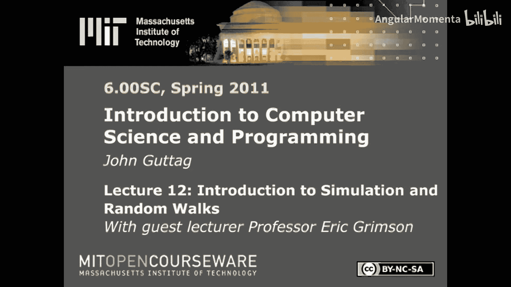
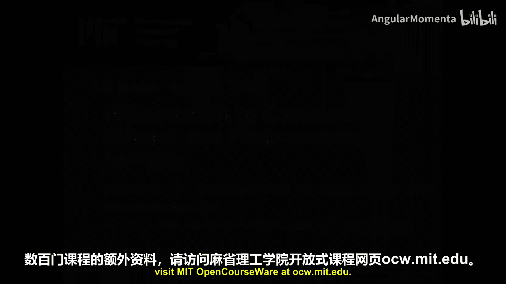
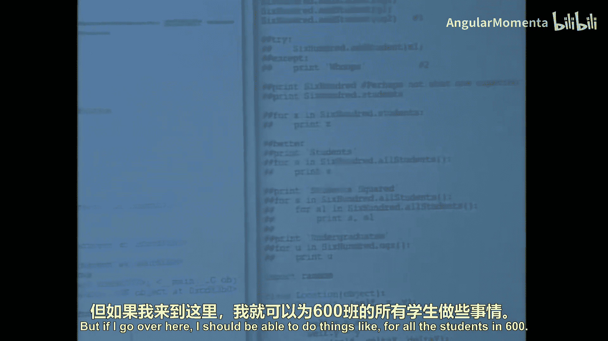
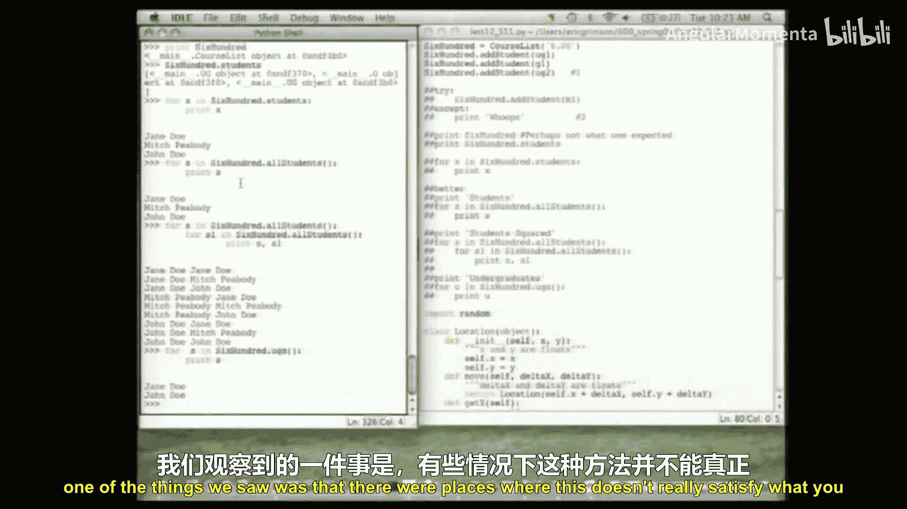
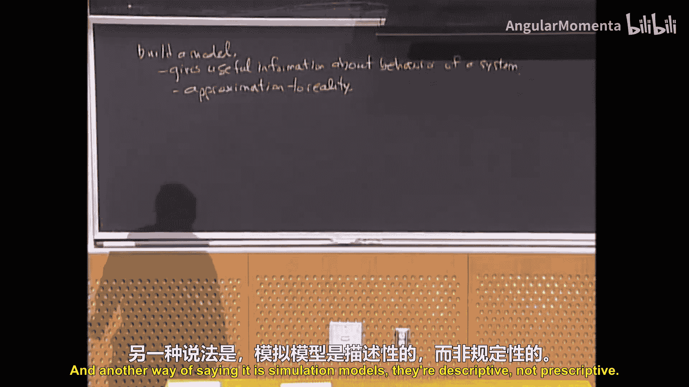
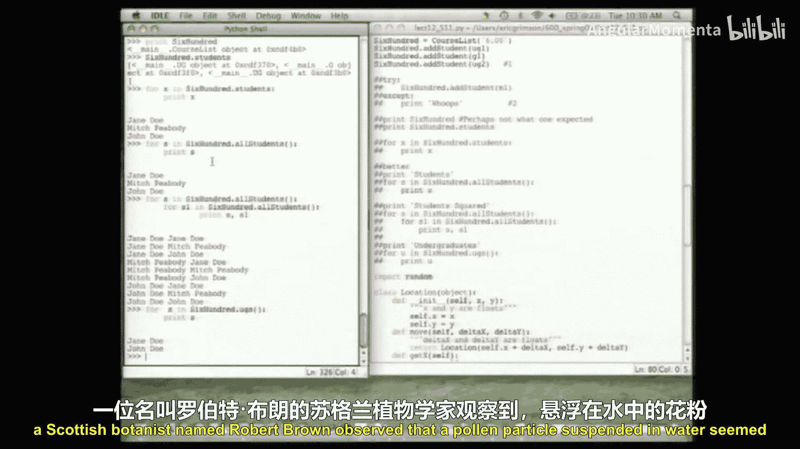
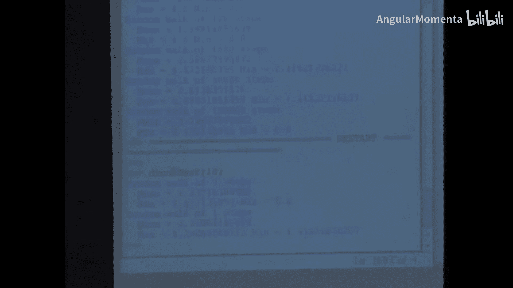

# 【麻省理工】计算机科学与编程导论 ｜ MIT 6.00SC Introduction to Computer Science and Programming p17 17 -BV1a5BZBkEP6_p17-

The following content is provided under a creative Commons license。

 Your support will help M I T Opencourseseware continue to offer high quality educational resources for free。

To make a donation or view additional materials from hundreds of M T courses。

 visit M I T OpenCourware at O C W。t M I Tt E Du。

Okay。You can probably figure out， I'm not Profesor Goodtag。He's away today。

And so he's asked me to cover this lecture， which I'm happy to do。

I'm asked to remind you that there is no recitation on Friday。

I was expecting at least a smile or a small cheer。 You know， you lead into spring break。

 This ought to be good。So my understanding is that at the end of last class。

 Professor Goodtag was walking you through a set of classes。

And I want to remind you of where you were。 I want to look at one of those classes in a bit more detail because we're going to show you one new piece of the language。

And then we're going to turn to a different topic。Which is going to be the subject for the next several lectures。

So just to remind you where you were， Professor Goodtag showed you a set of classes that started off with a person class。

And there's a definition up。On the screen。This was just something that created a kind of object。

 I'm not going go through the details， but you had the standard things you'd expect。

 You had a way of initializing it。 So you'd make each instance。

 and it had a way of pulling up the name so you could have a full name and a last name。

 You could get out pieces of it。 It set birthday。 It had age。 It had a bunch of stuff。

 And that's fine。Second thing that he did。As we do in a lot of dealing with classes is he created specialization of that thing called an M T person。

And you all know that M T people are special people。Right？And what does an MT person do， Well， again。

 you can look at it。 It had， again， an in it method。

But one of the things that was a little different here。

 You may have seen in some other places is that we can create inside of that class definition。

An internal variable。 In this case， it was the I D number。

So that every time we created an instance of this class。

 we could give that instance a special number and a unique number。

 And that was exactly what we did here， right， If you're going create one of these things。

 you set the I D number。To be。The next number。And then you would increment that so that you would be able to next time you created an instance。

 give it a unique number， and that let you do things like put things out in order and things of that sort。

There was also a method in this class。 We're going to use in a second。

 which is something that would say， is this person a student。 And I'll just highlight for you there。

 the definition of it， which said you'd look at the type of the instance。And say。

 is it undergrad or grad， And that was the other two specializations we had here。Just we had。

Undergraduates。And we had graduates。And again， I'm not gonna to worry about the details。

 You saw this last time。 undergrads， they had some methods like you could create an instance of it。

 You'd have its year。 You could give back what the year was。 And for the graduate students。

 we didn't even bother with putting details。 and it could be anything you want， okay。Now。

 these are the things that you ought to be getting used to looking at。

 So this is creating some class definitions。 I can make some instances。 A couple of nice variations。

 like for the people， the M T people， each one has a unique identifier。

 which lets us keep track of them。I think where Professor Goodtag ended up last time was actually creating a course list。

So a list of students in a class， like 600。And so I want to show you that。

 And I want to show you some highlights of that。 So there's。The definition it's on your handout。

 as well。So what does a course list？2。Well， idea should be。

 it's a way of collecting together all the students in 600。

So if you look at our knit function up here。When we create an instance of a course list。What's it do。

 Well we give it a number like 600。 And it's going to bind that locally inside of a definition。

 And it's going to create。A collection， a list。 It's gonna be a list of all the students。Now。

 if I'm gonna do that， I need to have a way of putting students into the class。

 and I know nobody dropped 600。 But just in case drop dates coming up。

 we have to have some way of removing a student from a class。So。I'm gonna have a method， right here。

Y， sorry， Im want to get it from the right place right there。That would add a student in。Now。

 take a look at that for a second。It's not just putting the student into the list。

The very bottom down here， that last line， self dot students dot a pen。

 What's that doing Well self remember refers to the instance。

 dot students will get me that list for that instance。

 And then dotta pen says add on to the end of that list。

 the person that I just added in the person I called that's bound to who。

The things above it are being careful。Theyre defensive programming。 There are ways of saying， look。

 make sure that the person is actually student。waitai a minute。 where' did that come from。Is student。

Oh yeah。 that was up here。In MI T person。 So we're making an assumption here that says we're only adding in students。

 No postdocs are welcome。Right，We're going all out in students。

 So we're taking instances of one of these two classes and checking。

 using the inherited method to make sure that this person is actually a student。

And we're doing this in a carefully， which is we're gonna to raise an error。 If， in fact。

 it's not a student。Okay， and then the second thing notice we're going to do here is we're going to say。

 gee， make sure that we're not adding you twice。So we're going to do what。 We're going to say。

 get out the list of students right there。Manager Ga， self is pointing to the instance。

 dot students gives me the list of students currently in that instance。 And I'm basically saying。

 is this person in that list。And if the R again， I'm going to write it or is an error saying。

 wait a minute， you're already in the class。So these are things I I'm sure you've seen before。

 but there are ways of being a little careful about the programming。

The removed student is roughly the same。 So let's just look at some examples here。Right。

 ourve created set of people。And just to show you what they look like， let's go down here。So。

 I created M1。Yeah。Let me do that again。 Sorry about that。 We're going to run this。Alright。

 so if I look at M1。It's not liking me， is it。 We'll try it one more time。 I'm gonna look at M1。

Gives me back。An instance of an object。Remember you again， if I actually say a print of M1。

It'll print out the name。And the same thing for the undergraduates here。

 So I've made a couple of undergraduates I made a couple of graduate students and notice what I've done down here。

 I've created。Of course。600。By calling courseless。 So course list is going to make an instance of that。

 I gave it the name so we can go back over here。 Let's look at what 600 says。Okay。

I'm sure you're used to reading that gobblediguook。 It says， it's an instance。

 and it's an instance of a course list。 And it gives me a pointer to where it is。Now。

But if I want to see the students。Inside this course， like to see who are all the students there。

Okay， so printing 600。See if that does the right thing。Oops， no。That kind of makes sense， right。

600 is just pointing to an instance。 So where are the students。

They're sitting down inside of an internal variable。Which is， in fact， in this case。

 the list of students。 So one way I could do this is I could say。Take 600， which is an instance。

And go into that frame that correspond to that and look up the local variable students。

And if I do that。No， I got a bunch of students named Maine。Now， this shouldn't surprise you， right。

 This is doing what is giving me back that instance。Of the list。

If actually want to print out the names of the students。

 I have to do something a little more careful。 So here's one way I could do it。

 I could say for every student。In that list。Let's print out their name。Oh， good。You're wondering。

 why am I doing this， Well， I want to show you what's going on in this class。

 And I want to highlight something for you。 So let's think about what I just said。 I want I said。

 I want to get the names of all the students in the class。

 So I took the instance I went in and pulled out an internal variable。

 and then I did a for loop to walked along it printing those out。Is that a good idea？

Is that a not so good idea。Is that a really bad idea。

Don't you hate professors who ask questions at 10 o'clock in the morning？Well。

 I'm going to suggest that it's not a great idea。 And here's why。I'm reaching into。An instance。

 I pulling out an internal variable。And doing something with it。

A much cleaner way of dealing with that is to build an interface， to build a function。

 a method that belongs to that instance that would give me back the pieces I want。

And the reason I'd like that is that I don't have to worry about if I change my mind in terms of how it represents things internally。

 All I have to do is think about that interface function。Okay。

So the last thing I want to show you here in this example is， let's look， in fact， right here。

I've added a method called all students。But it's a little different， I think。

 than things you've probably seen before。So what's the idea， I want all students。

To be a function or a method， when I call it， I wanted to give me back。All of the students。Now。

 I could have had to just give me back the list， but I might want to have the method give me back not just all the students。

 but maybe some students， like only the undergraduates in the class。And in fact， right below there。

 I've got a method that does that。Let's look at this one。 It says。

 I want to get back the undergraduates in the class。 And what's it do。

 It's going to do a little counting thing。 It's going to set index to 0。

And then it's going to run through a while loop where it basically takes each student。

And checks its type。Right， this is something you've seen before。 I'm taking a loop。

 I'm walking along， taking each element out of that listz and saying， if it's an undergraduate。

 I'm going give you back that student， and I'm incrementing index at the bottom。

Here's the funky thing。I've used a word called yield。And that's different than you've seen before。

Right， I'm not directly accumulating a list。 You don't see anywhere where I'm building up a list here。

 So yield， fact， is an example of。A form that you're going to want to use。Ca a generator。Now。

 a generator。It's a little bit like a return。But with one big exception。

 if I had a return in that method somewhere， when it found the first thing is going to give me back the value and it's done。

 And so any information it' stored about where it was in that computation phrase we use as it gets popped off the stack frame。

Yield is a little different， and it's different because a generator。

I want to write this down carefully， a generator。Is a function。That remembers。The point in the body。

Where it was。So remembers the point in the function body。Where at last returned。Plus。

 all the local variables。Okay， so what does this mean？

It says it's going to keep track of what was the state when I did the computation。

So that if I call it a second time， it goes right back to that state。And continues the computation。

 And If I call it a third time， it goes right back to that state and gives you the continuation on the computation。

So， in fact， what yield does， what a generator does is what you would do when you normally walk through a list。

 but it gives you some control。So it gives you a way of actually deciding。

 how do I want to create something I could use in a four list。 And if we go back and look at it。

 right， you can see it right there。This call to undergrad， sorry。

 the method definition for U GS undergraduates。If I call it。

 it is basically going to walk through one at a time， each element in that underlying representation。

And generate for me the next element of the thing I want to use。

And so let me show you a couple of examples of using it。 In this case。

 I buried it inside of a four or a while loop。 But if I go over here。

We should be able to do things like。

For all the students in 600。Notice the open closed print because that's a method I need to call it。

Now， you're going， you know， what you do。 That's just like the print thing I did before。

 But the difference here is I'm controlling now how I get access to those。

 And to show you just a slightly different way of doing this。

 I could now do things like saying the following。 I'm gonna take for all the students。In 600。

And I'm going to take all these students again in 600。So notice what I'm doing， two loops。

And I'm gonna create something that basically keeps track of where I am in each one of those loops。

 using that yield function。So take a look at what it printed out。

 That outer loop is using the generator to generate each element of the list。

 It hangs on to that so that the inner loop can walk through again。

 a generator going through each element of that list。 And I'm printing up students square。

 First student Time all other students， Second student Time all other students， Third student。

 times all other students。And， of course， the other thing I can do。Yes， I can do the same thing。

I'm sorry about that for S in， let's do 600。Undergrads。And in this case。

 it's walking through that internal representation。

 generating each element that satisfies the constraints。Okay。That's a little esoteric。

 but you're going to find it really useful。And it's the last piece I think。

 of syntax you're going to see for a while in terms of the language。

You could do this by just manipulating the list directly。But the idea of a generator。

 you're going to find really useful when you wanted control access to a collection。

And really think of the generator as something that keeps track of the state of the computation so it can go back and pick it up whenever it needs it。

Okay。It wraps up that piece of what Professor Goodtag was doing。 So I want to now switch to。

Completely different topic， which we're going to do today。 We're gonna to do Thursday。

 and it may well carry into after spring break。The second topic deals with。

 how do we go about building computational models to solve。Problems， real problems。Okay。

 and I want to start by putting up a comparison。For much of the history of science。People focused。

I trying to find analytic methods。Big word， what does it mean？Well。

 an analytic model is something that lets you precisely predict the behavior of a system just based on some initial conditions。

And a set of parameters。 So this is a mathematical function， if you like。You can predict。Behavior。

Given some initial conditions。And some parameters。Newtonian physics。Right，801。Analytic models。

Spring constants， analytic models are things that let you predict what a system is going to do。好。

 I don't know。 Several centuries。 This was basically what science did。 It was really useful。

 It LED to things like calculus。 LED to things like probability theory。

 It LED to basically understanding。Excuse me， The macroscopic physical world。

 So's the stuff you saw in high school。That's nice， but it doesn't always work。Okay。And indeed。

 as the 20th century progressed， one of the things we saw was that there were places where this doesn't really satisfy what you need。

 and you're better off。

With simulation methods。Which is what we're going to talk about here。

 So what do I mean by simulation method。 First of all。

 let me talk about why did we want to get a simulation method。

 The idea was that there are going to be some places where it's really hard to build the model。 So。

 in fact， places where this comes up。Sometimes we have systems that are not mathematically tractable。

G， highfaluin word。 What does it mean， It says there are some systems where it's really hard to build a physical model that exactly predicts what's going to happen。

Think weather forecasting。Right。Doesn't work well。 Actually， in Boston is easy。

 Just assume it's gonna to snow when you're fine。Right。

One reason why we want to move towards simulation models。

 Here's the second reason why we'd like to move towards simulation models。 There are times when。

 in fact， as things get more complex， we're better off。Just successively refining。

A series of simulations。In other words， rather than spending the effort trying to build a very detailed。

 predictive model， analytic model， just run a simulation that gives us an insight to what the problem is doing。

 We'll refine the simulation。 and we can keep going on like that。

Third reason you might like to do it is it's often easier to extract。Useful， intermediate results。

From a simulation， then it is to try and build a detailed analytic model。And of course。

 the last one is pretty obvious。Adventica computers made this possible。

I want to give you an example of this。Put yourself back in the 17 hundreds。

And think about how you would do a computation。You have two choices。 You can crank it out by hand。

Good luck。Imagine how detailed a model you could actually do that way。

 or you could build really precise， detailed mechanical models。 And In fact。

 there are wonderful collections of these from people like Leonardo of， for example。

 people that wanted to understand the solar system build what were called digital No， sorry。

 not digital， mechanical oraries， which were these very complex pieces of clockwork that allowed you to try and predict the motions of the planets。

😊，And that's a really expensive way to try and do a simulation。

 So computation suddenly makes things change a lot。Now。Just to give you a sense of this。

I did the following experiment this morning， excuse me。To see how important simulation is。

 And I haven't really said what simulation means， right， So simulation means。

Giving me an estimate rather than a prediction， giving me a sense of what might happen to a system under certain conditions and doing that multiple times。

 actually running。If you like a model of the system rather than trying to predict exactly what's going to happen。

 So I did the following experiment this morning。 I went to Google。 I could have gone to Bing。

And I typed in。Finance simulation。I got 5 million hits。Most of them probably wrong， by the way。

 but that's okay。I typed in biology simulation。I got 11 million hits。I typed in physics simulation。

I got 15 million hits。And then finally， I typed in game simulation。How many hits you figure I get？

North or south of 15 million。North， yeah，50 million hits。Okay， so why should you care， A。

 It's fun to do。 B， it's really a common tool that we want to use here。Okay。

So let's think about what a simulation would look like。 And then we're going to start building one。

 So the idea of a simulation then is what we're trying to do is we want to build。A model。

With the following property。It's going to give useful。Information。About the behavior。Of a system。Boy。

 there's a statement that has no content to it， right， But let me tell you what I mean by that。

I want to compare this to an analytic model。 An analytic model would exactly predict what the system is going to do。

With a simulation， we want to build a model that says if I give you some sense of the state of the system。

 it will give me some information about how that system is going to behave。May not be exactly right。

Okay， but it's gonna give me some some simulation。 another way thinking about it is it's going give me an approximation。

Sorry， once the R M your approximation。To reality。Right。

 and another way of saying it is simulation models。

They're descriptive， not prescriptive。Okay， so what does that mean？

An analytics model is prescriptive。You're doing 8，01 problems。

 You type in the definition of the parameters of the problem。 It will tell you。

 at least to the accuracy of the computer， exactly what's going to happen。With the simulation。

 it says given a particular scenario， I can give you a good guess what's going happen。

But it might actually be the case， by the way， that for exactly the same scenario。

 I run the simulation multiple times。 I might get slightly different answers。

Becauseuse maybe the world， as we said over here， is something that we can't model exactly mathematically。

And so we want to be able to have that ability to sort of go back and forth。Right。No。

Probably the easiest way to think about this is let's look at a model of a simulation。

 So the idea here is I want to build simulations。 I want to control the fact that I may not get a precise answer。

 I might not get the same answer every time。 But if I do enough simulations of a circumstance。

 I can get some good sense， which I can refine of how this object is actually gonna behave。

So here's the example I'm going to start with。I'm going go back again a couple hundred years，1827。

Scottish botanist named Robert Brown。Observed that a pollen particle suspended in water seemed to just float at random。

And you've probably heard this term。 It's called Brownian motion named after Robert Brown， right。

 He had no plausible explanation for this。 By the way， He just observed it。

 and he made no attempt to model it mathematically， which kind of makes sense。That's 1827。

The first really clear mathematical model of Brownie emotion didn't come around until 1900。

guy named Luas Baciier had a doctoral thesis called the theoryory of speculationulation。

Part of the problem for Bachier， though， was that he didn't model Brownian motion in pollen particles。

 He did it in finance markets。And that was considered， at least at the time， completely disreputable。

 And so nobody paid any attention to his thesis。It' not going to happen to your thesis。

 your thesis is going to be reputable when you get done with this place。

So it took 80 years to get to that point。Unfortunately， for， for poor baciier， five years later。

 another person came along。And actually built the kind of model that introduced this sort of what's called s stochastic thinking into the world of physics。

 This was a model that was almost exactly the same as bacilis。

But it was used to confirm the existence of atoms。Anybody know who did that model in 1905。

No physics boss here。I told you he was born in Switzerland with that help。

minoror guy named Albert Einstein。So was one of the first things Einstein did was he actually built the first really good model of Brown in motion。

 and that allowed， in fact， this kind of thinking to go into real world problems。So Brown in motion。

Is an example。Of a tool we're going to use a lot。Prob hiding that below the screen where you can't see it。

 It's an example of what we call a random walk。Okay。Random walks。

 you're gonna see all over the place。 They' are an incredibly useful way of building a simulation。

 And the， yeah， the essential idea of a random walk is。

 if I've got a system of interacting objects could be pollen particles。😊。

I want to model what happens in that system under the assumption that each one of those things is going to move at each time step under some random distribution。

 Okay， it's going to move in a particular direction。

 And I want to model what the overall system does。Okay。

 let me give you some examples of where this is really useful。

It's really useful in modeling physical processes。Well， we can start with pollen particles in air。

But you could think about any kind of particle in water。

 You could think about any kind of air particle。In a larger fluid， weather。喂。Moodeling whether。

 if we could really model the motion of all those molecules is just a really large random walk。

Random walks are really useful in understanding biological processes。For example。

 the kinetics of displacement of RNA from heterodupplexs of DNA。Is a great example of a random walk。

 And in fact， people interested in bioinformatics or computational biology。

 you'll see random walks used all the time to try and understand displacements of things。

It's really useful in social processes。Move to the stock market。It's definitely a random walk。

Except for today， when the markets are all crashing。For unfortunate reasons， right。

 So something we want to use a lot。In the example I'm going to use to motivate a random walk。

 We're going build a simulation here is the what was the traditional view of a random walk。

 So here is the motivation。 Excuse me， a second。Let's take a drunken university student。

Not an institute student， a university student。 So this is a Harvard student， not an M T student。

 because I know you're all well behaved。At least smile at me when I make these bad jokes。 Thank you。

 Allright， You got a drunken student。They're out in a big field。

And they start off in the middle of the field。 And every second。

 this student can take one step in one of the four cardinal directions。 So north， south， east west。

After 1000 seconds， after 1000 steps， how far away is that student from where he or she started out。

So I need some help here。Guesses。Thousand0 steps。 How far away after 1000 steps is that student from。

 we'll make it a he where he started out。呀。And上。Okay。

 so let's assume that the steps are equally likely。

 the four steps north southeast westt are all equally probable。Okay。

 so the suggestion of is where he started。 So zero distance away。 That's not a bad guess， right。

 I mean， you sort of， you know， you're just going in different directions you know。

 equally likely you end up where you started。 So， one possibility is 0。

 So you can end up back where you started。第二。All right， I'm going to take bets here， I got 150。

It's an interesting number， not bad。Any other guesses， I mean， this side of the crowd。

 I don't want to just do the right side。 I'm very liberal。

 I want the left side of the crowd over here。 Somebody over in this side， Help me out。

Any the other guesses is， I got zero， I got 150 steps。Boy， I get no eye contact when I do this。

 This is great。 Well， let me sit， yes， please。Sorry。500 root 2。 Can I drop the root2 for a second。

 The 500 is not a bad guess， right， because I sort of say， you're about half， you know。

 half the distance away。 The root two will come back to in a second here。 Keep that in line。

 All right，500。 So we got 0， got 150。 We got 500。Well， gee。

 that's the whole point of building the simulation。

 Let's see if we can figure out what might happen here。 Okay。

 and I'm going build the simulation in a second。 But before I do that。One of the good things to do。

Its to try and build。A simple model that we could use to get an intuition about what's going to happen。

 right， So I'm gonna start with a very simple model here。There's my field。You know。

 the the guys who mow the lawn at Fenway have been over and very nicely put X and Y axes onto this field。

 And let's assume。The student starts off there。 We'll just call that the origin。

 Does't matter what it is。 but that's where the student starts off。

And what I want to do is I want to get a very rough sense。

Of how far away the student might go after a few steps。 We weren't gonna be able to go very far。

 but enough steps that we can start estimating this。 So they start there after one step。

There are the places the student could end up。Equally likely。So， after one step。

I want to sort of build a distance。Associated probability。With probability one。

 their're one unit away， no matter which direction they went。Okay， let's take this one here。Okay。

 let's assume the student went east。In fact， they're all going to be roughly the same。

 And a second step， where could the student go。Can go there。Could go there。Go there。

Or it could go there， right？So what are the distances here well。In one out of four cases。

 instead a distance 0。which would be back to where we started。

 which is that original pretty good guess。If it goes there or it goes there。

 those are both what distance away， Ro 2， right。So。Could be root2 away。Two out of four times。

And if we went east again， we're two units away。Okay， again with probability 1 and 4。Alright。

 I'm cheating slightly here in the sense that I should do the same things if the first step was north south or west。

 but they're all symmetric to this。 It'll all come out the same way。

 So there what happens after two steps。Okay。Now， let's do one more step。

 I'm going get a little messy here， but suppose I want to go three steps。Okay。

Well I got three possibilities， if I'm in this case， which is the zero case， I'm here。In which case。

 no matter which step I take， I'm one unit away。So this will say distance one。

 the probability of being here was one quarter。 So the probability again is still one quarter that I'm one unit away。

Okay。Let's take one of these， the root two ones。 that says I'm either here or I'm there。

 they're going to be symmetric if I'm here。Where can I go？got possibilities。Going to those。So。

 these two。Are one unit away。So half the time I'm one unit away。

 and it was one half that got me there。So did I do that right？Yes。That's also with one quarter。

I was getting， I went here or went there If I'm up here or if I'm over there。 Sorry。

 if I'm up here or I'm over there， that's route 5 away。I put that over here。

So I got a probability of a half getting there and a probability of a half from here of getting that。

 So that's also with probability one quarter。And then what's the one case I have left。

 The case I have left is I went all the way over to here。Two steps over。 in which case。

 I'm gonna go what there， there， there or there。You know， if I just pull these together。

 I'm just going to do them for you。That says， I have a probability of being one away with probability 1。

16th。Route 5 away with probability 1，8。And I'm running out of room here and three units away with probability。

1，16th。Don't sweat the details， right， But what you can see as I'm just building this up。

 What I want you to see is， what do the distances look like。Through one step。One unit away。

After two steps。That was this。You can kind of do the math in your head。

 What's the expected distance away， What's the average distance I'd be away。Well。

 it's zero times a quarter。Plus2， root two times a half， plus  two times a quarter。 So that's 1。4。

 That's 2。8。 That's 4。8 divided by 4。 So it's about。1。2。Now。

 I'm sure you can do the math for three steps in your head， right。Yeah， right。But if I do that。

 if I add those things up， you can go do this yourself。 What you'll find is that this is about。1。5。1。

4，1。5。Let me make it 1。4， it's probably a little bit closer。All right， why was I doing that？

This is something you want to do is you start building a simulation。

 which is do a little bit of a calculation to get a sense of what you expect to happen here。

So what conclusion could I draw from that。Looks like admittedly on very small numbers。

 It looks like the more steps that Harvard student takes。On average， the further away they are from。

The starting point。 So your 0 was a great guess， but it's probably not going work here， right。

 And we want to see why。On the other hand，500。That looks。 well， And， maybe we're still okay， right。

 Three steps， halflf a three would be one and a half。 So maybe the 500 is O。

Let's see what happens if we do this。So。What I want to do。You see how I could build a set of classes。

That would let me build this simulation。And part of the design process here is I want to try and invent classes that correspond to the types of things I expect to see happen。

So in this case， what do I have？I need to model a drunk。I need to model a field。

 which is where the drunk's wandering around in。 And I'll need a third thing。

 which may not be obvious immediately。 But the third thing I'm going to need。

 So let me just put the pieces up。 I need a drunk。I need a field。

And I need to keep track of where the drunk is in the field。 So I'm going to pull out another class。

 I'm going to call a location。It's going to tell me where the drunk actually is。Okay。

 with that in mind。I'm going to show you some code。

 I'm going to walk through it reasonably carefully to let you see what it looks like。 So there is。

My class definition for a location。Now， at this stage in the course。

 hopefully you can look at that and already see the main pieces of it。 So what do we have in here。

 Well， we're gonna have an initialization， You can kind of see that right there When I create a location。

 I'm giving it an X and Y。 I'm gonna make an assumption， which is their floats。

 We'll come back to that in a second。 And that's just going store them away in some internal variables。

 things you've done before。 So selflf dot X gets that value。 Self dot Y gets that value。 And。

 of course， I could get out。The values right there。I need to know where the drunk goes。

 And so one of the things I'd like to do is to say， given a location， current location of the drunk。

 I might like to know how far away is that from some other location。

 like the place the drunk started。So that last method down here， distance from。

 notice what it's going to do。Right。Says if you give me another， which is another location。

Rememberber self will point to my instance。 What can I do。

 Well I can just do pythagoras theorem to figure out how far away am I， I get the X and Y。Coords。

Of the other location， I get my own X and Y coordinates， And then I just take， you know。

 those distance to square， take the square root of them。 So just give me distance away。

 just pretty nice。So one other method here， which is a little funky。 This was a design choice。

 And that method is the one up here called move。So the background to this is I'm going to have a drunk at a location。

One of the things I will want is to be able to change locations。

 So move says if you give me a change in X and a change in Y， I'm going to assume their floats。

I will give you back the new location， which is to go from my X and Y by some amount。

 could be in the east direction， could be in the north direction。 But notice what it returns。

 It returns a new instance of a location。Okay。I made a couple of assumptions。

Which are worth thinking about here。So one assumption is， I'm assuming that this is a 2D world。

 you can't elevate。 you can't rise up。 there's no change in altitude here that kind of makes sense。

The second assumption I made was I said， I want to build it in so that things like Delta X and Delta Y are floats。

What is that doing， Well， that's saying， I don't want to restrict myself to just moves that are only in the cardinal directions。

I'm going start there。 But initially， I'd like to have the ability that the move could be along a diagonal or it could be some partial step。

 So notice I'm making a choice there that is kind of nice。All right， that gives me locations。

And that's a pretty straightforward class。Okay， so I got locations。 That's always a good start。

 I have this。Now， again， I want to model a drunk wandering around in a field。

 So the second thing I need is I need to say， what's a field going to be。And I want to show you that。

 I'm sorry about that。 I want to show you that definition， which is right here。Right， and a field。

Is basically going to be。Something that maps drunks。To locations。

So fields just going to be a collection of drunks keeping track of where they are。

 So let's look at what that definition says when I create a field。Right up here at the top。

 it sets up。A variable。Inside of that instance， just called drunks。

And we're going to use a dictionary。Could use other choices。

 But the dictionary is going to be nice because it's going let us keep track of the drunks。

 I can add a drunk to the field。嗯。So notice what it says。 It says， given I got a field。

And assuming I have a drunk and a location。Because the drunk's got to be in a particular location。

 Notice what it does。 It says， first of all， it checks to make sure。

That I don't already have this person in my lecture collection。 So that first check there says。

 if this particular drunk is already in my list in my dictionary， I complain。You can't get so drunk。

 You can， sorry， you can be drunk enough to C double， but you can't be drunk enough to be double。

Another bad joke right off the back wall， great。Okay， so what else do I want。

 Otherwise notice what I'm going to do here。Okay， now I wanted to make sure you can see these things fairly cleanly If I'm going to add a drunk。

 what do I do into the dictionary under that label of drunk。

I'm going to insert a value corresponding to that label。 and the value is going to be the location。

So my representation here is now a dictionary of drunks and where they are。

And that's going to be handy as I want to use this。And then if I want to。

 I want to get out the location， will I just return exactly that。

 The final piece is when I go to move the drunk。I got some tests here to make sure that I actually have a drunk。

 But otherwise， I'm gonna to ask the drunk to take a step。Right there。Okay。

 we have to say what a drunk does。 That's gonna give me back a change in X and a change in Y。

 And then notice the funky little call below here。This says what The right hand side says。

 I get the dictionary of drunks。I go in and index into it to get out the actual drunk。

 That's this first part， right here。Right there。That gives me back what It gives me an instance。

So the dot says for that particular drunk， get its move method。Which is that call。And have it move。

By that amount。And that returns for me， then a location， which I can store back into the list。Right。

I made some assumptions about field。 They're worth pointing out。Right。No constraints on locations。

How big is this field。big as you want。 So I didn't build in a real physical representation of the limits of the field with every location represented。

 I just said， it's just a collection of drunks。 So there's no limits on how far the drunk can go。

Second assumption I made here is I can have multiple drunks。

 I'm going to see simulation that in a well。 You can imagine it's going to be fun watching them collide with each other。

😊，Alright， and the third thing is， it says nothing about the patterns in which the drunk moves。

So this is a design to keep this clean。 It says nothing about how the drunks move。 It simply says。

 give me a change in X and Y。 I'll change the location。Alright。

 the last piece is we're going to capture how the drunk moves in a drunk。

And there is the definition of the drunk。What does that say to do。Well。

 we're going to give it a name to start it off。And the only method it has is that thing that's going to do a take step。

And here's where we're going to build in the choices about how they can move。

 which is I think what you asked about earlier， right， Not what I've done there。 In this case。

 I've said， I'm going to pick at random from this set。Step choices。

That's where I'm building in the idea that it's only going to move plus or -1 in the X and Y direction。

 north southeast West。 I could clearly change that。

I'm also building in here that it's equally likely because random picks one of those equally likely。

 I might decide to change that。 And I can certainly do that if I want to move to other directions。

 But right now， that's where I'm gonna to build it in。Okay， so now we're ready to try the simulation。

We've got。What we've got locations。 that's just representing a place。

 We've got fields that just lets us map drunks to locations。

And then we got the ability to move the drunk around。 So I can now think about making。

This actually move around。So let me show you a quick example。Let's create a drunk。Yeah。

 sorry about that。I'm picking the obvious person。Alright， I'm going to create a location。

We'll call the look， the origin。Just the spot at 0，0。And I need to create a field， which I can do。

And then I'm going to add Homer。To this field。At the origin。And now。

 the last thing I want to do is Ill have a Woer wander on。 I want to see how far he goes。

 So I'm going to build a little function over here。 You can see it right there， called walk。

Which takes a field。Takes a drunk in the field and says。

 how many steps do I want him to stagger around with and what's it going to do。

 I'm going to set the start location to be where the drunk was initially。 mightight be at the origin。

 It might be somewhere else。And then I'm just going to run through that number of steps。

 So R is just saying， take that number of steps， just moving the drunk。

 And then I'll return how far away he is。 So if I do that here。I can do walk。With that field。

 with my drunk homer， let's take 10 steps。嗯。That's interesting。 Let's try it again。

WI was getting worried there for a second。So， we're getting。An interesting range of values。

So here's the last thing I'd like to do。Let's actually do a simulation of this。

 And I'm going to do this reasonably quickly。 Sim walks right here。

Is simply going to do what I just did， but multiple times。 That is it's going to take a drunk。

 a field some number of steps， and it's going to run a bunch of trials。I many trials I want to get。

 So I do what I just did over here and collect those together。

 And then I can just print out some statistics about how far away did the drunk get， as I do that。

And that's what drunk test is going to do。 We're going to do it for 10 steps，100 steps。

1000 steps and so on。 So let me simply run that。If I run drunk test。

And we'll do it with 10 trials each。O。That look right。Ft it good。

You can tell this is a trick question。So what should you be looking for there。

 Look at it says if I take 10 steps on average， I'm about 2 and a half steps away。

 if I take 100 steps on average， I'm less than two steps away，1000 steps。 I'm about two steps away。

10000 steps。 I'm about two steps away。100000 steps on average， I'm about two steps away。

 Wait a minute。 Didn't we say that it looked like。Right， over on that board there。

 that as I increased the number of steps， I got a little bit further away。嗯。

So I've done this deliberately。 This suggests what。 First key point。

 Think about what your simulation should return。 What are good examples to think about。

 because this doesn't look right。So here's how I could test it。Right， why don't I。

Try a simulation on values for which I know the answer。And so I'm gonna go back in here。

And right here， I'm going to replace this with。Or are they going to take。Zero steps。Or one step。Okay。

Let's run that。Oh don't do that to me。 Yes， I do have an error。 Thank you。Get rid of it right there。

We're almost out of time， so this is perfect。AndNow let's try drunk stuff again。Wow。

If I take a random walk， taking no steps， on average， I end up two and a half units away。

I teleport it。That's pretty amazing。And with perfect timing。

We'll figure out what's wrong with my next， my simulation next time， thanks。

