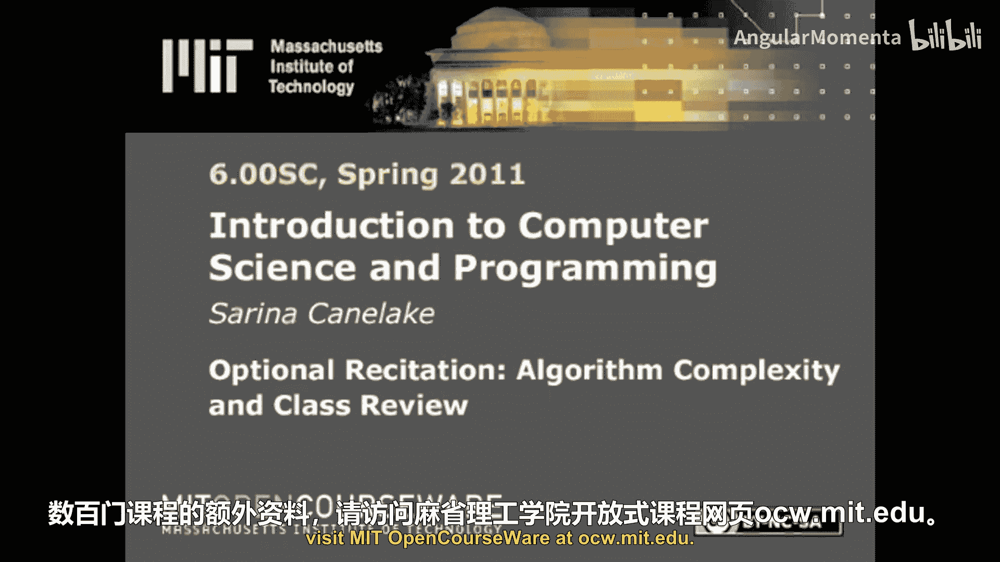
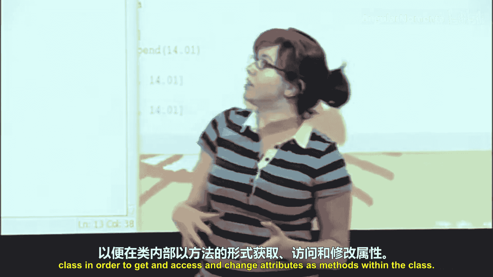
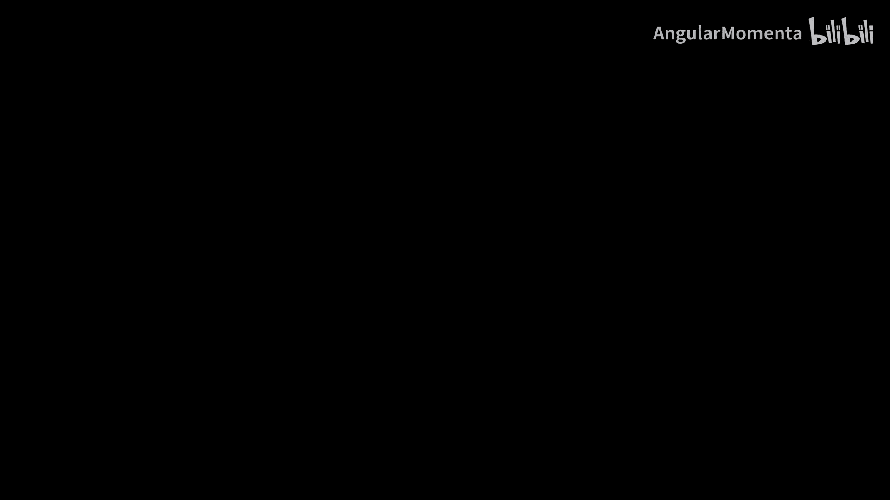

# 【麻省理工】计算机科学与编程导论 ｜ MIT 6.00SC Introduction to Computer Science and Programming p18 18 -BV1a5BZBkEP6_p18-

The following content is provided under a creative Commons license。

 Your support will help M I T Open Coseware continue to offer high quality educational resources for free。

To make a donation or view additional materials from hundreds of M T courses。

 visit M I T OpenCourseware at O C W。t M I T Eduu。

I wanted to give everybody a more conceptual idea of what big O notation was。

 as well as hopefully answer any like lingering questions you might have about object oriented programming。

 So I have these notes， and I type them up， and they're pretty detailed。

 So I'm just gonna go through some points kind of quickly。 So first up。

 who's still kind of unclear about why we even do big O O notation。Okay， so。Who。

 who can explain why we do Big O notation quickly。 Like what， what is it。Yeah。Right， exactly。

 So big notation gives us an upper bound on how long something is gonna take。 Now。

 something that's important to remember is it's not a time bound。 Okay。

 so something that's often confusing is that people say， oh， it's， you know。

 this is something that'll tell us how long our program is going to run。

 That's actually not the case。 Big O notation Lets us informs of how many steps something is gonna take。

 And so why is that important。 Well， I mean， I look at all of you guys。

 a couple of you guys have laptops out， everything。

 everybody's computer runs something at a different speed， right？

 But if we say something is big O of N。Okay， what we're saying here is we're saying that the worst case number of steps your program is going to take is going to be linear with respect to the size of the input。

 Okay， so if my computer is five times faster than your computer。

 my computer will probably run it five times faster。 Okay， but it's still。

 as the size of the input grows， I'm going to expect a linear speed up in the amount of time it's going to take。

Okay， so why is it important？At the bottom of page one， I have。You know， big onnotation。

 we are particularly concerned with the scalability of our functions。Okay。

 so what big O notation does is it might not predict what's going be the fastest for really small inputs。

 You know， for an array size 10， something that I you guys know a little bit about graphs， right。

We have a graph of x squared， and we have a graph of x cubed。Right。

 for there's a portion of time where the graph of x squared is actually bigger than x cubed， right。

 But then all of a sudden， there's a point where x cubed just goes， whosh， way bigger than x squared。

Okay， so if we're in some really small amount of input。

 big O notation might not tell us what's the best function。 but big O notation。

 we're not concerned about small inputs。 We're concerned about really big inputs。

 We're concerned about filtering the genome。 We're concerned about analyzing data from Hubble。

 you know， really huge blocks of data。Okay。So if we're looking at a program that analyzes the human genome with like。

 you know，3 million base pairs， some segment that we're looking at。 and we have two algorithms。

 One runs an order N time， and one runs an order N cube time。Okay。

 what this means is regardless of the machine that we're running on。 So this is algorithm 1。

 and this is algorithm 2。Regardless of the machine that we're running on。

 we'd expect algorithm 2 to run。Approximately n cubed over n。Approximately n squared slower。Okay。

 so with big O notation， you can compare two algorithms by just looking at the ratio of their big O runtime。

Okay， so if I'm looking at something that has， an array of size 2 million as its input。

 is it clear that this is gonna be a much better choice。Okay。So you'll run into that。

 especially a lot of you guys are taking this for the purposes of scientific computing。

 So you'll run into big onnotation a lot。 It's important to have， a grasp of what it means。

It's also on the second page of the handout。 I have some common ones that you'll see。

 The first one is constant time。 We did know constant time is order 1， okay。

 but you'll notice that I have here is order 1 is equal to order 10 is equal to order 2 to the 100。

Hey， that's unexpected to a lot of people who are learning about big O notation。 Why is， why is。

Why is this true？That seems kind of ridiculous。 This is a really big number。

 This is a really small number。But， yeah。Yeah， exactly， so if we look at a graph。😊。

Of one in a graph of2 to 100。Okay， we'll see that even though 2 to the 100 is much higher。

 much bigger than one。 Okay， as the size， if this is our input size。As the size of our input grows。

 do we see any change in these two graphs。No， they're completely linear they're completely constant。

 Okay， so anything， when you're doing big O notation。

 if you run across an algorithm who that does not depend on the size of the input。 Okay。

 it's always just gonna be order one。 even if it's like， you know，2 to the 100 steps。

 if it's a constant number of times， regardless of the size of the input， it's constant time。

Other ones， you'll see are logarithmic time， any base for logarithmic time we is about the same order。

 So order log basease 2 event is order log basease 10 event。

 This is the fastest time bound for search。Hey does anybody know what type of search we'd be doing in logarithmic time。

Something maybe we've hm。Yeah， exactly。 bisection search is logarithmic time， right。

 because we take our input。 and at every step， we cut it in half， cut it in half， cut it in half。

 And that's the fastest search we can do。😊，嗯。Okay， order N is linear time。

 Order n log N is the fastest time bound we we have for sort。

 We'll be talking about sort in a couple of weeks and order n squared is quadratic time。

 Anything that is order N to some variable。 So order order n squared order n cubed order n forth。

 all of that is gonna be less than。😊，嗯。Order something to the power of N。Okay。

 so if we have something that's order 2 to the N， that's， that's ridiculous。 That's， that's really。

 that's a computationally very intensive algorithm。Okay。So on page two。

 I have some questions for you，1，2，3， does order 100 n squared equal order n squared？

Who's who says yes。All right， very good。 How about does order one quarter N cubed equals order N cube。

Okay， does order n plus order n equals order n？Okay， yeah。 the answer is yes to all of those。

 And the intuitive sense behind this is that big O notation deals with the limiting behavior of a function。

Okay， so I made some nifty graphs for you guys to look at。

When we're comparing order 100 n squared to order， n100 n squared n squared n cubed in one quarter n cubed。

What people often think of is what I have here in the first figure。

So these are the four functions I just mentioned。 There's a legend in the top left hand corner。

 And the scale of this is up to x equals 80。 So you see at this scale。Okay。

 this line right here is 100 x squared。So this is， I think。

 often a tripping point is that when people are conceptualizing functions， they're saying， well。

 yeah，100 x squared is much bigger than x cubed， which is， you know。

 a lot bigger than a quarter x cubed。 right？ So for very small inputs， yes， that's true。

But what we're concerned about is the behavior。As the input is very， very large， okay。

So now we're looking at a time scale or a size of up to 1000。 Okay， so now we see here， X cubed。

 even though it's a little bit smaller than 100 x squared in the beginning， it shoots off。 Okay。

 X cubed is much bigger than either of the two x squared。

 And even one quarter x cubed is becoming bigger than 100 x squared。 right at 1000。Okay。

 so that's an intuitive sense why X cubed， no matter what the coefficient is in front of it。

 is gonna dominate any term with x squared did it， because X cubed is just going go。

Real big like that。Okay， and if we go out even further， let's go out to the input size of 50000。诶。

We go to input size of 50000。 We see that even 100 x cubed versus 10 Er versus just。

100 x squared versus just x squared。Alright， they're about the same。Okay。

 the x cubed terms now they're way， they're way above the x squared。 So the two x squared terms。

 you know，100 versus not， you know， just one。 As far as the coefficient goes， they're about the same。

Okay， so this is， this is the scale at which we're concerned about when we're talking about big O notation。

 the limiting behavior as your input size grows very large，50000 is not even that large。

 If you think about the size of the genome。Right，I mean， I doesn't need anybody here bio。

What's like the size of like the human genome， How many base pairs。Or even one gene。

Or one chromosome。What this the biggest？嗯，Yeah， over 50000， right。 And I'm talking about， you know。

 the amount of data that we get back from like the Hubble Space Telescope。 I mean。

 the resolution on those things are absolutely ridiculous。

 And you run all sorts of algorithms on those images to try and see if， you know。

 there's life in the universe。 So we're very concerned about the， you know， big。

 long-term behavior of these functions。Okay， have a page 3， One last question。

 does order 100 n squared plus order plus one quarter n cubed， equal order n cubed。Who says yes。Okay。

 and so I have one more graph。Okay。downown here， these red dots are 100 x squared。 Alright。

 these blue circles are one quarter x cubed in this line。Is the sum。Okay。

 we can see that its this line is a little bit bigger than the one quarter x cubed term。

 but it general really， this has no effect。This far out。Okay。

 so that's why we was just gonna drop any lower order terms。

 And whenever you're approached with a big O expression that， you know。

 has a bunch of constant factors and has all sorts of different powers of n and stuff。

 you're always just gonna drop all the constant factors and just pick the biggest thing。 Okay。

 so this is this line right here is order。And cubed。Does that clear it everybody？Okay。

 so now we've gone through。The basics of how we analyze this and， and why are we looking at this。

 Let's look at some code。Okay。So， the first example。Okay， all of these things right here in Python。

 we make the assumption that statements like this， X plus1， x times y。

 all these mathematical operations are all constant time。Okay， that's。

 that's something that you can just assume。Okay， so for this function down here。

 we have constant time， constant time， constant time， constant time operation。

 So we'd say this function bar is what。What's its complexity？嗯。Yeah， constant times。

 So the complexity of all of these functions are just01。Okay。

 because it doesn't matter how big the input is。right， all， it's all gonna run in constant time。Okay。

For this multiplication function here。We use a for loop。Okay。

 oftentime when we see four loops that's just going through the input。

 that's a signal to us that is going to probably contain a factor of O， N。Hey， why is that？

Okay what do we do in this for loop， we say for I and range y。What does that mean。

 How many times do we execute that for loop。Yeah， y times。 So if y is really small。

 we execute that for loop just a few number of times。 But if y is really large。

 we execute that for loop a whole bunch of times。 Okay， so when we're analyzing this。

 we see this for loop and we say， that four loop。All right， it must be O Y。Okay。

Does that make sense to everybody。Okay， good。Let's look at our factorial。

Can anybody tell me what the complexity of factorial is？Yeah， order in， why is it order in？

This is just it's still for loop。Yeah， it's the exact same structure。

 We have a four loop that's going through range1 to n plus one。Okay。

 so that's dependent on the size of N。 So this for loop is order N。 And inside the for loop。

 we just do a constant time operation。 right， That's the other thing。

 Just because we have this for loop doesn't mean that what's inside the for loop is going to。

 you know， be constant。 But in this case， if we have。Order N times。 we do a constant time operation。

Then this whole chunk of the for loop is order N。 the rest of everything else is just constant time。

 Okay， so we have constant time plus order N times， Con time plus constant time is gonna be order N。

 how about this one。Factctorial 2。Yeah， exactly。 This is also order N。

 The only thing that's different in this code is that we initialize this count variable。

 And inside the for loop， we also increment this count variable。 Okay。

 but both result times equal nu and count plus equal 1， both of these are constant time operations。

 right？ So if we do n times two constant time operations。 that's still gonna be order N。😊，Okay。

 so the takeaway from these two examples that I'm trying to demonstrate here is a single line of code can generate a pretty complex。

Thing， okay， but a collection of lines of code might still be constant time。 Okay， so you have to be。

 you should look at every line of code and consider that。Allright。Thrown in some conditionals here。

ok。What's the complexity of this guy？Yeah， this one's also linear。 What's going on here。

 We initialize a variable count。 That's constant time。 Al right。

 we go through character and a string。 This is linear in the size of a string， right。Now， we say。

 if character equal equal T。Okay， this character equal equal T。Right。

 that's also a constant time operation。 That's just asking if this one thing equals this other thing。

Alright， so when we're looking at two characters， we're looking at two numbers equal。

 equal or not equal is generally a constant time operation。 The exception to this。

Might be equality of certain types。 Like if you define a class and you define an equality method in your class and the quality method of your class is not constant time。

 then this equal equal check might not be constant time。 But on two strings。

 equal equal is constant time。And this is constant time as well。Okay。

 so linear in the size of a string， something that's important when you're doing this for exams。

 It's a good idea to define what n is before you give the complexity bound。

 So here I'm saying n is equal to the size of a string。So now I can say this function is order N。

What I'm saying is that it's linear with respect to the size or the length of a string。 Okay。

 because sometimes。You know， for like in the one where there was the input X and y。Okay。

 but the the in the running time was only linear in the size of y。

 So you'd want to define that n was equal to the size of y to say that it was order N。

 So always be clear if it's not clear， be sure to explicitly state what n is equal to。Okay。

 this code's a little more tricky。What's going on here。没上明。Everything in the beach train？哦，被告。Yeah。

 that that was perfect。 So just to reiterate the for loop。

 we know is linear with respect to the size of a string。

 We have to go through every character and A string。 Now， the second is if care in B string。Okay。

 when we're looking at bigot notation， we're worried about the worst case complexity in upper bound。

 What's the worst case。Yeah， if the character is not in B string。

 we have to look at every single character in B string before we can return false。Okay。

 so that is linear。 this one single line， if character in B string。

 that one line is linear with respect to the size of B string。

So how do we analyze the complexity of this？we have I want to be able to touch a screen。

We have this for loop。 This for loop is executed。Let's call N is the length of a string。 Okay。

 this four loop is executed n times。Every time we execute this for loop， we execute this inner body。

 And what's the time bound on the inner body。Well， if we let M equal the length of B string。

And we say that this check is order M every time we run it。Then we run an order M operation。

 order n times。So the complexity is。We do something of size M n times。Yeah， just order N M。

So we execute an order M check， order end time。 we say this function is order N M。Okay， does。

 does that make sense to everybody。Okay， cause you'll see the nested for loops。

 nested for loops are very similar to this。嗯。Okay， while loops like combine the best of conditionals with the best of。

4 loops， right， because a while loop has the chance to act like a for loop。

 But a while loop can also have a conditional。 It's actually possible to write a while loop that has a complex conditional that also executes a number of times。

 And so you can have one single line of code generating like an order n squared complexity。

Let's look at factorial 3。You can tell the the complexity of factorial 3。Yeah， it's also linear。

 It is interesting that factorial is always linear， despite its name。

We have constant time operations， how many times is the while loop executed？Yeah， n times。

 And what's inside the body of the while loop。Constant time operations。 Okay。

 so we execute a bunch of constant time operations， N times， order N。

How about this care split example？你在。This one's a little tricky because you're like， well。

 what's the complexity of L， Okay， in Python， L is actually a constant time operation。

 I this example is very crafted， such that all of the operations that are here are constant time。

So appending to a list is constant time and indexing a string is constant time。Okay。

 so what's the complexity of care split。Constant time。Yeah。Who would agree with constant time？Right。

 who would， who would say it's linear time。Okay， yeah， very good。 It is linear time。 That's。

 that's the correct intuition。 Okay， we say， well， the length of a string is not equal to the length of the result。

 Okay， these are two constant time operations。 What do we do， We append a value to the result。

 And then we add up this index。 So when is this check gonna to be equal。

This check is going to be equal when the length of the result is equal to the length of a string。

 And that's only going to happen after we've gone through the entire a string。

 and we've added each of its characters to result。 Okay。

 so this is linear with respect to the size of a string。

Something that's important to recognize is that not all string and list operations are constant time。

There's a website here that first off， it says C Python， if you go to it。

 C Python just means Python implemented in C， which is actually what you're running is C Python。

 So don't worry about that。There's often two time bound complexities。

 It says the amortized time and the worst case time。 And so if you're looking for big O notation。

 you don't want to use the amortized time。 You want to use the worst case time。

And it's important to note that operations like slicing and copying actually aren't constant time。

 Okay， if you slice a list or a string， the complexity of that operation is going to depend on how big your slice is。

Okay， does that make sense。I the way that a slice works is it walks through the list until it gets to the index。

And then keeps walking until the final index and then copies that and returns it to you。 Okay。

 so slicing is not constant time。Copying is similarly not constant time。你。

For this little snippet of code。All， this is just similar to what we， oh， yeah。Do we have。

That's true。嗯。With the big code， you right。So this is what I was saying。You want to define what n is。

 So we'd say something like n equals the length of a string。 And then you can say it's order N。Okay。

 right， it's important to define what you're saying， time the complexity is related to。O。

So here I'm saying， if we let n equal to the size of Z。

 can anybody tell me what the complexity of this snippet of code is。Butrry。Yeah。

 precisely order n squared。 Y。 Well， because we execute this 4 I4 loop here。 Okay， order n times。

Each time through this for loop， the body of this for loop is， in fact， another for loop。Alright。

 so my approach to problems like this is to step back a minute， and ignore the outer loop。 right。

 Just concentrate on the inner loop。 What's the runtime of this inner loop。Yeah， this is order N。

 We go through this。 Now go to the outer loop。 All right。

 Just ignore the body since we've already analyzed the body。 ignorere it。

 What's the complexity of the outer loop。Also， ordered。So now you can combine the analysis。

 You can say for order n times， I execute this body。 This body takes order n times。

So if I execute something that's order n order n times， that is order n squared complexity。 Okay。

 so we just multiply how long it takes the outer body of the loop to take the inner body of the loop。

 And so in this fashion， you know， I could give you now probably a 4 or 5 nested for a loop。

 And you could tell me the complexity of it， right。嗯。Harder sometimes understand is recursion。

I don't know how important it is to understand this because I've never actually taught this class before。

 but Mitch did tell me to go over this。 So I'd like to touch on it。 So consider recursive factorial。

 What's the time complexity of this。 How can we figure out。

The time complexity of a recursive function。Right。The way we want to figure out the time complexity of a recursive function is just to figure out how many times we're executing。

 said recursive function。Okay， so here I have recursive factorial of N。Okay。

 when I make a call to this， what do I do。Okay， I make a call to recursive factorial。And -1。

And then what does this do， This calls recursive factorial。And a subproble with size n minus2。Okay。

 so oftentimes， when you're dealing with you're dealing with recursive dealing with recursive problems to figure out the complexity。

 what you need to do is you need to figure out how many times you're going to make a recursive call before a result is returned。

Okay， intuitively， we can start to see a pattern。 We can say。

 I call it on n and then n -1 and then n -2。 and I keep calling recursive factorial。

 until n is less than or equal to 0。 When is n going to be less than or equal to 0， Well。

 when I get n minus n。Alright， so how many calls is that。Yeah， this is N calls。Okay， so。If you。

It's a good practice to get into being able to draw this out and work yourself through how many times you're running the recursion。

 And when we see we're making end calls， we can say， oh， this must be linear in time。😊，Okay。

How about this one， this foo function。This one's a little harder to see。Hey， but what are we doing？

Right， we call F on input of size n。Right， which then makes a a call。To subpro of size n over2。

Which makes it call to a sub problemblem of size and over4。And so on。Until we make a call。

To sub problemm of some size。 Okay， so this is n。This is two to the first。This is two squared。

 we start to see a pattern， two squared，2 cubed to the fourth。

 So we're going to keep making calls on a smaller and smaller and smaller subproblem size。

 But instead of being linear like before， okay， we're decreasing at an exponential rate。系。

There's a bunch of different ways to try and work this out in your head。

 I wrote up one possible description， but it's when we're decreasing at this exponential rate。

What's going to end up happening is that this。Recursive problem where we make a recursive call in the form。

To sub problemm of size N over B。Alright， the complexity of that is always going to be。

Log base B event。 so this is just like bisection search。

 where bisection search we essentially do in bisection search。

 we restrict the problem size by half every time。 and that leads to logarithmic time。

 actually log base2 of n。This problem is also log base2 of N。 if we， if we change。

This recursive call from N over 2 to N over 6， we get。A time complexity of log basedase6 event。Okay。

 so try and work that through， you can read this closer later and definitely ask me if you need more help on that one。

Right，The last one is， how do we deal time complexity of something like Fibonacci。Okay。Fbonacci。

Fib n -1 plus Fb n -2。 this initially， that kind of looks linear， right。

 We just went over the recursive factorial， and it made the call to a sub problem of size n -1。

 And that was linear， right。Fipbonacci is a little bit different。

 If you actually draw it out in a tree， you start to see like at every level of the tree。

We expand the call by two。Okay， and now imagine this is just for Fibonacci of 6。

 And whenever you're doing big O complexity， you want to imagine an input of 100000，50000。

 And you can imagine how big that tree grows。Okay。Intuitively。

The point to see here is that theyre going to be about n levels to get downb down to one from your initial input of 6。

Okay， so to get down to one from an initial input of size N is going to take about n levels。

 The branching factor of this tree at each level is 2。Okay， so if we have n levels and at each level。

 we increase our branching factor by another two。 We can say that a loose bound on the complexity of this is actually2 to the n。

Hey， this isn't。 this is something that's even less intuitive， I think。

 than what we did before with the logarithms。 So try and work through it again。

 play with it a little bit。 There's actually a tighter bound on this， which is like 1。62 to the n。

 which is a lot more complicated math that you can look up。 But for the purposes of this class。

 it's sufficient to say that Fibonacci is ordered2 to the N。Okay。So does that roughly clear up some。

Time complexity set for you guys。 Okay， awesome。 Does anybody have the time， I forgot my watch today。

😊，Okay， excellent。That gives us a little bit of time to talk about object oriented programming。

 Does anybody have any specific questions about object oriented programming。okay， how about this。

 How many of you guys finished the problem set and turned it in already。

Or did any of you guys not turn in the problem set yet？And we'll talk loosely about it then。

Not too specifically。 And anybody have any questions from， I guess at least the first part。 you know。

 we're making some classes， making some trigger classes， yeah。で对。Self。 what。

When we have like the self， we have like the giter methods。 Okay， so what's important about that。

 I'll tell you what's important about that。So we have a class。Let's say we have a class person。Okay。

 so we define our knit method。To just take a name。Alright。

 And so now what the problems that asked you to do was to define a giter method。 Allright。

 define a giter method called Gi name。That just returns the attribute。Okay。

 so what's the point of this， Okay， Because I can just say。Sally。Equals person。Okay。

 so here I define a person named Sally。 And， you know， I。

 I initialize a person with the string Sally， alright。And if I just look at Sally。name。

That's going to just directly print the attribute。Okay， so why did we need this Gi name function。

 Like what's the point of this additional giter method。And does anybody know why that is？Right。

 so that's what it does。 This Gi name does return the attribute name， but we don't need this。

 this method to just look at the attribute name。Right。Let's actually code this up。Okay。

 so we have class person。Okay， so if we run this code。And over here in the shell， we define。

Sally equals person with the name Sally。Okay， if I just print Sally dot name。It prints the attribute。

So why did I need to do。To provide this giter method called Gitname。That does us the same thing。

That's the question， right， Like that， that seems sort of redundant。 Okay。

 but there's actually a pretty big， important reason for it。

 Let's say we set S name equal to the attribute， Sally dot name。Right， if we look at S name。

We see Sally。And now， if I say。Actually， I'm not sure if this is the correct reasoning。Okay。

This is not the proper。This is gonna be better。All right， let's say Sally equals a person。Sally。

Who's taking what 1803，65，111。Okay， so now I， I can look at the attribute classes。

To show Sally's classes， which are weird floats。 And I can also use Sally dot Git classes。

To look at Sally's classes。Okay， if I set a variable S S classes equal to Sally dot classes。

This binds this variable S classes to the attribute Sally dot classes。 Now。

 if I say S classes append。1401。If I now look at the attribute Sallyott classes。

It now has 1401 in it。Okay， this is not。This is not safe。 This is not type safe。 Okay。

 because the reason for that is if you define a class and you access the class's attributes directly instead of through a gitter method。

 you can then do this。 And， and sometimes it's accidental。 Alright。

 you'll set some variable equal to some attribute of a class。 Then later on in your code。

 you'll alter that variable。 Okay， but that variable is not a copy of the attribute。Okay， yes。

 you can make copies of the attribute and stuff。 But the overall takeaway is that in programming。

 we try to do something called defensive programming。 Okay。

 this isn't defensive because it is possible if you code it incorrectly。

To alter the attribute of the class or the instance of the class。 But if we use the giter method。

 if instead of Sally dot classes， instead of directly accessing the attribute here。

 we had set S classes equal to Sally dot git classes。 and then we had changed S classes around。 Okay。

 that wouldn't have happened。Because the gitter method， it does return self dot classes。

 But in the way that Python is scoped。 And when we return something。

 we're not returning the exact same thing。Reference that。 we're returning a copy of it。 Okay。

 does that make sense。Alright， cool。 Other questions about classes。

 mean we have a little class up here。 if there's like some basic stuff that you'd like explained again。

Now is the time。所以。So here I'm setting just some variable S classes equal to the attribute Sally classes。

嗯。It's just like setting any sort of variable equal to some other quantity。别。有老そ。

So what I did here was I said I set the variable S classes equal to this attribute。

 Sally dot classes。And then because I know this is a list， I appended another value to it。Okay。

 but this is the same as when we have two lists， if we have a list called A。

And we say a is equal to 1，2，3。And I say B is equal to a。A， what is B。Now， if I say beta append。1401。

What does B look like？What does A look like？Right， because they're aliases of each other。

 So what I did here， when I set S classes directly equal to the attribute Sally dot classes。

 I made S classes an alias of the attribute。Okay， but the problem with that is that。

Then I can change them。 And because their alias is， the attribute itself is changed。 Okay。

 and we don't want to do that in auditory to programming。 When you define an object。

 the only way you should be able to change an attribute is through some method of the class that allows you to change that attribute。

Okay， so if I wanted to be able to add a class to Sally's class listes， I should define a method。

Call define a classes or defined a class。That does selft classes。 append。New class。Okay。

It's while technically， it's possible to directly access an attribute。

 it's really bad practice to do so。 simply because this unexpected behavior can result。

 And also because if you say， oh， well， it's not gonna matter for this one time。

 I'll remember how to do the right thing。 And the problem with that is it's often the case that you're not the only person using your code。

 Okay， So it's a better practice to provide all the sorts of methods that you would need to do with the class in order to get and access and change attributes as methods within the class。

Okay， does that make sense。Okay。So yeah， this is maybe our one violation。

 If you guys have been attending my recitation。 Our mantra of programmers are lazy。

 This is less lazy than just directly accessing the attributes。

 But even though we know that programmers are super， super lazy， Programrs also like to be super。

 super safe。 So when there's a trade off between defensive programming and being lazy。

 always pick defensive programming。😊。

