# 【麻省理工】计算机科学与编程导论 ｜ MIT 6.00SC Introduction to Computer Science and Programming p19 19 -BV1a5BZBkEP6_p19-

The following content is provided under a creative Commons license。

 Your support will help M I T Opencourseseware continue to offer high quality educational resources for free。

To make a donation or view additional materials from hundreds of MI T courses。

 visit M I T OpenCourseware at O C W。t M I Tt E Du。

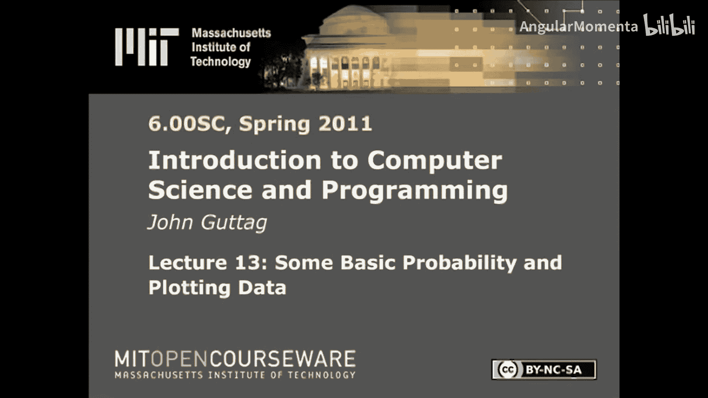

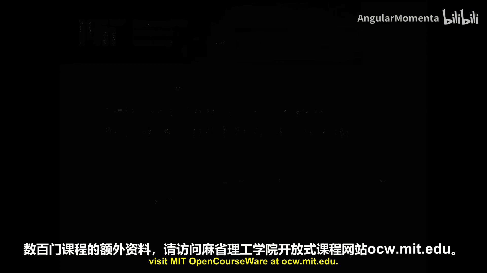

Good morning。I want to start today's lecture with， I guess one could call it confession。

 This isn't a real 600 lecture。I'm standing here on June 30 in an empty classroom。

Dressed for some bizarre reasons if it， as if it's the winter， I guess it's。With the video。

 folks would call continuity。嗯。What happened is Professor Grimson gave a beautiful lecture 13。

For which we have a lovely picture and no sound。We decided that。

Probably those of you watching this in open courseware would be unhappy just to watch Professor Grims and not hear him。

 So we're now retaing the lecture。This is actually one of two lectures we're going to be retaping because we had video problems。

So when I say something hilariously funny and there's no laughter in the room。

 it's because the room is empty。Do me a favor and laugh out there and， in video lens。

 So maybe at least someone will respond。Okay。The last lecture closed with a slight mystery。

 not a great mystery， but a little mystery。 We ran our simulation of the drunkard's walk。

And got a result。 That wasn't credible。How did we know it was incredible？Well。

 we had worked out some details on the the blackboard of what we thought would happen with a small number of steps。

And the results we got didn't match that。I told us we had something wrong。

 We asked you to go think about it and come back today， prepared to tell us what was wrong。Well。

 since there's no one here to ask， I'm not going to ask the class to fix it。But instead， I've。

Had the laborious task of fixing it myself。

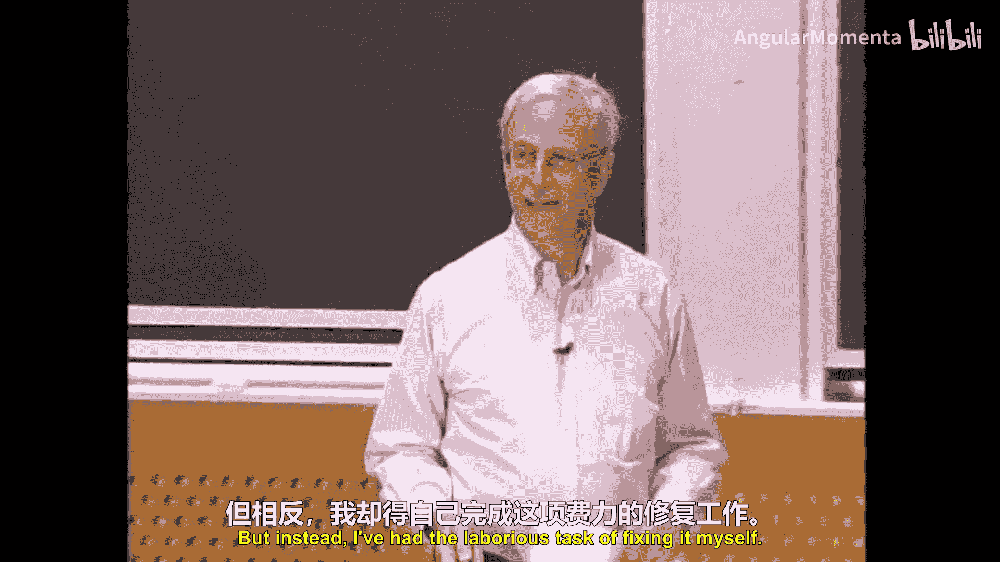

So let's look at it。 The problem was in Simwalk。And what we had is we had the wrong argument here。

 We had numb trials， instead of number steps。And so， it didn't make any sense。I've now fixed it。

 and I now want to run it。

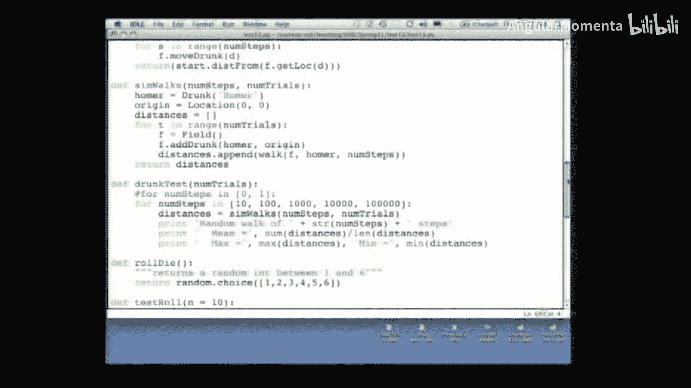

Well， clearly， what I should do to begin with。Is run it on some examples for which we already know the answer。

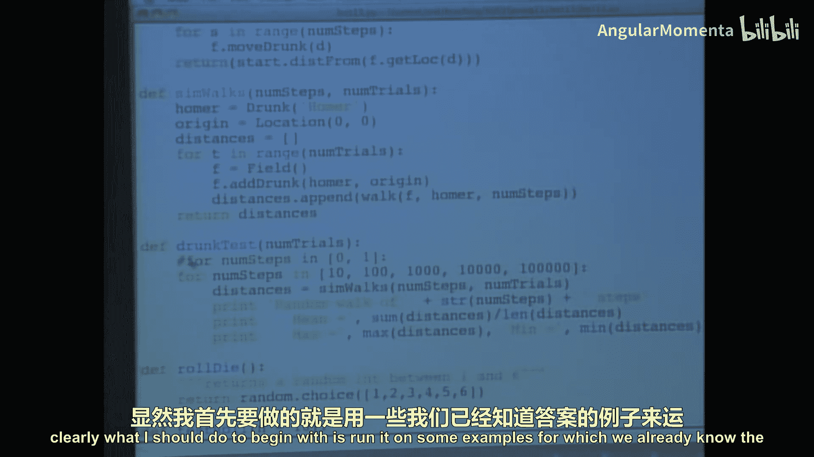

So I'll change drunk test。To instead of running it on large numbers of steps， run it on just a few。

And let's see what we get。run a lot of trials here since it's a short trial。

And what we see is for 100 trials。Of zero steps， the mean was 0。 The max was 0。 The min was 0。

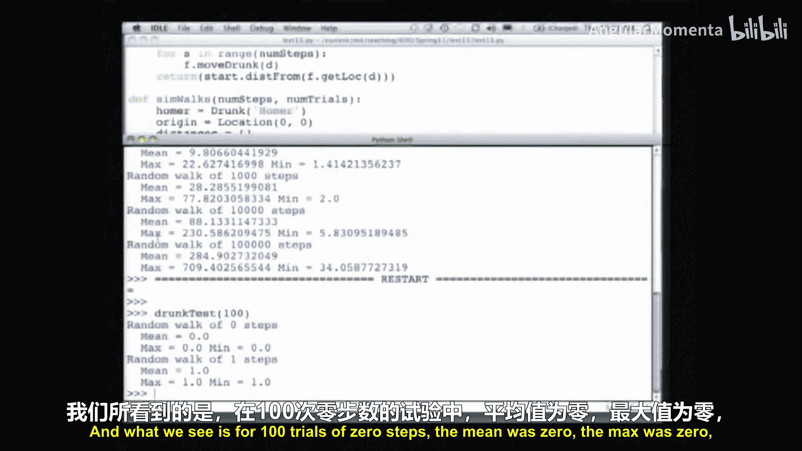

Well， that's exactly what we saw when we looked at it on the board should happen。

And the same thing with one。Everything worked the way it was supposed to work。

Doesn't tell us the program is perfect。 It does tell us it works in at least two examples。

 which was better than we had last time。Alright， now， let's look at it on a larger set of examples。

I think I won't run 100 trials here because it'll take a little longer than we want。

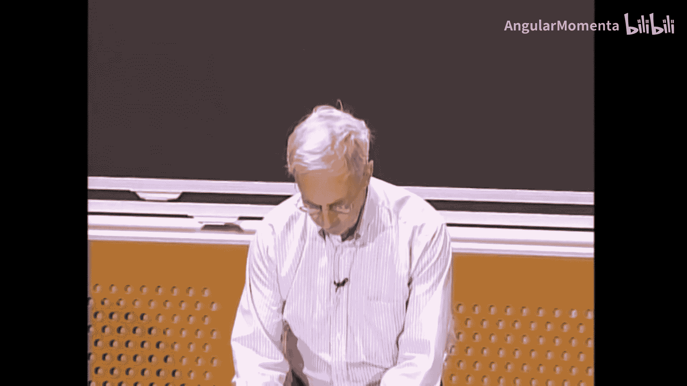

So let's run maybe 20。See what we get。Well， it's running through here。 Now。

 we're getting examples that seem much more credible。When we take 10 steps， the mean is 2。85。

 and the max is between 6 and 1。the max of 6， the min is one。

 It's what we would hope for that there's some dispersion there。And as we get up higher。

 we see that for 100000 steps， the mean is 248。 and there's quite a spread between the max and the min。

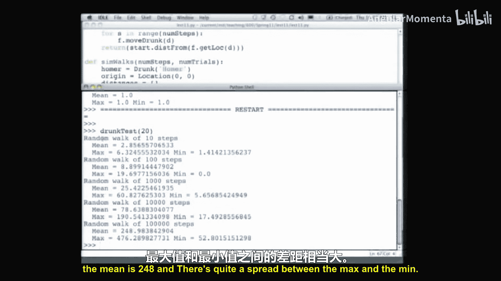

Finally， we get to look at the question that had us。Writing this code in the first place。

How far should we expect this drug to be given。Particular amount of time。

 Well we can look at these numbers and try and think about them in their， in our heads。But， in fact。

It's a lot easier to look at a picture。And this will get us to a theme that we'll be getting to shortly in the course。

Of how do we visualize data？

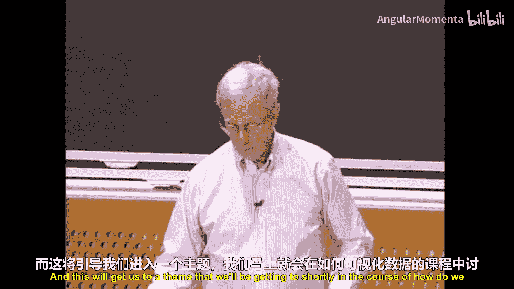

So here we have a visualization。What I'm plotting here is the mean number of the mean distance。😡。

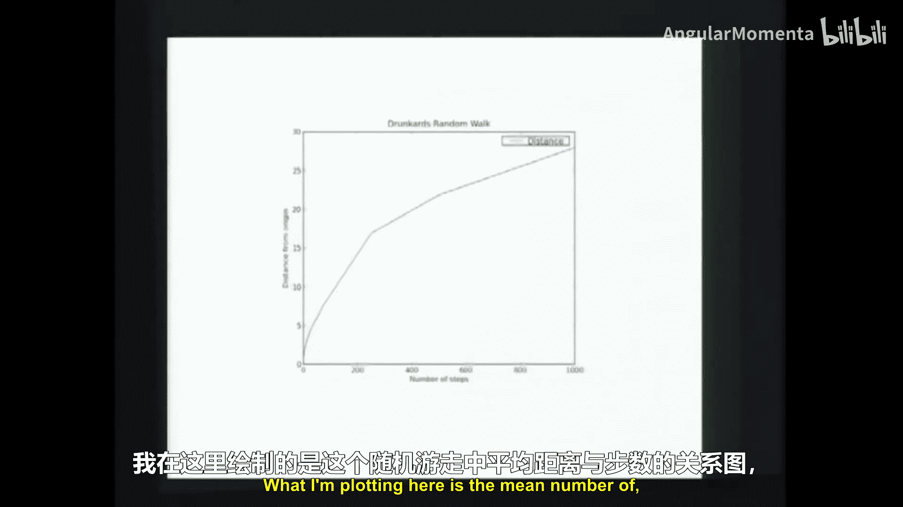

Against the number of steps for this random walk。And what we can see is， as we knew at zero at zero。

And then it sort of goes up。 And I've taken it only up to 1000 and 1000 were somewhere it looks like around。

25 steps。嗯。So we can learn something。Well， what can we learn from this， How fast is it growing， Well。

 it seems to grow pretty fast。And then， it flattens out。嗯。It looks to me， like， roughly speaking。

 the distance is growing as。Sort of close to the square root of the number of steps。Well。

 I could look at it more closely。 We actually know this is not exactly the square root。Right。

 the square root of 1000 is not going be 25。But I'm not going to delve into the details of that。

 It's actually a little bit complicated。 We， we could derive it， but， but we won't。

Because I want to get to what I think is， is a more。Important message。嗯。

How much should we infer from this or from the numbers I displayed before？And I want to say。

 not too much。Because what we saw， if we go look at what we had before。

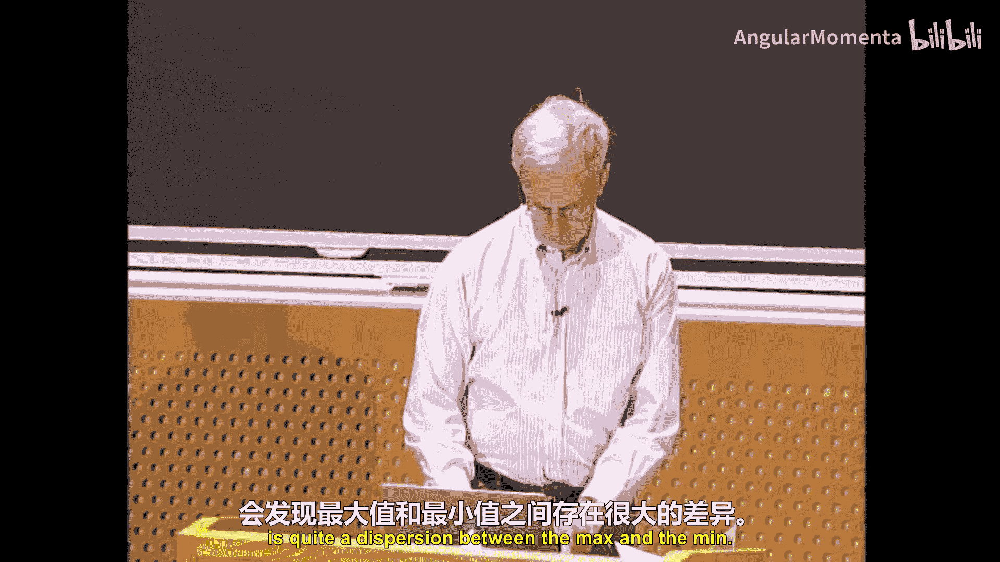

Is。Quite a dispersion。Between the the max and the min。And furthermore， if we run it again。

With 20 trials。We're getting different answers。So what you can see here。Is for 10，000 steps here。

 my mean was 78。

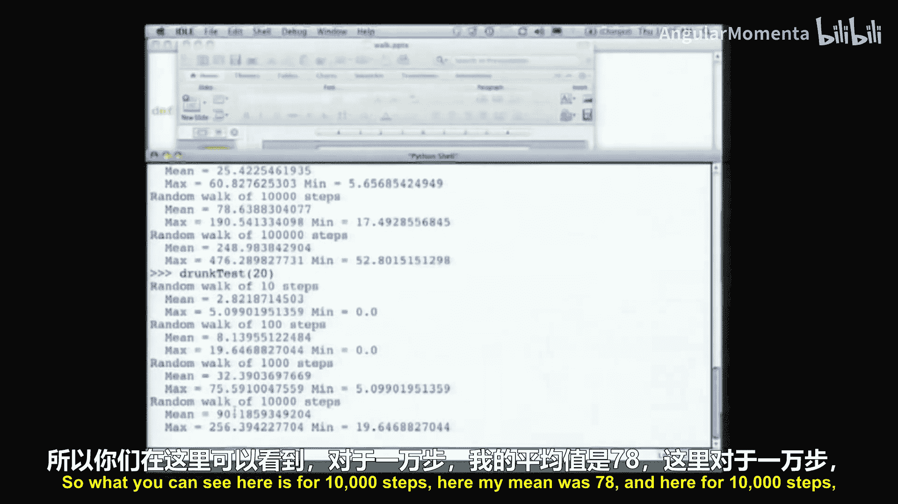

And here for 10000 steps， from a mean is 90。Here the mean was 279， here it was 248。

 the maxes and the mins are different。嗯。So I don't want to read too much into that graph。Now。

 one of the issues we should have asked。Is， well， it's the mean of how many trials I didn't tell you。

And to be honest， I don't quite remember， I think it was 20。

 but I don't have enough information to interpret it。嗯。I need a lot more。

 And that's going to be what this whole next unit of the course is about is how do we think about。

The results of programs when the programs themselves， are stochastic。

And this is important because as you will see， not only in this course。

 but as you progress in your careers， if you're involved in engineering or science。

 is that almost everything in the real world is stochastic。And in order to think about it。

 we have to really think pretty hard about what those things mean。

So I want to now pull back and talk a little bit sort of philosophically about that。

About the role of randomness in computation。嗯。Something you probably haven't seen a lot， if at all。

 in the other courses you've taken， if you're， say， a freshman or a sophomore。

And that's because there's something really comforting about Newtonian mechanics。

When I first learned physics， it was really comforting。 I learned the physics of Isaac Newton。

 You push down on one end of the lever， The other end of the lever goes up。

You throw a ball up in the air， travels a parabolic path and lands。嗯。F equals MA。

 that wonderful rule of physics。嗯。Everything happened for a reason。 It was predictable。

 It was a great comfort to some of us about about it。And for centuries。

That's the way the world thought。From almost the beginning of the time to to of science to really。

 if you look at the history of science to today， people believed the world was deterministic。

And they liked it。Then along came the so called Copenhagen doctrine。

And quantum physics in the 20th century， and。The comforting world of Newtonian physics disappeared。

The doctrine， the Copenhagen doctrine， LED by the physicist Boarers in Heisenberg。

Argued that at its most predictable and most fundamental level。

The behavior of the physical world cannot be predicted。

One can make probabilistic statements of the form X is highly likely to occur。

But not statements of the form， X is certain to occur。Period。

I can make the probabilistic statement that if I take this laser pointer and put it on the table。

 it won't fall through。The molecules won't separate in such a nice way that it just drops through。

But I can't promise it won't happen。Truth is， I'm， I'm going to make that promise anyway。

 because I believe in probability， and it's highly， highly probable。But they tried to say that。

 in fact， the world is all stochastic。 Everything is probabilistic。

Other distinguished physicists of the time， most notably。

 Einstein and Schrodinger vehemently disagreed。This debate， it's hard to believe。

 actually royaliled the world of physics， philosophy， and rich religion。The heart of the debate。

Was the validity of something called causal nondeterminism。The idea here， causal means。

Caused by previous events。So causal nondeminism was the belief that not every event is caused by previous events。

Einstein and Schroeger found this view philosophically unacceptable。

As exemplified by Einstein's often quoted comment， God does not play dice。U。What they argued is。

For something called predictive nondeminism。The concept here。

Was that our inability to make accurate measurements about the physical world。

Makes it impossible to make precise predictions about the future。

So this distinction was nicely summed up again by Einstein， who said， and I quote。

The essentially statistical character of contemporary theory is solely to be ascribed to the fact that this theory operates with an incomplete。

Description of physical systems。I。e。 things are not unpredictable。

 They just look unpredictable because we don't know enough about the initial states。

This question is still unsettled in science。The good news is it probably doesn't matter at all。

 What the truth is。However， you want to look at it。

We have to assume that the world is non deterministic because we can't actually predict it。

So there's a little experiment I sometimes do， I'll pretend to do it even though there are no students here。

I take three coins。So if there are students in the class， I ask the students to give me coins。

 and then I try and steal them。But since I know students， I'm gonna have to use my own coins。

And I'm going to ask。Is at least one of them heads？Well。The truth is。It's completely predictable。

 I know the answer。But you don't know the answer because you can't see these coins。

And so you might as well assume it's probabilistic。😡，And guess， well。

 he put three coins down at random。 The odds of each one being ahead is half。

 So probably one of the three is ahead。And you're relying on probability。

Because you don't know what's going on。 non predictive non determinism。Okay。

 and that's the way we're going to deal with a lot of things going on for the rest of the semester。

 We'll look at a lot of examples where we have to act as if things are non deterterministic。

And that gets us to this notion of what mathematicians call stochastic processes。

A process is stochastic。😡，If its next state depends on both the previous states and some random element。

So， now。What I'm going to do is pick up one of these coins。Flip it in the air。Put it down。

And ask again about the state of these three coins。

It depends upon the previous state because these two coins have the same value they had in the previous state。

Plus， a storcchastic element， a probabilistic element， a random element。The value of that coin。

 which I just flipped。O， most programming languages， including Python。

 include simple ways to write programs that use randomness。As we'll see。

 as we've already seen in Python。When our drunkards walk。We use the function， random dot choice。

Which given a。Set of values at random chose one of those values。That function。

And almost all of the other functions in Python that involve randomness。

Are implemented using something called random dot random。

This function generates a random float that's greater than 0。And no greater than 1。0。

So you get one of the。Infinite or seemingly infinite number of floating point values。

That are greater than0 and no greater than one。So。Let's go look at another example of a stochastic process。

嗯。

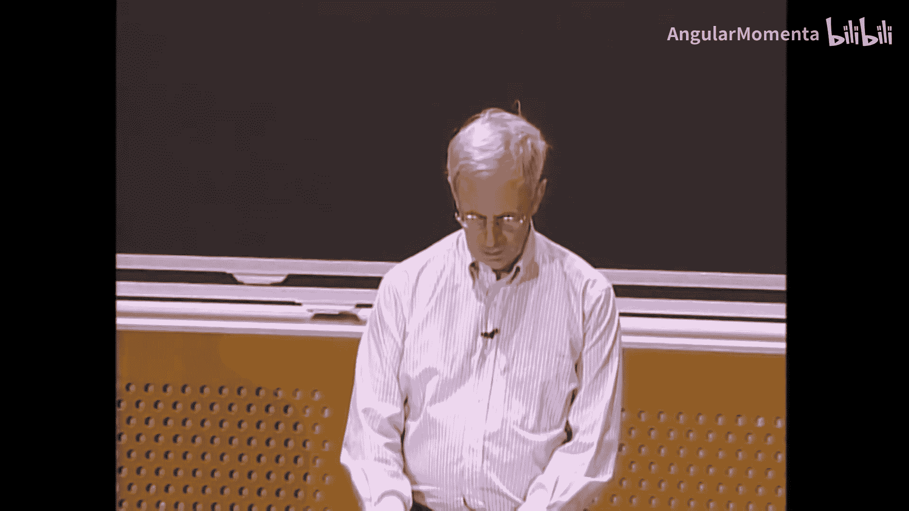

We're going to look at throwing dice。So I've got something called roll dye。W whichch。

Chhooses a value between one and6。For those of you who have never gambled with dice。It's a cube。

 You roll it， and it has a value between one and 6 that shows up at random。

And then I've got this little program called Testol。That。

Rolls a bunch of dies and comes up with an answer。All right。So。Let's see what happens。嗯。

Before we do that， let me ask you， we， we can look at a question。Imagine I roll it。

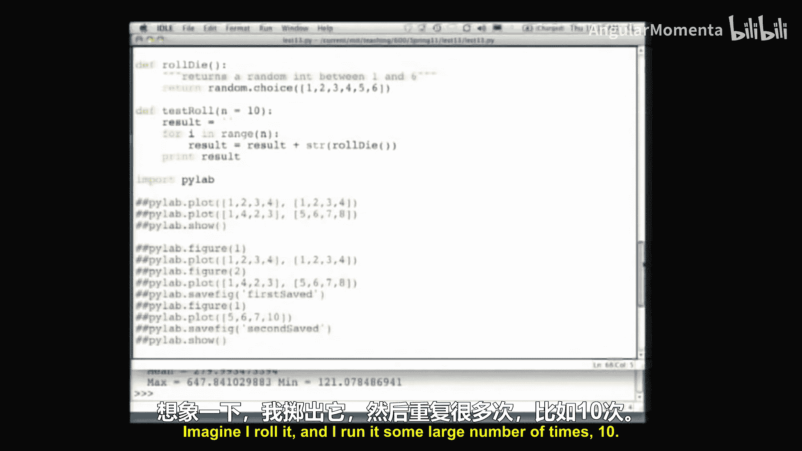

And I run it some large number of times。10。Would you expect to see the value？

More likely see that value or might more likely see a value that looks like this。

Which of these values is more likely to come up from my random roles？Of the die。Well。

 when I take a vote， if I take a vote， historically in this class。This。

Strikes people as more likely to happen than this。But it's a trick question。Because as it happens。

 they're equally likely。And the reason they're equally likely。Is each role。Is independent。

Of the previous roles。And as we'll see in our excursion and probability and randomness。

Independence is a very important assumption。In a stochastic process。Two events are independent。

If the outcome of one event has no influence on the outcome of the other。The events are independent。

 If the outcome of one event has no influence on the outcome of the other。

So it's a bit easier to think about this。 Maybe if we simplify the situation for the moment to think about flipping coins。

Which have either heads or tails。 And I'll look at the value as 0 or1。As the examples there。

That means I can use， I have a binary dye for some reason。So have we seen before， if I flip。A coin。

10 times。How many different。Possibilities， sequences of 0 and 1 are there。Well。

 we've seen this kind of thing a lot of times already this semester。

There were two to the 10 binary numbers of 10 digits。

So we know that there are two to the ten possibilities。

Each of these two to the 10 possibilities are equally likely。So the number in which I have all zeros。

Is no more likely than the number of all ones is no more likely than some seemingly random combinations of 0 and 1。

So it's a very small probability。So what's the probability of getting all ones。It's one out of。

Two to the 10。What's the probability of getting all zeros，1 out of 2 to the 10。

 What's the probability of any combination you would happen to pick of zeros and ones。

 one of over  two to the 10。I know I'm belaboring this point。

But the point I want to make is that when we talk。About the some result having a particular probability。

 we are asking， essentially the question。What fraction。Of the possible results。Have the property。

We're testing for。So I ask what property are all ones。 I'm saying what fraction are all ones。

 if I say， well， property， there are exactly four ones。

 what fraction of these numbers have exactly four ones in them。Whatever I want。

 So probabilities will always be fractions。That's important。

Because it means that when we talk about the probability of some event occurring。

We know it has to be somewhere between 0 and one。Probabilities。Are never less than 0。

 They're never more than one。Cannot happen， guaranteed to happen。Usually。Somewhere in between。

All right。That's the key thing to remember， when thinking about probabilities。Suppose I want to ask。

 what's the probability of getting some sequence of coin flips。Other than all ones。Well。

 I know the probability of getting all ones。😡，Is one out of 2 to the 10。

I know the probability of getting some sequence of flips is one。

It's certain I'll get one of those numbers。So the answer is。

The probability of not getting all ones is one minus1 over2 to the 10。

This is an important trick to remember。Typically， we have two ways of computing probabilities。

We can either compute it directly。As I did when I computed the probability of getting all ones。

Or we can compute the probability of something not happening。Or。

By subtracting one probability from another， this minus1 minus trick。And so you'll see me using this。

Formulation， a lot of times。And we'll talk as we go forward about when you do it which way。All right。

So let's go back finally， to our six sided die。嗯。How many sequences are there of length 10 for that。

2 to the  tenth0th。No。Six to the1。Because unlike the coin， where we only had two possibilities。

 we now have six possibilities。So。There are 6 to the 10th different sequences of roles I could get。

Quite a few。So the probability of getting 10 consecutive ones。Is。One over6 to the10th。And， of course。

 the probability of getting this sequence here is also one over 6 to the 10th。

So we see that they are equal。Okay， we're going to spend a lot more time on probability and randomized stochastic algorithms。

Before I do that， I want to take a brief digression。

And return to the topic we looked at a little earlier this morning， which was data visualization。

Plooting。I want to do this for two reasons， one， it's really important。

It's something that all of us do a lot of in the course of our work。

But it also will just make it a lot easier for me to talk about probability and stochastics when I can draw some pretty pictures to illustrate what's going on。

Now， many people。Most of us probably。When we're writing code to do something。

 focus on writing programs that perform some complicated analysis of the data。And then。

 print something。We don't spend enough time， I think。

 worrying about how the results of our analyses are presented so that somebody else can make sense of them。

 or。 In fact， we can understand them better ourselves。Sometimes text is the best way。

 but sometimes there's a lot of truth to， to the Chinese proverb。

That a picture's meaning can express 10000 words。Now， most of us sort of believe this。

 Why don't we do it。Well， because in most programming languages， it's hard to draw pretty pictures。

One of the reasons we use Python in this class is because in Python。

 it's easy to draw pretty pictures， or at least to make plots。Why is that it's because somebody。

Not me went to the trouble of building something called P La。Pil Laab is a Python library。

That provides many of the facilities of something called Matlab。If you're an MI T student。

The probability。Of your graduating without using Matlab。Is very low。It is something people use a lot。

It's not my favorite programming language。 It has its utility。

I like Python because it brings a lot of the features of Matlab。Or easy to use。

In a programming language that I find much more convivial than Matlab。All right。

 I'm not going to give you a complete tutorial for Pad here。It would take a long time。

 and it would be boring。Instead， I'm going to give you a few examples。 and fact， focus primarily。

On the plotting capabilities。And the good news is the plotting capabilities in P lab are almost identical to those of Matlab。

 So if you learn it how to do it here。😊，You will already know how to do it here。For details。

You should take a look at。Make sure I write this correctly。This website。Maappllootlib。sourceceforge。

net。And it's a very nicely put together website that will give you all of the。

 the capabilities of plotting。Also， you'll find in the class website I've written a little chapter of a book about how to do this sort of thing。

 And you may also find that helpful。嗯。I should point out that PLab is not part of the standard Python distribution。

It has to be installed on your computer。 And again。

 there are instructions about how to do this posted on the class website。All right。

 let's start with something。Very simple。嗯。

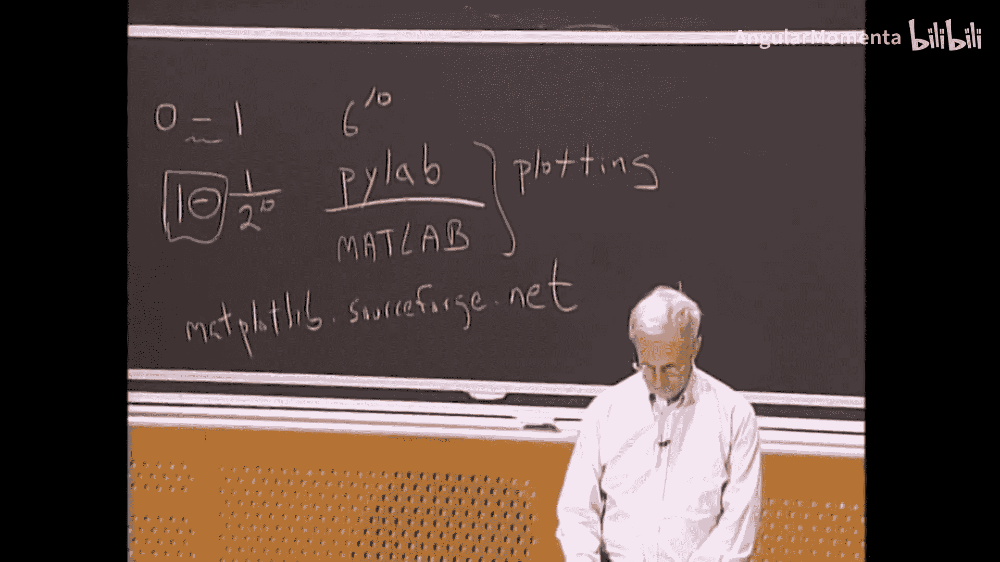

We'll look at that here。 I'm beginning by。Importing。I import P labab。

 You have to import it to use it。And then I'm going to plot two things。

So what I want you to observe here。As I'm going to plot two vectors， the vector 1，2，3，4。

 and the vector 1，2，3，4。

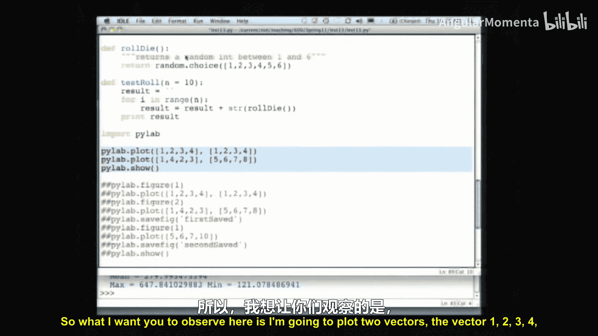

These are the x coordinates。 These are the y coordinates。 So I'll get a two dimensional plot。

 X versus Y。 And it's very important that these two vectors be of the same length。Doubtless。

 when you're using this in your problem sets， you will screw up and you'll get an error message。

Which you will have a hard time interpreting。 But what it probably is going to boil down to is you've done something wrong and you're plotting things that are not the same length。

After I plot these two things， I'm going to type Plab do show。

 which will put the plots up for us to look at。

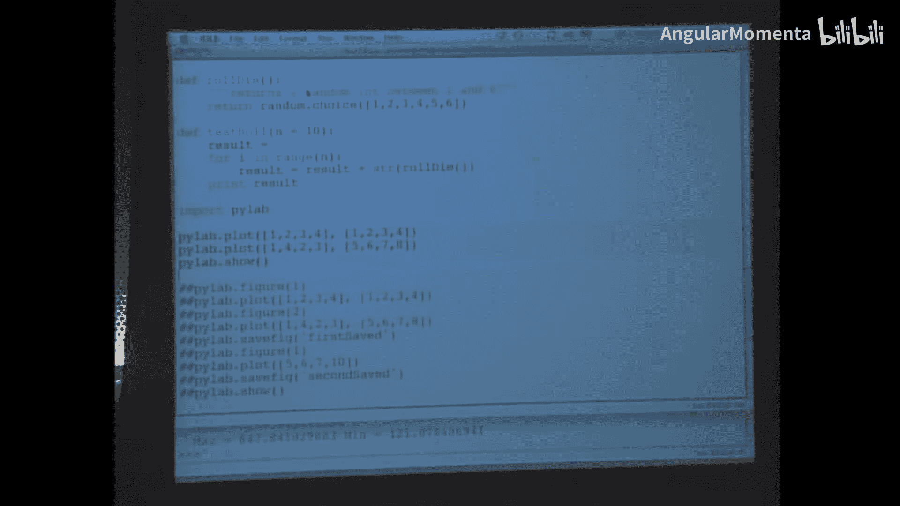

So let's do that now。

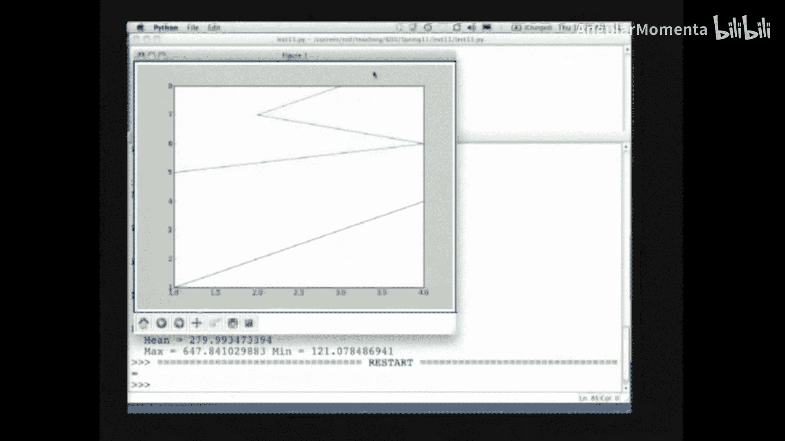

So it first plotted our straight line。1 versus 1，2 verses 2，3 verses 3，4 verse 4。 Got that。

 Then it plotted this rather funny looking zigzag we saw kind of just randomly chosen in the other one。

嗯。And the plots will always look something like this。嗯。

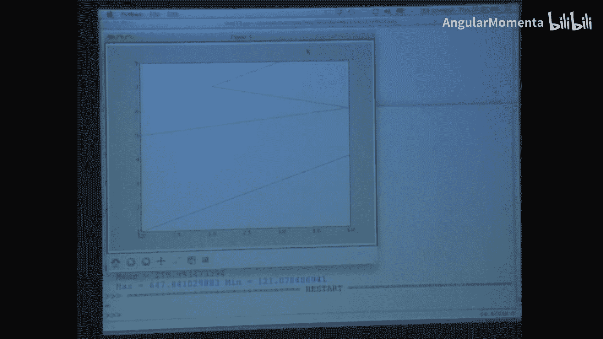

I should mention。If we go look at the code。Pilabab do show。If I hadn't said that。

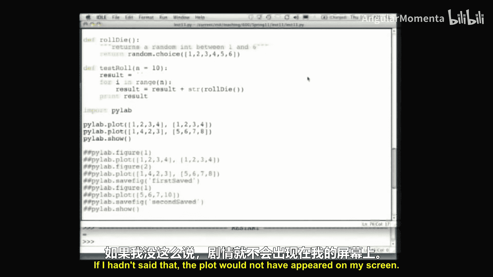

The plot would not have appeared on my screen。Pilabb would have produced it， but not displayed it。

You may think that's silly。

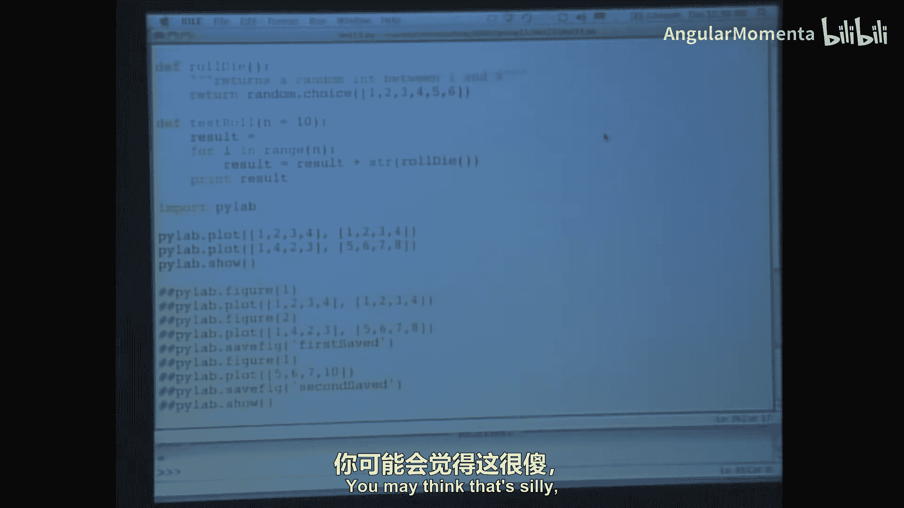

But， in fact， it's useful because most of the time when I'm writing programs that do plotting。

 I don't want to see them on my screen。

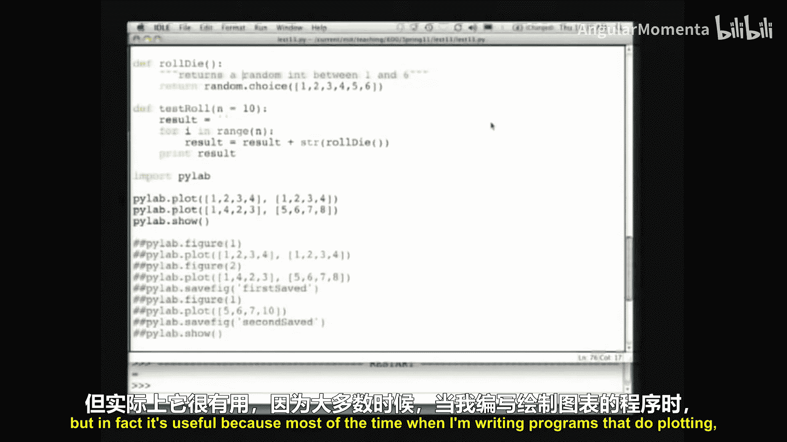

I'm producing a whole bunch of plot， and I'm going to write them the files that I'll then look at later or include in a paper or a lecture or something。

So it makes me say that I want to see it。I should point out， depending upon your operating system。

It can be pretty annoying。Because if you try and do this twice in your code。

 something bad can happen。The code can hang。Therefore。

 you should only execute Pla do show once per program。

And it should always be the last thing you execute。

Because once you execute Plab that show the program will stop running， essentially。It's annoying。

 I wish it weren't that way， but it is。 So live with it。

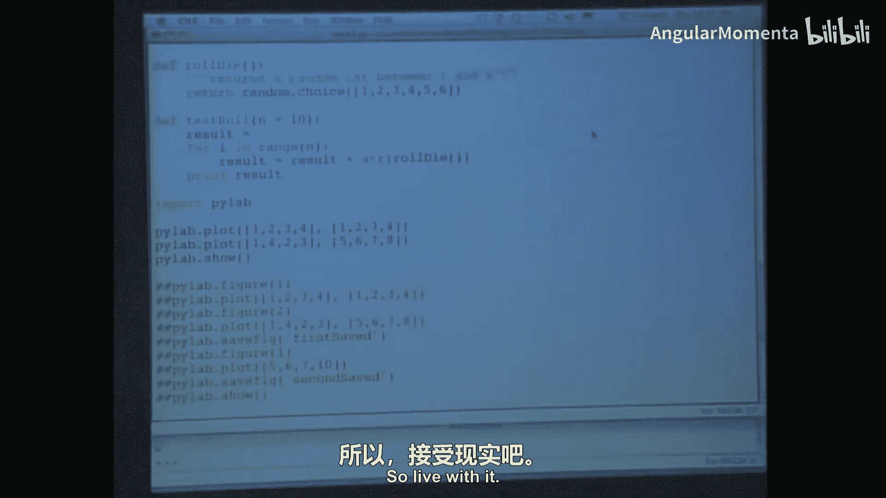

All right。Let's go look back at our graph our plot。

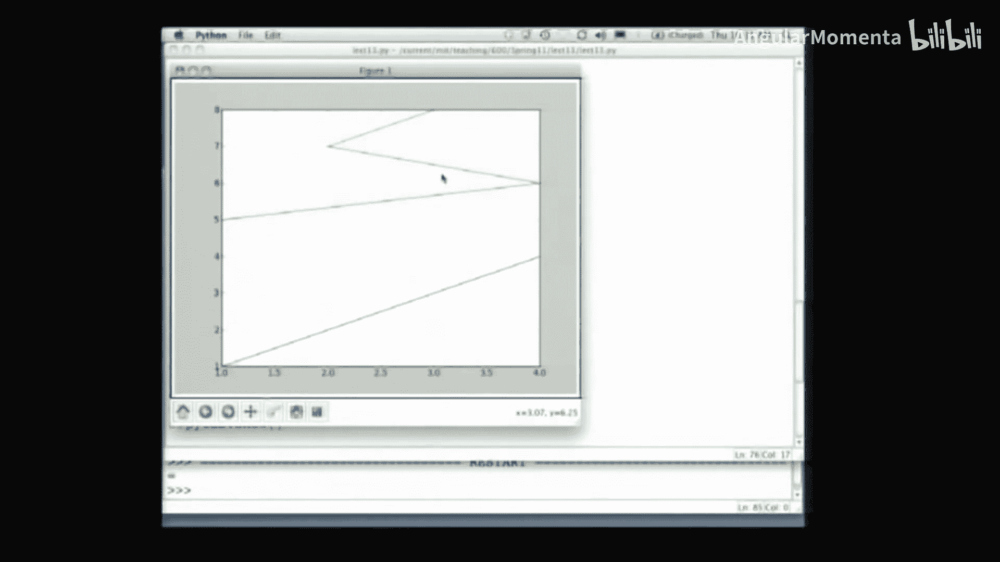

At the top is a title。This is the default title， it says figure1。Later。

 we'll see that I could have given it a much better title than that。

Then it's got the values of the X and Y axes。And a bunch of。Things down at the bottom。

That we could point out， you can zoom in on the plots using that or zoom out。

You can use this funny icon。Happens to be a floppy disk icon。

 something that probably most of you have never seen。Congratulations。

 if you've never seen a floppy disc， your life is better than it would be had you had to deal with them。

But that's used for saving them to a file。 You can move around in it。

 You can get back to what the original figure was。 A whole bunch of useful things。

 I suggest you' just。Bring this up， and play with it。嗯。One of the things I should mention here is。

You'll note that when I produce this， I only used four points。1，2，3， and 4。 Sa for this one。

Yet it looks as if I have a continuous plot。😡，You，It claims that 1。5 and 1。5。Match。

This can be very deceptive， as we'll see later on。And probably it might have been better for me to plot。

 not lines here。But points indicating there are only four points in this graph。

It's more apparent here where we see this funny looking zigzag。

Implying some complicated relationship amongst the points， which actually probably doesn't exist。

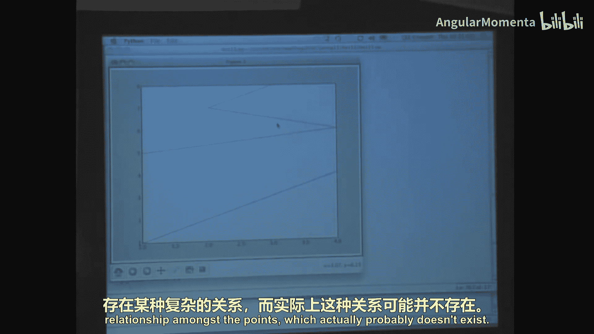

And again， later on， we'll see ways too。To avoid that。Okay。It is， of course。

 possible to produce more than one figure。So let's look at this。Well。Comment this piece out for now。

And we'll run this code。So this says。I want to plot something on a figure。 I'm calling figure 1。

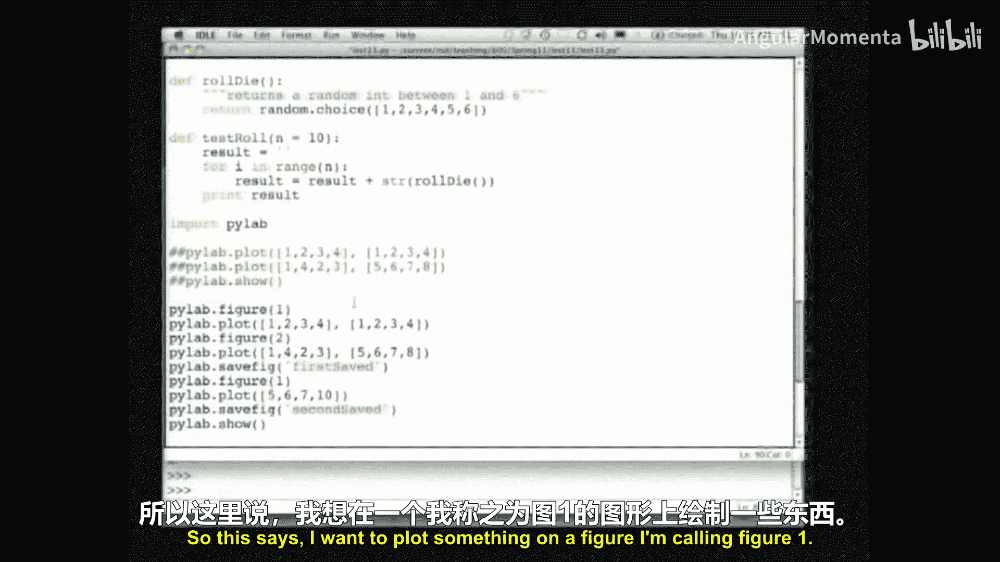

As before， then I'm going go to figure 2。 So now in plot。

 instead of plotting both of these on the same figure， I'm going to put them on separate figures。

And then Plab doc save figure will actually create a file。

In the directory in which I'm running the program and save it called first save。

 And then this will be second save。 And now I can run it。

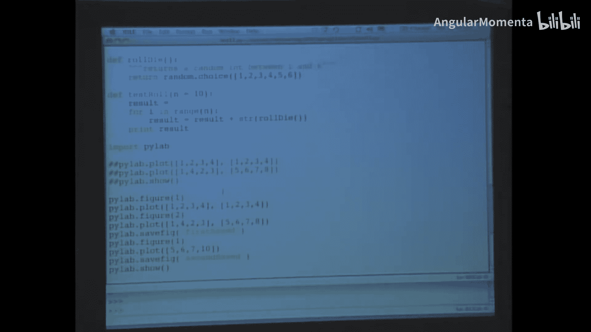

And now I have two figures。Figure 1 is before or not quite as before， a different figure。

And figure 2。Again， nothing very magical there。And if we look in my directory， we should see， I hope。

First saved and second saved。 So if we look at second saved。We'll see there it is。

And just to show that I'm not cheating。You can notice that the timestamp is today at 1034 AM。

 which happens to be when I'm giving this particular lecture。All right， we put that away now。

Continue。Now， what I want you to notice。Right。Is the last one？I just gave it one argument。5，6。

7 and 10。And if we look at what it plotted。Actually， I think I put that in figure 1， didn't I。

You'll see here it is。And it's made up some values。4。The X axis。

 If you only give it one set of values， it assume it's the y axis。And it finds values。All right。Now。

What values is it going to choose for the X axis？

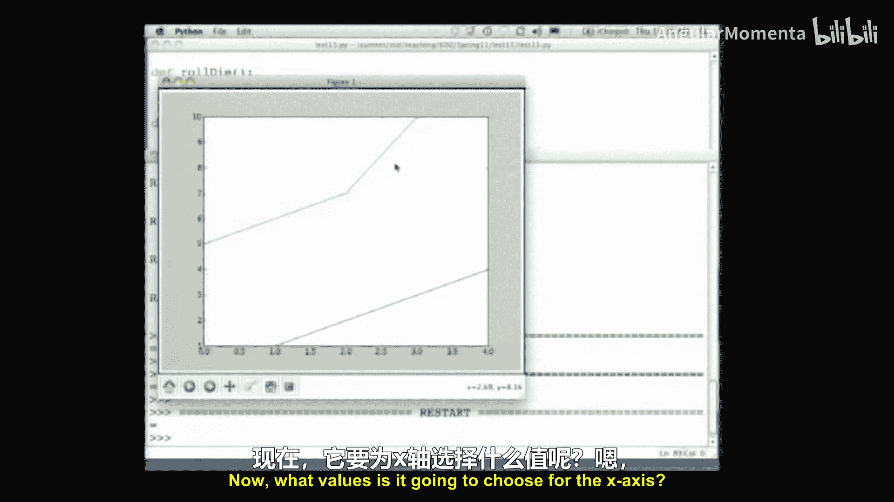

Well， this is Python。 So surprise， surprise。 The first value is 0，1，2， and 3。

How I get the four values。

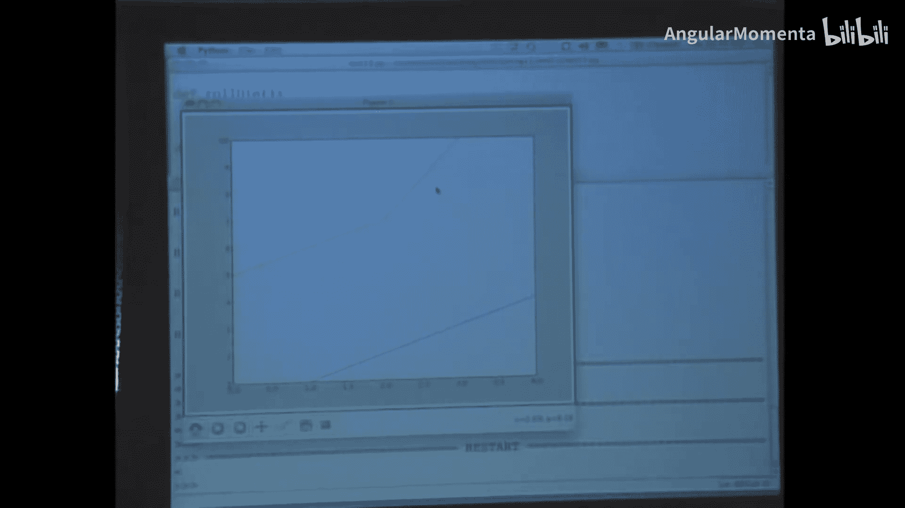

Now。We could， let's look at another example， a slightly more interesting one。

Comment this out so we don't look at the boring stuff over and over again。

I've written a little program to。Calculate interest。

So I'm going to start with an initial principle here。Of 1000， an interest rate of 5%，20 years。

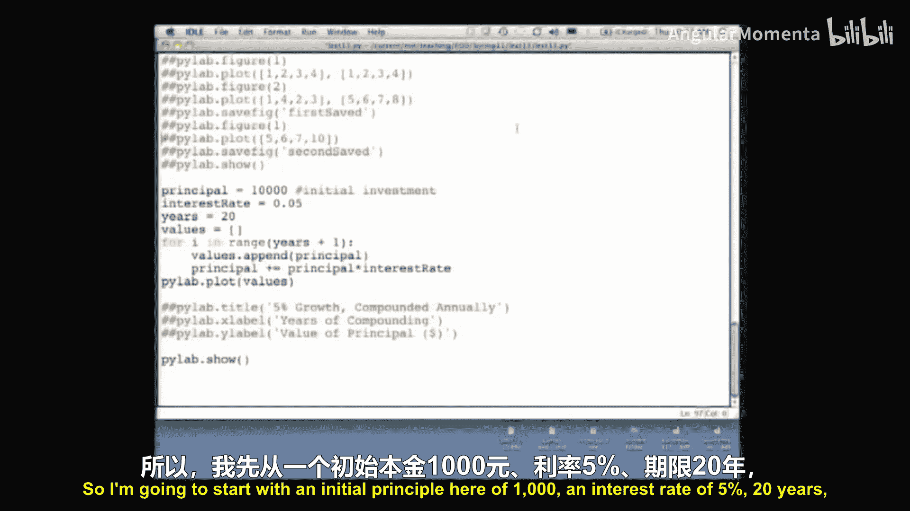

And just do compound interest。Yes。You all would know how to write this。

 And then I'm gonna to plot it and see what we get。Alright， so we have something here。

 which sort of shows the kind of beautiful growth you get with compound interest。😊。

With the finance people called the magic of compounding， which will make us all rich in principle。

Until we see what the markets really do。But any rate， for now， we can look at it。

And it looks very pretty。嗯。But。I don't know what it means。I look at it， oh， it's figure one。Well。

 Xs not very informative。 And x goes from 0 to 20， but。And if I hadn't told you。

 you wouldn't know what that meant and why from。10000 up to 28000。 But again。

 you wouldn't know what that means。

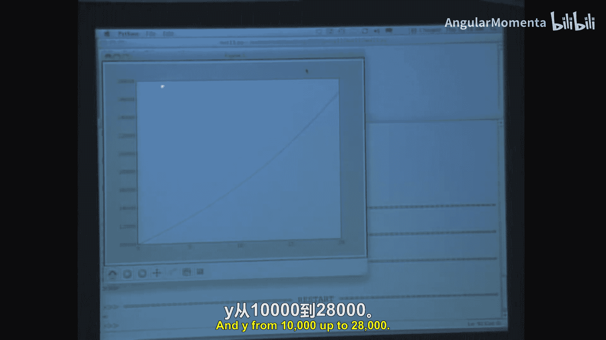

嗯。We see this all the time。😡，It's not a good thing。嗯。It's a bad thing， in fact。

All plots should have informative titles， and all axes should be labeled。

I can't tell you the number of times I've had a graduate student choke in my office。

Having worked for weeks， producing some data， put a plot on my desk and say， look at this。

 Isn't it great。And I say， I have no idea what it means。And sometimes I say， well。

 what is the Y axis， And they end up scratching their head。 They're not quite sure。

You've got to label your axes。 You've got to put a title。 You've got to give the。The person a break。

 Well， how do we do that。Well， it's pretty simple。So here's this code。So。Yeah， we just。

I just want to get rid of the old graphs because sometimes if you look at them。

 it causes you problems。Because it's now hung。 It won't continue until I get rid of it。 Now。

 my shell is back。So Pabab do title。Just says， okayk。

 I'm going to call it 5% growth compounded annually。

 Notice that I've put in that it's a 5% interest rate。 And then I'm compounding it annually。

 not semianly or quarterly。啊。The X axis is going to be the years of compounding。

 And the y axis says the value of the principle in dollars。So now it's the same curve。

 but a far more。Informative picture。

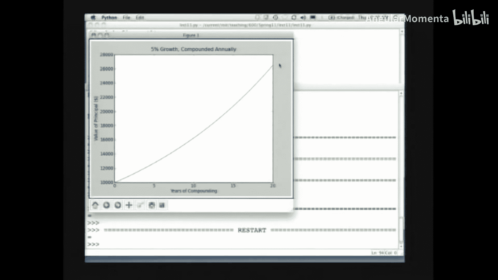

All right， here's where I want to stop today。 We're going to come back to this topic in probably more detail than you want。

And spend quite a lot of time talking about how do we produce beautiful plots。

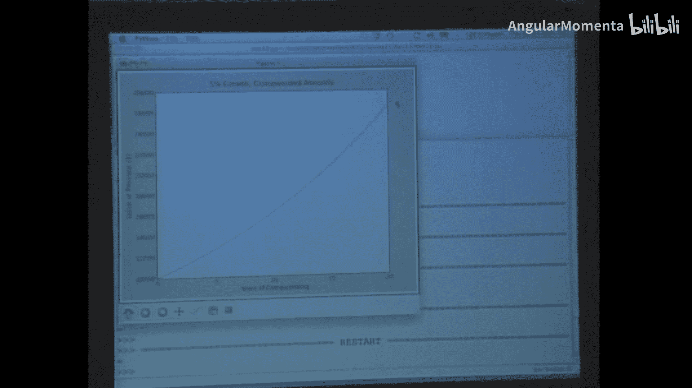

And more importantly， how do we produce plots that are actually meaningful to those reading them。

Thanks a lot。 See you in the next lecture。