# 【麻省理工】计算机科学与编程导论 ｜ MIT 6.00SC Introduction to Computer Science and Programming p20 20 -BV1a5BZBkEP6_p20-

The following content is provided under a creative Commons license。

 Your support will help M I T Opencourseseware continue to offer high quality educational resources for free。

To make a donation or view additional materials from hundreds of M T courses。

 visit M I T OpenCseware at O C W dot M I T dot E Du。

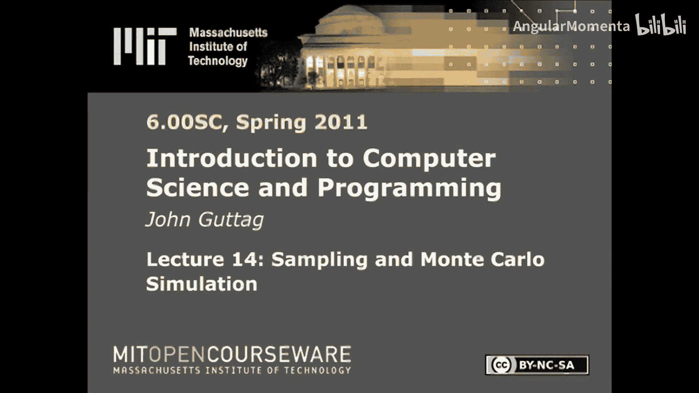

Alright， today， I want to spend a few more minutes on plotting。And then， return。

To a subject that will occupy us for a couple of weeks， which is the use of randomness in。

 in solving problems。啊。Don't save。Alright， so it's first。Look at one more example of plotting。It's。

 it's， it's simple。 It's so simple。 you'll find it's not in your hand out。嗯。

So here it is to start with。All I'm doing here is wrote a little program to。

 to show the effect of compound interest。 Nothing very sophisticated。

 We start with some principle and an interest rate。And then we just apply it over and over again。

 And then we're gonna to plot。To show。What the principle has become if we just keep compounding the interest。

So it is kind of what you'd expect。 Comp interest is a nice formula。

 You can actually get rich applying it。 And we see this nice little graph。嗯。On the other hand。

 we can't really tell what it is。And this is the sort of thing that I see all too often。

 including my graduate students produce it。 They come to my office。 They show me a graph。

 and they start explaining it。 And I usually refuse to look at it if it looks like this。

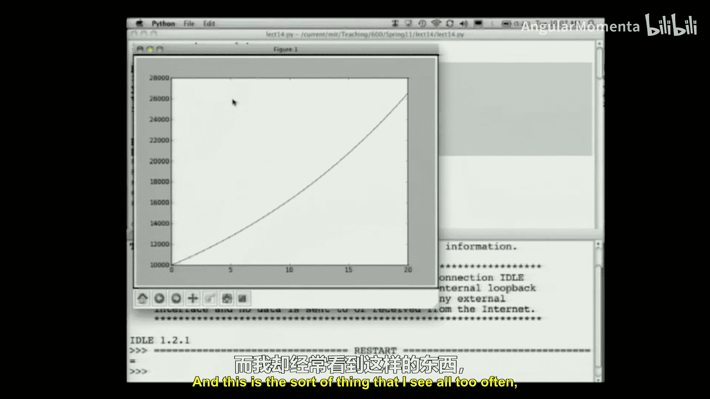

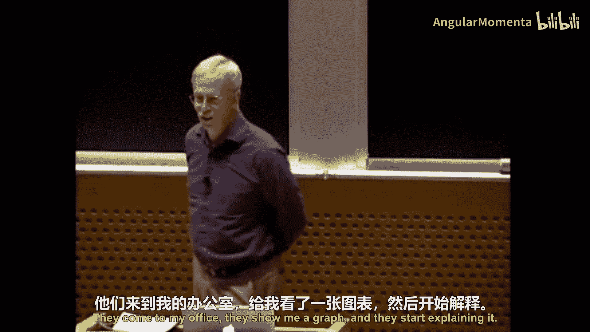

There is no point in ever。 And， I mean， ever producing a graph that does not have a title and labeled axes。

 And in particular， you have to label the axes to say what they mean。Fortunately。

 it's easy enough to do。嗯。In here。I've just done that。So I'm gonna run the same code to come。

 to compute the interest。But I'm gonna put a title on the graph。 You've seen this before。

 just want to remind you how it works。

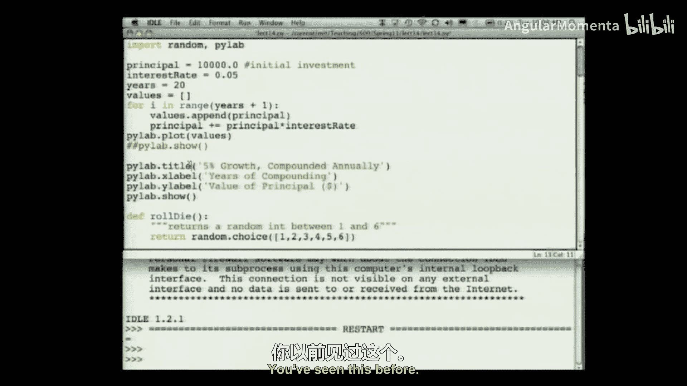

Pilab， dot title。And then I'm gonna label the X axis and the Y axis。

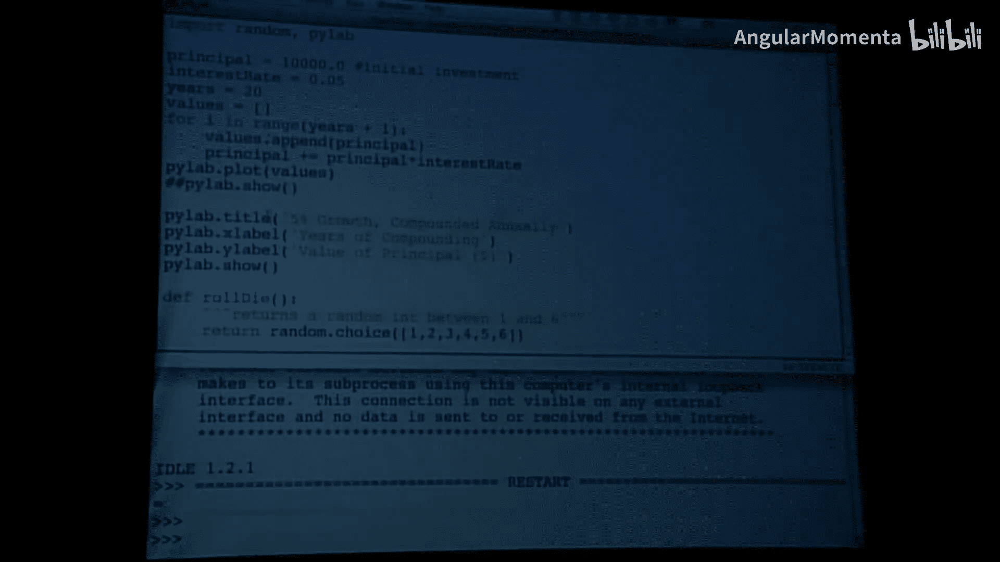

And that gives me a much more useful graph。嗯。Nothing magic here。

 It's just a reminder that you really need to do these things。 You'll notice here， I've not only。

Told you that this is the years of compounding and that this is the principle。

 but that I've measured it in dollars。 Maybe I should have been even more explicit and said， well。

 US dollars。Whatever， one of the things I did want to point out is。

You saw that you have these various icons that will let you do things like zoom in on a graph and save a graph。

Here's this icon that I think Professor Grimson mentioned。 In fact， I know he did。

 It's a floppy disk。 Just in case you've never seen one。 I brought a floppy disk to show you。

 This is one of the older floppy disks。

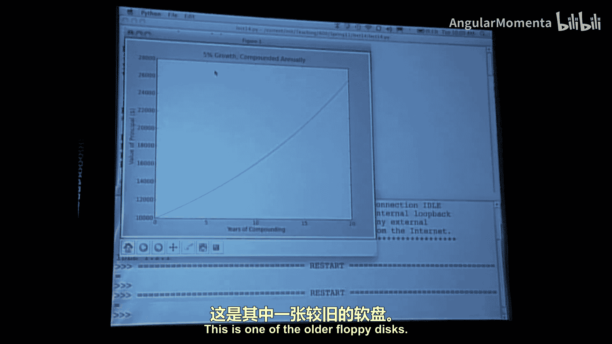

These were invented。In 1971， by IBM。They were originally 8 inches in diameter and held all of 80 k of data。

嗯。And as you can see， unlike later floppy disk， they actually flopped。Eventually。

 Apple and others pioneered a non floppy， floppy disk。嗯。That was in the 80s。

The interesting thing today is， is I typically carried it around a USB stick with me about that big。

That holds roughly 400000 times more data than this floppy。And so it's just quite incredible how。

Things have have gone along。 Allright， I now want to return to what will be the main theme。For。

 as I said， a couple of weeks， which is randomness。 And in order to talk about randomness。

 we have to talk about probability。And I know that Professor Grimson started down that path just before spring break。

But if you're anything like me， your mind kind of deteriorated a little bit over spring break and your head isn't quite into things。

 And so I'm just gonna back up a tiny bit。And， and start over to get our heads into it and then fairly quickly move on to new things。

So， let's start by asking。A simple question。You can tell my head isn't quite yet back to things because I forgot that I needed to。

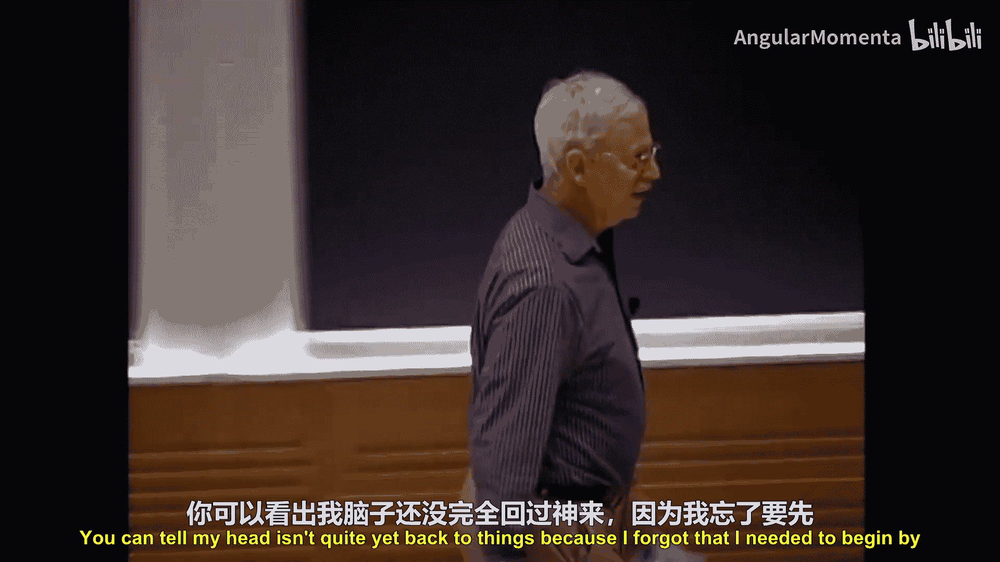

Begin by gathering chalk。

I've now got it。

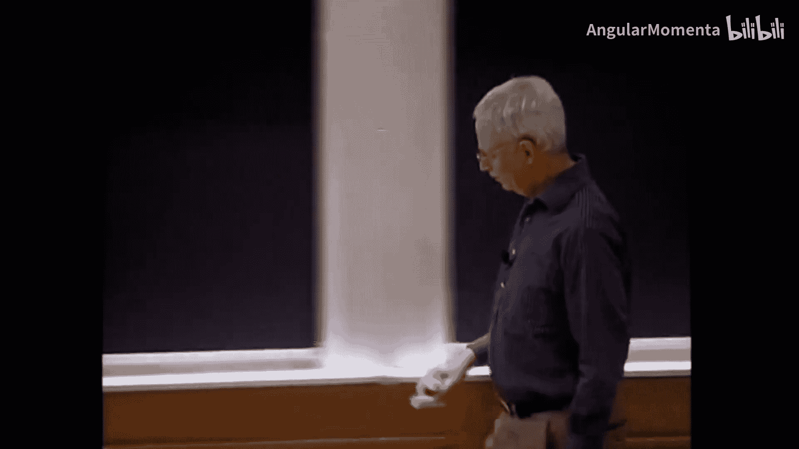

And we'll come over here and take a look at some examples。

Alright， so the first question I want to ask。

Is suppose。I take a six sided die， a fair one， and I roll it 10 times。

What's the probability of not getting a single one。Out of that die。Well有。

How do we go about answering this。

Well， there is a wrong way to do it， which is sort of the obvious way。

And many people will start down this path。 They'll say， well。

 the probability of rolling a one on the not rolling a one on the first。

Try is one over 6。

对。Right。That's that true。 That's not true。 right， What's probability of not rolling a one the first time。

5 over 6。All right。What's the probability of not rolling a one in the second try。5 over 6。Well。

The wrong thing to do， of course， would be to start adding them up。

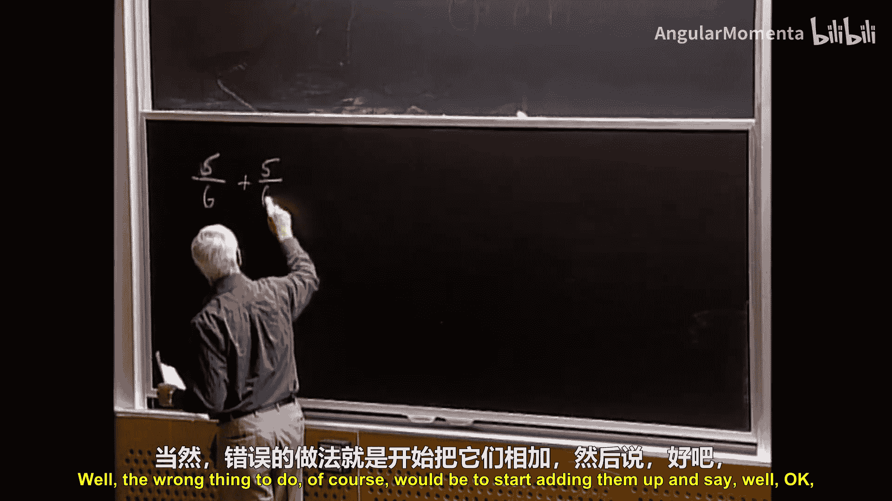

And say， well， okay， we'll just add these up。Well。One way we can tell that's wrong。

Is if we add up 10 of these， we get more than one。Probabilities can never be more than one。

 as we'll see。

So let's now try and think of the right way to look at this problem。

So you can think about it if we roll。These die 10 times。Each time I'll get a number。

So I might get a 3 and then a 4， and then a2。

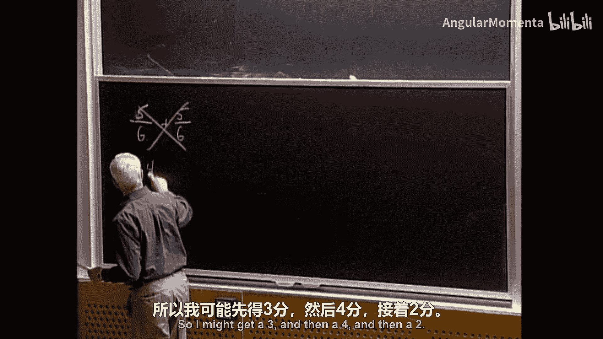

How many possible 10 digit numbers are there。On a six sided die， if I roll it 10 times。How many。

Sish to the ten。

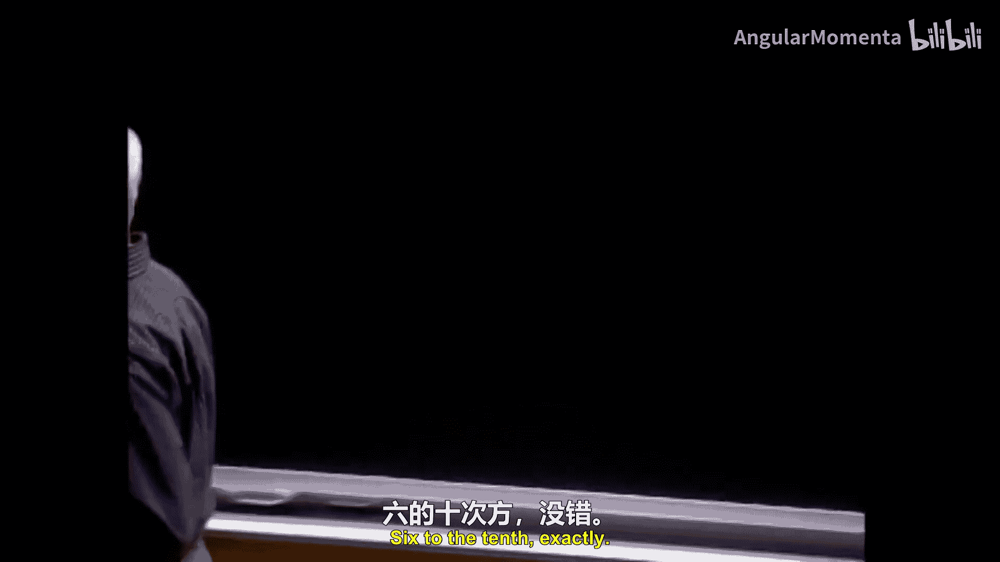

Exactly。Just when we looked at binary numbers， if I take a 10 digit binary number and ask how many different numbers can I represent in 10 binary digits。

 It's going be 2 to the 10th。

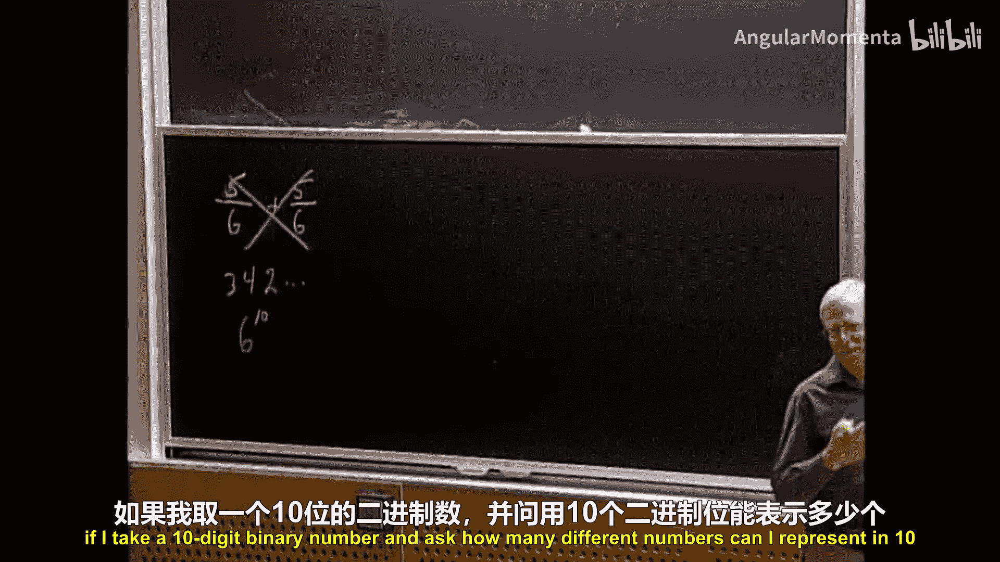

Here， we're base 6。 So it's going to be 6 to the 1。

Pretty big number。Now， I can say how many of those numbers。

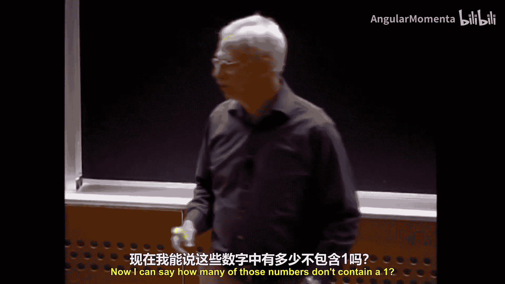

Don't contain one。

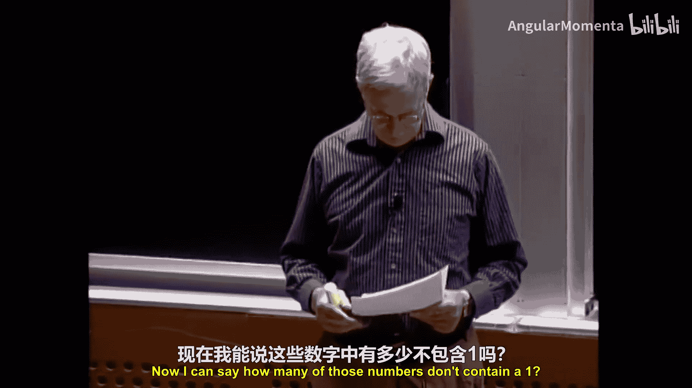

Alright， so that's really the question I'm now asking。How many of these don't contain a one。

So as we said， if I look at the first rule。The odds of not getting a one the first time is 5 over 6。

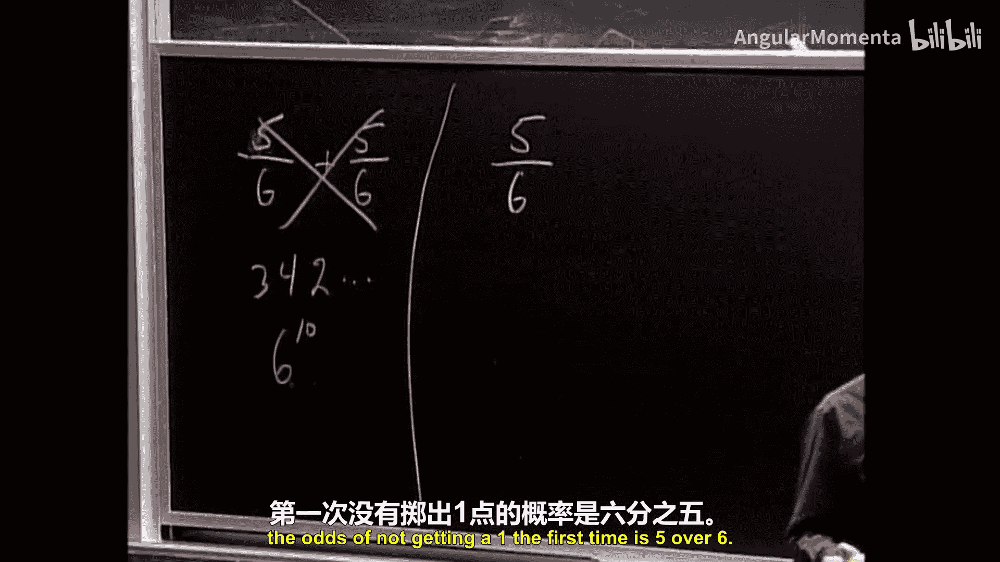

Now， what's the odds of not getting a one the first or the second time。

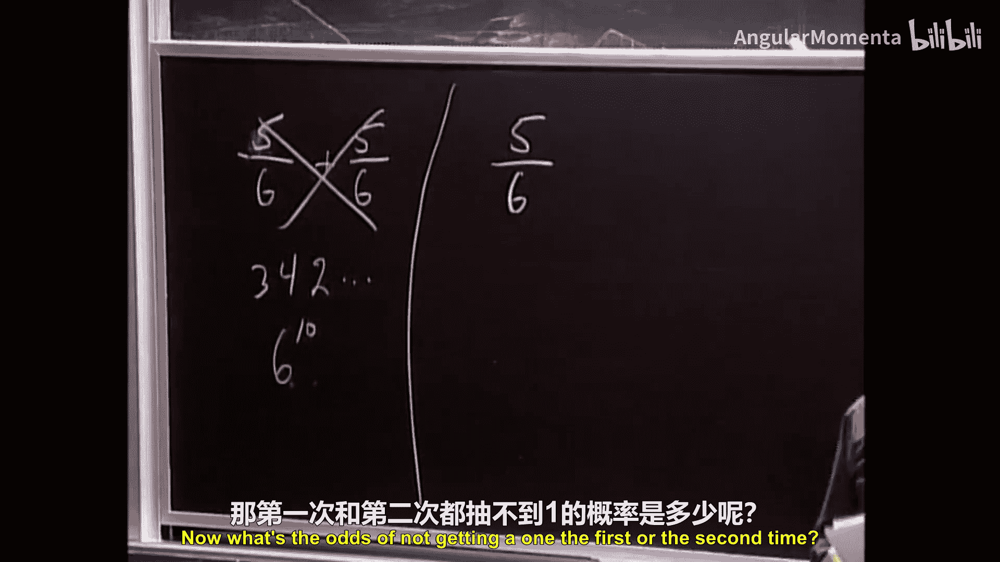

It's 5 over 6。Times。5 over 6。

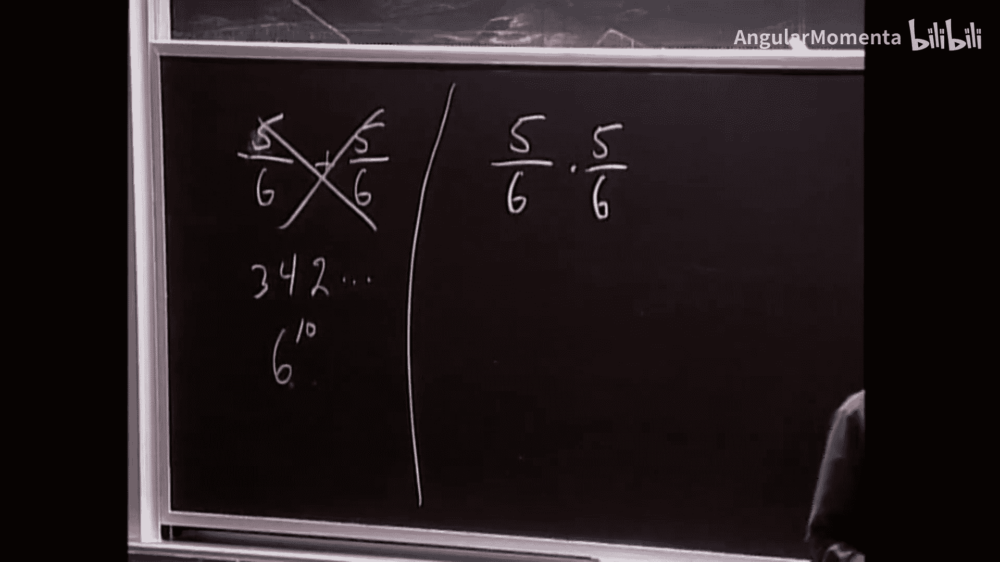

That makes sense。Because these are。

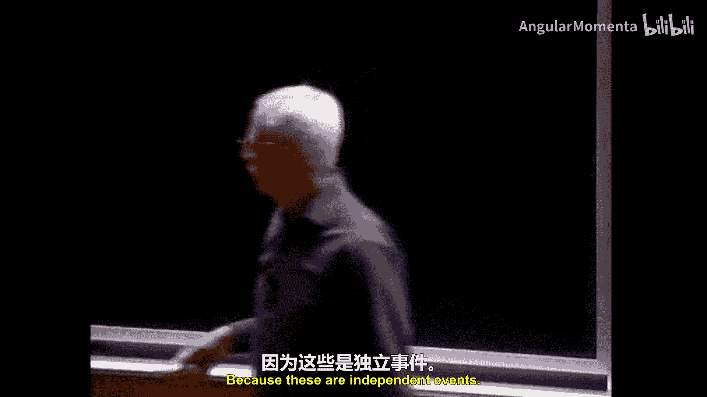

Independent events。And that's a key notion here。I'm assuming。

That whether I get a one on the second roll is independent of whether I got a run in the first role。

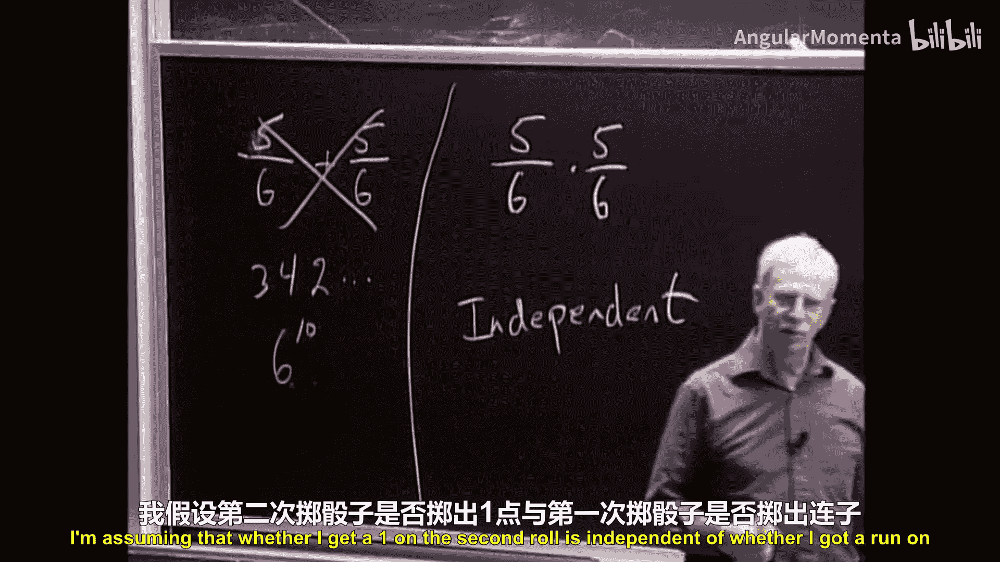

It should be true。Assuming my die or die is fair。

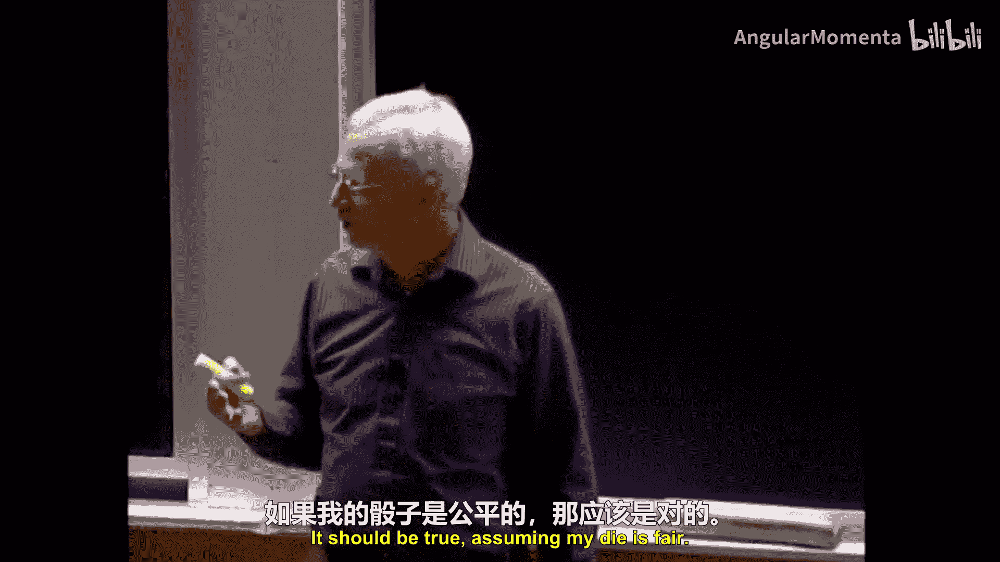

Similarly， I can do this。For the third role， et cetera。

So the probability of not getting a one in 10 roles。Is going be。5 over 6。To the 10th。

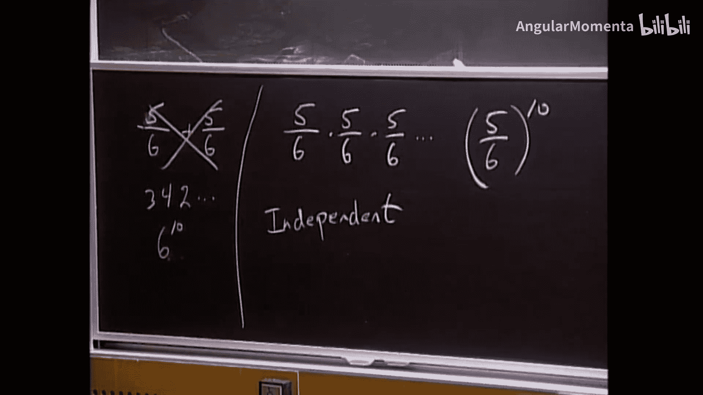

That makes sense。If not， speak up because things are going to get more complicated quickly。

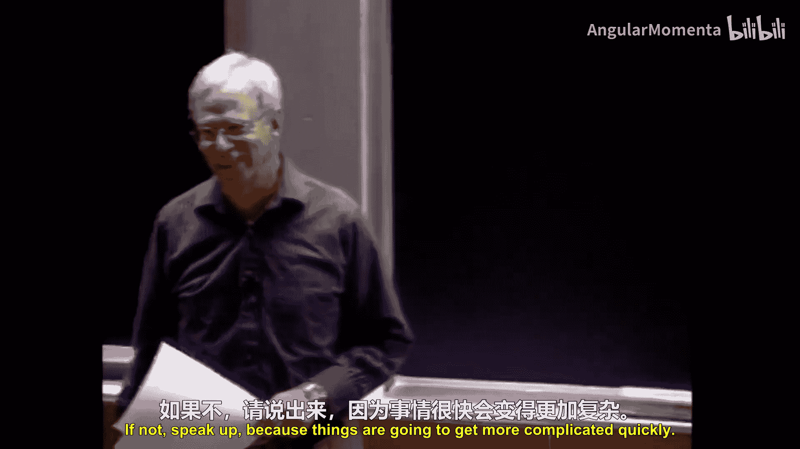

All right。So。

That's pretty simple。We， all you all with me on that。

Now， suppose I ask you the inverse question。 What is the probability of getting at least one1 if I roll the die 10 times。

So here I've given you how to compute the probability。Of not getting anyones。

Suppose I asked you the probability of at least one one。Yeah。Exactly。So that would be one minus。

Because we know that the probability。The sum of all the possible things that we can do when we do a probability always has to be one。

😔，It was a good effort。啊。Yeah， that's it。 If you take。

 if you want to get something where everything is covered。

 the probabilities always have to sum to one。And so now there are only two possibilities here。

 One possibility is， I don't get any ones。One possibility is I get at least one one。

So if I take all of the possibilities and I subtract the possibilities of not getting anyone ones。

 the result must be the probability of getting at least one one。

This is a very common trick in computing probabilities。Very often， when I ask or somebody says。

 what's the probability of x。The simplest way to compute it is to compute the probability of not X and subtract it from one。

Okay， again， heading down a wrong track for this， one might have said， well， all right。

 the probability of getting one on the first roll。Is one over 6。

The probability of getting a one in the second role is one over 6。

 probability of getting a third run Ro is one over 6。 I'll just add them up。

 and that will give me the probability of getting at least one， one。How do I， I。

 how can I be sure that's wrong， Well， when I'm done。

 I would claim the probability is something like that。

And we know that can't be true because a probability always has to be less than or equal to one。

So this is a good trick to keep in mind whenever you're given a probability problem。

Try and figure out whether you have a good way to compute it directly or whether it's simpler to。

Compute the knot of the probability， and then subtract it from one。Probability is really。A fun field。

It's interesting。 It's history。Is intimately connected with the history of gambling。And， in fact。

 almost all of early probability theory owes its existence to gamblers。People like Caranno Pascal。

 Vermont， Bnouli Deove Laplace， all famous names you've heard were motivatedded by a desire to understand games of chance。

嗯。Mostly， it started with dice。why I've been talking about dice。 And， in fact。

 dice are probably the human race's oldest gambling implement。嗯。

They date at least archaeologically to about 600 B， C。

Where a pair of dice was found in in Egyptian tombs。 actually， longer than that。

 two millennia before the birth of Christ， people found dice in Egyptian tombs。嗯。Typically。

 they were made from animal bones， but that doesn't matter。Pascal's interest in it。

 And Pascal is really considered the founder of probability theory。

Came when a friend asked him to solve the following problem， which I want to work out with you。

Is it profitable to bet that given 24 rolls of a pair of fairdise。You would roll a double 6。

He actually had a friend who was in the business of。Gambling， making these bets。 So they said。

 you've got a pair of dice。You roll it 24 times。And ask the question。

What is the probability of getting。What we call today box cards。And in those days。

 they just called two sixes。This was considered。

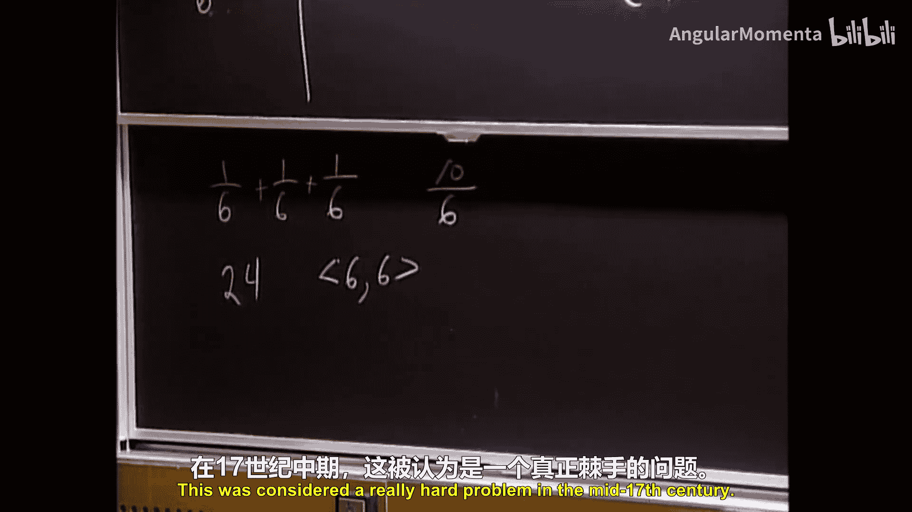

A really hard problem in the mid 17th century。And， in fact， Pascal and Vermont。2 pretty smart guys。

 as it happens， debated this。 They exchanged letters with each other trying to figure out how to solve this problem。

Shows how math is advanced。 because， in fact， today， it's quite an easy problem。

So let's work it through。And think， how would we。Answer this question。So what's the probability。

Of rolling。Of not rolling。A double 6 on the first try。

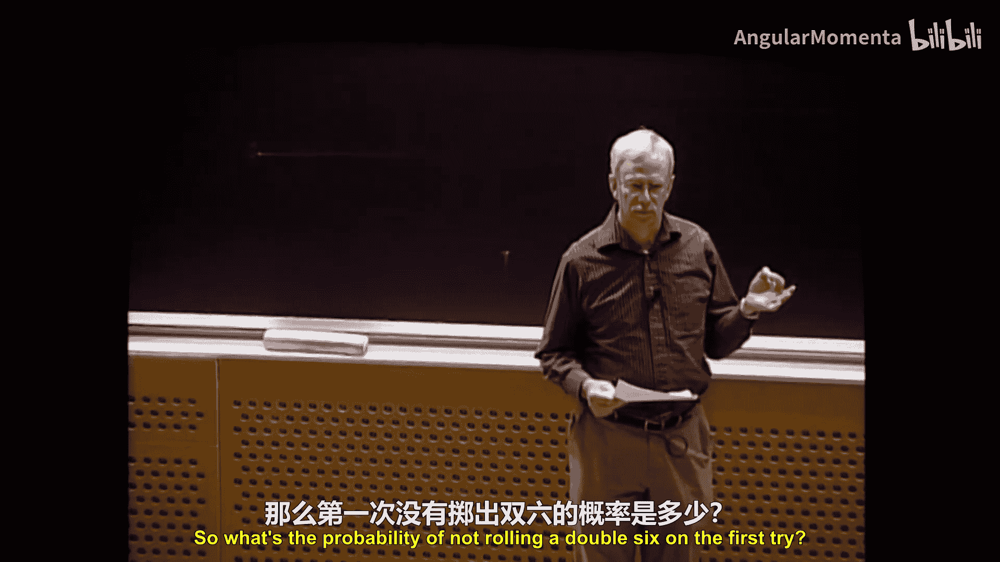

Well。The probability of not rolling a6 on one die is 6，1 over 6。

The probability of not rolling a one with the next guy is also one over 6。

So the probability of not getting a die in the first role。First， double sixs is。Sorry。

 the probability of getting a double 6 is 1，36。So the probability of not getting a double 6 is。35，36。

Right。So now we know that the probability of not。Getting it is that。

What's the probability of not getting it。24 times in a row。It's that。

Which is approximately equal to 0。51。So you can see why the answer was not obvious just by experience。

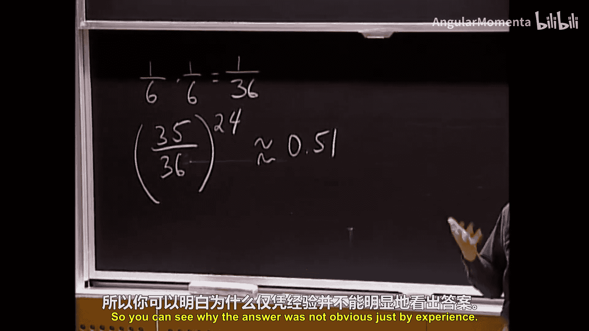

But there is a slight edge。Inbedding that you will not get。A double 6 and 24 times。Again。

 assuming you have fair dice as old as dice is， people have built cheaters's dis。

The excavation of Pomi， for example， they discovered a pair of loaded dice。

Ds with a little weight in it。 So one number would come up more often than it should。And， in fact。

 if you look at the Internet today， you will find many sites where you can。That's see。

1 I found this morning， says， quote， are you unusually unlucky when it comes to rolling dice。

Investing in a pair of dice that's more reliable might be just what you need。And then it says。

 of course， for amusement only。Yeah， we believe that。All right。As much as I trust probability theory。

I don't trust my ability to use it。And so， what I did。Is wrote a little simulation。To see if。

 see if Pascala was right。When he did this， So I've got the first， just this little test roll。Which。

Rolls at ice number of times， gets a。Result。嗯。Now， then I decided to check Pascal。

So I was going to run 100000 trials。And keep track。Of the number of times it worked。

So what you'll see I'm doing here is for I in the range number of trials。

This is the way we'll do a lot of these simulations。And， in fact， as we deal with probability。

Willll be dealing a lot with the notion of simulation。

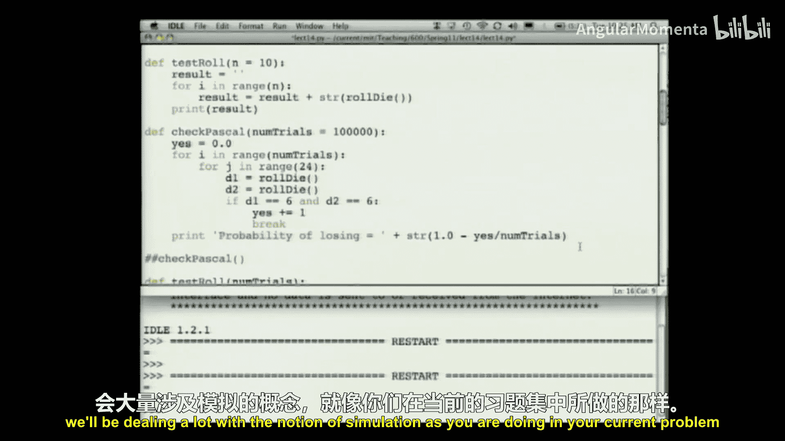

As you are doing in your current problem set。

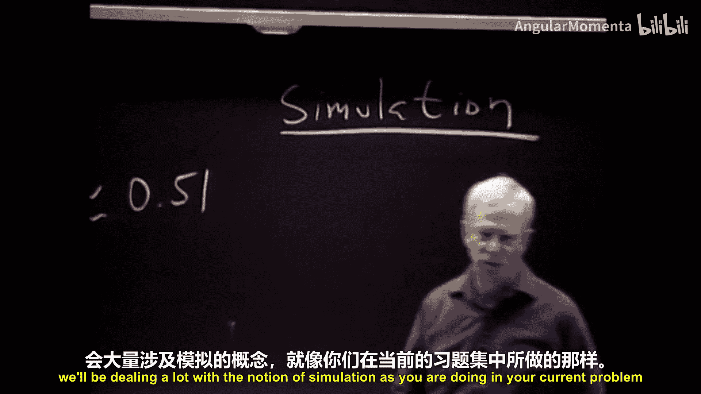

So for I in range number of trials for J in range 24， because that was Pascal's friend game。A role。

The first die， I'll roll the second eye。 If they're both sixes， I'll say， yes equals1。And I'll break。

And then I'll compute the probability of。Winning or losing。Okay。So， let's let it rip。

Okay now let's let it rip。Hredth， there it is。And we can see that it actually comes out pretty close。

To what Pascal predicted。Should we be surprised that it didn't come out to exactly。 Well， exceeded。

 is it exactly what is 35，36 to the 24th。So， that's the。Well， to 17 due of precision。

 the exact answer。And you can see we came up with something close to that。

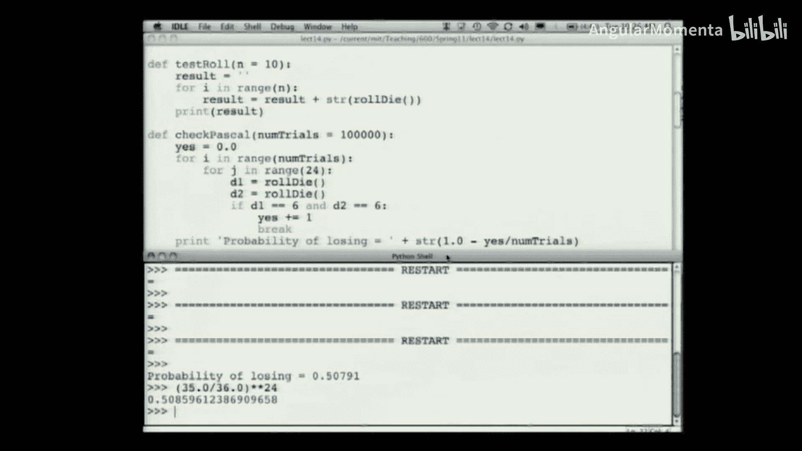

Not exactly that。 And we wouldn't expect to。Now， I only did 100000 trials。 If I did a million trials。

 I'd probably come up with something even closer。But if I did two trials， who knows what I'd get。

 come up with， right。Could be。Could get 1。 I could get lucky both times， or unlucky。Later on。

 we'll talk more about the question of how do we know how many trials to run。Now。

The interesting thing is， I'm sure it took me less time to write this program than it took Pascal to solve the problem。

Now， the truth is， I had several hundred years of other people's work to build on。But in general。

 I think one of the questions you'll find is， is it easier sometimes to write a simulation。Then。

 it is。To。Do the probabilities。What I often do in practice， is both。

I'll scratch my head and figure out how to figure out the answer analytically。 And then if it's easy。

 I'll write some code to simulate the problem。And expect to get roughly the same answer。

Giving me confidence。 I've done it correctly。On the other hand。

 if Id done the simulation and it had come up with something totally bogus。Or' totally different。

Then I would have had to work hard to figure out which was right， the code。Or the math。

Same sort of thing you saw when you looked at the random walk。 and the first time it was done。

 an answer showed up that was just wrong。But you need to have some intuition about a problem。

So that you can look at it and say， yeah， that's in the ballpark。And if it's not， it。

 it's time to worry。This kind of simulation that I've just done for the Dice game。

What's called a Monte Carlo simulation。

It is the most popular kind of simulation。

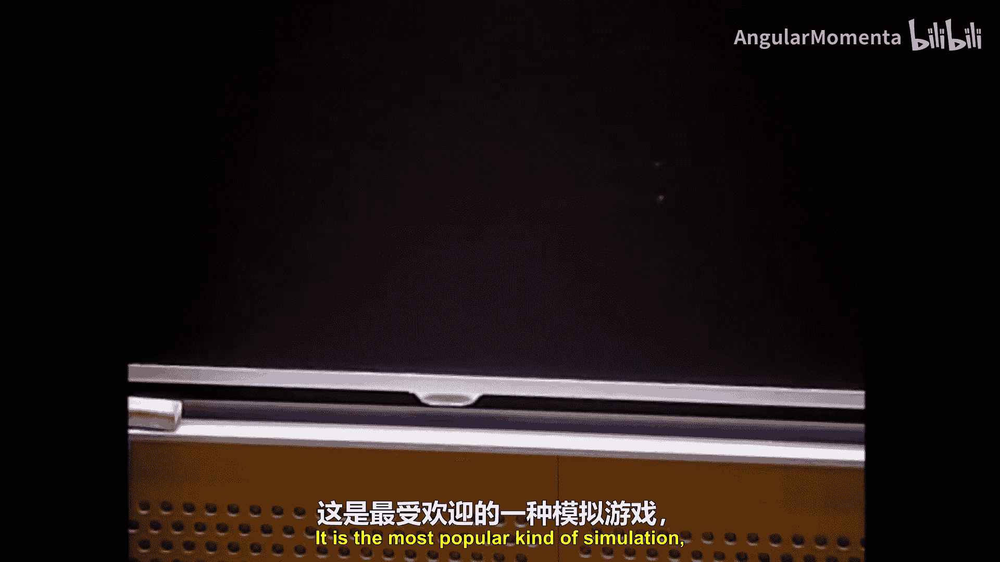

Named after a casino。On the Riviera。In， in the small principality of Monaco。

This was back in the time when it was hard to find a place you could gamble。

 And this happened to be one of the places you could。嗯。The term was coined in 1949 by Stanisl Ulam。

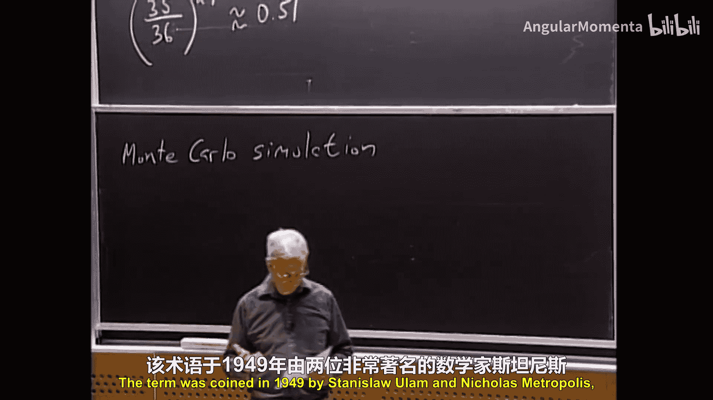

And Nicholas。Metropolis。2 very well known mathematicians。Ulam。

 who later became famous for designing the hydrogen bomb。Well。With teller。

Invented the method in 1946。And I'm gonna quote from his description of how he invented it。

The first thoughts and attempts I made to practice the Monte Carlo method。

Were suggested by a question which occurred to me in 1946。

As I was convalescing from an illness and playing solitaires。The question was。

 what are the chances that it can feel solitaire laid out with 52 cards will come out successfully。

After spending a lot of time trying to estimate them by pure combinatorial calculations。

I wondered whether a more practical method than quote。

 abstract thinking quote might not be to lay it out say 100 times and simply observe and count the number of successful plays。

This was already possible to envision with the beginning of the new era of fast computers。

And I immediately thought of problems， as you would， I'm sure。

 immediately thought of problems of neutron diffusion and other questions of mathematical physics。

And more generally， how to change processes described by certain differential equations into an equivalent form interpretable as a succession of random operations。

Later， I described the idea to John Vine Neumman， and we began to plan actual calculations。

So as early as 1946， people were thinking about the question of moving away from solving systems of equations to using randomized techniques。

To simulate things and find to find out what the actual answer was that way。Now， of course。

 fast is a relative term。Ulam was probably referring to the EnniAC computer。

 which could perform about 10 to the three editions a second。Not very many。

1000 operations a second and weighed approximately 25 tons。Today's computers， by comparison。

 perform 10 to the 9th editions and weigh about 10 to the - three tons。Allright。

 this technique was used during the Manhattan Project。

To predict what would happen doing during nuclear fission。And worked。

Money Carlos simulations are an example。Of what's called inferential statistics。

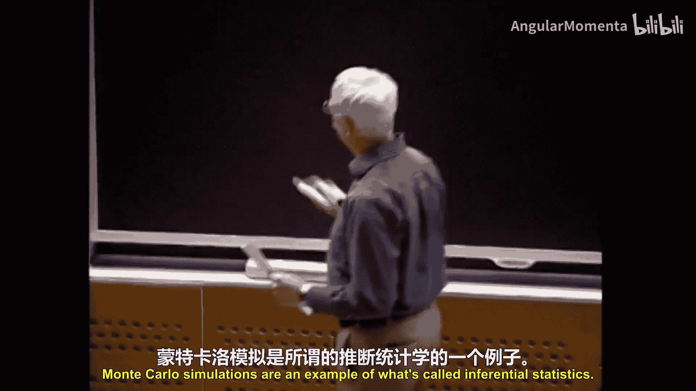

In brief， and Im going to be brief because this is not a statistics course。

Inferential statistics is based upon one guiding principle。And that principle。

Is that a random sample。Tends to exhibit。The same properties。

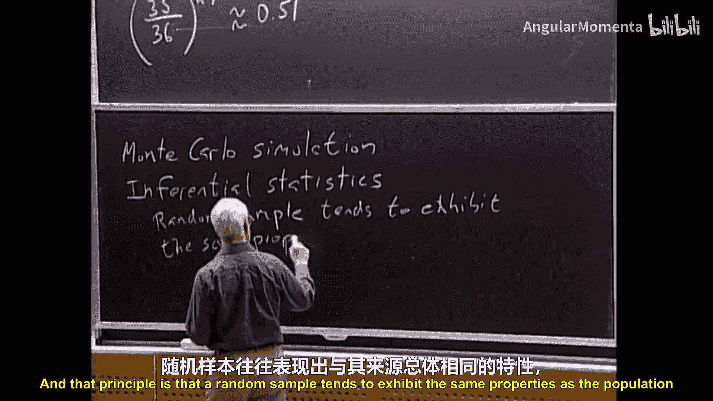

As the population from which it is drawn。So if I try and sample people say we're predicting an election。

 the notion is， if I go and I ask 1000 people at random in Massachusetts who they're going to vote for。

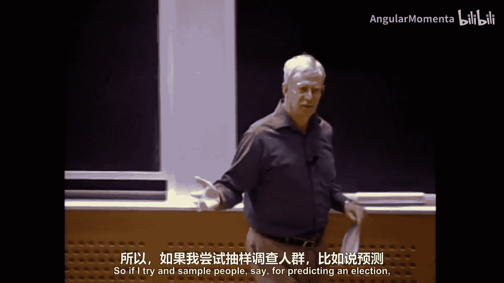

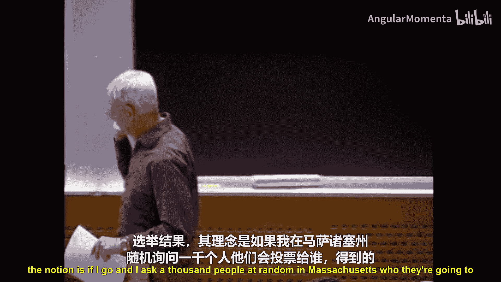

The average will be about the same as if I looked at the whole population。

So whenever we use a statistical method like this。So， for example。

 what we assume here is those  hundred thousand times I threw the pair of dice。

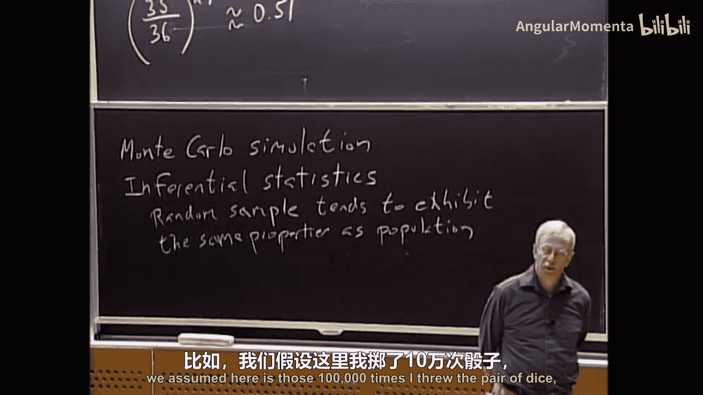

That that would be representative of all possible throws of the dice。

 the infinite number of possible throws。嗯。One always has to ask the question。

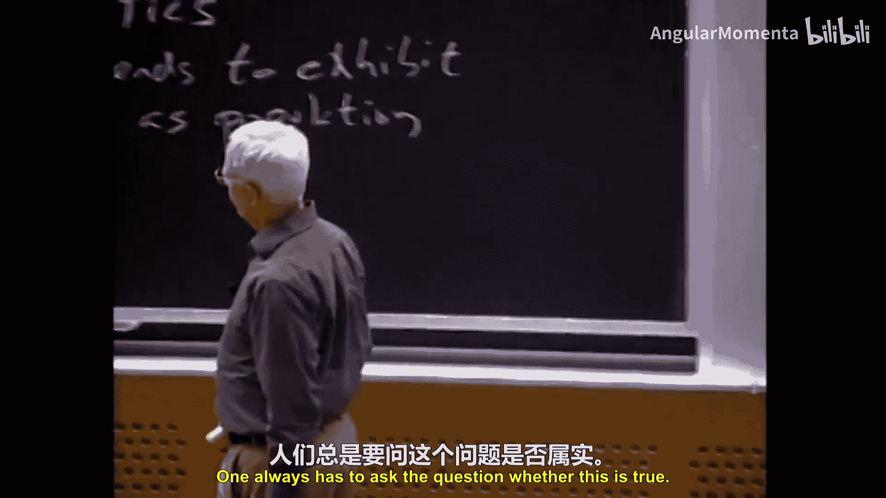

Whether this is true。Or whether one has a sampling technique that is， for example。

 giving you a bias sample。

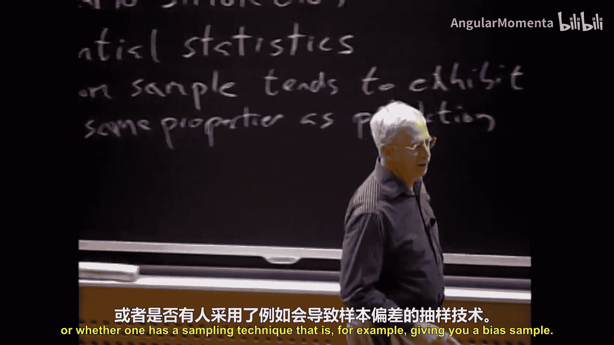

ALi later in the term， we'll talk about many ways in which you can get fooled here and think you're doing a fair statistical analysis and get all the math right and still come up with the wrong answer。

Because this assumption。Doesn't actually hold。Alright， let's think about it now in terms of coins。

 a little simpler than dice， where you can flip a coin and you get either a head or a tail。嗯。

Suppose Harvey Dent， or， for example， flipped a coin and it came up heads。

Would you feel good inferring from that that the next time he flipped the coin。

 it would also come up heads。I wouldn't。Suppose he flipped it heads and it came up heads twice in a row。

Would you feel comfortable that the third flip would be ahead。Probably not。

But suppose he flipped it 100 times in a row。And it was ahead each time。 What would you infer。

I would infer that the coin was too headed。And that， in fact。

 every time it was gonna come up heads because it is so improbable that if it was a fair coin。

 what's the probability of getting 100 heads in a row with a fair coin。1 over what。1 over 100。

One over two to the0， right？A half the first time， times a half times a half， a huge number。

 a very small number， rather， right。So the probability and a fair coin of getting 100 heads in a row is solo。

With just 100 flips that I would begin to think that the coin was not fair。All right。Suppose。

 however。

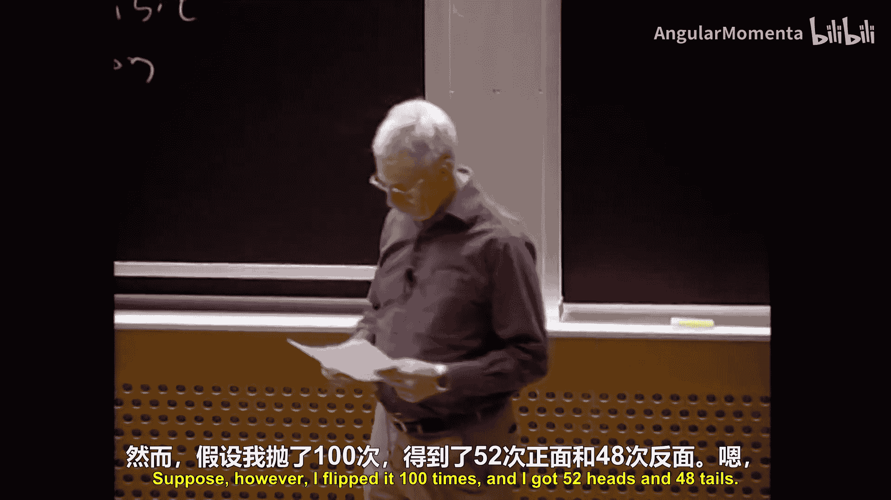

I flipped it 100 times。And I got 52 heads and 48 tails。Well， I wouldn't assume anything from that。

Would I assume that the next time I flipped it 100 times， I'd get the same 40，52 to 48 ratio。

Probably not， right， Your， your common sense tells you。You wouldn't。Right， probably。

 it tells you you wouldn't even feel comfortable guessing that there'd be more heads than tails the next time。

So when we think about these things， we have to think about the number of tests。And。

How close the answer is to what you would get if you did things at random。This is sort of comparing。

 This is technically called comparing something to the null hypothesis。

The no hypothesis is what you would get with a random event。And when you do a simulation。

 if you get something that is。Far from that。 Or when you sample a population。

 you get something that's distant from the null hypothesis。

 you can assume that maybe you're seeing something real。Alright， let's。

 let's look at this in a little less abstract way。So let's go look at some coin flips。

So I wrote a simple program， flip。Just flips the coin some number of times。And。

Tells me what fraction came up heads。So we can run it。And， let's look at。So as I flip 100。I get 。55。

If I flip 10。I get 04。 I flip 10 again。I get 05。Now， look at that。Same thing twice in a row。But now。

 I get  point2。So obviously， I shouldn't infer too much from， from 10 flips。

And even from 100 where I got 055， Let's see if what happens if I flip 100 again。Po。41。

 big difference。So this is suggesting that we can't feel very good about what happens here。Now。

 if I do the following。Well， I'm feeling a little bit better about this。Well。

 for one bad reason and one good reason。 the bad reason is， I know the answer is 05。

 and these are both close to 05。 So I feel warm and fuzzy。 That's cheating。

 I wouldn't even need to write the simulation if I knew the answer。

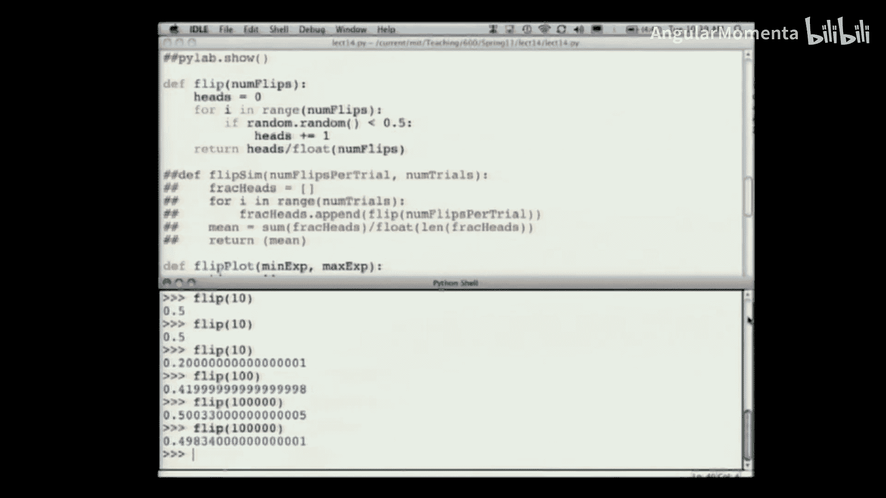

But mostly， I feel good about it because I'm getting kind of the same answer every time。Okay。

 and that's important。The more I do。The more stable it gets， the the。

 the larger the number of trials。This is an example。呃。What's called the law of large numbers。

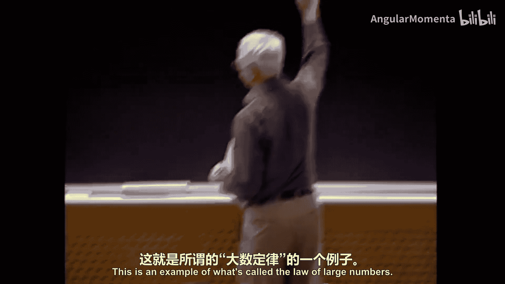

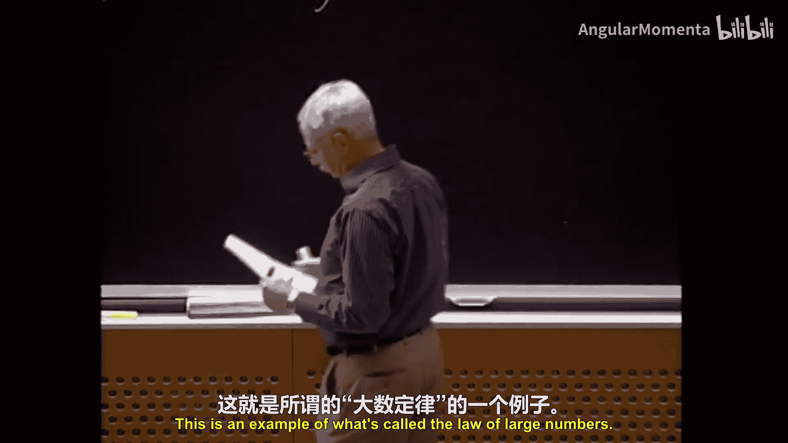

Also known as Berulli's law。After one of the Berulli family of mathematicians。

 and I can't for the life me remember which Bernoulli。

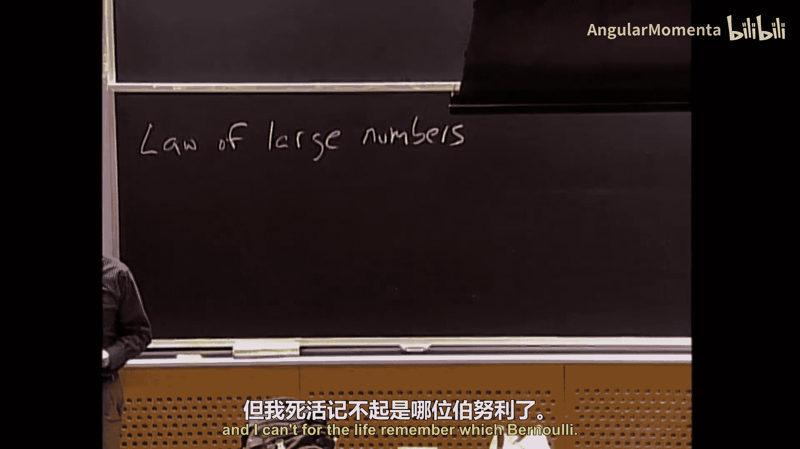

There were a whole bunch of them。Anyway。The law states。

 and it's important to understand this because， again， it underlies the inferluential statistics。

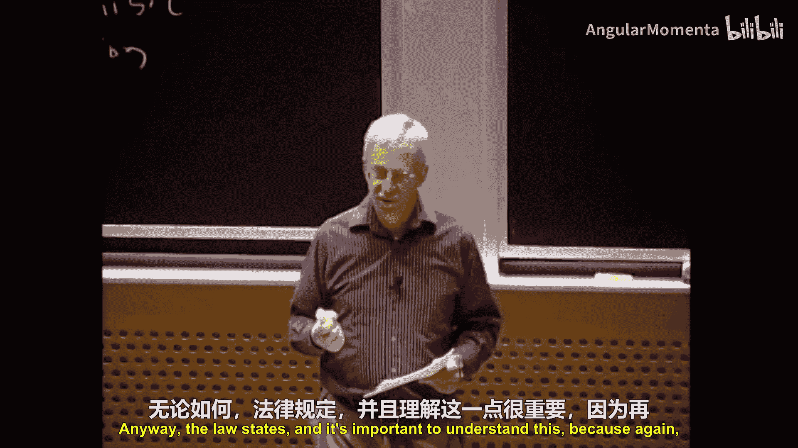

That in repeated。Independent tests。And it's important to note the word independent。

Each test has to be independent of the earlier test。 In this case， the tests are flips of the coin。

With the same。Actual probability。We'll call it P。Often used to represent probability。

Of an outcome for each test。The chanceant。That the fraction of times。That outcome occurs。

The outcome with probability P。

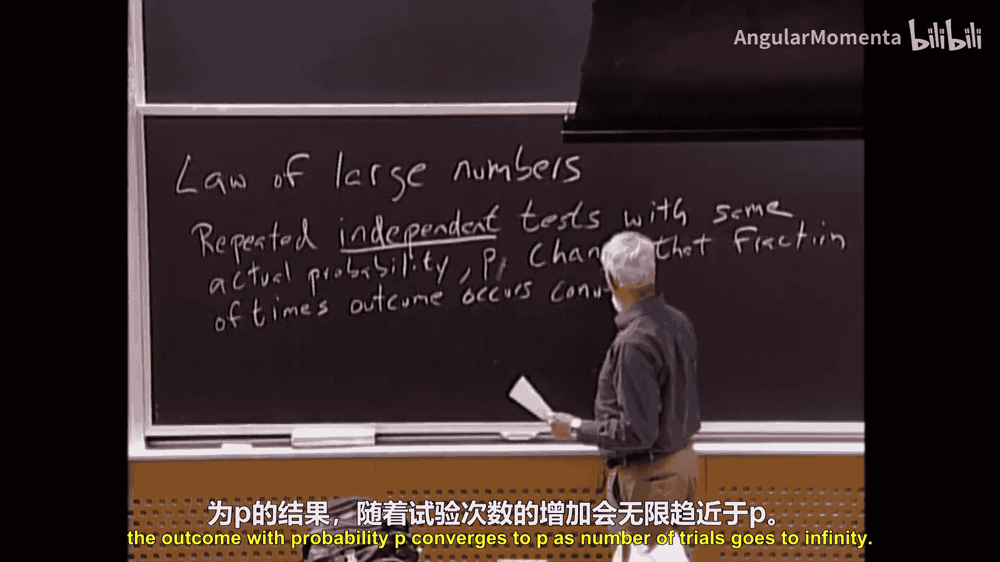

Converges to P。As number of trials goes to infinity。Alright。

 so if I did an infinite number of trials。The fraction of heads I would get in this case。

 would be exactly 05。Of course， I can't do an infinite number of trials。

But that's the law of large numbers。 that says the。Now。It's worth noting。

That this law does not imply。That if I start out with deviations from the expected behavior。

Those deviations are likely to be quote， evened out by opposite deviations in the future。

So if I happen to start by getting a whole bunch of heads in a row。It does not mean。

That I'm more likely to get tails in a subsequent trial。Alright， because if I were。

 if that were true， then they wouldn't be independent。Independent means memoryless。

So if I have an independent process， what happens in the future cannot be affected by the past。

And therefore， I don't get this business of， they even out。Now， people refuse to believe this。

 If you go to any gambling place。You'll discover that if the people through let wheelhe。

 if black comes up 20 times in a row， there'll be a rush to bet on red。Ca everyone will say。

 red is due。 Red is due。 Red is due。And。Every psychologist who's ever done this experiment finds that people don't believe it。

That it's not true。People just don't get probability。 And it happens so often。

 It's got a name called the Gambler's fallacy。And。Theres been great examples of。

 of people going broke， doing this。Now， notice that the law of large numbers here。

Is about the fraction of times I get an outcome。It does not imply， for example。

That the absolute difference between the number of heads and the number of tails will get smaller as I run more trials。

Right， it doesn't say anything at all about that。It says the ratio of head to tails will approach one。

But not that the difference between them。Alright， let's look at an example showing that off。So。

What I've got here。Is this program called Flippl， This is on your handout。

This is just going to run this business of flipping coins。I should point out just， I did it this way。

 just to show you。What I'm doing is each flip is ramp random dot random is less than 5。

 I'll call it a head 。5。 I'll call it a heads Otherwise it tails。

You'll notice that it appears that maybe I'm biasing a little bit because I'm giving 。5。A value。

But there are so many floating point numbers between 0 and 1。

That the probability of getting exactly 0。5 is so small。That I can ignore it。

 It isn't gonna really make a difference。Random dot random is the key issue。

 the key function that's used to implement all the other random。Functions that we have in。

 in that package。All right。So， I'm going to do it。And I'm gonna do it over a range of values。

The minimum exponent to the maximum exponent。And for exponent and range Min X to max S plus 1。

I'm gonna choose an X value that is 2 to that。So this lets me go over a big range。

So I'll see what happens if I get one flip and two flips and 4 and。8 and 16 and 32， etc cetera。

And then I'm gonna just do some plots。I'm gonna plot the absolute difference between heads and tails。

And the ratio。Of heads to tails。Let's see what happens when we run that。Actually。

 probably nothing because I didn't un the run part of it。Let's do that。

So I'm gonna call flippl with 4 and 20。Running from four trials 2 to the4 to 2 to the 20。

See what we get。Now。You may get。Different things when you run at different times， in fact， you will。

嗯。So here we see something kind of。Uninteresting。嗯我。That's cheat。

And see what we got the first time I ran it， which is on your handout。

 And I have a PowerPoint with it。I was。I knew this might happen。 doesnn't usually。

 But sometimes when you run it， you get。Surprising results。

So here's what happened when I first ran it。Here was the difference between heads and tails。

And it seems that， okay， the difference was low。 It went up。 It went down。 It went up， It went down。

It seemed to go down dramatically。If you remember what we just saw when I ran it。

We also saw something where it went up a little bit。

 and it went down and then it shot up dramatically at the end， which was why that scale was so funny。

And if we look at the ratio， what we see is it seems to start above one。Drop below one， and then。

Seems to converge towards。Wan。Now， I show this because I want to make a couple of points of plotting。

嗯。Let's look at this out here。Looks like we have a pretty dramatic trend。Of this linear drop。Do we。

Do we actually have a trend here。Well， let's think about it。The default。

Behavior of the plot command in P labab is to connect points by lines。

How many points do I actually have out here？Well， you saw the code。 You have the code in a handout。

How many points do you think there are out here。A0。100。3。2。2 to 3， right。

 depending what I mean by out here。So what we see here is something that happens a lot。

People plot a small number of points。Connect them by a line。

And mislead the audience into thinking there's a trend。When， in fact。

 maybe all you have is an outlier。So， it's problematical here。To do it that way。

So let's see what happens if we change the code。And what I'm going to do。Is。Change it。In two ways。

Well， maybe I'll change it in one way first。Whoops。哎。Uncomment。Un commentment。

So what I'm doing here is I'm plotting in a different way。This quote， B， O。

Says don't connect it by lines， but just put a dot as an O。 And V says， make it blue。

I use blue because it's my favorite color。So now if we look at these things。

 we'll see something pretty different。So that's the difference between head and tails。

That's the ratio。But now。If we look at the difference between heads and tails here。What we see is。

 it's pretty sparse。So， yeah， maybe there's a trend。But maybe not， right， because way out here。

 I'm only connecting two points。Giving an illusion that there is a trend。But， in fact。

No reason to believe it。So I always think if you're plotting a small number of points。

 you're much better off just plotting the points。Then you are。Trying to connect them。Now。

 if we look at this， this one again。Maybe we'd feel kind of comfortable。

 there is a trend here that there are several points on this line。

 We can't see much of what's going on over here。Which gets me to the next thing I want to do。

Is I'm going use logarithmic axes here。So Pabb dot semi log X says， make the X axis log rhythmic。

Pioab Semilogue Y， the Y axis。And so in the case of the absolute difference。

I'm going to make both logarithmic。Why am I doing that， Because both have a large range。

And by making it logarithmic， I can see what's happening at the left side in this case。

 where things are changing。When I look at the ratios， the Y axis does not have a very large range。

And so there's no need to make it logarithmic。We run it。So， here。

We can see the difference between heads and tails。And now we can see what's going on at the left。

 as we can in figure 4。And we can see things much more clearly。

So log scales can be enormously useful。And， in fact， I use them a lot。 Everyone uses them a lot。

 But again， it's very important。To observe the fact。That it's logarithic and not get fooled。

All right。So we talked about linear scaling， logmic scaling。

And we now have charts where I can perhaps actually reach some conclusion about what's going on。

The next question is， how certain can I be。Can I really be certain that。Indeed。

 this should be converging to one。嗯。Here， if I sort of look at it。

 it does look like there's kind of a linear trend。Of the absolute difference growing as the number of trials goes。

How certain can I be of that。You can never。Get absolute certainty from sampling。

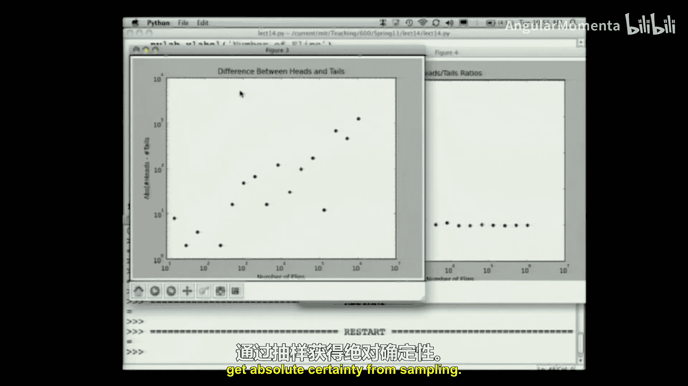

Becauseuse you can never be sure that you haven't been vastly lucky or unlucky。

That's not to say you can't get the absolute correct answer。 Maybe it'll I could get 05。

 which is the correct answer。But I can't know that。 That's the correct answer。

So now the question I want to pursue， and it's what we'll cover on Thursday is what techniques can I use to make a statement of the form。

 I'm certain within the following range that I have the right answer。

That I know the right answer is highly likely to be this close to the answer my simulation is giving me。

And we'll look at how we can make those statements， and actually believe them。Okay， see on Thursday。

