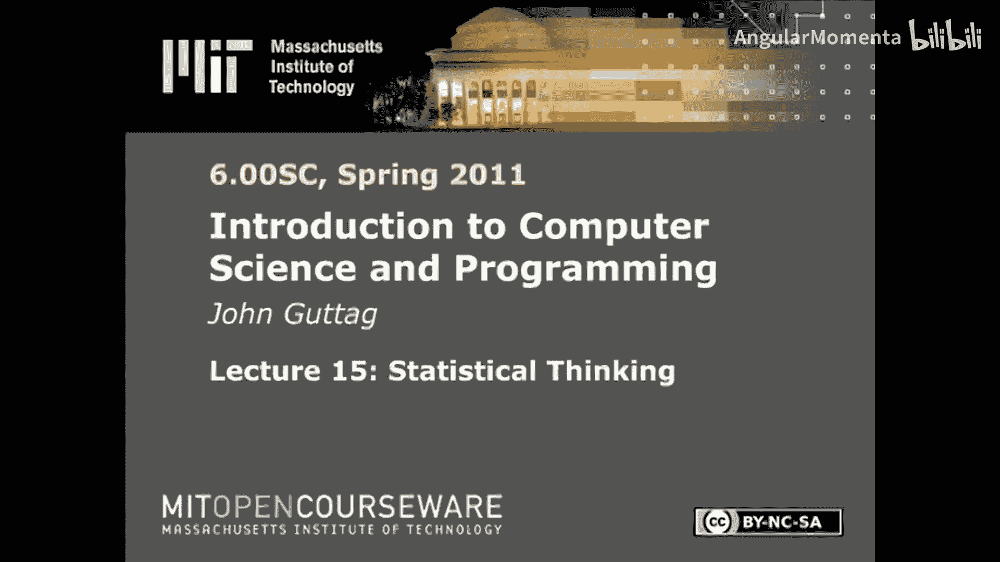
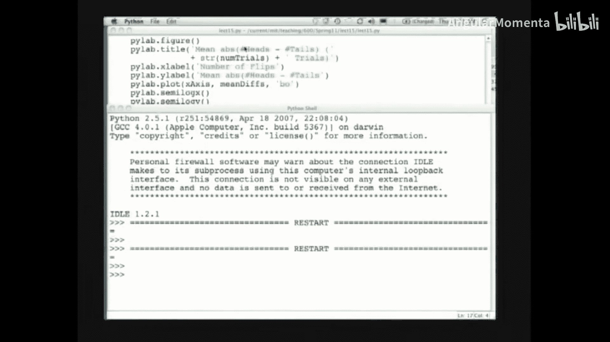
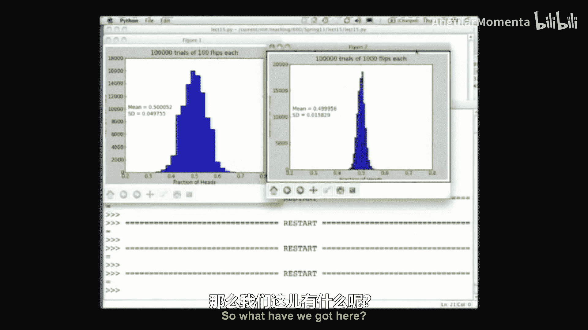
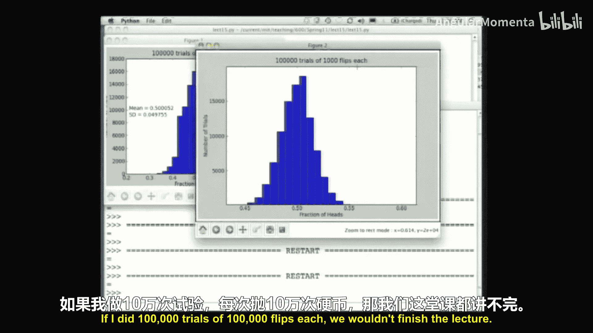
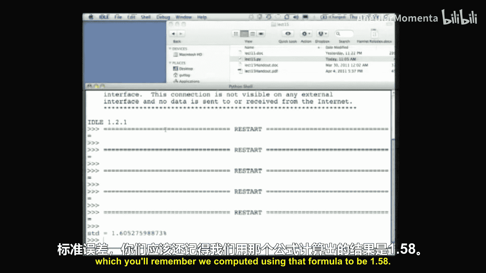
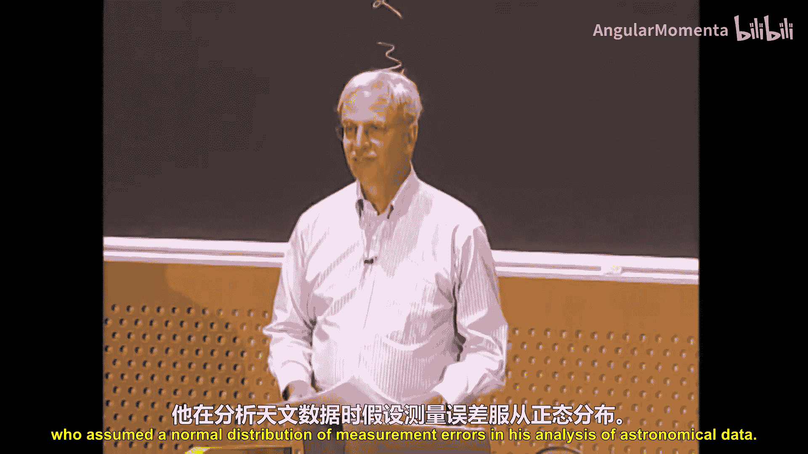
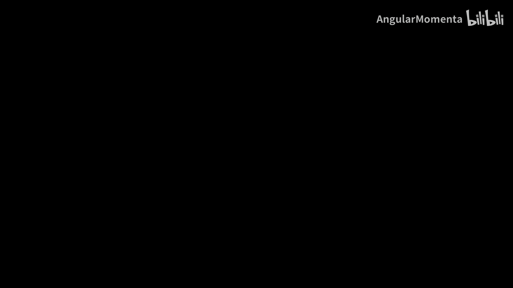

# 【麻省理工】计算机科学与编程导论 ｜ MIT 6.00SC Introduction to Computer Science and Programming p21 21 -BV1a5BZBkEP6_p21-

The following content is provided under a creative Commons license。

 Your support will help M I T Opencourseseware continue to offer high quality educational resources for free。

To make a donation or view additional materials from hundreds of M T courses。

 visit M I T OpenCourware at O C W。t M I Tt Eduu。

Good morning。This is the second of two lectures that I'm retaping in the summer because we had technical difficulties with the lectures that were taped during the academic term。

I feel I need to tell you this for two reasons。 One， as I said before， the room is empty。

 And so when I say something hilarious and there's no laughter， it's because the room is empty。😊，嗯。

And。If I'm not asking the students questions during the lecture， it's because there are no students。

The other important thing I want you to understand is that I do own more than one shirt。

And more than one pair of pants。 And the reason I'm dressed exactly the way I was for lecture 13 is I gave lecture 13。

5 minutes ago， even though this is lecture 15。 So again， here I am and。

I apologize for the uniformity in my clothing。Okay。On lecture 14， which came between 13 and 15。

 At the end of it， I was talking about flipping coins。And ended up with the question。

 how can we know when it's safe？To assume that the average result of some finite number of flips is representative of what we would get if we flipped the same coin many more times in principle an infinite number of times。

Or we might flip a coin twice， get one heads and one tails。And conclude that the true probability。

Of getting ahead is exactly 0。5。Turns out， assume I have a fair coin。

 This would have been the right conclusion。Just because we have the right answer。

 it doesn't mean our thinking is any good。And in fact， in this case。

 our reasoning would have been completely faulty。Because if I'd flipped it twice and gotten two heads。

 you might have said， oh， it's always heads。But we know that wouldn't have been right。

So the question I want to pose at the start of today's lecture。Is。Quite simply。

 how many samples do we need。To believe the answer。

So how many samples do we need to look at for we can have confidence。In the result。Fortunately。

 there's a very solid set of mathematics that lets us answer this question in a good way。😊。

At the root of all of it。Is the notion of variance。Verance is a measure。Of how much。Spread。

There is in the possible outcomes。Now， in order to talk about variance， given this definition。

We need to have different outcomes。Which is why we always want to run multiple trials。

Rather than say， one trial with many flips。In fact， you may have wondered。

 why am I not if I going end up flipping the coin a million times。啊。

Why would I do multiple trials adding up to a million rather than one trial of a million。

And the reason is， by having multiple trials。Each of which give me a different outcome。

I can then look at how different the outcomes of the different trials are and get a measure of variance。

If I do 10 trials and I get the same answer each time。

 I can begin to believe that really is the correct answer。

If I do 10 trials and get 10 wildly different answers。

Then I probably shouldn't believe any one of those answers。

 And I probably shouldn't even think I can average those answers and believe the mean is a real answer。

 because if I run an 11th trial， maybe I'll get something totally different。Yet， again。

We can formalize this notion of variance in a way that should be familiar to many of you。

And that's the concept of a standard deviation。Something I， in fact。

 already showed you when we looked at the spread of grades on the first quiz this semester。

Informally。What the standard deviation is measuring。Is。

The fraction of values that are close to the mean。😡，If many values are close to the mean。

 the standard deviation is small。😡，If many values are relatively far from the mean。

 the standard deviation is relatively large。If all values are the same。

Then the standard deviation is 0。In the real world， that essentially never happens。All right。

 we can write a formula for this。 Fortunately， it's not all about words。

And we can say the standard deviation of x。Where x is a set of trials。ASigma is usually used to。

Talk about that。Is equal to the square root。Of one over the absolute value of the length of x。

 So x1 over the number of trials。Times is summation。Of。The value of each trial， little x and big X。

Of x minus mu。Squared。Where mu is the mean。And as I said， that's the cardinality of x。Well。

 so that's a formula。And those of you who are majoring in math。Are going to love that。

But for those of you who are more computationally oriented。

I recommend you just take a look at the code。So here's an implementation。Of the standard deviation。

So the standard deviation of x。Is equal to start by getting the mean of x。

 which is by summing X and dividing it by the length of x。

Then I'm just going to sum all the values in X and do the computation。

So that code and that formula are the same thing。All right。

 now we know what standard deviation means， what are we going to do with it？We're going to use it。

To look at the relationship between the number of samples we've looked at。

And how much confidence we should have in the answer。So we'll do this again。

 looking at a bunch of code。So I've got this function flip plot。

Which doesn't quite fit on the screen， but that's okay。It's not very interesting in the details。

What it does is it runs multiple trials。Of some number of coin flips。

And plots a bunch of values about the relative frequency of heads and tails。And also。

 the standard deviation of each。So， again， nothing very exciting in the code。

I'm just going to keep track。Of for all these trials， the minimum and the maximum exponent。

 I'm using that so I can run a lot of trials quickly。The mean ratios， the mean the differences。

And standard deviations。For exponent in range， minimum exponent to maximum exponent plus one。

I'm going to build an X axis。So this is going to be the number of flips。

And then for the number of flips， I'm gonna run a bunch of tests and get the ratios of heads to tails。

And the absolute difference between heads and tails。And then I'm going to do a bunch of plotting。

And again， what I want you to notice is when I'm doing the plotting。

 I'm going to label the axes and put some titles on。And I'm also going to use semi log。Because。

Given that I'm。Looking at different powers， it would compress everything on the left if I were just due linear。

All right， let's run it。Actually。Let's comment out the code。 We need to run it。

So I'm going to call flip plot。With。A'm minimum exponent of four。A maximum exponent of 20。

 That's pretty high。 And I'm going to run 20 trials。IThis could take a little while to run。

 but not too long。And will give us some pretty pictures to look at。

Give me a chance to have a drink of water。I know this suspense is killing you as to what these plots are going to look like。

 Here they are。All right。So if we look at plot one。That's the ratio of heads to tails。

And as you can see it。Bunces around in the beginning。When we have a small number of flips。

The ratio moves a bit。But as I get to a lot of flips out here， you know，10 to the  fifth，10 to the 6。

What we're seeing is it begins to stabilize。 we don't get much difference。

Kind of interesting where it's stabilizing， maybe not where we'd expected。嗯。

I would have guessed it would stabilize a little closer to one than it did as I got out here。嗯。

Maybe I have an unfair coin。That's the problem with running these experiments in real time that I can't necessarily get the answer right I want。

 But for the most part， actually， it looks much better in my screen than it does on your screen。

In fact， on my screen， it looks like it's very close to one。I don't know。 I guess there's some。

Some distortion here。Think one。嗯。And。If we look at the standard deviation of the ratio of heads to tails。

What we're seeing is， that's also dropping。From somewhere。Up here around 10 to the zero。

Down to 10 to the -3。 And it's dropping pretty steadily as I increase the number of trials。

That's really what you would hope to see and expect to see。对。Not the number of trials。

 the number of flips。 sorry， as I flip more coins， the the variance between trials should get smaller。

Because in some sense， randomness is playing a less important role。The more random trials you do。

 the more likely you are to get something that's actually representative of the truth。And。Therefore。

 you would expect the standard deviation。To drop。All right。Now。

What we're saying here is because the standard deviation is dropping。

Not only are we getting something closer to the right answer。But。Perhaps， more importantly。

We have better reason to believe we're seeing the right answer。And that's very important。

 It's where I started this lecture。 It's not good enough to get lucky and get the correct answer。

You have to have evidence。They can convince somebody that really is the correct answer。

And the evidence here is the small standard deviation。Let's look at a couple of the other figures。

So here's figure 3。This is the mean of the absolute difference between heads and tails。

Not too surprisingly， we saw this in the last lecture as I flipped more coins。

The mean difference is gonna get bigger。That's right。 We expect the ratio to get smaller。

 but we expected the mean difference to get bigger。On the other hand。Let's look at figure 4。

What we're looking here。Is。The difference in the standard deviations。And， interestingly。

What we're seeing is。The more coins I flip。The bigger the standard deviation is。Well。

This is kind of interesting。I look at it， and I sort of said that when the standard deviation is small。

We think that the variance is small， and therefore， the results are credible。

When the standard deviation is large， we think the variance is large， and therefore。

 the results are maybe incredible。Well。I said that a little bit wrong。

 I tried to say it right the first time。 What I have to ask is。

 not is a standard D A fission large or small， but is it relatively large or relatively small。

Relative to what， relative to the mean。If the mean is a million。And their standard deviation is。20。

It's a relatively small standard deviation。If the mean is 10 and the standard deviation is 20。

 then it's enormous。So it doesn't make sense。 And we saw this。 We looked at quizzes， right。

If the mean score on quiz 1 were 70。And their standard deviation were 5。 We'd say， okay。

 it's pretty packed around the mean。If the mean score were 10。Which maybe is closer to the truth。And。

The standard deviation were 5。 Then we'd say that's not really packed around the mean。

So we have to always look at it relative or think about it relative to that。Now， the good news。Is。

We have。Again， a mathematical formula that lets us do that。

Get rid of all those figures for the moment。And that formula is called a coefficient of variation。

For reasons， I don't fully understand。This is typically not used。

 People always talk about the standard deviation， but in many cases。

 it's the coefficient of variation that really is， is more useful。Measure。 and it's simply。

The standard deviation divided by the mean。So that lets us talk about the relative varianceors。

 if you will。The nice thing about doing this。Is it lets us relate。

Different data sets with different means and talk， think about how much they vary relative to each other。

嗯。

So， if we think about it。If the co， usually， we argue。In that， if it's。Less than one。

We think about that as low variance。Now， there should be some warnings that come with the coefficient of variation。

 And these are some of the reasons people don't use it as often， because。

They don't want to bother giving the warning labels。If the mean is near zero。😡。

Small changes in the mean。Are going to lead to large changes in the coefficient of variation。

They are not necessarily very meaningful。So when the mean is near 0。

 the coefficient of variation is something you need to think about with several grains of salt。

Makes sense。 You're dividing by something near 0。 A small change is going to produce something big。

Perhaps more importantly or equally importantly。This is something we're going to talk about later。

Is it unlike the standard deviation？The coefficient of variation cannot be used to construct confidence intervals。

I know we haven't talked about confidence intervals yet。But we will shortly。All right。By now。

 you've got to be tremendously bored with flipping coins。 Nevertheless。

 I'm going to ask you to look at one more coin flipping simulation than I promise will change the topic。

😊，And this is to show you some more aspects of the plotting facilities in P lab。

So I'm going to just flip a bunch of coins， run a simulation。 You've seen this a zillion times。

And then we'll make some plots。And this is really kind of the interesting part。嗯。

What do I want you to notice about this？嗯。Let's take a look at here。So， now。

We've been plotting curves。Here， we're going to plot a histogram。So I'm going give a set of values。

Set of y values， in this case， the fraction of heads。And a number of bins in which to。

Do the histogram。 So let's look at a。Little example first here， independent of this program。Oops。

 wrong way。So I'm going to set L。 a list equals 1，2，3，3，3，4。

And then I'm just going apply a histogram with six bins， and then show it。

I've done something I'm not supposed to do。 I just know title， there's no X label， no Y label。

 that's because this is totally meaningless。 I just wanted to show you a histogram's work。

And what we'll see here is that it's shown that I've got。3 instances of this value of 3。

And one of everything else。 And is just giving me essentially a bar chart， if you will。Again， many。

 many plotting capabilities you'll see on the website。 This is just a simple one。

1 I like to use and use。Fairly frequently。Some other things I want to show you here。Is。

I'm using X limb and Y limb。So what we can do here is。This is setting。The limits of the X and Y axis。

 rather than using defaults， saying the lowest value should be this thing。

 I have the variable called X min， which I've computed up here。And the highest Y N。What you'll see。

If we go up a little bit。So I'm getting the fraction of heads 1 and computing a mean  one and the standard deviation1。

Then I'm gonna plot a histogram and the way we looked at it。

And then what I'm going to do is say X min and y X max is p labb dot x limb。

If you call Xlim with no arguments。😡，What it will return is the minimum x value and the minimum y value of the current plot。

The current figure。So now I've stored the minimum x and x values and the maximum x value for the current 1。

 I've done the same thing for y。I'm then going to plot the figure here。

Then I'm going to run it again。 I'm going to run another simulation。Getting fracrack heads2。

 mean to standard deviation 2。Going to plot the histograms。

 But then I'm going to set for the new one， the X limit and the y Y limit。Or the X limit。

 sorry of this to the previous ones that I saved from the previous figure。Why am I doing that。

 Because I want to be able to compare the two figures？

As we'll see when we have our lecture and have a lie with data。

A great way to make to fool people with figures is to subtly change。The range of one of the axes。

 And then you look at things say， wow， that's really different。 Or they're really the same when。

 in fact， neither conclusion is true。 It's just that they've been normalized to either look the same or look different。

So it's kind of cheating。And then we'll， we'll do it。 So now let's run it and see what we get。

Don't need this little silly thing first。嗯。Let's see。It's going to take a long time， maybe。

It's one way to fill up a lecture， just run simulations that take a long time to run。

Much easier to prepare than actual material。But nevertheless， it shouldn't take forever。

I may have said this before。 I have two computers。 I have a fast one that sits at my desk that I use to prepare my lectures and a solar one that I use to give the lectures。

I should probably be testing all these thing out on the slow computer before。Making you wait。But。

Really， it's going to stop， I promise。All right。So we'll look at these。

So figure 1 has got 100000 trials of 10 flips each。 And figure 2，100000 trials of 1000 flips each。

And let's look at the two figures side by side。Make them a little smaller so we can squeeze them both in。

All right。So what have we got here？

Notice if we look at these two plots， the means are about the same。0。5 and 0。499。

 Not much difference。啊。The standard deviations are quite different。And again， you would expect that。

100 flips should have a lot higher standard deviation than 1000 flips。And indeed， it certainly does。

15 is a lot smaller than 。05。So。That tells us something， something good。 It says。

 as we've discussed it， these results are more credible than these results。

Not to say that they're more accurate， because they're not really， but they're more believable。

 And that's what's important。Notice， also， the spread of outcomes is much tighter here。

Then it is here。Now。That's why I played with XL。😡，If I use the default values。

It would not have looked much tighter when I put this up on the screen。Because it would have said。

 well， we don't have any values out here。 I don't need to display all of this。

And it would have been about the same visual width as this。And therefore。

 potentially very deceptive when you just stared at it。

 If you didn't look carefully at the units on the X axis。

So what I did is since I knew I wanted to show you these things side by side and make the point about how tight the distribution is。

I made both raxies run。The same length。And therefore， produce comparable figures。I also， by the way。

 use X Li and Y im。 If you look at the code， which you will have in your handout。

To put this text box。In a place where it would be easy to see。You can also use the fault of best。

 which often puts it in the right place， but not always。The district。Baution of the results。

 in both cases。Is close to something called the normal distribution。

And as we talk about things like standard deviation or a coefficient of variation。

 we are talking about not just the average value， but the distribution of values of these trials。

The normal distribution， which is very common， has some interesting property。It always。

Peaks at the mean。And。Falls off symmetrically。The shape of the normal distribution。So I'm told。

 you know， it looks something like this。And。There are people who imagine it looks like a bell。

And therefore， the normal distribution is often also called the bell curve。That's a terrible picture。

 I'm gonna get rid of it。And， indeed。Mathematicians will always call it this。

 This is often what people use in the。Non technical literature。There was， for example。

 some a very controversial book called the Bellella Curve。Which I don't recommend reading。

。Okay。So。This is not a perfect， normal distribution。嗯。You know， it's not really exactly symmetric。嗯。

We could zoom in on this one and see if it's better。 fact， let me make that larger。

 and then we'll zoom in on it。Now that we're not comparing the two。

 we can just zoom in on the part we care about。And you can see， again， it's not perfectly symmetric。

But it's。It's getting there。And， in fact， the trials are not very big。 only 1000 flips。

If I did 100000 trials of 100000 flips each。

We wouldn't finish the lecture， take too long， but we'd get a very pretty looking curve。In fact。

 I have done that in the quiet of my office， and it works very nicely。And so， in fact。

 we would be converging here on the normal distribution。Normal distributions。😡。

Are frequently used in constructing probabilistic models for。Two reasons。Reason one。

they have nice mathematical properties。They're easy to reason about for reasons we'll see shortly。

That's not good enough。啊。The curve where every value is the same。

 has even nicer mathematical properties。But isn't very useful。

 but the nice thing about normal distributions。Is。Minie。Naturally， occurring instances。

So let's first look at what makes them nice mathematically。 and then let's look at。

How many where they occur？So the nice thing about them mathematically。

Is they can be completely characterized by two parameters。The mean。And the standard deviation。

Knowing these is equivalent to knowing the entire distribution。Furthermore。

If we have a normal distribution。The mean and the standard deviation can be used to compute confidence intervals。

So this is a very important concept。1 that you see all the time。In the popular press。

But maybe don't know what it actually means when you see it。

So instead of estimating an unknown parameter。And that's， of course。

 all we've been doing with this whole probability business。 So we have some unknown parameter。

 like the probability of getting a head or a tail。And we've been estimating it。

Using of various techniques。And typically， you've been estimating it by a single value， the mean。

Of a set of trials。A confidence interval。Instead。Allows us to estimate the unknown parameter。

By providing a range。That is likely to contain。The unknown value。And。

A confidence that the unknown value lies within that range。It's called the confidence level。So。

 for example。When you look at political polls。You might see something that would say the candidate is likely to get 52% of the vote。

Plus， or minus4%。So what does that mean。Well， if somebody doesn't specify the confidence level。

They usually mean 5%。So， what this says。Is that 95% of the time。95th confidence interval。

If the election were actually conducted。The candidate would get somewhere between 48% and 56% of the vote。

So 95% of the time。95% of the elections the candidate would get between 48。And 56% of the votes。

So we have two things， the range and our confidence that the value will lie within that range。

When we make those assumptions， when you see something like that in the press。They are assuming。

That the elections are random trials。That have a normal distribution。

That's an implicit assumption in the calculation that tells us this。The nice thing here。

Is that there is something called the empirical rule。Which are used for normal distributions。

They give us a handy way to estimate confidence intervals， given the mean and the standard deviation。

So if we have a true normal distribution。😡，Been roughly speaking。68% of the data。

Or within one standard deviation。Of the mean。And 95%。Within two standard deviations。And almost all。

99。7%。Will fall within three。These values are approximations。They're not exactly right。

 It's not exactly 68 and 95， but they're good enough for government work。So we can see this here。

And this is what people use when they think about these things。Now。

 this may raise an interesting question in your mind。

How do the pollsters go about finding the standard deviation。Do they go out and conduct。

100 separate polls and then do some math of what we've been doing。You might hope so。

 but that's not what they do because it's expensive。 and nobody wants to do that。

So they use another trick。To estimate the standard deviation。

Now you're beginning to understand why these poles aren't always right。

And the trick they use for that。Is something called the standard error。

Which is an estimate of the standard deviation。And you can only do this under the assumption that the errors are normally distributed。

And also， that the sampled population。Is small， And I mean small。

 not large is small relative to the actual population。

So this gets us to one of the things we like about the normal distribution。That， in fact。

It's often an accurate model of reality。And when people have done polls over and over again。

 they do discover。That， indeed， the results are typically normally distributed。

So this is not a bad assumption。 Actually， it's a pretty good assumption。So if we have。P。

Which is equal to the percentage。Sampled。And we have N。Which is equal to the sample size。

We can say that the standard error， which I'll write S E。Is equal to the formula P。Times。100。

 because we're dealing with percentages。Minus P。Divided by n。To the one half。

It's a square root of all of this。So， if， for example。A pollster were to sample 1000 voters。

And 46% of them said that they'll vote for Abraham Lincoln。

We should be so lucky that Abraham Lincoln were running for office today。

The standard error would be roughly 1。58%。We would interpret this to mean that in 95% of the time。

The true percentage of votes that Lincoln would get。Is within two standard errors of 46%。Alright。

 I know that's a lot to swallow quickly。So as always。

 we'll try and make sense of it by looking at some code。

By now， you've probably all figured out that I'm much more comfortable with code than I am with formulas。

So we're going to conduct a poll here。Not really。 We're gonna pretend we're conducting a poll。

N and P。We'll start with no votes。 And for I in range N。If。Random dot random is less than P over 100。

The number of votes will be increased by one。 Otherwise。

 it will stay where it was and will return the number of votes。Nothing very dramatic。

And then we'll test the error here。So， n equals。1000。P equals 46， the percentage of votes that we。

Think Abraham Lincoln is going to get。 We'll run 1000 trials。

Results equal that for T and range number of trials。 Result do append。I'll run the poll。

And we'll look at the standard deviation。 We'll look at the results。

And will print the fraction of votes and the number of polls。All right。

Let's see what we get when we do this。Well。Pretty darn close to a normal distribution。

Kind of what we'd expect。嗯。F of votes peaks at 46%。 Again， what you expect。

 But every once in a while， it gets all the way out here to 50 and looks like Abe might actually win an election。

Highly unlikely in our modern society。嗯。And over here， he would。Lose a lot of them。And。Look。

 sorry about that。 If we look here， we'll see that the standard deviation。Is。Is 1，1。6。

So it turns out that the standard error， which you'll remember， we computed。

Using that formula to be 1。58。

You may not remember because I said it and didn't write it down。Is pretty darn close to 1。6。

So remember， the standard error is an attempt to just use a formula。

To estimate what the standard deviation is going to be。And， in fact， we use this formula。

 very simple formula to guess what it would be。We then ran a simulation and actually measured the standard deviation。

 no longer a guess。And it came out to be 1。6。And I hope that most of you would agree。

That that was a pretty good guess。And so， therefore。Because。If you will。

 the differences are normally distributed。 The distribution is normal。

 It turns out the standard error is a very good approximation。To the actual standard deviation。

 And that's what pollsters rely on。 And why polls are actually pretty good。

So now the next time you read a poll。You'll understand the math behind it。In a subsequent lecture。

 we'll talk about some ways they go wrong。That have nothing to do with getting the math wrong。Now。

 of course， finding a nice。Matractable mathematical model。

 The normal distribution is of no use if it provides an inaccurate model of the data that you care about。

Fortunately， many random variables have。An approximately normal distribution。So if， for example。

I were doing a real lecture， and I had 100 students in this room。

And I were to look at the height of the students。We would find that they are roughly normally distributed。

Any time you take a population of people and you look at it。

 it's quite striking that you do end up getting a normal distribution of the， of the height。

You get a normal distribution of the weights。嗯。Same thing will be true if you look at plants。

 all sorts of things like that。嗯。I don't know why this is true。 It just is。嗯。What I do know is that。

And probably， this is more important。 Many experimental setups。

 And this is what we're going to be talking about going forward。

Have normally distributed measurement errors。This assumption was used first in the early 180s。

By the German mathematician and physicist Carll Gaus。You've probably heard of Gauss。

Who assumed a normal distribution of measurement errors in his analysis of astronomical data。

So he was measuring various things in the heavens。He knew his measurements of where something was were not 100% accurate。

And he said， well， you know， I'll bet it's equally likely it's to the left。

Of where I think it is or the right is where I think it is。

And I'll bet the further I get from its true value， the less likely I am And。

 And to guess that's where it is。And。He invented at that time what' we now call the normal distribution。

Physicists insist today， still， I'm calling it a Gaussian distribution。

And it turned out to be a very accurate model of the measurement errors he would make。

If you guys are in a chemistry lab or a physics lab or a bio labb， mechanical engineering lab。

 any lab where you're measuring things。It's pretty likely that the mistakes you will make will be normally distributed。

And it's not just cause you're sloppy in the lab。Actually， if you were sloppping the lab。

 they may not be normally distributed。 If you're not slopping the lab。

 they'll be normally distributed。 It's true of almost all measurements。 And， in fact。

 most of science。Assumes normal distributions of measurement errors in reaching conclusions about the validity of their data。

And we'll see some examples of that， as we go forward。Thanks a lot。 See you next time。

