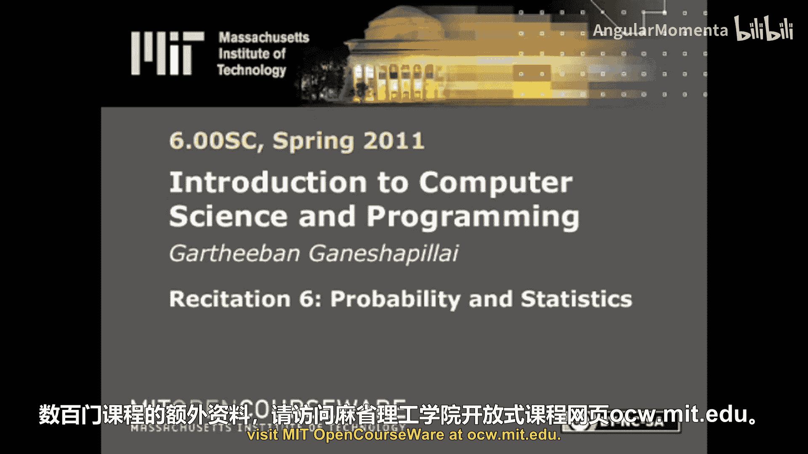
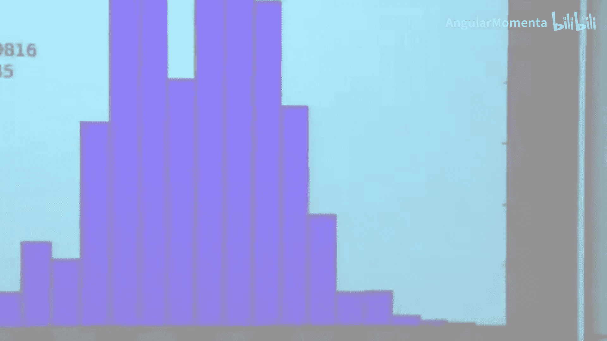
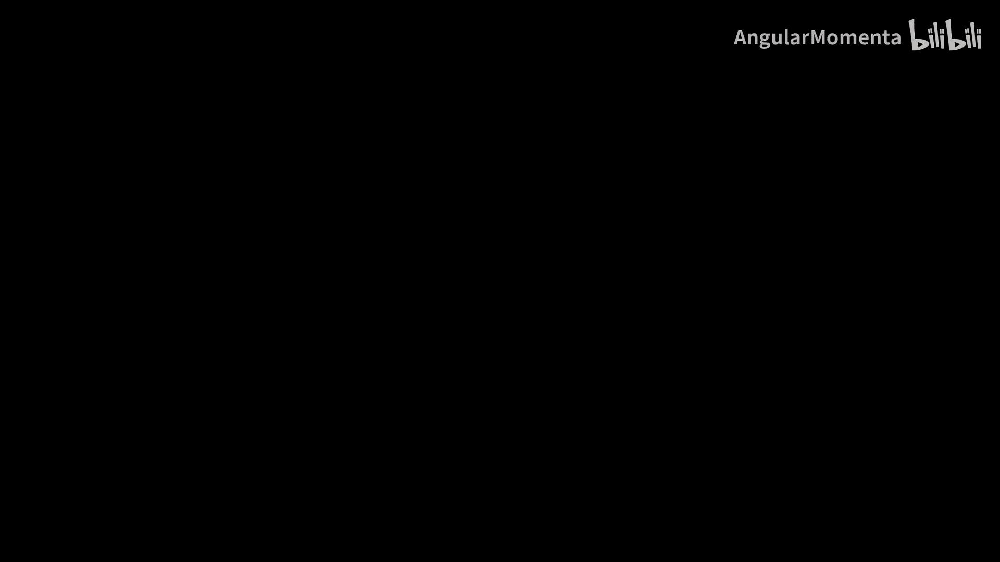

# 【麻省理工】计算机科学与编程导论 ｜ MIT 6.00SC Introduction to Computer Science and Programming p22 22 -BV1a5BZBkEP6_p22-

The following content is provided under a creative Commons license。

 Your support will help M I T Open Coseware continue to offer high quality educational resources for free。

To make a donation or view additional materials from hundreds of M T courses。

 visit M I T OpenCourseware at O C W。t M I T Eduu。

Today's focus is probability and statistics。 So let's start with probability。

Let's look at a probability of a binary variable。What do you mean by a binary variable？

It can take only two outcomes。So it can take only two values。For example， it could be 01。

Head or tail。On or off。对。So we call， we are going to call this variable A， for instance。

So a could be either H。Or a is equal to 10。But that could happen。

 That event could happen with a certain probability。So that by that， I mean。

 the probil like way of expressing the belief that the particular event could happen。

So we could assign a value to that。That is the public of a taking value H。Okay。F。So， here。

The values of A and B sorry So here the value of a can be either H or T。Which means。

It has only two possible outcomes。That's why we call it binary variable， however。

P of a is equal to H can lie anywhere from 0。And one。Including 0 n。Sorry。Even。Sorry。

 I didn't get your question。You know。Okay， we we look at that later like this particular event can take a particular probability and we will look at that particular case later。

 but in general a probability will always lie between 0 and 1。😊，So。

 and it can take any value between 0 and 1。So it's a。The range it can take is continuous。

 It's not discrete。Okay。However， the variable the value the variable can take is going to be discrete can take only AoH sorry Ht。

😊，So that's why we call it binary way。For example， take a deck of cards。Here。The value could be。

For example， if you consider only one particular suit， then it can be any one of those 13 values。

Right， so there this variable is not binary。 However。

 the probability of particularly even happening is always between 0 n。Now。

 let's look at some probabilityd theory like， like like what you asked earlier is like。

Whether they would be equal， whether the the probability of head and can be equal。So， let's。

Representing the probability A of H。This can be between 0 and 1。What is the probability of。

A not happening。So we call it by Aba。Can you give P of Fa， Can you give me P of Aba。

1 minus video fee。If there are two events happening。For example。You are throwing two coins。

Then we can consider their joint probabil。Okay。So， let's say。We have a coin A， and there's a coin B。

So this coin can take two values as well as this coin can take another two values。Sorry。😔。

We know this。A can take H with probability So assume it's unbiased， so it will be half。

All these are going to be half。What is the probability of H T？Okay， so now we are。

Concerring a joint event， P of A Z Col。And。P of b is equal to T。Okay。So in poverty。

 we represented it by something like this。P。Do you know what is be intersection？He won both。

Even wants to happen。There will be。P of free。And in this case， it's P of B。

So we could s simply say it's one fourth。Why this is possible。

It's because these two events are independent。The coin A getting head doesn't affect Co B。

 getting a tail。So it doesn't have any influence。That's why these two events are independent。

 The dependent events made complex analyze。 Let's skip them at the moment。

So we can we know like all these possibilitiesbabilities are going to be one fourth。So。

 we looked at a。Particular condition here that is A taking head and B taking tear。Wat boat。

What about the condition， What about the case where either A or B。Takes ahead。

How can we represent it。So it would be something like a is equal today。Or be Z。

At or probably at least one。 So that by that I can also represent something like this。Okay， yeah。

 this is sufficient， anyway。So what are the possible events。So， these three events could。

Give rise to this， public。It's better if we can represent this in a diagram。

 So let's go and represent this in a diagram。This is A， and this is B。Geting a pop head。In one case。

 both can take head。That is。This particular condition， intersection。We earlier looked at。So， what is。

This whole thing。That is either A gets H or B gets h。Which is this condition。We call it。PA。

 A union B。Okay。Is there。An efficient way of finding this rather than writing down all possible cases。

I then efficient way of finding P。A union B。From high school mes， probably。No idea。Okay。

PA Union B is equal to PA。To speed B。Mine SPA A intersection B， because if you consider PA。

 you would have taken this full circle。When you take PB， you would have taken this full circle。

So which means you' are counting this area twice。So you are re deducted once。Okay。Greatect。

This is the basics of the poverty。Now， actually， we looked at two events， two joint events here。

But we should have a formal way of looking at multiple events。So how can we do that。

The first way is doing it by trees。Let's say。We represent the first the outcome of the first trial。

By a branch。We can represent the outcome of the second trial by another branch from these two previous branches。

So this would be H， H。H T。H， sorry， T， H。Tat。Okay。And we know。

This could happen with probability half。So we know it's again half， half， half。好。So， this is 1 ft。

Okay。Suppose we want to do this for an outcome of， of throwing。Dce。Then probably we could。

 we would have six branches here。Okay。Which， again， forks into another36 branches。So this。

 there should be another easier。For that， we could use the second method called grid。😊。

You could simply put that in a diagram。Okay， so this is the first trial。

And this will be our second trial。So now we can represent any possible outcome on this grid。

For example， can you give me an example where。You throw the same number。In both the trials。

Then what would be the layout of it in this grid。Throwing the same number in both the trials。

Because this is the first trial。It's a second try。Can it be the diagonal。Right。

If you want to calculate the probability。We know the probability is。

The ratio between the possible outcomes sorry， the ratio between。

The outcomes we expect over the all possible outcomes。

So here we know there will be six instances in this in this highlighted area。Compared it。

36 total possibilities。So itll be simply 6 by 36。Okay。How can you find the probability of getting。

A cuumulative total of6。Then again， it will be very simple。It could be1 phi。2，4。3，3，4，2。1， for。Right。

So it'll be5hi by。36。Okay。So either by using trees or grid， you can easily find the probabilities。

Okay。Now， like， let's look at few concrete examples。Let's see。Suppose we are throwing three coins。

Then what is the probability of。One particular outcome。In that trial。In all three trials。

 what is the pur assuming that these are unbiased coins。

What is the probability of one particular outcome which how many possible outcomes are there？

If you are trying three coins。Consider this tree。First， it splits into two。

 then it splits into four then。8ight。Right， okay， so there are8 possible outcomes。So。

 each outcome will have the probability 18。So what is the probability of head appearing exactly twice？

How can you do that？Of course， you can ride the tree and count。

What is the easy way of doing that since we know this count。

Since we know this probability of particularly even happening。

How can we come up with the probability of getting exactly two heads？It could be head head or tail。

 So this is by enumerating all possible outcomes， so it could have been head head tail。

Where we put the tail only at the end。It could have been head， tail head。

Or it could have been tail had。In these three cases。

You are getting only you are getting exactly two heads， so we are enumerating all possible outcomes。

And we know each possible outcome would take the probability of 18。

So the tall probability here is 308。Okay， so this is one way of handling a probability question。

You can do that only because these are independent events and you can sum them。😊，Okay。

 well come to that later。呃。Suppose we are rolling two four sided dice。And assuming they are fair。

How many possible outcomes are there。2 for sided dice。 And assuming that each of them are fair。

 that means unbiased。How many possible outcomes are there。Considersider this three。First。

 it branches into four。Okay。In the first trial， there it's a four sided dice。

 so there are four possible outcomes。So it branches into four。Okay。Then each branch will， in turn。

 fork into another four branches。 So there are totally 16 outcomes。Okay。

 so what is the probability of rolling a2 and a 3。What is the probability of rolling a 2 and a 3。

 not in the particular not in the given order？Not in the given order。Can anyone give the answer。Okay。

 let's say。 so we had to roll a two and a three。So which means it could have been 2，3， or 3，2。

And we know the probability of each event is 116th。So it will be。 this will be 1，16th and。

This will be 1，16th。So， the tall probability。1，8。What is the probability of。

Getting the sum of the roles。A odd number。What is the probability of getting an odd number as sum of the roles。

Now， this is getting bit tricky。Because now it's it might be a bit harder to enumerate all possible kind of cases。

So how can we do that？There should be a shortcut。Sorry，It can go the order even， right。

 So it would be half。 Okay， This is another trick we might be able to use to get the answers quickly。

😊，What is the probability of the first row being equal to the second row。In the same line。

 you can think。What is the probability of getting the first row equal to the second row。

 It's quite similar to this。Any ideas？It's a four sided dice。 There are four possible outcomes。

This is one case where it could be 1，1， or it could be 2，2， or 3，3 or 44。

 And if it' is like insider dice， it will be n。Right。So if it's inside it dies。

There are impossible N outcomes desired， and there are totally n by n outcomes。Right。

 so we get one away。B。What is the probability of rolling what is the probability of at least。

One role equal to 4。At least one row equal to 4。This is very interesting。

 These type of questions you'll get in the piece sets and all。Probably in questionta。

What is the probability of caring？At least one role equal to 4。Okay。

 so what are the possible outcomes， First role。这。Could be a4。And the second role。Could be anything。

Right。Or it could be four。 And the first all could have been anything。Or both could have been four。

 but we would consider that that here as well。😊，Okay。

So what we had to do is we had to calculate this probability and this probability add them and deduct this because they should have been double counted。

It's quite like this。This intersection， we want to remove it and we want to find the junior。Okay。

So what is this perbate？Since we don't care about the second role。

 we have to care only about the first role we first role getting four， which is one fourth。

And this is one fourth。Similarly。And this is one fourth by one fourth， so 16。

So it'll be half minus1 over 60。And when you give out， when you give the answers， if it's hard。

 you can just leave it like this。So this is what we call giving the answers as formula instead of giving exact fractions。

 because sometimes it might be hard to find the fraction。

 Supp it's something like one over say 2 to 5 into 3 to2， something like this over say 5。

You' are not supposed to like give the exact value in the disimal or even the functionss。

 You can give such formulas。You can give something like this， too。

To give the inverse probabilityity of that not happening。Okay。Let's see。

 let's move into a little bit more complicated example。A pack of cards。

What is the probability of getting N A anyone？One out of two。ideat is， yes， just as。4 hour 52。Yes。

Or if you consider one suit， it would have been like one or 13。

 right you could have considered one suit and out of like O。😊，It's the same， same analysis， right。

 okay。What is the probability of getting a specific card， which means say a S of hearts。

It's what she said。 Yeah，10，52。What is the probability of not getting an Ace。Sorry。1 over 3。Okay。

Okay， this is where we make use of the inverse probability。Okay。

 so that will come into play very often。Okay， now let's get into two deck of playing cards。Okay。

What is a sample size， sorry。What is a sample size。Of drawing cards from two deck of cards。

 two cards。 Actually， we are going to draw two cards from two different decks。Sorry。Okay。

What is the probability What is the sample size of trying a cart from one deck。

There are 52 possible outcomes。So there are not for each outcome here。 We have 52 outcomes there。

 right， So it's 52 by 52。 It's like the tree。 But here， we have 52 branches。So eventually。

 you will have 52 by 52。 This is where you cant enumerate all possible cases。

 So you should have a way to find the final probability。Okay。Okay， so in this case。

 what is the probability of getting at least one is。

What is the probability of getting at least one is？😊，This is， again， similar to this case。

Remember this diagram， it's called when diagram。Remember this。

So what is the probability of getting at least one s。

Which means it could have you could have got this from the first deck or the second deck。😊，Or both。

But ificating from both three had to deduct it， because otherwise。

 you would doubt you would have double counted it。Okay。So it is getting the。

 getting an as from the first deck is one over 13， second deck，1 over 13。

 getting from from both is one over 52 by 52。 sorry， one over。13 by one over 13。Here。Sorry。Yeah。

 that's why I explained earlier。You are trying two。 You are doing two trials。

You could have got the A from here and describe anything。You could have got a S from here。

 and this could have been anything。 You could have S from both。Okay。

So you should add these two permits because we need a case where。At least one card is a。

But the parliamentist， this could have happened here and here。That's why we deduct。

What is the probability of getting near the card。What is the probability of need card being an A S。

1 minus this， okay， exactly。Okay， you' are getting comfortable with the inverse probability now。

What is the permit of two cards？From the same car suit。

What is the probability of getting two cards from the same suit。Now， it's getting interesting。

2 cards from the same suit。 So how can we think about this。Of course， you can an all。

Possible cases and count。 we don't want to do that。Okay。

We are going to use the grid here to visualize this。Okay。

It could have been a space or hearts or clubs or diamond。Okay。So we want two cards are the same suit。

 right？So it's one， sorry，4 over 16 possible outcomes。They see that。

So say we are using all the tools available at our disposal， trees， grades。😊，Counting。

When diagrams investverse probability， yeah， you should be able to do that。

To get the answers quickly because you could have actually done you could have done something like this too。

 but it will take more time， right， So this would be a simpler way of visualizing things。Okay。

What is the probability of。Getting neither card a diamond nor cloud。Neither card is diamond Nora。

That is tricky。But since we have this。Graade， we can easily visualize that。😊，Okay。

So if neither card is diamond nor club， then it could have been only these two values， right？

Which is again。460。So there are four possible cases。Okay。Okay。So， what is。What is the summary。

 What is the take home message here。In probabilityb。

The probability of the belief or the way of expressing the belief of。

 how many of of are particularly even happening。Okay。Now。

There could be several possible outcomes out of those possible outcomes。

 You have certain number of desired outcomes。How can can you find that？

You can either anate all of them。 You can put them in tree， or you can put them in a grid。

 or you can use some sort of Ven diagram and like come up， come up with some sort of analysis。 Okay。

 here we start with our belief that。The coin is unbiased。

 or we have a fair chance of drawing any card from the pe of cards。

 So like we have like all these unbiased beliefs or sorry beliefs about the characteristics of each trial。

Okay， so we start from that。Then。We。We find the probability。

Of particularly even happening in certain number of trials。But。

What if you don't have the knowledge about the coin。But if we dont know whether it is fair or not。

 but if we dont know p of a is equal to H is equal to half。Suppose we don't know that。

 Supp it's only P。How can we find it？What you could do is。You could simulate this。 You can throw。

Coins several times and count the tall number of heads you get。Okay。

So it could be n of heads or N trial。Will give you the P， right？Okay。

This is a way of finding the probabilities through certain number of trials。

It's like simulating the experiments。 It's called Monte Carlo simulation。And using that。

 we try to find a particular parameter of the model。

You know like how they actually found the value of pi at the beginning。Pi。It's again。

 using a Monte colorlo simulation， what you could do is。For the given。Radius。You can， actually。

Check whether it flies within a circle or not。 you can simulate the mod simulation and with this given this radius。

You can come up with a particular location at random。And check with it within this。Boundary or not。

Okay。So。Then you know the outcome， you know the outcomes， right？Suppose this is。And。

A and the tall outcome is ta N T。This gives you the area， right？

We know this is R square and this is pi。Ass。Sorry。😔，Okay。Okay， wait this is four square。 This is20。

 right。So using this， you can easily calculate the pi。Okay。

So now like since we are going to come up with these parameters through repeating the trials。

 we need to have a standardized way of finding these parameters。 we cant simply say this right， Okay。

 take take this example。You know this MIT Charlesrs， right。

 a sha arriving at the right time or the time difference between the arrival and the actual quarter time can be like put in a graph。

So if you put that。We spread around 0， right， probably， or we hope so。Okay。No。So from this。

 we can see it。The it C actually， it's the mean of this simulation。 will give you the。

Expected difference in the time。Do expect a difference in the arrival time from the actual credit time。

Okay。And we hope。This expectation to be 0。We called it mean。It means it's taking the average。But。

This distribution。Might actually give you some information， some extra information as well。

That is how well we can actually believe this， how， how much we can rely on this。

 if the spread is greater， something like this。😊，Then probably you might actually not trust the system。

 right， although the mean is0。It could either come early or late， right， So which means it's useless。

Okay。Similarly， we can actually okay in this case。😊，We have a spread around mean 0。But if you take。

The score， the marks you get for 600。It could be something like this。 It's not centered around 0。

 right。Hopefully， it's probably say 50。Then。We actually want the spread to be small or large。

We were want the spread to be large。Because we want to like distinguish the levels， right。

 the students level of understanding，600。Anyway。So， this spread determines。What is the variation？

Percent in the distribution of this course。We measure that by a variable cost standard deviation。

In this case。This particular sample will be different from its mean。By a particular value， right。

We can。Express that as Xci。Minus it's mean。Let's call the main view。So this will be the difference。

Standard deviation is summing up all the differences。But the problem is。

 when you sum up the defenses， it will be 0， right。The tall summation of the differences will be 0。

 because that's how you get the mean。Because if you， if you expand this。

 it would be something like this， right。Which will be N mu。😔，Should we equal 0。

So we have to somehow actually take the differences into account。 So let's scale this。

So now it will be it will no longer be 0。Now， this gives you。The differences。

So the square sum of the differences average reached across all the samples。We call this variance。

And the scar root of variance。Is standard deviation。Okay。No。Having a standard deviation。

So we know the standard deviation tells you how spread the distribution is。

But can we actually rely only on the China deviation to determine the consistency of some event。K we。

Probably not。 Supp take a class where this supposed to take two examples。 One is the scores 50。

 and suppose the standard division is-10 plus 10。Okay。So the standard deviation is 10 here。

 Supp lies in this for。Consider another example。The weight， the weight of the paper。

 like saying at M I T。And suppose， it's centered around。Hundred and 50。Okay， now。

 if the standard deviation is say。10。Then the standard deviation 10 here and the standard deviation 10 here。

Don't convey the same message。Okay。So we need to have a different way of。哦。Expressing。

The consistency of a distribution。So， we represented by。Coeicient。Of variation。

Which is equal to standard deviation。Divided by mean。Now， here it will be。

10 over 50 here it will be 50， sorry，10 over 50。😔，So we know this is more consistent than this。

The weights of the students at MIT。It's more consistent than the marks you might get or you get。

For 600。 It might be true。Okay。Now， what is the use of the standard distribution sorry standard deviation or how can you use them？

Okay。Let's look at this graph。We are supposed to mean 0。And the standard deviation is safe。F。Okay。

Consider another example， where standard deviation is 10。It might have been like this。Okay。

 now before that， let me。Sort of tigress a little bit。So I can expand this better。

We can take the outcome of a particular event。As a sample in our distribution。

So suppose you are throwing a die。So you get an outcome。

You can represent that outcome as a distribution。Okay。So， here。There's x， which can take。1，2，6，6。

And we can represent X I as the sample point in our distribution。So I don't know。

 it might be uniform。Baubably。We hope。 so it's with  one6 probability。

We will always take one of these values。Okay。But this might not be the case with all events。Alright。

Okay。So what was， what I'm trying to say here is you can actually represent the outcome of the trial in the distribution。

Or you can also represent the probability of something happening in a distribution。How， how。

 how does it work。In this case， we throw a dice， we get an outcome， we go and put it in the X axis。

 It could be between one and6。And it takes this distribution。In addition， what what you could do is。

You could have say 100 trials， say you throw you throw a coin， you take 100 trials。

 you get the mean of you get the probability of getting ahead and you have that mean， right？

So probability of getting had 400 trials。Say051。You do another 100 trials， you get another one。

So you have now another distribution。 So there is a distribution of probabilityities。

So you can have a distribution of perbaities， or you can have a distribution for the events。

We handled these two cases in the PSet。So probably you should be able to distinguish those two。

Anyway。So here in this particular example。Let's take， this as our mu。

This lets take this as our standard deviation and for the first distribution。

Let's take the standard deviation to be phi。The standard division is great。 It's going to be。

More spare， it's it's going to be more distributed than the former。So here。

 say the standard division is 10。And standard division is a way of expressing how many items。

 How many samples are going to lie within。Those particular boundaries。So for a normal distribution。

 we know we know the exact area， exact probability of things happening。If this is a mu。

We know within the first standard deviation。There will be 68 percentage。Of events lie in that area。

Within two standard deviations。Okay， one standard deviation。68 percentage。

Two standard deviations on either site。It's going to be 95。

Three standard deviations is going to be 99 percentage。So。

If suppose you conducteded so many trials and you get the values。

And and for that in the distribution suppose mean is 10 and the standard deviation is say1。Okay。

So now， with 99 percentage confidence， we can say。Then the outcome of the next trial is going to be withwe。

 what？7 and 30。Right。So this is where finding the distribution and its standard deviation helps us giving a conference interval。

Giving a probability， expressing our belief of that particular event happening。Okay。

We will look at a few examples because you might need this your preset。

So this particular function you have already seen。In the lecture。Okay。But。

We need to understand this particular part。Suppose you have a probability of something happening。

Okay， supposeupp you estimate the probability of something happening。

 Supp youre given the coin is biased。Okay。S， sorry， unbiased。 So we know P of H is equal to half。

How can we simulate an outcome？How can you simulate an outcome and see whether its a head or tape with this particular probability。

We do that by calling this function， random， du， random。

Which gives which is going to give you random value between 0 and 1。

And you are going to check whether it's below this or not。Fits below this。

 lets we can take it as head。If it is not， it is 10 and this will happen with probability half。

Because the random function is going to return a value between 0 and 1。With equal probabilities。

 it's uniform probil。So to simulate a high to tale， you call that function。 You。

 you write the expression like that。Okay。Then。If you consider this example。

For certain number of flips。We simulate the event and we count the number of heads we obtain。Okay。

And also from that， you can calculate the number of tails as well， right。

 if you know the total flips， you know the number of tails。Using that， we are taking two ratios。Now。

 the ratio between the heads and tails and the difference between heads and tails。

We are doing this for certain number of trials。And we are going to take the mean and standard deviation of these trials。

Okay。So what is here in the， in the in， in our。Distribution。What are we considering？

In what is going to build our distribution here。The ratios， right， the ratios are events。

And we simulated certain number of trials to get those events。

Then if only if you simulate certain number of trials。

 you can actually summarize the outcome of the events in mean and standard deviation。

This is exactly like the difference in the the times of the bus arriving。And theyre called at times。

 okay。Let's check this example。Let's blood the and。It's going to take a while。Okay。

 there' is another thing we want to explain here。Because since we are going to plot。

 we are going to use pile app extensively and plot graphs。

You need to puttyro and labels to all the plots you you are generating。Plus。

 you can use this text to actually put the text in the graph。 we will show that in a while。Plus。

Here sorry。If you want to change the axis to lock， lock scale。

 you can call this command at the end after calling the plot。

Because you might sometimes need to change the axis to log scale in x and y axis。So。

So this is the mean heads versus stas。And if you can see。The mean。Tends to be one when we have。

Large number of flips。So two， get the consistency， we need to simulate large number of trials。

then only were tend to be close to the me。Okay。So this is we this is sort of way of checking the evolution of the series by。

 by actually doing it for a certain number of flips at every time。So it's quite like a scatter plot。

The scatter plot。Is like plotting the outcomes of experiments。Suppose it's x1 and x2。In a graph。

So we are going So for example， suppose you have two outcomes。 sorry。

 suppose you have a variable and the variable course is an outcome。

AProb of the coin flip So a P of fetch， and it can result in certain number of heads appear。Say。

 Norwich。Now you can do a scatter plot between these two variables。And it will be probably spread。

 but we know。That if you increase the probability of heads。

 the per number of heads is going to increase as well。 So it would be probably something like this。

From this， we can assume that its linear or something like that。

 but the scatter plot is actually representing the outcomes of the trial versus some of the variable。

In the graph。 and visualize it。Okay。And let me show the last graph and we'll be done with that。

So this， again， we are， we actually now instead of putting a scatter plot， we actually。

Giving the distribution。As a histogram。And。Pending putting a text box in the graph。

This might be useful if to if you want to display something on your graph。

I guess we will be uploading the code to the site so you can check the code if you want。S。😔。

See you next week。

