# 【麻省理工】计算机科学与编程导论 ｜ MIT 6.00SC Introduction to Computer Science and Programming p23 23 -BV1a5BZBkEP6_p23-

The following content is provided under a creative Commons license。

 Your support will help M I T Open Coseware continue to offer high quality educational resources for free。

To make a donation or view additional materials from hundreds of M T courses。

 visit M T OpenCseware at O C W dot M I T dot E Du。

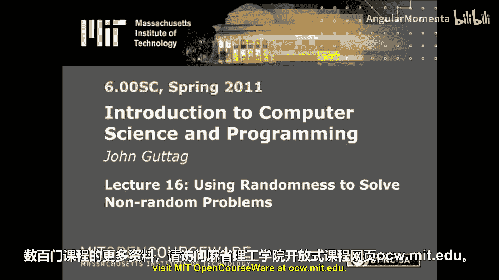

He ended up last Thursday's lectures， talking about Gaussian distributions。As he said。

 one of the interesting things about a Gaussian is it can be fully characterized by its mean and its standard deviation。

And this concept of being able to take a， a curve。And characterize it with a small number of parameters。

Is something we'll continue to see as a very important way of。

 of looking at modeling physical systems。And， in fact。

 that is the part of the term that we've entered。 And it's the part of the term。

 We'll spend a lot of time on it。 And the whole issue is， how do we construct。Computational models。

That will help us understand the real world。嗯。When we can。

 we love to model distributions as Gaussians are normal because they're so nicely characterized。

 We have nice rules of thumb that tell us how close things lie to the mean， etctera。😊。

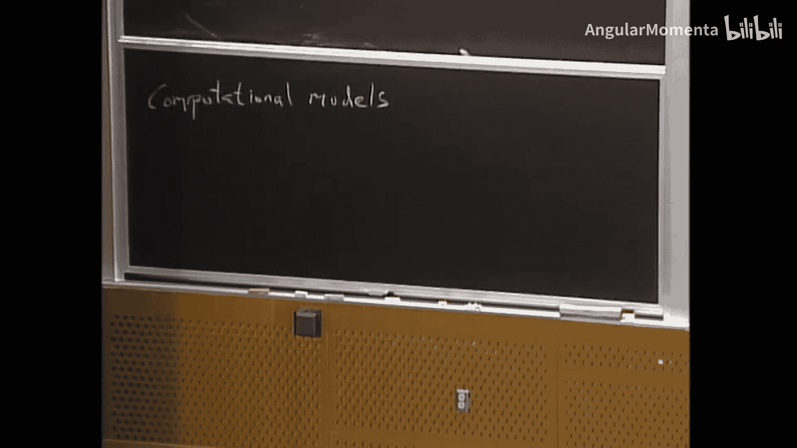

However。It's important to understand that if something is not actually normally distributed and we pretend it is。

 we can get very misleading results out of our model。

So let's think about the fact that not all distributions are normal。

 So consider rolling a single die。Each of the six outcomes is equally probable。

So we would not expect to see a peak， say， at 3 or 4 and a trough at one。

A3 or a four is the same probability as one。

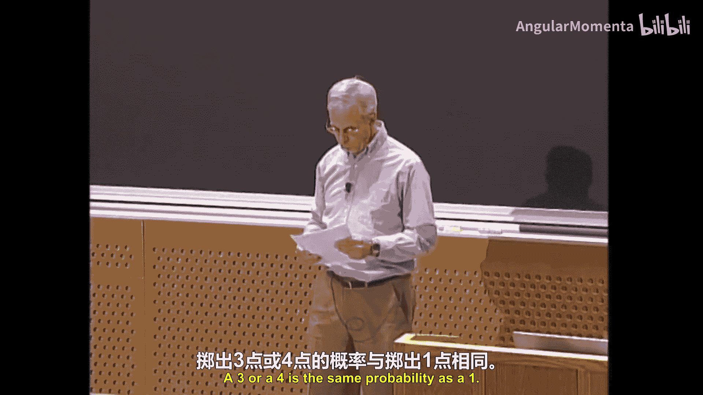

嗯。Similarly， if one thinks about the Massachusetts State lottery or any fair lottery。

The probability of each number coming up。Is the same。So it would be a flat line。

 if you had a million numbers， the probability of each number is one over a million。

 And so if you plotted the probability of each number again， you'd get a flat line。

Such distributions are called uniform。Each result。Is equally probable。

We can fully characterize a uniform distribution with a single parameter。It's range。 I tell you。

 it ranges over  one to a million。 That's all you need to know to what to know what the distribution looks like。

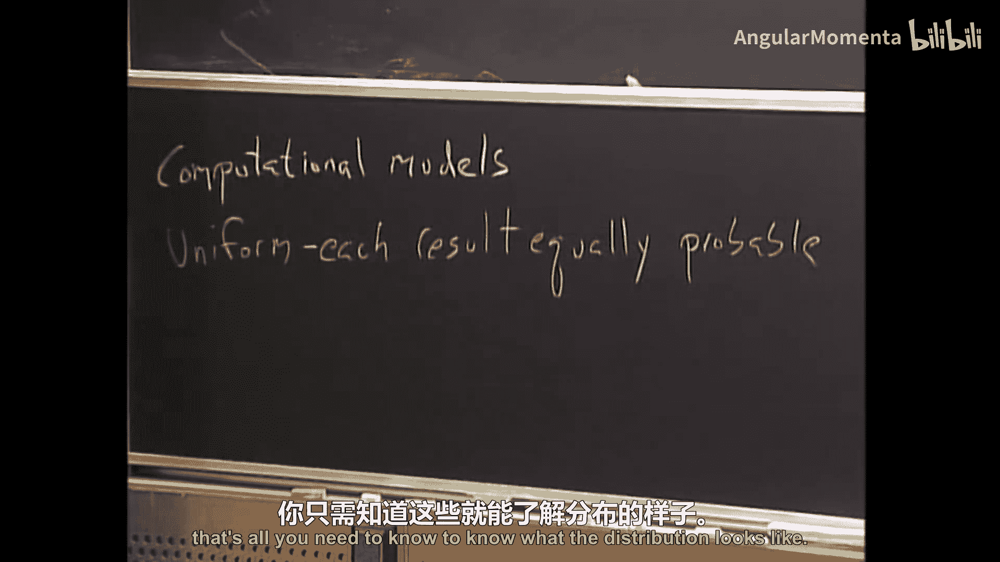

So they're even simpler than normal distributions。Uniform distributions occur quite often in games devised by humans。

But almost never in nature。And then。Typically， theyre not very useful for modeling complex systems。

Right， we have to work hard to invent something that's normal。

 Most things are not naturally that way。

That's right to invent things that are uniform。 normalmal， as we saw last time。

 occurs all the time in nature。The other thing that occurs quite frequently。

Are exponential distributions。They're used in a lot of different ways。For example。

 people who are trying to plan things like highway systems。

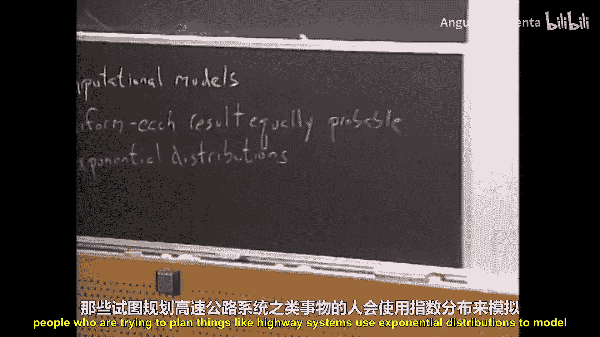

Use exponential distributions to model into arrival times。How much time there is between each car。

 say， entering the mass turnpike。We'll see many other examples of them。The key thing about them。

Is they have the property of being memoryless。They are， in fact， the only continuous distribution。

That are memoryless。So consider， let's look at an example with which some of you are more familiar than you want to be。

The concentration of a drug in the human body。For those who are watching an open course where it's not because all the students are drug users。

 It's because they're working in a problem set that involves modeling drugs in the human body。嗯。So。

 assume。But I don't know how many of you are drug users，right。Assume that at each time step。

 each molecule has a probability P of being cleared by the body。The system is memoryless。

In the sense that at each step， the probability of a particular molecule being cleared is independent of what happened at the previous steps。

So the fact that a molecule didn't get cleared at time T。Has no impact on whether and well。

 or not it will be cleared at time T 1。The probability doesn't go up。As it doesn't get cleared。

So its independent of the previous steps。So， at time1。Time T equals 1。

 What's the probability of the molecule still being in the human body。

If the probability of being cleared at each step is P。It's 1 minus P。Right。

 so if the probability of being cleared was 05 at each time step。

 the time that it still exists after the first time step is 1-05， I。e。 。5。

So what's the probability of it still being in the human body at time T equals 2。Well。

 it's that it wasn't cleared at time1。Since it's memoryless。

 whether or not it's clear a time 2 is also one over P。

And so it existing still after two steps is going to be one minus p squared。

We saw that with independent probabilities。And the nice thing about working with exponential distributions is we know that the probabilities are independent。

More generally， it's still being in the body at time。 T is going be 1 minus P。To the Qi。

So we have a nice， closed form solution。It will give us the probability of each。

 each molecule surviving until time T。All right。So now let's look at the question of。

 suppose that at time t equals 0。

There are M molecules。Or M 0 molecules。And now we can ask。

 how many molecules are there likely to be at any time T。Well。

 let's write a little program to look at that。So that's this program clear。

We'll start with n the number of molecules。 The probability of clearing it at each step and the number of steps。

And we'll keep track of the norm remaining。 So at the beginning。We have N molecules remaining。

And then for T and range steps。We're just going multiply M。

And the number we started with times the probability of each molecule still existing。And then。

 we'll app plotla it。And make sense。So this is a tiny bit of code that basically implements that formula over on the board。

Let's run it。And we'll run it starting with 1000 molecules。

 The probability each being cleared of 001。 And we'll look at 500 time steps。嗯。All right。

 this is kind of interesting。We're getting a straight line。That doesn't look like an exponential。

 does it。Or does it。 Why do we have a straight line here。Somebody。Because I used a semi log access。

So let's look at it now， without that。We now see something that really does look like exponential decay。

It drops very quickly， in the beginning。And then it asymptotes towards 0。 But， of course。

 it never quite gets there。In a continuous model。If we had a discrete model。

We would eventually have to get to 0 because that last molecule would either get cleared or not。

 But in a continuous world， which is， in this case， probably not a good model or not a perfect model。

 I should say， because it allows us to have a quarter of a molecule there。

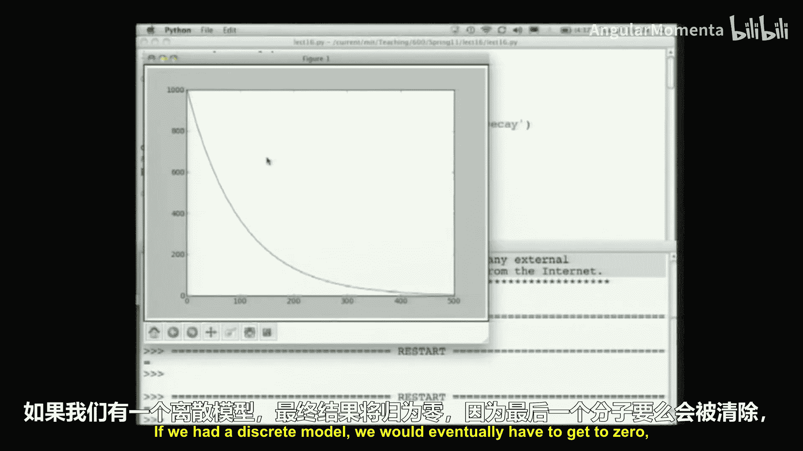

Which we kind of know is physiologically nonsense。Biochemically nonsense。

But you can see we get this exponential decay。But as we saw previously， if we plot an exponential。

On a log axis。As the math would tell us， we get a straight line。And that， in fact。

 is a very simple and nice way to see whether you have an exponential distribution。

Put it on a log axis。 See if it's straight。Alright。嗯。It's a good trick。 And one we use a lot。Okay。嗯。

So there， I took the physical model I described and derived through a little bit of math。

 what the result should be。

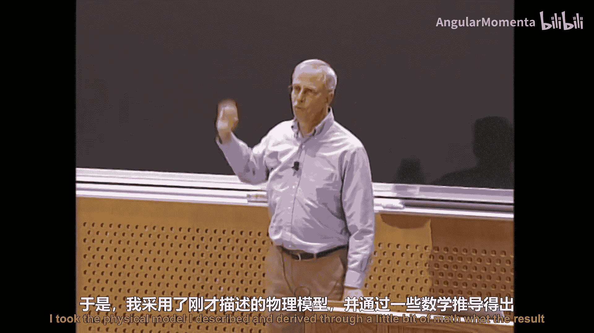

And implemented some code to give us。A plot of what that told us。

Let's look at a different way of doing it。I could have， instead。

Written a Monte Carlo simulation to do the same kind of thing。So here。

 instead of working out the probabilities。I just tried to write some code that exactly mimicked。

The physical process that I was talking about。So instead of knowing that I could just look at1 minus P to the T at each step。

I cleared some molecules。Okay， I just used random dot random。

 If I came out with something less than the clear probability。I got rid of that molecule。

 and I did that for each molecule， deciding whether or not it should be cleared。Okay。

For molecule M in range。Looking at all the remaining molecules。 I either clear one or I don't。

And then， I can plot that。So， let's look what happens。If。I compare the two results。

So I'm going do the original analytical model of clear。And then the simulation model of clearing。

And see what I get。Well， much to my relief。I get kind of the same curve， not exactly。

You'll notice that the blue curve， the analytical model is a beautiful， smooth curve。

Whereas the red curve has got a little bit of jas。It's clearly very similar to the blue curve。

 but not identical。嗯。Doesn't surprise me。 Theres some randomness in there。And， in fact。

 I could have gotten unlucky and gotten something that didn't look like the blue curve。

But given the sample size， that would have been。Quite surprising。嗯。Which of these two curves。

I shouldn't say which of these two curves， Which of these two models。

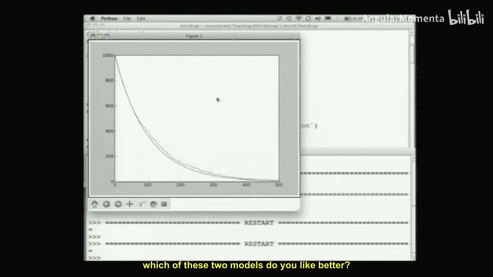

Do you like better。So we've got two models。 We've got 1。 I'll call the。Analytic model。

And what I'll call the simulation model。Both show exponential decay。That is to say。

 the number of molecules declines exponentially quite quickly。But， they're not quite identical。So。

Which would we prefer， Which would you prefer。There is no right answer for this。Just for fun。

 I'll ask for a poll who prefers the analytical model。Who prefers the exp the simulation。Alright。

 somebody who prefers the analytical。 Tell me why。It looks a lot nicer。Well。

 all right it looks a lot nicer。That's kind of。Human nature to prefer something that looks prettier。

 on the other hand。What we're really interested in is the question of not aesthetics， but。

Fidelity to the actual physical situation。A straight line might look even nicer。

 but it wouldn't be accurate。嗯。So when we think about evaluating a model。

 what we really should be asking， I think are， are two questions。One is fidelity。And in that。

Another way to think about that is credibility。Typically。

 we're creating a model because we don't know the actual answer。

And we're trying to see what might actually happen if we say ran a physical experiment。

And so we have to ask our， the question of， do we believe the results the model are giving us。

And so that sort of boils down to。Not a question of mathematics， but a question of reasoning。

 Can we look at the model and convince ourselves that it is accurate。And the other question is。

 utility。And I can think about that， as。In some sense， what questions。Are answerable with the model。

So the first one is pretty much a question of personal preference。And for this particular simulation。

 which is pretty simple for this particular model， it's hard to argue that one is more believable than the other。

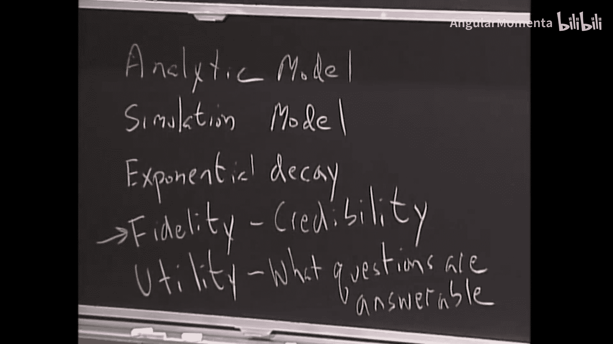

嗯。I might argue the second is more believable because it's a direct implementation of the physical system。

 I didn't rely on my math being right。But the math is pretty simple here。

What's I think more apparent is there， in this case。

 there is some additional utility offered by the simulation model。

And it's often true of that simulation models。That we can ask what if questions。

Because we can easily change the model to be slightly different in ways that is usually harder for an analytic model。

For example。Suppose。These drug molecules had this peculiar property that every 100 time steps they could clone themselves。

And so every molecule that was there became two molecules。Unlikely for the drug， not so unlikely for。

 say， a bacterium or a virus， as you've seen。

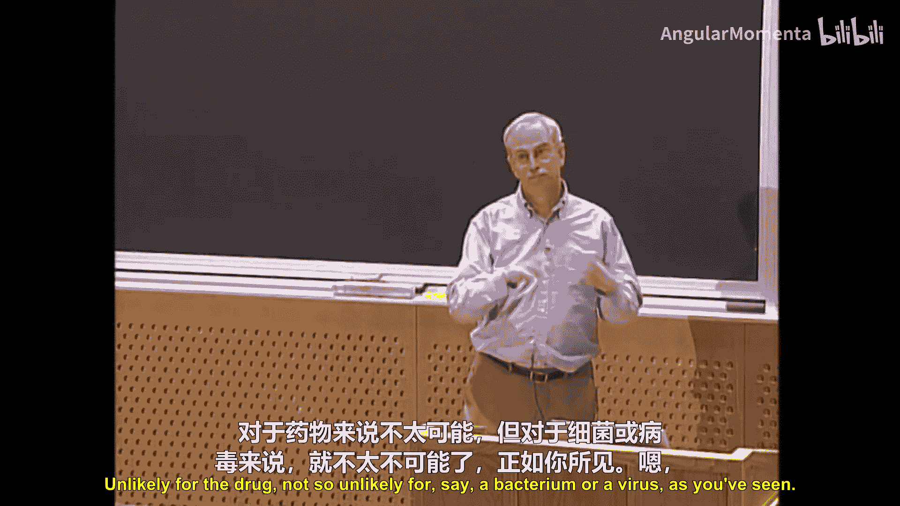

Well， a little hard to figure out how to do the probabilities。In the case that that happens。

 because we'll no longer get this beautiful， simple， exponential decay。

But quite easy to think about how we would change the simulation model。

Which is what I have done here。So。I've said here， if time is not equal to 0 and time is easilyly。

 evenly divisible by 100。Then I'm just going to double the number of molecules。

every living molecule will clone itself。And now we'll see what we get。

Where we get this rather peculiar looking saw tooooth distribution。We still have overall。

 an exponential decay。But we see every once in a while， it jumps up， and then it comes down。

It's not so easy to write a simple closed form formula that describes this。

But very easy to produce a simulation model that gives us some insight。To what's happening here。

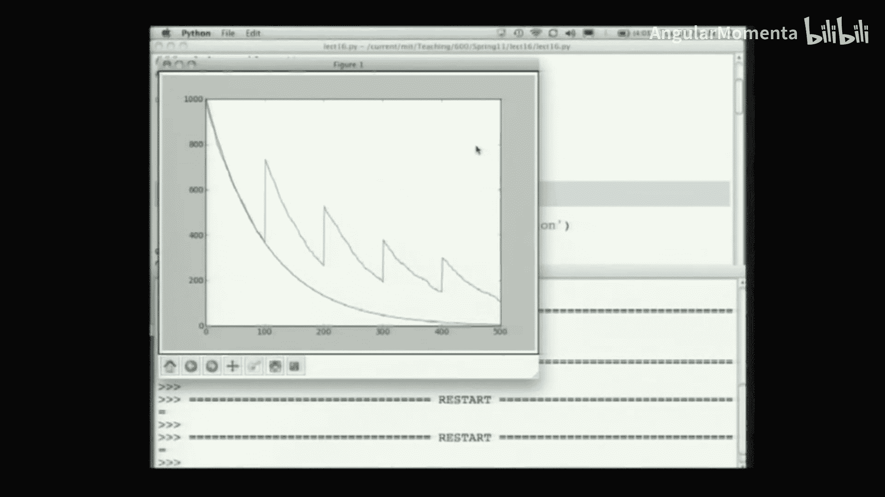

And that's， I think， one of the great attractions of simulation modeling。

I is we get to do this sort of thing。Many， many physical systems exhibit exponential decay or exponential growth。

For example， well， people in Japan now are very interested in half life of various radioactive particles。

And when we talk about half life， we mean that there is exponential decay in the radioactivity。

That's what half life is。 So people are looking at what is the half life of iodine。

 say versus other radioactive particles。We also see exponential growth a lot。

 I used to have a swimming pool， which I have to maintain。

 And I realized if I let the algae get out of control in the pool。

It went from having very little algae to having a lot of algae very quickly。

Because the algae doubles every period。 And so all of a sudden， it takes off。

So exponential growth is exponential decay are important things。 We see them all the time。嗯。

People use the word very carelessly when they mean quick growth。 They say exponential。 But。

 of course， it has a very specific meaning。Okay， we've now。For the moment。

 at least finished our short venture into probability and distributions。

 Well come back to it a little bit when we talk about how to lie with statistics。

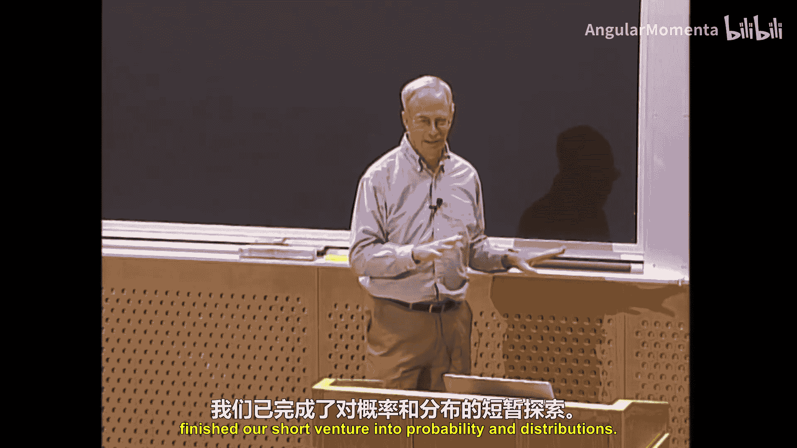

But before we do that。嗯。Before we leave probability for a while， just for fun， I want to。

Poposed to one of these probability problems that hurts people's heads。It's a very popular one。

How many people here have heard of the Monty Hall problem。Okay， a lot of you。 So as we play the game。

 those of you who know the answer， I'll ask your forbearance not to， to blurt it out。

So it's a wonderful problem。It's so exciting that people have written。

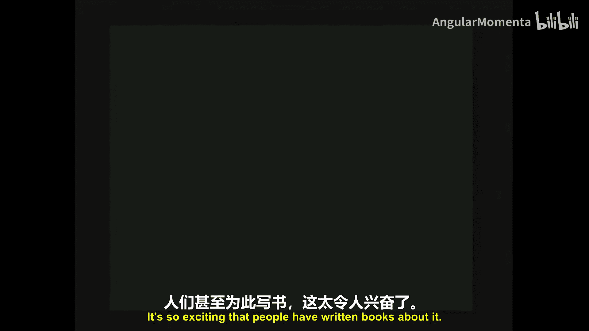

Books about it。嗯。

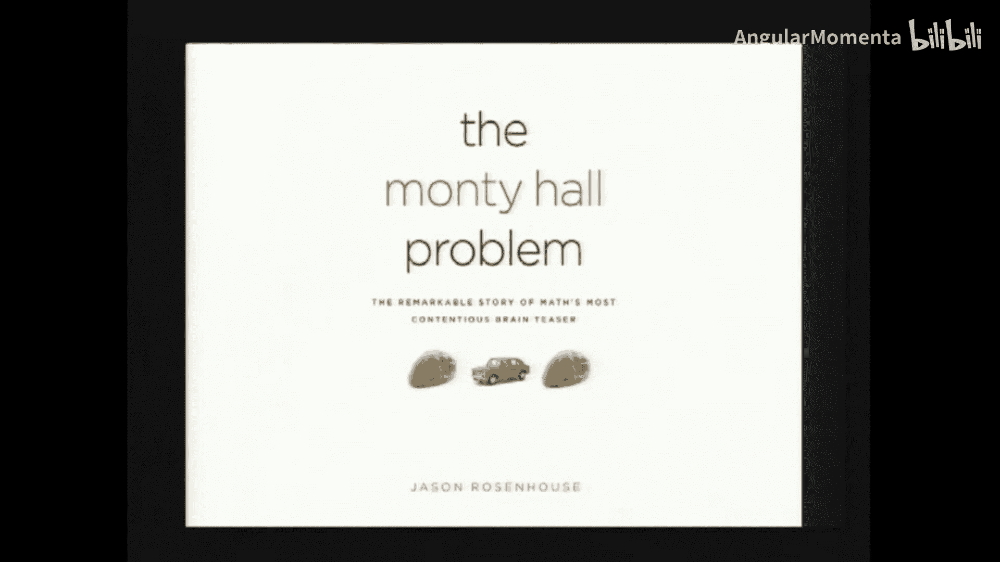

So here's how it works。This is from a game show called， I think。

 let's make a deal with a To Monty Hall who did it forever。

 So the way it works is you start with three doors。Behind one of the doors is a great prize。

 for example， an automobile。Behind each of the other doors is a booby prize， typically a goat。

I don't know why people don't like goats， but apparently， they don't。

So the way it works is Monty invites someone from the audience。

 chosen on the basis of their outlandish costume。And they come down and they're told what wonderful prize is behind one of the doors。

And then they're asked to choose a door。So the person might choose a door and say。

 I'll choose door number one。Monty then opens one of the other two doors。

He knows which doors have the goats and which door has the car。 He opens a door with a goat。

So now there are two doors left。And he asked the contestant。Do you want to switch。

 Do you want to stick with door 1， or would you like to switch to door 2。And the Mon Hall problem is。

What should she do？So， and the audience will always shout out advice。

 So I do have a simulation of that。 I'd like to run。 I need three people to volunteer to be doors。

Come on， Three doors。 It's not so hard。 Come on down。

And I need one person to volunteer to be the contestant。Is anybody in a costume here？I don't know。

 Mitch is kind of in one， but all right。 I needed a contestant。All right， you were door number two。

You are door number one， you are door number three。A contestant， please。

There's a dollar in one of these。 You can actually win something of value。 Allright。

 we have a contestant coming down。Oh， we have two contestants coming down。All right。The aisle wins。

All right， choose a door。You choose door number  two。 Allright， let us open door number one。

 and let's see what's in door number one。Show it to the class。It is a goat。Now， you have a choice。

 You can stick with your original decision， or you can switch to door number 3。Suggestions。No。すごい。

All right。He is going to stick with door number two。Let us open door number two。She wins a dollar。

 It is yours。Don't spend it all at once。Thank you everybody all right。😊。

Was she lucky or was she smart， is the question。Does it matter？There was。

 this was a subject of enormous debate in the mathematical community。In 1991。

Praade magazine published a correct solution to the problem。And approximately 10000 readers。

 including 1000 with PhDs in mathematics， wrote to parade telling them they had published the wrong solution。

And the debate royaliled on。 So who thinks she was lucky and who thinks it actually matters whether you switch。

Who thinks it matters those who don't know the problem， Who thinks it doesn't matter。Alright。

 it doesn't matter Win by a small margin。And in fact， that's what the readers of parade thought。But。

 they were wrong。It matters a lot， whether you switch。Let's do the analysis first， analytically。

 and then we'll do a simulation。So the player makes a choice。

 This is some interesting ways to think about probability。And with the probability of one over three。

The player has chosen the correct door。All right。Now。

 that means that with the probability of two out of three。

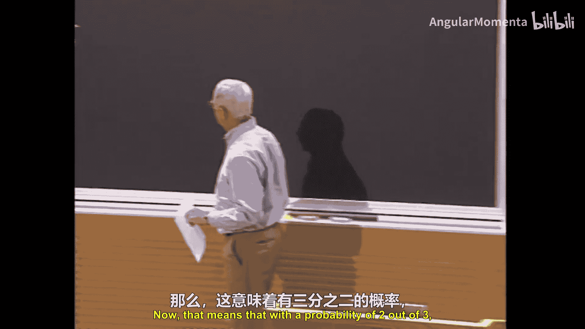

The car lies behind one of the other two doors。Now， here's the key step。

 Monty opens a door that he knows does not contain the prize。The key thing to notice here。

Is the choice of doors。Is not。Independent。Of the choice of the player。

Because Monty will never choose the door。That the player has initially picked。Now。

 since the probability of the prize。Being behind the two remaining doors is two out of  three。

The probability of the prize being behind the door。

One of the doors that he did not open is two out of three。In fact， behind the other door。 So。

 in fact， you were extraordinarily lucky to win the dollar。

Because switching doubles the odds of winning。Because remember。

Your odds of winning were one out of three when you first chose the door。At left two doors。

The probability of the car being behind one of those two doors was two thirds。

Mty opened the one that didn't contain。The car， because he knew it contained a goat。

So that must mean the probability of the car being behind the remaining door is  two out of three。

So you double your odds of winning。The logic is kind of clear。

It didn't stop people from aggressively debating it for the longest of time。

And I kind of didn't believe it myself。 So I did what I usually do is I wrote some code。

And let's look at two pieces of code here。And again。

 the theme here is how we can use simulation models to understand slightly complex or more than slightly complex。

Situations。So。Here's the way the game works。 So I've got。A simple simulation。

That counts the number of wins。啊。And the way it's done is。For T and range number of trials。

The contestant picks 1，2 or3 at random。 I've tried to mimic exactly the game。

So the car is behind one of the doors。 The contestant guesses a door。And then there's this。

 we call choose function。To open one of the two。And we're gonna have two ways of choosing which door gets opened。

So the Monty hallway， Monty chooses。He takes the guest door， and the prize door。And he opens the non。

Guess that contains the goat。So if one is the guest door and one is not the guest door。

 and it's not the prize door。Then he opens one。Same thing for two。

 And if one or two is not the choice， he opens 3。As opposed to the random choose function。

Which just chooses at random between the doors that weren't guessed。So it might open the car。

And which point the contestant is told， sorry， you lose， you don't even have a choice anymore。

We're then going to run the simulation。With Monty choosing and random choice。And see what we get。

So you've got the code on the handout to do this。 I'm not going to go over the details。

 The thing to notice about it is it's yet another example of how we can use。

Pil lab to do some interesting plots。This time， I'm gonna print a pie chart just to show that we can do those。

And let's see what happens。So people understand what's going on， that I've got this function。

 two functions， Monty Cho and random choose。 I'm using those functions as parameters。

 a very convenient thing。And running the simulation each way。And let's see what happens。All right。

So what we see here is when I run Montych。Sure enough。

 it comes out to about two thirds of the time You win if you change and only one third of the time。

 if you don't。Pretty close to what the math predicts。In fact， sort of astonishingly close。

On the other hand。If Monty had been just chose choosing at random。

Then we see it really doesn't matter whether you switch or not。So， again。

 from a probability point of view， we see how subtle these things can be based upon whether decisions are independent of previous decisions are not independent。

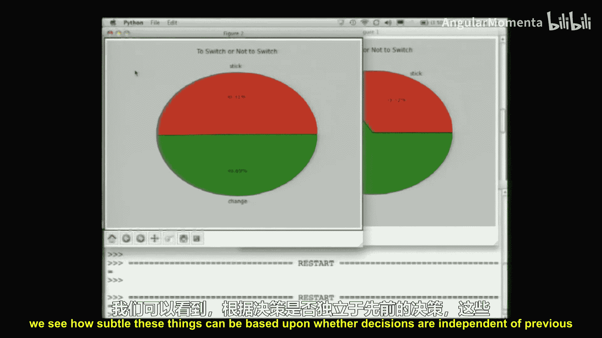

And we also see， in some sense。That we can write。A very small piece of code。

That actually provides a simulation of a real， in this case， game。And we can have， I think。

 a lot of confidence。 We can look at the code， say， is it really the way the game is described， Yes。

 And then we get nice results that tell us what to do。And in this case。

 it tells us that if Monty is choosing based upon what he knows。Then。By all means， you should switch。

And。I'm sorry that it didn't work out that way when we played the game。

 but that's the way probabilities are。That you didn't switch and you lucked out。

 So now you're a rich lady。 al right。So。That's one things we can do。

One more thing I want to talk about before we leave the subject of Monte Carlo simulations。So。

 it's pretty clear。That these kind of simulations are very useful。For tackling problems in which。

Predictive nondeminism plays a role。And at first， blush， you might think that， okay。

 that's the only time we should use a Monte Carlo simulation。

When there's some inherent randomness in the problem and therefore。

 it's hard to model analytically and therefore willll use randomness in the code。Interestingly。

 enough。Particularly in recent years。 But for quite a while。

 people have understood the notion of using randomized algorithms to solve problems in which randomness plays no role。

And that's a little surprising。But incredibly useful concept to sort of put in your bag of tricks。

The ability to use randomization to solve problems that are not random。

So let me talk about an example。Consider the concept of pi。嗯。Pi has been around for a long time。

For thousands of years， people have known that there's a constant。

Called Pi since about the 18th century。Associated with circles。

Such that the circumference of a circle is always going to be equal to pi times the diameter。

The area of a circle is always going be pi R squared， etca。So for thousands of years， people knew。

That there was such a constant。They just didn't know what it was。

And there's a long and beautiful history of people attempting to estimate pie。

About the earliest estimate I've found is from the Egyptians。In something called the rhymed papyrus。

From 1650 B， C or thereabouts。And it estimated pi to be 4。Times， let me get this right。8 over 9。

Squared。Which is 3。16。More or less。That was pretty good。About 1000 years later。

An estimate of pie appears in the Bible。嗯。In a， at least is implied by the Bible in a description of one of Solomon's construction projects。

It says， and he made a molten C，10 cubits from the one brim to the other。 It was round all about。

 and his height was 5  cubits。And the line of 30 qubits did composite round about。

So you can take that and solve for pie。Because you've given the circumference， other details。

 the the diameter you can solve for pi。 And you see if you do that， pi comes out to be exactly 3。嗯。

Not quite as accurate as the Egyptians had1000 years earlier。Now， perhaps the Bible is wrong。

 I don't want to offend anybody。But， or perhaps the molten sea wasn't perfectly circular。

Or maybe the circumference was measured from the wall outside in the diameter from the inside。

 Or maybe it was just。That was a good enough number to use in construction。

 because a qubit was something like the length of your forearm。

 different people of different length forearms。 And there was no reason to try and be more precise。

 Who knows。嗯。The best estimate of pie in ancient times was from Archimedes。Of Syracuse。

And he did something quite amazing for。😊，Around 200 B， C。He didn't give the value of pi。 He said。

 I don't know what the value is， but I can give you an upper bound and a lower bound。

And he did this by carefully constructing a polygon with a huge number of tiny little straight lines。

That would approximate a circle and then actually measuring things。

So he built a polygon with 96 sides。And concluded that pie was somewhere between。223。Divided by 71。

And 227s。Very sophisticated at the time to be giving upper and lower bounds。

If we look at what the middle of that is， it's actually amazingly good。 It's 3。1418。😊，Not bad。

All right。What does that have to do with Monte Carlo simulations。Many years later。In fact。

 in the 17 hundreds。2 French mathematicians invented another way of computing Pi， Buffin and Laplace。

Actually， Bang first proposed did he got it wrong。 Laplaceaz corrected it。And they said。

 we can find pie using a stochastic simulation。They didn't use those words。

 but that's what they basically described。And they talked about it in terms of needle dropping。So。

 think about。Having a square。And inscribing in the square a circle。

And you'll excuse my lack of artistic ability。So they put one of those on the floor。

And then they dropped needles， which would get carried around by the wind and land in some random place。

And they counted the number of needles that landed。In the circle。

And the number of needles that landed in the square。But not in the circle。

And then they did the little math。Let's assume for the sake of argument here。

That the radius of the circle is。1。They observed the following equation must hold。

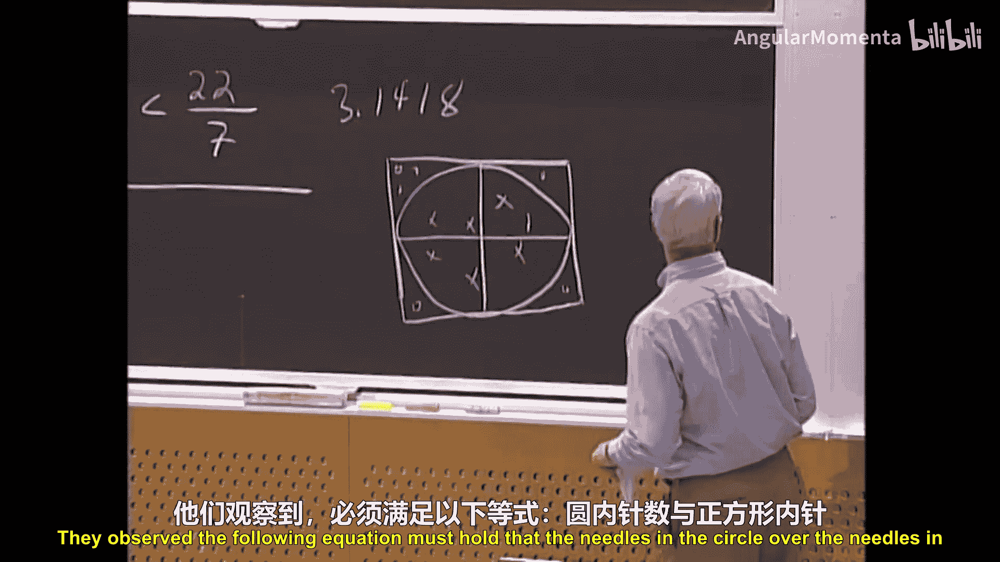

That the needles in the circle。Over the needles in the square。Should be equal to the area。

Of the circle。Divided by the area。Of the square。Seems logical if they're landing at random。

That they would get。Distributed proportional to the area。And then。They solved for pie。

Knowing that the area of the circle is pi R squared。They could then say that， pie。In fact。

 in this case， since we know the radius is one and one squared is one。

That tells us that the area of the circle should be。Pi， right， pi times 1。

So they said pi is equal to the area。Of the circle。Which is equal to the。Area of the square。Times。

The needles in the circle。Divided by the needles in the square。

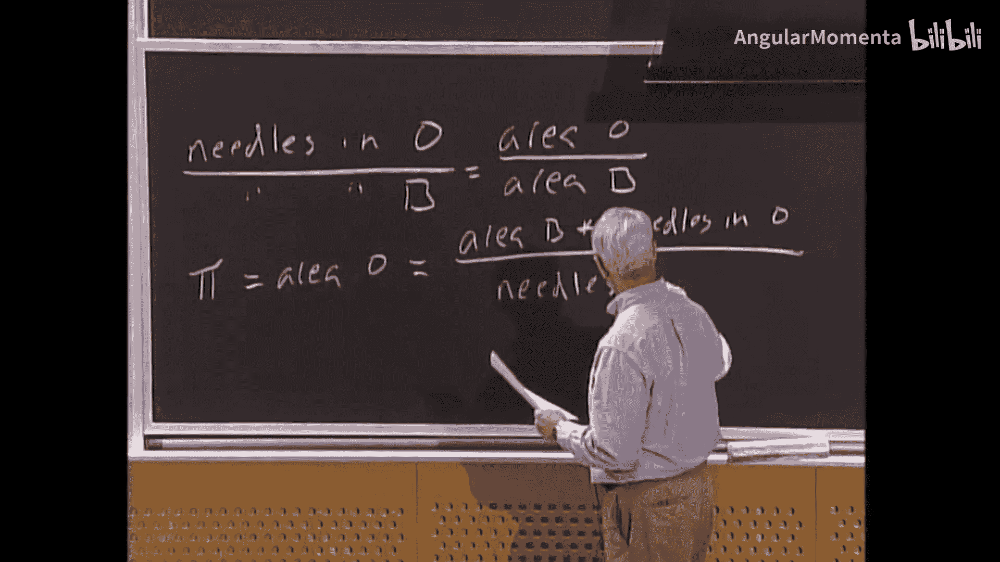