# 【麻省理工】计算机科学与编程导论 ｜ MIT 6.00SC Introduction to Computer Science and Programming p26 26 -BV1a5BZBkEP6_p26-

The following content is provided under a creative Commons license。

 Your support will help M I T Open Coseware continue to offer high quality educational resources for free。

To make a donation or view additional materials from hundreds of MI T courses。

 visit M T OpenCourseware at Ocw。 MT Eduu。Good morning， everybody。Allright。

 I ended up the last lecture。Talking about how to calculate the absolute goodness of a fit using something called the coefficient of determination。

Uly spelled as R squared or R 2。And the formula was quite simple。

We measure the goodness to the fit as R squared equals1。Minus。

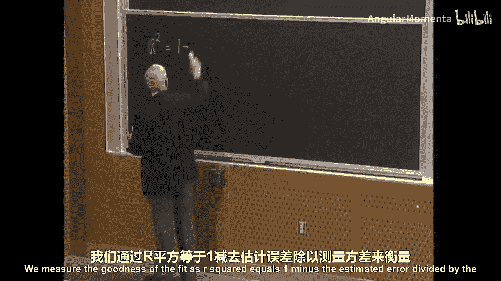

The estimated error。😡，Divided by the measured。Variance。As I observed。

R squared always lies between 0 and 1。If r squared equals one。

That means that the model that we've constructed。The predicted values， if you will。

Explains all of the variability in the data。So that any change in the data is explained perfectly by the model。

We don't usually get one。 In fact， if I ever got one， I would think somebody cheated me。

If R squared equals 0， conversely。It means there is no linear relationship at all between the values predicted by the model and the actual data。

That is to say， the model is totally worthless。So we have code here。

The top of the screen showing how easy it is to compute R squared。

And for those of you who have a little trouble interpreting the formula。

 because maybe you're not quite sure what E E and M V mean。

This will give you a very straightforward way to， to understand it。So now we can， can run it。

We can get some answers。So if we look at it， you remember last time we looked at two different fits。

We looked at a quadratic fit and a linear fit for the。Trajectory of an arrow fired from my bow。

And we can now compare the two。And。Not surprisingly。

 given what we know about the physics of projectiles。We see is exactly what we'd expect。

That the linear fit。Has an R squared of 0。0177。Showing that， in fact。

 it explains almost none of the data。Whereas the quadratic fit has a really astonishingly good R squared of 098。

 saying that almost all of the changes in the values of the variables。 That is to say。

 the way the y value。Changes with respect to the X value is explained by the model。I。e。

 we have a really good model of the physical situation。Very comforting。Essentially。

 it's telling us that less than 2% of the variation。Is explained by the linear model。

98% by the quadratic model。 Presum， the other 2% is experimental error。Well。

 now that we know that we have a really good model of the data。We can ask the question。

 why do we care。We had the data itself。 What's the point of building a model of the data。And that。

 of course， is what we're getting when we run polyfiip to， to get this curve。

The whole purpose of creating a model or an important purpose of creating a model。

Is to be able to answer questions about the actual physical situation。

So one of the questions one might ask， for example， about firing an arrow is how fast is it going。

Right， that's kind of a useful thing to know if you're worried about whether it will penetrate a target and kill somebody in the other side。

 for example。We can't answer that question directly， looking at the data points。You look at the data。

 Well， I don't know。But we can use the model to answer the question。

And that's an exercise I want to go through now to show you the interplay between models and theory and computation and how we can use the three to answer relevant questions about data。

No， I do not want to check for new software。 Thank you。Fact。Let's make sure it won't do that anymore。

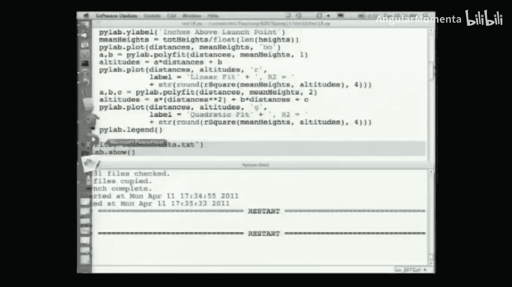

So let's look at the PowerPoint。So here we'll see。

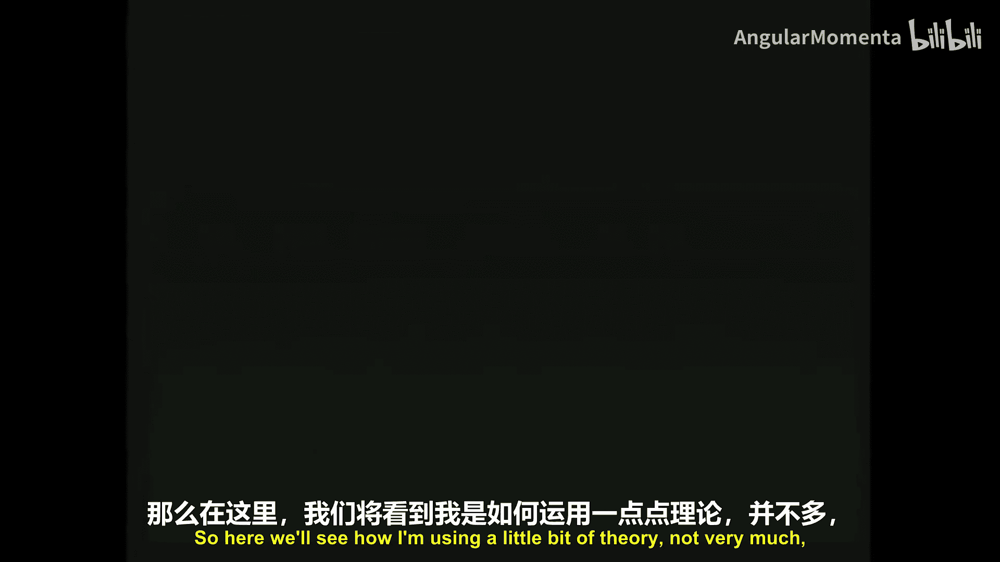

How I'm using a little bit of。Theory， not very much。To be able to understand。

How to use the model to compute the speed of the arrow。So what we see。

Is we know by our model and by the good fit。That the trajectory is given by y equals A X squared plus B。

 X plus C。We know that， right。We also know。From looking at this equation， that the highest point。

Which I'll call why peak。Of the arrow must occur at x mid。The middle of the x axis。

So if we look at a parabola and it doesn't matter what the parabola is。

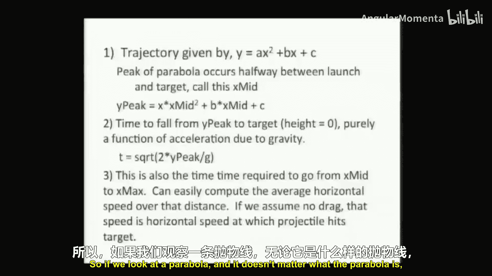

We always know that the vertical peak。Is halfway along the X axis。

The math tells us that from the equation。So we can say y peak is x times x mid squared plus B B times x mid plus c。

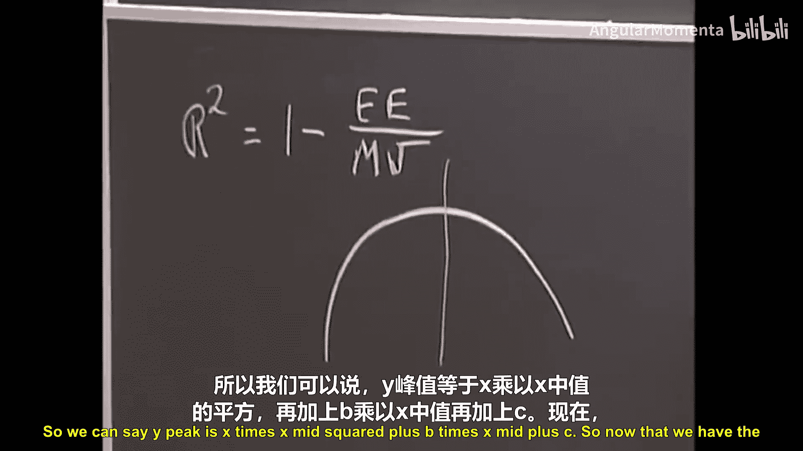

So now that we have a model， we can tell how high the arrow can get。The next question I'll ask is。

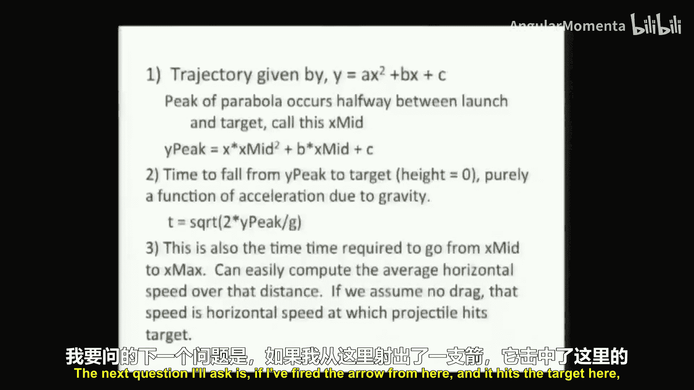

If I fired the arrow。From here。 And it hits the target here。 And I've exaggerated by it this way。

 It's nowhere is near this steep。How long does it take to get from here to here。

We don't have anything about time。In our data。Yet I claim we have enough information to。

Go from the distance here。And the distance here to how long it's going to take the arrow to get from here to the target。

Why do I know that。What determines how long it's going take to get from here to here。

It's going be how long it takes it to fall that far。

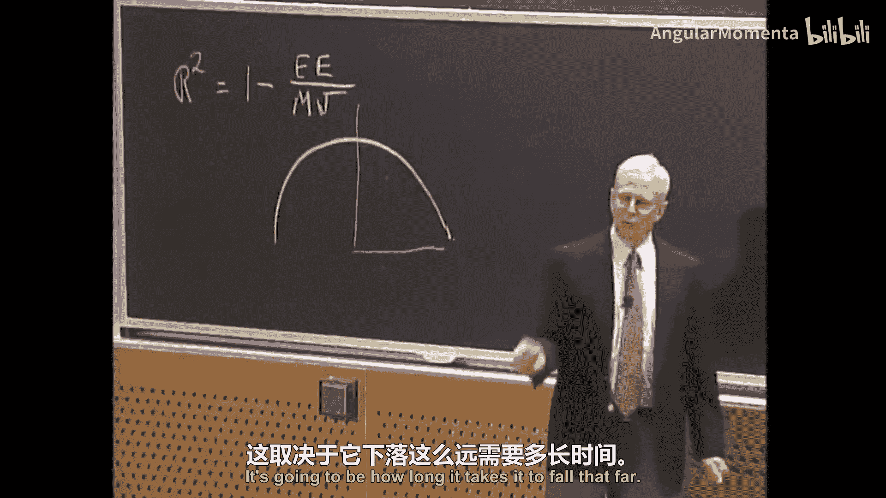

It's going to be gravity。Because we know that gravity， at least on this planet。

 is a constant or close enough to it， lest maybe the arrow were going a million miles。

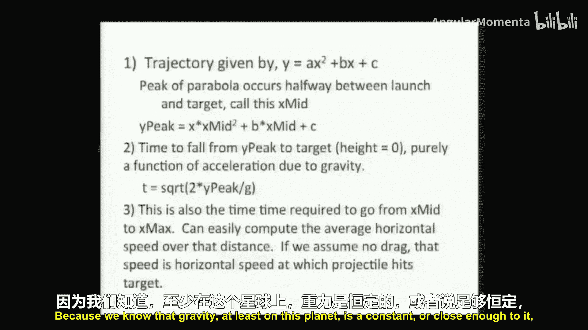

And it's gonna be gravity that takes， tells me how long it takes to get from here to here。

And when it gets to the bottom， it's going be here。So， again， I can use some very simple math。

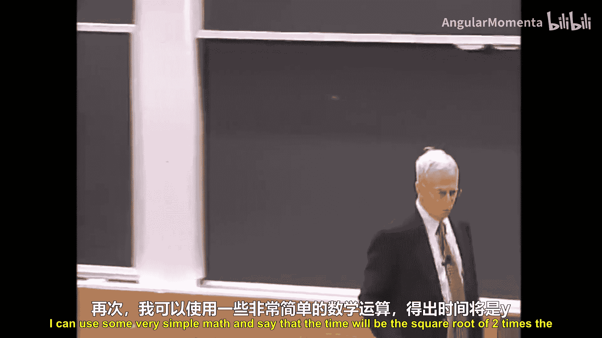

And say that the time will be the square root of two times the y peak divided by the gravitational constant。

Because I know that however long it takes to get from this height to this height。

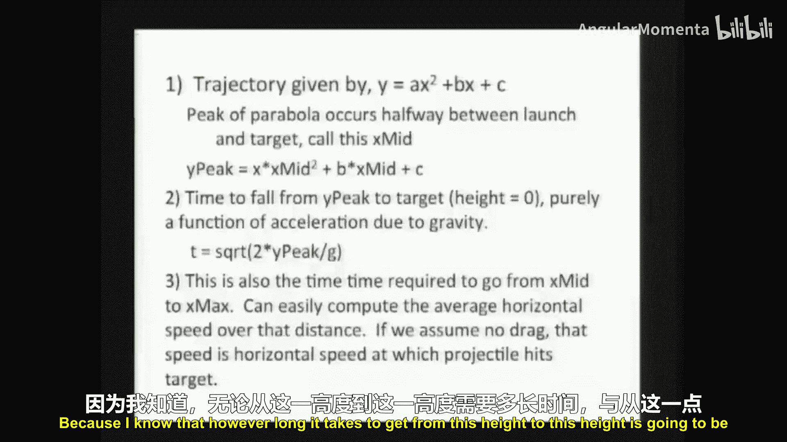

Is going to be the same time it takes to get from this point to this point。

And that will therefore let me compute the average speed from here to here。

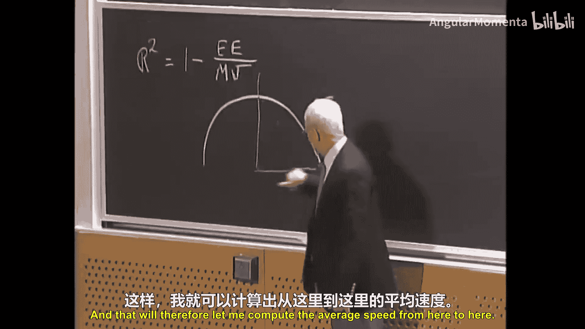

And once I know that， I'm done。Now again， this is assuming no drag and things like that。

Thing that we always have to understand about a model is no model is actually ever correct。

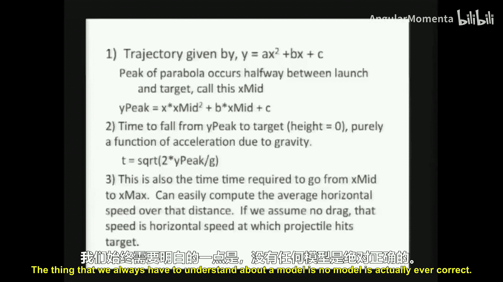

On the other hand。Many models are very useful and that they're close enough to correct。

So I've left out things like gravitation， like wind shear and stuff like that。 But， in fact。

 the answer we get here will turn out to be very close to correct。

We can now go back and look at some code。Get rid of this。And so now you'll see this on the handout。

还没留。Just write a little bit of code that just goes through the math I just showed you to compute。

The average X velocity。I' got a print statement in here I use to debug it。

 And then I'm going to return it。And then we'll just be able to， to run it and see what we get。Well。

 all right。 that we looked at before。W。I forgot to close the previous figure。 So now I。

 I'm sure this is a problem you've all seen。And we'll fix it the way we always fix things is just start over。

哦哦。I bet you guys have all also seen this happen。What this is suggesting， as we've seen before。

 is that。The process， the old process still exists。Not a good thing。Again。

 I'm sure you've all seen these。 Let's make sure we don't have anything running here that looks like idle。

We don't。Just takes it a little time。 There it is。 Allright。Alright， now we'll go back。Right。

 all of this happened because I forgot to close the figure and executed Pabb do show twice。

Which we know can lead to bad things。So， let's。Get rid of this。Now， we'll run it。And now。

We have our figure。Just using the quadratic spit。Fit， and we see that the speed is 1 36。

25 feet per second。 Do I believe，136。25， not really。I know。 It's the ballpark。

I've sort of confused precision with accuracy here by giving you it to two decimal places。

 I can compute it as precisely as I want。 But that doesn't mean it's actually accurate。Probably。

 I should have just said， it's about 135。Or something like that。 But it's pretty good。

And for those of you who don't know how to do this Earthrithtic in your head like me。

 this is about 93 mph。And for comparison， the speed of sound instead of 136 feet per second is 1100 feet per second。

 So it's traveling pretty fast。Well， what's the point of this。

 I don't really care if you know how fast an arrow travels。I don't expect you'll ever。

Need to compute that。But I wanted to show you this as an example of a pattern that we use a lot。

So we did， as we started。With an experiment。You didn't see this， but I actually stood in my backyard。

And shot a bunch of arrows， and measured them。Got real data out of that。

And this gave me some data about the behavior of a physical system。はい。All right。

 That's what I get for wearing a tie。 Maybe it'll be quiet or a fight。Put it on my shirt。Actually。

Looks silly， but。Excuse me。 I hope none of you will mind if I take my tie off。

Seems to be making noises in the microphone。Maybe we should write a computation。All right。

So ends my experiment with trying to look dignified。Not something I'm good at。Okay。Had an experiment。

 that gave us some data。We then。Use computation。To both find。And very importantly， evaluate a model。

It's no good just to find a model。 You need to do some evaluation to convince yourself that it's a good model。

Of the actual physical system。And then， finally。We use some theory。And analysis。And computation。

To derive the consequence of the model。And then since we believed the accuracy， the model。

 we assumed this consequence was also a true fact about the physical system we started with。

This is the pattern。😡，That we see over and over again these days in all branches of science and engineering。

 And it's just the kind of things that you should get used to doing。

It is what you will do if you go on to careers in science or engineering。Okay。

 that's all I want to say now。About the topic of data and experiments and analysis。

We will return to this topic of interpretation of data later in the semester， nearar the end。

 when we start talking about machine learning and clustering。But for now， I want to pull back。

And start down a new track。That will， I'm sure you'll be pleased to hear dovetail nicely with the next few problem sets that you're going to have to work on。

What I want to talk about。Is the topic of optimization。

Not so much optimization in the sense of how do you make a program fast。

 though we will talk a little about that。 But what people refer to as optimization problems。

How do we write programs to find optimal solutions to problems that occur in real life。

Every optimization problem we'll look at。Is going to have two partss。There's going to be one。

An objective function。That will either be maximized or minimized。So， for example。

 I might want to find the minimal airfare between Boston and Istanbul。

Or more likely between the minimum bus fare between Boston and New York。

So there's an objective function。 Sometimes you find the least， sometimes you find the most。

Maybe I want to maximize my income。And 2。A set of constraints。That have to be satisfied。

So maybe I want to find the minimum transportation， minimum cost。

 transportation between Boston and New York subject to the constraint that not take more than 8 hours。

Or some such thing。So the objective function that you're minimizing or maximizing。

And some set of constraints that must be obeyed。A vast number of problems of practical importance can be formulated this way。

Once we formulated them in this systematic way， we can then think about how to attack them with the computation that will help us solve the problem。

You guys do this all the time。 I heard a talk yesterday by Jeremy Wthtimeimer。

 an MIT graduate who founded a company called ITA。 if you ever use Kaayak， for example。

 or many other these systems to find an airline far。

 They use some of Jeremy's code and algorithms to solve these various optimization problems like this。

You've ever used Google or Bing。They solve optimization problems to decide what pages to show you。

They're all over the place。There are a lot of classic optimization problems that people have worked on for。

Decades。What we often do when confronted with a new problem。

 And it's something you'll get some experience on in problem sets。Is take a seemingly new problem。

And map it on to a classic problem and then use one of the classic solutions。

So we'll go through this section of the course and we'll look at a number of classic optimization problems。

And then you can think about how you would map other problems on to those。嗯。This is the process。

 known as problem reduction。Where we take a problem and map it onto an existing problem that we already know how to solve。

I'm not going to go through a list of classic optimization problems right now。

 but we'll see a bunch of them。As we go forward。Now。

 an important thing to think about when we think about optimization problems。Is how long。

How hard they are to solve。So far， we have looked at problems that， for the most part。

 have pretty fast solutions。Often， sublinear。Binary search。Sometimes linear， and at worst case。

 low order polynomials。Optimization problems， as we'll see， are typically much worse than that。

In fact， what we'll see。Is。There is often no computationally efficient way to solve them。

And so we end up dealing with approximate solutions to them or what people might call best effort solutions。

And we see that as an increasing trend。In tackling problems。All right。Enough of this abstract stuff。

Let's look at an example。So one of the classic optimization problems。Is called thenapsack problem。嗯。

People know what annapsack is， sort of an archaic term。 Today， people would use the word backpack。

But in the old days， they called thena facts。When they started looking at these things。

 and the problem is also discussed in the context of a burglar。Or various kinds of thieves。

So it's not easy being a burglar， by the way， I don't know if any of you have ever tried it。

You've got some of the obvious problems， like making sure the house is empty and picking lock。

 circumventing alarms， etc。But one of the really hard problems a burglar has to deal with is deciding what to steal。

Because if you break into the typical luxury home and why would you break into a poor person's house if you were a burglar。

There's usually far more to steal than you can carry away。

And so the problem is formulated in terms of the burglar having a backpack。

 They can put a certain amount of stuff in it。And they have to maximize。

The value of what they steal subject to the constraint of how much weight they can actually carry。

So it's a classic optimization problem。And people have worked for years at how to solve it。

Not so much because they want to be burglars， but as you'll see。

 these kinds of optimization problems are actually。Quite common。 So let's look at an example。

You break into the house。 And among other things， you have a choice of what's to steal。

 You have a rather strange looking clock， some artwork， a book。A velvet elvis in case you。

 you lean in that direction。All sorts of things。

And， for some reason。The owner was nice enough to leave you information about how much everything cost and how much it weighed。

So you find this piece of paper。And now you're trying to decide what to steal。

Based upon this in a way to， to maximize your value。How do we go about doing it。Oh。

 I should show you， by the way， there's a picture of a typical knapsack。

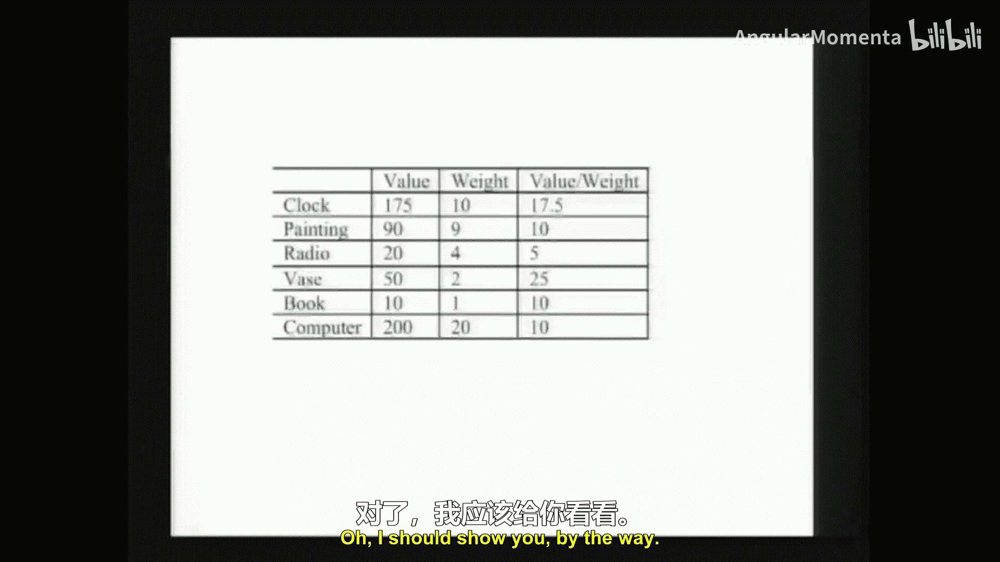

。Allright， it's almost Easter， after all。Well， the simplest pollution。Is probably a greedy algorithm。

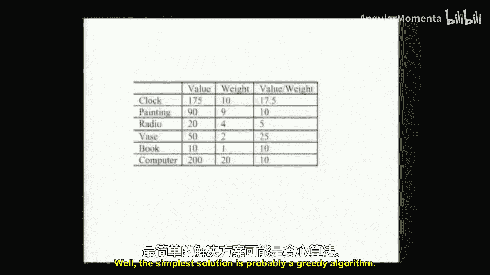

And we'll talk a lot about greedy algorithms。Because they're very popular。And often， the right way。

To tackle。A hard problem。So the notion of a greedy algorithm。Is it's iterative。And at each step。

 you pick the locally optimal solution。So you choose the， make the best choice。

 Put that item in the knapsack。Ask if， if you're out of weight， if not。

 you make the best choice to the remaining ones。Ask the same question。 You do that until。

You can't fit anything else in。Now， of course， to do that。That assumes。That we know， at each stage。

What we mean by locally optimal。And， of course， we have choices here。We're trying to figure out。

 in some sense。What greedy algorithm， what approach to being greedy will give us the best result。

So one could， for example， say， all right， at each step。

 I'll choose the most valuable item and put that in my knapsack。

And I'll do that till I run out of valuable items。

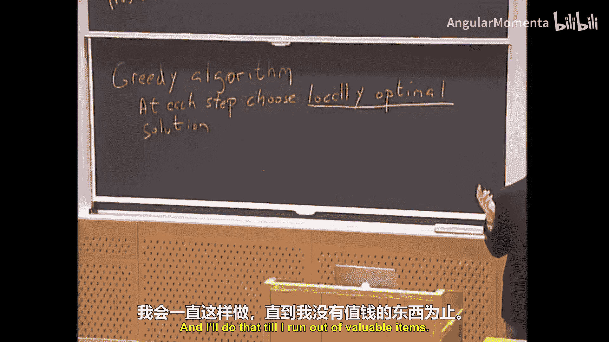

Or you could at each step say， well， what I'm really going to choose is the one that weighs the least。

😡，That will give me the most items。 And maybe that will give me the most total value when I'm done。

Or maybe at each step， you could say， well， let me choose the one that has the best value to weight ratio。

And put that in。 And maybe that will give me the best solution。As we will see， in this case。

None of those is guaranteed to give you the best solution all the time。In fact， as we'll see。

 none of them is guaranteed to be better than any of the others all the time。

And that's one of the issues with greedy algorithms。I should point out， by the way。

 that this version of the Napsack problem that we're talking about is typically called the 01 Napsack problem。

😡，And that's because。We either have to take the entire item or none of the item。We can't。

 We're not allowed to cut the velvet elvis in half and take half of it。

This is in contrast to the continuousnapsack problem。

If you imagine you break into the house and you see a barrel of gold dust and a barrel of silver dust and a barrel of。

Rains。What you would do is you would fill your knapsack with as much gold as you could carry or until you ran out of gold。

And then you would fill it with as much silver as you could carry。

 And then if there was any room left， you'd put in the raisins。For the continuousnapsack problem。

 a greedy algorithm provides an optimal solution。Unfortunately。

 most of the problems we actually encounter in life， as we'll see， are 0，1napsack problems。

You either take something， or you don't。And that's more complicated。All right。

 let's look at some code。So I'm going to formulate it。

I'm first going to start by diving by putting in a class just so the rest of my code is simpler。

This is something we've been talking about that increasingly， people want to start by。

Putting in some useful data abstractions。So I've got a class item。Where I can put in the item。

 I can get its name。 I can get its value。 I can get its weight， and I can print it。

Kind of a boring class。 but useful to have。Then I'm going to use this class。To build items。

And in this case， I'm going to build the items based upon what we just looked at， the table that。

I think it's in your handout。 And it's also was on this。Slide。Later， if we want。

 we can have a randomized program to build a much bigger choice of items。

 But here we'll just try the clock， the painting， the radio， the vase， the book and the computer。Now。

 comes the interesting part。I've written a function， greedy。That takes three arguments。

The set of items that I have to choose from， makes sense。The maximum weight the burglar can carry。

And there's something called key function。Which is defining essentially what I mean by locally optimal。

Then， it's quite simple。I'm going to。Sort the items。Using。The key function， you remember。

 sort has this optional argument that says， what the ordering。So maybe I'll order it by value。

 Maybe I'll order it by density。 Maybe I'll order it by weight。I'm going to reverse it。

Cause I want the most valuable first， not the least valuable， for example。And then I'm going to just。

Take the first thing on my list until I run out of weight。 And then I'm done。

And I'll return the result， and the total value。To make life simple。

 I'm going to define some functions。 These are the functions that I can use。For the ordering。Value。

 which is just going turn the value of the item。The inverse of the weight。

Because I'm thinking as a greedy algorithm， I'll take the lightest， not the heaviest。

 And since I'm reversing it， I want to do the inverse。And the density。Which is just a value。Divided。

 by the way。Okay， make sense to everybody。You with me。Speak now or not。 And then we'll test it。So。

 again， kind of a theme of this part of the course。 as we write these more complex programs。

 we tend to have to worry about our test harnessnesses。

 So I've got a function that tests the greedy algorithm。

 and then another function that tests all three greedy approaches。

For one algorithm with different functions and looks at what our results are。So， let's run it。

See what we get。 Oh， you know what I did。 Just the same thing I did last time。 But this time。

 I'm gonna to be smarter。We're gonna get rid of this figure。Comment out the code that generated it。

And then we'll test the greedy algorithms。So we see the items we had to choose from。

Which Ive printed using the string function in items。

And if I use greedy by value to fill a knapsack of size 20。We see that。 I end up getting。

Just the computer。 If I do greeting by value。This is for the， the nerd burg burglar。If I use weight。

 I get a different。 I get more things， not surprisingly， but lower value。And if I use density。

I also get four things， but four different things。 And I get a higher value。

So I see that I can run these greedy algorithms。 I can get an answer。But， it's not always。

The same answer。As I said earlier， greedy by density happens to work best here， but。

You shouldn't consume that that will always be the case。

 I'm sure you can all imagine a different assignments of weights and values that would make greedy by density give you。

A bad answer。All right， before we talk about how good these answers are。

And we will come back to that。 as in particular， S I want the best answer。

I want to stop for a minute。And talk about the algorithmic efficiency。Of the greedy algorithms。

So let's go back and look at the code。 And this is why people use greedy algorithms。 Actually。

 there are two reasons。One reason is that theyre。Easy to program。 And that's always a good thing。

And the other。Is that they are typically highly efficient。So what's the efficiency of this。

How would we think about the efficiency of this greedy algorithm。what are we looking at here。Well。

 the first thing we have to ask is， what's the first thing it does。Is it sorts the list， right。

So one thing that covers the efficiency might be the amount of time it takes。

To sort the list of items。Well。We know how long that takes， or we can speculate at least。

 And let's assume it does some something like merge sort。 So what's that term going be。Order， what。

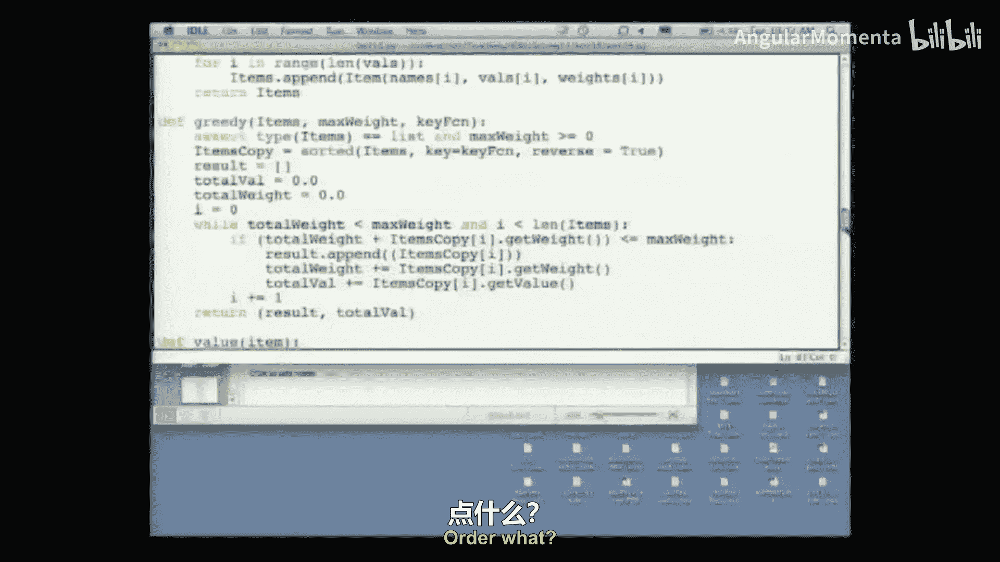

Len of items。Times what。Login， right。So， maybe that's。Going to tell us the complexity。But， maybe not。

The next thing we have to do is look at the while loop。

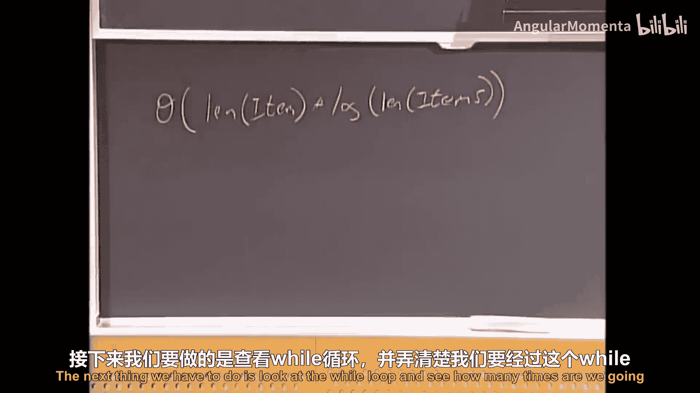

And see， how many times are we going through the while loop。What's the worst case。Somebody。

 I know I didn't bring any candy today， but you could answer the question anyway。

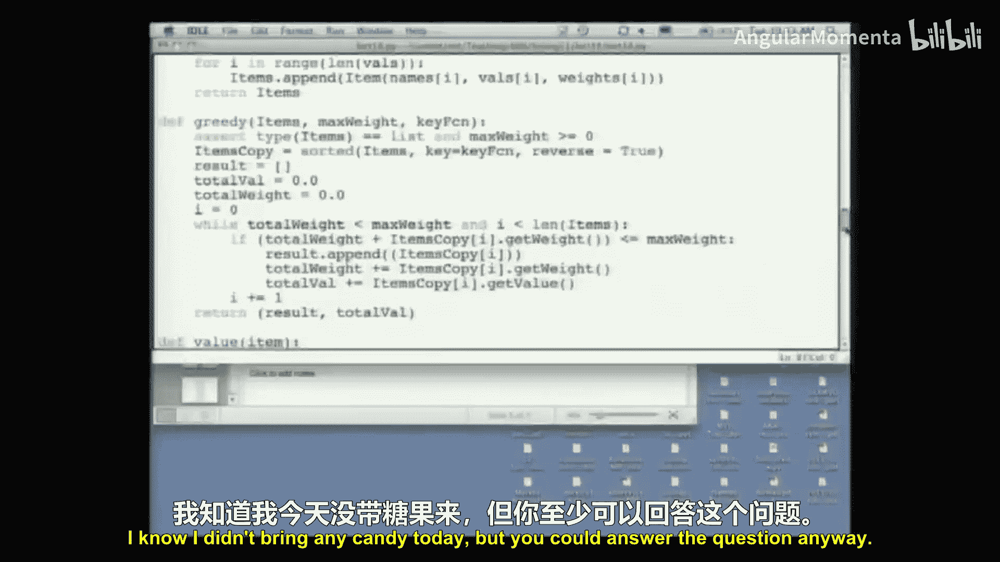

Be a sport。 Do it for free， yeah。Or length of the items。Well， we know this one is bigger。So。

 it looks。Like， that's the complexity， right。So we can say， all right。Pretty good。

Slightly worse and linear in the length of the items， but not bad at all。

And that's a big attraction of greedy algorithms。They are， typically。Order length of items or order。

Length of items times the log of the length。So greedy algorithms are usually very close to linear。

And that's why we really like them。Why we don't like them is it may be that the accumulation of a sequence of locally optimal solutions。

Does not yield a globally optimal solution。So now let's ask the question， S that's not good enough。

I have a very demanding。Thif， or maybe the thief works for a very demanding person。

And needs to choose the absolute optimal set。Let's think first about how we formulate that。Carefully。

 and then。What the complexity of solving it would be and then algorithms that might be useful。Again。

 the important step here， I think， is not the solution to the problem。

But the process used to formulate the problem。Often， it is the case。

That once one has done a careful formulation of a problem。It becomes obvious how to solve it。

 at least in a， in a brute force way。So now let's look at a formalization of the 0，1 Napsack problem。

 And it's a kind of formalization we'll use for a lot of problems。So， step 1。Will represent each。

Item。By a pair。Because， in fact， in deciding whether or not to take an item。

We don't care what its name is。 We don't care if it's a clock or a radio， or whatever。

What matters is what's its value and what's its weight。We'll write W。As。The maximum weight。

That the thief can carry or they can fit in the knapsack。So far， so good。 Nothing complicated there。

Now comes the interesting step。We're going to represent。The set of available items as a vector。

We'll call it I。And then we'll have another vector。V。

Which indicates whether or not each item an I has been taken。So V is a vector。And if V。So I。

Is equal to one。That implies。That I sub。Big eyes。 So little eye。Has been taken。Is in the K Napsack。

Conversely， if v sub I is 0， it means I sub I is not in thenapsack。So having， having formulated。

The situation， thusly。We can now go back to our notion， as an optimization problem。

As an objective function and a set of constraints。To carefully state the problem。So the。

 for the objective function。We want to maximize。The sum。A Vi sub I。Times。I survive。Thatt value。

Where I ranges over the length of the vectors。So that's the trick of the 0 and one。

If I don't take it， it's 0， so it's 0 times the value。 If I take it， it's one times the value。

 So this is going to give me the sum of the values of the items I've taken。

And then I have to subject to the constraint。And again， we'll do a summation。

And it will look very similar。V sub I。Times。I survive I。But this time， dot weight。

Is less than or equal to W。Straightfor。But a useful kind of skill。

 And people do spend a lot of time on doing that。 If you've ever used Matlab， you know。

 it wants everything to be a vector。And that's often because a lot of these problems can be nicely formulated。

In this kind of way。All right， now let's return to the question of complexity。

What happens if we implement this in the most straightforward way。

What would the most straightforward implementation look like。Well， we could。Enumerate。

All possibilities。And then。Choose the best。That meets the constraint。So this would be the obvious。

Root for a solution to the optimization problem。Look at all possible solutions。 Choose the best one。

I think you can see immediately that this is guaranteed to give you the optimal solution， actually。

 an optimal solution。 Maybe there's more than one best。But in that case。

 you can just choose whichever one you like for whichever comes first， for example。The question is。

 how long will this take to run。Well， we can think about that by asking the question how big will this set will be。

 How many possibilities are there。Well， we can think about that in a pretty straightforward way。

Because if we look at our formulation。We can ask ourselves how many possible vectors。Are there。

 How many vector Vs could there be。Which shows which items were taken and which weren't。

 And what's the answer to that。Well。If we have N items。How long will V be？Length in， right，0。

1 for each。If we have a vector of zeros and ones of length n。

How many different values can that vector take on。We've， we've asked this question before。

 What's the answer。Somebody shouted out。I家。Vectctor of length N。

Every value in the vector is either a 0 or a  one。 So maybe it looks something like this。

How many possible combinations the0 ones are there。2 to the n， because essentially。

 this is a binary number， exactly。And so if I have an n bit binary number。

 I can represent totally N different values。And so， we see that we have。2 to the n。

Possible combinations to look at if we use a brute force solution。How bad is this？Well。

 if the number of items is small， it's not so bad。And you will see that， in fact， I can run this。

On the example we've looked at 2 to the five is not a huge number。Suppose I have a different number。

Suppose I have 50 items to choose from。Not a big problem。

I heard yesterday that the number of different airfares between two cities in the US is order of 500。

500 different airfares between say Boston and Chicago。

So looking at the best there might be 2 to the 500， kind of a bigger number。Let's look at2 to the 50。

Let's say there were 50 items to choose from in this question。

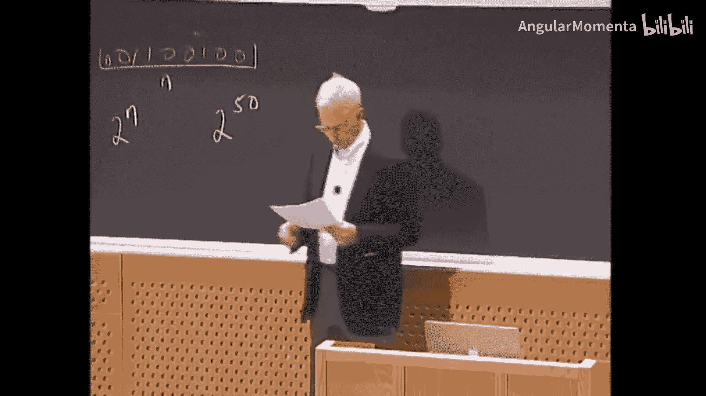

And let's say， for these sake of arguments。It takes a microsecond。

1 millionth of a second to generate a solution。How long will it take to solve this problem in a brute force way for 50 items。

Who thinks you can do it in under 4 seconds。How about under four minutes。Wow， skeptics，4 hours。

 It's a lot of。Computation，4 hours we starting to get some people， four days。Allright。 Well。

 all right， How about four years。You know， still longer， just under four decades。Solving。

 looking at one choice， every。Microsecond， it takes you roughly 36 years。

To value all these possibilities。Certainly for people of my age。

 that's not a practical solution to have to wait 36 years for an answer。

So we have to find something better。And we'll be talking about that later。

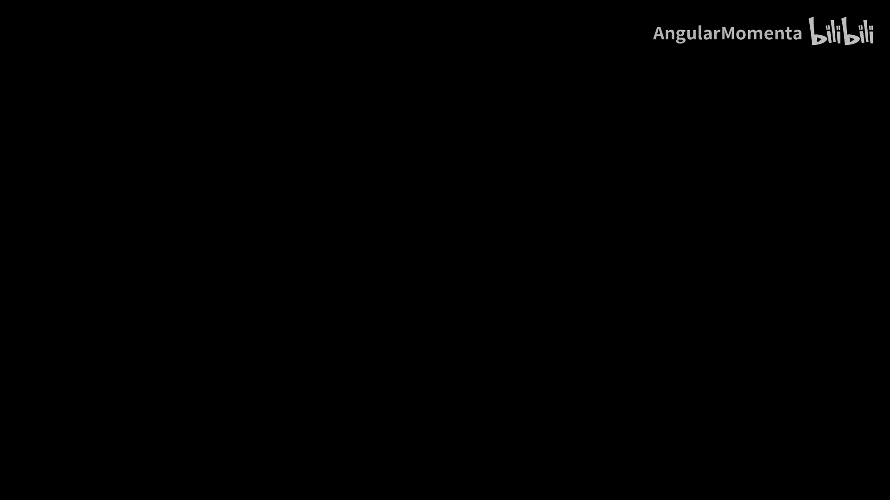