# 【麻省理工】计算机科学与编程导论 ｜ MIT 6.00SC Introduction to Computer Science and Programming p27 27 -BV1a5BZBkEP6_p27-

The following content is provided under a creative Commons license。

 Your support will help M I T Opencourseseware continue to offer high quality educational resources for free。

To make a donation or view additional materials from hundreds of M T courses。

 visit M I T OpenCseware at O C W dot M I T dot E Du。

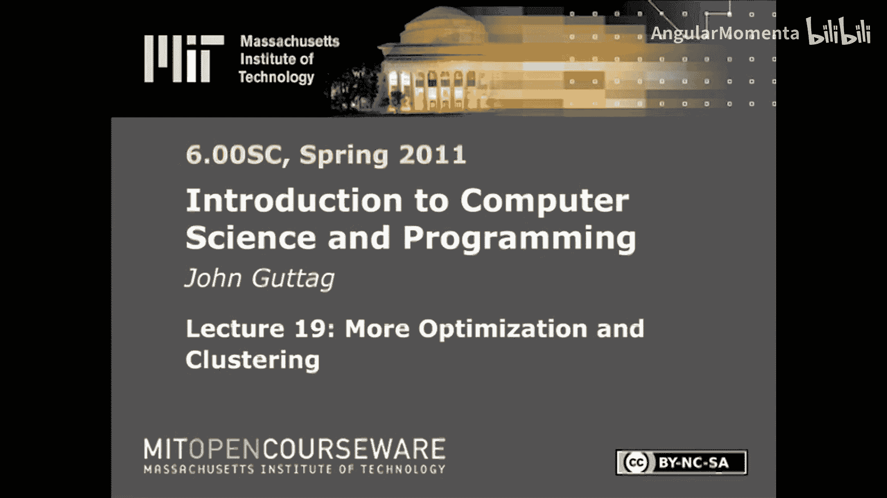

Last Tuesday， we were ended up the lecture talking aboutnapsack problems。

We talked about the continuousnapsack problem and the fact that you could solve that optimally with the greedy algorithm。

Then we looked at the0，1napsack problem and discussed the fact that while we could write greedy algorithms。

 it would solve the problem quickly， we had to be careful mean by solve。And that while those。

 while those algorithms would choose。A set of items that we could indeed carry away。

 There was no guarantee that it would choose the optimal items。That is to say。

 one that would meet the objective function of maximizing the value。We looked after that， at a。

Brte force algorithm on the board only for finding an optimal solution。

 a guaranteed optimal solution。But observe the fact that on a even a moderately sized set of items。

 it might take a decade or so to run。Decided that wasn't very good。Nevertheless。

 I want to start today looking at some code that implements a rootte forest algorithm。

Not because I expect anyone to actually run this on a real example。

 but because a bit later in the term， we'll see how we could modify this to something that would be practical。

And there are some things to learn by looking at it。So let's look at some code here。嗯。

I don't expect you to understand in real time。 all the details of this code。 It's more。

 I want you to understand the basic idea behind it。 And then the result we get。

So you will remember that we looked at the complexity by saying， well， really。

 it's like binary numbers。So the first helper subroutine I'm going to use。

Is something that generates binary numbers。So it takes an N， some natural number。

And the number of digits and returns a binary string of that length。

 representing the decimal number N。Why am I giving it？This number of digits。

 because I need to zero pat it。If I want to have a vector that represents whether or not I take items。

If I take only one item， say the first  one， I don't want just the binary string with one digit in it because I need all those zeroes to indicate that I'm not taking the other items。

And so this second argument tells me， in effect， how many zeros I'm going to need。

And there's nothing mysterious about the way it does it。Okay。The next helper function。

Generates the power set。Of the items。What is a power set？If you take a set。

You can then ask the question， what are all the subsets of the set。

What's the smallest subset of a set。 It's the empty set。No items。Was the largest subset of a set。

 all of the items。And then we have everything in between the set that contains the first item。

 the set that contains the second item， etctera， The set that contains the first and the second。

 the first and the third。 There are a lot of them。And， of course， how many is a lot， Well。

2 to the n is a lot。But now， we're going generate。Every possible subset of items。

And we're gonna do this， simply using the。Deimal to binary。

Function to tell us whether or not we keep each one so we can enumerate them。

 We can generate them all。 And now we have the set of all possible items one might take irrespective of whether they obey the constraint。

Of not weighing。Too much。The next function。Is the one that does the work。

 This is the interesting one。choosehoose best。It takes a power set。The constraint。And。2 functions。

 One get value that tells me the value of an item and the other get weight that tells me the weight of an item。

Then it just goes through。And it enumerates all possibilities。And eventually， chooses。

I won't say the best set because it might not be unique。 There might be more than one optimal answer。

 but it finds at least one optimal answer and then it returns that。Again。

 it's a very straightforward implementation of the brute force algorithm I sketched in the board。

And then we can run it with test best。Which is going build the items using the function we looked at last time。

ItThen going get the power set of the items。It's going call choose best and then print the result。

So let's see what happens if we run it。We get an error。 Oh， dear。 I hadn't expected that。

And it says test， O， test best is not defined。 Allright， let's try that again。

Sure looks like it's defined to me。There it is。Okay。

And you may recall that this is a better answer than anything that was generated by the greedy algorithm on Tuesday。

 You may not recall it。Believe me， it is。It happened to have found a better solution。

And not surprisingly， that's because I contrived the example to make sure that would happen。

Why does it work better in the sense or why does it find a better answer。

 Why might it find a better answer。Well， because the greedy algorithm。Chose。

Something that was locally optimal at each step。But there was no guarantee that a sequence of locally optimal decisions would reach a global optimum。

What。This algorithm does is it finds a global optimum by looking at all solutions。

And that's something we'll see again and again as we go forward。

 that there's always a temptation to do things one step at a time。

 finding local optimum optima because it's fast。 It's easy。

But there's no guarantee it will work well。Now， the problem， of course。

 with finding the global optimum is， as we discussed， it is prohibitively expensive。Now。

 you could ask， is it prohibitively expensive。Because I chose a stupid algorithm。

 the brute force algorithm。Well， it is a stupid algorithm。But， in fact。This is a problem。

That is what we would call inherently exponential。We've looked at this concept before。That。

In addition to talking about the complexity of an algorithm。

 we can talk about the complexity of a problem。In which we asked the question。

 how fast can the absolute best solution， Fastest solution to this problem be。And here。

 you can construct a mathematical proof。That says。The problem is inherently exponential。

No matter what we do， we're not going be able to find something that's guaranteed to find the optimal that is faster than exponential。

Well， now let's be careful about that statement。What that means is the worst case is inherently exponential。

As we will see in a couple of weeks， it'll take us a while to get there。

There are actually algorithms that people use to solve these inherently exponential problems。

And solve them fast enough to be useful。So， for example。

 when you go to look at airline fares on Kaayak to try and find the best fare from A to B。

It is an inherently exponential problem， but you get an answer pretty quickly。

And that's because there are techniques that you can use。 Now， in fact。

 one of the reasons you get it is say， don't guarantee that you actually get an optimal solution。

But there are techniques that guarantee to give you an optimal solution that almost all the time will run quickly。

 And we'll look at one of those a bit later in the term。Before we do that， however。I want to。Leave。

For a while， the whole question of complexity behind。

And look at another class of optimization problems。

We'll look at several different kinds of optimization problems as the term goes forward。

The kind I want to look at today。Is probably。What I would say is the most exciting branch of computer science today。

 And， of course， I might have a bias。And that's machine learning。It's a word you'll hear a lot about。

And。It's a technique that many of you will。Apply， you might not write your own code。

 but I guarantee you are either the beneficiary or the victim of machine learning。

Almost every time you log on the Web these days。I should probably start by defining what machine learning is。

 but that's hard to do。 I really don't know how to do it。Superficially。

 you could say that machine learning deals with the question of how to build programs that learn。

However， I think， in a very real sense， every program we write learn something。

If I implement Newton's method， it's learning what the roots of the polynomial is。Certainly。

 when we looked at curve fitting。Fitting curves to data， we were learning a model of the data。

That's what。That regression is。嗯。Wikipedia says， and， of course。

 it must be true if it Wikipedia says it。That machine learning is a scientific discipline that is concerned with the design and development of algorithms that allow computers to evolve behaviors based on empirical data。

I'm not sure how helpful this definition is， but it was the best I could find。

 And it doesn't really matter。But it sort of gets at the issue that a major focus of machine learning research。

Is to automatically learn to recognize complex patterns。And make intelligent decisions based on data。

This whole process。😡，Is something called inductive inference。The basic idea is one observes actually。

 one doesn't the program。Observes examples。That represent in incomplete information about some statistical phenomena。

And then tries to generate a model， just like with curve fitting。That。

Summarizes some statistical property of that data， and can be used。To predict。The future。For example。

 give you information about unseen data。There are roughly speaking。2。

Distinctive approaches to machine learning。Called supervised learning and unsupervised learning。

Let's first talk about supervised learning。It's a little easier to appreciate how it might work。

In supervised learning。We associate。A label。With each example in a training set。

So think of that as an answer to a query about an example。If。The label is discrete。

We typically call it a classification problem。So we would try and classify， for example。

 a transaction on a credit card as belonging to the owner of that credit card or not belonging to the owner as I。

e。 with some probability， a stolen credit card。So it's discrete。 It belongs to the owner。

 It doesn't belong to the owner。If the labels are real valued。😡。

We think of it as a regression problem。And so， indeed。When we did the curve fitting。

We were doing machine learning。And we were handling a regression problem。

Based on the examples from the training set。The goal is to build a program that can predict the answer for other cases。

Before they are explicitly observed。So we're trying to generalize from the。

 the statistical properties of the training set。To be able to make predictions about things we haven't seen。

Let's look at an example。So here。I've got red and blue circles。

And I'm trying to learn what makes the circle red。What's the difference between red and blue other than the color。

Right， think of my information as the X， Y values and the label is the color， red or blue。

So I've labeled each one， and now I'm trying to learn something。Well， it's kind of tricky。

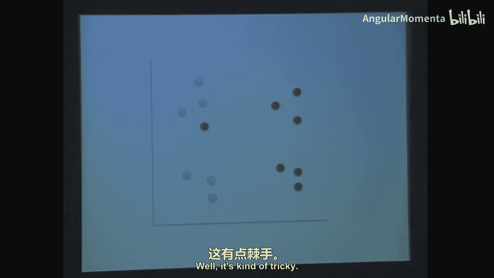

U。What are the questions I need to answer to think about this。

 And then we'll look at how we might do it。

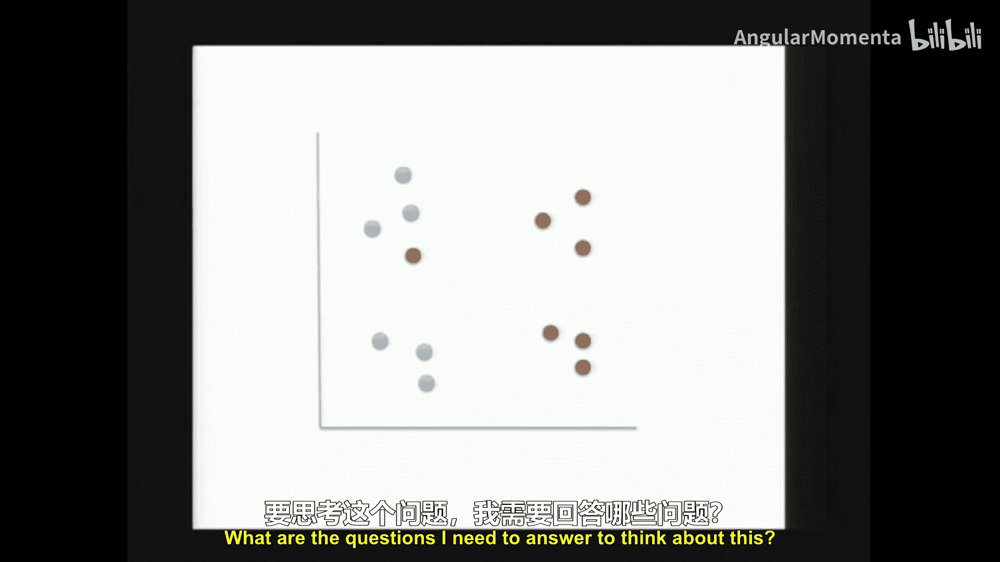

So a first question I need to ask。I。Are the labels？Accurate。And， in fact。

 in a lot of real world examples， in most real world examples。

 there's no guarantee that the labels are accurate。So you have to assume that， well。

 maybe some of the labels are wrong。How do we deal with that？嗯。Perhaps the most fundamental question。

Is， is the past。Representative of the future。RePent。

We've seen many examples where people have learned things， for example， to predict。

The price of housing。And it turns out you hit some singularity。

 which means the past is not a very good predictor of the future。

 And even if all of your learning is good。You get the wrong answer。

So you sort of always have to ask that question。Do you have？Enough data to generalize。And by this。

 I mean enough training data。If your training set is very small。😡。

You shouldn't have a lot of confidence in what you learn。

A big issue here is feature abstract extraction。As we'll see when we look at real examples。

The world is a pretty complex place。And we need to decide。What features we're going to use？You know。

 if I were to ask 25 of you to come up in the front of the room and then try and separate you based upon some feature。

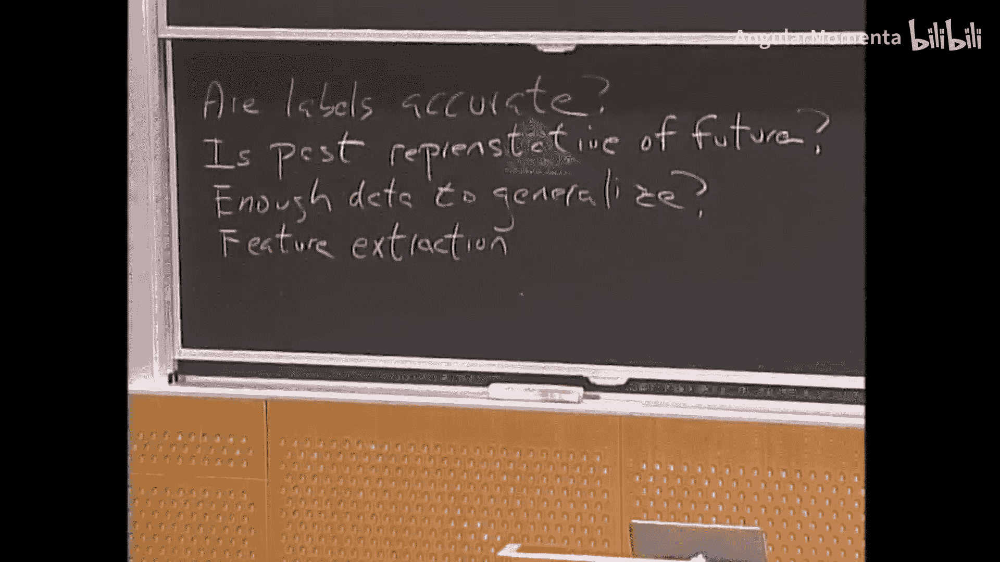

You know， if I were to start， I'm gonna separate the good students from the bad students。

But the only features I have available are the clothes you're wearing。It might not work so well。

And very importantly。How tight should the fit be？So now let's go back to our example here。U。

We can look。At two different ways。We might generalize from this data。And indeed。

 when we're looking at classification problems。In supervised learning。

 what we're typically doing is trying to find some way of dividing。Our training data。In this case。

 I've given you a two dimensional projection， As we'll see， it's not always two dimensional。

 It's not usually two dimensional。 So I might choose。This rather eccentric shape。And say。

 that's great。 And why is that great， It's great because it minimizes training error。

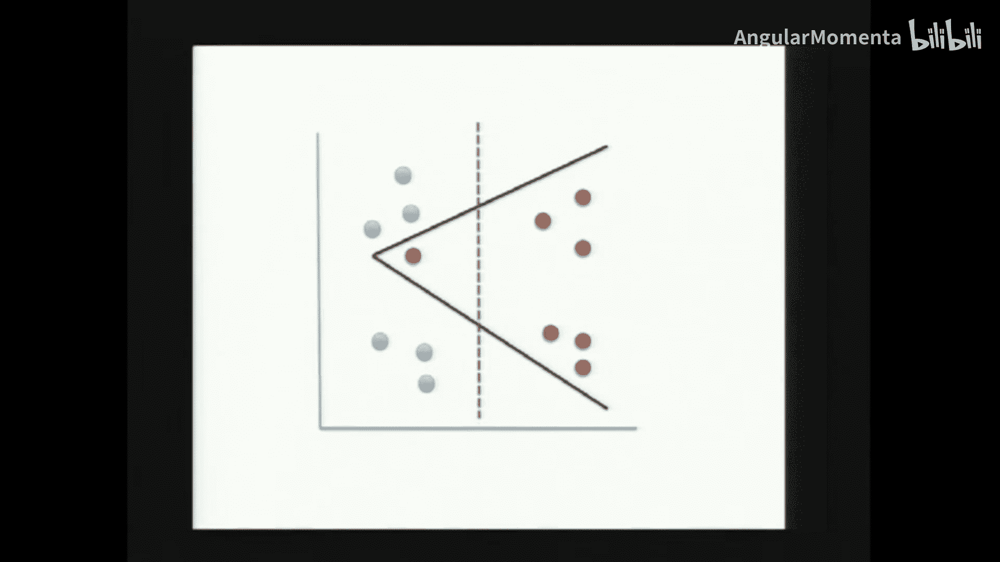

So if we look at。It has an optimization problem。We might say that our objective function。

Is how many points。Are correctly classified in the training data as red or blue。And this。

Triangular shape has no training error。Every point is perfectly classified in the training data。

If I choose this linear separator instead， I have some training error。This red point is。

Misclassified in the training。Does that mean that the triangle is better than the line？

Not necessarily， right， because my goal is to predict future points。And maybe that。

Mislabeled or an experimental error。Maybe it's accurately labeled， but an outlier， very unusual。

And this will not generalize well。 This is analogous to what we talked about is overfitting when we looked at curve fitting。

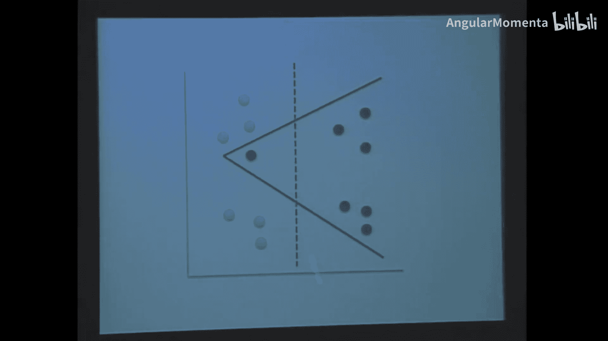

And that's a very big problem in machine learning is if you overfit to your training data。

 it might not generalize well and might give you bogus answers。Going forward。Okay。

 so that's a very quick look at。Supervised learning。 We'll come back to that。

I now I want to talk about unsupervised learning。The big difference here is。We have training data。

 but we don't have labels。So， I just。Give you a bunch of points。It's as if we looked at this picture。

 and I didn't tell you which were the red points and which were the blue points。

They were just all points。So what can I learn。What typically you're learning。

In unsupervised learning。Is you' learning about regularities？Of the data。

So if we looked at this and think away the red and the blue。We might well say well， at least。

You know， if I look at this， there is some structure to this data。

And maybe what I should do is divide it this way。

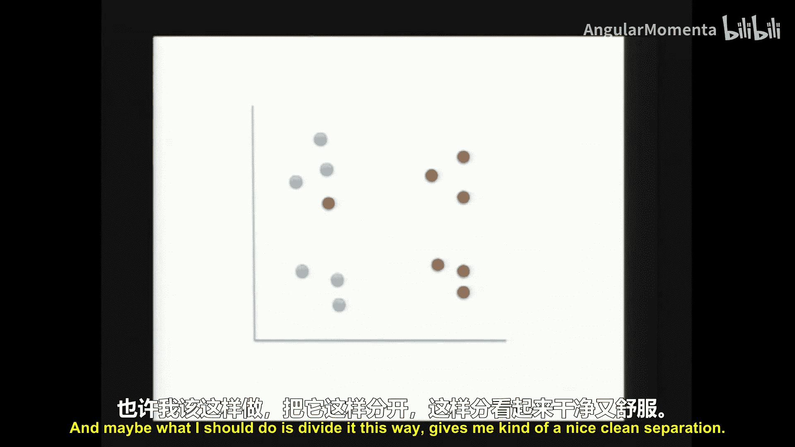

It givesives me kind of a nice， clean separation， but maybe I should divide it this way。

Or maybe I should put a circle around each of these。4 groupings。Complicated what to do。

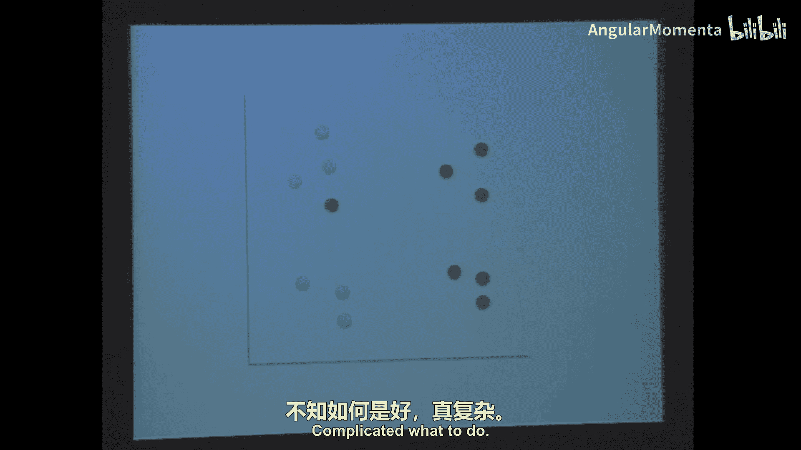

But what we see is there is clearly some structure here。And the idea of unsupervised learning。

Is to discover that structure。Far and away， the dominant form of unsupervised learning is clustering。

And that's what I was just talking about is finding the cluster。In this data。

So we'll move forward here。There it is with everything the same color。

But here I've labeled the X and Y axes。As height and weight。What is clustering means。

 It's the process of organizing the objects or the points。

Into groups whose members are similar in some way。

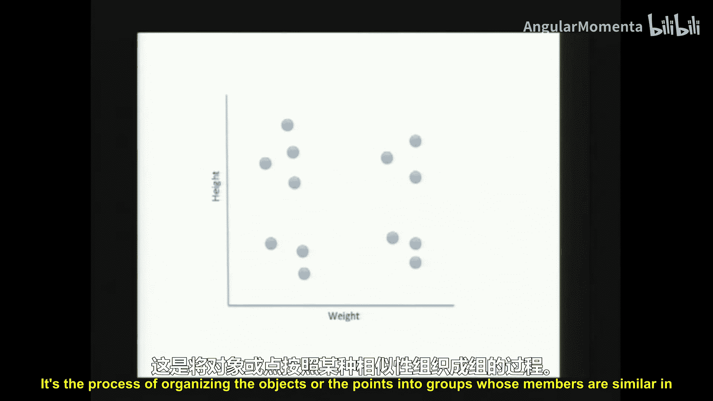

A key issue is， what do we mean by similar。 What's the metric we want to use。

And we can see that here。If I tell you that really I want to cluster people。By heightい。

Sa people are similar if they're the same height， then it's pretty clear how I should divide this。

 right， what my clusters should be， my cluster should probably be this group of shorter people。

And this group of taller people。If I tell you， I'm interested in weight。

Then probably I want to cluster it with the divisor here。

Between the heavier people and the lighter people， or if I say， well。

 I'm interested in some combination of those two， then maybe I'll get four clusters。

 as I discussed before。Cluing algorithms are used all over the place。 For example， in marketing。

They are used to find groups of customers with similar behavior。

Wmart is famous for using that clustering to find that。

 They did a clustering to determine who would buy when people bought the same thing。

 and then they would rearrange their shelves to encourage people to buy things。

And sort of the most famous example they discovered was there was a strong correlation between between people who bought beer and people who bought diapers。

And so there was a period where if you walked in a Walmart store。

 you would find the beer and the diapers next to each other。

And I leave it to you to speculate on why that was true。It just happened to be true in Walmarts。嗯。

Amazon uses clustering to find people who like similar books。So every time you buy a book on Amazon。

 they're running a clustering algorithm to find out who looks like you。

 So this person looks just like you。 So if they buy a book。

 maybe you'll get an email suggesting you buy that book。 or the next time you log in Amazon。

Or when you look at a book， they tell you， here are some similar books。

And then they've done a clustering to group books as similar based on buying habits。Ne uses that to。

 to recommend movies， etca。Biologists spend a lot of time these days doing clustering。嗯。

They classify plants or animals based in their features。 We'll shortly see an example of that。

As in right after Patriot's Day。 But they also will use it a lot in genetics。

 So clustering is used to try and find。Genes that look alike or groups of genes。

Insurance companies use that to decide how much to charge you for you your automobile insurance。

They cluster drivers based upon who and use that to predict who's going to have an accident。

Document classification on the web is used all the time。嗯。usedd a lot in medicine。

 just used all over the place。So what is it exactly， Well， the nice thing is we can define it。

Very straightforwardly is an optimization problem。And so we can ask， what properties。

Does a good clustering have。Well， it should have low。In truck cluster。Disimilarity。

So in a good clustering， all of the points in the same cluster should be similar by whatever metric you're using for similarity。

 And as we'll see， there are a lot of choices there。But， that's not enough。We'd also like to have。Hi。

Interluster dissimilarity。So we'd like the points within a cluster to be a lot like each other。

 But if a points are in different clusters， we'd like them to be quite different from each other。

That tells us that we have a good cluster。All right， let's look at it。How might we model thisimility。

Well， using the concept we've already seen variant。So we can talk about the variant。

Of some cluster C。As equal to the sum of all elements x in C。Of the mean of C。Minus x。Squared。

Or maybe we can take the square root of it if we want。But it's exactly the idea we've seen before。

 right， that we say， what's the average value of the cluster。

 And then we look at how far is each point from the average， We sum them。

 And that tells us how much variance we have。Within the cluster。Makes sense。So。Thats variance。Now。

So we can use that to talk about how similar or dissimilar the elements in the cluster are。

We can use the same idea。To compare points in separate clusters。And compute various different ways。

 And we'll look at different ways to look at the distance between clusters。So。

 combining these two things。We could get， say a metric we'll call badness。Not a technical word。

And now I'll ask the question。Is the optimization problem that we're solving in clustering。

 finding a set of clusters， capital C。Such that badness of that set of clusters is minimized。

Is that a sufficient definition of。The problem we're trying to solve。

Find a set of cluster C such that the badness of C is minimized。Is that good enough。

Now why not just imagine in case where if you cluster if you big a single cluster。

 every cluster has one element in it and the variance is zero exactly so that has a trivial solution。

 which is probably not the one we want of putting each point in its own cluster。Badness。

 it won't be bad。 It'll be a perfect clustering， in some sense。But doesn't do us any good， really。

So what do we do to fix that？What do we usually do when we formulate an optimization problem。

 What's missing。I've given you the objective function。 What have I not given you。A constraint。So。

 we need to add。Some constraint here。That will。Prevent us from finding a trivial solution。

So what kind of constraints might we look at。There are different ways of doing it。

A couple ones that usual， sometimes。You might have， as a constraint， the maximum number of clusters。

SoAll right， cluster my data， but I want at most。😡，K clusters，10 clusters。

And that would be my constraint， like the weight for thenapsack problem。Or maybe。

I want to put something on the maximum distance between clusters。

So I don't want the distance between any two clusters to be more than something。In general。

Solving this optimization problem is computationally prohibitive。So once again， in practice。

 what people typically resort to is greedy algorithms。

And I want to look at two kinds of greedy algorithms。

 two probably the two most common approaches to clustering。One is called K means。

In Ka means clustering， you say， I want。Exactly， K clusters。And find that。

 find the best K clustering。 We'll talk about how it does that。 And again。

 it's not guaranteed to find the best。And the other is hierarchical clustering。

We'll come back to that shortly both are。Symple understand and widely used in practice。

So let's first talk。About how we do this。 Let's first look at hierarchical clustering。

So we have a set of n items to be clustered。And let's assume， we have。An end by N， distance matrix。

That tells me for each pair of items。How far。They are from each other。So we can look at an example。

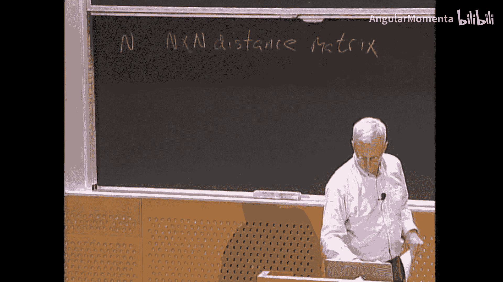

So here's an N by N distance matrix for the airline distance between some cities in the United States。

That the distance from Boston to Boston is 0 miles。 Dis from New York is 206。

The distance from Chicago to San Francisco is 21，42， etcter。 Allright。

 So I have my end by N distance matrix there。Now， let's go through how hierarchical clustering would relate these things to each other。

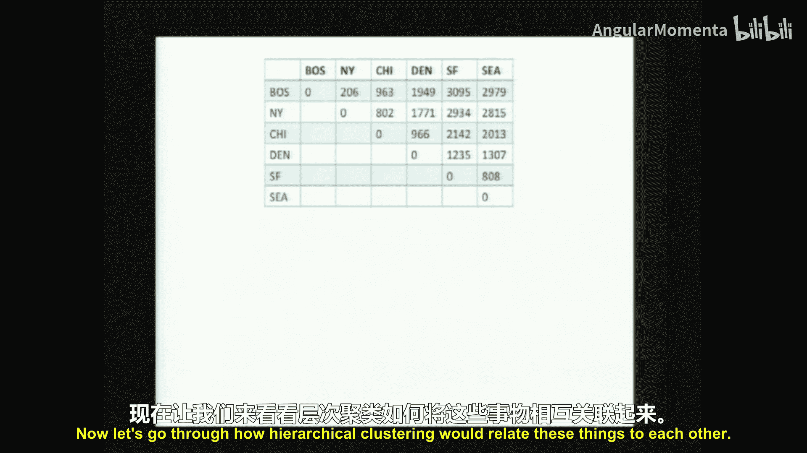

So， we start。By。Assigning each item。To its own cluster。So if we have N items， we now have N clusters。

All right， that's the trivial solution that you suggested before。The next step。Is to find。

The most similar。Pair of clusters。And merge them。So if we look here。啊。And we just， we start。

 We'll have six clusters， one for each city。And we would merge the two most similar。

 which I guess in this case， is New York and Boston。

Hard to believe that those are the most similar cities。 but at least by this distance metric。

 they're the closest。So we would merge those two。And then you just continue the process。In principle。

 into all items are in one cluster。So now you have a whole hierarchy of clusters。

And you can cut it off where you want。If you want to have six clusters。

 you can look at where in the hierarchy。 you have six。 You can look where you have two。

 where you have three。Of course， you don't have to go all the way to finish it if you don't want to。

This kind of hierarchical clustering is called a glloorative。Why， well。

 because we're combining things。 We're agglomerating them。So this is pretty straightforward。

Except for two。The complication in step 2。Is。We have to define what it means to find the two most similar clusters。

Now， it's pretty easy when the clusters each contain one element。Because， well。

 we have our metric in this case， distance， and we can just do that as I did。

But it's not so obvious what you do when they have multiple elements。And in fact。

Different metrics can be used to get different properties。

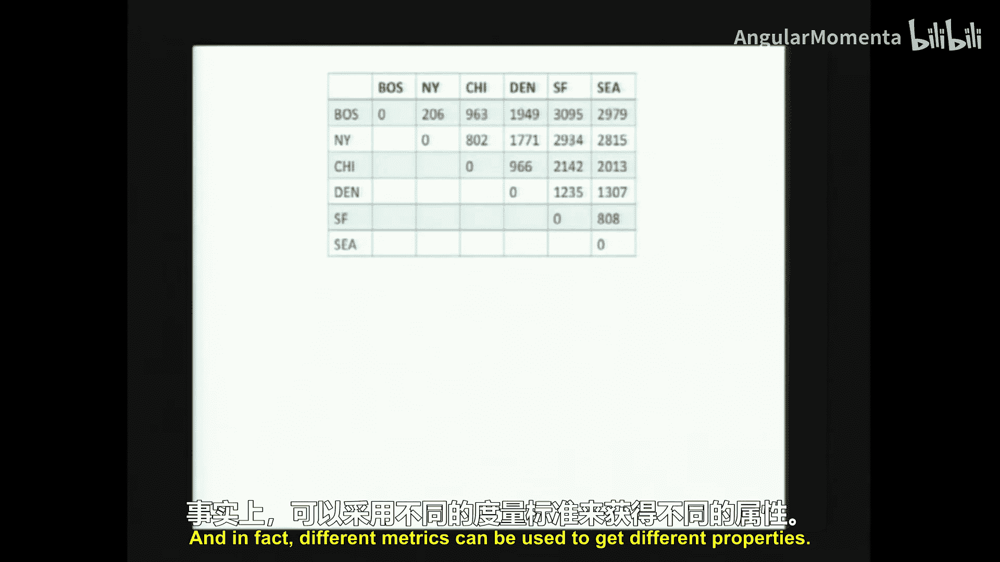

So I want to talk about some of the metrics we use for that。

These are typically called linkage criteria。All right， so。

Popular one is what's called single linkage。It's also called connectedness， or minimum method。

In this， we consider the distance between a pair of clusters。

To equal to the shortest distance from any member to any other member。

So we take the two points in each cluster that are closest to each other。And say。

 that's the distance between the two clusters。People also use something called complete linkage。😡。

It's also called diameter or maximum。Where we consider。

The distance between any two clusters to be the distance between the points that are furthest from each other。

So in one case， essentially。Single leakages linkage is looking at the best case。Complete。In English。

 not French， it's looking at the worst case。

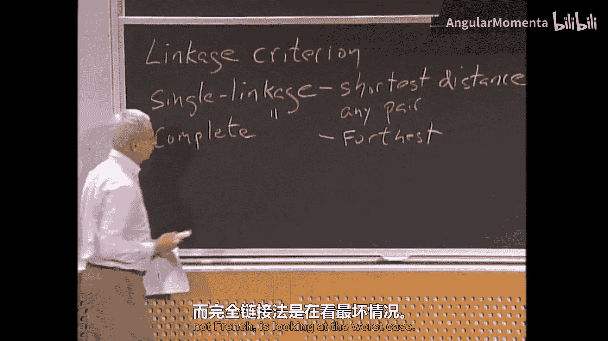

Then you won't be surprised。To hear that you can also look at the average case。

Where you take all of the distances。So you take all of the pair wise things， you add them up。

 you take the average。You can also take the median if you want instead。

None of these is necessarily best。But they do give you different answers。

 And so I want to look at that now with our example here。So let's look at it。And run it。

 So the first step is independent of what linkage we're using。 We get these six clusters。All right。

 now。Let's look at the second step。Well， also pretty simple。

 since we only have one element in each one。We're going to get that clustering。All right now。

What about the next step。What do I get if I'm using the minimal？Single linkage distance。

What gets merged here？十位。Boston， New York and Chicago。Boston， New York and Chicago。

And it turns out we'll get the same thing if we use other linkages， in this case。

 let's continue to the next step。Now we'll end up merging San Francisco in Seattle。

Now we get a difference。What does the red represent and what does the blue represent。

 which linkage criteria？We're saying we could either merge Denver with Boston， New York and Chicago。

 or we could merge Denver with San Francisco and Seattle。嗯。Which is which？

Which linkage criterion has put Denver in which cluster。Well， suppose we're using single languageage。

 where we can group go。Yes， because it's not so far from Chicago。

 even though it's pretty far from Boston and New York。But if we use average linkage。We see。

 on average， it closer to San Francisco and Seattle。And it is to the average of Boston。

 New York and Chicago， so we get a different answer。And then finally， at the last step。

Howhy do you think it merge together？So you can see in this case， without having labels。We have。Used。

A feature to produce things。And say， if we wanted to have three clusters， we would maybe stop here。

 and we'd say， all right， these things are one cluster。 This is a cluster， and this is a cluster。

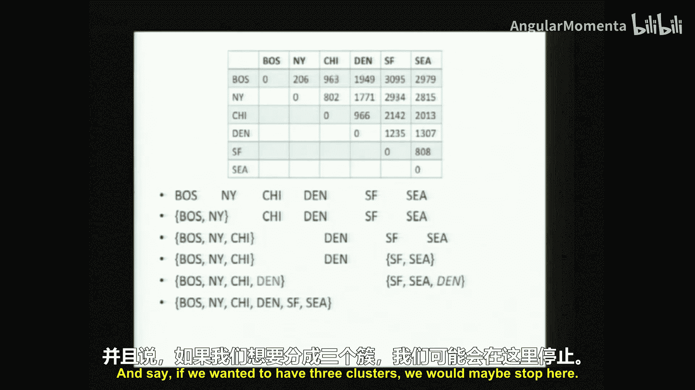

And that's not a bad geographical clustering， actually。

For deciding how to relate these things to each other。

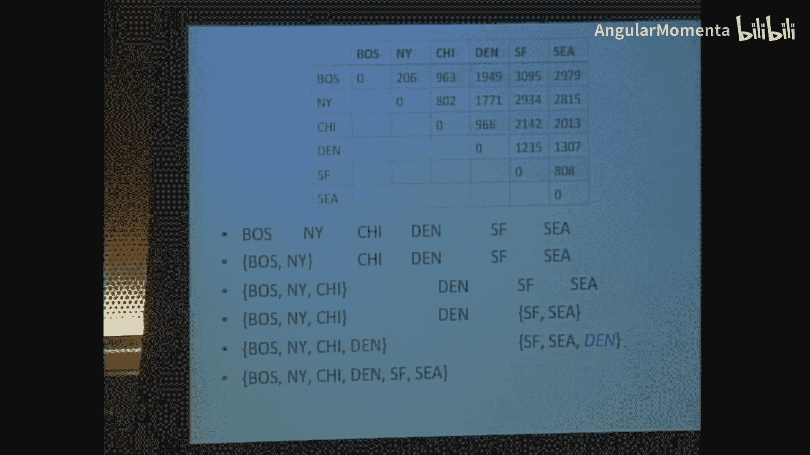

This technique is used a lot。 It does have some weaknesses。One weakness is it's very time consuming。

 It doesn't scale well。The complexity is at least order n squared。Where n is the number。Of。

Items points to be clustered。 and， in fact， in many implementations， is's worse than n squared。

And of course， it doesn't necessarily find the optimal clustering， even giving these criteria。😡。

It might never， at any level， have the optimal clustering。Because again， at each step。

 it's making a locally optimal decision。😡，Not guaranteed to find the best solution。

I should point out。That。A big issue in deciding to get these clusters or getting these clusters was my choice of features。

And this is something we're going to come back to。

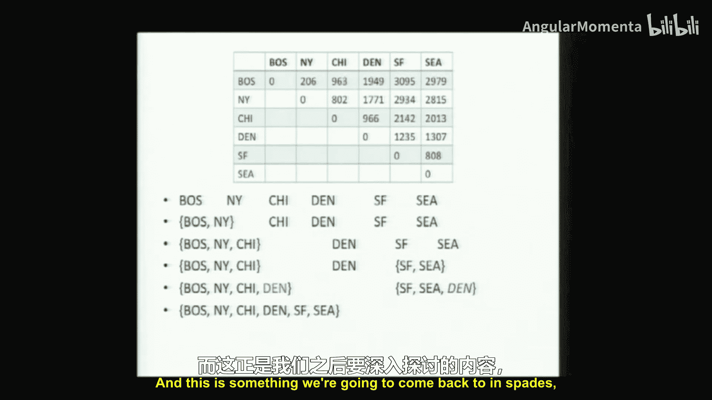

In spades， because I actually think it is the most important issue in machine learning。😡。

Is if we're going to say which points are similar to each other。

 we need to understand our feature space。So， for example。

 the feature I'm using here is distance by air。Suppose instead。

 I added distance by air and distance by road and distance by train。Well。

 particularly given the sparsity of railroads in this country。

We might get very different clusterings， depending upon where the trains ran。

And suppose I throw in a totally different feature， like population。Well。

 I might get another different clustering if， you， depending how I use that。

What we typically need to do。😡，In these situations。

Dealing with multidisal data and most data is multidimensional is we construct something called a feature vector。

That incorporates multiple features。So we might。Have for each city will just take something like the distance。

You know， we might。Or let's say， instead of distance。

 we'll compute the distance by having for each city， it's。

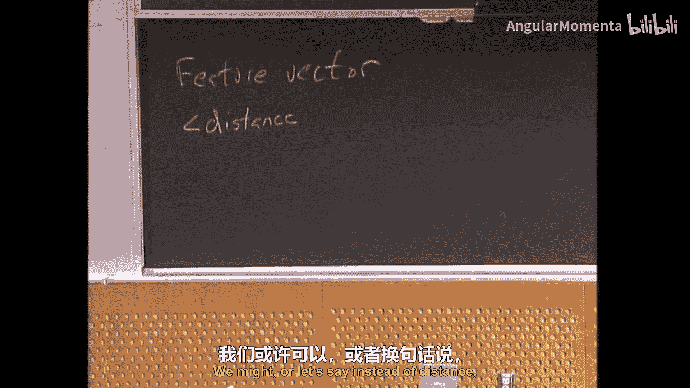

GPS coordinates。Where it is on the globe and its population。I let's say that's how we define a city。

And that would be our feature vector。 And then we would cluster it， say。

 using hierarchical clustering to determine which cities are most like， which other cities。Well。

It's a little bit complicated。 I have to ask， how do I compare。Feature vectors。

What distance metric do I use there。Do I get confused that GPS coordinates and populations are。

Essentially unrelated。 And I wouldn't like to compare those to each other。Lots of issues there。

 and that's what we're going to talk about when we come back from Patriots Day is how in real world problems。

 we go from the large number of features associated with objects or things in the real world to feature vectors that allow us to automatically deduce which things are。

 quote， most similar to which other things。

