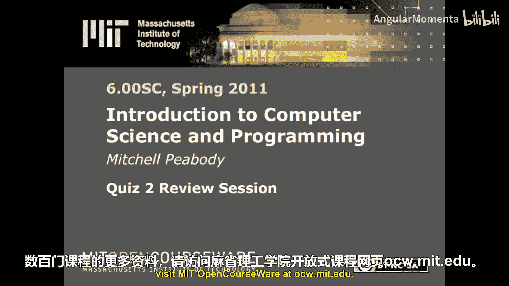
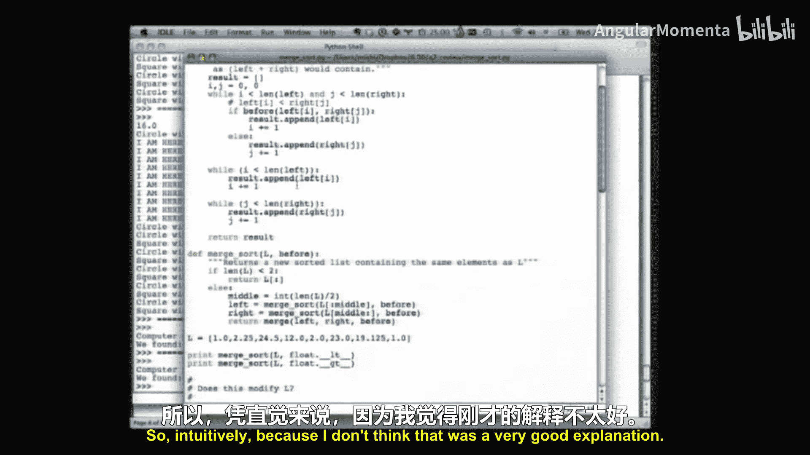
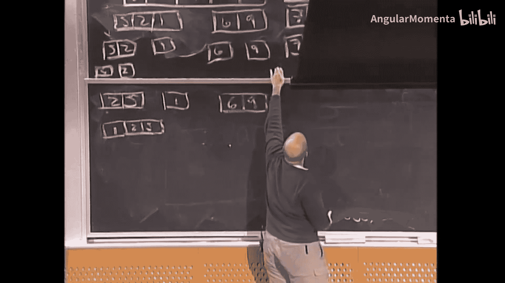
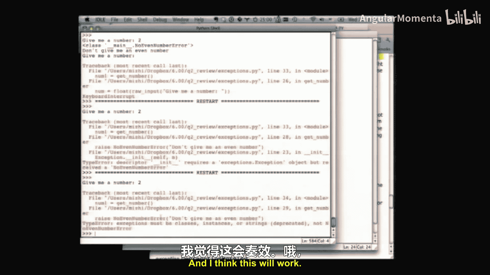

# 【麻省理工】计算机科学与编程导论 ｜ MIT 6.00SC Introduction to Computer Science and Programming p28 28 -BV1a5BZBkEP6_p28-

The following content is provided under a creative Commons license。

 Your support will help M I T Open Coseware continue to offer high quality educational resources for free。

To make a donation or view additional materials from hundreds of M T courses。

 visit M I T OpenCourseware at O C W。t M I T Eduu。

So I'll start off by going over the quiz 2 practice questions。So 1，1 in Python。

 a subclass can override methods of its superclass。 What say you all， true。Alright。

 there are some repeat people from last night。 So they know these already。 standard deviation。

 coefficient of variation are different names for the same thing， true or false。False。Allright，1，3。

All right， so coefficient of variation。It is。I have to write big for the camera， so。Is that right。

People who haven't asked the question。It's the other way around， right？

Coeient of variation is the standard deviation。Divided by the mean。What does this tell you， Like。

 what， what sort of information does the coefficient coefficient of variation tell you。Anyone。

So it's another way of telling。If your distribution is very widely spread so。

What it's getting at is like， it's trying to help you compare your standard deviation against your mean。

 because let's say that I have a distribution。And its mean is all the way out at one。Wow。

Let's pick it。Very large number， right， So it's got a really big mean。

 but say it's standard deviation。Is， I don't know，100。 Would you say that that's widely spread out。

It's pretty tight， right， If you're taking， you know， if this were like， I don't know。

An observatory taking measurements of deep space。 and you got a fluctuation of 100 for each standard deviation。

 You'd probably say that was pretty good。 And you wouldn't be too concerned about it because you've got a planet out there that's。

 you know， billions of light years away or something。So on the other hand。

 let's say that I have another measurement and its mean is somewhere around，ll say 50。

And his standard deviation is 100。So it's a lot fatter。

You would say that this has a much wider spread， right？So it's。

 it's a way of relating the standard deviation to the mean。 And rule of thumb is， if this is。

Les and or equal to one。We're going to say that it's not too widespread。

 there's not a lot of variation。Though that， you know， that's the standard that。Professor Gut has。

 you know， depending on your purposes， maybe that's too large or whatever。 So。

 but that's what coefficient of variation is。 Everyone clear on it。

The difference between variance and standard deviationation。

Stand deviation is a square root of variance。All right。Unit testing is useful for debugging。

What does the audience say？True， true， okay。You know what unit testing is， can you define it？Well。

 unit testing is when you use other code to test your code like right so you say you've broken your code up into nice little functions like a good programmer and you want to make sure that those functions are giving you the right values。

What you're doing with unit testing is you're writing a bunch of other code or a little bit of code。

Sometimes a lot， it depends on how thorough you want to be in your testing。

And what you do what you have is known input and known output。

And you're going to feed your input to the functions you're testing and youre to make sure that they give you the output that you're expecting。

 And if they don't give you the output that you're expecting。

 that indicates that there's probably a bug。Which also， you know。

 kind of supports the idea that unit testing is good for debugging。

And if you're very conscientious about your code and doing unit testing。

 you're gonna run your unit tests every time you either run your code or make a change because you might have。

 know inadvertently introduced a bug into the code that you're modifying。

 So it's it's a way of verifying it's a way of detecting bugs and also verifying that any changes you make in the process of you know writing more functions for your program or modifying functionality in your program don't introduce other bugs。

Okay。So in Python， functions cannot be used as actual parameters。False， why。Well。

 you could just use rephs rephrase a question。 But a better answer is that functions are first class citizens。

 So they， you know， they， they are objects in and of themselves。

 And so you can pass them around to a function。 and they can functions can make use of them。So。

We might see an example of that later on， if you want。Alright，1，5。

 increasing the size of a hash table typically increases the amount of time needed to locate a variable or value in the table。

False。Why。Right， the hashing function is generally constant。So。嗯。Okay。See。😔。

So what is this code print。嗯。6ix。嗯。'So外了。So。What is the string X actually？

It's the binary representation of image。And all this code is doing is it's just converting it to a decimal。

Right， and。Because I came prepared tonight。Sort of kind of。I have the code here。And we can verify it。

Any burning questions on that from？Right right。Booming on。What is the expected value of G1？哎有。Well。

Look at what the code's doing。 I haven't seen that function。 What's gaze that function of。

Gaus is a method on the random object that draws a random value from a Gaussian distribution that has a mean at。

Well， in this case， mean and a standard deviation of STD， dev， whatever you put in there。So。

Maybe for this example， if I wanted to draw a random value from this distribution。

 which I said had a mean a 50 and a standard deviation of 100。I would， say random。gauss。50，100。So。

So in answering the question，3，1， what do people think？100，000， what about three， two？100，000。

 so they're both the same。They both have a different standard deviation， so。

What this is getting at is it's getting you to look at。This。

So this code is straight from the question and all I'm going to do is I'm going to plot a histogram。

Of what this function produces。 and also。I'm going to run it a number of times and verify that I am getting 100。

000 in general。Python。There we go。So it's not exactly 10000 but it's close enough。 I mean。

 we're not going。Be too upset。So this picture here shows the actual values that were drawn when I did a number or repeated the experiment a number of times。

So。I don't know if you can see it on the screen， but there's this big。

 really thin vertical line here。That's those are the results from the Gausstian with zero standard deviation。

 so everything was 100000 exactly。And then these red blocks here。

 this is with the standard deviation of 20。Any questions on this？Yeah。The name。The question was。

 what's the difference between a normal distribution and the Gaussian distribution and its just it's a different name。

How I came across it。I also like see that。Well。If you look at the plots。Did来。

Which I apparently killed。So let me pull them up again。嗯嗯。All right， so。

So I think the thing that you want to know about Gaussian distributions。

Is that at the mean is the value that's the most probable。So its peak is at the mean。 And so if。

You're taking a thousand numbers from this distribution。

Then what's you know you if you know which number you're expecting to see with the highest probability。

I'm not sure if the sentence is grammatical anymore。嗯。

What it' going to affect is it's going to tell you that。

Like if you have a standard deviation of 10 versus 20。

It's just going to tell you what the spread of the curve is。

 but it's not going to change the expected value， so why don't I actually demonstrate that because I'm a fan of visuals and not necessarily good at English。

To know。All right， so all I did in the code was I just changed the standard deviation of the first distribution to be 10 versus 20。

And what you can see from the plots。Are that。Value with the highest probability。

Is still centered at 100，000。But the first plot as opposed to the first time I ran this with zero standard deviation。

Is a little bit more spread out。And the plot with 20 for the standard deviation is even more spread out than it。

 but they both have the highest probability at 100，000 or center it at 100，000。For G1。G求。Yeah。

 so had so if instead you had a mean of say 200 for the second distribution。Versus 100。

You'd expect them in two completely separate places， and you'd get。An expected value that's。

100000 versus 200，000。So here， close to 100，000， close to 200，000。And then see my distributions。

All right， we good on this？So moving on， question four。

What is the probability of the final value of nu6 being0？Nine over 10。

 the whole thing to the1 powder。Okay， so。Does anyone not see why that's the case？All right。

I'm going to explain it anyway， so what this code is doing。Is for 10 times。

It's drawing an integer from 0 to 9， a random integer。 It's a uniform distribution。

And it's counting the number of times that the integer drawn is6。And it's incrementing a counter。

The question can be rephrased as。What's the probability that no sixes were drawn。

10 times out of a pool of 1010 ins。And you know the way you can figure it out is。On one。

 one pool where I just。And I'll say I have a ten0 sided dice。On one roll。

 what's the probability of not getting a 6。 It's gonna be 9 over 10， right。

 And then if you do that 10 times 9 over 10 times 9 over 10 times 9 over 10。

That gives you9 over 10 to the  tenth0th power。And。Because this is a code class。Sort of。

We have a demonstration。 So here's the， you know， the answer that we hand jammed or that we。You know。

 just discussed。And now。Here is a function， count of6。And it's。The code that you see in problem4。

And all I'm going to do is I'm going to run a number of trials。

 and I'm going to count the number of trials that come up zero and increment count nu zeros。

 And then I'm going to say this is what I think the probability of getting a zero is。

 and then we'll compare the two numbers。Okay， so that's the probability that we count9/1s to the 10th power。

And then this is the estimated probability that we got。From running this function 100，000 times。Z。

Were good on this problem？とえて。呃。あマね。That you will see at least one six。

One minus times the probability or one minus the probability that you'll see at least 16。I mean。

 you can solve it in different ways， it's just that this ways。😔。

I think probably or this way thinking about it is probably more intuitive。When would you。

Instead of want to。いすがそ？Well， my answer would be when it makes sense to you。😔，は。

Some problems are easier viewed in the negative light， which is what you're saying its one minus。

 whatever， and some problems are better solved just in a straightforward fashion。

 so it's whatever tool gets the job done。Ma来 dont have to战 rules。呃，Maybe必都是。

A course 18 person who does。嗯。Would we possibly be as？😔。

What is the probability that'll end up being one？😔。

Or it doesn't necessarily matter which of those ten came up six。

In this and how would you show that if we were going to be absent？Well， one， I haven't seen the quiz。

 so I can't give you a definite。But you could be asked， what's the problem， you know。

 instead of using 6， maybe say。One， is that going to really change anything？

I meant that one of those 10 outcomes ends up being a six， right？I can do it if。You know。

 they say the fifth trial is a sixth。But just one of those 10 trials being in six。

 I don't know how to write。😔，So that's the probability that you get one of the trials is exactly six or exactly one of the trials comes up a six。

I think you would I mean， one way of thinking of it is。We calculated 910s。

 That's the probability that 6 doesn't come up。So what's the probability that six will come up？1，10。

 So instead of doing 9 over 10 to the 10th power， be 9 over 10 to the  ninth power times 1 over 10。

 right。Okay， thatll comfort。走没有。And because I never very comfortable with this stuff。

Why don't we do a simulation？All right， so this is what we're saying， right， exactly1，6 comes up。And。

I'm going to set this to one， right？likelyly that 16 comes up， then zero， six has come up。Is it。Yeah。

 because you're looking for exactly you're looking for a sequence of 10 events where exactly one of those events is a six。

 which。Seems more unlikely than say you're getting。😔，You know， everything that's。な。So but you know。

 I want to verify this。Because we're asking if I rolled this ten side of dice。😔，1en times。

 what's the probability that exactly one of those roles is going to come up with six？

And so what we're asking is what is the probability that I roll the dice nine times and it doesn't come up a six？

And then what's the probability that on the remaining role that it comes up to six？

Which is one over 10。So let's see if I'm you know， in the ballpark。Don make a mistake。

There's 10 different ways。Oh， yeah。So yeah， you're right。借 that出来了位。嗯。So yeah。

 it's a little bit more complicated than that。You comes。That's right， so I only in this， yeah。

 I'm only counting one case。Multiple ways that exactly one dosece could come。

So the answer is more complicated。光发呗。There'1antly places。Yeah， so actually that's what we got。

So we'll just do this。Well， of course it's。快。The simulation gives us the same answer as what we've just kind of come up。

Right？Okay， thanks。Did that work？Yeah， probability can be。Triricky。哪啊。那个大。気もっぱがね。Yeah，你给 us that。

So yeah， I mean， there's multiple ways to think about the problem。So she was saying。

 instead of multiplying by 10， we just say that we take the probability that you know we have nine rules that aren't six。

And that works too。That's what she just pointed out。So these parts cancel each other out。So。

It's basically， it is the same thing as this。All right， are we good on this question？Right right。

Alright， problem 5， it was matching plots。So you have three functions here。 you have a。

Polynomial or two polynomials， one's a cubic， one's aquintted。And one's an exponential， right？嗯。

There are a couple ways that you could go about solving this one。

 one is to plug values in and kind of match them up with the plots。

 another is to look at the axis of the plots。This exponential function here。

 if we were to have it on two linear axis， the x axis and the y axis were both linear。

 you'd see the expected curve upward sharply。But if you notice one of the a couple of the plots are in a semi log Y axis。

 So if you put an exponential on with a linear X axis and a logarithmic y axis。

 what would you expect the plot to look like。And be a straight line， right？

 So what that tells us is that if we look at。InThe bottom plot。

 we have something with a straight line。 So bottom plot is the third。Function， right， exponential。

And then for the remaining two functions， there are a couple methods that you would use or you could use one is to plug values in and see where the plots wind up or see where the points wind up and compare them with the plots。

 Another way to think about it is that one of the plots is on a semiloggue and another plot is on just both linear ax。

And if you。Ploot a。If polynomial， and that's not exponential on a logarithmic y axis。

 what would you expect the curve to look like？Yeah， it shouldn't look like similar to a log。

So with that in mind。嗯。You could， then。Start plugging points in。

And what you would come up with is that the second function is this top plot here。

And the middle plot here is the first function。Is there anyone who's lost on that？Oh。喂。3。ちち。对他完了没有。

嗯哼。If you plot an exponential on a logith with a linear x axis and a logarithm with y axis。

 should be a straight line。Firstt graders。嗯。嗯。Any other questions？All right。

 what is the following code print？Close。So I don't actually have。报大税。But I have the code。

 so I'm just on。So here class。嗯。Shall we spend some time stepping through this code and understanding it？

So。What question six does is it creates a class hierarchy。And at the top of it。

 it has the shape class。Which has just two methods， under double underbar EQ and double underbar GE。

Those just defined the equals operator and the greater than an equal operator for shapes。呃。

In terms of their area。So it's what this is saying is that。

Two shapes are equal if the areas are equal。A shape S1 is be greater is going to be larger than another shape if its area is larger than the other shape。

So， like。If I had like a。well， let's go down and we'll get to that in a second。嗯。

Square subclass of shape。It is what it says it is， it's a square and it just it has a side。

And its area is what you would expect it to be the side squared。And circle。Is just defined。

 It just has a radius， and its area is。What you would expect it to be。Okay。There is a function here。

 F， and it takes。A parameter L。And L， if you look at the code here and you kind of walk through it。

 L would have to be either a list or a tuple of elements， right？

Doesn't have necessarily have to be shapes， but。This first line is just going to return none if the list is empty。

And then these next lines are going to one。 it's going to set the first element equal to x and then iterate through each element to L。

And then if the element it's looking at is larger than x， it's going to set x to the element。

 So what this function is doing is finding the largest element in the list， right？

Anyone follow that okay？So。This should be pretty straightforward。Ashidess。

This part might trip some people up。So。This obviously creates an empty list。

 what this does is it creates a dictionary。Of class names。And what it's saying is that。

For a key of zero。The class circle and for a key of1， the class is square。They see that？Okay。

This loop here iterates for 10 times。And it depends。10 elements。

 then each of those elements are defined by this shape dictionary。Right。On each iteration。

It's going to take the modulus。Of the， of， of I， the index or of the number。And if it's a zero。

It's going to construct whatever class。The dictionary shapes returns， so if it's an even number。

 it's going to be a circle。And then if it's an odd number， it's going to be a square。

Everyone follow that？Does no one follow that？O。Or does anyone not follow that？my logic messed up。

 All right， so now what we have here is a list of shapes。

And then all this does is it's going to print。Which shape is it going to be the fourth of the fifth shape。

Fifth， right， because we start indexing at zero。What。So this number is obviously even， right？

So this should be a circle shape。Or a circle class。And what should its radius be？And then。

This line here is just' going to call the function F， which is going to find the largest shape。

 which is which is determined by its area。And in this particular instance。

 it's going to be circled with radius8。OnceOnce you figure out what F does this is actually not such a hard problem。

So the key to understanding this one is figuring out what F is actually doing。And it's purposely。

 you'll probably see a problem or two on the exam that's written like this where。

The function has been obfuscated。So it doesn't have nice little variable names。You know。

 if we were writing this for real， it would be like。Something like that。

Whi what was the radius on it was。Rdius on the not radius what was like L4 was it was circled and it was。

Was that all it was， it was just circle with radius4 with radius 4， Okay， that's what I thought。

好 right。How many of those。Special。Besides。So how many of the double underbar functions have you seen。

 it's a good question。You say话， right。The ones that I would be familiar with。Definitely in it。

Definitely EQ， GE。And definitely STR。You might want to be。Familiar with。This L。 So what is L。

What do you think that does？Less than or equal to less than so it's the opposite of GE， right？嗯。

I think there's also。LT， so less them。え？拒绝。It。Fairly logical。而童。Historically， you haven't。

 you don't need to under， you don't need to have these memorized。 Like。

 I don't think we're gonna I've never seen a question where you've actually had to produce code。

That uses double underbar on the quiz， you just have to understand what it's doing if you do see it like in a code reading exercise。

Right， and。The conventions are fairly straightforward。To understand。Can I move on。Yeah。Print L4。

And I guess print FL， why just does it automatically just print the string？方便。Yes。You're asking why。

I don't have this。And right。So。In this flavor of Python and。If you don't have。

An explicit conversion to string Python will look for the underbar STR function if it exists。

 If it doesn't exist， then you get that weird object at blah， blah blah， blah。Okay。

Any other questions？I。So。Are you confused because it's the same name？Maybe I don't know。

 if he's like so。I understand in the second。Circle3 for building。How do you circle with gradient？

Well。The way we get that is F of L， I mean F is a function， right。Right， and the list of contains。

Zero，2 nine。Yeah， so I mean， we can actually print out what elephant why isn't it square isn't？不然还了。

我では。All right， so all this is going to do is it's going to print out all the shapes in the list and their areas。

Oh yeah， I've got。Stuff at the top。Okay。So this is the first。Shape and then as we move down the list。

You know， we have。Square with side1， circle with radius 2，3， et cetera， et cetera， et cetera。

And then。This is the area of the circle with radius 8。Versus。The area of a square was 9。So。

And it depends。On。The reason why it works this way is that this。

Greater than or equal to operators defined in terms of the area method of the shapes。Does that。这应的。

然后。L is a list of shapes。So what。Well， it's a list of subclass of shapes。And to being。

Just list of shape。Oh， I to compare。If us。啊。有。嗯。Now。I think this will work。Yep， it works。

So you see this weirdness I have here？Its showing pretty explicitly that I'm calling this GE operator。

Right， it's just so。This is really just shorthand for that syntactic sugar that's easier to look at。

Easier to understand。And。To even drive that point further home。Whenever that G。

 that greater whenever that comparison is done， it's going to print out I am here。

So it is actually getting called a not just blow smoke。Okay。Have we beat this problem to death？哎。

Last problem。So。I'm actually not a huge fan of this problem， but。

The way I think of it is it's the number guessing game right， so I say to you。

 I'm thinking of a number between zero and 100， or in this case， Max foul。

And your job is to guess as quickly as possible what number I'm thinking of。

 The only thing I can tell you is that you give me a guess and I'll tell you if it's higher or lower or if it is the answer。

 right。So what， you know， if I am thinking of a number between 0 and 100， what's the strategy？来说下。

Well buying research。Or binary searches binary search， right。

 so you're going to start in the middle you're going to start 50。I to say I'm going to say， well。

 no its the number I'm thinking of is lower， right， so now you're going to guess。Between0 and 50。25。

 I'm going to say well it's higher。Not even a guess between 25 and 50。I don't know。

 I didn't actually think of a number， but you get the idea， right？

So this problem is asking you to implement binary search。

And comp gas here is functioning as me in this。In this this problem， right。

 it knows a number and you get right the program that's going to guess it。Which is fine number。

So there are multiple ways to。To do this problem。Here is。My solution。嗯。

This is just an implementation of comp guests right at the beginning。

 I set a maximum value of 100000， and I'm going guess magic number。

 or I'm gonna choose a random random number from between， yeah。Is that the same thing as？

It's the same idea， but the way that I differentiate binary search from biseual search is that you do a binary search on a finite list of elements。

Ofsorted elements， right， so I might have a list of names in alphabetical order or a list of numbers in the sending order。

And I would do a binary search on that list。With bisection search。

It's not necessarily a finite list of numbers or elements that I'm looking at。

 It's I know that the answer exists within a lower and a higher upper bound。

But I'm going to divide that search space in half。Successively or iteratively to find that actual value。

But it's not necessarily a finite。List of elements between those bounds。Did that that's good。Right。

So this is one implementation。 You can do any number of。Do it any number of ways。

 this numb steps thing。You don't， you wouldn't need to have， it's just， you know。

 for me to illustrate some stuff。So I'm going to start at zero， and I'm going to start at MaxV。

And then I'm going to keep iterating while I don't have。Or while I haven't reached the answer。

 basically。So。I'm going to make my guess in the middle。

 and then if comp guess tells me that it's higher。2。That my guess is too low， basically。

 then I'm going to set my upper。Sorry， my guess is too high。

 then I'm going to set my upper bound to my guess and then I'm going to search in the middle from there。

 and then if it tells me that my guess is too high， then I'm going to search in the upper region。

Otherwise。That means that I made the correct guess。And I'm done。So。Pretty simple。嗯。D。

A key part of this problem that tells you that you you should use binary search， though。

 is that it stipulates you need to have a log Maxwell algorithm， right。

 and binary search is a log n algorithm。I mean， you could。

 you could do fine number in a linear search， but it would be fairly inefficient。Alright。

Just like guess one number go。Yeah， zero， zero。有。So一。Incrementing by one。あるってね。itOh。

 it did specify like， oh， it you Ron？If it didn't specify the complexity， then yeah。

 you could use whatever search you deemed appropriate。But because it said， it needs to be lo in。Yeah。

关有。What's that。Not in this particular case。So。然个是。We're dealing with visitorss anyway。So。

All these operations are going to result。Integer results。下ね。So if it were like。900。990。在我上。

There's the number of next nows see。I might have a right way of implementation， always possible。

If I do， I'd probably take one point off me。Yeah， so I have a bug。So。I am actually。W to divided it。

Yeah， so I havet lot。Now I'm not going to try and fix it right now。没有。

If I were grading this and this was my solution， Id docked me a point or two。My error is that。

Because of this。The way that I formulaly get my guess here。I'm never going to。Get to Max Val。

 like it's I'm always going to like if the computer chose Max Val as its guess， then I' never。So。

Yeah， so yeah， you call me。Whoa， why did your friend think you would define them？I'm not。对对有是。

It is saying define a recursive function。I think its。Yeah， so I'm solving it。

You can write a recursive function。And。In this case。

 because we've given you the specification for find number。

 you would probably like write something like find number helper and have whatever additional parameters you needed in order to support the recursion。

See看觉呢。Yeah， we be fantastic and the point is that you' write。

A function that runs in log maxile time。Because at the top。The magic numbers in。doesn是那。这两个。あ第一。

そんですよ。I actually yeah。Because it would be zero to。Right。是。Well。No。

 I'm not sure if this actually constitutes a bug or not。So I happy to do。I don't have to get just。是了。

Which is。Again， back to unit Test。You have a question？Yeah。Do you do this by saying？S yes equals。

You could。But it would have。Like analyzing the complexity。Like doing this way。

 because right in the middle， you know it's going to be log map。发这的。

If you were to choose a random number between low and high。

 I'm not sure what that would do to the complexity。

It would make the analysis a little bit more intricate。Song。

And if you did that on the put if this were the actual quiz and you put that as your answer。

 we probably take a fair number of points off for。There are people who do study algorithms that do that though。

 like they use random numbers in order to。All right。We're done with the quiz。😔。

And now he's got a list of topics to go over。So。Let's start at the top。

The first subject that was listed， so all of you got the list of quiz topics for their quiz。

 I'm assuming。Did all of you look at it？The first topic is algorithms， and I have big O notation。

 exhaustive enumeration， guess and checks， excessive approximation divide and conquer， binary search。

 merit sort， hashing， orders of growth and amortized analysis。So。First come， first serve。

 what do people want to see？Hashing and amortized analysis。Okay。

So let me start with hashing because that's pretty easy。The idea behind hashing is that。

You have a function。And it's going to take some input。

And it's going to compute an address of some sort。And。

Let's imagine that I have a data structure that has a number of buckets。Arranged one after the other。

What hashing does is it says。I have this。Input S or a key， if you will。

And I'm going to compute and address。Like a number of some sort。 and it's going to say wine up here。

And。This relates to Python because this is how dictionaries are implemented。

So this S here is going to be the key that you give the dictionary。

And then itll compute a location for this bucket where it's going to put the value。All right。So。

The idea。What makes these hashing functions valuable， especially with respect to dictionaries。

 is that you can check for the presence of a key or a value in constant time。

Because the hashing function is more or less constant。

And once you have an address into the data structure。

 it's very easy to compute the location where you're going to put something。So。I'm not。

Does that kind of。I辩。You're not going to have to know。You don't need to know hashing in great detail。

 like you're not going to need to know。The hashing function for like a string or the hashing function for a tuple or something like that。

 the main points that you need to get from hashing is that it computes an address into this data structure。

 it's a constant time thing。And。That's about it， actually。If you have those two concepts down。Well。

 also three， that's how dictionaries are implemented。If you have those in your mind for hashing。

 you'll be good。Does anyone to have any other questions for Hahing？So we never have to like write。

It's more just like this is。Right， this is so that you know what it is and when you see it in the future。

 if you see it in the future， you're not totally lost， like you have an idea of what it's doing。

You can define your own hash functions。But we're not going to require that of you in this course。

Okay。All right， so that's hashing， basically。And all you need to know for the quiz。So。

For amortized analysis。The idea behind amortized analysis is that you have。

Maybe you have a known kind of sequence of operations and you might have。

You're trying to find what the worst case runtime for that sequence of operations is。

 and you might have a bunch of operations that are really。

 really low cost or low complexity and one really expensive one。And for our purposes， you know。

 we're trying to find this。You know， find which of these operations is a dominating factor for the complexity。

 So the example I would use is。Let's say that I have the task of searching for an element in a list of a big list of elements。

 right？So we know two basic search algorithms for this， right。

 we know like a linear search where we go one at a time through each of the elements。

 and what's the complexity of that。否则。It's going to be linear in it terms of the number of elements in you。

We also know。Finary search。What's the complexity of binary search？While again。

Now there's a problem with binary search， it has a requirement。

Will binary search work on a list that is not sorted。No， you require to be sorted。

We've talked about sorting in class， where he covered it during lecture， right？For。You know。

 basicsic sorting that we've seen。The lower lower bound or the complexity of the sorting algorithms is N log n。

 right， So like merge sort will be an n log n algorithm。So。

When let's say that we just need to do one search， right？Do I want to necessarily。

 do I really want to use binary search？Wai。Because I have to sort it first。😔，And。Yes。I just do。

 if I do。I have to sort。And then search。And this is going to be。Whereas if I do a linear search。

I just have search。Right。And for just a single search。For binary search。

This is going to dominate my complexity。But let's say that I'm going to do a million searches。Right。

Now。It might behoove me to actually sort this first， because。I only have to sort the list once。

And then I can do as many searches as I want。So。In the grand scheme of things。

 if I'm doing a million searches。Then linear search is a really poor choice。

And binary search would be my best option and this is about as deep as we want to go with amortized analysis。

 it's this idea that there's a certain point at which one algorithm becomes more important than another algorithm because the composition of its operations kind of determines it kind of changes as you increase the number of elements you're working with or the number of times you're going to do the operation。

Right。So。That's kind of what you need to understand for amortized analysis。And。

It can be used in other types of analyses， but we're not going to get into that。All right。

 what other topics do we want to go over？For algorithms we've got。They go notation。

 exhaustive enumeration。Divide and conquer， successive approximation merge sort and orders of growth。

You want to go over Merel？Okay。So and today I actually have my。So。

Mert sort is a divide and conquer algorithm。And the idea is that。I am going to。

Take a list of elements。And。I am going to。Divided。Divide the list in half。

 so I'm going to get a left list and a right list， and they're unsorted。

And then I'm going to co mergege sort on that。And。I'm going to keep recursively calling merge sort。

Until I have one element or no elements in the list。And then I'm going to return the list。After。

I do a merge sort on the left and right halves。 I'm going to merge them。

And the merge operation is just going to start at the start at the beginning of the left and right halves of the list。

And it's going to append the smaller element at the beginning of each of the lists to result until it gets to the end of the west。

So。I'll try a blackboard。Demonstration in a second or explanation in a second。So。This before。

Prameter， all this is doing is it's。Determining the order of the elements。

 so it's saying that left should come before right。

It'll return true if left should come before right and false if right should come before left。嗯。So。

Intuitively。Because I don't think that was a very good explanation。

Let's say that I have a list of elements。And they're unsorted。Yeah。Im missing。All right。

 so it's an unsorted list of elements。When merge store first starts。

It's going to divide this list into left and right halves。 So basically。

 it's going to take the middle here。And then it's going to call itself。On this。Left half。

And then on this right half。And it's going to keep doing this。 It's going to divide。This half into。

Say five， two， one。Now when it gets to these little single elements。

 it's going to do something interesting。It's going to。It's gonna to merge these two。 So it's when it。

 when it gets down to these single elements， it's just going to return。

The list as is it's not going to do anything to them。And then， the code。After this division。

Is going to merge them， and the way it merges them is it's going to start at the beginning of these two lists。

And it's going to say。Is this element larger or smaller than this element or is it going to come before this element？

And it's going to construct a merge list。And then return that as its result。All right。

 so this is going to come down。So now at this point it's popping back up the stack。

 it's going to return this， it's going to merge these two lists。

 so it's at the beginning of both lists。One comes before two。And then this list is done。

 so now it only has this list to do。After each merge step， these lists are going to be sorted。So。

Now where are we at， so now let's do these guy。So this guy gets merged into six and nine。嗯。

And then this guy， I didn't divide up。Bad on me。

All right， so we're going to merge that those two single element lists。Now。He's getting merged。

So these guys are going to get merged。 so this is going to become。

 I think my tree got messed up a little bit。Now we're going to merge these lists， right。

 so we're going to start at the beginning。One comes before three。First element is one。

 two comes before three。Now we're here in this list， we're still at the beginning this list。

 three comes before five。Five comes through four，7。And we're here six comes through 4，7。

And we have seven， and then nine comes before 10。Now we're done with this list， so now we have。10，13。

And at the end of the last merge， the list is sorted。So。I'm not sure howque that was。刚才说。

To begin with like all of your are split equally。关 there钱。した。第月0。What do you mean？

Like there's an odd number of elements in the list。So you would just get an uneven split。

 so your left sublist might have six elements， like say you have 11 elements in the list。

 left element would have six or left list would have six elements and then the right list would have five。

Yeah and。The two is split in one of them。Three split。And then the one would actually。

Make a call the eventually。又又 split。我ら。2。算然那。I mean， that's kind of what have。

They go all the way down on some of the branches。So。But the idea is that。I mean。

 the main idea behind merge sort is that you split the list in half， whatever size it is。

 and then you merge sort those separate halves。And merge sort is going to do the same thing with those separate hals。

 it's going to split them in half and sort those halves until it gets to the smallest case。

 which is an empty list or just a single element， and then it's just going to start merging these lists。

Yeah， you' split it into like two and one， and then that merge sort it would be like one and one。

 and then this one would split it into a list of one。Right错。I emergency between that。

So in the merge sword lecture notes， at one point the lambmbda is used。

Can you explain a bit how these works？Did he actually use lambda？Yeah， well， it isnt useful。

But I guess the word is。あ。He land okay。Python has these functions called Lambda functions。

What they are essentially like one liner， bits of code that return of value。See。How are you。

I can't believe he used Lida。I'm trying to think of where I would actually use them。Like an example。

 and I don't have one off the top of my head。 You're not going to see a lambda on the quiz。嗯。

The syntax is。Not too difficult it's basically。It's like lambda X。

 and then it's going to return like x squared， right， there's just going to create a function。

And it can be something like。I assign this lambda function to a variable square。

And I'm going to pull up a separate。So I'm creating a function square， but instead of writing。

Something like this。I write it as this。And。What's that， Do you have the same。Yeah，s。

I'm just trying to pick them。I'm actually stunned that he whipped Lambda out in lecture。So。Really。

 it' it's a way of defining these one liner functions。

 Python's lambmbda functions are kind of broken。At least in the 25，26，27， like 2。 x versions， 3。

0 are the 3。 x versions of Python， I think actually do away with Lambda。Because they were broken。

You find Lambda functions in a lot of other programming languages， like LspP or scheme。嗯。And。

You're never going to see this hard quiz， but if you want to learn more about them。

 you can look it up online。先生。Yeah。I just， was， I had it there as an illustration that the functions functional they're functionally equivalent。

嗯。And it actually serves to illustrate another point in that。呃。Functions are objects。

And pass them around。But lambda functions on their own。

 you're not going to need to know that piece of linguistic。呃。配ト年。F science。

 you're not going to any build。Does that work？I'm goingt have to ask him about that because I think used it。

Okay。Ex range。Did talk about generator opts or？Or yield， you haven't seen those？Okay。嗯。

So what you're asking is。Something like that， he used something like that， right？

The difference between range and x range is that range returns a list of integers and x range returns a generator object。

嗯。And I know that really meant a whole lot meant a whole lot to you。 So let's say that I assign。Yeah。

 that's what I'm going to show。So if I do print list of energygers， right？Our list of members。

 it's actually going to print the list of members。Someone fall back there？

So it's actually going to print that list。 right now， if I do something like。

Pretty sure this is not gonna to print a。Yeah。The reason is is that if you look at the type of the object that's returned。

It's well， experience range doesn't really help much either。哎。Why does he do this to me？U。

It's a way of， so let's say that you have a list of a billion elements or numbers or things that you need to iterate over in a for loop。

It's probably not a good idea to bring all of those into memory at once。So， or。

To necessarily keep them all around， you want。 that's where things like X range come in so。

Let's do this。M you like fore。Ex1 point。Yeah， so why do this？

It's going to be the same as if I did were to do this。

They're going to it's going to have the same functional effect， but the difference comes in。

 let's say that I were to。Do something like this。A lot of numbers， right。

I'm hoping Python crashes on this because this is my whole point。Yeah。So there's too many items。

But let's see if I do it with X range。Now I should probably comment this out。

I chose a really too large number， didn't I。嗯。Well。

I want to find a number that has too many list elements， but Python can still。Feel comfortable。

Constructing an X range out of。The point is is that there's a certain point。ACertain number。

That's gonna do that comfortably。So you see this little delay that's occurring。

 actually it's kind of long delay。It's actually hanging up on this range command because it's actually constructing this list object with all these integers in it。

So。Let's say do this。Are you going to need to know the exact difference， no。Is there a difference。

 yes， am I prepared to explain it exactly right now， not really。

Previous iterations of this class have covered the yield statement。In Python。

Which allows you to create functions。Create generator objects that。He did yield。答米のし料うが。So。

Rang is going to give you a list of integers。 X range is going to give you a generator object that uses yield to produce these integers。

Let me see if I can rescue my machine。Okay。So he covered something like that with you。All right。

 so if I were to。Soy do I in my X range。Back to where I was。

My X range does the exact same thing that X range does。Right。Now。As I said before， if I do。Alles。

 or if I do range。That's going to be a list， right if I assign this to。写的？

That's what the yield statement does for you。 It produces that generator。

 and that's how X range functions。So。Basically， it allows you to do some interesting things。

 like in this case， it's not too interesting because it's just returning a list of。

Or it's just returning one integer after the other， but let's say that I wanted to do。Deaf。

 my squares。All that's going to do is。Return these squares of all the numbers between0 and max n。

Right， so if I were to。Do this。It should print out all the squares or the squared of all the numbers between0 and 9。

Makes sense。So that's what yield gets you， those are generator objects。And that's how x range works。

 that's how it's different than range。Right。Does that make sense to everyone？Okay。

 I don't need to beat that into death。我。I was not expecting that question。Okay。

What should we go over next？Is everyone comfortable with orders of growth？Okay。All right。

 the next major topic area I have is linguistic issues， so this covers stuff like exceptions。

 polymorphism， classes and objects。So。People want to go over classes， objects， polymorphism，第五个责。

Sorry。嗯。So before。All right。So here。Are some class definitions， right？

So I have a shape object and I've defined two methods， area and perimeter。They currently do nothing。

Except for rays not implemented errors。And now I have to find a class hierarchy。

 I have a rectangle class that inherits from shape。All right， so shape is a super class of rectangle。

 rectangle is a subclass of shape。This also says， well， let me ask the question。Is shape a rectangle？

It's not a rhetoric。たけし？Not necessarily， is rectangle of shape。It's an easy question， so a question。

In the rectangle class， I have an init method， it just takes a length and the width。

Computing the area is really easy， and then competing the perimeter is also very easy。

And now I have a string representation， which is just rectangle with the length and the width。

Ellipse。Inherit some shape， and it has。One radius or one。The long axis and the short axis， right？

And competing the area for that is pretty easy。Competing the perimeter， on the other hand。

 I had to look it up online。 So if you're interested in the formula I used。Go take a look at this。

This website。嗯。Again， I have a string method， and then now we have a square which inherits from rectangle because square is just a special case of a rectangle。

And so I'm going to reuse it。I'm just going to make both。Both lengths the same， right？

That makes sense， everyone。Then I don't need to override the area perimeter because they're pretty easy to understand。

 are they're the same。And then circle， it just inherits from ellipse and same thing。

 I'm just going to reuse the stuff that I have in ellipse。And'm。All right。

I' have to find a bag of shapes here。Circle， squares， rectangles， rectangles， lots of stuff。Now。

 to answer your question， what polymorphism allows me to do。Is it allows me to treat？Subclasses。

That share。A particular super class or a parent class。The same。So I've defined an area method。

On the shape class， right？And all of my subclasses， rectangle， lip， circle and square inherent。

From this superclass。And some of them override area。 Some of them don't。 It doesn't。

Really matter to me。 It's just what matters to me is that if I have a bag of these shapes。

I know that I have an area method。And I don't he needs to know。

The particular or the type of the object that I'm calling the area method on。Right。

Python is going to take care of that for me。I can just。Iterate through this bag of shapes。

Call the area method and I can get to some of the areas。So， I mean。

 that's what polymorphism gives to me is it allows me to treat。Ojects uniformly。

 it allows the objects to change their behavior based on the particular type of object that I'm using。

 but I don't need to know the particular details。So it's pretty powerful。You know。

 if I were to create a racing game and I wanted to drive a car， you know。

 I could have different models of car， but I wouldn， you know。

 that my game engine wouldn't need to know like the drive method to call for like。You know。

 a model model， you know， a Ford car versus a chvrolet， all that stuff。So。嗯。

That kind of answer your question。All right。So。Yeah。Area areaa function that overrdes。

What is it going to st it just raises a not？😔，完了。And this yeah if you havent redefined Yeah。

 this well in this example， I have I'm using all what I known as concrete classes。

 so they're not abstract。They all have implementations of area。Right。But if I were to say。

 I dont know， for some reason， I decided that I wanted to make。Something amorphous。

This should raise an error， right？Unless I have in invalid syntax。然o。Alright， so when it gets there。

 yeah。Any other questions on this？嗯。They're related。But what inheritance means is that。

If I see that rectangle inherits from shape， that means it gets all of its methods and attributes。

But it's not necessarily polymorphic in that case。It's like。It's saying a rectangle is a shape。

 so it has all these characteristics of a shape and then some。

The polymorphism comes in when I override the area method。And then I can treat like all shapes。

 whether the rectangle square circles uniformly with the area method。Like。You know you。You know。

 you might。Trying to think of。An example where。So。So。

Let's say that I didn't do this in a class oriented way or using classes and so I had。A really。

Nive implementation it said。Let's represent them as dictionaries， right？Okay。

 so I have two really stupid functions here。 And all they they say they make a circle and they make a square。

 And so I'm really all' assuming doing is representing these as dictionaries。

 And the key is side and radius。 Now， let's say that I want to have my list of shapes。

I'll make a square， I'm to make a circle。Another square。Okay。

 so now I've got a bag of shapes or a list of shapes， right， What's that？It's been too much time。

All right， so if I were to take a look at this。All right。

 it's going to print out a bunch of dictionaries。 Now the question is。

 what if I wanted to compute the areas？Of these of these data types。Right。Using polymorphism。

I can just call thatt area on each shape， right？But if I wanted to do the same thing with this code。

 I would have to have like。嗯。Square area。S， return， D side。Right。And then。Death。Circle area， C。

 return。3。14。呃C。啊喂。I'm already going tripped on。Okay， so even this is not so bad because if I。

You know， do something like this， I can。Still get the areas， right？

And I can do this because I know what's in those positions in the list。So。Oh。Okay。

 so it's going to work。But now if I want to print out all the areas， well it shapes。

In this loop here。I' am not going to do that because I can't just call。You， square area。Of S。

 because what of us is a circle。And was it's going to get there。I could get around this by saying。😔。

Yes。Raddius in S。 then I know it's a circle， right。Or sighed。In S。

But you see how the codes getting kind of ugly now。I have to know details about how the。

These different objects are implemented， how square and circle are implemented in the dictionary。

I have to know what type they are。Before I compute their area。And。I can do it。But it's kind of ugly。

 Where if I invest a little bit of time in。Go away。If I invest a little bit of time in。

A class hierarchy。I can do this much more easily， much more cleanly。 It's， it's a way of kind of。

Abstracting from the problem。You don't have to worry about the details of the individual shapes。

Could I kill that？beat it into the ground。I heard it。我当位。

The point of what polymorphism was that if you had a class at the objects。

You don't need to know the details of the objects of know what type what specific type an object is。

 as long as you know that they like in the case of。Right。Yeah。Yeah。

 so like in this particular example， shape has an area method。

And I have a bunch of concrete class subclasses of shape that have all overridden the area method and they do it in different ways。

 you compute the area differently for a rectangle versus an ellipse。

 I don't have to worry about which particular shape it is I just call the area method。

And I don't have to do all the checking that I do here where I look at， is this a circle。

 is this a square， I don't know， so I'm going to compute that。So。所以。Can I会。

Anyone lost any other questions？So that actually touched on a couple of topics， right。

 So we saw exceptions here。Is there anyone who wants to see anything else on exceptions？

Passing continued。Okay。呃。So。The question is， what's the difference between' the past？

So when you have pass， this is basically a null command。 it's a do nothing command。

 I can actually run this code right now and it will do absolutely nothing useful。But。

 it also won't complain。Okay。It's it's a placeholder sometimes。

 so like a lot of times we'll senior code something like this。I's say。X equal。1，50。呃。

X mod 2 equals 0。Pass。Else。然。Do something useful。Right。So this we see this a lot in your P sets。

 It's not a slam on you or anything。 But you can simplify this by saying。

But the way that you conceptualize the problem forced you to have this， this if statement。

 and then you didn't have anything useful to put in here。

 so you had to put a pass in order to make Python not complain。So。Let's know be a little less。

You know， flip and more concrete。It's getting late。 I'm getting punchy。Alright。

 so if I were to run this now。It's not going to approach anything because it hit the pass command。

 right？Now let's make this odd。So we verified that this code works and that I'm not blowing smoke。

Now。Let's take out the pass。Python is going to complain， why？Because。After this， if。Lyine here。

 it's expecting a block of code， but there's nothing there。

The pass key gives you a do nothing command， it says。I don't really have anything to say here。

 but you want me to put something here， so I'm going to put something here。

But it doesn't do anything。嗯。So。That's past。It， it's。It's a placeholder。This is a basic answer。 Now。

 continu is different because connu actually has a function that is useful。嗯。

Let's say that I'm not too familiar with the range command。

 and I don't know that I can specify a step。 and I want to print out all the odd integers。

And I also am going to restrict myself and say that I can't use an else。Or something of that nature。

So I'm going to handicap myself。Does X range。Is X change cool？So。

I only want to print out odd numbers。Okay。Or we can do it like this， either or it doesn't matter。So。

Comment this。What continue does is it if you're within a loop。As we are here with this for loop。

 it tells Python if it sees a continuous statement。

Do not continue beyond this point within the block of the loop。

Go instead and perform the next iteration of this loop。Go to the top of this loop。All right， so。

What this code should do， I'm hoping in case don' I might have a bug。

 it should print out the odd integers。So。What's happening is that when the integer is even。

It's hitting must continue。Statement。And this is telling Python go back up to the top of this for loop。

And do the next iteration。So if I just had pass。Your correct。小文。Anyone confused？

You can also have your code， right， like if not。Yeah， but。啊。

There are some schools of thought that say that。It is something that disturbs the flow of code and sometimes should be avoided。

I don't subscribe to that， I think that if it makes your code clear， then use it。

But so which is to say that， yeah， you can rewrite a lot of your code to not use continue。 Okay。

 do we need to go over anything with linguistic issues。Are we good on classic？Reemption。O。

So there is a question。So exceptions are another way。Flow control。

And if I can pull up my source file， I have an example of handling exceptions。There we go。All right。

Exceptions give you a way of handling。Certain errors that occur， right。

The easiest one to come up with is division by zero， so normally。If you do a division by zero。

So I'm going to try and divide  10 by zero， right？The universe won't end。

 but Python will be very unhappy。In kind of programs that are more complex than the ones that we've been writing。

 know， division by zero happens， but you don't necessarily want the program to crash， right？

You want to be able to handle that error in a semi graceful way。And。In this particular example。

 we with a division by zero， we can do that with exceptions。

Let's say that instead of the program crashing， I wanted to print out a nicer error message rather than everything in big red。

 I say， well， you divide by zero so maybe you should change your numbers。嗯。

The way I capture or catch this exception is。I have a tribe。Keyword。

Colon and then I have this block of code， this is the code that could potentially raise an exception where the error might occur right this code could be in this case。

 it's just straight up assignment and division It could be a function that raises the exception。

 It doesn't matter。 The point is that there's an exception that might occur。If an exception occurs。

 then Python is going to look past this block of code here。At these accept statements。

And it's going to look at the type of exception it has。 In this case。

 it's a zero division by zero division error right。

 and it's going to match the exception against whatever type this is。

 and you can hand you can put inside here whatever code you want in order to handle this exception。

So in this case， I'm just printing divided by zero， I could be rude。And I could， I du'n know， say。

See， can't even smell。 so I can handle this exception however I want。

 but the program's not going to crash right， and this program's actually not going to really convince you of that。

 but。U。You see that the first thing you see here is that there's no big red blurring message that says you have an exception。

 It's all code that I've written。And I could even be silent about it。 I could say。

 I'm not going to say anything， I'm just going to let them fail silently， right。

And just tell me it's all good。 It's not going to tell me I divide it by 0。嗯。You know。

 it can come in handy if I like have an input loop。 So let's say I'm gonna do a little bit more be。

 be a little bit more creative and do。Oh。Where。That's an internal pipelineython。Oh。

 so if you want to learn about all the wonderful exceptions that Python provides you。It's Cl library。

 you can go to the Python。Documentation， or you could even。Do a Google search。Of course。

Almost being gross。No going。So built an exception。So these are all the exceptions that Python has。

And you can use these too， like， let's say that， you know， let me get back to my contrived example。

 I want to create a loop。That says。Let's say that。I want to catch。 I don't want to divide。

Even numbers， for some reason。What do we have here？What can we find？I think there's a value error。

There we go。So let's say that I'm going to raise a value error。Okay。And。

I am actually going to do this。This way。So I've created a function that's not going to allow me to input。

Even numbers， right， it's gonna raise a value error if I enter in a two or4 or whatever。

 But if I do enter in an odd number， it is just gonna return that number to me。

 So I'm gonna use that function now。And I'm just going to do the silly thing and divide。

Do a division and print it out All right。So if I comment out this code up here and I comment this out and I run this。

So。Let's do three。That's interesting。Apparently， Python is a little constipated right now。

We edit this during the summer， so。We can take that out， I think。Alright。

 so it does what we expected it to do。 It's going to keeping prompting us for numbers。

 and it's going to。Divide them for us and give us the answers， right。

 So we've got a really dumb calculator here。Except when I hit， know。

 try to do even numbers because my calculators really， really don't。

 So it's going to raise a value error。And it raised the value error in this function here。

I can handle this though。Because I know how。So。What should I type here？Okay。Tysically， catch up。

苦してるす。Yes， we can any error。Yeah， but if you want specifically to say， all right， value。Right。

 and I mean， so what she was saying is that I could do this。

I don't have to specify what error I'm expecting， I could say。

But it's not really going to give me any detail about what happened， right？

And what I'm going to do is I'm going to say that if I had。If， if I have an exception。

 then I'm just going to repeat my getting of the numbers， okay？So。Let's say that I do。This， hey。

 something happened。Not really specific。nothing happened。Okay， I divide it， all right。So。What's that。

当す。Yeah， that's a good question。Yeah， something happened， but we don't know。はい。You know。

 we know we have a bug because it's exceptional sorry， but we don't know what it is。Yeah。

 it's never been a crash。So like what a useful example of like when to use this。I be like。

 they going to。Can we put letter some that we remove each of the guestses。对上。

Something that you've already guessed， yeah， you can wear some exception I already guess as opposed to the program first I。

原告后。Yep， a raise exception。Ex explain。Yeah， and you can catch any errors that raised。

 so like you've got a couple of exceptions at aser and actually this program can't flourish。Oh wait。

 no I can't， because zero is going to be zero thanks。そう。So。Yeah， it's not going to crash at all。

We did a really good job， right？All right， so now we want to get a little bit more specific。

 so I'm going to catch a value error。So I'm only going to handle this one type of exception。

Because that。So it still， still works， al right。y something happened。

 But now we know that it's because I。Did something silly。And now I can break the program because。

 you know， this keyboard interrupt， that's actually an exception when you hit control C。

ItIt's going to break you out of the program， but because we were catching that exception。

 it just kept going。And then be really。Yeah。😊，嗯。I'm quoting the girls over there。😀。Are you。嗯嗯。

So something happened。Oh， wow。😮，that has。Oh， I know how that happened。What am I missing here？

So I caught the keyboard interrupt， right？Yeah， I didn't go to the top of the loop。

 so what happened is it tried to execute this， but no two had to refine。So。

We're going to kick me back up to the top of the lip here。Yeah。😀は。Yes， it is a cleaning program。

Anyway。Does everyone kind of get the idea of with exceptions now I don't have to go anymore？呃。

I step up there， there's always co。对。So when you get an exception when an exception is raised。嗯。

It's actually an object where there's an object that's associated with it and in a lot of cases you really don't have to be concerned about it。

 but sometimes you want some additional information so like you know these are not very interesting exceptions。

But some exceptions might have。I don't know some additional diagnostic information。

 So if you were say logging the run of your program and you wanted to diagnose any exceptions that were。

 you know you caught like say you got a generic exception or you got something that was kind of odd you weren't expecting。

 you could print out additional information。 And so E is the name of that object so。I can do。Les。

Right。Well。This is because。If you give it a parameter like that， it's going to。

Put that message into the exception。 So now I can retrieve it。When the exception is raised。

 so like if I'm raising the exception， I can provide additional information。So。

That's the message that I put into the exception when I raised it。

Does that make sense Well is that different， So we interview the same thing as saying pray？

Both give yeah， so。You know， this is a really toy。So this is just going to print out whatever message I passed in。

 so when I say this and point to my screen， I really meant this and highlighted this。Okay。

So this line is just going to print out this message that I passed in when I raise the exception。

Because what I'm actually doing is I'm creating a value error object。

That has this message associated with it。And that's what gets passed up this exception chain。

And until I finally handle it here。And E holds the reference to that value error object。

So these is an actually volume。Yeah， so if I do something like this。And I print out the type。也 see然。

It's pretty me。But did that answer your question？嗯。Could it be anything？Let's think of。

Something like this。Like a list。No，I in your accept value error。哦。Could you like。Oh， anything？

I've always used E， that's kind of the convention， but I think。对方。Es the convention that I use。

Some people don't like that， they're like， you should name it something a little bit better。Honestly。

My mother。Okay。Are we good with exceptions， did that answer your question？

Any other questions on exceptions？てなけ。Can you make up your own exceptions？Yeah。

 you can do that you can say。Right。But。嗯。I think this is going to work。

It's been a while since I've defined my own exceptions。Also sorry。So and again， you know。

 I can handle it。So if you ever work on big systems。

 a lot of times they'll have their own exception hierarchies that define all sorts of exceptions for the specific application you're working on。

嗯。Python'ons exception or built in exceptions are pretty rich， so。嗯。There we go。But you have to。嗯。

I don't think you do， it's convention。Like， I could probably do this， I think。Oh wait。

The only difference or the only problem is is that now， see， I expect my exception to have a message。

Attribute and I don't have anything on this， so I have to do this。Or something similar， right。

 I have to define message on this。And I think this will work。

哎。Oh， actually it does guard against it， so yes， you do have to inherit from exception。

One of the few things that Python seems to guard against。So。三れい。Very good， all right。嗯。

So we're getting kind of late。The only other topics that we have are the simulations and kind of the distributions。

That's about it。Are there any questions on Monte Carlo methods？We've kind of done those to death。

Real quick， someone humor me， what is a Monte Carlo method？I guess not。So。Get that。Yeah。

 it computes some value of solution to a problem using a random process and repeated trials。

What's up， is it almost brute force No， it's not what we call brute force。

We computed pi by throwing a dart at a chalkboard or something like that right。

 and it landed in a square and we used some sort of analysis to figure out what pie was based on that。

 you know throwing a dart at a board you a million times， right？So I mean。

 that's what a Monte Carlo methodth is。Anything that uses random stuff to compute value？

A random simulation。我来唱歌。Okay。嗯。And we actually， and we saw a couple of Monte Carlo methods like when I when I showed the solutions for problems 3 and 4 on the quiz。

 I used a random number generator in order to figure out the probabilities of like not rolling a six and all that stuff。

And I used also the Monte Carlo method to show me that I was wrong。

On my initial answer for rolling exactly 16。嗯。Yeah。So。

Is everyone comfortable with coefficient to variation？Because I did that first。Initially。

Confidence intervals and levels。Does anyone have any questions on that？What is a confidence interval？

こはも。So。Let's say I do a political poll。Let's say I do a political poll and I sample  a thousand0 people in a population and I say。

46% of them will vote for candidate X。My margin of error is plus or -4。And my confidence。Is 95。

What this is saying is that。If I conduct this poll。

 the same poll with sampling 1 thousand0 random people at a time。Over like 100 trials。

 so I do 100 polls。What I'm saying is that 95 out of 100 of those times。

 my level of support for candidate x will be between 42。And 50。Right。Basically， what。

You need to know for confident subs and intervals。The other thing that you need to know for confidence levels and intervals is that。

If you have a normal distribution。With a standard deviation。Sigma。Nan。1。

Standard deviation from the mean is going to have。So its 6。6 or 67。So6。I wrote it down 68， thank you。

And then two standard deviations is going to be 95。And then three standard deviations。

It's going to be what 97。Theresent 99。99。7。So。But you need to just know that for normal distributions。

 It's also like。If this is one standard deviation。It's saying that。

68 of the sample points are going to be within one standard deviation of this mean。

And then if you have。Two sigma。AndThen that means 95 are going to be within。2 sigma of the mean。

And then if you have。3 sigma， then 99。7 are going to be within。3 standard deviations of the mean。So。

I think that's all you really need to know for the for confidence intervals and levels and also for normal distributions。

So。We're actually kind of at theal。こし？Other review session。

Any have any questions that I haven't answered。啊。