# 【麻省理工】计算机科学与编程导论 ｜ MIT 6.00SC Introduction to Computer Science and Programming p29 29 -BV1a5BZBkEP6_p29-

The following content is provided under a creative Commons license。

 Your support will help M I T Open Coware continue to offer high quality educational resources for free。

To make a donation or view additional materials from hundreds of MI T courses。

 visit M I T OpenCourseware at O C W。t M I T Eduu。

I want to。Pick up with a little bit of overlap just to bring people， remind people where we were。

We had been looking at。Clustering。And we looked at a fairly simple example of using a glloorative。

 hierarchical clustering。To cluster cities based upon how far apart they were from each other's cities。

So essentially using this distance matrix， we could do a clustering。

It would reflect how close cities were to one another。And we went through a glloorative clustering。

And we saw that we would get a different answer depending upon which linkage criterion we used。

This is an important issue。Because， as yourre。As one is using clustering。

 one has to be aware that it is related to these things and you choose the wrong linkage criterion。

You might get an answer other than the most useful。

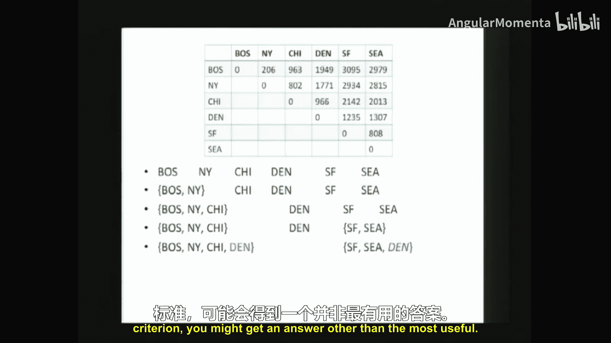

All right， I next went on and said， well， this is pretty easy。

Because when we're comparing the distance between two cities or the。Two features。

We just subtract one distance from the other， and we get a number。 It's very straightforward。

I then raised the question， suppose when we looked at cities。

 we looked at a more complicated way of looking at them than。Airline distance。

So the first question I said， well， suppose in addition to the distance by air。

We add the distance by road。Or the average temperature。Pick what you will， what do we do？Well。

 the answer was we start。By generalizing from a feature being a single number。

To the notion of a feature vector。Where the features used to describe a city。

Are now represented by a vector。Typically of numbers。

Now if the vectors are all in the same physical units。

We could easily imagine how we might compare two vectors。So we might。For example。

 you look at the Euclidean distance between the two。Just by， say。

 subtracting one vector from the other。However， if we think about that， it can be pretty misleading。

Because for example， if when we look at a city。😡，One element of the vector represents。

The distance in miles from another city。Or in fact， this case， we distanceed miles from each city。

And another represents。Temperatures。Well， it's kind of funny to compare a distance which might be thousands of miles。

 with a temperature， which might be5 degrees。Right， a five degree difference。

 and average temperature could be significant。Certainly。

 a 20 degree difference in temperature is very significant。

But a 20 mile difference in location might not be very significant。

And so to equally weight a 20 degree temperature difference and a 20 mile。

Distance difference might give us a very peculiar answer。

And so we have to think about the question of， how are we going to scale the elements of the vectors。

Even。If we're in the same units。Say inches， it can be an issue。So let's look at this example。

Here I've got on the left。Before scaling， something which we can say is in inches， height and width。

This is not from a person， but you could imagine if you were trying to cluster people and you measure their height in inches and their width and inches。

Maybe you don't want to treat them equally， right， that there's a lot more variance in height than。

 in width， or maybe there isn't。 Maybe there isn't。So here on the left， we don't have any scaling。

And we see a very natural clustering。

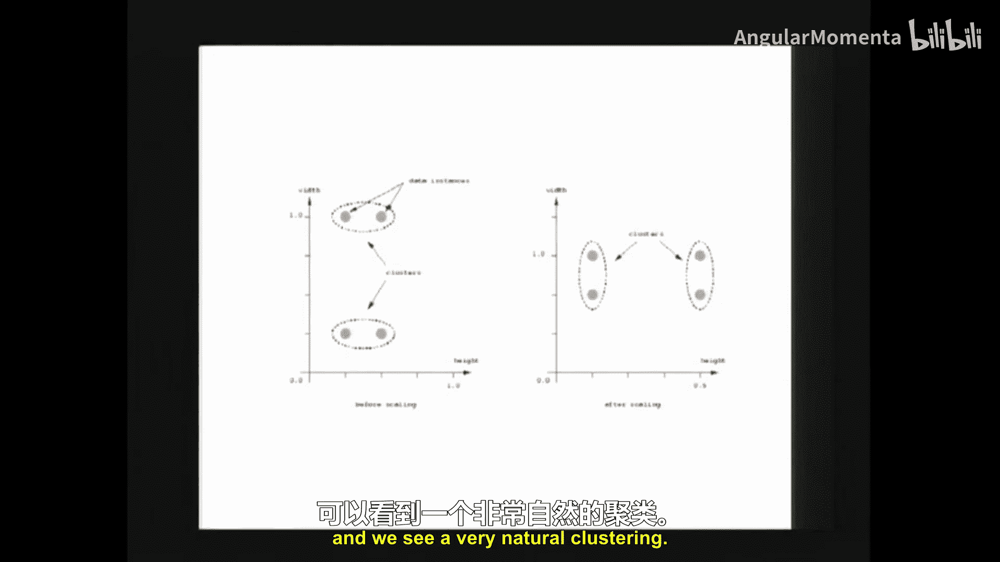

On the other hand。We notice on the y axis， the values range from not too far from 0。

To not too far from one。Whereas on the X axis， the dynamic range is much less。

Not too far from zero to not too far from a half。So we have twice the dynamic range here than we have here。

Therefore， not surprisingly， when we end up doing the clustering。

Height plays a very important role or width， I guess， as this one plays a very important role。

And we end up clustering it this way， dividing it along here。On the other hand。

 if I take exactly the same data and scale it。And now the X axis runs from 0 to a half。

And the y axis roughly again， from  zero to1。We see that suddenly， when we look at it geometrically。

 we end up getting a very different look of clustering。

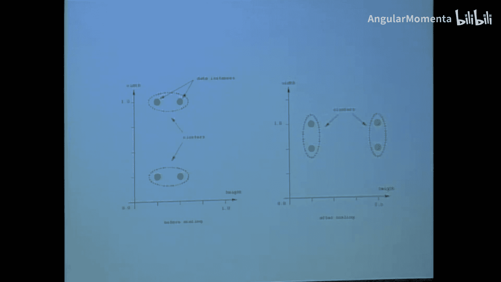

What's the moral？The moral is。You have to think hard about how to cluster your features or about how to scale your features。

 because it can have a dramatic influence on your answer。

We'll see some real life examples of this shortly。But these are all the important things to think about。

And they all， in some sense， tie up into the same major point whenever you're doing any kind of learning。

😡，Including clustering。Feature。Selection。And scaling。Is critical。

It is where most of the thinking ends up going。😡，And then the rest gets to be fairly。Mechanical。

How do we decide what features to use and how to scale them？We do that。Using domain knowledge。

So we actually have to think about。The objects that we're trying to learn about。

And what the objective of the learning process is。So。Continuing。How do we do the scaling？

Most of the time it's done using some variant of what's called them inkowski metric。嗯。

It's not nearly as imposing as it looks。So the distance between two vectors， x 1 and x 2。

And then we use P。To talk about the essentially degree we're going to be using。

So we take the absolute difference。Between each element of x1 and x2。Raise it to the P power。S them。

 And then。Take the one over P。Not very complicated。 So let's say P is2。

 That's the one your people are most familiar with。Effectively。

 all we're doing is getting the Euclidean distance。

What we looked at when we looked at the mean square distance between two things。

Between our errors and our measured data， between our measured data and our predicted data。

We used the mean square error。 That's essentially a menkowski distance with P equal to 2。

That's probably the most commonly used。😡，But an almost equally commonly used sets p equal to1。

And that's something called the Manhattan distance。嗯。

I suspect at least some of you have spent time walking around man。

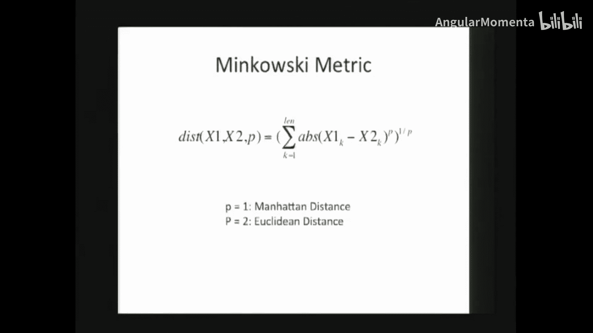

A small but densely populated island in New York。And midtown Manhattan。

Has the feature that it's laid out in a grid。So what you have。Is a grid。And you have the avenues。

Running north south。And the streets running east west。And if you want to walk from， say here to here。

Or drive from here to here， you cannot take the diagonal because there are a bunch of buildings in the way。

And so you have to move either left， right， up or down。

That gives that's the Manhattan distance between two points。This is used， in fact。

 for a lot of problems， typicallyy when somebody is comparing the distance between two genes。

 for example。They use a Manhattan metric rather than a Euclidean metric。

To say how similar two things are。Just wanted to show that because it is something that。

You will run across in the literature when you read about these kinds of things。All right， so far。

We've talked about issues where。Things are comparable。

And we've been doing that by representing each element。Of the feature vector。

As a floating point number。So we can run a formula like that by subtracting one from the other。

But we often， in fact。Have to deal with nominal categories， things that have names。

 rather than numbers。So for clustering people， maybe we care about eye color。😡，Blue， brown， gray。

 green， hair color。 Well， how do you compare。Blue to green。Do you subtract one from the other。

 That's kind of hard to do。 What does it mean to subtract green from blue？ Well。

 I guess we could talk about it in the frequency domain and light and things。嗯。Typically。

 what we have to do in that case is we convert them。To a number。

And then have some ways to relate the numbers。Again。

 this is a place where domain knowledge is critical。So for example， we might convert blue to 0。

 green to 0。5 and brown to one。Thus， indicating that we think blue eyes are closer to green eyes than they are to brown eyes。

I don't know why we think that， but maybe we think that。

Red hair is closer to blonde hair than it is to black hair。 I don't know。嗯。

These are the sorts of things that are not mathematical questions， typically。

 but judgment that people have to make。Once we've converted。Things to numbers。

We then have to go back to our old friend of scaling。Which is often called normalization。

Very often we try and contrive to have every feature range between zero and1。For example。

 so that everything is normalized to the same dynamic range。And then we can compare。

Is that the right thing to do not necessarily because you might consider some features more important than others and want to give them a greater weight？

And again， that's something we'll come back to and look at。All right。All of this is a bit abstract。

 I now want to look an example。Let's look at the example of clustering mammals。

There are essentially an unbounded number of features you could use， size at birth， gestation period。

 lifespan， length of tail， speed， eating habits， you name it。

The choice of features and weighting will of course。

 have an enormous impact on what clusters you get。If you choose size。

 humans might appear in one cluster。If you choose eating habits， they might appear in another。嗯。

How should you choose which features you want？You have to begin by choosing。

Thinking about the reason you're doing the clustering in the first place。

 what is it you're trying to learn。About the mammals。As an example。

I'm going to choose the objective of eating habits。

I want a cluster mammal somehow based upon what they eat。But I want to do that。

 and here's a very important thing about what we often see in learning。

Without any direct information about what they eat。Typically。When we're using machine learning。

We're trying to learn。About something。For which we have limited or no data。😡。

Remember when we talked about learning。I talked about。Learning in which it was supervised。

 in which we had some data。Andm unsupervised in which essentially， we don't have any labels。

So let's say we don't have any labels about what people eat or sorry about what mammals eat。

But we do know a lot about the mammals themselves。

And in fact， the hypothesis I'm going to start with here。😡，Is that。You can infer。

Peoples or creatures eating habits from their dental records。Or they dentition。That over time。

 we have evolved， All creatures have evolved to have teeth。That are related to what they eat。

We can see。So， I。Managed to procure a database of。Dentition for various mammals。啊。

There's the laser pointer。So。What I've got here is the number of different kinds of teeth。

 So the right top andcis， the right bottom andciors， the molars， etctera， premolars。

Don't worry if you don't know about teeth very much。 I don't know very much。And then for each animal。

 I have the number of each kind of tooth。And actually， I don't have it for this particular mammal。

 but for these two， I do。And I don't even remember what they are， they're cute。嗯。All right。

 so I've got that database。

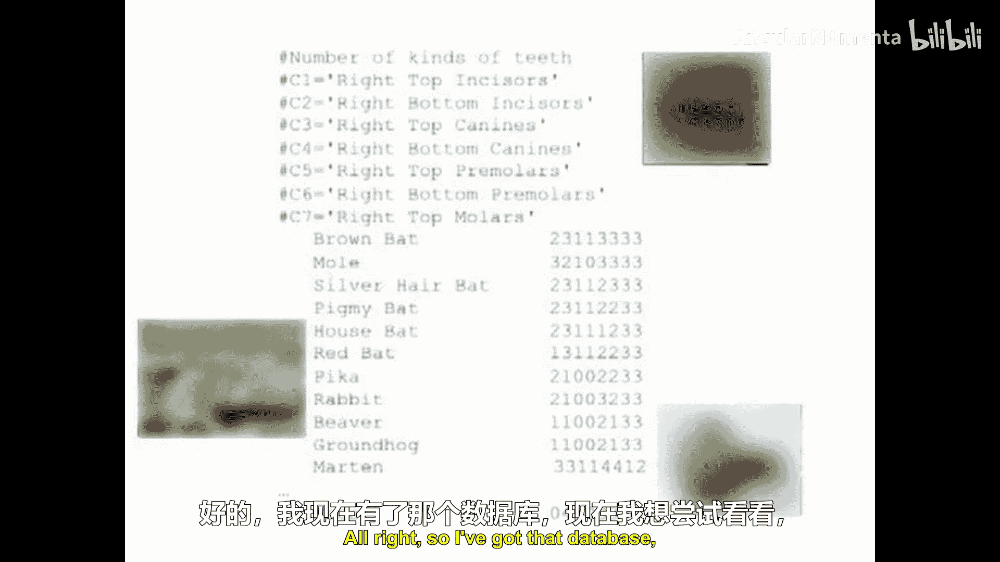

And now。I want to try and see what happens when I cluster them。

The code to do this is not very complicated。But I should make a confession about it。Last night， I。

 I won't say I learned it。 I was reminded of a lesson that I've often preached in 600。

Is that it's not good to get your programming done at the last minute。

So as I was debugging this code at two and 3 in the morning today。

 I was realizing how inefficient I am at debugging at that hour。 maybe for you guys。

 that's the shank of the day。 for me， it's too late。I think it all works。

 but I was certainly not at my best as I was debugging last night。All right， But at the moment。

 I don't want you to spend time working on the code itself。

I would like you to think a little bit about the overall class structure of the code。😡。

Which I've got on the first page of the handout。So。At the bottom of my hierarchy。

I've got something called a point。And that's an abstraction。Of the things to be clustered。

And I've done it in quite a generalized way。Because as you're going to see the code we're looking at today。

 I'm going to use not only for clustering mammals， but for clustering all sorts of other things as well。

😡，So I decided to take the trouble of building up a set of classes that would be useful。

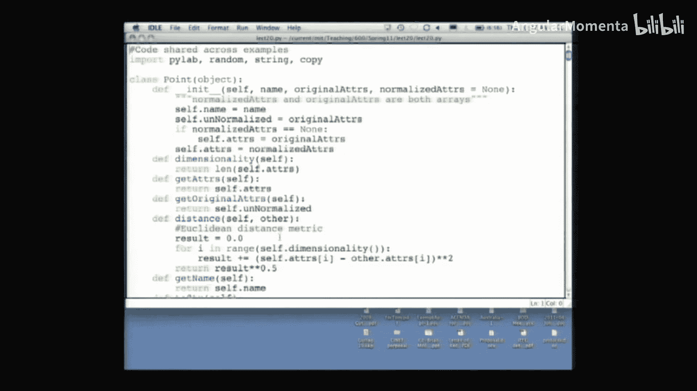

And in this classes' class， I can have。The name of a point。

Its original attributes， let's say， it's original feature vector， an unscaleed feature vector。

 And then whether or not I chose choose to normalize it。 I might have normalized features， as well。

Again， I don't want you to worry too much about the details of the code。

And then I have a distance metric。 and I'm just， for the moment， using simple Euclidean distance。

The next。Element in my hierarchy。It's not yet a hierarchy。 It's still flat。Is a cluster？

And so what a cluster is， you can think of it as at some abstract level。

 it's just going to be a set of points。The points that are in the cluster。

But I've got some other operations on that will be useful。嗯。

I can compute the distance between two clusters， and as you'll see。

 I have single linkage max average， the three I talked about last week。

And also this notion of acentroid。😡，We'll come back to that when we get to K means clustering。啊。

We don't need to worry right now about what that is。Then I'm going to have a cluster set。

That's another useful data abstraction。And that's what you might guess from its name。

 just a set of clusters。The most interesting operation there is merge。

As you saw when we looked at hierarchical clustering last week。

 the key step there is merging two clusters。And。In doing that。

I'm going to have a function called Fine closest。Which given a metric and a cluster finds the cluster that is most similar to that to self。

Because as you again will recall from a hierarchical clustering。

 that's what I merge at each step is the two most similar clusters。

And then there's some details about how it works。Which， again。

We don't need to worry about at the moment。And then。

I'm going to have a subclass of point called mammal。In which I will represent each mammal each。

Mammal by the dentian， as we've looked at before。Then， pretty simply。

We can do a bunch of things with it。嗯。Before we look at the other details of the code。

 I want to now run it。And see what we get。So I'm just going to use hierarchical clustering now to cluster the mammals。

Based upon this feature vector， which will be a list of numbers showing how many of each kind of tooth。

The mammals have。 Let's see what we get。So， it's doing。The merging。So we can see it the first step。

It merged beavers with groundhogs。Then it merged gray squirrels in porcupines， wolves and bears。

Various other kinds of things thought Jaguars and cougars were a lot alike。Eventually。

 it starts doing more complicated merges。 It merges the cluster containing only the river otter with one containing a martin and a wolverine。

嗯。

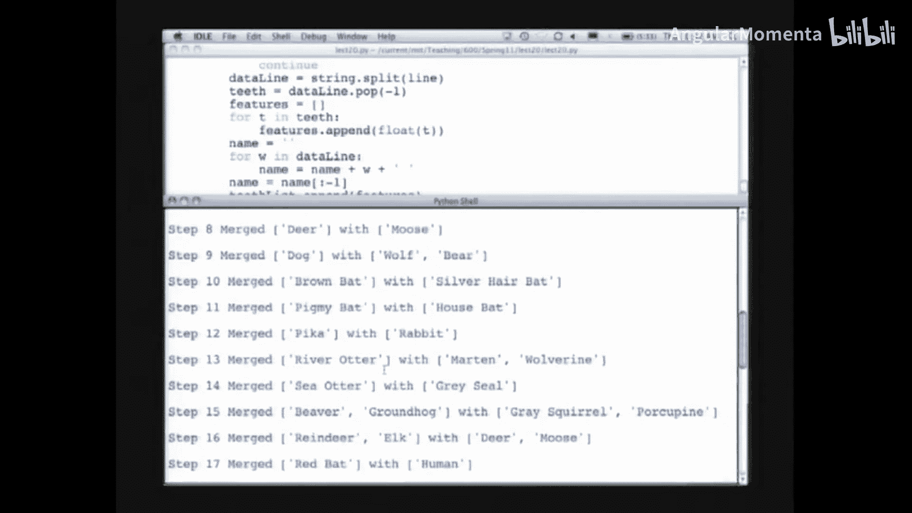

Beavers and groundhogs with squirrels and porcupines， etc cea。

And at the end。I had it stop with two clusters。 It came up with these clusters。Now。

 we can look at these clusters and say， all right。What do we think。

 Have we learned anything interesting。Do we see anything in any of these， do we think it makes sense。

 Remember， our goal was to cluster mammals based upon what they might eat？And we can ask。

 do we think this corresponds to that。No， all right。 somebody said why no。该起。

We've got like a deer doesn't eat similar other things as a dog。

And you've got like one type of bat in the top cluster and a different type of bat in the bottom cluster。

 it seems like they'd be closer together。So sorry。Yeah。

 a deer doesn't eat what a dog eats and for that matter。We have humans here。

 and while some humans are by choice vegetarians， genetically humans are essentially carnivores。

 we know that we eat meat。And here we are with a bunch of herbivores， typically。Things are strange。

By the way， bats might end up being in ones because some bats eat fruit and other bats eat insects。

 But who knows。 All right， so。I'm not very happy。Why do you think we get this clustering that maybe isn't helping us very much。

Well， let's go look at what we did here。Let's look at test zero。So I said I wanted two clusters。

 I don't want it to print all the steps along the way。 I'm going to print the history at the end。

And scaling is identity。Well， let's go back。And look at some of the data here。What we can see is。

Or maybe we can't see too quickly looking at all of this is some kinds of teeth。

Have a relatively small range。Other kinds of teeth have a big range。

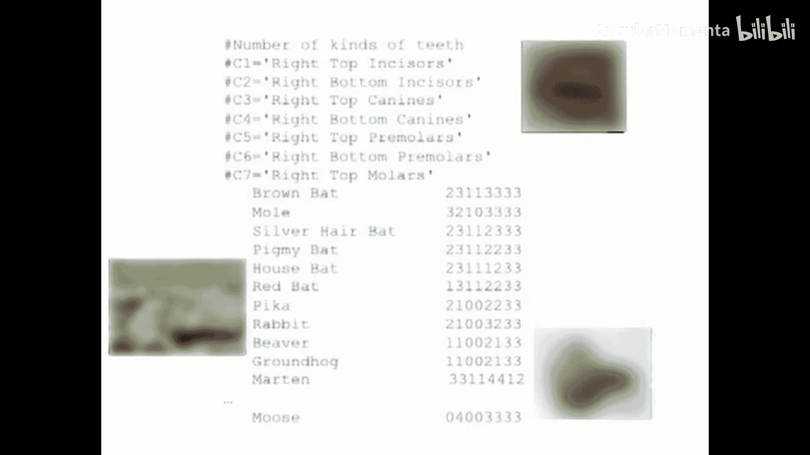

And so at the moment， we're not doing any normalization。

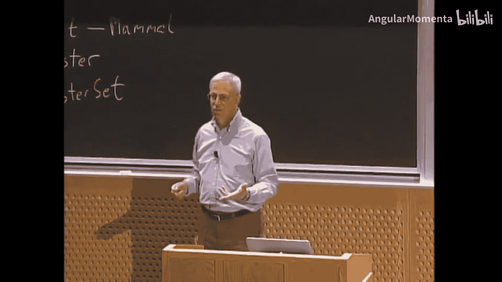

And maybe what we're doing is getting something distorted where we're only looking at a certain kind of tooth because it has a larger dynamic range。

And， in fact。If we look。At the code。We can go back up。And， let's look at。Build mammal points。

And read mammal data。So， build mammal points。Calls read mammal data。And then builds the point。

 So read mammal data is the interesting piece。And。What we can see here。

Is as we read it in。This is just simply reading things in， ignoring comments。Keeping track of things。

And then when we come down here。I might do some scaling。

So point dot scale features using the scaling argument。

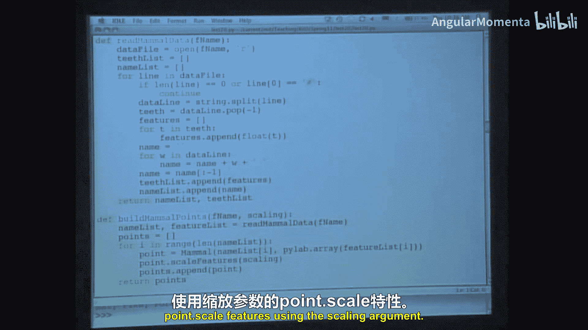

Where is that coming from。If we look at mammal teeth。Here from the mammal cluster， or a mammal。

 not cluster class。 We see that there are two ways to scale it identity。

 where we just multiply every element in the vector by one。

That doesn't change anything or what I've called one over Max。And here。

 I've looked at the maximum number of each kind of tooth。And I'm dividing one by that。😡。

So here we could have up to three of those。Here we could have four of those。

 We get six of this kind of tooth， whatever it is。And so we can see by dividing by the max。😡。

I'm now putting all of the number， all of the different kinds of teeth on the same scale。

I'm normalizing。And now we'll see。Does it make a difference。Well。

 since I'm dividing by six here and three here， it certainly could make a difference， right？

It's a significant scaling factor，2 x。So let's go and change the code。Or change the test。And。

 let's look at。Test 0。Wops0， not0。With scale。Set to one over max。 you'll notice， by the way。

But rather than using some obscure code like scale equals 12。

I've used strings so that Ill remember what they are。It's， I think。

 a pretty useful programming trick。Wops， did I use the what the wrong name for this。

Should be scaling。So， off it's going。Now， we get a different。

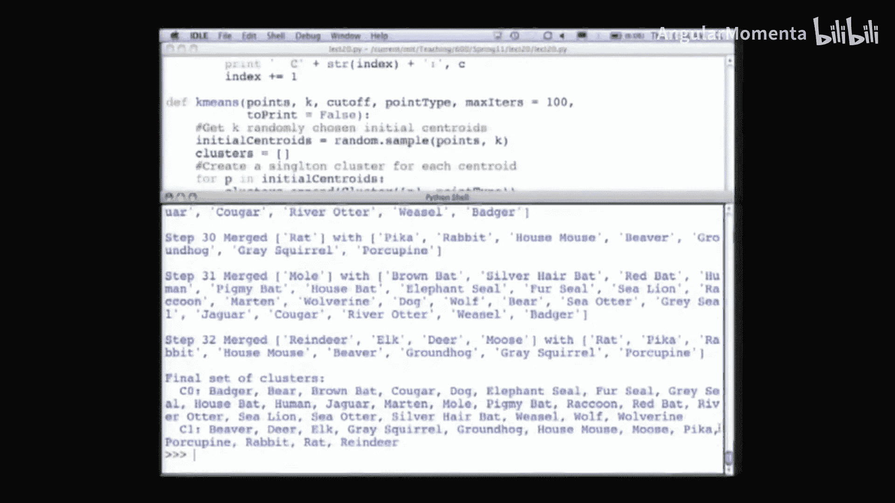

Set of things。And as far as I know。Once weve scale things。

 we get what I think is a much more sensible pair， where I think what we essentially have is the herbivores down here and the carnivores。

Up here。Okay。I don't care how much you know about teeth。The point is， scaling can really matter。

 You have to look at it， and you have to think about what you're doing。

And the interesting thing here is about any direct evidence about what what mammals eat。

 We are able to use machine learning， clustering in this case， to infer a new fact。

That we have some mammals that are similar in what they eat， and some mammals。That are。Also similar。

 some groups。 Now， I can't infer from this herbivores versus carnivores。

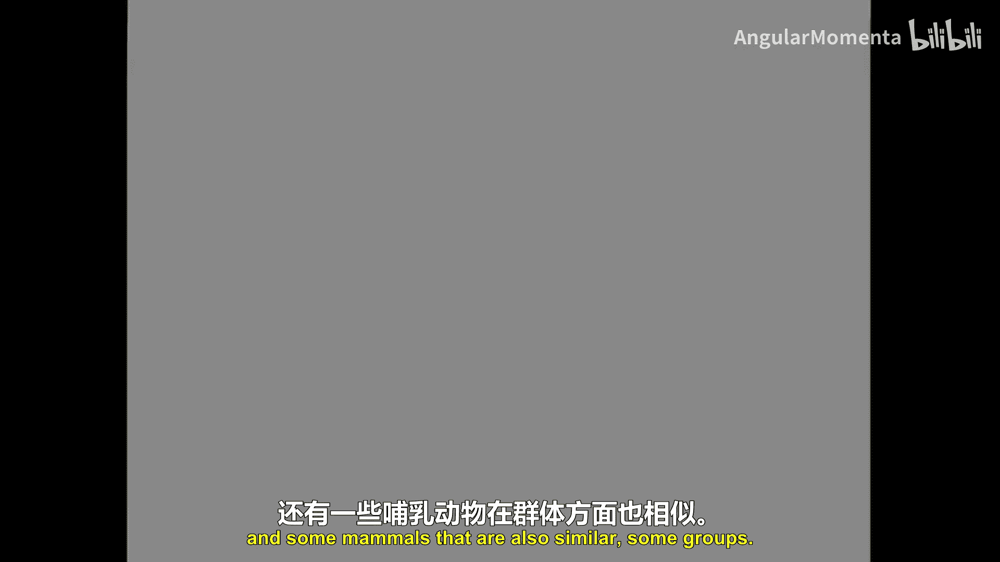

Because I didn't have any labels to start with。But what I can infer is that whatever they eat。

There's something similar about these animals and something similar about these animals。

 And there's a difference between the groups in C 1 and the groups in C 0。I can then go off， and。

Look at some points in each of these and then try and figure out。How to label them later。Okay。

Let's look at a different data set， a far more interesting one， a richer one。Now。

 let's not look at that version of it。 that's too hard to read。Let's look at。The Excel spreadsheet。

So this is a database I found online of every county in the United States。

And a bunch of features about that county。So for each county in the United States。We have its name。

The first part of the name is the state it's in， second part of the name is the name of the county and a bunch of things like the average value of homes。

How much poverty， is population density， its population changed， how many people are over 65。

 et cetera？So the thing I want you to notice， of course， is while everything is a number。

 the scales are very different。You know， it's a big difference between。

The percent of something which will go between 0 and 100 and the population density。

 which ranges over a much larger。Dynamic range。So we can immediately suspect。

That scaling is going to be an issue here。So we now have a bunch of code that we can use that I've written to process this。

It uses the same。

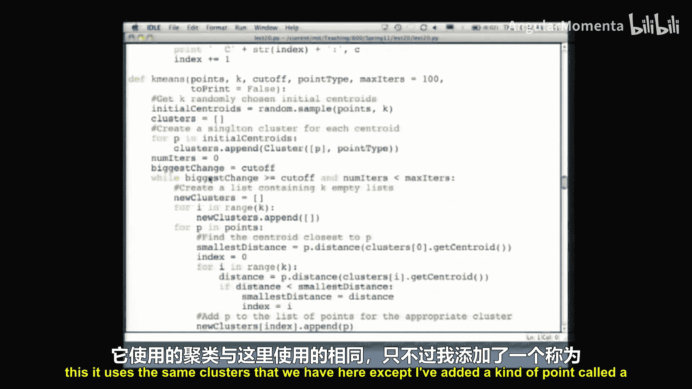

Clus that we have here。Except I've added a kind of point called a county。

Looks very different from a mammal。 But the good news is， I got to reuse a lot of my code。😊，Now。

 let's run a test。

We'll go down here to test 3。And we'll see whether we can do hierarchical clustering of the counties。

Wops。Test 3 wants the name of， of what we're doing。So we'll give it the name。 It's counties dot text。

I just exported the spreadsheet as a text file。Well。We can wait a while for this。

 but I'm not going to。Let's think about what we know about hierarchical clustering。

And how long this is likely to take。

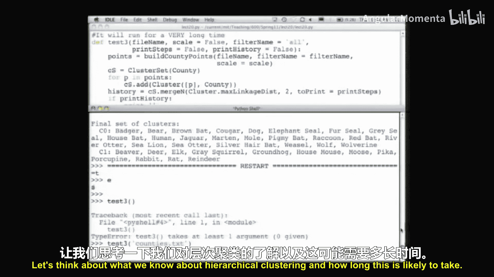

I'll give you a hint。There are approximately 3100 counties in the United States。

I'll bet none of you could have guessed that number。All right。

 how many comparisons do we have to do to find the two counties that are most similar to each other。

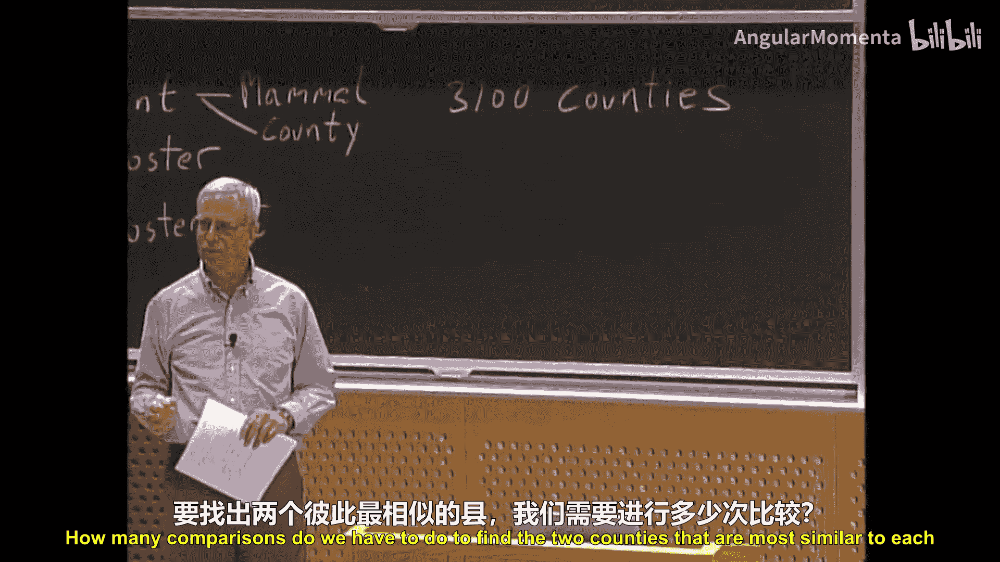

We here in each county Egypt of。Every other county， how many comparisons is that going to be yeah。

 it's 31 of you choose2？Right， so that'll be。3100 square， thank you。

And that's just the first step of the cluster。To form the next merge。We'll have to do it again。So。

 in fact， as we've looked at last time。It's going to be a very long and tedious process。

 and one I'm not going to wait for。So I'm going to interrupt。

 and we're going to look at a smaller example。Here， I've just got only the counties in New England。

A much smaller number than 3100。And I'm going to cluster them using the exact same clustering code we use for the mammals。

It's just that the points are now counties instead of mammals。And we got two clusters。

Middlesex County in Massachusetts。Happens to be the county in which M I T is located。

And all the others。Well， you know， M I T is a pretty distinctive place。 Maybe that's what did it。啊。

I don't quite think so。 Someone got a hypothesis at why we got this rather strange clustering。And。

 is it because Middlesex contains M I T and Harvard both。This really surprised me， by the way。

 when I first ran it， I said， how can this be。So。I went and I started looking at the data。

And what I found。Is that Middlesex County。Has about 600000 more people than any other county in New England。

Who knew？ I would have guessed Suffolk where Boston is was the biggest county， But， in fact。

 Middlesex is enormous relative to every other county in New England。

And it turns out that difference of 600000 when I didn't scale things just swamped everything else。

And so all I'm really getting here is a clustering that depends on the population。

Middleex is big relative to everything else。 And therefore， that's what I get。

 And it ignores things like education level and housing prices and all those other things。

 because the differences are small relative to 600000。All right， well， let's turn scaling on。

To do that。I want to show you how I do the scaling。嗯。I did not。

 given the number of features and the number of counties。

 do what I did for mammals and count them by hand to see what the maximum was。

 I decided it would be a lot faster， even a two in the morning to write code to do it。

So I've got some code here。嗯。So I've got build County points， just like build mammal points。

And read county data， like read mammal data。But the difference here is along the way。

 as I'm reading in each county， I'm keeping track of the maximum for each feature。

And then I'm going to just do the scaling automatically。

So exactly the one over max scaling I did for mammals teeth， I'm going to do it for counties。

 but I've just written some code to automate that process。Because。

I knew I would never be able to count them。All right。

 so now let's see what happens if we run it that way。Test 3。Of New England。And scale equals true。

I'm either scaling it or not as the way I wrote this one。

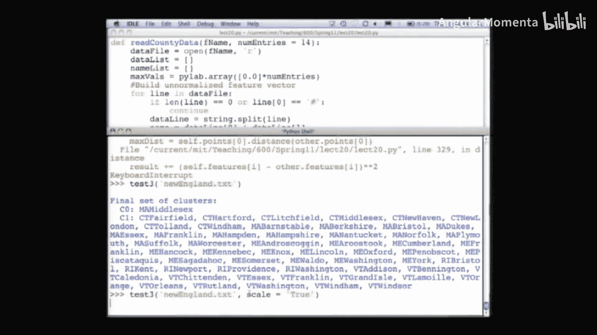

Allright， And with the scaling on， again， I get a very different set of clusters。What do we got。

 Where's Middlesex？It's in one of these two clusters， here it is in C0。But it's with Fairfield。

 Connecticut and Hartford， Connecticut and Providence， Rhode Island。嗯。It's a different answer。

 Is it a better answer。It's not a meaningful question， right。

 It depends what I'm trying to infer what we hope to learn from the clustering。

And that's a question we're going to come back to on Tuesday in some detail with the counties。

And look at how by using different kinds of scaling。Or different kinds of features。

 We can learn different things about the counties in this country。Before I do that， however。

 I want to move away from New England。Remember， we're focusing in New England because it took too long to do hierarchical clustering of 3。

100 counties。But that's what I want to do。It's no good Did you say， I'm sorry。 took too long。

 I give up。Well， the good news is there are other clustering mechanisms。That are much more efficient。

We'll later see they， too have their own。Falts。But。We're going to look at K means clustering。

Which has the big advantage of being。Fast enough that we can run it on very big data sets。In fact。

 it is roughly linear in the number of counties。And as we've seen before， when n gets very large。

 anything that's worse than linear is likely to be ineffective。

So let's think about how K means works。Step 1。Is you choose K。K。

Is the total number of clusters you want to have when you're done。So you start by saying。

 I want to take the counties and split them into K clusters。Two clusters， 20 clusters， 100 clusters。

 100 clusters。

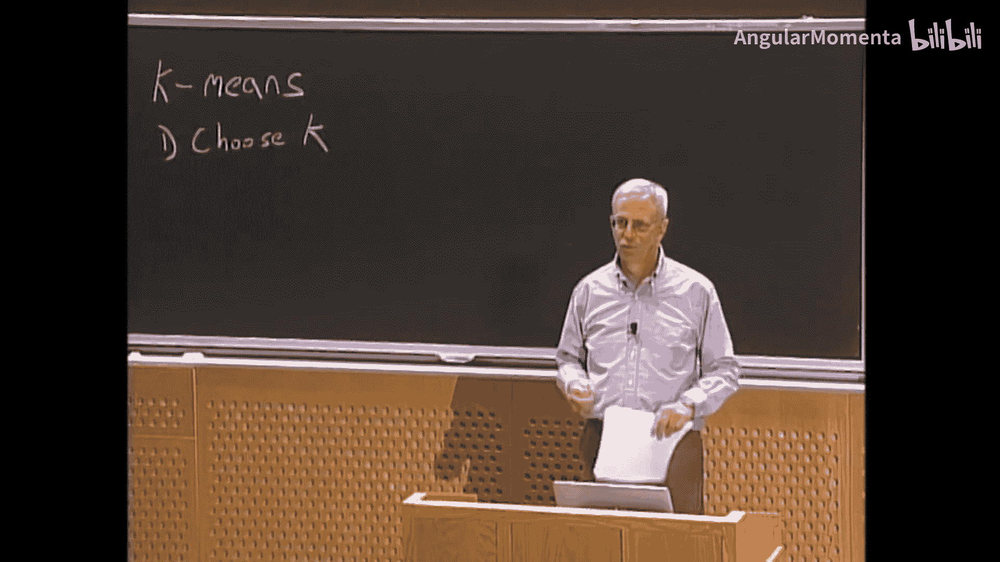

You have to choose K in the beginning。And thats。One of the issues that you have with K means clusterings is how do you choose K。

We can talk about that later。Once I've chosen K。I choose K points。As initial centroids。

 you may remember earlier today， we saw this centroid method。In class cluster。So what's a centroid？

You've got a cluster。😡，And in the clusters， you've got a bunch of points scattered around。

The centroid you can think of as quote， the average point。😡，The center of the cluster。

The centroid need not be any of the points in the cluster。So again， you need some metric。

 but let's say we're using Euclide， it's easy to see in the board， the centroid is kind of there。Now。

Let's assume that we're going to start。By choosing K points from the initial set。😡。

And labeling each of them as a centroid。We often。In fact， quite typically。Choose these at random。

So we now have K randomly chosen points， each of which we're going to call a centroid。The next step。

Is to assign each point。To the nearest centroid。So we've got K centroids。

 We usually choose a small K， say 50。And now we have to compare each of the 3100 counties。

To each of the 50 centroids。And put each one in the correct thing。In the closest。

So it's 51 times 3100， which is a lot smaller number，50 times 3100。

 which is a lot smaller number than 3100 squared。So now I've got a clustering。

Kind of strange because what it looks like depends on this random choice。

So there's no reason to expect。That the initial assignment。Will give me anything very useful。Step 4。

Is。For each of the K clusters， choose the new centroid。Now， remember， initially。

 I just chose at random K centroids。Now。I actually have a cluster with a bunch of points in it so I could。

 for example， take the average of those and compute a centroid。

And I can either take the average or I can take the point nearest the average。

 It doesn't much matter。And then， step 5。Is one we've looked at before。Assign。Each point。

To nearest centroid。 so now I'm going to get a new clustering。And then six。Is repeat。4。And 5。

Until the change is small。So each time I do step 5。

I can keep track of how many points I've moved from one cluster to another。Or。

Each time I do step four。I can say， how much have I moved the centroids。

Each of those gives me a measure of how much change the new iteration is produced。

When I get to the point where。The iterations are not making much of a change。

 And we'll see what we might mean by that。 We stop and say， okay， we now have a good clustering。

So if we think of the complexity， each iteration is ordered KN。Where K is the number of clusters。

 and n is the number of points。And then， we do that step。For some number of iterations。

So if the number of iterations is small， it will converge quite quickly。And as we'll see。

 typically for K means， we don't need a lot of iterations。To get an answer。

It's typically not proportional to N in particular， which is very important。All right， Tuesday。

 we'll go over the code for Ka means clustering and then do have some fun playing with counties and see what we can learn about where we live。

 All right， thanks a lot。

