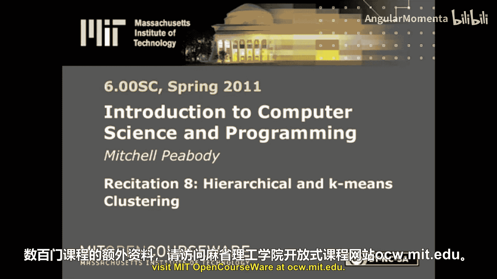
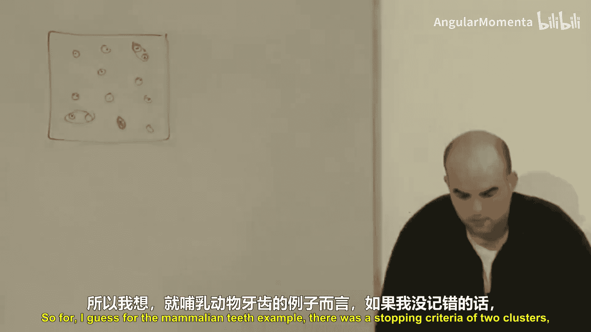
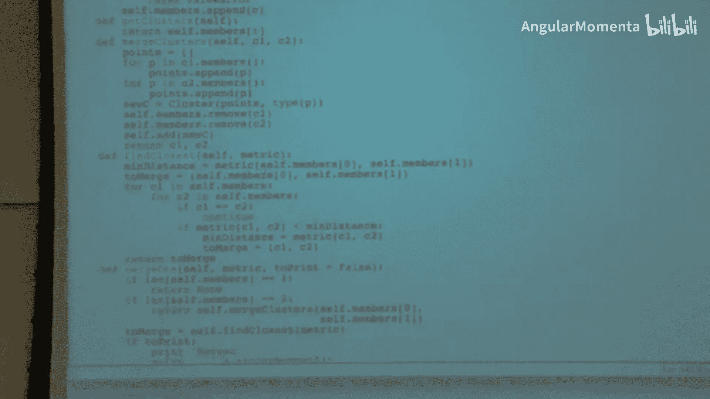
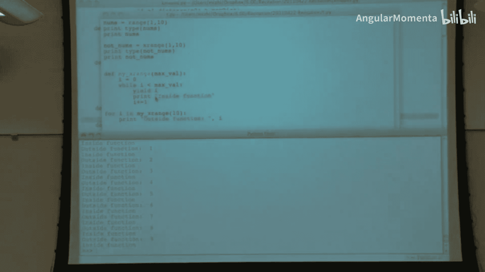
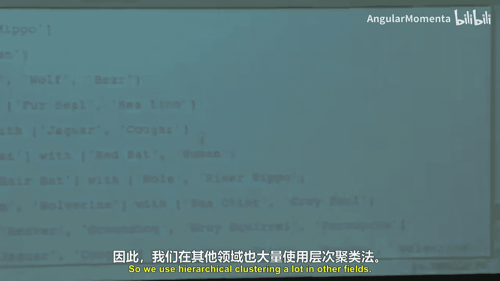
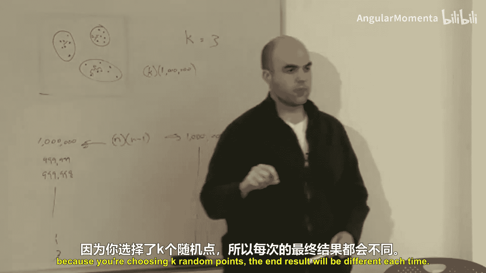
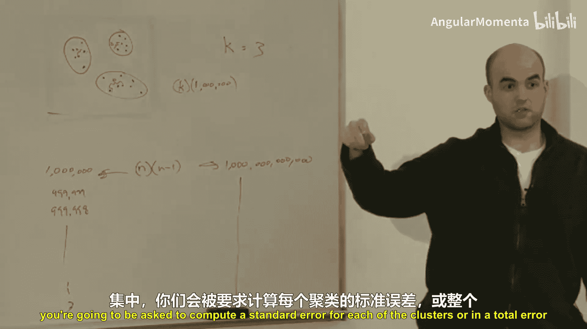
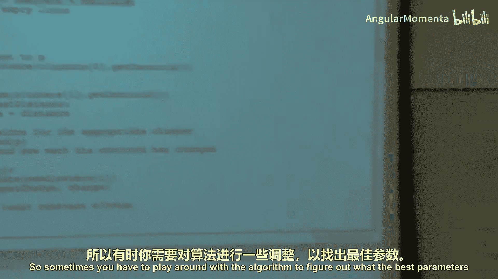
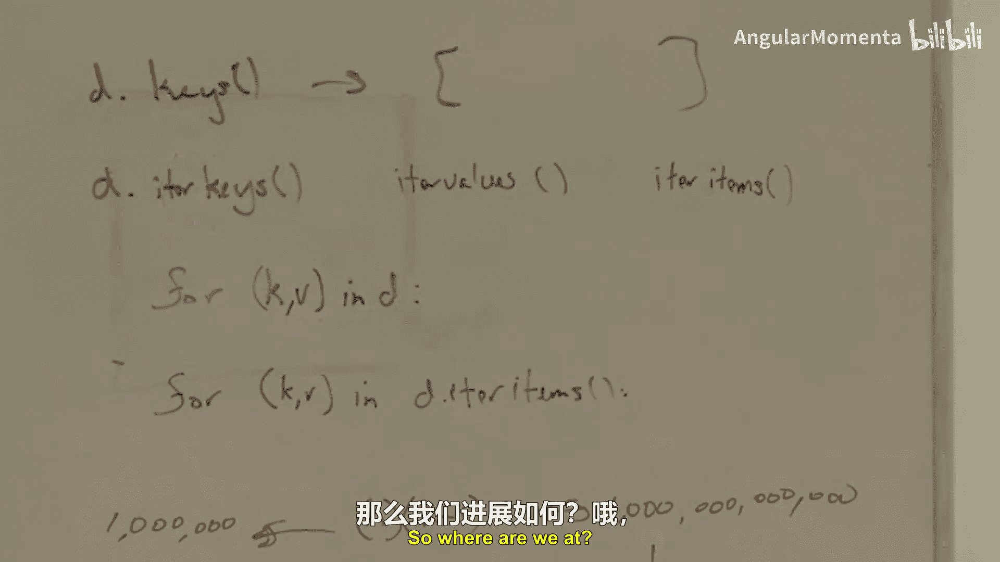
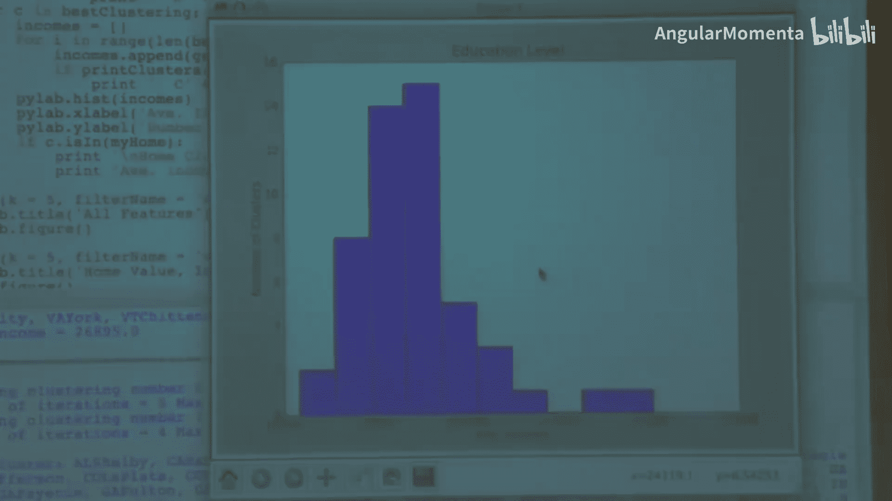

# 【麻省理工】计算机科学与编程导论 ｜ MIT 6.00SC Introduction to Computer Science and Programming p30 30 -BV1a5BZBkEP6_p30-

The following content is provided under a creative Commons license。

 Your support will help M I T Open Coseware continue to offer high quality educational resources for free。

To make a donation or view additional materials from hundreds of M T courses。

 visit M I T OpenCourseware at O C W。t M I T Eduu。

这个是刚才。Number。おいいで、すね。Yeah。You were generating random。You were。

 but if you look at what totes zero is collecting so。If you look at where it draws a random number。

J is you know indexing in totes right， So when J is0， your standard deviations。

 which is also being indexed by J， is going to be zero Yeah。

 so you're always going to get the same value。Any questions。嗯，O。That was it。嗯。So。In lecture。

 we were talking a lot about or clustering， or we've been talking about clustering in the past。

It' two lectures。And we had two different types of clustering methods， what were they？

Herarchical inca meansians。Can someone give me a rundown of what the steps are in hierarchical clustering？

So。Everything down。That。So let's say I have a bunch of data points。What would be the first step？So。

We're going to first。Assign each point to a cluster。Right so。Each point gets its own cluster。

And then。The next step would be what？Right， so you're going to find the two clusters that are closest to each other and mergese them。

 so in this very contrived example。Would be these guys。

And then you're going to keep doing that until you get to a certain number of clusters， right？

Mge these two， then he might merge these two。And where used to。Et cetera， et cetera， right？So。

So you're going to。You're going to set the number of clusters that you want。At the outset。So for。

 I guess for the mammalian teeth example， there was a stopping criteria of two clusters。

 if I'm not mistaken。

Yeah， so if we look， so let's take a look at the code here。

That implements the hierarchical clustering。So this is just some infrastructure code it builds up the number of points。

We have a cluster set class， which we'll go over in a second。And。Then we just。Add for each point。

 we're going to create a cluster object and add it to the cluster set。So。

Let's take a look at the cluster set。Cluster set is。Has one attribute， the member's attribute。

And it just has a set of points。Or a set of clusters， actually。And。

The key method in here or the key methods are merge1 and merge n。

 merge n is what actually implements the clustering here。So。

You give it the distance metric that you're going to use for your points。

The number of clusters that you want at the end of your clustering。Some a history tracker。

 and then you also tell it if you want to print out some debugging information。So。

Which apparently is not used in this method。I know it is， mergech one。Anyway。

So while we have more clusters than the number of clusters we desire， we're going to keep iterating。

And on each step， we're going to call this function or method called merge one。

And just pass it the distance metric。And all merge one is going to do。Is it's going to。

If there's only one。If there's only one cluster here。

 then it's just going to return none if there are。啊。Two clusters and it's going to merge them。And。A。

If there are more than two clusters， it's going to find the closest according to the distance metric and then merge those two。

So， and then。The return value is going to be the two clusters that have merged。

So。Let's look at。The merge clusters code。All it does。Because it takes to two clusters？

And for each point。In both clusters， it adds it to a new list points。

And it creates a new cluster from those points。And then it removes two clusters from members。

And adds the newly created cluster。嗯。So。Then fine cluster or fine closest methane。

So what's this bit of code doing here？Right。So and we'll get to the metric in a second。

So it initially finds， it looks at the first two。Members。In the cluster set。

And it sets men distance to be that， and then sets too merge to be those two members。

 and then it naerateates through every possible pair。Of clusters in this cluster set。

And finds the minimum。Distance， according to the metric。嗯。Xi。So let's look at the cluster class。

All the cluster。Object does or class does， is it holds a set of points。

It knows the type of point that it's holding because that becomes important when we talk about the different types of things that we want to cluster。

And then it also has something called a centroid。All theroid is is just the middle of the cluster。

If you take all of the points and you average their distances or average their location。So。

These different functions， these just compute metrics about this particular cluster， right。

Single linkage test， all this is going to do is it finds some minimum。

Distance between every pair of points in the cluster。And what does Max linkage distance do？

I'm sorry， I'm mistaken。Minimum distance between this。

Ap point in this cluster and a point in another cluster， I misspoke。So what does Max linkage just do？

The opposite， yeah， the opposite， I have to keep you talking how much you fall asleep。

And then average linkage list。Same thing， this is why having meaningful function names is important。

Because it helps you explain code。So it also has this method in here called Update。

And what update does is it takes a new set of points。And it sets。D。

Points that this cluster has to be these new points。

And then it computes a new centroid for this cluster。And the return value。

Is the distance of the old centroid from。The new centroid。

And this becomes important in some of the algorithms。And then there's just some bookkeeping。

Stuff here， like members will just。Give you all the points in this cluster。

You all know what yield does， right？Okay。So yield returns a generator object。

Which allows you to iterate over elements。So。This was asked during the quiz review。

 what's the difference between range and X range？So if I have。Arrange。Of values。

It actually returns a different。Type， so like I can print out。This list。Right。In this case。

It'll print out the type of object it is。This is this is accomplished using yield。

 so if I wanted to write this myself。Wn。This is going to do is it's going to turn something called a generator object。

And all it does is instead of holding all the numbers in memory。

 it's going to return them one at a time to me。So like。When I use range here。

 it constructs a list and it has all of those integers in memory if I use X range。

It's not going to hold all the integers in memory， but I can still iterate over them one at a time。

发修理。讨。去发下去。Yeah， that？Proions。Right。What this tells Python is that。When it sees a yield。

It's sort of like a return， except it's telling Python that I want to come back to this location at some point。

A return just returns out of the function completely。

 What a yield does is it takes the value that it's specified after yield and it returns to the calling。

呃。Place in the program。And that value， but then when。It comes time to get a new value。

 it'll return back to where this yield exited。Kind of a way of maybe seeing this is if I iterate over my X range。

Each time it needs a new value， it's going to go back inside this function and grab it。

So it looks like a function， but what it's actually doing is。

Creating what what's called a generator object， and it has these special methods for getting the next value。

So it's some nice syntactic sugar。But it's pretty neat。

But。That's what's going on with this yield statement here。

 is that instead of returning the entire list of points or instead of。诶。Doing it in some other way。

 all it's doing is just yielding each point one at a time so that you can iterate over them。嗯。

So what else？So here's。Here's a method for computing with centralroid。嗯。All we are going to do is。

Total up。Where each point is。And then。Take the average over all the points。Does that make sense。

So the example we saw was mammal teeth。And the way that that's accomplished in this。

Set of code is we're going to define a subclass of a class point。That's called mammal。And。What。

Point does。Is it has。A name for a given data point。It has a set of attributes。

 and then you can also give it some normalized attributes。If you don't give it。

 the normalize attributes。Then it'll just use the original attributes。

It becomes important when we talk about when we do scaling of our data， which we'll do shortly。So。

There's nothing really special about it。Except for。This distance function。

It's just defining the Euclidean distance for a given multidimenional point。So。

Everyone knows that if you have a point in two dimensions， then it's just， you know if it。

If it's an xy point， then it's just x squared plus y squared square root of。

It generalizes to higher dimensions。If you weren't already aware。

So like if I want to find the straight line distance between a point in 3D。

It's just going to be x squared plus y squared plus z squared square root。That's all。 And then。

So on and so forth。你看。嗯。So。All this does is at someclass point。And。

It has this function scale features。And what scale features does。Is it'll。Take a key。

 and in this case we've defined two ways of scaling this data， scaling these points。

 we have the identity， which is it's just going to leave every point alone。

 and then we have this one over max， which is going to scale each attribute by the maximum value in this data set。

And。If we look at the data set。We know that our max value is6。So you could do that automatically。

 but in this case。We're using prior knowledge of the data set that we have。So。

So when don't we do a clustering？So this is going to do a hierarchical cluster。

And what we're going to ask if I。Just specify the default parameters。

 All it's going to do is to go look for two clusters。

It's going to use the identity and it's just going to print out the history。

 like when it's performed the different mergers。On my side have extraneous code that I'm already running。

So what starts off first is we get a lot of merges with just these single element clusters， right？So。

Have a beaver with a groundhog， so I guess they're pretty similar in terms of teeth。

 we have a squirrel with a porcupine， wolf with a bear。And so。Eventually。

 though we start finding clusters。A wolf and a bear， I guess， are more similar。

 but they're also similar with a dog。 so we're going to start merging。Multipoint clusters。嗯。So。

We start seeing the beaver and groundhog cluster is going to get merged with the squirrel and porcupine cluster。

If you were to visualize this， so like。The reason why it's called hierarchical clustering。

Is which one does I say， beaver， Groundhog？These guys have been merged into a cluster， right。

 they started out as their own cluster。And they merge into their own cluster and then the gray squirrel。

And the porcupine， same thing， they started off in their own clusters at the beginning。

 they got merged。And now， what this step is saying is that。These two clusters get merged。

 so we're building this tree or hierarchy。 that's where the hierarchical comes from。

So we use hierarchicalical clustering a lot in other fields。

Like in speech recognition， we can do a hierarchicalical clustering of speech sounds。 So if I have。

Say different vowels。And maybe a couple of consonants。I would expect to see， say， these。

Kind of clustered together first。And so what I might see is。These would be like。Fricatives。

 but then I might have some stops like tea。And B that get merged first。Like。

It it's a way of kind of making these generalized groupings。At different levels。怎么。嗯。呃。

Does anyone have any real questions about hierarchical clustering？So should I move on to Ka meanss？

So。What's the general idea with K meanss？So I start off with a set of data points。

What's my first step？Cl。So I'm going to choose a K。So let's save for。

You knows this is we're going to choose k equal 3。And then what's my next step？Yeah。

So we're going to pick K random points from our data set。And then。我为6。Then you cluster。

After we've chosen our three centroids here。These become our clusters。

 and we're going to look at each point and we're going to figure out which cluster they're closest to。

So in this case， this is going to be a pretty easy。Cluing。

 so all these points are going to belong here。All these points are going to belong here。

All these points are going to belong here。And then we're going to update。Our centroid。

For each of these clusters。And there's going to be a distance。That the centroid moves。

Each time we update it， so in this case， the sensorroid moved quite a bit。Right。

And then we're going to find the maximum distance that the centroid moved。

And if it's below a certain cutoff value， then we're going to say， I've got a good enough clustering。

If it's above a certain cutoff value， then what I'm going to say is。

This centroid moved quite a bit for this cluster， right？So I'm going to try another iteration。

 I'm going to say for each one of these points， I'm now going to look try and find the closest cluster that it belongs to based on these new centroids。

And in this case， nothing's really going to change， so all of the deltas。

 all of the centroids are going to stay the same。So it's going to be below the cutoff value。

 and it's going to stop。So。What's。An advantage of canines over hierarchical clustering。や。Yeah。

So let's say that I have a million points。If I were to hierarchically cluster these。

 that means that I'd start off with a million clusters。 And then on each iteration。

 I'm just going to reduce it by one。I don't know。Say three， okay。So on each generation。

 we're just reducing it by one， which if that's all we were doing would not be so hard。

 it doesn't take too long to count down from a million on a computer， but on each one of these steps。

 we have to compute the pairwise distance between every cluster。So。

It's going to be n times n minus1 comparisons on each step， which。In this first case。

 works out to a lot。And it doesn't get much better。So approximately， right？

And it doesn't get much better as we go down。With K means。What happens is。

We just have to perform on each step。If we have a million points。And we have K clusters。

We just have to perform。K times 1 million comparisons， right？Because for each point。

 we need define the closest centroid。Approximately。

So the upshot is that K means winds up being a lot more efficient on each iteration。

 which is why you have a large number of points。Might want to choose K meanss over hierarchical clustering。

嗯。What's。An advantage， though， of hierarchicalical clustering over kine。

Even though it's less efficient。What's another？我车。More thorough。Yeah。

 I give a lot of different levels so you can look at the clusterings that different from different perspectives。

 but the kind of key thing with。I know how many clusters。Yeah。嗯。Go down。Right。

 so you could go down different levels of the tree and pick whatever。

 however many number of clusters you want， but the big reason that or one of the kind of main advantages that hierarchical clustering has over ks is that ks is random。

 it's non deterterministic。Herarchical clustering is deterministic。

 it's always going to give you the same result with cane means。

Because your initial starting conditions are random because you're choosing K random points。

The end result will be different each time。And so。When we do came means clustering。

This necessarily means that we don't necessarily want to do it once， like if we choose k equal 3。

We might want to do。You know， five different cameyens clusterings and take the best one。Oh。So。

 that's kind of。One of the big points with Canyians。诶。There's a degenerate condition with canines。So。

If my objective is to。If my stopping criteria is that the centroid doesn't move。

What's a really easy way？To make the centralry knot move by choosing K。我是。K equals n right。

 so if I have k clusters or if I have n points and I have K equal n。Then。

All of my points are going to be their own cluster， and every time I update。

 I'm never going to move my centroid。This also， so in your problem set。

 you're going to be asked to compute a standard error for each of the clusters or in a total error for the entire cluster。

So。What that is is if I have。系社翻。If I have the centroids。And I have each point。In。I dontcentroid。So。

What I'm going to do is I'm going to take the centroid for each cluster and I'm going to find the distance。

From。Each point in the cluster to the centroid， and then I'm going to sum up。

All of those distances over the entire cluster， and that's going to give me my error。然后的。

I'm not sure if that equation is totally right， but that's you know。

 there might be like a division of merit。But。The general idea is that。

What I'm trying to emphasize is that we can。Reduce this number by just increasing the number of k。

And if we make a k equal end， and this is going to be zero， so like I was saying with statistics。

You never want to trust just one number with K means。

 you never just want to trust one clustering or one measurement of error。

 you want to kind of look at it from multiple perspectives， vantage points。

So why don't we look at the code and try to match up all of that stuff with？

What you'll see on your problem set。

So the big function to look at for K means is aptne name K means。

It iss going to take a set of points。It's going to take a number of clusters。

 it's going to take a cutoff value。And a point type and。A variable named Max enters。So first step。

We get our initial centroids， All we're going to do is we're going to sample our points randomly。

And choose K of them。Our clusters， we're going to represent as a list。We are going to。For every。

For all the points in the initial centroids。We are going to add。A cluster with just that point。

And then we get into our biggest into our loop here。

So what this is saying is while our biggest change in centroid is greater than the cutoff。Right。

And we haven't exceeded the number of iterations or maximum number of iterations。

We're going to keep trying to refine our clustering。So。

That brings up a point I actually fail to mention。Why should we have this cutoff point， Max enters？

Yeah， there's a chance that if our cutoff value is too small or we have a point that's like on a border and likes to jump between clusters and move the centralroid just above the cutoff point that keep we'll never converge to our cutoff and so we want to set up a secondary break so we have this max itters which defaults to 100。

So with this setup， though， there's a couple of things you have to consider， and that is one。

 you need to make sure that your max itters is not too small because if it's too small。

 you're not going to converge。And you don't want to make it too large because then your algorithm will just take forever to run。

 right？Likewise， you don't want to make a cut off too small either。So。

Sometimes you have to play around with the algorithm to figure out what the best parameters are。

And that's oftentimes more of an art than a hard science。So anyway。Continuing on。

For each iteration， we're going to set up a new set of clusters and we're going to set them initially to have no points in them。

And then for all the points。In our data set。We are going to look for the smallest distance。

 So that means。We are going to look， we're going to initially set our smallest distance to be the distance from the point to the first centroid。

And then we're just gonna to iterate through all the centroids or through all the clusters and then find the smallest distance。

Is anyone lost by that？Make sense。Once we find that。

 we're just going to add that point to the new clusters。

And then we're going to go through our update。We're going to iterate through each of our clusters。

We are going to update the points in the cluster， so remember the update method sets the points of the cluster to be this new set of points you've given it。

And it also updates the centroid， or it updates the centroid。

 and it returns the delta between the old centroid and the new centroid。

So that's where this change variable is coming from。

And then we're just going to look for the biggest change。And if。At some point。In our clustering。

 these centroids have stabilized， and our clusters are relatively stationary， cutoff。

 then our max change will be small and willll wind up terminating the algorithm。

And。All this function does is once it's converged or it's gone through the maximum of iterations。

 it's just going to find the maximum distance。Of a point。To its centroid。 So it's going to look for。

啊。It's going to look for a point that has a maximum distance from its corresponding centroid。

And that's going to be the coherence of this clustering。

And then this is just going to return a tuple containing the clusters and the maximum distance。

So it's not a hard algorithm to understand。And it's pretty simple to implement。

Are there any real questions about what's going on here？So。The example that。

He went over and lecture with came meanss was this counties。Cluing。Example。So we had a bunch of data。

Of different counties in the US and we just played around with clustering them and seeing what we got。

So。If we you know， made five clusters and we clustered in all the features we wanted to see。

Kind of what the distribution would be。For。Say incomes。What this function test is going to do。Is。

It's going to take a K。A cutoff。And a number of trials。

 so remember we said that because cameians is' non deterministic。

 we're going to want to run it a number of times。D maybe we get a bad initial set of points for our centroids or for our clusters。

A。And that gives us a bad clustering， so we're going to run it a number of times and try and prevent that from happening。

Well。It can be tricky。To be honest。One technique you could use would be to。

Have a like a training set and a development set so you。

What I mean by that is you perform a clustering on the training set。And then you take the training。

 the development set and you。Figure out which clusters they belong to。

 and then you measure the error。Of that development set。 So it's， you know。

 once you've assigned these。Development points to the clusters。

 you measure the distance to the centroid and you sum up the square distances and you sum up over all the clusters。

Then if you do that a number of times， what you would do is you choose the clustering that gave you the smallest error on your development set。

And then you'd say that's probably my best clustering for this data。So that's one way of doing it。

 There's multiple ways of kind of。啊。You know。sninging the cat。

I was trying to think of a good aphorism。And actually。

 that's what's on your problem set or one of the problems on your problem set is to。

Cluster based on like a holdout set and see what the effect of the error is on this holdout set。So。

Did that answer your question？Okay。Um。And then choosing K you can。

There's different methods for doing it too， it's a lot of it is you run a lot of experiments and you see what you get。

This is kind of where the research part comes in for a lot of applications。So。

You can also try some other automatic methods like entropy or other more complicated measurements of error。

Don't worry about those。For our purposes， if you get below the cutoff value and you run a number of iterations and you've minimized your error on your test set。

 we'll be happy。Its just kind of。We want you to be familiar with kines， but not experts in it。

Because it's a useful tool for your kit。Anyway。So。

All this code is going to do is it's just going to keep。

It's going to run a number of trials it's going to perform。A came means clustering。

And it's going to look for。The clustering with。啲。Smallest maximum distance。

So remember the return value of k means is the maximum distance from a point to a centroid。

We're going to define our best clustering as being the clustering that gives us。

The smallest max distance。 So that's another way you would。Choose your best clustering。嗯。Yeah。

 and that's all we're going to do for this bit of code here。

Is we're going to find the average income in each cluster。And。Try a histogram。

So I think this is actually done。So we have five clusters。And。

What they're showing us is that the clusters， if we take the average income of the different clusters。

 they're going to be centered at these。啊。Average incomes。Let's see what some other plots look like。

So。These set of examples or this set of examples is using a。A point type is called county。

And county like the mammal class inherits from point and it defines a。啊。Set of features。

That can be used or set of it calls them filters， but basically。

 if you pass it one of these filter names like all education， no education， wealth only， no wealth。

 what this is doing is it's selecting。This tuple of tus。 And so if I say wealth only。It's going to。

Use this tuple as a filter。And。For each element in this tuple of tus。Yeah had。

It has a tuple that has the name of the attribute and whether or not it should be used in the clustering。

 so if it has a one， it should be used if it has a zero， it shouldn't be used。

So if we look at how that's applied。It'll get a filter spec。And then。Itll。Just set a。

a attribute called ATR filter。If we see where that's used。Dan。

It's going to iterate through all of the attributes。And if。

The given attribute has a one then it's going to include it in the set of features that are used。

In this distance computation。So did that make sense at all？No。So。Well， the idea is that if。

It's to illustrate that if you use different features when you're doing your clustering you'll probably attain different clusterings。

 so in that first example I showed we used all the features。

 but in this example we are going to look at only wealth。And。

That includes the features if we look at this。A set of filters here， it's going to include the home。

 home value， the income， the poverty， and then all the other attributes like population change it's not going to include。

 so it's not going be those aren't going to be used in the clusterings。So。

This is going to change what our clusters look like。If we look at what we have for a cluster well。

 that's not very clear。Yeah。So。Let's see what happens。

I'm not sure if that's really going to show us。Probably better if I show them all at onces， right？

So this will take a while。Yeah。在设个问。method tradition。P it。嗯。It's like inner values or innerer keys。

いせ。In actual code。You know that if you have a dictionary D， you can do like D dot keys。

So。Remember as kind of demoing that code the difference between range and X range。

 same thing if this is going to return an actual list of all the keys， right？

What D dot inner keys returns？Is a generator object that gives you one by one by one each key in the dictionary。

 So if you wanted to， so a lot of times you guys in your code will use something like 4K in。

D dot keys。To integrateerate through all the keys in the dictionary， what this method does， though。

 is it creates an actual copy。Of that list of keys right， so it it's when you call D dot keys。

 if you have a lot of keys in your dictionary， it's going to go one by one by one by one into through each of those keys。

Add it to a list and then return it to you。What D dot inner keys does is it will。It skips that you。

 going one by one by one and adding it to a new list。 it just gives you a generator object。

 which when you use it in。A for loop。When you use it in a for loop。

 it's going to just return the key or yield the key one at a time without creating a separate list。

That makes sense。Yeah， it's generally more efficient and then there's also， I think。Inter values。

Which。Goes through each of the values， and then I think there's inner items。And I think。

If I'm not mistaken， if you do something just like that， so you do 4K。V in D。

This going return this is going to iterate through a tuple that contains the key and the values associated with that key。

And it's equivalent to doing。Yes。This。Makes it。So where are we at？Yeah。

No， maybe I shouldn't have done this all at once。So。I't know if it's going to finish。

 why don't we just look at two？Why don't we take a look at what the average incomes or what the clustering gives us for average incomes for。

Education。Versus no education。It's probably not going to be a very good comparison。

It's doing five trials and two trials for each clustering。So K means is the efficient one。

Which means a hierarch will take a long， long time。There we go。

So these are the average incomes if we cluster。With。K equals 50 on education。

And then there should be another one。I didn't create the new figure。

So apparently there's a bug in the code。 I wanted to show the two plots side by side so you could see the differences。

Because what you should see is。嗯。We would see a different distribution in incomes。Among the clusters。

 if we clustered based on no education versus education level。But。咪。

Code is buggy and not working the way I expected it to。So I apologize。

