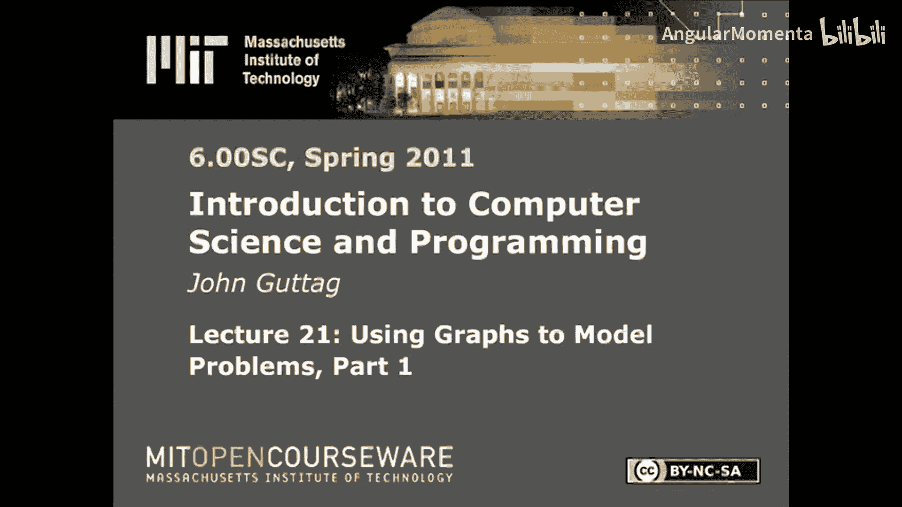
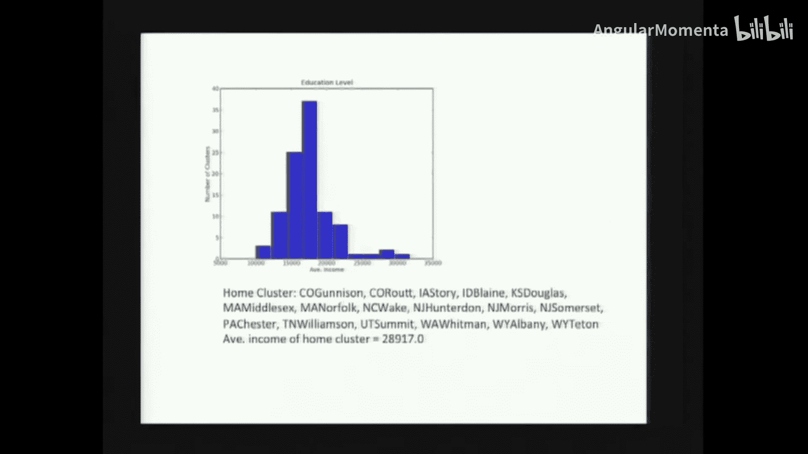
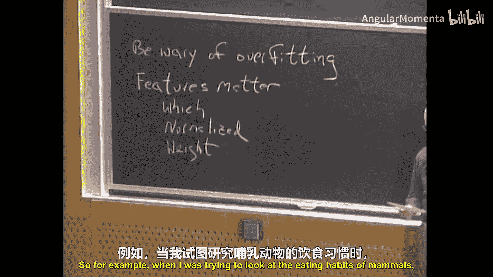
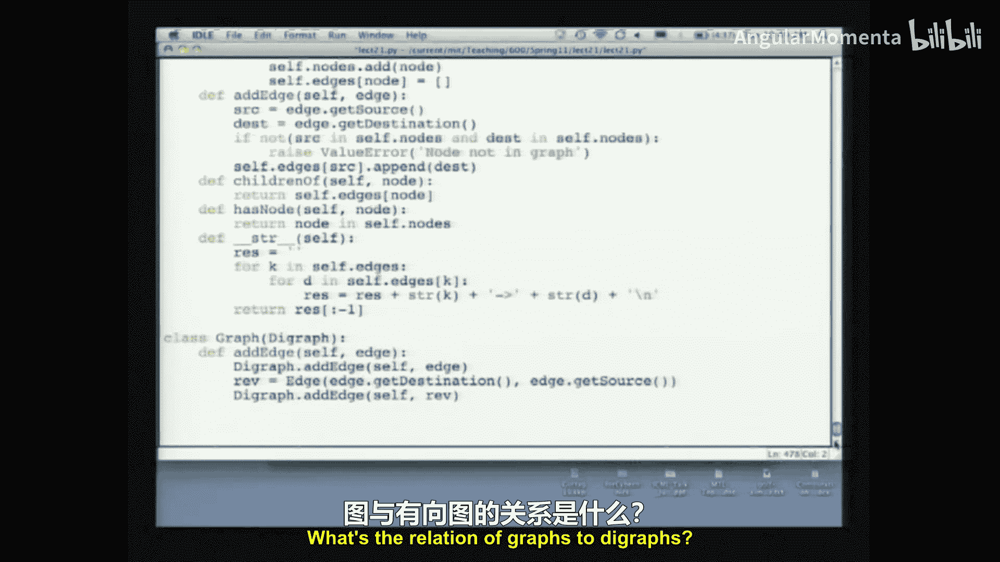
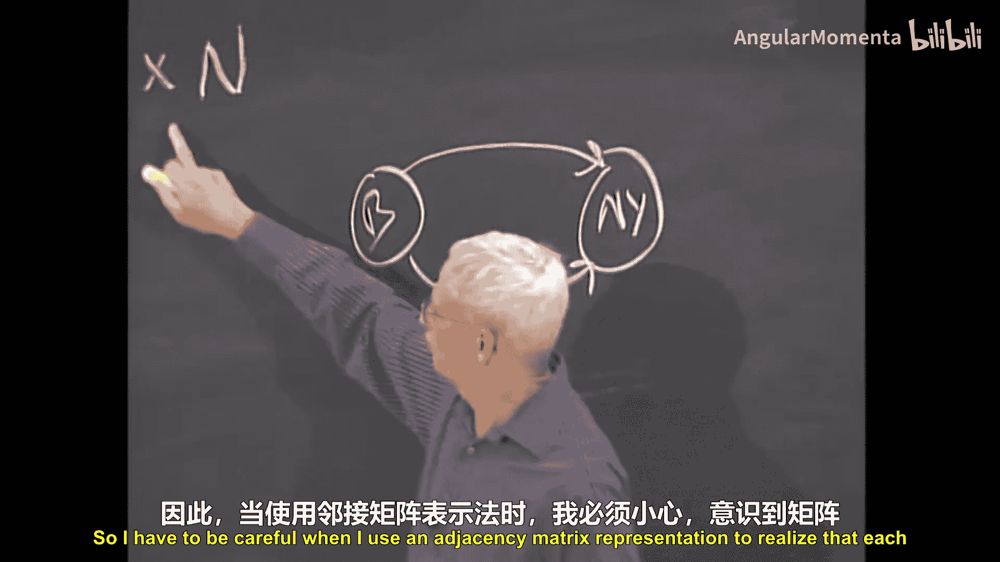
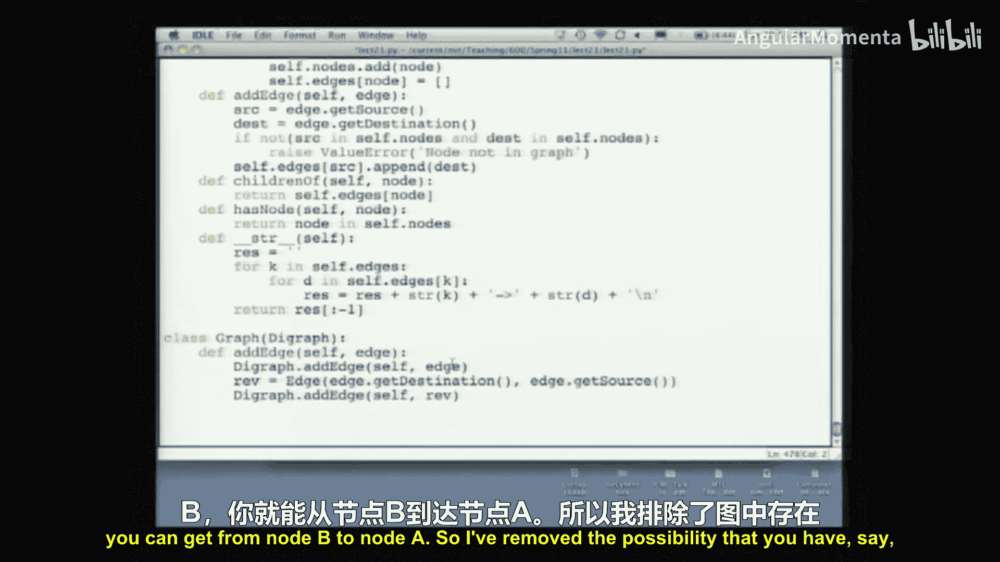

# 【麻省理工】计算机科学与编程导论 ｜ MIT 6.00SC Introduction to Computer Science and Programming p31 31 -BV1a5BZBkEP6_p31-

The following content is provided under a creative Commons license。

 Your support will help M I T Opencourseseware continue to offer high quality educational resources for free。

To make a donation or view additional materials from hundreds of M T courses。

 visit M I T OpenCseware at O C W dot M I T dot E Du。

Good morning。 Oh， it's so nice to get a response。 Thank you。 I appreciate it。😊，啊。

I have a confession to make。 I stopped at my usual candy store this morning。

 and they didn't have any。So， I am bereft of。Anything other than crummy little Tutsie rolls for today。

But I promise I'll have a new supply by， by Thursday。Alright。

 we ended up the last lecture looking at pseudocode for K means clustering。

And talking a little bit about the whole idea and what it's doing。

 So I want to start today by moving from the pseudo code to some real code。

This was on previous handout， but it's also on today's handout。So let's look at it。

Not so surprisingly， I've chosen to call it K means。And you'll notice that it's got some arguments。

The points to be clustered。K。And that's an interesting question， unlike hierarchical clustering。

 where we could run it and get what's called a denogram and stop at any level and see what we liked。

K means involves knowing in the very beginning how many clusters we want。So I。

 we'll talk a little bit about how we could choose K。A cutoff。And what the cutoff is doing。

 you may recall that in the pseudocode， K means was iterative。

And we keep reluing until the change is small enough that we feel it's stable。

That is to say the new clusters are that are not that much different from the old clusters。

The cutoff is the definition what't mean my small enough。We'll see how that gets used。

The type of point to be clustered。The maximum number of iterations。

 there's no guarantee that things will converge。As we'll see。

 they usually converge very quickly in a small number of iterations。

But it's prudent to have something like this in just in case。Things go awry。And。

To print just my usual trick of being able to print some debugging information if I need it。

 but not getting buried in， in output if， if I don't。Alright， so let's look at the code。

 and it very much follows the outline of the pseudocode we started with last time。

We're going to start by choosing。K initial centroids at random。

So I'm just gonna go and take all the points I have。And I'm assuming， by the way。

 I should have written this down， probably that I have at least K points。Otherwise。

 it doesn't make much sense。 If you have 10 points， you're not going find 100 clusters。嗯。

So I'll take K random centroids。And those were my initial centroids。

There are more sophisticated ways of choosing centroids， as discussed in the problem set。

But most of the time， people just choose them at random。Because at least it。

 if you do it repetitively， it guarantees against some sort of systematic error。Whoa。What happened。

I say， come back。Thank you。Alright， then I'm gonna to say that the clusters I have initially are empty。

And then I'm gonna create a bunch of singleton clusters， one for each centroid。

So all of this is just the initialization getting things going。 I haven't had any iterations yet。

And the biggest change so far， I'm just setting arbitrarily to the cutoff。Alright。

 and now I'm gonna iterate until the change is smaller than the cutoff。

While biggest change is at least the cut off and。Just in case， nu meters is less than the maximum。

I'm gonna create a list， containing。K empty lists。 So these are the new clusters。And then。

 I'm going to go through。For I and range K， I'm going to append。The empty cluster。

 these are going be the new ones。And then for P and all the points， I'm going find the centroid。

In the existing clustering。That's closest to P。That's what's going on here。Once I've found that。

I'm going to add P to the correct cluster。Go and do it for the next point。Then when I'm done。

I'm going compare the new clustering to the old clustering。And get the biggest change。

And then go back and do it again。Alright， people understand that basic structure。

And even some of the details of the code， it's not very complicated。

But if you haven't seen it before， it can be a little bit tricky。When I'm done。

I'm going to just get some statistics here。嗯。About the clusters。

going to keep track of the number of iterations， and。The maximum diameter。Of a cluster。

 So the cluster in which things are least tightly grouped。And this will give me。

An indication of how good a clustering I have。O。Does that make sense to everybody。

Any questions about。The K means code。Well， before we use it。Let's look at how we use it。

 So I've written this function。 test 1 that uses it。嗯。Some arbitrary values for K and the cutoff。

Number of trials is kind of boring here。 I've only said one is a default。

 And I sent pth steps to false。The thing I want you to notice here。

Because I'm choosing the initial clustering at random。

I can get different results each time I run this。Because of that。

 I might want to run it many times and choose the， quote， best clustering。

What metric am I using for best clustering。It's a min Max metric。

 I'm choosing the minimum of the maximum。Diameters。

 so I'm finding the worst cluster and trying to make that as good as I can make it。

You could look at the average cluster。 This is like the linkage distances we talked about before。

So that's the normal kind of thing。 It's like when we did Monte Carlo simulations， or random walks。

Flipping coins， you do a lot of trials， and then you can either average over the trials。

 which wouldn't make sense for the clustering or select the trial that has some property you like。

This is the way people usually use K meanss。 Typically， they may do 100 trials and choose the best。

The one that gives in the best clustering。So， let's look at this。嗯。

And let's try it for a couple of examples here。With。Start it up。And we'll just run test one。

On our old mammal teeth database， we get some clustering。Now，'ll run it again。We get a clustering。

 I don't know。 Is it the same clustering。Kind of looks like it is。No reason to suspect it would be。

We run it again。Well， you know， this is very unfortunate。

 It's supposed to give different answers here。Because it often does。I think they're the same answers。

 though， aren't they。Yes， they see a different。 Now they're the same。Well。

 how unlucky can you be Every time I ran it at my desk。

 it came up the first two times with different things。 But take my word for it。

And we'll see that with other examples。 It could come out with different answers。Let's try it with。

Some printing on。So we get some things here。And， let's try it。What do we got out of this one。

All right。Oh， well， sometimes you get unlucky and sometimes you get unlucky with randomness。

All right。So why did we start with Ka meanss， Not because we needed it for the mammal's teeth。

 The hierarchical worked fine， but because it was too slow when we tried to look at something big like the counties。

So now let's move on。And talk about clustering the counties。We'll use exactly the K means code。

 It's one of the reasons we're allowed to pass in the point type as an argument。

But the interesting thing will be。What we do for the counties themselves。

So this gets a little complicated。In particular， what I've added to the counties。

Is this notion of a filter。The reason I've done this is， as we've seen before。

 the choice of features can make a big difference in what clustering you get。

I didn't want to do a lot of typing as we do en examples。

 So what I did is I created a bunch of filters， for example， no wealth。Which says， all right。

 we're not going to look at home value。 We're giving that a weight of 0。

We're giving income away of 0。 We're giving property poverty level a rate of 0。

But we're giving the population or weight of one， etcter。Okay。

 so what we see here is each filter supplies a weight。 In this case， either 0 or one。To a feature。

This will allow me as we go forward to run some experiments with different features。All features。

 everything as a weight of one。 Oh， I made a mistake， though。That should have been a one。

Then I have filter names， which I'm just a dictionary。 and that'll make it easy for me to。

Run various kinds of tests， with different filters。Then， I've got a knit。Which takes。

As its arguments， the things you would expect， plus the filter name。

So it takes the original attributes， the normalized attributes。And you will recall that。

 why do we need to normalize attributes。If we don't， we have something like population。

 which could number in the millions。And we're comparing it to。Percent female。

 which we know cannot be more than 100。And so the small values become totally dominated by the big。

 absolute values。 And when we run any clustering， it ends up only looking at population or number of farm acres。

Or something that's big。Has a big dynamic range。 You know， Manhattan has no farm acres。

 Some county in Iowa has a lot。Maybe they're identical in every other respect。Unlikely。

 but who knows， I guess theres no baseball teams in Iowa。But at any rate。

 we always scale or we try and normalize so that we don't get fooled by that。嗯。Then I go through。And。

If I haven't already， this is a class variable attribute filter。Which is initially set to none。

 not an instance variable， but a class variable。And what we see here is if that class variable is still none。

This will mean it's the first time we've generated an in a point of Tpe County。

Then what we're gonna do is set up the filter。To only look at the attributes we care about。

So only the attributes， which have a value of one。And then I'm gonna to override distance from class point to look at the features we care about。

O。Does this basic I structure and idea make sense to people。It should。 I hope it does。

 because the current problem set requires you to understand it。

In which you will be doing some experiments。So now I want to do some experiments with it。

 I'm not going to spend too much time， even though it would be fun。

 because I don't want to deprive you of the fun of doing your， your problem set。So。

 let's look at an example。嗯。So I've got test， which is pretty much like test 1。

R K means a number of times， and chooses the best。And。We can start。 Well。

 let's start by running some examples。Oursels。So I'm gonna start by clustering on education level only。

So with I'm gonna get 20 clusters，20 chosen， just so it wouldn't take too long to run and we'll filter on education。

And we'll see what we get。Well， I should have probably done more than one cluster just to。

Make it work。But we've got it。 And I just for fun， I'm keeping track of what cluster Middlesex County。

 the county in which M I T is shows up。😊，嗯。So we can see that it's similar to a bunch of other counties。

 and it happens of an average income of $28665， or at least it did。Then。And if we look。

We should also see。Oh， let me go back。I foolishly didn't un Pabab dot show。

So we better go back and do that。Now， we're just gonna。Newke couldnt run it again because it's easy。

 And I wanted to run it with a couple of trials， anyway。So we'll first do the clustering。

 We'll get cluster 0。Now we're getting a second one。 and it's gonna choose whichever is the tightest。

And we'll see that that's what it looks like。So we've now clustered。The counties。

 based on education level。No other features。And we see that it's got some interesting properties。

There is a small number of counties， clusters。Out here near the the right side with high income。And。

 in fact， we'll see that we are fortunate to be in that cluster。One of the。

Clus that contains wealthy counties。And you could look at it and see whether you recognize any of the other counties。

That hang out with Middlesex。嗯。Things like Marin County， San Francisco County。Not surprisingly。

 right， Remember， we're clustering by education， and these might be counties where you would expect the level of education to be comparable to the level of education。

In Middlesex。All right。We get rid of that for now。Sure。I ran it。 I didn't want。

 didn't want you to have to sit through it。But I ran it on a much bigger sample size。

So here's what I got when I ran it asking for 100 clusters。And。I think it was five trials。And。

You'll notice that this case， actually， we have a much smaller。Cluster。Containing Middle sex。

 not surprising because I've done 100 rather than 20。And it should be pretty tight。

 since I chose the best。And you can see we have this interesting。 We have a distribution here。Now。

Remember that the name of the game here is we're trying to see whether we can infer something interesting by clustering。

Unsupervised learning。So one of the questions we should ask is how different is what we're getting here from if we chose something at random？

Now， remember， we did not cluster on things based on income。 I happened to plot income here。

Just because I was curious as to how this clustering related to income。Suppose we had just chosen。

At random。And split the counties at random into 100 different clusters。

 What would you have expected this kind of graph to look like。Do we have something that。Is。Different。

 obviously different from what we might have gotten if we just done a random division in。

100 different clusters。Think about it。 What would you get。Bardon。Well。

 a bell curve is a good guess because bell curves occur a lot in nature。嗯。And as I said。

 I apologize for the rather miserable quality of the rewards。It's a good guess。

 but I think it's the wrong guess。What might， what would you expect。

Would you expect the different clusters， Yeah， go ahead。A very sharp bell curve was one comment。

 well， someone else want to try it， that's kind of close。

 I thought you were on the right track in the beginning。Well， take a different example。Let's take。

Students。If I were to select 100 MIT students at random and compute their GPA。

 would you expect it to be radically different from the GPA of all of MIT。

 the average GP of all MIT students。Probably not， right？

So if I take 100 counties and put them into a cluster。

The average income of that cluster is probably pretty close to the average income in the country。

And so you'd actually expect it to be kind of flat， right。

That each of the randomly chosen clusters would have the same income， more or less。Well。

 that's clearly not what we have here。So we can clearly infer from the fact that this is not flat。

Is that there is some interesting correlation between level of income。And。Let an education。

And for those of us who earn in our living education。We're glad to see it's positive， actually。

 not negative。😊，As another experiment， just for fun。I clustered by gender only。

So this looked only at the female male ratio in the counties。

And here you'll see with Middleses with remember， we had about 3000 counties to start with。

So the fact that there were so few in the cluster on education was interesting， right。Here。

 we have more。And we get a very different looking picture。Which says。

 perhaps that the female male ratio。It's not unrelated to income。

But it's a rather different relation than。We get from。Education。

 this is what would be called a bimodal distribution。

A lot here and a lot here and not much in the middle。But again， the dynamic range is。

 is pretty is much smaller， but we do have some counties where the income is。Pretty miserable。

All right。We could play a lot more with this， but。I'm not going to。I do want to before we leave it。

Because we're about to leave machine learning， reiterate a few of the major points that I wanted to make sure were're sort of the take home messages。

So we talked about supervised learning。Much less than we talked about， unsupervised。Interestingly。

 because unsupervised learning is probably used more often in the sciences than supervised。

And when we did supervised learning， we started with a training set。That had labels。

Each point had a label。And then we tried to infer the relationships between the features of the points and the associated labels。

Between the features and the labels。We then looked at unsupervised learning。

And the issue here was our training set。Was all unlabeled data。And what we try and infer。

Is relationships among points。So rather than trying to understand how the features relate to the labels。

We're just trying to understand how the points or actually the features related to the points relate to one another。

Both of these， as I said earlier， are similar to what we saw when we did regression。

Where we tried to fit curves to data。You need to be careful。And wary of overfitting。

Just as you did with regression。In particular。If the training data is small。

A small set of training data。 You may learn things that are true of the training data that are not true of the data on which you will subsequently。

Run the algorithm to test it。So you need to be wary of that。嗯。

Another important lesson is that features matter。Which features matter。

It matters whether they're normalized。And in some cases。

 you can even wait them if you want to make some features more important than the others。

Features need to be relevant。To the kind of knowledge。That you hope to acquire。So， for example。

 when I was trying to look at the eating habits of mammals， I chose features based upon teeth。

Not features based upon how much hair they had。Or their color or there lengths of the tails。

I chose something that I had domain knowledge， which would suggest that it probably relevant to the plan at hand。

 questiontion at hand。And then we discovered it was。Just as here， I said， well。

 maybe education has something to do with income。We ran it， and we discovered。

 thank goodness that it does。Okay， so I've probably told you 10 times that features matter。 If not。

 I should have。Because they do。 And it's probably the most important thing to get right in doing machine learning。

Now， our foray into machine learning is part of a much larger unit。 In fact。

 the largest unit of the course， really。Is about how to use computation to make sense of the kind of information one encounters in the world。

A big part of this is finding useful ways to abstract。

From the situation youre initially confronted with。To create a model about which one can reason。

So we saw that when we did curve fitting， we would abstract from the points to a curve to get a model。

 And we see that with machine learning。That we abstract from。

Every detail about a county to say the education level to give us a model of the counties that might be useful。

I now want to talk about another kind of way to build models。That。啊。As popular way as there is。

 probably the most common kinds of models。And those models are graph theoretic。

And there's a whole rich theory about graphs and graph theory that are used to understand these models。

So suppose， for example， you had a list。Of all the airline flights between every city in the United States and what each flight cost。

Suppose also， counter counterfactual supposition。That for all cities， A， B and C。

 the cost of flying from A to C by way of B was the cost of A to B and the cost from B to C。

We happen to know that's not true， but we can pretend it is。

So what are some of the questions you might ask if I gave you all that data。And in fact。

 there's a company called I T A Software in Cambridge， recently acquired by Google for， I think。

$700 million。That is built upon answering these kinds of questions about these kinds of graphs。

So you could ask， for example， what's the shortest number of hops between two cities？

If I want to fly from here to Juau， Alaska， what's the fewest number of stops。I could ask。

 what's the least expensive。Different question， flights from here to Juneno。I could ask。

 what's the least expensive way involving no more than two stops。

Just in case I don't want to stop too many places。I could say， I have 10 cities。

 What's the least expensive way to visit each of them on my vacation。

All of these problems are nicely formalized as graphs。A graph。Is a set of nodes。

Think of those as objects。 nodes are also often called vertices， or ver。A vertex for one of them。

And those nodes are connected。By a set of edges。Often called as。If the edges。

Our unidirectional equivalent of a one way street。It's called a digraph。Or directed graph。

Graphs are typically used in situations in which there are interesting relationships among the parts。

The first documented use of this kind of a graph was in 1735。When the Swiss mathematician。

 Leonard Euler。Use what we now call graph theory to formulate and solve the Knsberg Bridges problem。

 So this is a map。Of。Kunigsburg， which was then the capital of East Prussia， a part of what's today。

 Germany。And it was built at the intersection of two rivers and contained a lot of islands。

The islands were connected to each other， into the mainland， by。So7 bridges。For some bizarre reason。

 which history does not require。 And I cannot even imagine。

The residents of this city were obsessed with the question。Of whether it was possible to take a walk。

Through the city that involved crossing each bridge exactly once。

Could you somehow take a walk and go over each bridge exactly once。 I don't know why they cared。

 They seemed to care。 They debated it。 They walked around。 They did things。嗯。

It probably would be unfair for me to ask you to look at this map and answer the question。

But it's kind of complicated。Oilers great insight。Was that you didn't have to actually look at the level of detail represented by this map to answer the question。

You could vastly simplify it。And what he said is， well， let's represent each landmas by a point。

And each bridge as a line。So， in fact， his map of Khanigsberg looked like that。Considerably simpler。

This is a graph。We have some vertices， and some edges。He said， well。

 we can just look at this problem。And now ask the question。Once he'd formulated the problem this way。

 it became a lot simpler to think about。And he reasoned， as follows。

If a walk were to traverse each bridge exactly once。It must be the case that each node。

Except for the first and the last。In the walk must have an even number of edges。

So if you were to go to an island and leave the island。And traverse each bridge to the island。

Unless there were an even number， you couldn't traverse each one exactly once。Right。

 if there were only one bridge once you got to the island， you were stuck。If there were two bridges。

 you could get there and leave。 But if there were three bridges， you could get there， leave。

 get there， and you're stuck again。He then looked at and said， well， none of these edges。Has an even。

 none of these nodes have an even number of edges。 Therefore， you can't do it。End of story。

Stop arguing。嗯。Kind of a nice piece of logic。And then Euler later went on to generalize this theorem。

To cover a lot of other situations。But what was important was not the fact that he solved this problem。

But that。He thought about the notion of taking a map and formulating it as a graph。

And this was the first example of that。 And since then。Everything has worked that way。So。

If you take this kind of idea and now you extend it to digraphs。

You can deal with one way bridges or one way streets。

Or suppose you want to look at our airline problem。You can extend it to include weights。For example。

The number of miles between two cities or the。Amount of toll you'd have to pay on some road。And so。

 for example， once you've done this， you can easily represent the entire US highway system。

Or any roadmap by a weighted， directed graph。More used more often， probably， the World wide Web is。

Today， typically modeled as a directed graph。Where there's an edge from page A to page B。

 if there's a link on page A to page B。And then maybe if you want to care， ask the question。

 how often do people go from A to B。A very important question。

 sayy to somebody like Google who wants to know how often people click on a link。

To get to another place so they can charge for those clicks。You use a weighted graph。Which says。

 how often does someone go from here to there。And so a company like Google maintains a model of what happens and。

Uses a weighted directed graph to essentially represent the web。

 the clicks and everything else and can do all sorts of analysis on traffic patterns and things like that。

There are also many less obvious use of graphs。Biologists use graphs to measure things ranging from the way proteins interact with each other to more obviously。

 gene expression networks。Are clearly graphs。Physicists use graphs to model phase transitions。

With typically the weight of the edge representing the amount of energy needed to go to from one phase to another。

So those are， again， weighted directed graphs。The weight， the direction is。

 can you get from this phase to that phase And the weight is how much energy does it require。

Epidemiologists use graphs to model diseases， etc。And we'll see an example of that in a bit。Alright。

 let's look at some code now to implement graphs。This is also on your handout。 And I'm gonna。

Comment this out just so we don't run it by accident。So as you might expect。

 I'm going use classes to implement graphs。So I start with a class node。Which is at this point。

 pretty simple。It's just got a name。Now， you might say， well。

 why do I even bother introducing a class here， Why don't I just use strings。Well。

Because I was kind of wary that some time later， I might want to associate more properties with nodes。

So you can imagine if I'm using a graph to model the world web。

I don't want more than the URL for a page。You know。

 I might want to have all the words on the page or all who knows what else about it。So I just said。

 for safety， let's start with a simple note class， but let's make it a class so that any code I write can be reused。

If at some later date， I decide nodes are going be more complicated than just strings。

Good programming practice。An edge is only a little bit more complicated。It's got。A source。

 a destination and a weight。So you can see that I'm using the most general form of an edge。

So that I will be able to use edges not only for graphs and diegraphs。

 but also weighted directed graphs。By having。All the potential properties I might need。And then。

Some simple things to fetch things。The next cluster in the hierarchy， is a digraph。So， it's got。

And in it， of course， I can add nodes to it。I'm not gonna allow myself to add the same node more than once。

I can add edges， edges。And I'm gonna check to make sure that I'm only connecting nodes that are in the graph。

Then I've got children of， which gives me all the descendants。Of， of a node。And。Has node in string。

And then interestingly enough， maybe surprising to some of you， I've made graph。

A subclass of digraph。Now， maybe that seems a little odd。 After all， when I started。

 I started talking about digraphs。OrAbout graphs and then said， and we can add this feature。

 But now I'm kind of going the other way around。Why is that， Why do you think。

That's the right way to structure the hierarchy。What's the relation of。

Graphs to di graphs。Diagraphs are more general than graphs。A graph is a specialization。Of a digraph。

Just like a county is a specialization of a point。So typically。

 as you design these class hierarchies。The more specialized something is。The further。

It has to be down more of like a subclass。 That makes sense。I can't really turn this on its head。I。

I can。Remove， I can specialize a diegraph to get a graph。

 I can't specialize a graph to get a digraph。And that's why this hierarchy。

Is organized the way it is。What else is there interesting to say about this。A key question。

 probably the most important question in designing an implementation of graphs。Is。

The choice of data structure is to represent the digraph， in this case。

There are two possibilities that people typically use。They can use an adjacency matrix。So。

 if you have。N nodes。You have an N by N matrix。Where each entry gives， in the case of a di。

 a weighted digraph。The weight connecting the nodes on that edge。Or in the case of a graph。

 it can be just true or false。So this is， can I get from A to B。Is that going to be sufficient。

Suppose you have a graph。That looks like this。And we'll call that Boston in this New York。

And I want to model the roads。Well， I might have a row that looks like this。

And a road that looks like this。From Boston to New York。As in， I might have more than one road。

So I have to be careful。When I use an adjacency matrix representation to realize that each element of the matrix could itself。

Be somewhat more complicated。In the case that there are multiple edges connecting two nodes。

And in fact， in many graphs， we will see there are multiple edges connecting the same two nodes。

It would be surprising if there weren't。All right， now the other。Common representation。

Is an adjacency list。In an adjacency list。For every node。I lift all of the edges。

 emanating from that node。Which of these is better， Well， neither。It depends upon your application。

An adjacency matrix is often the best choice when the connections are dense。

Everything is connected to everything else。But is very wasteful if the connections are sparse。

If there are no roads connecting most of your cities or no airplane flights connecting most of your cities。

Then you don't want to have a matrix where most of the entries are empty。

Just to make sure that people follow the difference， Which am I using in my implementation here。

Am I using an adjacency matrix or an adjacency list。Adja， I heard somebody say adjacency list。

And because my candy supply is so meage， they didn't even bother raising their hands。

 I'd know who said it， but yes， it is an adjacency list。😔。

And we can see that by looking what happens when we add an edge。

I'm associating it with the source node。So， from each node。

And we can see that when we look at the children of。Here。I just returned the edges of that node。

 And that's the list of all the places you can get to from that node。Alright， so it's very simple。

But， it's very useful。Next lecture， we'll look， yeah， thank you。 Quetion。 I love questions。Yeah。

What makes？Because good question， so the question is what makes the graph more specialized？😔。

What we'll see here when we look at graph。😔，It's not a very efficient implementation。

 but every time you add an edge。I add an edge in the reverse direction。Because you can。

 if you can get from node A to node B， you can get from node B to node A。

So I've removed the possibility that you have， say， one way streets in the graph。

And therefore， it's a specialization。There are things I cannot do with graphs that I can do with eyegraphs。

But anything I can do with a graph， I can do with a digraph。It's more general。 Does that make sense。

嗯。So that that's a great question。 and I'm glad you asked it。 Allright， Thursday。

 we're gonna look at a bunch of classic problems that can be solved using graphs。

 And I think that should be fun。😊。

