# 【麻省理工】计算机科学与编程导论 ｜ MIT 6.00SC Introduction to Computer Science and Programming p32 32 -BV1a5BZBkEP6_p32-

The following content is provided under a creative Commons license。

 Your support will help M I T Open Coseware continue to offer high quality educational resources for free。

To make a donation or view additional materials from hundreds of MI T courses。

 visit M T OpenCourseware at OCW。t MT Eduu。

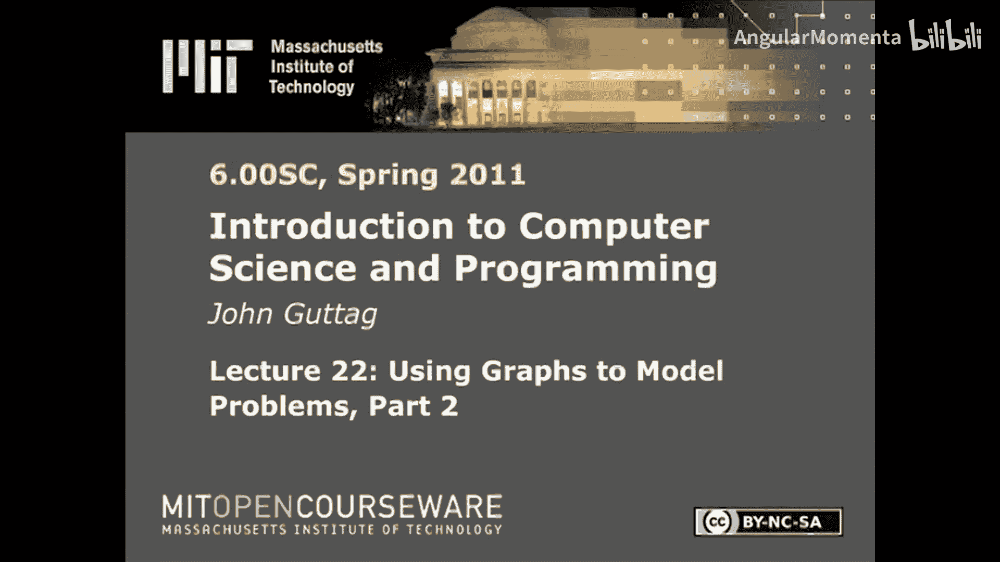

OK呃。So we're going to test it， here's test one。It just says for name and range 10。

 I'm going to build some nodes。Put in a few edges， and then I'm going to print the graph。

And all I really want to show you here。Is that if we run it for digraph and we run it for graph。

 we'll get something different。Yes， I'm happy to save the source。Oh。Inval syntax。

It was Val last time I looked， what have we done wrong here？Did I edit something badly。

Sort of looks valid to me， doesn't it？Or we type it。We以谁。No。Well， it's one of those days， isn't it？

All right， this is a good debugging exercise for us。Let's think about how we go and find this。

 I'm sure you've all had this sort of problem。Well。

 the first thing to do is I think I'll just comment out all of this。And see if I still get an error。

I do。 Well that suggests that that wasn't the problem， so I can put it back。Now。

 it shows a problem all the way down there。So let's see what's going on here。😔。

Or maybe I'll just skip this。Doubtless， I'll get in trouble if I do。So， let's see。

I must have just made a sloppy editing error somewhere this morning in commenting things out for the lecture。

咩啊。Think what we're gonna do。The moment is move on and hope it goes away。SeeIt seems silly。

 sorry about this， everybody。😔，People should look with me and see if you can someone may see it more quickly than I can。

In fact， I'm hoping someone sees it more quickly than I can。We've now got a microphone。I mean。

 the embarrassment of a code with syntax errors says it？Sorry， for some reason。

 it wasn't on his schedule。Just because we've been teaching it。10 o'clock， Yeah。

 I know February is no reason to suspect that we would teach at 10 o'clock today。啊。Well。

 this is embarrassing， folks， and I wish one of you would bail me out by telling me where my syntax area is。

Well， random looks okay， right， node looks okay。And it gets more complicated。あし。あ出。No。Okay。

 I'll turn in the transmitter。But I'm really focused on a different problem right now。Guys， help。

Where are my T is。why does it keep doing that to me。Maybe there's something just funny going on here。

Bton。Restarting idle。 You think maybe that's the issue。We could try that。啊。

So it looks like iddle was just in some。Ugly state。Let's hope。Yes， alright。 So I didn't have a bug。

 It was just idle had a bug。 Allright，But we did squander 10 minutes。 Oh， well。 So we have the graph。

And you can see when we look at a graph。 We have a node from  one to 2， an edge from  one to 2。

 from one to  one， etca。And that's the digraph。 When we look at the graph， we'll see that， in fact。

 we have a lot more nodes because everything goes in both directions。But that's what we expected。

 Nothing very interesting。 All I want you to do is notice the difference here between graphs and digraphs。

Now， getting to a whole point。Once。We have this mechanism set up to think about graphs。

 We can now think about interesting problems and formulate them as graph problems。

 And I want to list a few of the interesting problems。

 and then we'll look at how to solve some of them。So probably the most common graph problem that people solve is called the shortest path problem。

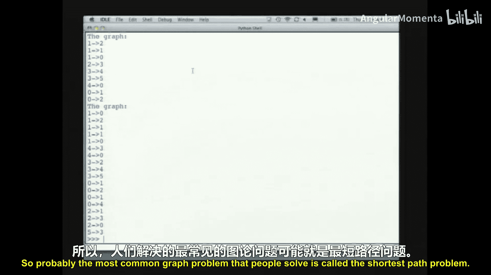

We talked about this briefly last time。 The notion here is for some pair of nodes， N1 and N 2。

We find， want to find the shortest sequence of edges。That connects those two nodes。Alright。

 so that's very straightforward。Then there's the shortest weighted path。

Where instead of trying to find the shortest sequence of edges。

 we want to find the smallest total weight。So it may be that we converse a few extra edges。

But since they have shorter weights， we end up getting a shorter path。

So we might indirect to do the shortest path。嗯。This is。Probably the more common problem。So。

 for example， that's the problem that Google Maps solves。When you ask it to give you。

Driving directions。And you'll notice when you use something like Google Maps or Map Que。

You can tell it to minimize the time。In which case， maybe it will route you on a freeway。

Where you can drive at 80 miles an hour， even though you drive a few extra miles。

 or you can tell it to minimize the distance， in which case it may take you on these crummy little surface roads where you have to drive slowly。

 but you'll cover fewer miles and use less gas。So you get to tell it which set of weights you care about。

 And then it finds you the shortest path。Given those weights。

We'll come back to this since we're gonna look at some code to implement it。

Another slightly more complicated problem to understand that stand is finding cliques。So。

 to find a clique。We're looking to find a set of nodes。Such that。There exists a path。Connecting。

Each node。In the set。So。You could think of this。As similar to， say， a social clique。

Who your friends are。It's a group of nodes or a group of people that somehow can get to each other。

It's not saying you can't get outside the clique， but it is guaranteeing that from any member of the clique。

 you can reach any other member of the clique。And so you can imagine， well。

 we'll look at some examples of， of where finding a clique is useful。And the final。Kind of problem。

 I want to mention。Is the minimum cut problem often abbreviated min cut。So the problem here。

Is given a graph and given two sets of nodes。You want to find。The minimum number of edges。

Such that if those edges are removed。The two sets are disconnected。I。e。

 you can't get from a member of one set to a member of the other set。

This is often a question that gets asked。 for example。

 imagine that you are the government of Syria and you want to ensure that nobody can post a video on YouTube。

You would take the set of nodes in Syria， and you would set take the set of nodes probably outside Syria。

And ask， what's the minimum number of links， communication links you'd have to cut to ensure that you can't get from a node in Syria to a node outside Syria。

People who do things like plan power lines， worry about that。They want to say。

 what's the minimum number of links such such that if they're cut。

 you can't get any electricity from this power plant to say， this city。

And they'll typically design their network with redundancy in it so that the min cut is not too small。

And so people frequently are worried about Mink problems and， and trying to， to see what that is。

Alright， now let's look at a couple of examples。嗯。In， in slightly more detail。 So what we see here。

Is a。Pctorial representation。Of a weighted graph generated by the Centers for Disease Controls。

 CDC in Atlanta。In 2003， when they were studying an outbreak of tuberculosis in the United States。

A virulent and bad， infectious disease。

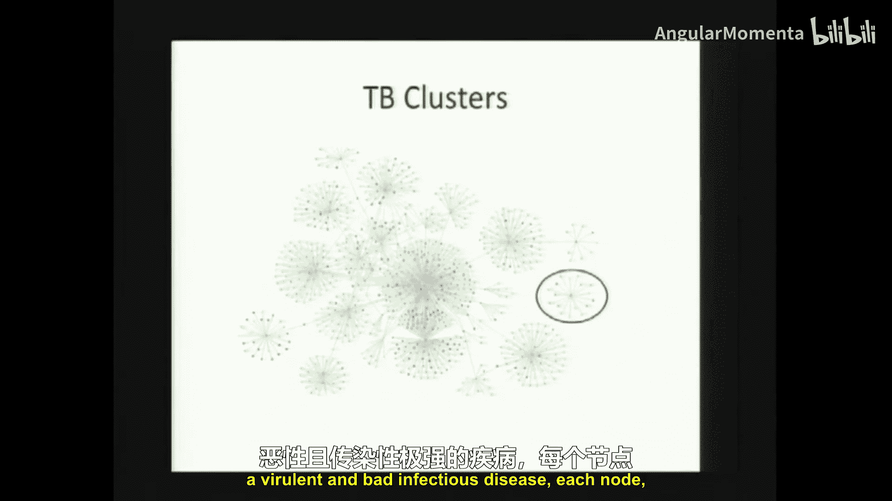

Each node。And you can see these little dots or the nodes。Represents a person。

And each node is labeled by a color。😡，Indicating whether the person has active tuberculosis。

Has tested positive for exposure。But doesn't have the disease。Or tested negative for exposure。

Or not been tested。So you'll remember when we looked last time at class node and asked。

 why did I bother creating a class for something so simple？It was because I said， well。

 maybe we would add extra properties to a node。So now， in some sense， these colors。

Would be easy to add。 So I could add to class node。Well。

 I could attribute color and call it red or blue or green。

 or more likely an attribute saying TV state。Which would indicate active， not active， etc cea。

The edges。😡，Which you can see here。Represent connections among pair of people， pairs of people。

What I didn't bother， what you can't see on these pictures is the edges are actually weighted。

And the weights there are about how closely people are connected。

And there are really only two weights， I think they used close。

 someone who say lives in your house or works in the same office or casual。

 a neighbor you might have encountered， but you wouldn't expect to necessarily see them every day。

So they've taken a fairly complicated set of information and represented it as a graph。

Now what are some of the interesting graph theoretic questions we might proceed to ask about this？

So an important question they typically ask when diseases。Break out unexpectedly。

Is there an index patient？The index patient is the patient who brought the disease into the community。

So somebody who visited some country picked up tuberculosis flew back to their neighborhood in the US and started spreading it。

嗯。How would we formulate that as a graph question？Again， quite simply。We would say。

Does there exist aode？Such that。Noode。Has TB。Or maybe not even that has TB。Well， simplify it。

 You might say or tested positive because maybe you can communicate it without having it。Has TV， and。

Is connected。To every node。With tea。With TV。Now， this doesn't guarantee that the patient is an index patient。

But if there is no such patient， no such node， then you know that there is not a single source of this disease in the community。

How would we change the graph to model it in a more detailed way。 And remember。

 this is all about modeling。So that we could ask the question more formally。About， or more precisely。

Well， we'd have to change to a more complex。Coloring scheme， if you will。

In which we'd include the date。Of when somebody。Acquired the disease。Or tested positive。

 And then we could ask those kinds of questions in a little bit more detail。But again。

 once we've built the model， we can then go and ask。A lot of interesting questions。By the way。

 the answer to this question for this graph。Is almost。嗯。There is an index patient。

That's connected to every node in the graph， except for the nodes in this black circle。They。

Are not connected to any index patient。So the CDC actually did that analysis。

 and they reached that conclusion that there didn't seem to be。And then later， it came to light。

 in fact， that this particular graph is missing an edge。

That there somebody had moved from neighborhood A to neighborhood B。And they not kept track of that。

 and if they had， they would have discovered there was a link。

That's missing an edge that's missing from this graph， which， in fact。

 would have connected everybody to the index patient。It was an interesting question。

 They only found that because they were puzzled about this tiny little black circle out here and started investigating all the people in the black circle and discovered that one of them had moved。

From one place to another。What's another question you might ask once you've built this model。Well。

 suppose this is the current state of the world。And I want to reduce the spread of the disease。

By vaccinating uninfected peoples that they don't contract tuberculosis。But。I have a minimum， I have。

 you it's expensive to do this， I only have so much vaccine， who should get it。

What's the graph theory problem that I would solve？

To address the question of what's the best way to allocate my limited supply of vaccine。Exactly， I。

 by the way， have really good。 I have much better candy now。 So I should， I think that。

 I think that's where the minimum cut came from。😊，Well， all right， it's better for eating。

 it's just worse for throwing。That's easier to throw。All right。It's the minimum cut problem。

I take the people who are already infected。View them as one set of nodes。

I take the people who are not infected and view them as another set of nodes。Find the edges。

That I need to cut to separate them and then vaccinate somebody on one side of the edge so that they don't contract the disease。

So， again， a nice， easily formalized problem。

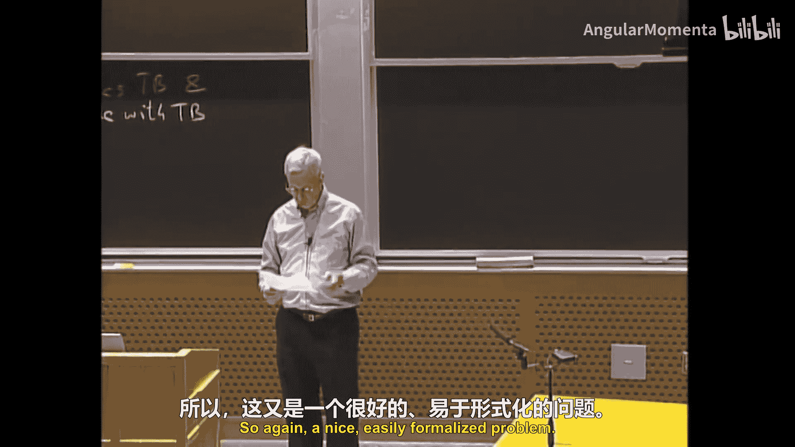

Allright， so that's an example。Let's look at another example。

Let's think about the shortest path problem here。And we'll do that by thinking about social networks。

So I suspect that at least a few of you have used Facebook。And you have friends。

Some of you more than other。Um。There's， I see people laughing。

 This is someone who probably has two friends and is sad。 I don't know， or 1000 friends and is happy。

All right， who knows， I don't， I don't want to know， please。

And I'm not going to tell you how many friends I have either。But you might ask the question。嗯。

Suppose you wanted to reach Donald Trump， Errstwhileil Republican vice presidential candidate。

 or presidential candidate。Say is there a connection from you to Donald Trump？

Do you have a friend who has a friend who has a friend who is a friend with Donald Trump or Barack Obama or anyone else you'd ask。

Well， and what's the shortest path。How many friends you have to go through？嗯。

This is what's called the 6 degrees of separation problem。In the 1990。

 the playwright John Guray published a play called 6 degrees of separationation。

Under the slightly dubious premise that everybody in the world was connected to everybody else in the world with at most six hops。

You took all the people you knew， all the people they knew， etc cea。

 You could reach any person in the world in 6 and 6 phone calls。 sayy any person who was a phone。I。

Don't know whether that's true。But this is a whole notion of a social network。

So if we wanted to look at that in Facebook， we could either assume that the friend relation is symmetric。

If I'm your friend， you're my friend， which it is， Or you can imagine a different model in which it's asymmetric。

If it's symmetric， you have a graph。If it's asymmetric， you have a directed graph。

And then you just ask the question。What's the shortest path from you to whomever you care about？

And you get that。You could imagine that Facebook already knows the answer to that question。

 but just won't tell you。But they'll sell it to somebody who has enough money。All right。

So how does Facebook solve this problem？They have a very simple piece of code。

 which we'll now look at， which solves the shortest path。So， let's go back。So， here's a。

Recursive implementation of shortest path。Comment this out while I'm in the neighborhood。

Takes the graph。A start node an end node， and。To print And this extra argument called visited。

We'll see why that gets used。And we'll think about the algorithm。This particular algorithm。

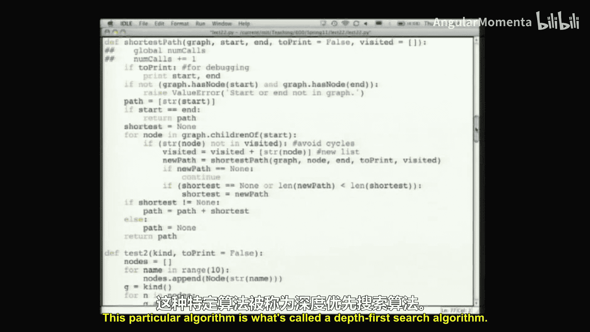

Is what's called a depth first search algorithm。It's a recursive depth for search。

 We've seen these before。Often abbreviated D FS。So if you think about having a graph。

Of a bunch of nodes connected to one another。Gest for fun will say， it does something like this。

What depth first search does is it starts at the source node for the shortest path。

 Let's call it this one。It first， visits one child。And then visits all the children of it。

 those children。This one has no children。Visit this child。Picks one of its children。

 Visits all of its children。 Let's say it had another one here。And goes on。Until it's done。And then。

 it backtracks。Comes back and takes the next child。

AndThen we have to be a little bit careful about the circle。So。To summarize it。

First thing we have to say is the recursion ends。When start equals end。That is to say。I've called it。

And。I've asked is there a path from A to A。 And the answer is， yes， there is。 I'm already there。Now。

 you could argue， and in some formulations， the answer is not necessarily。

 you'd say there's only a path that's if there's an edge from A to A。

But I've chosen to make the simpler assert that if you want to get to A and you're already there。

 you're done。Kind of seems reasonable。So then， the recursive part。Starts by choosing one child。

Of the node you're currently at。And it keeps doing that， until either。

It reaches a node with no children。Or。It reaches the nodes you're trying to get to。Or。

 and here's an important part。 It reaches a node。 It's already seen。And that's what visit is about。

Because I want to make sure that when I explore this。Graph。

 I don't go from here to here to here to here to here to here， anauseum。

Because I'm stuck in what's called a cycle。You have to avoid the cycles。

Once it's got to a no that has no children。If that's not the node it's trying to get to。

It backtracks。And takes the next child。Of the note it was at。

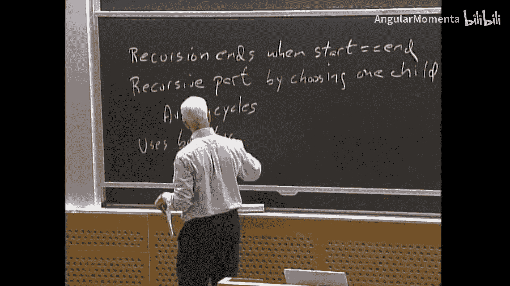

And in that way， it's systematically。Explorees all possible paths。And along the way。

 it chooses the best one。So we can look at the code here。

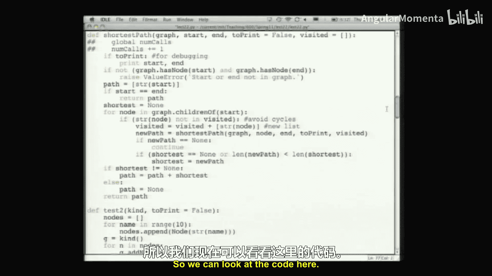

I've just commented out something we'll look at later。

 just as we try and instrument it to see how fast it's working。I've got a debugging statement。

Just to say whether I'm gonna print what I've been asked to do in case it's not working。And then。

 the real work starts。I get the original path is just the， the node we're starting at。

 If start is end， I stop。Shortest， if I get to here， I say shortest equals none。

 I haven't found any paths yet。 So there is no shortest path。

And then for node in the children of start。If I haven't already visited the node。

 this is to avoid cycles。😡，I create a visited list。That contains whatever that used to contain。

 plus the node。Notice that I'm creating a new list here。Rather than mutating the old list。

And that's because when I unravel my recursion and backtrack to where I was。

I don't want to have think I've visited something I haven't visited， right。

If I had only one list and I mutated it each time。 Then as I go down the recursion and back up the recursion。

 I'm always dealing with the same list。By getting a new list。

I'm ensuring that I don't have that problem。Then I say the new path is whatever the shortest path is from the node I'm currently at to the desired end node。

And I use the current set of visited nodes to indicate where I've already been at this part of the recursion。

If the new path is none， well， didn't find 1， I continue。 Otherwise， I found a path。

 and now I just want to check， is it better or worse or the same as the previous shortest path。

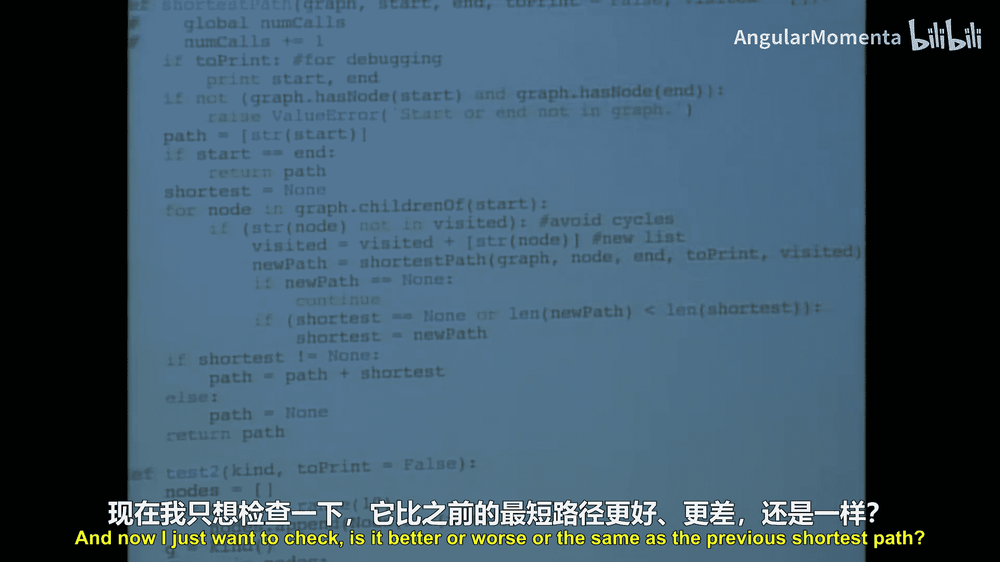

And then， I'm done。Very straightforward。The only really tricky part was making sure that I kept track of visited properly and didn't get stuck in cycles。

Okay， let's run it。So， here's test 2。Builds the same kind of graph we built before。

And then it tries to find the shortest path。And I'm going to do it for the same。Input， essentially。

 the same addd edge operations。 But once when it's a graph and once when it's a digraph。

So you'll notice that it found two different answers。When it was a graph。It could get from 0 to 4。

And essentially， one hop。But when it was a digraph。It took longer。

You have to go from 0 to 2 to 3 to 4。And that's not surprising because the graph has more edges。

And in fact， what we saw is that in the graph， there was an edge from 4 to 0。

 but there was no such edge in the directed graph。So again。

 you'll get unsurprisingly different answers。But， very straightforwardly。Now。

Let's try it on a bigger problem。So I've called this big test。

And what this does is rather than my sitting there and typing a bunch of addd edge commands。

It just generates edges at random。So I tell it whether I want it to be a graph or a digraph。

And then I give it the number of nodes。I want， in the number of edges。

 and it just generates at random a graph。 in this case， with 25 nodes and 200 edges。

So let's see what happens here。So printed out the graph。And now we're waiting a little bit。

It will eventually finish there。 I can get from 0 to 4。

turns out there's a short path for this random graph from 0 to 14 to 4。

It's not so surprising that there's a short path。 Why is it not surprising that there's a pretty short path。

I had a lot of edges， right， I had 200 edges in my graph。 So things are pretty densely connected。嗯。

Why did it take so long。Well， remember， what it's doing is exploring all the possible paths from 0 to 4。

 in this case。啊。This is very much like what we saw when we looked at thenapsack problem， right。

Where there， when we looked at the recursive implementation， we saw that， well， all right。

 generating all possibilities， There were an exponential number of possibilities there in the number of items。

Here， depending upon the number of nodes。And the number of edges， it's also large and， in fact。

 exponential。We could explore a lot of different paths。But let's see what's going on。

When we explore those。So what I'm gonna to do now。Is go back to our small example。We'll run test 2。

That was the small one we looked at。But I'm gonna set two print on to true。

And if you remember what that code did， is it told us。What it， what each recursive call was。

 what the start node was and what the end node was。So it found the same shortest path。

 That's a good thing，0 to 4。But how did it do that。Well， it first got called with the question of。

 okay， starting at 0， find me a path to 4。It visited the first child of 0， which was one。 So said。

 all right， see if you can find a path from  one to 4。

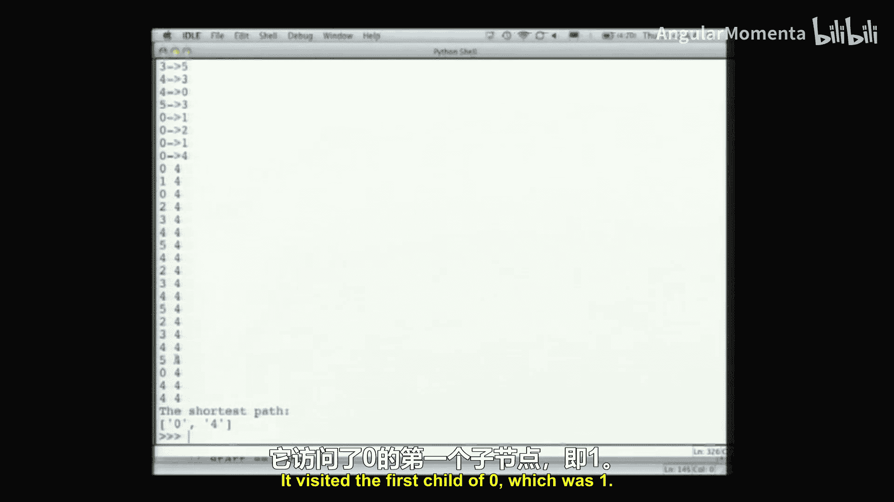

It then。Backtracked and sort of asked the same question。 Can I get from 2 to 4。From 0 to 4。

 And they said， well， I can get from 0 to 2。 Let me try 2 to 4。3 to 4，4 to 4。 That's good。

get to 5 to 4。 and they tried to find 4 to 4 again。Here， it tried to find 2 to 4 again。

So what you can see。Is as I do that backtracking。Im solving the same problem， multiple times。

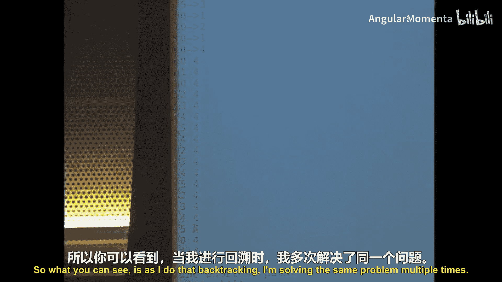

Why am I doing that？Because there may be multiple ways to get to the same node。So， if， for example。

I looked at this graph。What we would see is I would try and， and let's say I wanted to get to here。

Just for the sake of argument。I'd first say， can I get to hear from here， I try this。

 Then I'd solve here to here。And I do that。I'd also go from here to here to here。

 And then for the second time， I'd try and solve the problem here to here。Now， here。

 since it's only one connection， that's a short thing。

But you can see if I have multiple ways to get to the same intermediate node。Each time I get there。

 I'm gonna to solve a problem I have already solved。

How to get from that intermediate node to the final destination。

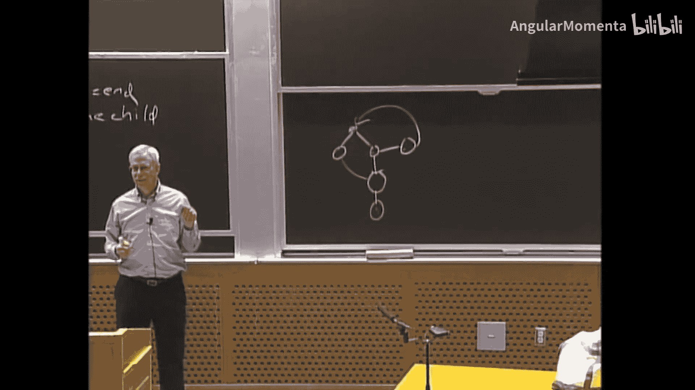

So I'm doing work I've already done before。This is， obviously。Troublesome。

 nobody likes to solve a problem I've already solved before。So what do you think the solution is？

How would you solve this sort of thing yourself。What would you do？Well， what do you yeah， thank you。

Sky is hungry。 Go ahead。Sttoring。That basically you've already looked at。Exactly。

What you try and do is。Oh。Is remember。What you did before。 And just look it up。

And this is a very common。Technique。It's called。Memorization。

We use this to solve a lot of problems where you remember what the answer was。

 and rather than recalculating it， you just look it up。And that can， of course， be much faster。Yeah。

 so it's a fancy way to say we're going to use table look up。This concept of memorization。

Is it the heart。Of in a very important programming technique called dynamic programming。

In the algorithms class that's taught in this room immediately following this class。

 they have spent at least four lectures in the topic of dynamic programming。

But since you guys are much smarter than those guys taking that class。

 we're gonna do it in about 20 minutes。In today， in a little bit。In the next lecture。All right。

So let's look at an example。We'll look at a solution。 So I've taken。

The recursive implementation we had before。And。Rewritten it just a little bit。

To call D P dynamic programming shortest path。

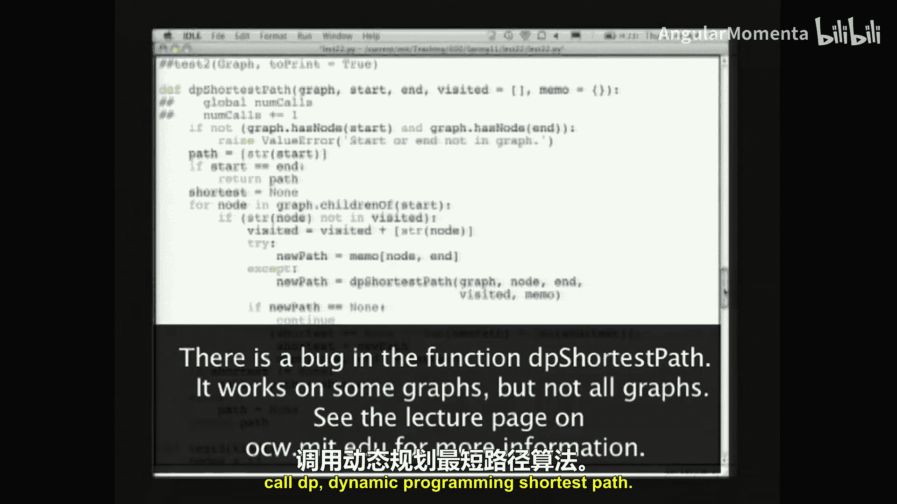

And the most important thing to notice is I've given yet another argument to the function。

 And that's the memo。Which is initially an empty dictionary。

The rest of the algorithm proceeds as before。Except what happens here。Is。

When I want to get from a path。The first question I ask is。

 I say new path is equal to the memo of node to end。So when I get to one of these interior nodes。

And I want to say， what's the shortest path from here to here。 The first question I ask is。

 do I already know the answer。Is it already in my memo， if so。I just look it up。And I'm done。

 And found it， and I proceed as before。If it's not in the memo， well， this lookup will fail。

And I'll enter the accept clause。And I'll make a call again。

So this is a very conventional way of using try except as a control structure。

Failing to find it in the memo is not an error。 just means I haven't yet stored it away。And as I go。

 I'll build up the memo， and then I'm done。

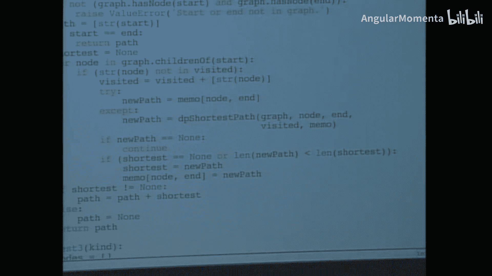

So。It's very simple。So。I should。Ask the questions。 anyone need me to explain this again。

 or does it make sense what we're doing here with the memo。Okay， I'm assuming it makes sense。

 Let's test it。And we'll first do a very。Simple test。

 We're just going to use the same little graph we used before。And I'm going run shortest path and D。

 P shortest path。 and at least confirm that for one search， I get the same answer。

Just sort of fire testing it to make sure that it's not a complete disaster。And we do。We get 0，2，3，4。

0，2，3，4。 So at least for one thing。It's the same thing。Let's see about performance。

 because that's really what we got interested in。So， we'll。Go back to our big test。And let's go back。

And for both of these， I'm going to。Uncomment。Tracking this global variable。

 just keeping track of the number of calls。And we'll see whether we get a substantially different。

Amount of recursion。In one versus the other。So it's built some random graph， again。

This is the non dynamic programming one， which， as we recall， takes。A bit longer。

I probably should have felt， all right。So it's a pretty big difference。They found the same path，0，23。

4， but you'll notice。The straightforward depth for search took over 800000 recursive calls。

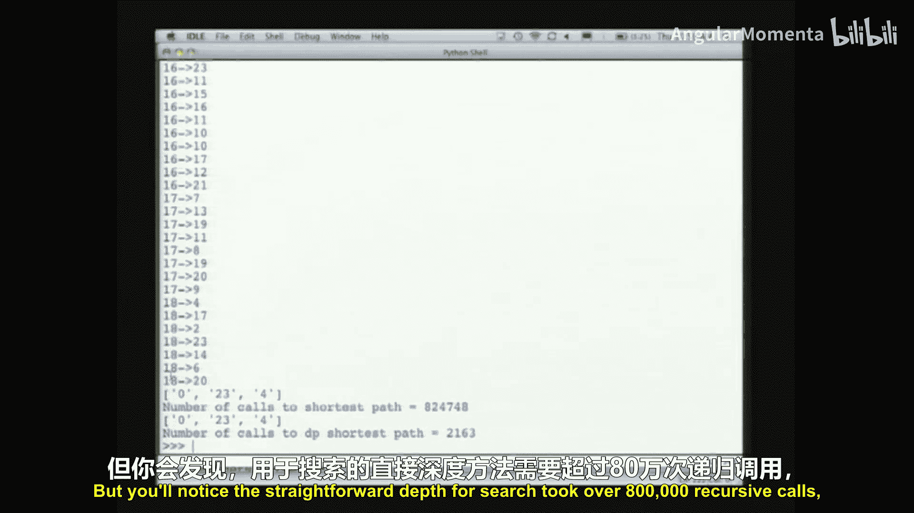

Whereas the dynamic programming one took only order 2000。A huge difference。If I ran it again。

 I might see a slightly smaller difference。 I might even see a considerably larger difference。

I've run this on some examples where the Kive search depth first took a million， and。

Got through the dynamic programming in 50 or 60。But what you can see is there's a huge improvement。

And going from one to the other。Dynamic programming was invented in the 1950s by someone named Richard Bellman。

嗯。Many， a student has wasted a lot of time trying to understand why it's called dynamic programming。

And you or I could invent lots of theories。relativelyelly recently。

 I found out why it was called dynamic programming。 And this is a quote from Bellman。😊。

It was an attempt to hide what I was doing from government sponsors。

The fact that I was really doing mathematics was something not even a congressman could object to。So。

 you know， he was doing this thing that was pretty evil， which was mathematics。

Which is what he thought this was， the math of dynamic programming。

And he just didn't want to admit it。So he made up a name out of nothing。

 and it fooled the government， and he got to do it。Now， why do I teach you dynamic programming？

 And we're going to talk a little bit more about it the next lecture。

It's because it is one of the most important algorithms that we know today。

It's used over and over again， to provide。Practical， efficient solutions。To optimization problems。

That on their surface， appear intractable。They appear exponential。

 It says there's no good way to solve it， in fact。If it has certain kinds of properties。

It will always be amenable to solutions by dynamic programming。Which will most of the time。

 and I'll come back to the most of the time， end up taking an exponential problem and solving it really quickly。

 as we did here。I could have made this graph enormous。

 and dynamic programming would have given us a very fast solution to it。

So when can we use dynamic programming。Not all the time。嗯。We can use it。On problems that exhibit。

Two properties。The problem must have optimal substructure。

What this means is that you can find a globally optimal solution。By combining。

Locally optimal solutions。So we can again see that with our graph problem。

That we can combine the solutions from nodes。At a distance from the root node。

To get the solution of getting there from the root node。If I know I can get from A to B。

And I can find the optimal solution from B to C。 Then I can use that to find the optimal solution from A to C。

So it has optimal substructure。The other thing it has to have。Is overlapping sub problems。

And that's the thing I emphasized earlier。That finding the optimal solution involves。

Finding an optimal solution to the same sub problem multiple times。Otherwise。

 we could build this memo， but we'd never successfully look up anything in it。

And so the algorithm would give us the right answer， but we get no speed up。

So it's this property that we need to know that we'll get。The correct answer。

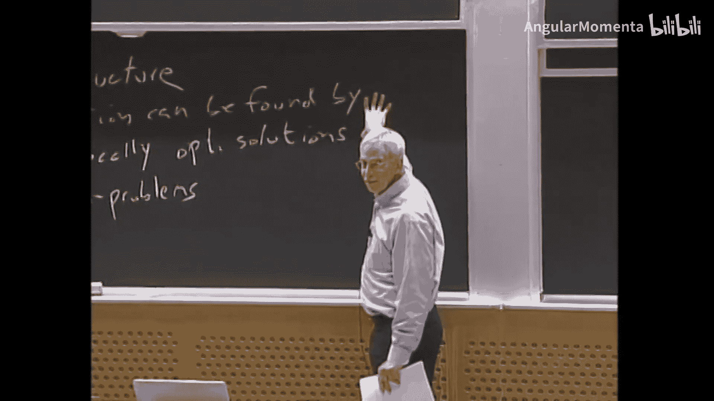

That when we combine the local solutions， we'll get the right global solution。

It's this property that gives us an indication of how much of a speed up we can expect to to achieve。

 How many problems will we not have to solve because we can look up the solution。

We'll come back to this and we'll see how it applies to another problem。You've already looked at。

 say the Napsack problem to give us a fast solution to that so that if you want to answer。

 go back to a previous problem set and take the full database of classes。

 you'll be able to solve it quickly using dynamic programming。Okay， see you next time。

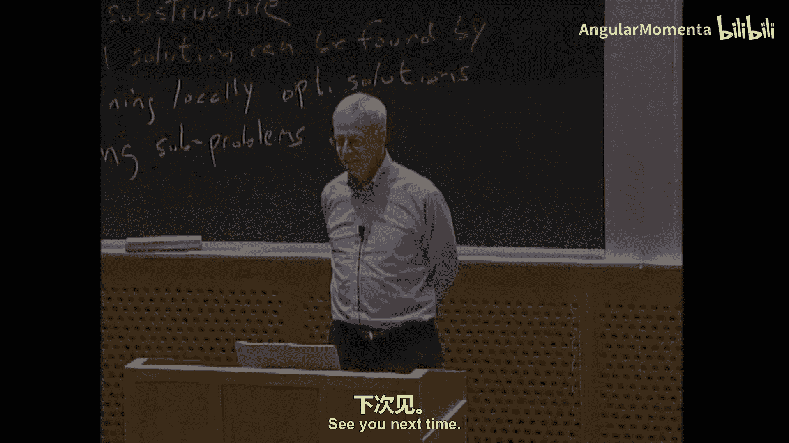