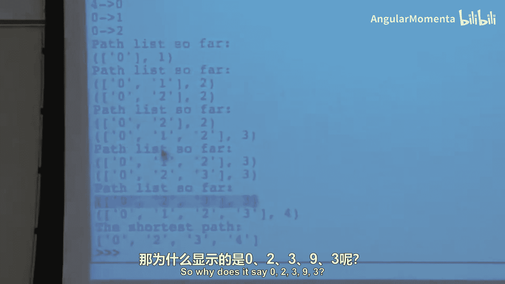

# 【麻省理工】计算机科学与编程导论 ｜ MIT 6.00SC Introduction to Computer Science and Programming p33 33 -BV1a5BZBkEP6_p33-

The following content is provided under a creative Commons license。

 Your support will help M I T Open Coseware continue to offer high quality educational resources for free。

To make a donation or view additional materials from hundreds of MI T courses。

 visit M I T OpenCourseware at O C W。t M I Tt E Du。

So。嗯。You guys have been talking about graphs in lecture， right？So。What are graphs？啊。All right。

So graphs。Are a kind of formalism， they have vertices and edges。All right。

 a set of vertices is you can think of it， it's like a set of things。

And then the edges are the relationships between those things。So， like。

The set of all your friendships and your friend' friendships could be considered a graph。

 so like if this is me。And this is all two of my friends。Then。

An edge between us would indicate a relationship。Of friendship。There's no edge here。

 so there's no friendship between these two。So。Yeah， so you have verticus。Which are also。

Called nodes， and then you have edges。And they could also be called arcs。So if you see either。

Any of these names， they're all know these two are the same and these two are the same。So。

What kinds of graphs do we have？So there's a directive graph and there's an undirect graph。

So up on the screen here is a directed graph， right。I'm not a sports fan。

 I think those are the Bruins and I don't know what the other team is， you know？Okay。Yeah。

I think it's a hockey team somewhere up in Montreal。

This is a representation or a graph representation of。Cities， which are the nodes and vertices。

 and then the roads that connect the cities。And obviously， it's not to scale or accurate。

But it's an abstraction， so we're okay with that。And the question。

Here is like what's the path to get from Boston to Montreal？So in this case。

 it's a directive graph so that means that。We can only go this direction。

From node to node in the direction of the arrow。So really， there's only one way to go， right？

Two hops。So for。So that's a directed graph。 And then an undirected graph is basically the same thing。

 except。We can go either direction。On the edges， right？On the directed graph on the previous。

In the previous slide。You could only go in this direction。

 so you had to make two hops in order to get to Montreal。In this。Undirected graph。

 you can just make one hop to get to Montreal。Really conceptually very easy。Yeah。

 so and actually we can we'll see that in the code so the question was is。

Can I have like New York here？And then in Boston here。Can I have this sort of relationship？Right。

And the answer is， yeah， this is actually just equivalent to an undirected graph。Right。

 you can have his Eric。Some cases。Yeah， so you could have like。And we actually have actually。

 I think this might have an example of that。So yeah。So。In this case。

 you have Hartford has a path to Albany and back。And a path to New York City。

 but there's no path directly back to。But。That worked for you。What's it。唉。Well。

 then I won insult tart for them。嗯。I didn't do these graphs， so don I'm。If I had done them。

 I certainly wouldn't have used sports teams because I know next to nothing about sports。

 so I don't know the rationale behind picking the names other than I'm supposed to say that。

The reason why the Bruins want to go to Montreal is because he'll want to kick Canada's butt。Do they？

Oh， well， then this is a very apropos slide then。嗯。So。What we have up here is a weighted graph。

 right？the undirected and directeded graphs have been really easy so far because they're just defining。

 you know。The fact that。There is a relationship that exists between two vertices， right？

So what a weighted graph does， though， is it says that not only is there a relationship between these these two entities。

 these vertices， but it also has maybe a cost associated with it。

 So if these represent the road networks， then these represent kind of the toll costs the weights on these edges。

 So it's saying that in order to get to Hartford， I need to pay a dollar and then to get to Albany。

 I need to pay $3 and then to get to Montreal to pay $6。 So a common question， you know。

 on you know weighted graphs in general is what's the least cost path from here to here。So。

Can anyone tell me？Yeah， what the least cost is from Boston to Montreal。Hartford is your only choice。

Right。New York。Right。So and the cost for that is nine， right？Because he got one， seven， one， some。

 nine。There are actually two paths to get from Boston to Montreal， the other path is from Boston。

 Hartford， Albany， Montreal， but the cost of that path is10。你。The question is。How do you figure out？

Which path is shortest， right？So。Did he talk about breathth first search and death first search at all？

He only talked about death first， okay， so we need to do breath first。So。Before we do breath first。

 can someone define depth first for me and maybe walk me through it a little bit。So let's。

Take this off the screen。And let's assume。That I have a very simple graph。I'm going to start here。

I want to end here。And I have。So。I'm starting at V0 and I want to get to V8。

I have let's call this as a directed graph。It can only go one direction。

It also doesn't have any cycles， so that makes it a little easier。So。If I'm starting here。

In depth for search， what do I do？PK条的。So you pick one of your children。

 so you're going to pick V1 or V4。Now you go to this node， what do you do now？

Same thing again so you pick another daughter and because this is a really trivial example。

 we just walk down the line until you get until you find the node that you're looking for or if you don't find it and you have no more。

There are no more children to look at than。You knowThere's no path that exists。

 but we can get to our goal node here right， so what do we do once we find this node？

We save it offsho like it becomes a path with just itself。And then we return that to who or。

And then we say， okay， well， where did I come from？W I came from V7。

So now I know that my shortest path from V7 to V8 is going to be V7 V8。I'm back here。

 I'm going to add wherever I came from here。So the idea is that。系。I grow my shortest pass backwards。

Right。嗯。And actually， the shortest path is the top of here。IsIf you had a branchial V7。

 when you go back to V7 which you。Thanks branch。So yeah， so if I had something like this。

And the answer would be。Let's say that it loops around。So now we have a cycle。

 so it becomes interesting。So let's say that。I've reached my goal here and I know that if I'm at my goal then my shortest path is just my goal right so now I return here and I say。

 well what would be my shortest path in this case？嗯。Can。Does this child have a shortest path？What。

When I get here first to V7， I ask the question， what's the shortest path？

To V8 from either of my two children。 So I'm going to look at all the children of V7。

And I'm going to find what's the shortest path from V8？Or from this node to the end node。

 And then from this node to the end node。 And obviously。

 this one's the shortest because it is the end node。 So now I know that my shortest path is。This。

Plus， myself。All right。And so that means that the shortest path from V6 to the end node is going to be this path plus this。

 right？And I don't know if it's。Getting， getting any clearer。So。Really。

 if we start out at the beginning here， and we're looking at this first known。We ask the question。

 what's the shortest path from V1 to the end？And what's the shortest path from V4 to the end？

And we choose the shortest of those two paths as our answer。

 and then we just add ourselves to the beginning。And that's all we do for each of these nodes。

 We ask of of the children at each of these nodes。 what's the shortest path， And then we add。

Ourselves to the beginning of that path。And return that as our answer。

So if we were to look at that and code。So。You guys have all seen the graph object。

In class with the node and edges。Yes or no。Here is shortest path and depth first。

So there's a lot of debugging code here。And some administrative stuff。

 so all this is doing is just making sure that the nodes we're looking for in the graph。And actually。

 we'll be back to it， so when we first call shortest path。

 we're going to call it with a graph object。And a start and an endnote。

And we're also going to have this parameter visited。

 which keeps track of the notes that we've already seen。We'll get to that in a second。So。

One of the first things that we do that's of any importance is we check to make sure that the start and end nodes are actually in the graph。

Because you can't get from one to the other if they don't exist。And then we're going to construct。

A path or a list that just contains the start note。As its element。

And then we're going to check to see if star is equal to end。So if we're already at our goal。

 then the shortest path is just us， right？We don't have to go anywhere。What's it。

For comparison purposes。I mean， you you。If you look at the definition of node。

 it's pretty sparse or pretty Spartan。Like。If we wanted to make it so that you know we just added the node object itself。

 we'd have to add like an underbar underbar equal method。Stuff like that。 And in this case。

 where we we don't want to bother with。Kind of complicating look like that。So。

If we're not at the end， though， now we need to figure out what the shortest path is。

From each of our children to the gold Mo， right？We have a variable that we call shortest。

 and that's going to keep track of what our shortest pass so far is。

 and then we're going to iterate through all the children。In this no。And。If the node is not visited。

And that's where this parameter comes in。Were。We're going to say， okay well。

 let's take a look at it and then we're going to say we're an addictitive visit so we know that we visited this known kind of sounds kind of cyclic。

 but which is funny because we have visited so that we avoid cycles。Because。

So if we've already visited a node， we've figured out what its shortest path is。

Why would we want to visit it again？Like， say， you know this。If we're on a path and。We're saying。

I' would say I have。I'm trying to figure out。The shortest path from V1 to V4。

 and I'm using depth first。And so I decide I'm going depth first first goes to V2 then to V3。

 now it's got two choices on which nodes to get the shortest path for。

Let's say for some reason when it gets the list of children。

 it's going to get V1 and V4 and if it's looking at V1 before it looks at V4。

Then if we didn't have that check in there， just make sure that we are not visiting or looking at other nodes that we've already visited。

Then the algorithm would just go here and it would repeat itself in a cycle。

So that's what that visit brings。It's preventing that cyclic check。Orcyclic check。So。

Now we ask the question。Or we make a recursive call the shortest path， right？

And the only parameter that changes is the start note。I'm going to say and we're going to ask it。

What's the shortest path from this node to the end？

And it's going to call itself again and return an answer。And if it doesn't return anything。

 then we're just going to kind of ignore it and continue。Whatever。Returns something。

And either we haven't found a shortest path yet。Or the length of this new path that it's found is shorter than the shortest path that we've already found。

Then we're going to record it and say that this is our new shortest path。

And then we're just going to。Keep iterating through all the children of the unknown。

Until we've exhausted all possibilities。And then once we break。

 once we finish going through all the children， what're going to say？If we found the shortest path。

That means that there exists a path from one of its children to the goal node。

Then we're going to add。It to our existing path， which is just ourse。

So we're adding ourselves to the beginning of the shortest pathogen。And then we return it。So。It's。

Kind of growing the shortest path from the back to the front。Right。

Brethfat search works in the opposite direction。 So the way that。Well， first。

Is anyone confused by debt for research？跟嚟 hit it。これでぱ。液緒でなり。So。This line here。This is。Well。

 this if statement first is checking to see that we've got that one of our children has a shortest path。

 it's like if it's possible that none of our possible children lead to the goal known。

Let's say that I have。Another kind of subgraph on here。Allright。When V2 is my start node。

 I'm still going to check。These two children。But and let's say that my goal node is to get to V8。

 right？Well， I'm still going to check to see what the shortest path is for both of these children。

Well， once I use this as my start node， there's obviously no path。To the actual goal node。

The depth first search call or the call the shortest path is going to return none in this case。

And we need to check that。So。That's what that bit of code is doing there is that if。

It's saying if there is a shortest path。Then we're going to just add ourselves to the front of that shortest path and return that as our answer。

 But if there is no shortest path from us。From one of our children。

From any of the children on the start node to the gold node。

 then we're just going to return none as our answer because we can't get to the gold node from where we we are。

Did that work for you？So why don't we take a look at how this is working？

So we're going to try DFS on an undirected grid。And。The code that does this is called test2 here。

And all it does is it creates a graph with 10 modes。And in this case。

 it's going to be an undirected graph。And we're going to create a bunch of edges。

Is that diagram you sent out？Is that the representation of？就。So。

We have this graph and what we're going to do is use depth first search to compute shortest path from。

Herear to here。So this is showing kind of the depth of the recursion， right？So we start off。

On node zero。And then it starts looking for the shortest path from。1，2，4。And at the same depth。

 that's going to try and find。The shortest path from two to four。So it starts out here。

And then it asks what's the shortest path from one to four？

And then what's the shortest path from two to four？And so when it's looking at one。

 now it's going to ask， what's the shortest path？From。We want to do that。Hey， sorry。

Is there a bug in your cone？So。I， this is。Is this the lecture code， okay？系呢嗯。Yeah。

 because it seems like it's checking node zero twice。So it's going from- oh no。

 because there's a directed edge from 120， right？Yeah。

 so what it's doing what the code does is it says。It。

So it does a depth first so first it looks at node zero and then it goes for child in right for all the children notes。

 what's the first child node zero， it's node1 Oh， because zero hasn't been added to the visit list right and then。

And then it asks what are all the children of Well the print statement comes before it discovers that。

Checking node zero is an invalid path didn' add I forgot to add another print statement if you go to the code。

So where are we at。Yeah， so see how I have the very first at the top of the function see how there's the if to print I say that but then there's this check here if it's not envis。

 if it isntvis there's no print statement that says that says that you knows that yes so basically what's happened is when we do that second check where we end up finding the second path from zero to four right it ends up hitting that test it says。

Yeah， we've already visited note zero so we don't continue that I got it Okay so yeah it's just a little。

There was no print statements in the code before， and I was having a really hard time figuring it out。

 and I did this and this made it a lot more clear， I thought trying to figure out how the depth of the search was。

No， I think so too maybe we should add a couple extra no I agree。あ。sorryrry。I was just。

 I was perplexed because I' was like， oh。So it's working correctly。

But is there any confusion on De first search in spite of that？Okay。

So let's start on breathth first search。So。You guys。You guys covered depth for search and lecture。

 so we need to do a breath for search。So the idea behind breadth first search is that。Instead of。

Asking the question， what's the shortest path from V1 to V4 and adding ourselves to the front of that to get the shortest path？

We're going to build the past from a start outward。From the start forward。 So in this case。

 we're building the past from the goal backward。 in this case， we're going to say。I to say I'm at v0。

 so my current partial path is v0。Then。I'm going to ask， I'm going to look at V1 and V4。

 and so I'm going to have。I'm going to say now this is my list of partial paths to the goal。

And then for V1， I'm going to say。I'm want to ask what its neighbors are。And we have V2。

And then for V4， we're going to ask the same question So now we're building。Our partial paths。

So conceptually what we're doing is we're just， you know。

 we're maintaining a list of all the paths that we or all the history of nodes or paths that we've been looking at and just kind of growing that one by one by one。

So。If we look at this in code。Shortest path， B， FS has a slightly different call signature than the DFS。

Method。So we still get a graph。And then we get this variable called paths。

AndWhat paths contains is the partial path or less of the partial paths of tufls。

So the format of this is each element has。A list of the nodes in the path。

And then the length of that particular。嗯。系下。So。We also have the gold Moon。And。What we do。

The first thing that happens is this pass gets shorted or sorted。So it's sorted by。

The length of the path so。Is anyone puzzled by this lambmbda here？Okay。

So when you call the sorted function， you pass it a list， you can also pass it this key parameter。

This key parameter is a function that takes。It takes an object。And it'll return。

Kind of the value associated with that object。 So in this case。

Each these each of the elements in pass contains a tuple。

And what this key function does is it says each element in this path is。

Has got a value that is equal to the length of that path。And this length parameter。

 that's just that's the second element in the toolfold， right？So when sort of does its work。

 it's going to call this key function on each element in path。

And what this function has to do is return。You know。

 the value associated with that particular element。I this land is just a keyword that？Oh。

Lambda is what's known as an anonymous function。And he covered that in lecture at one point。Yeah， so。

Did he just use Lada， blew past it， and this is something called lambda。哦， ok。Well。

 since I'm your TA and I'm here。So。Real briefly。Lambda is a way of kind of doing really simple not really simple functions。

 but it's a way of creating。Anonymous function。 So let's say that I want to create a function that squares a number。

 right。This is。Exactly， well， not exactly， but it's equivalent to this。

I can use G as a function just as easily as I can use H。So。That's all。

And it's useful for situations where。You have。You have elements that don't have an order defined find。

Sored needs to know a value of an element in order to put it in order in order to do the sorting。

 right， So that's what this function does is it gives each element in that list of value。

So that the sorting can do its job。So。The key that we want to sort on or the item that we want sort on is the length of the path。

And the reason why we want to do that。Is。We're going to take the first partial path。

That exist in our paths。And for every node。In the shortest。2。For every node in the。

For every child of the last node in this path。We're goingWe want to check to see if it's a goal。

And if it's not。Then we're going to append it。We're going toend a new partial path。

Which is the path that we're looking at。Plus， one of the children nodes。

And then the length of the path。To this value called new path。So。It it's saying。

This node that I'm looking at。So， I guess。Let's say that this is my partial path。

What it's doing is it's looking at this last node in this path and it saying。

 what are all the children of this node？And if none of the children are the goal node。

 then it's going to create a new set of paths。谢。That are composed of this path。

 plus all the children。Me。Right。It真你。No。嗯。So什么。Yes。

The reason why Bret first search has its name is that it doesn't。

ry toIt doesn't keep go try to go towards the end immediately。

 it grows gradually so if you can kind of envision。A graph like this。Yes。Death first works by。Going。

By。Proceeding down until it finds the goal node for each of the possible paths。Right。

What Bth search does is it starts at a node and then it。Builds。All the pass from that node。

And then for each of these， it builds。The pass。So that's what I'm saying when I say partial pass。

Yeah。It's a new partial path。V0 P1。嗯哼。So let's。So let's say this is V0， V1。Me， too。

Let's say that I have this partial path already。Alright。When I build a new。

Partial when I'm looking at this path， which is what I'm doing when I pop it off the front of the list of paths that I already have。

I'm going to look at all its children， so I'm going to look at。These two nodes right here。

And then I'm going to say， let's say that my goal note is here。And then I'm going to say that。

You know， these aren't my goal nodes， so I'm going to create new partial paths and one of them is going to be V0。

 V1， V2 and V4， so I already have that and the other partial path is going to be V0， V1 V2 and V5。

やりますか。嗯。What's up。Until you reach the goal node。 So with depth for a search， you do have to。呃。Well。

 no， not even with that for research。嗯。There's some interesting properties about the different searches。

 but we just want you to be familiar with kind of how they go about doing their task。The idea。

The idea is that we start off with a partial path of just this guy and then we find all the other partial paths。

It'll start off with just this guy is its list of paths。So one element。

And then it's going to pop this off the front， it's going to say， okay。

 I'm looking at this partial path， what are the additional paths that I can build off of this？

And I can build。Four additional paths off of this， so now I have a set of four paths that I want to look at。

And then it takes a look at。Say this partial path of V0 v1 it says。

 what are the paths that I can build off of this？And then it adds it to the end。

 and then it says what are the paths that I can build off of this guy， adds those to the end。

 what are the paths that I can get from this guy， adds those to the end and so on and so forth。

We keep track of all。Right。Oh okay， that what you meant。But if you don't handle。

IfThere's some paths somewhere else。Does't ever like Reg you know。Yeah。Well。For， you know。I mean。

 it is possible for breast research to go find nodes that don't reach the goal。But。

What's going to happen in those cases is they're they're going to。对。They're just。

Like so let's say that there's such a path at the front of this pass list。And。It doesn't， you know。

 if you it doesn't have any children， so it's like it's you can't go anywhere after you've gotten to this node。

Then what's going to happen is this for loops not going to execute， right。

 because it has no children。And so it's just going to be discarded as a possibility。So。I mean。

 the key thing is that you're。You're generating these new partial paths for every node that you're looking at。

And you're adding those to a list or a queue of partial paths that you need to examine in the future。

If you don't find your goal。If you do find a partial path that has a child that is the goal。

 then you can just immediately return that path。Because you know what's going to be the shortest path in this case。

So。Hello。嗯。So what。Well， then it depends on which one appears first in your list。So you're asking。

Like if I have。Onces you do something really simple。If I have。So at some point。

 you're going to have a partial path right here。ThatOr a list of partial passs that consists of v0 V1。

And then v0。And V2。Whichever path you ultimately wind up returning is going to be。You know。

 dependent on whether or not this one comes first in your list of partial pass to check or this one comes first in your list of partial pass to check。

Right。Kind of answer it。Okay。So。Is everyone good on breath first search？Conceptually。So code kind of。

Flow mixing anyone。Hello。If you reach， if you if when you're building。Yeah。

 if you're building your partial path of your and you so you've popped off this path that you're examining and you look at all its children and one of the children as a goal known。

 then you know that you found the shortest path， right because？

You've been building this incrementally。You know， one by one by one。 And then if you've found this。

 the gold node， then you know that。You know，You already built up the shortest path possible because if you had found the goal。

 if the goal node had been on a shorter path before， you would have found it already。Well， Nick。

 if the paths are weighted， then it's a little different then you're not because here we're just doing shortest path。

What you're talking about is doing like a least cost path。In which case you would， you know the main。

Difference would be this， how it sorts its list of candidate path， right。嗯。よ say。Sa。Yeah， I mean。

Yeah， so in this case。OurOur lambmbda function is saying that we're going to sort these lists based on their length。

 but if I wanted to say sort them based on the sum of their weights。

 then I would have a function that sums up the weights on that path and。

Uses that in this sorting in order to select the next partial path。To search， although in that case。

 you actually has to generate every single possible。Should you find the lowest cost。嗯。No。

Because I might understand this。You find all the paths and length one for the show。

That's like two right and so if you're worried about costs。

 it's possible in principle that you're the longest。There were long conference what was responsible。

ぱい。Right。Although but what he's saying is that because you're growing it by one each time。

Then it's possible that let's say that I have a。You know。I have partial path of length too。

But my least cost path is actually of length five， then even if one of these nodes reaches like say that V2 reaches the goal。

Before the actual lease cost path。Then。You can't stop。

 you do have to inrate through Well you just sort it by cost。

 I think that it's a better example to say that if you have one partial path that has cost seven well actually wait。

 no you're actually right because if you sort it by cost。

 then your least cost path is going to be in front front of your pillow。

I think that's true because imagine this。Imagine we had a graph。This is your start node。

 this is your end node。And you go like this。そです。This and so you make a breath first where you go to this note and this note and the cost of this is one and the cost of this is eight。

 right。The cost of this is 20 and the cost of this is one this is your shortest path。

Or this is your cheapest path， but when you add them。They're both of length one。

 so you explore this one first because it' the cheapest right at a cost of one。

 but the total cost is 21 to continue earn this note but the total cost is right。Right。

 but so I think he's right， right， I thought you had to expand all notes when you're doing breath first that's why you do like disters。

Yeah。But yeah， her ways you have to expand all of them， right？就。Yeah。发0。I know。

 I'm blanking on this on the answer。So。But in this case we don't have to enumerate all paths。

theIf you're just looking for the shortest pack， you can just find the shortest pack right。

 but if you incorporate costs and you do have。You would use a different algorithm。

 so it would be like an actual shortest path algorithm for something of that。

So why do we disrupt those？Like one there in the。嗯。They have different running characteristics。

 it really depends on your application。嗯。The nice thing about death for search is that。You。

 it's fairly memory efficient because with breakfast search， you're storing all the possible paths。

 all the possible。Partial paths with depth for search。

 you only have one path in memory at a given point。Right。You have the path。

 You have the path that you've already found from one of your children to the end node。Plus one。

 but with the breathth first search， you're going to have a list of all the partial paths that you have to search through。

Let's see。This is what makes sense。Yeah。Zero4 is。Right。Yeah， no， it's not much your picture。

 What's it。What you人。It what。Yeah， it was an undirected graph， that's why。So。

Let's you we run it direct， let's see what happens。Z to four still ground。Yeah。

You are absolutely right。Oh， you know what's going on， it's running both。

 that's running the depth first search it's running both the directly and the under。Well。

 it's also running the depth first search as well。 That's that that was my question because I was looking at this。

 And I was like， that's not B first search。 That's step first search。This， on the other hand。

 is breath。So。There we go。So if we have a graph， and let's see。So it starts off with node zero。

 and then it builds a new list of partial paths with 0，1，02。It's got。In this case。This partial path。

 And then this partial path。And then， it expands。One of them， so in this case。

 I guess 01 was the path that was first and the last， right？

So it's going to expand the children of one。Which is just two and itself。

 But it's going to avoid cycles。我车。Oh yeah， and then expand and then it's going to expand。

This partial path， the 02， because it's the shortest one。

And it's going to add that new partial path to the end。And then it's going to expand。This guy。

And add the expansion here。And then it's going to expand the guy。 and it turns out that。There is。

That one of the children of three is four， so it's found path the shortest path from zero to four。

Make sense。So why does it say。

0，2，3，That's the representation and the path list， so each element in the path is represent each element in the paths list。

Is represented as a tuple， the first element is the list of nodes on that path。

 and then the second element is the length of that path。

SoAnd that's why we had that lambmbda function in the first place， right？

So if you read the specification here。You have pass length and then you have the nodes that are on that path。

And when we sort this the path list because we need to， you know。

Make sure that we're looking at the shortest path。D。We use this。

This Lambda function in order to get that length。For each two。

