# 【麻省理工】计算机科学与编程导论 ｜ MIT 6.00SC Introduction to Computer Science and Programming p34 34 -BV1a5BZBkEP6_p34-

The following content is provided under a creative Commons license。

 Your support will help M I T Opencourseseware continue to offer high quality educational resources for free。

To make a donation or view additional materials from hundreds of M T courses。

 visit M I T OpenCseware at O C W dot M I T dot E Du。

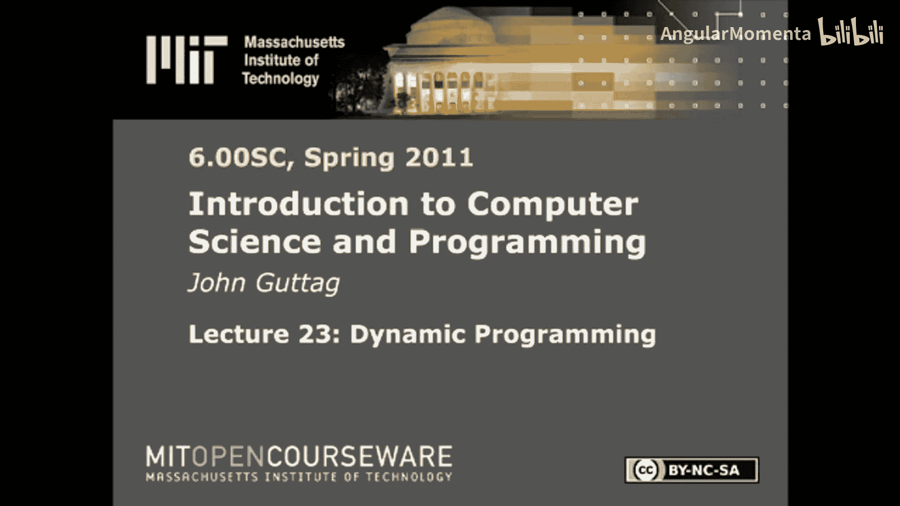

We ended up the last lecture， talking about dynamic programming。

And we'll spend all of today on that topic。We showed how it could be used to provide。

A practical solution to the shortest path problem。A solution that would allow us to solve what was。

 in principle， a complex problem quickly。And we talked about the properties。

That make it possible to solve that problem。 And in general。

The properties we need to make dynamic programming。Applicable。

So let's return to that topic right now。What we looked at is we looked at two properties。

The first was optimal substructure。And you recall what this meant is that we can construct a globally optimal solution。

By combining。Solutions to local sub problemsble。So we've looked at a lot of problems already this term that have optimal substructure。

 merge sort， for example。Which exploits the fact that a list can be sorted by first sorting components of it。

 and then combining those。So merge sort exhibited optimal substructure。

The second property we looked at。Was overlapping sub problems。And what this meant。Was that。

In the course of running our algorithm， we would end up solving the same sub problem more than once。

And that is what gave us the power of using memmoorization。

To use table lookup instead of recomputing the solution。Notice that merge sort。

Does not have overlapping sub problems。There is no reason that we would expect if we're sorting a list。

That the tooth that we would ever encounter the same sublis twice。And so， in fact， we cannot use。

Dynamic programming to solve sorting。Because it has one of these two properties， but not both。

So how about shortest path。Does it have these properties。Well。

 let's first think about optimal substructure。You might begin by asking the question。

If I knew the shortest path from A to B。And I knew the shortest path from B to C。

Can I necessarily combine those to get the shortest path from A to C。No， exactly right。 because。

 for example， maybe there's a direct link from A to C。So。Can't combine them that way。

So that gives us the question。哦。保毕。Almost got it there。So that gives us the question。 What are the。

What is the optimal substructure here。Well， there is something we do know about shortest path。

That if I have the shortest path。From。1 node to another。 And I take any subpath of that。I will have。

 So let's say I have a path that goes from。Let's say I know that the shortest path from A to C is A to B to D。

To E， to see。If this is the shortest path from A to C。

I know that this is the shortest path from B to E。Right， because otherwise。

I wouldn't have bothered going through D if there were， for example， a link directly from B to E。

Then the shortest path from A to C would not have included this。

So that's the optimal substructure I have。And that's the substructure。

That I exploited last time in showing you the dynamic programming solution to the shortest path problem。

You will also recall that when we looked at the shortest path， we found overlapping sub problems。

Because I would end up solving the same intermediate problem multiple times。

Figuring out how to get from one node to another。So， indeed， we saw that the shortest path problem。

Exhibited both of these properties。And therefore， was amenable to solution by dynamic programming。

 And， in fact， we ran it， and we saw that it ran quite quickly。It's not immediately obvious。

But the 0，1 Napsack problem also exhibits both of these properties。You'll recall。

A few lectures ago and also in a problem set， not so long ago。We looked at a recursive solution。

To the 0，1 Napsack problem。Called solve in this code。It uses backtracking。

To implement a decision tree。So if we look at the decision tree we had there。

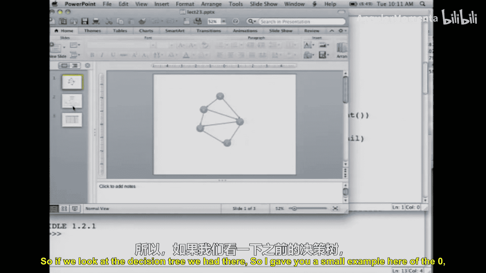

I gave you， a small example here， the 0，1 Knapsack of problem。I've got A，B，C and D。

 I've got some values， and I've got some weights。We started by saying， at the beginning。

We looked at this node here。Where we had decided not to take anything。We still have the list， A，B，C。

 and D， to consider。The total。Value of our items was 0。 And for our example。

 I think we had 5 of material left or  five units of weight。We then considered a decision。

 What happens if we take a。Well， if we take A， we have B， C and D left to consider。

We now look at this node and say， all right， our value is 6。 The value of a， but we only have 2 left。

We then considered going depth first， left first， in this case。 This was the depth first search。

 We've looked at that before。 All right， let's consider the next branch。Well。The next branch。

 where it considers C。Well。We discover。Now， we consider B， rather。

 we can't take B because B weighs 3。So this is a branch that we can't get to。

We can elect the other decision not to take B。In which case， we still have A。

 We have C And D left to consider， and still 6 and 2。We then proceed and consider right， well。

 can we take C， Yes， we can。And that leaves us with a value of 14 and no weight left。

So since we have no available weight， we might as will stop considering things。

 So this is a terminal node。We then back up and say， all right。

 let's consider the decision where we don't take C。Can we take D， And the answer is no。

 because it weighs too much。 And then we're done。And so we see on this brand。

 on this side of the tree， we've explored various possibilities。 And this is our best option so far。

And we can walk through。 And now we consider， well， what if we don't take a， Well。

 then we have these decisions to make。And eventually。

 we can look at the whole thing and make it decision。 By the way。

 I noticed this morning that there was an error on your handout。

I chose not to correct it in the slide so that you would notice it was in your handout as well。

 What should note 18 be。What's the error here。Barddon。Right， that should be the empty one， right。

 because we considered everything。And， in fact， typically， all of your bottom nodes。

Should either have zero weights or no items left to consider。Not very deep。 Just a typo， but。

Has the advantage that by looking for it， you can see whether you understand how we're constructing these decision trees。

So this is a very common way to deal with an optimization problem。

You consider all combinations of decisions in a systematic way。 And when you're done。

 you choose the best one。So this is using get first search and backtracking。

And this is essentially what you did in your problem set。Now， what you saw in your problem set。

Is that if the set of items is even moderately large。This algorithm can take a very long time to run。

How long？ Well， at each level of the tree， we're deciding whether to keep or not keep。One item。

So what's the maximum depth of the tree。How many levels can this tree go。If we have N items。point。

N levels， exactly。 So if we have N items， it can go N levels。Good grab。Alright。

 How many nodes do we have at each level。Well， at level 0， we have only one node。

But what's the down at the bottom。Let's say we have an enormous amount of weight so that， in fact。

 we never run out of weight in our knapsack。Well have。Quite a broad tree， right。

How many nodes at level 2。At each level， right down here， we have up to 4 nodes， up to 8 nodes。

 up to 16 nodes。

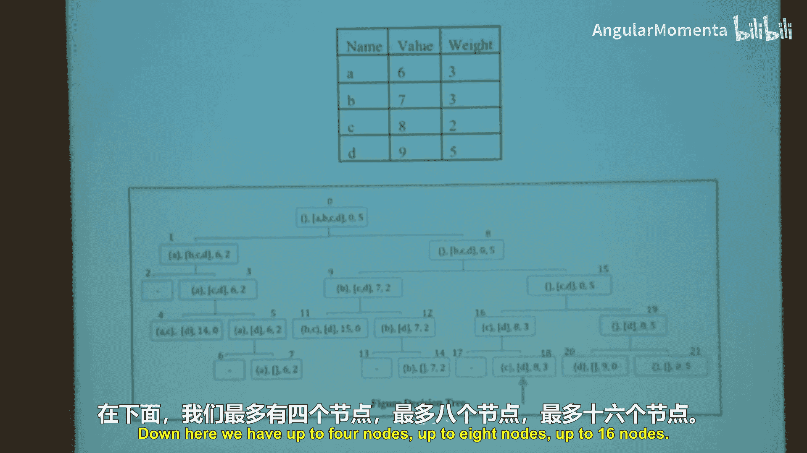

So， we had， say，39，40 items at level 39， We'd have two to the 39th nodes。Pretty darn， big tree。Right。

 not very deep， but very bushy。So we know that for any reasonable number of items and a reasonable amount of weight。

 this is just not going to work。And that's why when you wrote your problem set and you were trying to solve the optimal set of courses to take。

 you could only run it on a small subset of the courses at M I T。

 because if we gave you everything and we gave you a lot for a test。

 you noticed it effectively just wouldn't finish。It。So now we have to ask the question， well。

 can we use dynamic programming。To solve this problem。And in particular。

 that boils down to the question of， does this solution exhibit optimal substructure and overlapping sub problems。

Well。Optimmal substructure。

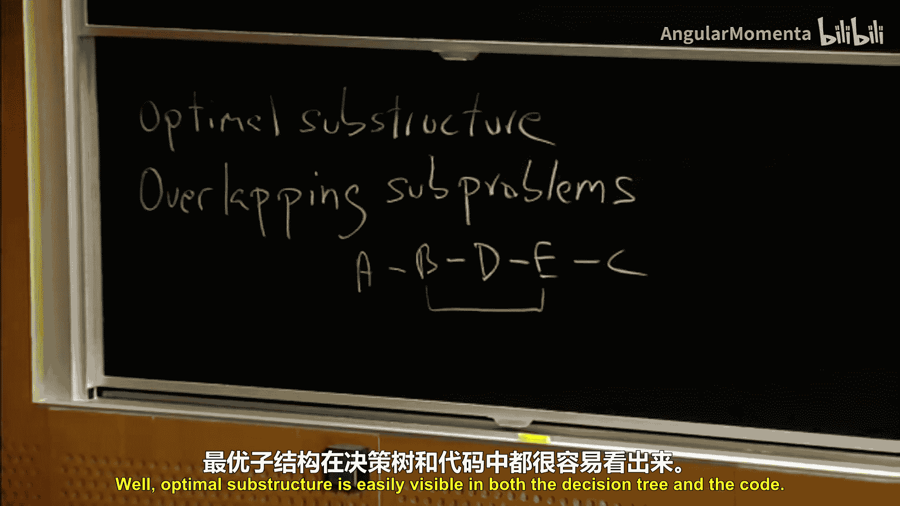

Is easily visible。In both the decision tree and the code。Right， each parent node。

Combines the solution。 We can look at the code。Since you have the subree in your hand out。

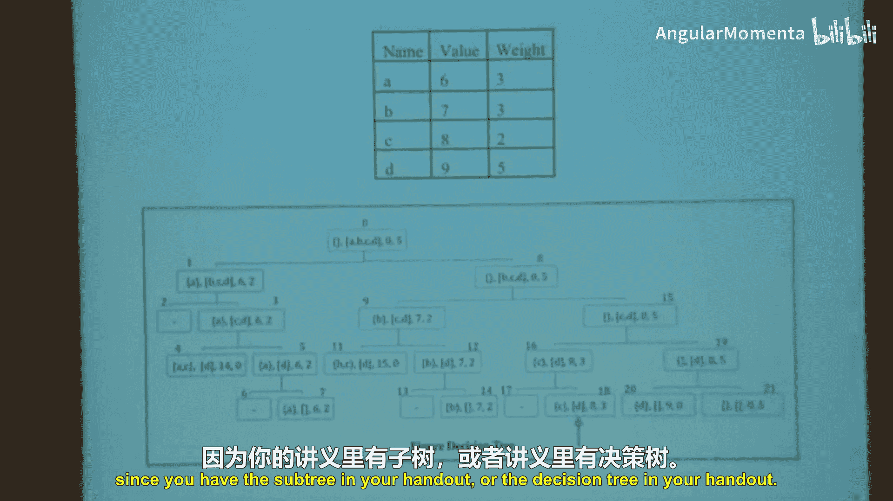

Or that decision tree in your hand out。And the key place in the code is where we combine decisions from lower down in the tree as we go up。

So at each parent node， we select the better of the two children。Right。

 if the left child is better than the right child， we select the left。 Otherwise。

 we select the right。And we just percolate up the tree。

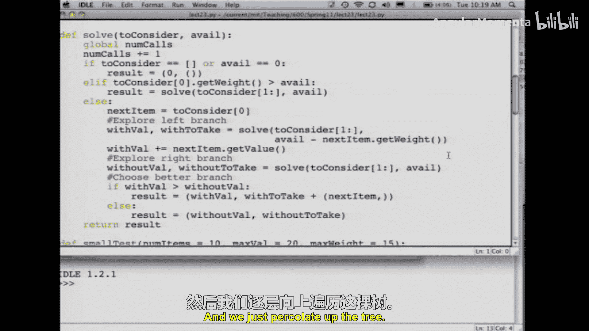

So there's clearly optimal substructure here。That we can solve the higher nodes with solutions to the lower nodes。

And we see that again in the code where it says choose better branch。It's less obvious。

To answer the question， whether or not there are overlapping sub problems。

If we go back and look at the tree。At first glance。

 it may appear that there are no overlapping sub problems。You'll notice that at each node。

 we're solving a different problem， right， The problem is described in some sense。

 by this four tuupple。That if I've already taken A and C and I have D left to consider。

 what should I do。Or up here， I've taken A， and I have B， C and D left to consider， what should I do。

And by design of the decision tree， each node is different。

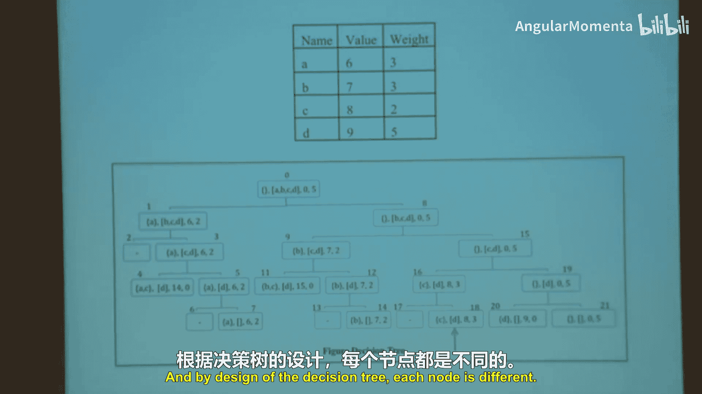

Right， we're not considering the same thing over and over again。 So you might look at it and say。

 well， we're out of luck。 There are no overlapping sub problems。Not true。

So let's think hard for a second。And ask， in what sense are there overlapping sub problems。

 When are we potentially at least solving the same problem。Well。

 what is the problem we're actually solving。We're solving the problem。It can， in some sense。

 be stated as follows。At each node， we're saying， what should we do about the nodes left to consider。

So we're solving the problem， given。A set of items。

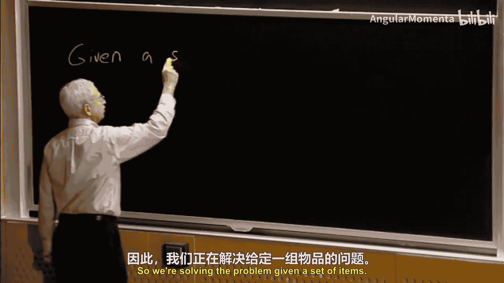

What items we have at a node。Given。An available weight。Which items。Should we take。

What's missing from this。It says nothing about the island you've already taken。

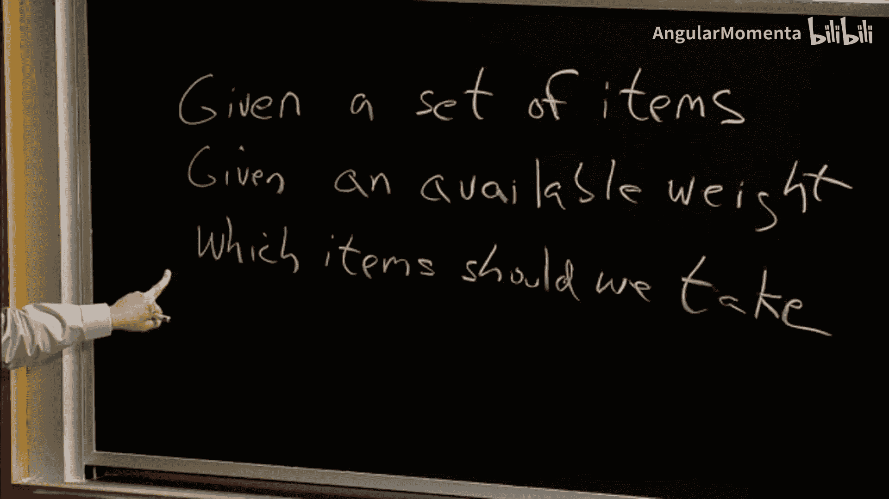

In order to decide what to take next， we need to know how much weight we have available。

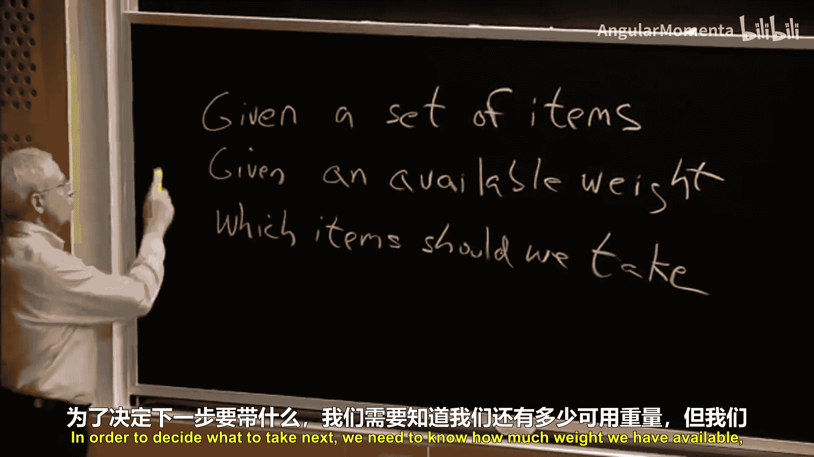

But we don't need to know why we have that much weight available。

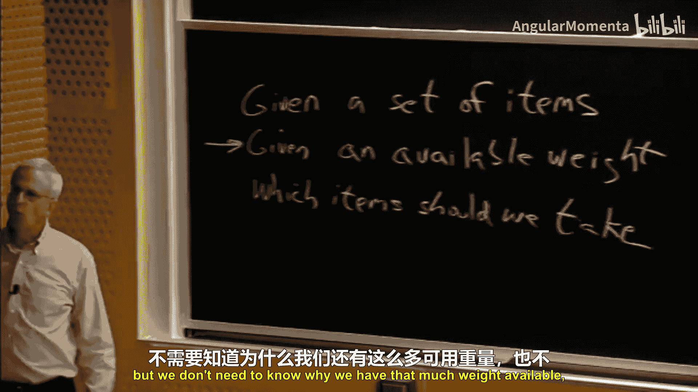

Which items we have previously decided to take。That。

Part of the four tuple turns out not to be relevant to the problem I still have to solve。

Why is that important？Because there may be many different sets of items I could take that would add up to the same total weight。

Therefore， leaving me the same。Problem to solve。And that's the key observation that tells us we can use dynamic programming to solve the 0。

1 Napsack problem。

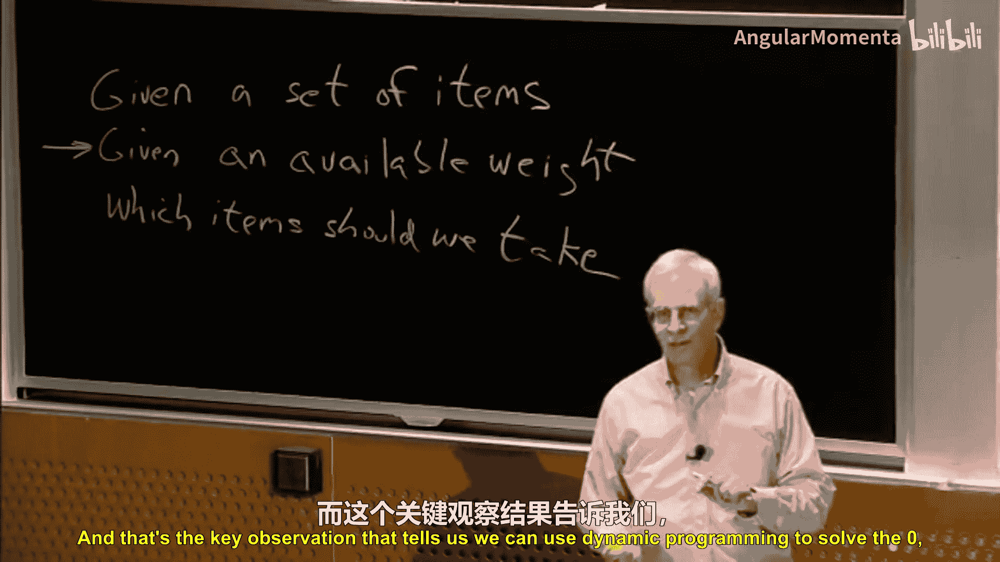

Does that。Actually should ask the positive question。 Does that make sense to anybody。Raise your hand。

 if it makes sense。

A small number of hands。 Raise your hands if it doesn't make sense。O。

Can any of you to whom it doesn't make sense formulate a question。Well， it's hard。

The same total weight。Because the question is， are there many sets of items with the same total value or the same total weight。

 There might be many with the same total value， but that doesn't really matter。

Because in choosing what to do next。As I go down the tree。

 I don't care what the value is above the tree。Cause I'll still try and find the best solution I can to the remaining subproble。

If I value above as a million or the powerful above is 3。It doesn't matter what I should do next。我。

To get that。Right， so the question is， it makes sense that there are many different sets of items that would have the same total weight。

But what I'm gonna， But wouldn't I have different items to choose from。Well。

 you'll notice that I do have to look at what items I have left。But as I go through。

Let's assume here that I have a lift。Of items to take。

As I go through from the front， say。I'll label at each node of the tree。

 Each item will have either a 0 or a one， depending upon whether I decided to take it or not。

And then what I have to consider。Is the remaining items。And let's say， the values。

Of the first two items， The first four items were。Well， let's say they were all one。

Just to make life's。Well， that'll be confusing since I'm using that for taken or not taken。

 Let's say their values were all， too。When I get here and I'm deciding what to do with these items。

I might。So this tells me that I've used up 4 of my allotment， right。But if I had done this one。

I would also used up 4 of my allotment。And so which of these I take or don't take。

Is independent of how I got here。I do have to keep track of which items are still available to me。

But I don't care how I've used up those 4。And obviously， there are a lot of ways to choose。

 too that will， that will use up 4 here， right。But the solution to this part of the problem。

Will be independent of which two I took。That makes sense now。Therefore， as long as。

There is a prefix of my list of items。Such that multiple things add up to the same weight。

I will have overlapping sub problems。Now， you could imagine a situation in which no combination added to the same weight in which case dynamic programming wouldn't buy me anything。

It would still find the right answer， but it wouldn't speed anything up。But in practice， for most 0。

1napsack problems， they may not be this simple。But， you could expect。

And we'll see this complexity later that as long as your possible weights are being chosen from a relatively small set。

You'll have many things add up to the same thing， particularly as you get further down this list and have a lot longer prefix to consider。

So， indeed， I do have。

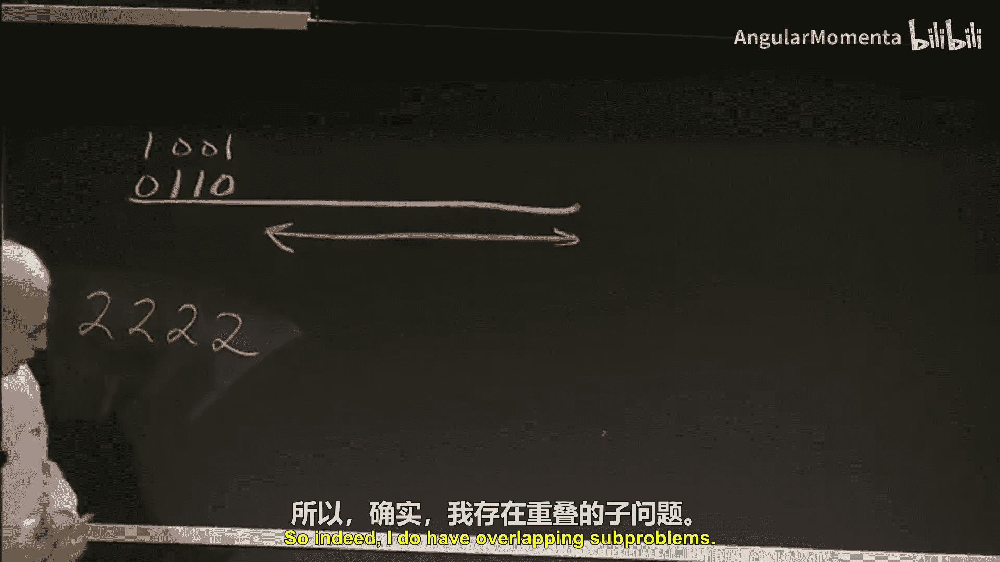

Overlappping sub problems。 that answer the question。Alright。

 now people feel better about what's going on。Okay， maybe looking at some code。Will'll make it。

Even clearer， and maybe not。Anyway， I do appreciate the question since it's sometimes hard for me to appreciate what's coming across and what's not coming across。

She get rewarded for good questions， as well as good answers。Alright， so now let's look at。A dynamic。

Programming solution。嗯。I've just taken the previously the example we looked at before of solve。

Made it fast solve。And I've added a parameter of memo。

 This is the same kind of trick we used last time for。Our shortest path problem。

I should point out that。 I'm using。This calls to mind a， a dirty little secret of Python。When。

 I have。Previously been hiding because it's， it's so ugly。 I just hate to talk about it。

But I figured at some point， honesty is the right policy。嗯。

What I'd like is the first time I call fast solve。I shouldn't have to know that。 there's even a memo。

Fast solve should have。The same interface。As solve。The items to consider in the available weight。

 And that's all you should need to know， because the memo is part of the implementation。

Not part of the specification of solving the 0，1 Napsack problem。

We've made that argument several times earlier in this semester。

And so you might think that what I should therefore do。

Is initialized the memo to say the empty dictionary。 I'm going use dictionaries for memos as before。

And then just check。 And if it's the empty  one， that means it's the first， you know， know。

 I can know whether it's itll work fine for the first call。 Well， it doesn't work fine。

And here's a dirty little secret。In Python。When you have a parameter with the default value。

That default value is evaluated once。So the way the Python system works is it will process all of the death statements。

And evaluate。The right hand side here， once。And then， every time。

The function is called without this optional argument。

 It will use the value it found when it evaluated the death statement。Now， if this value。

Is immutable。It doesn't matter。You know， nonene will be none forever。28 will be 28 forever。3。

7 will be 3。7 forever。But if this is a mutable value， for example， a。

Then what will happen is it will create an object。Which will be initially an empty dictionary。

But then， every time。Fast solve is called without this argument。It will access the same object。

So if I call fast solve to solve one problem。And in the course of that。

 it builds up a big dictionary。And then I call it again， to solve another problem。

Instead of starting with the empty dictionary， it will start with。

The same object it started with the first time， which is by now， a dictionary filled with values。

And so I will get the wrong answer。This is a subtlety， and it's a。Common kind of bug in Python。

 And I confess to having been bittten by it very recently， as in yesterday， myself。

So it's worth remembering。 And there's a simple work around。Which is。

The default value is the immutable value。 I chose none。

And what I say when I enter it is if the memo is none， it means it's been invoked。

 And now I'll initialize it。To the empty dictionary。And now， every time it will get a new one。

Because we know what this statement says is allocate a new object of type di and initialize it to empty。

This will happen dynamically when the thing is invoked rather than statically at the time。

 Python processes the dis。It's a silly little problem。 I hate to bring it up。

 I don't think it should work that way， but it does work that way。 So we're stuck， yeah。I'm sorry。

 I have to speak more loudly。Well， why doesn't my first call？ So the question is。

When I go to test it， say， why don't I start by calling it with fast solve and an empty dictionary。

And it's because， as we'll see when I get there， I want。Solve。And fast solve。In this case。

To have the same interface。And， in fact。We could say， I want them to have the same specification。

Because， in fact， imagine that you wrote a program that called something called solve many times。

And it was slow。 And then you took 600， said， I know why it's slow because I've used a stupid solve。

 Let me use dynamic programming。I want to then be able to not name the new one fast solve。

 but replace the old solve by the new solve。And have all the programs that you solve still work。

That will not happen if I insist that the new solve has an extra argument。Now。

 I could put what's called a wrappper in。And call solve and then have it called fast solve。

With the extra argument。 and that would work， too。 That would be an equally good solution。To this。

 this problem。But that makes sense。So， I either one would work。 I chose this one。

 but what wouldn't work in a practical engineering sense is to change the specification of solve。

All right。So it's a silly little thing。 But since people do get bitten by it。I figure I should。

tellll you about it。 And I guess while I'm on the subject of silly little things。

I'll tell you one more thing before we go back to this algorithm。Down here。

In the place where I'm testing it。You'll note that I've imported something called sis。And then said。

 Sis do set recursion limit to 2000。In Python， theres a maximum depth of recursion。

When this is exceeded， it raises an exception。Debt exceeded。As it happens。

 the default value for that is some tiny number。 I forget what it is。

Such that when I run this on an interesting size example。It crashes with that exception。

So all I'm doing here is saying no， I know what I'm doing， it's okay to recurse to a greater depth。

And I've set it to 2000 here， which is plenty for what I need。 I could set it to 20000。

 I could set it to 50000。Again， if you're writing a serious program。

 you'll probably find that the default value for the depth of recursion is not enough。

And you might want to reset it。I don't expect you to remember how to do this。

 I expect you to remember that it's possible。 And if you need to do it。

 you can Google recursion limit Python， and it will tell you how to change it。But again。

 I found in testing this， the， the fault was too small。Okay。嗯。Let's go look at the code now。

 for fast solve。It's got the items to consider what's available， the available weight。And a memo。

And'm going keep track of the number of calls。Just for pedagogical reasons。

 we'll want to review that later。Okay， so I'll initialize the memo if it's the first time through。

And then the first thing I'll do。Is what I'm going to code。What I have available。Essentially。

 the way I coded it here。 Sorry， what items are remaining by using an index。

So my items are going to be a set of lists。And I'm gonna just sort of keep track of where I am in the list。

Just march through exactly the way I march through here。And so if the list of things to consider。

The length length of it， because every time the length is the same。

 it will be the same list since I'm systematically examining a prefix。

 I'm not shuffling the list each time。So the length can be used to tell me。

What I've already looked at。So if I've looked at that sublist before with this available weight。

It will be in the memo， And I'll just look up the solution。

Result equals memo of length of to Consider and veil， a veil。 So those will be my keys。For my。

Dictionary， the key will be a pair of essentially which items I have left to consider。

Which is coded by a number， and。The amount of weight， Another number。

Or if there's nothing left to consider or there's no way available， then。I'll return 0， and。

The empty tuple。No value didn't take anything。Otherwise， I'm now in the interesting case。嗯。If。

To consider sub 0。First one here。If the weight of that。Is。Greater than what I have available。

Then I know I can't take it， right。So I'll just lop it off。And call fast solve recursively with。

The remaining lift。Same old value of a veil in the same old memo。Otherwise。

 well now I have an option of taking the first element in the list。I'll set the item to that element。

And I'll consider taking it。So all cost call fast solve。With。To consider。Without the first item。

But the amount of weight will be available available now is what was available before minus the weight of that item。

This is my left branch， if you will， where I decide to take the item。And so， now， I'm solving。

A smaller problem。 The list is smaller， and I have less weight。

The next thing I'll do is consider not taking the item。

So I'll call fast solve again with the remainder of the list。But a veil and memo were not changed。

 That's the right branch。 And you'll remember our decision tree， the right branch， a veil。

And weight were never changed because I elected not to take that item。

Then I'll just choose the better or the two alternatives， as before。And when I'm done。

 I'll update the memo。With the solution to the problem I just solved。All right。

So it's exactly the same as。The recursive solution you looked at few weeks ago， except。

I've added this notion of a memo to keep track of what we've already done。Well。

 let's see how well it works。So I've got this test program。嗯。Just so things are repeatable。

I've set the seed to 0。Doesn't matter what I said it to。 This just says。

Instead of getting a random value each time， I'll get the same see。

 So I'll get the same sequence of pseudo random numbers。Makes it easier to debug。啊。

Out of this global variable numb calls， I'm arbitrarily fitting the capacity to eight times the maximum weight。

So I'm saying the maximum value of an item is 10。 The maximum weight is 10。 This just says。

 run slowly is false。As in。Don't run the slow version。 Run only the fast version。

We'll come back to that。 I set the capacity of the Napsack to eight times the max weight。

And then for the number of items， And I'm just going go through a different number of items for 8。

16 up to 1024。I'm going to call build many items。 Again。

 we've seen this program before that just takes a number of items。

 a maximum value and a maximum weight。And build some set of items。

Choosing the values and weights at random from， the ones we've offered it。This saves you。

 I wasn't gonna type a set of 1024 items。 I'll guarantee you that。If run slowly。

Then that I'm gonna test it on both fast solve and solve。

 Notice that these are the names of the functions。Not in vocations of the functions。

 because remember， functions like everything else in Python are just objects。Otherwise。

 my tests will be only the tu fast solve。And then for each function in tests。

I'm going set the number of calls to 0。 I'm going to load up a timer just because I'm curious how long it takes。

And then I'll call the funk。Notice， again， getting back to what we talked about before。

Both fast solve and solve get called with the same arguments。I could not have done this trick。

A fast solve had required an extra parameter。And then I'll just see how well it did。So。Let's start。

With this equal to true。So in that case， we'll test both of them。 And let's see how we do。So。

 it's chgging along。And we see if I have four items。Fast solve made 29 calls took this much time。

The good news， by the way， you'll notice that fast solve and solve。Gave me the same value， each time。

We would hope so， right。Because you're both supposed to find an optimal solution。

 They could find different sets of items。 That would be okay。

 but they better add up to the same value。嗯。But we seem to be stuck here。So you'll notice at 16。

Solve made 131000 calls。 fast solve 3500。Only took a third of a second。

But we seem to be kind of stuck it。Actually， fast all only made。1200 at 32。

 fast solve made 3500 calls。But， Sa seems to be stuck。

Should this be a shockkper that going from 16 to 32 made a big difference。Well， remember here。

 we're talking about 2 to the 16。Possibilities to investigate， which is not a huge number。

But now we're 2 to the 32， which is quite a large number。And so we could wait quite a long time。

For solve to actually finish。And， in fact， we're not going to wait that long。Willll interrupt it。So。

 let's see how well。Fast solve works。Oops。We just call that。 So we'll set this to false。

So don't run slowly。 I。e。 don't call solve。

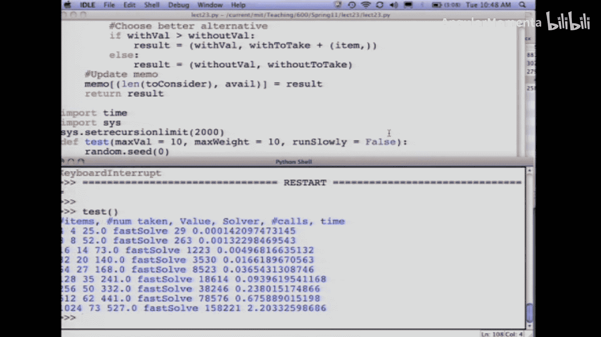

So not only did we not get stuck at 32 items way up here， we didn't get stuck at 1024 items。

Huge difference， right， Instead of only being able to process a set of 16。

We can process a set of over 1000。And， in fact， I don't know how much higher we can go。

 I didn't try anything bigger。But even this big difference between getting stuck here and not getting stuck here。

And， in fact， not only did we not get stuck， it was only two seconds。

So let's ask ourselves a question。 how fast is this growing。Not very fast。More or less。

 what we see here。 And this is not something we can guarantee。But in this case。

 what we see is as we double the number of items。The number of calls kind of doubles， as well。

So we're actually growing pretty slowly。😊，嗯。Well。Okay， that's good。

But suppose we want to look at it a little bit more carefully。And consider the question of what does。

Govern the running time of fast solve。Well， we know that looking things up in the d is。Constant time。

So， that's okay。So what's going to govern it。Is every time we have to add an element to the memo。

It's going to slow us down because we're gonna have to solve a problem。

Every time we can just look something up in the memo， we'll get our answer back instantaneously。

So if we think about the running time， it's going to be related to how many different。

Key value pairs might we have to compute for the memo。Well， what governs that。

So we know that the keys in the memo。Are pairs of。To consider。

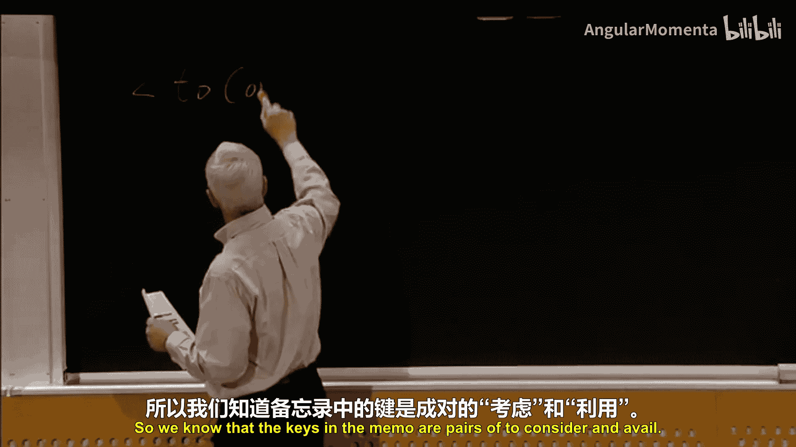

And avail。And so we know that the number。Of possible， different keys。

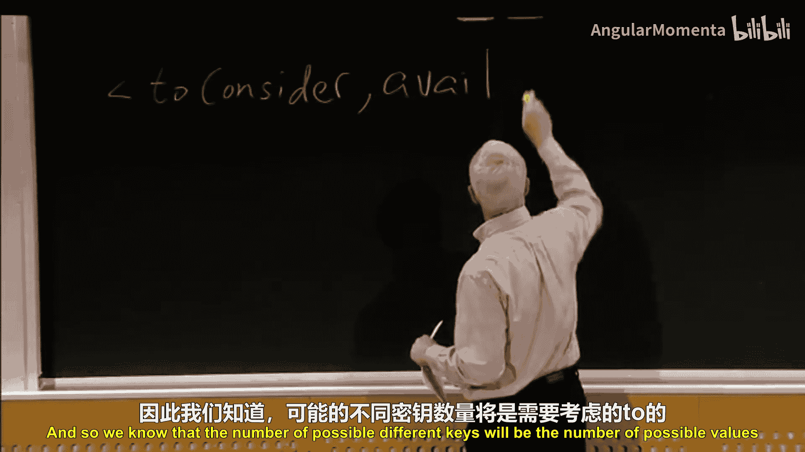

Will be the number of possible values of two Consider multiplied by the number of possible values。

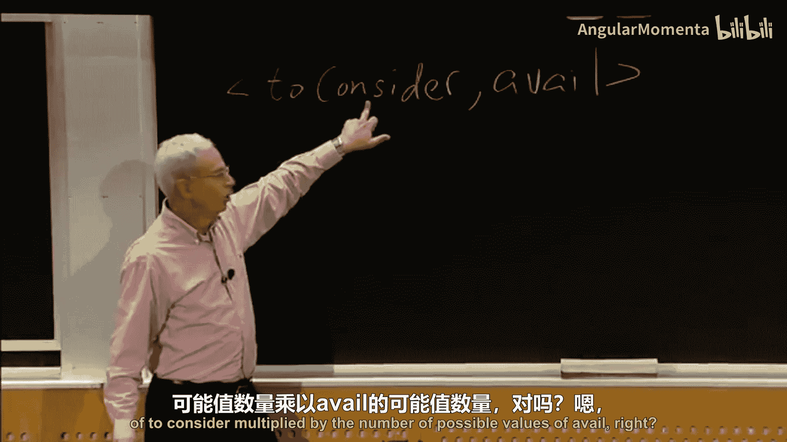

Of a veil， right。Well， how many possible values of two consider are there。What governs that。

That's the easy question。Number of items。Right。Because I'm just marching across this list。

Chropping off one item at a time。 At most， I can chop off in items if the list is of lengthin。

A veil is more complicated。What does a veil depend upon。It depends upon， well， the initial。

Available weight。Now， the initial available weight is 0。Well， and， and it's gonna end really quickly。

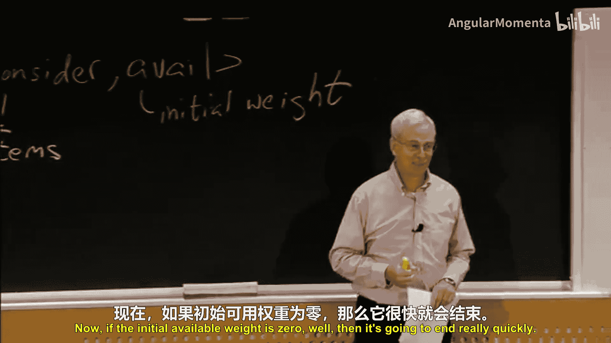

If it's really big， I might have to churn。

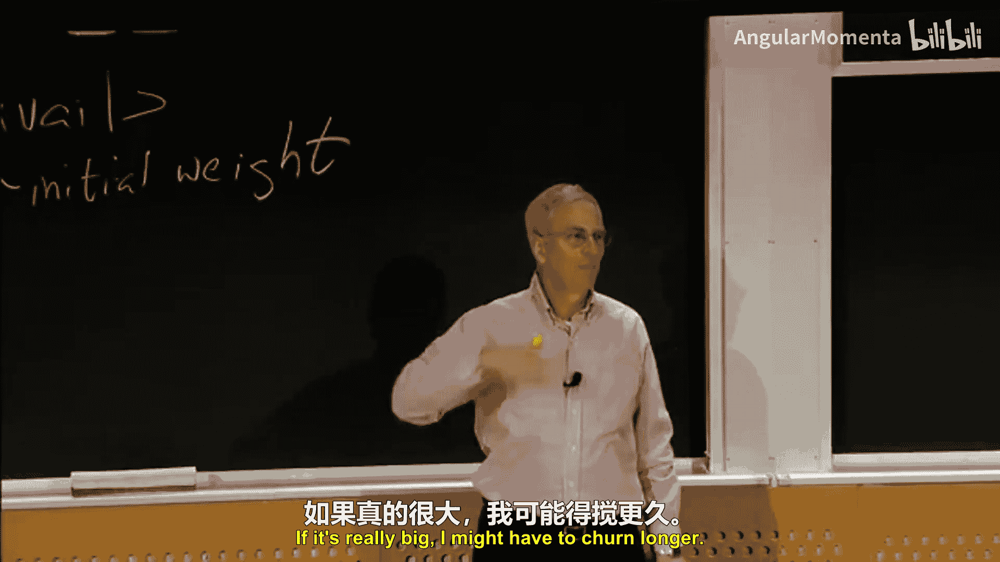

Longer。But it also depends。 And this is the key thing。On。The number。Of different weights。

That sets of items。Can add up to。Because you'll recall the whole secret here was that we said that different sets of items。

Could actually have the same total weight。 And that's why we had。

This business of overlapping sub problems。Now， here。Since I only had 10 possible weights。

That tells me that I can't have very many different combinations。Right。That any set of， say。

 one item。Has to be0 through。10 or0 through 9。I forget which it was， right， But either way。

 that means that all， I only have 10 different possible sums。For sets of length 1。

Whereas if my weights ranged over 100， I would have 100 different possibilities for sets of length 1。

So， that's an important factor。In， in governing it。All right。So。It's a complicated situation。

 but just to see what happens。Try and remember how long this took for 1024， took 2。2 seconds。

I'm gonna allow 20 different weights。And let's see what happens。Alright。

 it took roughly twice as long。Alright， so that's sort of what we would have expected。 So， again。

 we're gonna to see the running time is related to that。

So we can see that it's actually a fairly complicated thing。Suppose I did something really nasty。And。

Went up here where I built my items。So you here you'll see when I built my items。

 I chose the weight between one and max weight。And。These were all integers。 ints。

 supposeuppose instead of that， I do this。So， here。After I choose my value between 1 and 10。

I'm gonna multiply it by some random number between 0 and 1。We've all seen random random。 So now。

 how many possible different weights am I going to have。A huge number， right。

The number of random numbers between real floats between 0 and 1 is。Close to infinite。Right， and so。

 in fact， now I'm gonna see that with reasonable probability。

 every single item will have a different weight。And so things adding up to the same could still happen。

 even if they're all different， but it's not very probable。

So let's see what happens when I run it now。

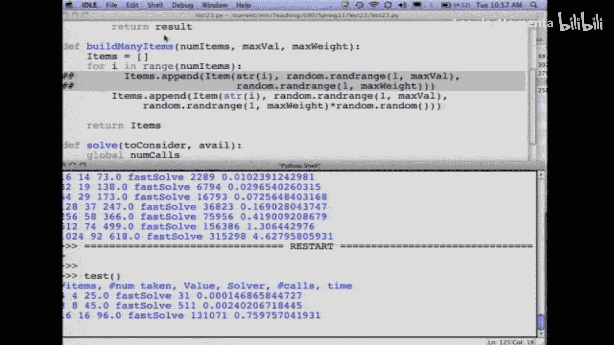

It's slowing down pretty quickly。Pretty much where the other one stopped， right？ Remember。

 we got through 16 with slow solve， but not through 32。Because effectively， I've now reduced。

Fast solved to the same as solve。 It will never find anything in the memo。

 So it's doing exactly the same amount of work as solved did， and it will run very slowly。O。

 life is hard， but this is what you'd expect。Because deep down， we know the 0，1 knapsack problem。

Is exponential。Inherently exponential。And while I think dynamic programming is kind of a miraculous how well it usually works。

It's not miraculous in the liturgical sense， right， It's not actually performing a miracle。

And solving an exponential problem in linear time。It can， all things go bad。Be exponential。

 And that's what it is here。 This kind of algorithm is called pseudoponomial。喂。

It kind of runs in polynomial time。But not when things are really bad。

And I won't go into the details of pseudoaponomial， but if any of you are in course 6。

 you'll hear about it in 6， double0，6 and 6，0，4，6。 Okay， we can adjourn。

 I'll see you all on Thursday。And we're not gonna wait for this to finish， because it won't。

