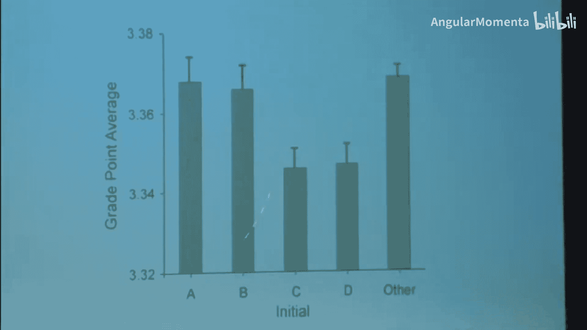
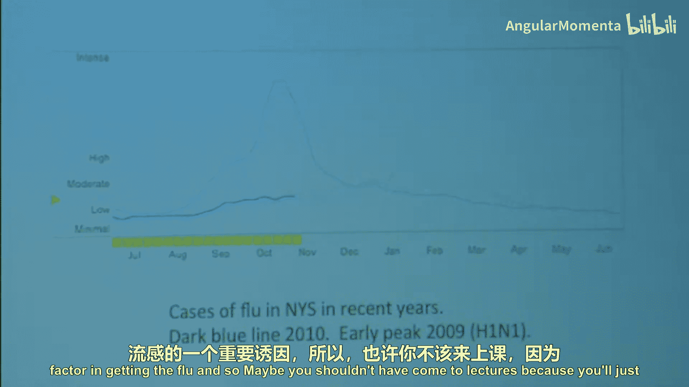

# 【麻省理工】计算机科学与编程导论 ｜ MIT 6.00SC Introduction to Computer Science and Programming p35 35 -BV1a5BZBkEP6_p35-

The following content is provided under a creative Commons license。

 Your support will help M I T Open Coseware continue to offer high quality educational resources for free。

To make a donation or view additional materials from hundreds of M T courses。

 visit M I T OpenCourseware at O C W dot M I Tt Eduu。

All right。We'll back up and start again since I just turned on my microphone。嗯。

I started with the observation。That for most of recorded history， people thought qualitatively。

 not quantitatively。They didn't know what statistics were。 They must have had some intuitive sense。

For example， that if you're old， you're more likely to have bad hearing than if you're young。

 If you're old， you're more likely maybe to die than if you're young， things like that。

But they were just anecdotes， and they had no。Careful way to go from statements about individuals to statements about populations or expectations。

This changed in about the middle of the 17th century， changed fairly dramatically。When。

 an Englishman named John Grt published something called the Natural and political observations made upon the bills of mortality。

This was。The first work in recorded history that actually used statistics。

And what he did is he looked at the fairly comprehensive statistics of when people died in the city of London。

And from that， attempted to produce a model that could be used to predict the spread of the plague。

And turns out he was pretty good at it。And that just changed the way people started to think。

 And since that time。People have used statistics。Both to inform， and unfortunately， to mislead。啊。

Some have willfully used statistics to mislead。Others have merely been incompetent。

And that gets me to what I want to talk about today， which is。Statistics。嗯。

This is often attributed to Mark Twain， but， in fact， he copied it from Benjamin Disreeli。

Who said there were three kinds of lies， lies。Damned lies and statistics。And there is， unfortunately。

 a lot of truth in that。嗯。More recently， in the 50s， Darryl Hoff wrote a wonderful book。

 I recommend it called How to Li with Statistics。😊，NowHere's a quote from the book。

 If you can't prove what you want to prove， demonstrate something else。

And pretend that they are the same thing in the days that follows the collision of statistics with a human mind。

 hardly anyone will notice the difference。Alas， that seems to be true。So what I want to do today is。

Talk about a few ways in which one can be fooled into drawing inappropriate conclusions from statistical data。

Now， I trust that you will use this information only for good。And it will make you a better consumer。

And purveyor of data， rather than a better liar。But that's up to you。Allright， so let's start。

With the first。Where thing I want to talk about。And it's important to always remember that no matter how good your statistics are。

Statistical measures。Don't。Tell the whole story。We've seen examples of this already earlier in the term。

There are an enormous set of statistics that can be extracted from a data set。

And by carefully picking and choosing among them。It's possible to convey almost any impression you want about the same data set。

The best antidote， of course， is to look at the data itself。In 1973。

 the statistician John Anscomb published a paper with this set of data。

4 different examples where he gave values for X and Y。嗯。Nothing very sophisticated。

The interesting thing is that， in many ways。The statistics for these four data sets are very similar。

They have the same mean。The same median， the same variance。For X and Y。

 both the same correlation between X and Y。 And even if we use linear regression to get a fit。

We get very similar things， so let's look at it。I actually wrote some code to do that。

So this just reads in the data set that that we just had up。And then plot some things with it。And so。

 let's look at it。So what you can see is you have these in your handout。 We have four graphs。4 plots。

And I won't show you them all because they all are identical。What they all give me is a mean of 7。

5 and a whole bunch of things。Same to 17 decimal places or so， the same mediumn and。

The same linear fit。Y equals 05 x plus 3。So I might write a paper。In which I would tell you that。

 well， from a statistical sense， these data sets are all the same。

Every statistical result I ran said these things are indistinguishable。Well。

 is it true that these data sets are indistinguishable。Well， one way to look at it。

Is to actually plot the points。So， we can run it。With true。

 which says in addition to plotting the data， plot， put points on them。

 in addition to plotting the statistics。And now we see something fairly dramatic。So， for example。

 figure 2 and figure 1。Don't look a lot like each other。When we actually look at the data。

Figure 3 looks quite different， and figure 4 is remarkably different。

Compare figure 4 to say figure 1。 Again， these are all in your handout。

So the moral is pretty simple here。 And it's one we looked at before， which is。

 don't ever ignore the data。Don't just look at statistics about the data。

 Try and find a way to look at the data itself。Of course， it's easy enough to look at the data。

But how do you look at it。And the next thing to remember is that pictures。Can be deceiving。

There can be no doubt about the utility of graphics， for quickly conveying information。However。

 when used carelessly or maliciously， a plot can be highly un misleading。So let's look。

 go back to the PowerPoint。And look at this plot of housing prices in the Midwest。

So we've got a plot here。And we've got years 2006，2007。 And then in 2008，9， we have quarters。

 You may remember that there was an event in the housing market in 2008。

 precipitating the global financial crisis。And if we look at this。

What impression do we get about housing prices in the Midwest during this period。Well。

 I would get the impression。That they're remarkably stable。YouYou publish this and you say， okay。

 look， they really haven't changed very much。 Maybe they've gone down a little。But。

 nothing very serious。If we compare that to this plot。Which is exactly the same data。And now。

 I ask you。About housing prices in the Midwest。 Well。

 what you might tell me is it's they're remarkably unstable。And， in fact。It was， clearly。

Some sort of horrible event here。Exactly the same data， two plots， both of which are truthful。

But which give a radically different impression about what happened。Right。

 the chart on the right was designed designed on the right in your handout was designed to show that。

They were highly unstable。So what's the difference， What trick did I use to produce these two plots。

 yeah。So that was certainly one trick that I performed that in the first chart。

 I plotted the Y axis log rhythmically， which always make things look like they're changing less than if I plot it linearly。

And in this chart， I used the linear plot。 Go ahead。Sca on the second。The magnitude are different。

Much less compared to magnitude。😔，So that's the other thing I did。Is if you look at it。

I sort of cheated。 I had full years here， and then I went to quarters。So， in part of my chart。

The resolution on the X is pretty wide It is a whole year。 And then part of it's on a quarter。

And not surprisingly， since we know that housing prices change seasonally。

They are different in the spring than in the winter。Once I started plotting quarters。

 even if there had not been a crash， it would have looked much less stable in out years。

Because I changed the resolution on the X axis。I didn't lie。

 You can tell reading the legend that I did that。But I sure could have fooled a lot of people with these charts。

Here's another nice example of statistics。So this plot， this is from a paper by two professors。

 I think， from Yale。嗯。Shows what you can do if you're in the Ivy League。That plots。Initials。

Against G for students at Yale。And so you can see that if your first name starts with the letter A。

 I think it was first initials。Are your GPA is considerably higher than if it starts with C or D。

And if your parents weren't nice enough to give you an A name。

 you could hope they at least gave you a B name。And you certainly don't want them to give you a C or a D name。

 So， you know， if you're Charlene。Or David， you could have a real problem。I have to say。

 my first child was named David。His GP might have been somewhere in there。All right， clearly。

 it matters。 Well， what trick did I perform here。Right。

 so what I did here is I made the range on the Y axis very small。Ranging from 3。32 to 3。38。

 not a big difference。However， because that's the whole thing。 It looks like it's a big difference。

You'll often see this when you say， look at things in newspapers where， in fact。

 someone has manipulated one of the axes to make things look bigger or small。

If I had ranged this from a GPA of 0 to a GPA of 4。The highest GP at Yale。

 this difference would have looked very tiny。

But I didn't。 actually， it wasn't I。 I actually copied this from their paper。

 This was the way they presented it in their paper。

Because they were trying to argue in the paper that your name had a big influence on your life。

 and they used many statistics， including your grades。

And so they actually formatted it kind of like this。To try to try and give you this impression。Later。

 we'll see another statistical sin they committed。In this paper。Which。Basically。

 was designed to show that。In your name was Desttiny。听到。Had many， other things。

 If you're a baseball player and your name starts with K， you are more likely to strike out。

Because K is the symbol for strikeouts in a baseball scorebook。A lot of implausible things。All right。

Moving right along。Probably the most serious。And common statistical error。Is。

The one known as garbage inn。Garbage out。And it's so common that people typically refer to it。

By its acronym。Gaigo， garbage in， garbage out。A classic example of this occurred。

And we could look at more recent examples， but I don't want to offend any of you in 1840。

TheUnit States census showed that insanity among free blacks and mulatos was roughly 10 times more common than insanity among enslaved blacks or melattos。

And the conclusion from this was obvious， I guess。US senator。

 former vice president and later Secretary of State John C。 Calhoun， concluded from the census。

 and I quote。The data on sanity revealed in this census is unimpeachable。From it。

 our nation must conclude that the abolition of slavery would be to the African a curse。

Because after all， if you freed them from slavery， they would all go insane。嗯。

That's what the statistics reported， he said。Now， never mind。It was soon clear that， in fact。

 that census was riddled with errors。And John Quincy Adams， a former vice president。

And Massachusetts resident responded。To Calhoun and said， no， that's a ridiculous conclusion。

 The census is full of errors。Calhoun being a very patient person， explained to Adams。The following。

There were so many errors。That they balance one another out and LED to the same conclusion。

 just as much as if they were all correct。There were just enough errors that you could be O。Well。

What was he relying on， What should he have said if you wanted to make this statement more mathematically precise。

What he was basically implying is that the measurement errors are unbiased。

And independent of each other。And therefore， almost identically distributed on either side of the mean。

I see a typo。 mine as will fix it。M as well make it big enough to fix it。I's it interesting。

If he had made this much more precise statement。Then you could have had a meaningful discussion。

Assuming it was possible to have a meaningful discussion with John Calhoun， which is perhaps dubious。

About whether or not， in fact， the errors are independent。Because if they're not。If， for example。

 they represent bias in the people compiling the data。

Then you cannot rely upon statistical methods to say that they'll balance each other out。

You remember way back in Gaus's time， Gauss talked about this when he talked about the normal distribution。

And said， well， if we take these astronomical measurements。And we assume our errors are independent。

 and normally distributed。Then we can look at the mean and assume that that's close to the truth。

Well， those are important assumptions， which in this case turned out to be not correct。And， in fact。

 it was later shown that the errors did not balance each other out nicely。And， in fact。Today。

 you can say that no statistical conclusion could be drawn from that。On the other hand， recently。

 the US National Research Council， perhaps the most prestigious academic organization in the United States。

Published a ranking of all universities in the country。And it was later shown that。

It was full of garbage G input。And they did extensive statistical analysis， and published it。

On data that turned out to be just wrong。And it was。Very embarrassing。Now。

 the good news is M I T came out near the top of this， this analysis。

The bad news is we can't conclude that it actually should have been near the top because who knows about the quality of the data。

But kind of embarrassing。All right。Moving right along。Another very common way to lie with statistics。

Is to exploit what's called the comeumhawk。Ergo propped the hawk。Fallacy。So。Anyone here study Latin。

Once you take， oh， okay， well， what does it mean。Boy， your Latin is good。

Either that or you just no statistics。But。I have to say that was the mostffluent translation I've had in all the years I've asked this question。

I hit the reallay man or reallay woman on the throw。 All right， yes。With this， therefore。

 because of this。I don't know why。 but statisticians like physicians and attorneys like to show off by phrasing things in Latin。

So， for example。It is a statistical fact。The college students， including M I T students。

 who regularly attend lectures。Have higher GPs than students who attend lecture， only sporadically。

So that would tell us that those of you in the room are likely to have a higher GP than the various students in 600 who are not in this room。

I hope it's true。Now， if you're a professor who gives these lectures。

 what you want to believe it's because the lectures are so incredibly informative that we make the students who come much smarter and therefore。

 they do better。And so we'd like to assume causality。

 because I give beautiful lectures and you choose to come， you will get a better grade in 600。Well。

Yes， there's a correlation。 It's unquestionably true。

But causation is hard to jump to。For example， maybe it's the point that students who bother to come the lecture also bother to do the problem sets。

And are just more conscientious。And whether they came to lecture or not。

 the fact that they're more conscientious would give them better GPAs。

There's no way I know to separate those two things。Other than doing a controlled experiment， right。

 maybe kicking half of you out of lecture every day and just see how it goes。But。It's dangerous。

 But again， you know， you can read things like the faculty newsletter。

 which will talk about how important it is coming it is to come to lecture because you'll do better。

Because whoever wrote that article for the faculty newsletter didn't understand this， this fallacy。

Or was just thinking wishfully。嗯。Another nice example， one that was in the news not too long ago。

 has to do with the flu。嗯。This was the cases of flu in New York State， in recent years。

And you'll notice that there was a peak in 2009， and that was the famous swine flu epidemic。

 which I'm sure you all remember。Now， if you look at this carefully or even not too carefully。

You'll notice a correlation。Between when schools are in session。And when the flu occurs。That。

 in fact， during those months， when schools are in session。

There are more cases of flu than in the months when school is not in session。High schools， colleges。

 whatever。Quite a strong correlation， in fact。This LED many to conclude that going to school is an important causative factor in getting the flu。

And so。Maybe you shouldn't have come to lectures because you'll just have gotten the flu by doing so。

And， in fact， because of this， you had many parents not sending their kids to school during the Twine flu epidemic。

And， in fact， you had many schools closing in some communities。Because of the swine flu epidemic。嗯。

Well。Let's think about it。 just as you could use this correlation。

To conclude that going to school causes the swine flu。

You could have also used it to prove that the flu causes you to go to school。

Because more people are in school when the flu season is at its height。And therefore。

 it's the growth of flu that causes people to go to school。

That's an equally valid statistical assumption from this data。Kind of a weird thing。 But it's true。

 right。Just as we could conclude that having a high GA causes people to come to lecture。

 You look at your G every morning。 And if it's high enough， you come to lecture， otherwise。

 you don't。You could draw that conclusion from the data， as well。The issue here。

That you have to think about is whether or not there's what's called a lurking variable。

Some other variable that's related。To the other two。 And maybe that's the causative one。So。

 for example。A lurking variable here is that the school season coincides with or the non school season。

 maybe I should say， coincides with the summer。And， in fact。If you study the flu virus。In a lab。

 you will discover that it survives longer in cold weather than in hot and humid weather。

When it's cold and dry。The flu virus will survive for a longer time， on a surface。Then it will。

 when it's warm and humid。And so， in fact， maybe it's the weather。

Not the presence of schools that causes the flu to be more virulent。During certain times of the year。

In fact。It's probably likely true。So there is a lurking variable that we have to consider。

 And maybe that's the causative factor。Now。This can actually lead to some really bad decisions in the world。

I'm particularly interested in issues related to health care and public health。In 2002。

Roughly 6 million American women were taking hormone replacement therapy。

In the belief that this would substantially lower their risk of cardiovascular disease。It was argued。

That women over a certain age or of a certain age， if you took extra hormones。

 they were less likely to have a heart attack。This belief was supported。

By several published studies in highly reputable journals。In which they showed a strong correlation。

Between being on hormone replacement therapy and not having cardiovascular disease。

And this data had been around a while。 And as I said by 2002 in the US。

 roughly 6 million women were on this therapy。Later that year。

 the Journal of the American Medical Society published an article asserting that， in fact。

Being on this therapy increased women's risk of cardiovascular disease。

It made you more likely to have a heart attack。Well， how could this have happened。After the。

New study came out。 People went back and reanaly the old study。

And discovered that the women in that study who'd been on hormone replacement therapy。

Were more likely than the other women in the group。To have。Also。

Better diet and be on a better exercise regimen。In fact。

 they were women who were more health conscious。So there were the lurking variables of diet and exercise and other things。

That were， in fact， probably the causative factors in better health， not the replacement therapy。

But there was this lurking variable that had not been discovered in the initial analysis of the data。

So what we saw is that taking hormone replacement therapy and improve cardiac health。

Were coincident effects of a common cause。That is to say， being health conscious。

Kind of a strange thing， but true and。Sad story。 All right。Moving right along。

Another thing to be cautious of。Is nonrepon bias。And。

A related problem of a non representative sample。You'll probably recall that when I first started talking about statistics and the use of randoms。

 as I said that all statistical techniques。Are based upon the assumption that by sampling a subset of a population。

We can infer things about the population as a whole。And that's true。Typically。

 because if random sampling is used。You can make assumptions that the distribution of results from the random sample。

 if it's large enough， will be the same as the distribution of results from the whole population。

And that's why we typically want to sample randomly。And so for all the simulations we looked at。

 we used random sampling to try and ensure that a small number of samples would give us something representative of the population。

And then we used statistical techniques to answer the question about how many random samples we needed。

But those techniques were only valid。If the samples were indeed random。Otherwise。

 you can analyze it to your heart's content。And any conclusions you draw。Are likely to be fallacious。

Unfortunately， many studies。Particularly in the social sciences。Are based on what has often called。

A convenience sampling。So， for example， if you look at psychological psychology journals。

 you'll find that many psychological studies use populations of undergraduates for their studies。

Why did they do this。Is it because they believe that undergraduates are representative of the population of as a whole。

 No， it's because they're captive。 They have to agree to participate。Right， it's a convenience。

 if you happen to be at a university to do your experiments on undergraduates。And so they do that。

 And then they say， well， the undergraduates are just like the population as a whole。

You may have observed that at least at this institution。

 the undergraduates are probably not representative of the population as a whole。

An wellknow example of what you can do with this occurred during World War  I。

Whenever an allied plane would return from a bombing run over Germany。

The plane would be inspected to see where fl had hit it。 So the planes would fly over to drop bombs。

The Germans would shoot flak at the planes to try and knock them out of the air。

 They'd come back to England。 They'd get inspected。 They'd say， well。

 the fl hit this part of the plane more often than that part of the plane， on average。And so。

 they would reinforce。The skin of those parts of the plane where they had expected the flk to hit。

To try and make the plane less likely to be damaged in future runs or the planes in general。

 What's wrong with this。呀。Exactly。What they're not sampling is the planes that never made it back from the bombing room。

 boo。That never made it back from the bombing runs。Because they weren't there to sample。嗯。

And in fact， maybe it's the case that what they were doing is reinforcing those parts of the planes where it didn't matter if you got hit by flak because it wouldn't cause the plane to crash。

And not reinforcing those parts of the plane that were most vulnerable to being damaged by flak。

They did a convenient sample。 They drew conclusions。

 and they probably did exactly the wrong thing in what they chose to reinforce in the airplanes。嗯。

This particular error。Is called nonrepon bias。Where you do some sort of survey， for example。

 and some people don't respond。And， therefore。You ignore what they would have said。嗯。

It's perhaps something we see when we do the underground guide to Co 6。In fact。

 I should point out that it's now online。And it would be good if each of you would go and rate this course。

 rate the lecturers， rate the T As， etcter。We actually do read them。

 and it makes a difference in how we teach the course in subsequent terms。But there's clearly a bias。

You know， maybe only the people who really feel strongly about the course either positively or negatively bother to fill out the survey。

 And we draw the conclusions that there's a bimodal distribution。

 and nobody thinks it's kind of mediocre。Because they don't bother responding。

Or maybe only the people who hate the course respond。 And we think everybody hates the course。

 Who knows？ It's a big problem。We see it。 It's a big problem today， with telephone poles。

Where you get more convenient sampling or nonrepresent samples。

Where a lot of polls are done using telephones。By law， these pollsters cannot call cell phones。

So they only call lamblines。 How many of you have a landline。That the record show nobody。

How many of your parents have a landline。At the record show， pretty much everybody。Well。

 that means your parents are more likely to get sampled than you when there's a poll of， say。Whos。

 who should be nominated for president。And so any of these polls that are based on telephones will be biased。

And unfortunately， their poem may just say a telephone sample。

 And people may not realize the implication of that that a whole part of the population is undersampled。

There are lots of examples of this。All right。嗯。Moving along。

Another problem we often see is data enhancement。It's easy to read much more into data than it actually applies。

Implies， especially when viewed out of context。So on April 29，2009。CNN reported that， quote。

 Mexican health officials suspect that the swine flu outbreak has caused more than 159 deaths and roughly 2500 illnesses。

It was pretty scary stuff at the time。 And people got all worried about the swine flu。😰。

On the other hand。How many deaths a year do you think are attributable to the conventional。

 seasonal flu in the US。Anyone want to hazard a guess。36000。So 36000 people a year， on average。

 will die from the seasonal flu。Which sort of puts in perspective that 159 deaths from the swine flu maybe shouldn't be so terrifying。

😰，But again， people typically did not report both of those。Another great statistic。

And accurate is that most auto accidents happen within 10 miles of home。

I'm sure many of you have heard that。So what does that mean。Almost nothing。

Most driving is done with 10 miles within 10 miles of home。And besides that。

 what does home mean in this context， what home means is the registration address of the car。

So if I were to choose to register my car in Alaska。

Does that mean I'm less likely to have an accident driving around M I T。I don't think so。Right。

 again， it's kind of a meaningless。嗯。Another aspect of this is people often extrapolate from data。

So we can look at an example。Of Internet usage， this is kind of a fun1， too。

So what I've plotted here is the Internet usage in the United States as a percentage of population。

And I've plotted this from starting at 1994。And the green line are actually the。The blue line here。

 the points。And the green line is a linear fit。If you looked at my code。

 you'd see I was using polyfit with one to get a line to fit it。

 And you can see it's a pretty darn good fit。So people actually looked at these things and used this to extrapolate。

Internet usage going forward。So we can do that。Now， we'll run the same code。

With the extrapolation turned on。And so figure 1 is the same figure 1 as before， same data， same fit。

And here's figure 2。And you'll notice that as of last year。

 about 1 hundred and 15% of the US population was using the Internet。Probably not true。

It may be possible in sports to give 1 hundred and 10%。But in statistics， it's not。嗯。Again。

 you see this all the time when people are doing these projections。 as they fit some data。

 they extrapolate into the future without understanding why maybe that isn't a good thing to do。

We saw that， by the way we were modeling springs， right。

 We could accurately project linearly until we exceeded the constant of elasticity at which point our linear model was totally broken。

So you always need to have some reason other than just fitting the data to believe。

That what you're doing makes actual sense。All right， the final 1 I want to talk about。嗯。

Is what is typically called in the literature。The Texas Shapcuter fallacy。

And this is a little bit tricky to understand， sometimes。Actually， is there anyone here from Texas。

Oh， good。 So no one will be offended by this。Well， imagine that you're driving down some country road in Texas。

And that you see a barn。And that barn has six targets painted on it。

And in the dead center of each target， you find a bullet hole。So you're driving。

 you're pretty impressed and you stop and you see the owner of the barn， and you say。

You must be a damn good shot。 He he says， absolutely， I never miss。

At which point the farmer's wife walks out and says， that's right。

 There ain't a man in the state of Texas who's more accurate with a paint gun。What did he do？

He shot six bullets into the barn， and he was a terrible shot。 They were all over the place。

 But then he went and painted a target around each of them。And it looked like he was a great shot。

Now， you might think that， well， that's silly。 No one would do that in practice。But， in fact。

 it happens all of the time in practice。A classic of this genre appeared in the magazine new scientist in 2001。

And it reported that a research team LED by John Eagles of the Royal Cornhill Hospital in Aberdeen had discovered that。

 And I quote。Anorexic women are most likely to have been born in the spring or early summer。

Between March and June。In fact。There were more than， there were more than 13%。

There are 13% more anorexs， anorexics born on average in those months and 30% more anorexics than average in June。

Now。Let's look at this worrisome statistic。 Are any of you women here born in June。All right， Well。

 I won't ask about your health history。But maybe you should be worried or maybe not。

 So let's look at how they did this study。And you may wonder why so many of these studies or flawed studies are about women's health。

 and it perhaps because they're all done by male doctors。 Anyway。

 the team studied 446 women who had been diagnosed as anorexic。So if you divide that by 12。

Which you'll discovered is that on average， there should have been 37。

Women born in each of those months of the 446。And， in fact， in June。

There were 48 anorexic women born。So they said， well。

 how likely is this to have occurred simply by chance。Well， as I am wont to do on such occasions。

I check their analysis。And I wrote a little piece of code to do that。

So trying to figure out what's the probability of 48 women being born in June， I ran a simulation。

In which I simulated 446 births and chose。A month at random。And looked at the probability。

And let's see what it was when we run it。Ghoops， well， we didn't want these graphs， but。

Look the probability of at least 48 births in June was 0。042。So， in fact。Pretty low。You might say。

 well， what's the odds of this happening by accident， Pretty small。 Therefore。

 maybe we really on something。 Maybe it has to do with， you know。

 the conditions of the birth and the weather or who knows what。Well。What's wrong with this analysis。

Well， one way to look at it。Is this analysis would have been perfectly valid。

If the researchers had started with the hypothesis。

That there are more babies born in June than in any other month。

 more anor future anorexics born in June than any other month。

And then run this experiment to test it， and validated it。So if they had started with the hypothesis。

And then， from the hypothesis。Conducted what's called a prospective study。

Then they would have perhaps valid reason to believe that the study supports the hypothesis。

But that's not what they did。Instead， what they did is they looked at the data and then chose a hypothesis that matched the data。

The Texas Shaptroder fallacy。Given that that was the experiment they performed。

The right question to ask is not what is the probability that you had 48 futurinorexics born in June。

But what was the probability that you had 48 future anorexics born in at least one of the 12 months。

Because that's what they were really doing， right。So， therefore， we should really have。

Run this simulation。Similar to the previous one， again， these are on your handout， but。

Is there at least one month。In which。There were 48 births。And if we run that。

We'll see that the probability is over 40%。Not so impressive as 4%。So， in fact， we see that。

We probably shouldn't draw any conclusion。The probability of this happening by pure accident is almost 50%。

So why should we believe that it's somehow。

Meaningful。Again， an example of the Texas Shapshooter fallacy。That appeared in the literature。

 and a lot of people fell for it。And if we had more time， I would give you many more examples。

 but we don't。I'll see you on Thursday， on Tuesday， rather。Two more lectures to go on Tuesday。

 I'm going to go over some code that I'll be asking you to look at in preparation for the final exam。

And then on Thursday， we'll， we'll wrap things up。

