# 【麻省理工】计算机科学与编程导论 ｜ MIT 6.00SC Introduction to Computer Science and Programming p36 36 -BV1a5BZBkEP6_p36-

The following content is provided under a creative Commons license。

 Your support will help M I T Open Coseware continue to offer high quality educational resources for free。

To make a donation or view additional materials from hundreds of M T courses。

 visit M I T OpenCourseware at O C W。t M I T Eduu。

So， this week。The last final topic we're really going to talk about in the class is dynamic programming。

Who can tell me what the key ID and dynamic programming is？Oimizing。said。Opttimization。That's。嗯。

Sort of。It's the key idea is that you don't want to repeat computations that you've already done before。

So you want to find a way to。Only do everything once。 it's a form of laziness。

There are two key attributes for a problem though， that need to exist for it to be。

Solvable with dynamic programming。Can someone tell me what those are？The local。Ps。Overlappping。

Some practice。He had all the right words， not the right order。Yeah。An optimal substructure。Okay。

 can you describe the first one or anyone？说。多问啊。So when we say overlapping sub problemss。

 it means that we can take the big problem and we can break it down to a slightly smaller instance。

of the same problem， and then we can use the solution to that smaller subproblem in the solution to our bigger problem。

And then optimal substructure is closely related。 it's saying that if we get an optimal solution for one of those subpro。

 then we can use that optimal solution for the optimal solution。Of the big problem。

Does that make sense to everyone？What's that？It's closely related and so it's mean。Yeah， I mean。

 it's closely related， but not exactly the same。So。So。To start off。

 we're going to do kind of a function that we're all familiar with is Fibonacci， right？So。

We've seen this one a billion times before。And so it's pretty obvious where the overlapping sub problemsblems are。

The solution to F of n is f of n minus1 and F of n minus2， right？

And so if I combine the solutions to these two instances of Fiminacci， I get the solution for。

The big instance of Fiminacci， right？So。On the screen。You have。

An example function you've all seen this before。And so what I'm just going to do is I'm going to run this Fibonacci function。

From  zero to 30。Or n equal 29， actually。And。We're going to look at how many steps it takes to execute。

So。When we get to Fibonacci of 29， it takes about 1。6 million steps to compute the value。

And if we take a look。A plot here， so the Y axis is the semiloggue。

The blue dots represent the actual number of steps that the function took。

 so the number of times had had to perform the computation。

And then the blue solid line represents2 to the n。The red line is the golden ratio to the end。

 which is the tight bound for this version of Fibonacci。

The green line is a part of a quadratic function。So。Nothing really surprising there。

So it's pretty inefficient and we established that before。So。

We can make this more efficient with dynamic programming though， right？So。Let's draw out。

The call tree for F of5。're doinging a lot of writing。Okay。So if we look at this。

We see that in a lot of places we're repeating。Computation， so we repeat F of2。Three times。

We also repeat FF3。This computation twice。So the idea behind dynamic programming is that instead of repeating these computations over and over again。

We're just going to compute them once so if we look at。The implementation。

Of this recursive Fibonacci。We see that the first recursive call。Is going down this side of the tree。

And so。The upshot is that。All the values from F5， F4， F3， F2， F1， F0， they all get computed。

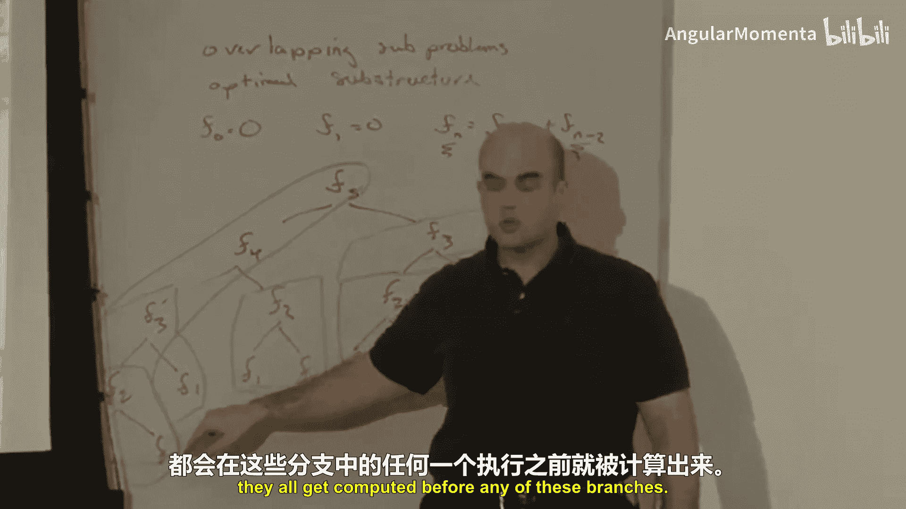

Before any of these branches。So what we can do。Is instead of recomputing F2。An F2 here。

We can just compute it here， save off this value somewhere。In some sort of a brain。

And do the same thing for F3。NF4， but that's not going to matter。

So when we get to the second recursive call， so say when we're calling Fibonacci of3。

 and we compute F of2， get F of1。We come back up to Fibonacci of four， right？

The next recursive call is going to be to Fibonacci of two。But since we've already computed it。

And we've saved it off in a brain， we can just look up this value instead of doing all the computation again。

So when you have a very small tree like this， right， it's not a huge benefit。 but if you have like。

A lot like F of 100， this is going to make a huge difference。Anyone lost？Okay。

So why don't we take a look？So this is。An implementation of Fb。

That has an extra parameter called memo。And memo is the brain I'm talking about。

 this is where we're going to stash those computed values so we don't have to compute them again。

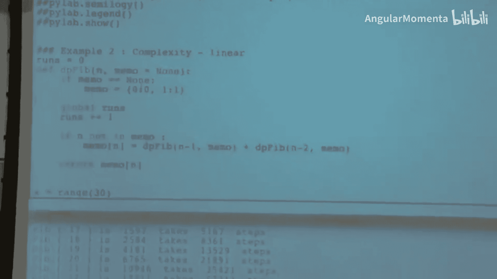

And。When it initially comes in， if memo is none， that is， you know。

 we haven't passed in a dictionary or if it's like the first call to this function。

 then it's going to set。

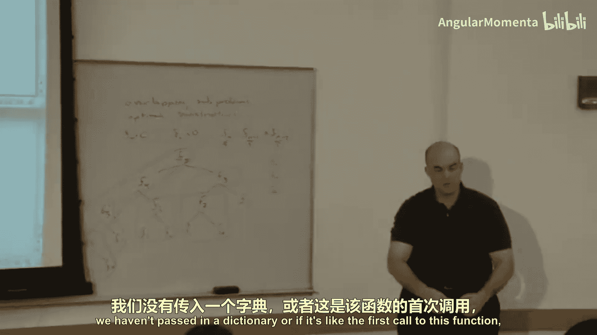

A key of zero to zero and key of one to one。Those correspond to F of 0 and f of 1， right actually？

No one pointed that out。All right。So。Now it's going to effort does that initialization。

 it's going to come down to this if statement， right？

And it's going to check for whether or not N is in memo。What this is actually asking is。

Have we seen this number before？

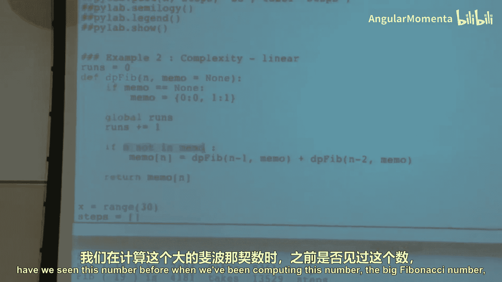

When we've been computing this number， the big Fibonacci number， right？So if it's down here。

 and it's looking at F of2， it's asking， have I seen Fibonacci F2 when I've done this computation before？

And if it's in this tree， then the answer is yes， because it's seen it down here。

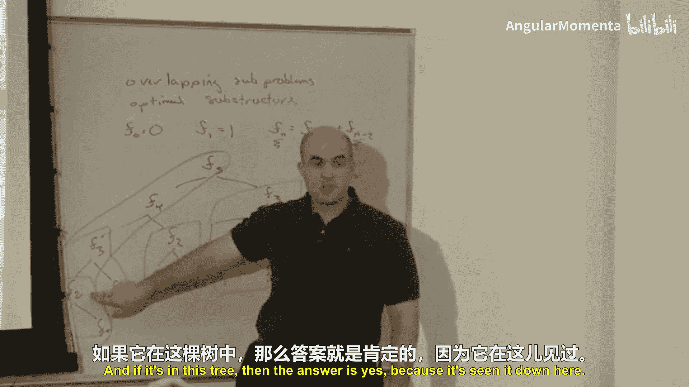

If it hasn't seen it though。It's got to do the work， so it's got to actually do the recursive calls。

And this is when it travels down this。Left branch of the tree。Does that make sense？

And all we're going to do is store it off here。And then at the end。

 we just return whatever's inner memory。So I why don't take a look at how this runs。So。Yeah。

 so remember， this is 1。6 million。For the old implementation， and now it's only 57。And in fact。

It's linear。And exactly two to the n minus1 or two times n minus1。everyone follow that。

Are any questions？No。It's it saves a lot of work for you， right， because as soon as it。

 so let's say that it's， it's computed。

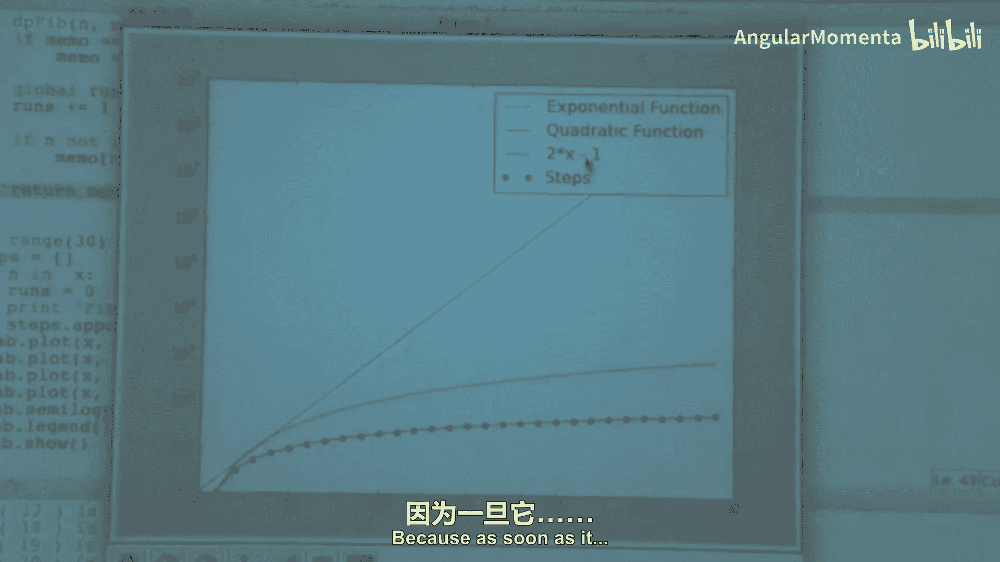

F of4， this entire subt here。

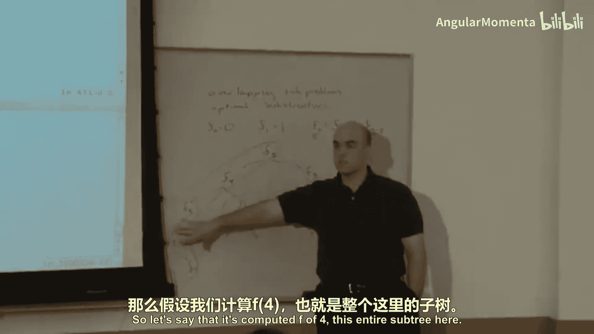

As soon as it sees F of3。It's going to look in its brain。And you've already seen F of3， and it says。

 I've already seen this， so I don't need to do all this computation here。

 I don't need to do all these recursive calls。 I just have to return whatever's in the dictionary。

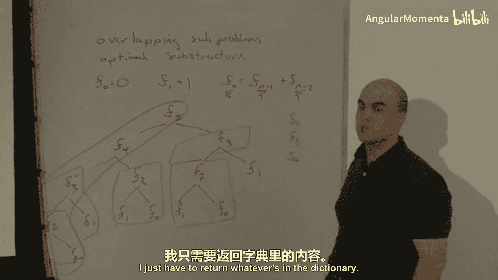

That's where your savings come in。So。Let's take a look at another example。So。

The point is is you can have some really huge savings。

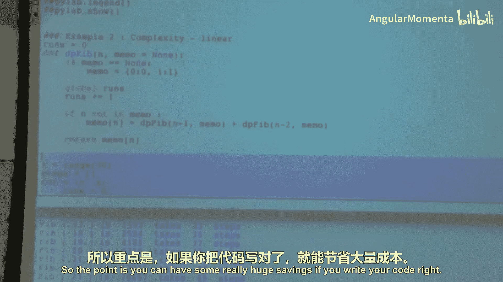

If you write your code right， so let's look at a different problem。So let's say that I have a robot。

And this robot is positioned on a grid。Say that。It has N rows。And n columns。Or M columns。Your robot。

Its starting out here。And it wants to get here。Your robot though， is very stupid。

And it can go only down。And to the right。And the question is。

How many unique paths are there from the top left square to the bottom right square？

Given those constraints。So。If you try and do this analytically， you'll probably hurt yourself。

The easier way to do it， or at least I think so。Is to to realize that in order to get to G。

 there's only two places that it can come from can come from here。Can come from here。Right。

So the total number of unique paths coming into G are the total number of unique paths coming into this guy。

The total number of unique paths coming into this guy， so there's your overlapping sub problems。

 right？And also your optimal substructure if I can figure out these numbers。

Then I can figure out this number， right？So。And then these guys， the same condition applies。

If I know these two numbers， then I can figure out this number。If I know these two numbers。

 and I can figure out this number。So。One implementation。Well， one other thing。

If I get down to this case where I have a1 by M。Grid。

How many different ways are there to get from here to here？Wan， right。And then， same thing for。

And by and right。So。First crack at this。Here's a recursive function。All we're going to do is。

If we only have one row or one column， we return one。Otherwise。We're going to look。

For the number of robot paths and an n minus1 by M matrix。

And then the number of paths and an n by M minus1 matrix。So let's take a look。

So we're going to do this on a 14 by 14。Grid。And this will take a few seconds。Okay。So。There's a lot。

10 million， 10 million unique paths， and it took but。20 million steps to figure it out。So。

We're going to pull the same trick for this problem that we did for Fibonacci。

We're going to memorize。Or memorize。The different paths or the different solutions。

Except our key is going to be a little different， it's just going to be N&M。Right， so。Again。

 if we have。Well， again， if NNM is not memo， then we need to compute it。If either is one。

Then we remember it as one。And if they're both greaterer than one。Nan。

We're going to look at the number of paths in n minus1 by m and n times n minus1。And then。

We also know that the solutions are symmetric， right？

So it's going to be the same for an n by M and an M by N。And just return the solution。

 so let's try this out。

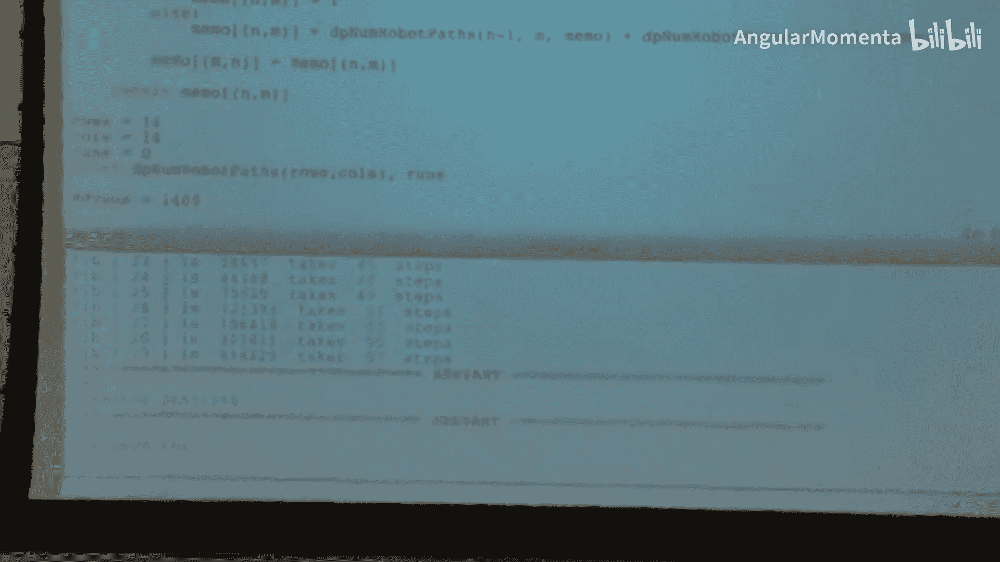

So we get the same answer， but it only takes 104 steps to do。 So it's a pretty huge savings there。So。

The other this is an example of a top down dynamic programming solution。 So we looked at the big。

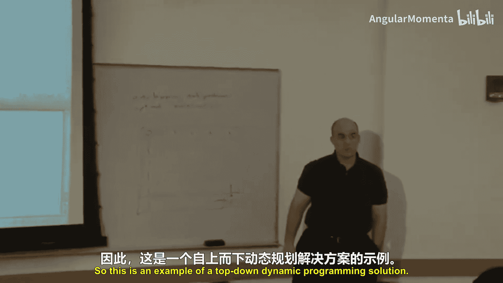

Big problem。 And then we broke it down into two smaller problems。

 We looked at those two smaller sub problemsms。 We broke them down into two smaller smaller subproms a piece。

We can also go from the bottom up。And we might want to do this for a reason and I'll show in a second。

So。

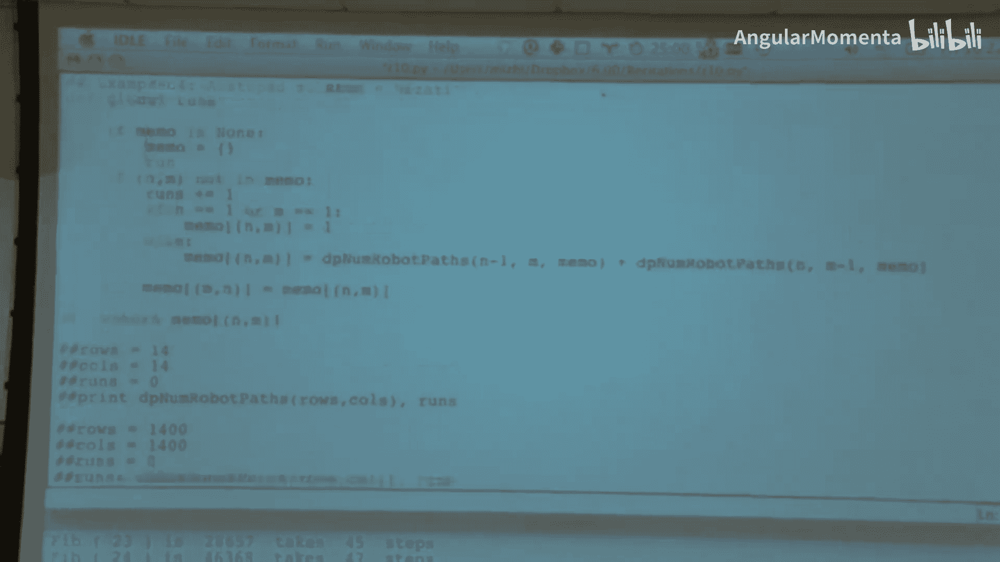

So。This is going to go from the bottom up。 So instead of starting back here and asking how many ways I can get。

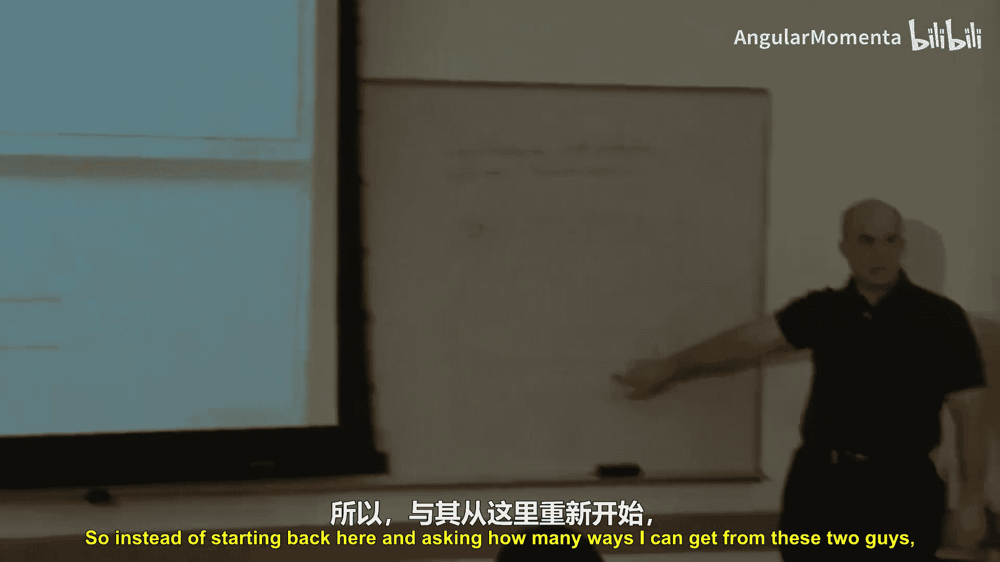

From these two guys。This is going to start at the beginning and ask how many ways I can get here。1。

 right。And then here。Zou。Let's imagine that we only have a two by two。It's going to look at， again。

 the number of ways to get。To the square to the left and to the square to the top and add it here。

At it here。 So what we're doing here， what we're doing in this。Version。Is we're growing our grid？

Towards the solution。Does that make sense。So。This just sets up a matrix。

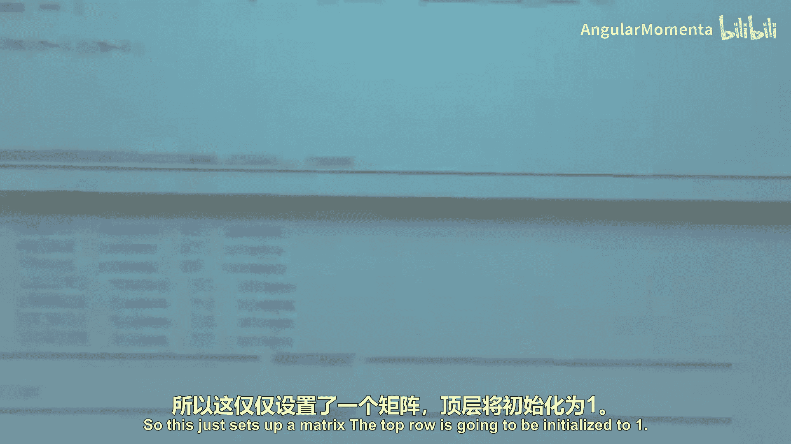

The top row is going to be initialized to one。First column is going to be one。

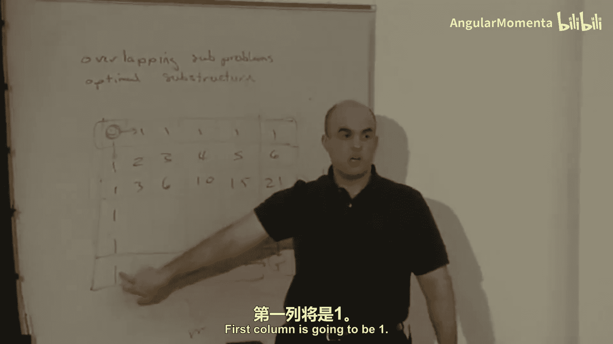

And then for everything else。We're just going to add。The row above。And the column to the left。

And return whatever is down in this lower right corner。So。

Gets the same solution just in a different direction。So。Now。You might want to do this。

Because imagine if instead of 14， we had 1400。So。This should crash。Right。

So Python has a maximum exccursion depth。So if you have too many recursive calls。

 it's going to tell you I can't go that deep。And kick you out。So。I have 1，400 rows and 1，400 columns。

That's a lot of acursion。But if we do it iteratively， where we have no recursion。

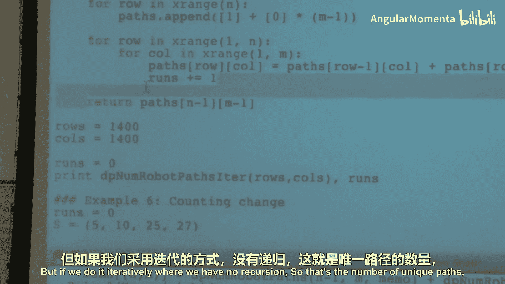

So。That's the number of unique paths。Which is。Pretty sizable number。And。

That's the number of calls you made， which for a 1400 by 1，400 matrix， is not too bad。All right。

So that was an easy one。 So now we're going to go to a little harder one。

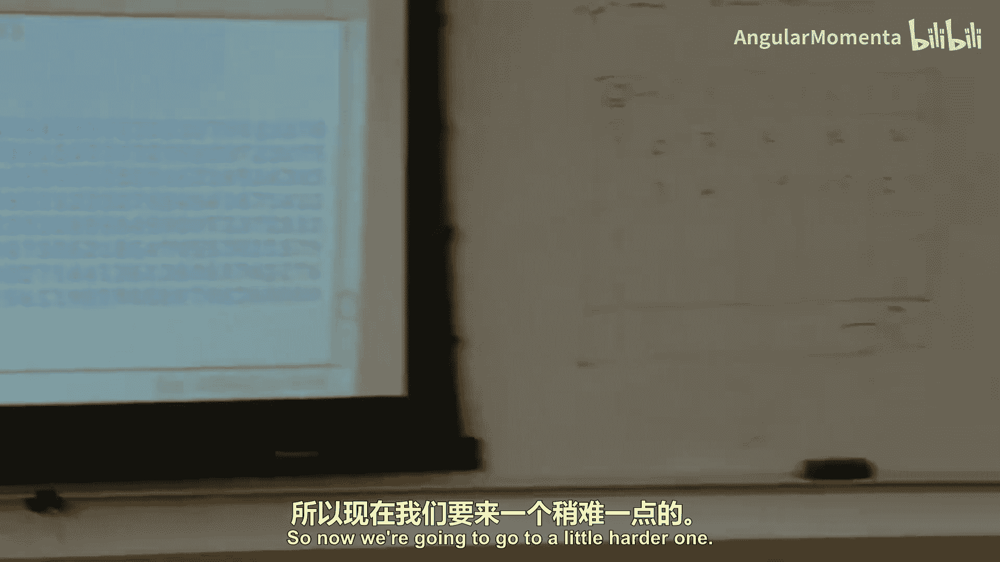

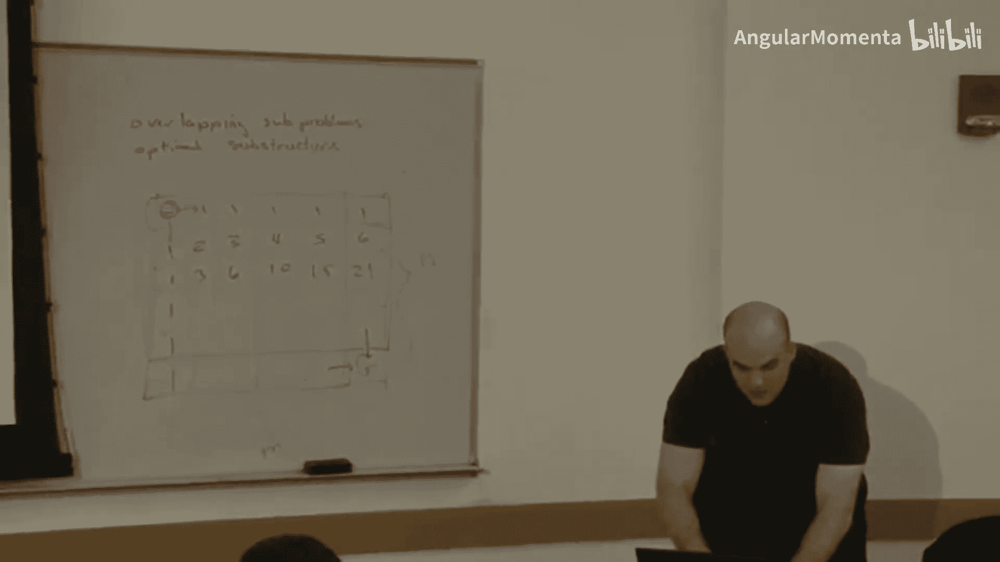

Is everyone doing it right？Okay。This is a accounting change problem。The idea is。

Let's assume I have a currency。With coins of a certain value。I'm not sure where Garthy got 27 from。

That's apparently the value of one of the coins in our currency。So。The problem is。

 let's say that I have some total。

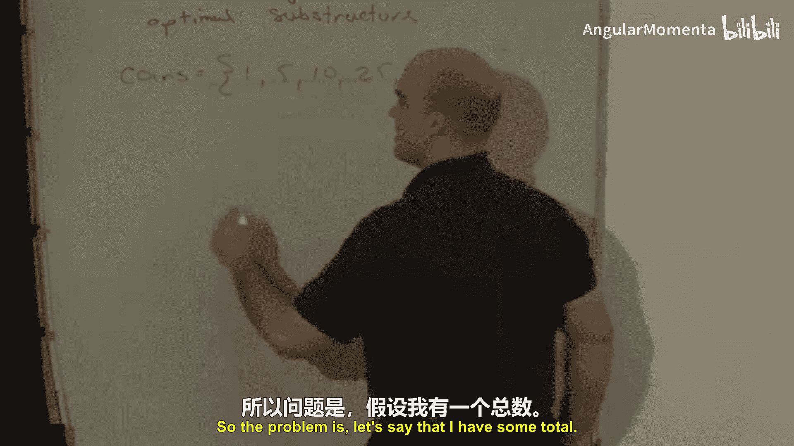

The question is， how many different combinations of coins？Are there that equal total？So。

The way to break this down is， so does everyone understand the problem？

So like if I say I want to give change 41 cents to a customer。

 then it's like a quarter of dime and nickel and a penny， right？So。

We can think of the problem in two ways， well， we can break the problem down into two sub problemsms。

By first considering。What the。Total is what the number。Of combos。Would be。

If I use the largest coin in my set。We're using at least。1。Of the。Largest。Coins。And then the other。

Is。The number。Of combinations。If not using。The largest coinil。Okay。So。

This actually turns into a nicer subproble， which is。If I have total。Minus largest。So in this case。

 minus 27。What's the total， what's the number of？Of combinations。For this problem。Fo。All right。

 and then this guy can be formulated as。The number。I still have total。Number。Of combinations。

But then I take out。The largest coin。So coins us now instead of one。

Instead of having 27 as the largest coin， has 25 as the largest coin。Does that make sense to people？

你。And so the solution。Here to this big problem。Is the solution to or is the sum of the solutions to this problem and this problem？

Make sense。All right。So why don't we take a look at the first version of this？

Problem or this implementation。So we have。Three base cases。So the first base case is。Well， first。

 let me explain the function， so a total， that's the amount that we want。

Coins is a set of coins in our currency。Rightright。And I only have5， 10， 25， and 27。Oh。

The first thing we do is check to see if total is zero。

That means that we're trying to figure out what combination of coins is equal to zero。

 and of course there's only one combination of coins。There are no coins。So that actually is warm。

This case。This is if we're trying a particular coin that's a little too large to fit into our。

Into our total， so we wind up going below zero。That means we can't use that coin for this particular total。

 right？There are no combinations that work for this。And then this last case is。

If we're no longer using， if we have no more coins。

And we still have stuff that we need to make up like we still have。Some value in total。

Then that means that。です。Particular。Combination that we're trying out also doesn't work。

 so we return zero。That's this case where。We've taken out everything。

 so our set of coins is the empty set， there's nothing。Does that make sense？So。

Our first recursive call。Is looking for the number of ways without the last coin。So。That's this case。

And all we're doing is we're passing the total we got before。

And all the coins except for the largest one， so the last one。

 so we're stripping one off for each recursive call。And then the second case here。

Is if we do use at least one of the largest coins。So in this case。

 we're just going to subtract that off of total。And we're going to pass in。Coins as is。Make sense。

And then we just return the sum。So。Okay， so not too bad。Everyone follow that code。Well，All right。So。

This is without doing any memorization， it's just， you know。Using recursion。

 breaking it down into two sub problemss and figuring out a solution。

But now we're going to use dynamic programming to optimize this a little bit。So in this case。

 we have our little memorization dictionary。You notice a pattern here。And。Yeah。You like。Yes。

 so you're assuming that。You have an infinite number of 27 cent pieces， 25 cent pieces， et cetera。最错。

Once。You don't have one。Then it's possible to get below zero。So。Let's see， so this is all the same。

 right？No surprise this there。But then。What we're going to do is we're going to memorize on。

The total that we're trying to find。And the largest currency piece that we have。Right。

 and if it's not。In our dictionary。Then we weren're going to compute them。

But once we get the solution， we're going to memorize it。And return it。So let's see how this runs。

So we at it in by four。Does makes sense to everyone。No questions。Wow。

So now let's try a different formulation。This one's。Li little tricky。

Let's imagine that I have a grid。And down the row， I have。Numbers up to total。Okay。

 starting from zero。Across the columns， I have my different currency pieces。So。

The first two implementations were going top down， now we're going bottom up。Right。

The way you read this is。If I have a total of zero。This is a number。

And my largest currency piece is 5 or 10 or 25 or 27。 the number of。

Coin combinations I have that will equal this total。So in this first row。That's my base case， right？

And then down here， we know this is all going to be zero。Because if I have no coin pieces。

So now the bottom up way is we're going to fill in this table here。

So we're just going to iterate through all。The totals。Better possible。And for each total。

 we're going to iterate through all the largest coin denominations。Right。

And then we're just going to do。To checks。We're going to look at the current total we're looking at。

 so let's say that we're on row1。

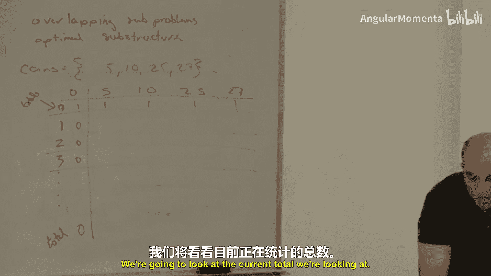

So our total is one。

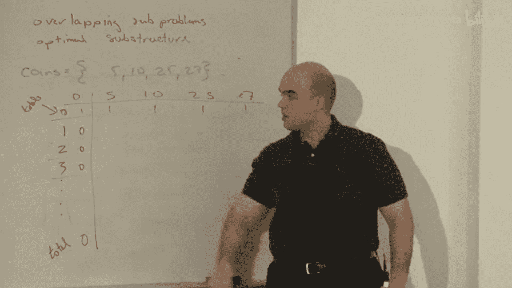

And we're going to subtract the largest。Deenomination of currency that we're looking at。

You start out。Here。Okay， so we're going to subtract five from a total of one。

And that's less than zero。And when it's less than zero， all we're going to do。

Is carry the number of combinations。From the current total。To the next smallest largest nomination。

 So if we're at five。And we know we're less than zero。

 that means we're going to carry this value over。

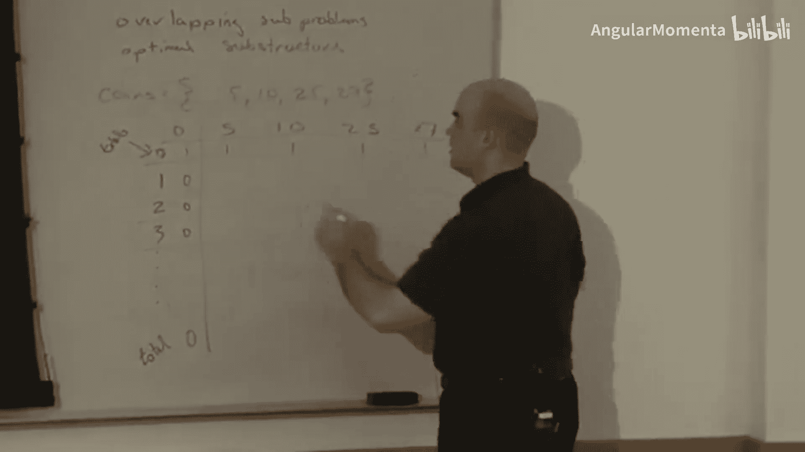

And then we're going to do the same thing for all these values。Now let's get to an interesting case。

So。So now we're looking at a total of five。Okay。When our largest coin。Is five。

And we subtract it from a total of5， that's not less than zero， right？

So that means we're going to go into the second branch of the if statement。So again。

 the same thing we're going to look at the number of ways with。The largest coin。And to do that。

 we're going to use our table。We're going to look at。The current total， which is five。

Minus the largest coin that we're looking at， which is five。

So that's going to index us into this row。Because 5 minus50。

And then we're going to look at the current coin， which is five。So that's going to be one。Wan。Well。

 I skipped a step， so we're going to get this value right。

 so this is the number of ways with this the largest coin。

And then we're going to look at the number of ways without the last coin。

 so if this is the largest coin that we're looking at。Then without it， this is all we have。

So that's going to be zero。So0 plus1 one。And then。For 10。Zou。Again。This becomes hero。

So the next interesting one is going to be 10。Is everyone following so far what we're doing？

So this's going to be zero。This is going to be。1 plus 0。And this is going to be one plus one。

It's making sense。Make an error。Okay。Then this is going to be  zero，0。Everyone want to get the idea。

So we're just filling in this table。

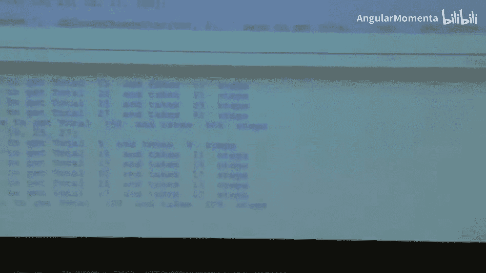

我车。Here。你说。Because I the smallest。Right， if I had one here， like so I was using a one piece。

 then this would be two。But。Because we only have five， there's only one way to make1。Two fires。

Make sense。す。我 show that。Use 110。Yes， exactly。ぜ優先。这方来。We have five is the largest point。哼，所以就送你运你人。は。

他刚才管理这个奥动的话是是。If you have 25 is the largest one， you can use five。You know it。 You're right。哦，还说点。待会。

可以。或者。Yeah， but。咁咪 say。It can be confusing。So。Food that this crazy thing works。That's right。不め。So。

Lets expandp this。use。So all three version。H。So all three versions。But did I make a mistake？系。Oh。

 you like that。Thats。What， like。His code is always。啊。It's a program called Divi。

 if you're interested， I think it's like $10 on the app store or something， or maybe it's$5。It just。

ItAlls you to do those little。Goodid thing， so if you have like lots of windows and stuff。

And if you need to increase your font size， that's a little bit more involved with the Python。Anyway。

 so they all give the same output except for the number of steps that they take。

 so the initial one took 855。The one with the memorization took 209 steps and the one without memorization。

 but from bottom up took only 337 steps。So。嗯。It's just it's three different ways of attacking the same problem。

And。Objectively， the last two are better than the first one。

We might think of cases where we would want to use。

Say the table based method over the recursion method。

 like if we had like lots of combinations to explore or。

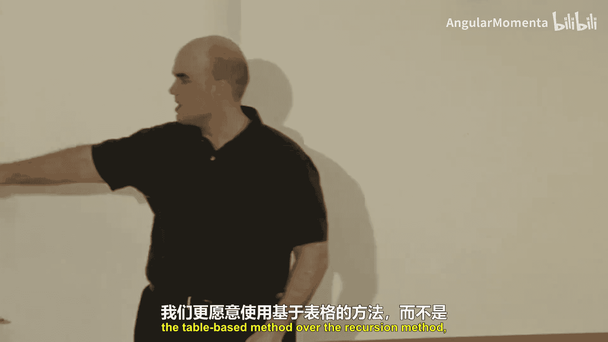

Some kind of situation where we got into a really deep recursion。

That was too deep for Python to handle and we got kicked out like we did for the number of robot pass。

So that would be kind of like a criteria for which algorithm youll choose over to the other。

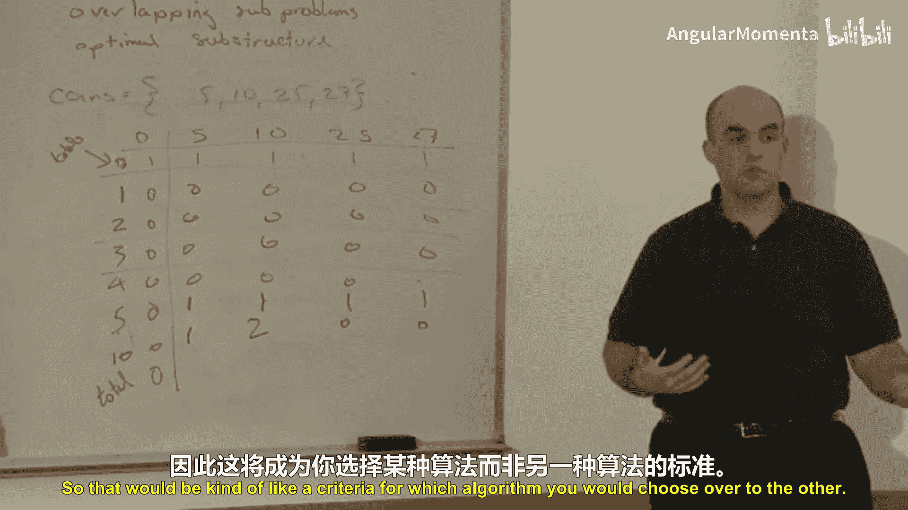