# 【麻省理工】计算机科学与编程导论 ｜ MIT 6.00SC Introduction to Computer Science and Programming p37 37 -BV1a5BZBkEP6_p37-

The following content is provided under a creative Commons license。

 Your support will help M I T Opencourseseware continue to offer high quality educational resources for free。

To make a donation or view additional materials from hundreds of M T courses。

 visit M I T OpenCourseware at O C W。t M I Tt E Du。

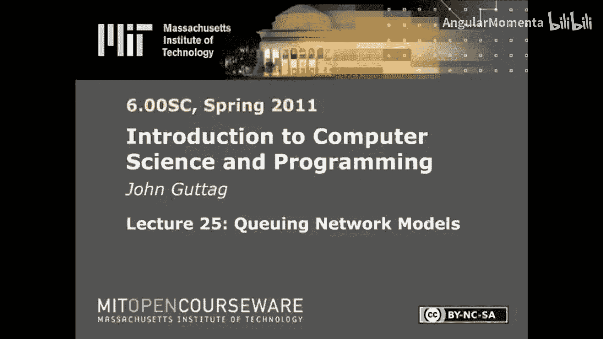

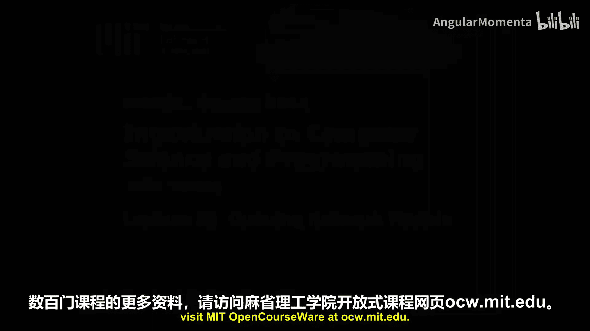

Good morning， everybody。We're on the home stretch here。Only two more lectures， no more recitations。

 And in the small matter of a final exam。嗯。I should remind you the final exam is on Monday of finals week。

 and it will be a two hour exam， not a three hour exam。嗯。

Same kind of format as on the first two quizzes。Open book， open notes。

 The difference is that we'll be giving you some code， which we'll be posting today。

Which we're gonna to ask you to study in。Preparation for the exam。

And then we'll ask you some questions about that code。 For example。

 ask you to make a small modification to it on the exam。And in fact， today's lecture。

Just as a special incentive to pay attention will be about things related to the code。

 We'll be posting for you to study for the exam。It covers one final class of simulation we haven't looked at at all this term。

But I think it's important to at least know。A little bit about it。

 And those are queuing network stimulations。From the time of conception until death。

Human beings find themselves all too often waiting for things， waiting for events。

 waiting for conditions， waiting for T As， etc。Quuing networks。

Give us a formal way to study systems in which waiting plays a fundamental role。

Some typical examples might be in a supermarket waiting to check out， you get in a queue。

Wait your turn。Computers all the time。 You may wonder sometimes why when you hit your computer and ask it to do something。

 sometimes it's fast， sometimes it's slow。Well， it's because there are a tasks running in the background that are ahead of your task and a queue。

 and you're waiting for them to finish。Computer networks。Waiting for arrivals and things like that。

 If you look at the internal structure， the Internet。

As say an email hops from hither to yawn between two sites along the way it enters queuees and waits for its turn to get forwarded to the next top。

A few of you have experienced this when you go to office hours where there's a wait for T A and you get in a queue。

Public transit。Analysis of highway systems， all of these things。

Depend upon understanding cues to understand how they work。You might wonder why we have cues。

 The answer is pretty simple in that it typically makes economic sense。As we'll see in our analysis。

When resources are limited， particularly， say servers。

It makes economic sense to have jobs line up for service。So if you think about a supermarket。

 ideally， when you go to check out， you'd like there to be no line。

 but think about how many cash registers they would need to ensure that all the time when someone was ready。

 there was no line。And the problem is， if they did that， they would have idle servers。

And so they would not get very good resource utilization。

Of the people they would be hiring to do the checkout。In designing a system with cues。

 and that's what the simulations help us do。We're aiming for a balance。Between。Essentially。

 customer service。And resource utilization。The organization paying for the resources。

Would like them to be working 100% of the time at full capacity。 So there's no wasted expense。

On the other hand， it's easy to show in any reasonable system。

That if you have 100% resource utilization， you're going to be providing terrible customer service。

There is always a need for excess capacity in a complex system in order to provide adequate service。

 most of the time。And that's because， as we'll see。

 the demand for service is probabilistic and unpredictable。And。In order to observe。

 absorb bursts of activity， you need excess capacity。Because a lot of the time。

 you don't see those bursts。All right。All that， by way of introduction。

If we think about how to model a system with cues。They're all modeled essentially the same way。😡。

You start with some jobs。Work to be done。Those jobs enter a queue。They wait around for a while。

They leave the queue one at a time。And enter a server。And then they depart。Alright。

 so that's what it looks like。 And， of course， it can be much more complicated than this。

 You can have multiple streams of jobs。 You can have multiple queuees。 You can have multiple servers。

But when we build an analysis of it， when we build a simulation。

 we typically break it down into components that look exactly like this。And use that as the key。

As we do this。We have to look at a number of different things。We start with the arrival process。

How do the jobs appear？And there are lots of questions we can ask。Do they arrive singly or in groups。

If they arrive in groups， we say that it's a batch process。So if you think about a service for， say。

 processing。Students at M I T into the database， they typically arrive in a big batch in September。

Rather than straggling in one at a time。嗯。We have to ask related to that。Is how arrivals。

Are distributed。In time。Assume for the moment that arrivals are one at a time。 for example。

 automobiles entering a highway。U。Did they come uniformly。At evenly space intervals。

Do they come at random times if random is there a time of day when we see most of them。

We typically model all of that。😡，In what's called an inter。Arival， time distribution。

The simplest process is where these things do arrive at regular intervals。Constant intervals。

 We hardly ever see this in， in the real world。Most of the time。We see something。

It looks much like our old friend of the Pois zone process。The things arrive at a random interval。

But they are typically exponentially distributed。We've seen this before。Okay。It is。

 as you will recall， memoryless。It is， as you will recall， described by a single parameter。

The average arrival rate。We can look at it just briefly to see what it looks like。

Just to remind ourselves， really。So I' have just a small piece of code where I've given the mean arrival。

And then I'm going to just have 2000 things arrive at Poso intervals。All。Why is it not running。

I cleverly rebooted before I got here。 so it shouldn't have had any problem。There it is。嗯。Allright。

 so thats really should be。Anyone remember what this calls？Right。And so， we'll see。

That we have exponential arrival times。A rapid decay， only a small tail out at the。

 the right in this picture and a big cluster near the mean。We can look at this in a different way。

 if you look at the scatter plot。And you'll notice that we've given it a mean of 60。

 the dark blue line。But we seem to have an awful lot of points below the mean。

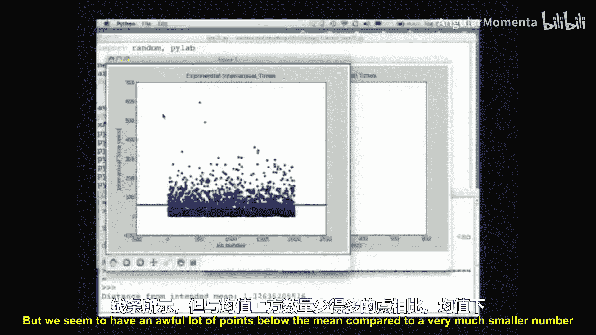

Compared to a very much smaller number of points above the mean。Why is that。In fact， inevitable。

In this situation。对。Does there's， there's less space。Because there's just less Facebook。Well。

 there's less space and the reason that there's less space。

Is we don't allow things to arrive yesterday in negative time。

So the smallest inter arrivalval time is just epsilon， more than 0。

So the time between jobs can never be less than 0。And so。If we want。

 and we're going to have a few way out here that take a lot longer because that's the nature nature of an exponential。

So we're gonna have to have a bunch down here to counterbalance the few way up here。

We can only get 60 below the mean in this case。 And you can see we here of over 500 above the mean。

So it's going to always look like that。Which is why。

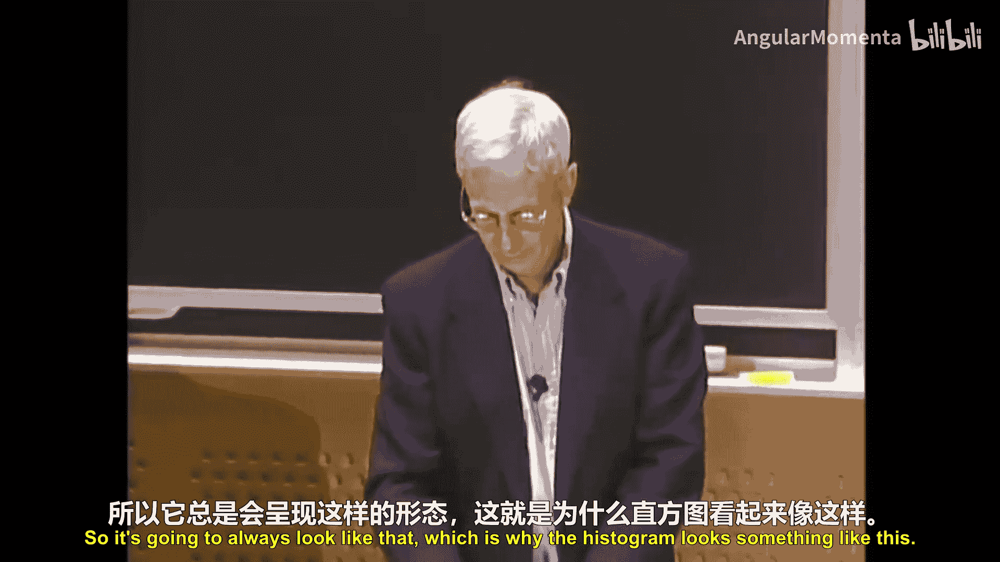

The histogram looks something like this。So you'll observe that as you look at these things。

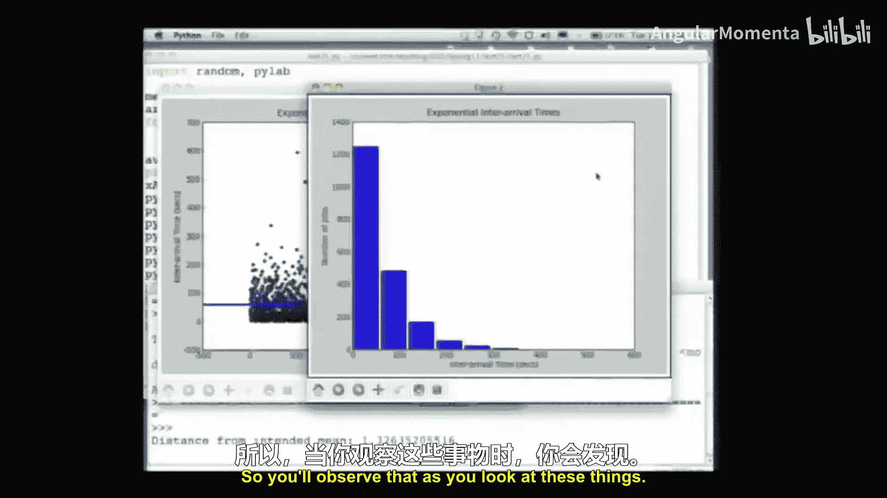

All right， that's the arrival process。We also have to look at the service mechanism。

How does the server work。Again。We can ask some question， like。How long will it take。

To provide service。And this is called the service time distribution。This depends on two things。

The amount of work， the job to be served entails and the speed of the server。So again。

 you've experienced this， no doubt at the supermarket。

 where if you get in the wrong line where there's a very slow person running the cash register。

Even though the jobs are small， it takes forever because there's a slow server。Or alternatively。

 you've gone behind a line， not noticing that the person in front of you has two shopping carts full of junk。

And so even though the server is fast， it will take a long time to service that job。

The number of servers certainly matters。An important question。Is。The number of cues。In particular。

 does each server have its own queue？😡，Which is what you see at the supermarket。

Or is there a single queue for many servers。Typically， what you see if you are checking in， say。

 in coach class at the airport。Or lining up for security at the airport。Which of those is better。

 do you think， which provides。On average， better service， multiple cues are a single cu。Single queue。

 right。Is much better。In fact， it's easy to construct a proof while it's better。

Which is why we now see them typically at places like banks and airports。Didn't used to be。Initially。

 people didn't understand this was better， and they would have multiple cues。嗯。

Why don't we always have a single queue。Because。We may not have enough space。So you can again。

 imagine at the supermarket， there'd be no place to put the single queue for all of the cash registers。

 maybe。And another question we have to ask is whether or not we allow preemption。

In some queuing systems， a server can stop processing a customer to deal with another emergency customer。

In others， once a job is started， it has to run the completion。And again。

 you get very different performance depending upon whether you allow preemption or not。

An important part of the architecture is， of course。The characteristics of the Q itself。

The fundamental question is the policy。😡，How from the set of customers waiting for service。

 do we choose the customer to be served next。So， a very common policy。Is FiO。Stands for first in。

 first out。That's the one we see most of the time in a lot of physical situations。

 whoever gets in line first， gets served first。There are some situations。Where you do last in。

 first out。Who's ever arrived most recently get served first。

A very popular one in many computing applications。Is what's called SRPT。Which is short for。

 shortest remaining processing time。Take whichever job。You can complete fastest。

So these are the three most popular policies。 You can also imagine a random policy where you just chose some random member of the queue。

Then there are lots of other kinds of issues， which I， I won't go into in detail。

Choice of queuing discipline， as we'll see when we look at the code。

Can have a major effect on performance。In particular， it can be used to reduce congestion。

We'll often see， in practice。This one。Now why might that be a very useful practical method。Well。

 it's got one obvious feature。If。The available space for the queue is small。

By taking the ones you can finish fastest。You reduce the average number of elements in the queue。

Could you get to process more customers by taking the customers that you can process quickly。And so。

 on average， there will be fewer customers in the queue。And so， it reduces congestion。

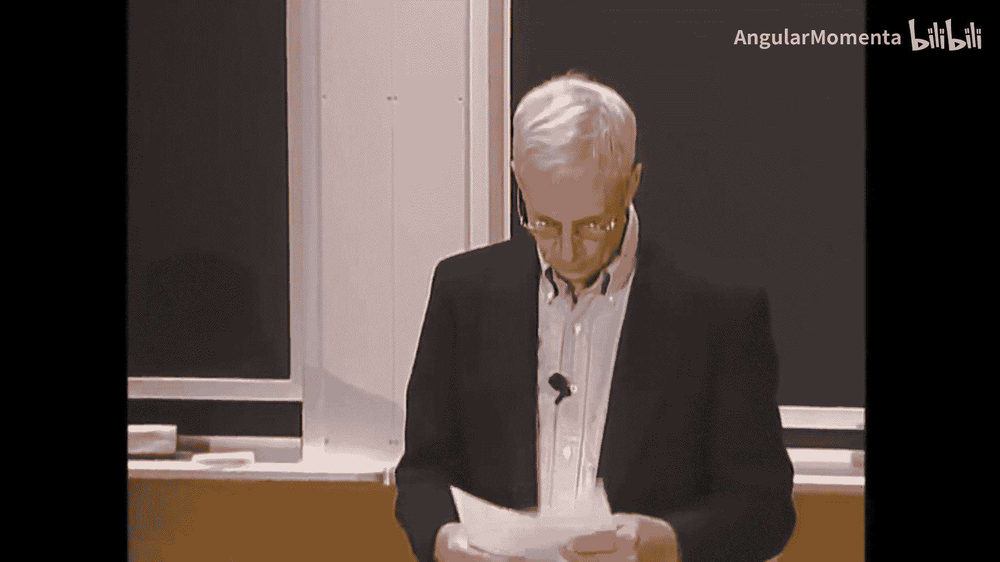

As we'll see， it also improves。Expected service time。So it， it is。An excellent method。

When we talk about queuing networks。What we're going to see， and I hope I've implied this already。

Is that probability has to play a fundamental role in understanding them。Because there's randomness。

There's randomness in the inter arrivalrival time， and there's typically randomness in how long each job will take to process。

What are the questions we might want to ask about a queuing system to see whether we've designed it properly。

An important question is the average waiting time。On average。

How long does a job wait between the time it enters the queue and the time it leaves the queue。

Now imagine that you're waiting for the M I T shuttle bus。

 How long do you wait before you get on the bus， on average。You can also ask once the job starts。

 how long to complete。We can also ask。Is the waiting time bounded？

So this is a different question than how long you should expect to wait on average。

It's what's the probability of your not having to wait longer than some upper bound。

So you can imagine that if you were working for。Some company that， for example。

 sold products over the telephone。You might want to put a bound on how long a customer would wait before their call got picked up。

And。You do some analysis saying if people have to wait longer than three minutes。

 they hang up the phone。 And so we'll have enough servers that rare。

 It's only rare that someone has to wait more than three minutes。

It's a different question than how long people have to wait， on average。

We've already talked about the average Q length。And by analogy， we can also ask about the bound。

Found。On Q length。You can imagine if you're designing a router for the Internet。

You need to know how much memory to allocate for the cues of jobs so that you don't run out。

 It's not infinite。So there's an upper bound on how long you'll let the， the queuees grow。And。

 finally。Along a different dimension。Is something we've already talked about， server utilization。

What is the expected utilization of each server？In sense of what is the expected amount of time it will be fully occupied。

Remember， servers cost money。So keeping them busy is important。If we can assign relative cost values。

😡，To each of these things。We can then build a system that will let us do an analysis and build an optimal system。

Decide how big the queuees should be， how many servers， how fast they should be。

 Do the analysis and design a system that meets some optimization criteria。

So now we need to investigate these things。Two basic methods， as we've discussed before。

 are analytic。And indeed， you can get books on analytic queuing theory， really thick。

 hard to read books。 I might add。That give you complicated formulas for deriving these kinds of things。

In practice， they're hardly ever used。Because most systems are too complex to actually model analytically。

So in fact， today， most queuing network systems are analyzed using simulations。

The kind of event discrete event simulations we've looked at earlier in the term。 All right。

 now I want to look at a particular example。And see how we can build a simulation that will let us answer。

These kinds of questions about a particular example。The example is a， and again。

 this is the one that you'll be asked to look at。Is a simplification of the M T shuttle bus system。

So as I'm sure you all know， it runs in a loop。Dropping。

 picking up students and dropping them off at some number of stops。For legal reasons。

 each bus has a maximum capacity。Often exceeded。 I'm in practice。

 but there is officially a maximum number of people allowed on a bus。

And it takes a certain amount of time to go around the loop。嗯。The obvious question to ask is。

 how long。Should a student expect to have to wait for a bus at a particular stop to get picked up。

And what should M T do to， depending upon whether it's feeling benevolent or not。

 minimize or maximize the waiting time for the bus。All right。

Most of the code we're going look at now is on your handout。

 I should say I've deleted the obvious part so I could fit it on the handout。 However。

 we'll be posting the code on the Web today， a dot pie file that you'll be able to study and。

More importantly， probably run it。All right。Let's start。So as usual， in designing a piece of code。

 I began with some useful classes。

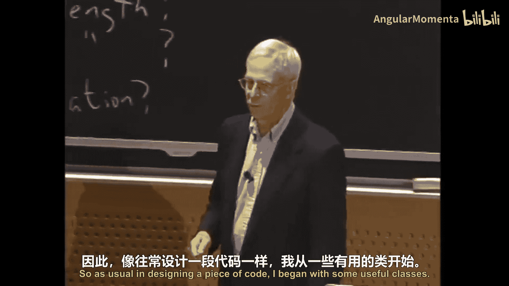

You won't be surprised that the first class I looked at was class job。啊。So what is the job。A job is。

Depending upon the mean arrival and the mean work involved。

And I've chosen to model arrivals as exponential。And I've chosen to model work as a Gaussian。

Nothing magic about this。 And， in fact， I played with various other models。

 What would happen if the work were uniformly distributed or exponentially distributed。 And。

 of course， you get different answers。😊，I said next two attributes。

 there is actually only one attribute here。And this is going to keep track of when a job enters the queue so that we can tell how long it had to wait。

And then there's the inter arrivalval， the work， the queue， the queued time， etcter。 All right。

And then I'm going to model a passenger as a job。 You'll note this is kind of a boring class。

 All I've done is say， pass。Because I'm not adding anything new。I am giving it a different type。

 and it gave me a place to put the comment here。That the arrival rate corresponds to passengers to arriving at a bus stop and work is the time that takes a passenger to board the bus。

There are many other things I could have done for work。 I could have made it multidimensional。

 having to do with how long to get on the bus， how many stops， etc。 For simplicity。

 I'm just assuming that there are some agile people who just get on the bus quickly。

 and there are some people who are a little bit slower who might take a longer time to get on the bus。

And that's it for jobs。Pretty simple， but pretty typical of the kinds of things we see。Then。

 we come to。Accus themselves。The root class is just the job queue。Jobs can arrive。

 and the queue can have a length。You'll note that I don't have any way for jobs to leave the queue in the base class。

And that's because I'm the subclass said and each subclass will be distinguished。

By the queuing discipline it's using。And thequeuing discipline。

Typically has to do with how jobs leave the queue。So there's a fiIO discipline。Pretty simplistic。

 It just removes the first item from the queue， and returns it。Rises an exception， if you try and。

Remove something from the queue when there's nothing there。And SRPT is a little bit more involved。

But， not much。

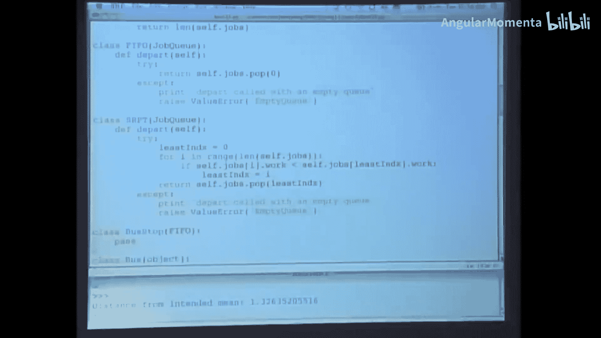

I've not tried to be clever。 You could imagine a much more efficient implementation than the one I've got。

But here， each time a job needs to leave the queue。

 I just search the queue to find one of the jobs with the least amount of work。And I remove that。

That's why I'm。Searching with the index here， because pop lets me remove something from a list at a particular index。

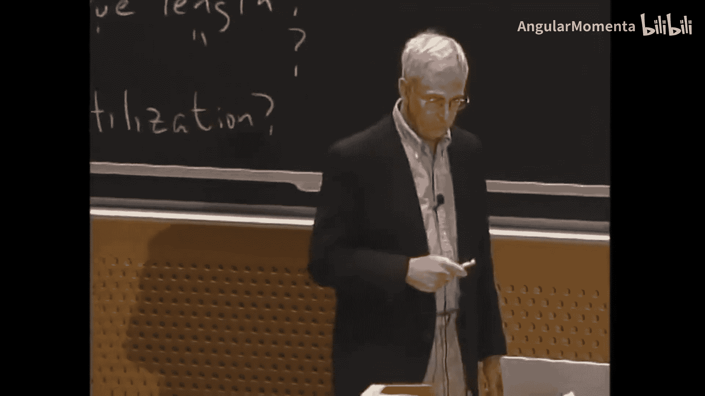

And then finally， I have another simple class bus stop。

And the key thing here is what it's a subclass of。

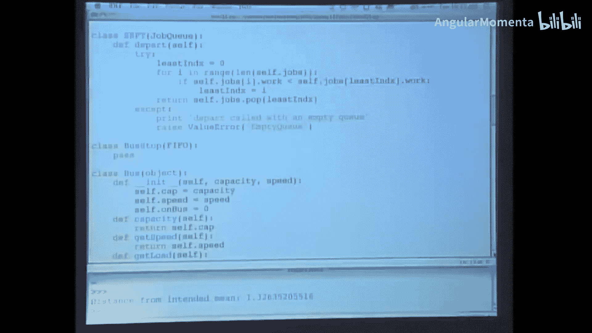

Initially， I'm choosing it to be a subclass of PIO。Later。

 we'll see I could make it a subclass of SRPT or， in fact， anything else I chose。

But this gives me a convenient way to。Decide what queuing discipline。 I'm going to use at。

 The bus stops。So I mentioned earlier that SRPT is nice because it allows us to reduce the size of the Q。

I also mentioned。That it's typically optimal in the sense of producing the shortest average waiting time。

So， let's think about why。Imagine。But we do the opposite。This is a good intellectual tool。

 Just think of the opposite。 Suppose we always took the longest job first。

What would that do to the average waiting time。If， say we had a job that took 10 minutes。

And a queue with。10 people in it。Well， while we were waiting for that one 10 minute job to get on the bus。

The other nine people would each have to wait 10 minutes。9 times 10，90 minutes of waiting time。

Not very good， right。Now， suppose each of those9 jobs only took one minute。Well。

 the first job would wait 0。 The next job would wait one minute。 The next job would wait two minutes。

And even the longest job would only have to wait 9 minutes before it started。

 So the total amount of time spent waiting would be much less。

So we can see that by using shortest remaining processing time。The waiting times are reduced。Now。

 with the bus example， it's a little bit strange。In that， yes， you'd get on the bus。

 but maybe the bus wouldn't move at all while it was waiting for that last person to get on。

But most queuing disciplines， imagine you're in the supermarket。

You don't care how long the guys behind you take As soon as you get to the front and you get processed。

 you get to leave the store。So， in fact， a supermarket would， on average， have happier customers。

If it followed shortest remaining processing time and always took whoever had the smallest。

The fewest number of items， first。Why。Don't they do that or why is not SRPT always used in practice。

It's got one glaring problem。 What's that problem。It doesn't seem there。It's not fair。

And this is actually a technical word。People talk about fairness of acuing discipline。😡。

And in particular， it's so unfair。That it。Allows starvation。Another technical term。

Imagine that you're the person with the 10 minute job。😡。

And there's a continuing stream of people arriving with one minute jobs。

You never get to get your job processed at all。You just sit there and you wait and you wait and you wait。

 And in fact， you wait forever。In the bus situation。

 imagine you're the person who's in a wheelchair and takes 10 minutes to get on the bus。嗯。

And people keep arriving at the bus stop。 Well， before it gets to be your turn。

 the bus is full and it leaves。You have to wait for the next bus。

 but people arrive while you're waiting。 it arrives again。 You don't get on。And you never get on。

 This is technically called starvation。And it's a problem that SRPT has。So typically。

 if you're using that as your scheduling algorithm。

You've got to put in some sort of a priority on top of it。

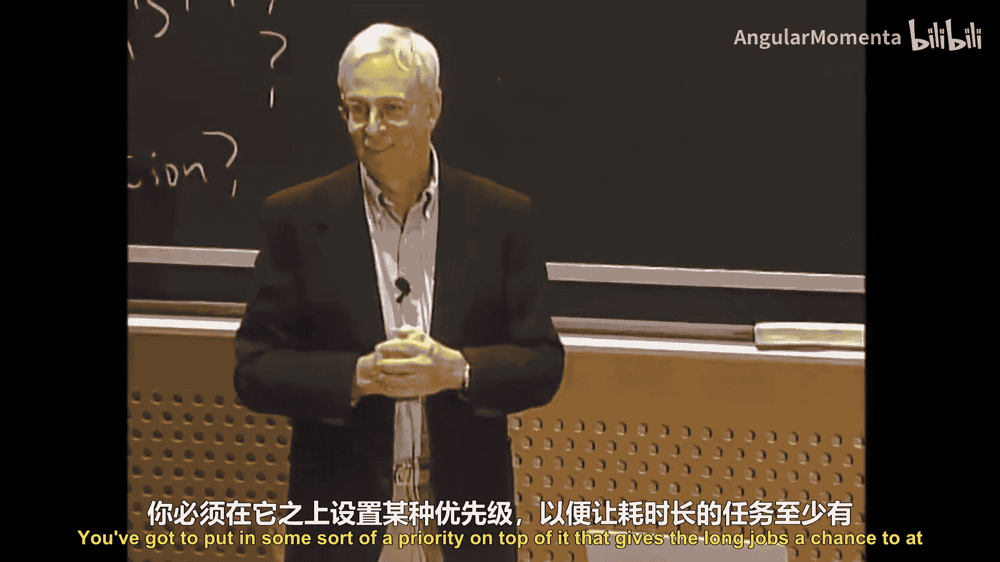

That gives the long jobs a chance to at least run once in a while。

And there are lots of different disciplines for doing that。Alright。

 let's continue looking at the code。So， now， we've got。But bus stops， which were queues。

 We've got jobs。Well， we're going to have our server。And in this case， our server is a bus。

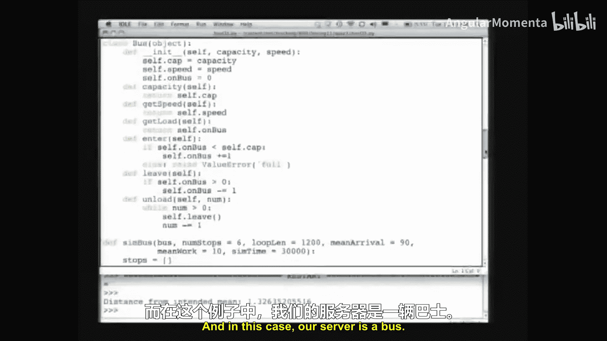

Every bus has got a capacity。The number of people it's allowed to hold and a speed。

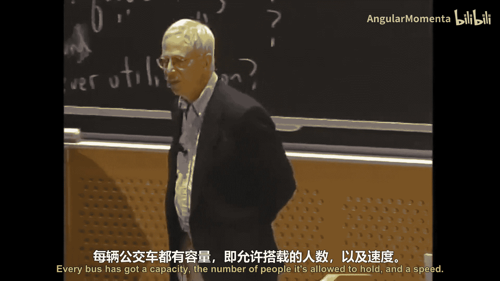

The speed has to do with how fast it goes from stop to stop。And for simplicity。

 we're going to assume that this depends only on the bus itself， not on the traffic。

Not true in Cambridge and Boston， of course。But we can't get everything in a code that we can get through in one lecture。

So it's got a capacity。 It's got a speed。And then we can keep track of how many people are on the bus。

It's got an enter。Which has to do with people getting on it。And it does that until it's full。Then。

 it raises an exception。And。Things can leave the bus。And there's， here's the interesting method。

 Unload takes a self。And the number of。To unloaded from the bus。And it just calls self dot leave。

Over and over again。All right， those are our basic classes。Nothing too sophisticated。

 as is often the case with classes， the code is straightforward。

And now comes the not so quite straightforward code， which is the actual simulation itself。

Probably the most important thing to understand in looking at this code is the arguments。

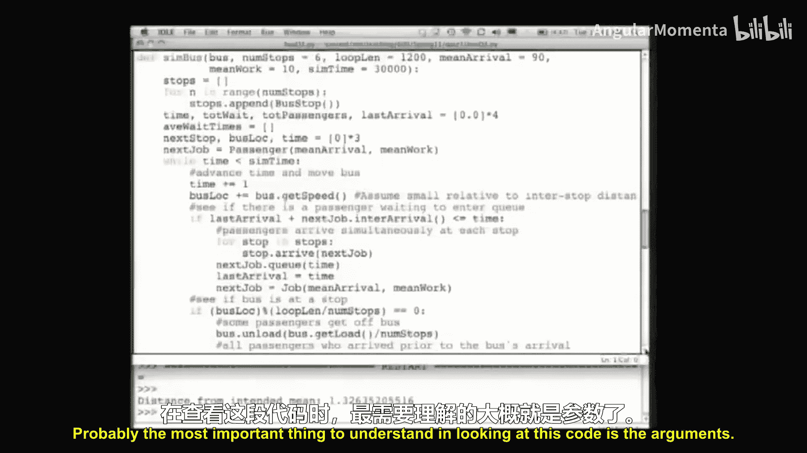

This will sort of tell us what the simulation depends on。So there's going to be a bus。

So notice we have only one bus。So， again， I've simplified the simulation instead of having a multiple。

Busees running around the loop。 We're gonna to assume you just gotta wait for that first bus to get back。

Later， we can talk about what would be involved in having multiple buses。

The number of stops in the loop。The loop length。 And for simplicity。

 I'm going to assume that the stops are equally spaced along the length。

The mean arrival rate of jobs。The mean work per job。

 And then how long we're gonna run the simulation。Roughly speaking。

 I'm using the same unix for the simulation time， and the loop length。

So this would tell us if we simulate for 30000 times and the loop is this 1200。Time units long。

How many times around the loop we could get and how many stops the bus would make。All right。

And then comes the body of the simulation。啊。So the first thing， actually。

 let me write up some pseudocode here to basically show you the way。Way it's structured。嗯。Yeah。

 I think we'll put it over here。So the first thing we do is we create the stops。

And we initialized some variables。That we're going to use to keep track of performance。

We then entered the main loop。Which is essentially， while time not expired。

That has to do with how long we're going run this simulation。We move the bus。

So the loop will go through one time unit， each iteration。At least it looks that way initially。

So we'll move the bus that amount of time。So then while we're doing it。

Passengers will arrive at the stops。Then we'll see when a bus is at a stop。

Has it driven long enough to get to the next stop。And when it's there。

We'll unload some passengers first。And then we'll load some passengers。

And then when we're done at the very end。Willll compute some statistics。

So that's the overall structure of the simulation。Then we can put that in something outside it that tells us how many simulations to run and get yet more statistics about aggregate。

All right， now working our way through the code。

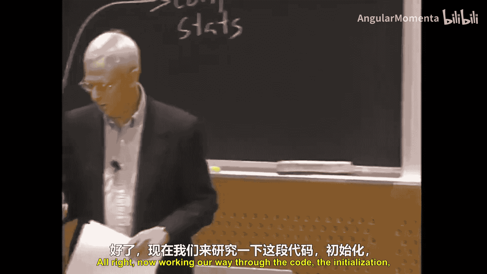

The initialization， while time less than sin time。Advanced the bus。 Advance time。Move the bus。

 Now how far we move it depends upon how fast it is。So we'll just add to the bus location。

 However far it's allowed to move in one time unit。I don't care whether the time unit is seconds。

 minutes， hours， days， whatever。 just it has to be all consistent。啊。

Then I'll see if there's a passenger waiting to enter the queue by checking the arrival time。

And passengers can arrive simultaneously， at each stop。

I apologize for leaving the comments out of your handouts。

 but I couldn't squeeze it onto the page with the comments。Whats。Then here's the interesting piece。

 So we， we do this。 We're just having passengers arrive。Based upon。The characteristics of jobs。

See if the bus is at a stop。If the bus location。Divided by。The inter stop distance is equal to 0。

 So it's actually at a stop。I'll do my unloading， etc cea。Now， down here。

You'll notice that I up here， I had this assumption。

That the speed of the bus is small relative to the inter stop distance。This assumption is important。

Because of this statement。If the bus were moving too fast。It might skip over the stops。Now。

 this is kind of a clumsy trick I've used here。嗯。It has to do with it being small。

 It has to be doing with each movement of the bus being， in fact。

 an integral of the interstop distance so that you don't skip over the stops。In a real simulation。

 I would have done something much more careful。To deal with the not missing stops。 But again。

 I wanted to make this relatively simple。 So I'm gonna jigger things so that。The speed of the bus is。

Evenly divides the inter stop distance。 So when I advance the bus， it never skips over a stop。O。

 it's just a trick， not a very elegant trick， but it。Keeps things working。Allright。

 then I'm going to unload。Some fraction of the passengers。 Now， again。

 in a more realistic simulation， I'd be keeping track of what's the average distance a passenger wants to travel。

And I would have， in fact， made work two dimensionals。The amount of time to get on the bus， plus。

How far the passenger wanted to travel。Again， here， I've done something simple。

 I've just assumed that。A fraction of all the passengers get off at each stop。

 and the fraction depends upon how many total stops there are。

We can still understand most of the interesting aspects of the problem。

 even with all of these simplifications。And that's an important lesson。Every simulation。

Is a simplification of reality。No simulation is ever a perfect model of reality。

No model is ever a perfect model of reality。What we typically do in build a simulation。

Is simplify it enough that we can get it to work。But not so much that we cant answer the questions we want to answer。

And so I've made a lot of these simplifications， but they will still allow us well。

 maybe not to get precise answers about the impact of various things。

 to understand how things relate to each other， the relative impact。Various design decisions。

All right。If the bus is at a stop。As I said， some passengers will get on， get off。嗯。

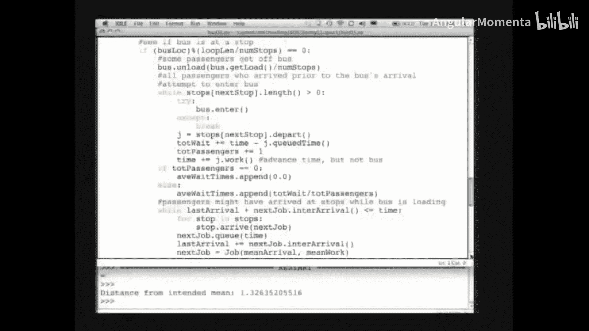

Passengers that are already at the stop will try and get on the bus。

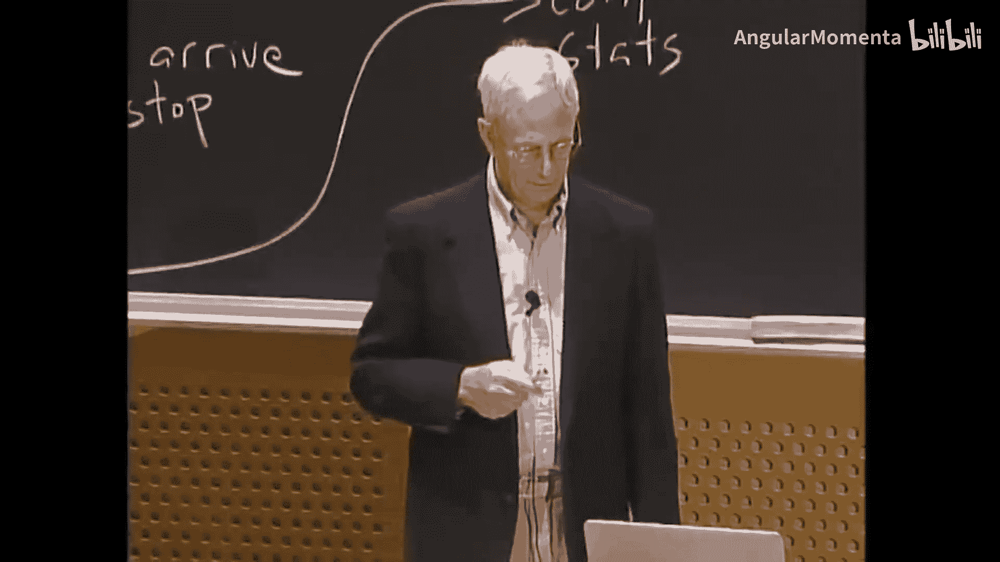

嗯。We'll have to advance time。Because。Time starts to run out as people are getting on the bus。

 even though the bus is moving。 But， of course， even though time is advancing， the bus is not。

 So we have to model that the impact of loading times。And， in fact， in mass transit systems。

 it turns out that loading time is a very important parameter。In many urban systems。

 subways will spend more time at stations getting loaded than between stations。

Moving to the next one。If the stations are dense， you may have noticed this on the green line。嗯。

So we have to make sure we model that。 And then， of course。

 since the bus could be at the stop for a while， passengers might arrive while it's at the stop。

Then we can keep track of the number of people left waiting when the simulation ends。

And do things like that。 All right， finally。There's this program test。

Which I won't go over in detail。 It's exactly like the drivers we've written for other simulations for at least half the semester。

In which I run symbols multiple times， accumulate results from trials， and then。Plot them nicely。

Allright， let's run it。So I'm going to run it with。

I've actually written it so that I can look at combinations of speeds and capacities。But first。

 I'll just look at small combinations。 I。e。 each list will be one。

So we'll test it with a capacity of 30 in a speed of 10。To 40 trials。

Then we'll test it with a capacityity of 15 in a speed of 10， and。A capacity of 15 and a speed of 20。

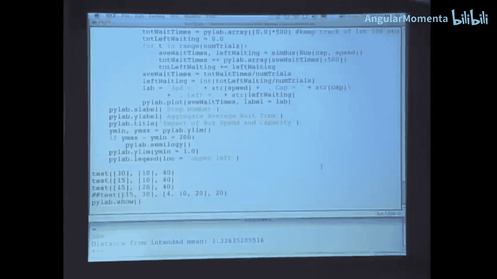

All right， we have some results。So what we can tell， looking at the。

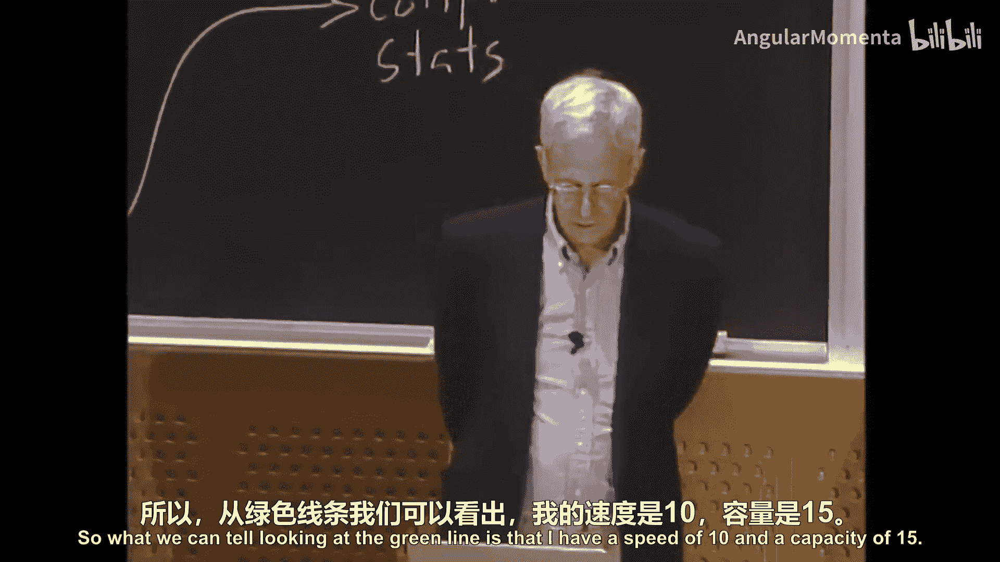

Greenline。Is that I have， I have a speed of 10 in a capacity of 15。第2。Agregate， average wait time。

Is long and apparently growing。The longer I run the simulation。

 I've only plotted here up to the first 500 times the bus stops at a stop。

 But we can imagine that if I went further， it would just get worse for a while。

Then it will eventually plateau。But it will take it quite a while to do that。嗯。

And here we can see the interesting thing in that the blue and the red lines。Are not very different。

So what this tells us is there's a trade off。I can afford to have smaller buses。

If I make them faster。Or conversely。If I want slow buses， I have to make them bigger。

And I get more or less the same average wait time and not much difference in。

 in how many people are left behind at the end。Clearly， here， I have a big number。

 These are smallish numbers。Again， we'd have to run it longer to see。

Whether these are stable and with different seeds or different random numbers to see whether or not the fact that this is 80 and this is 40 is statistically significant are just an accident of this run。

 because we do have randomness。But we did do 40 trials。 So maybe there's a reason to believe that。

 in fact。This is slightly worse。You'll notice also。

 the blue line doesn't quite get all the way to 500。

Which means that slow bus didn't get to make enough stops。

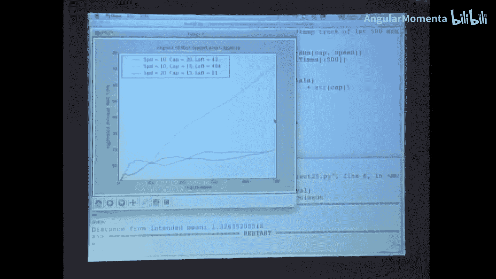

Took a long time to load up because they had big capacity and didn't really get to all of the stops。

All right。Let's try another experiment。And let's go change the queuing discipline。

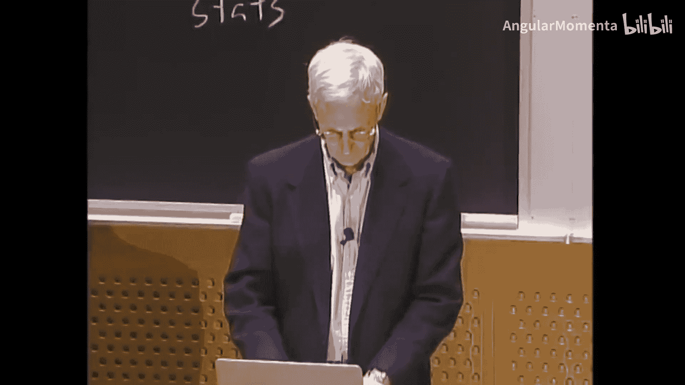

Go way back up here， and let's make it S RRPT。And see what we get。Well。

 we get something pretty different。In particular， you'll note that the。Average wait time has dropped。

 rather significantly。It really has， as the theory predicted。LED to improved wait times。

We'll also notice that it's got some interesting shapes here。Where it jumps around。

 goes up almost a knee here。

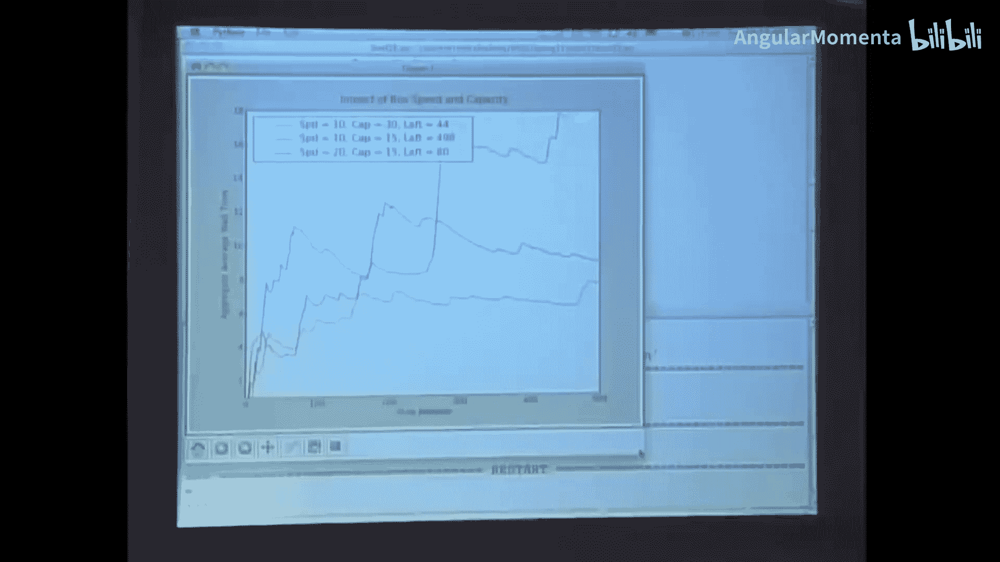

And we might try and understand。 You might try and understand why it's doing that。

 As you look at the code。 Is it random， It just bad luck， Is there something fundamental going on。

 Think it all through and， and decide。What's going on。All right。Finally。嗯。You know， and again。

 I suggest you play with this with a lot of different combinations to get a sense of what the code is doing。

So one last queuing network question to test your understanding。Different question。

 Suppose you were given the job of hiring a 600 lab assistant。

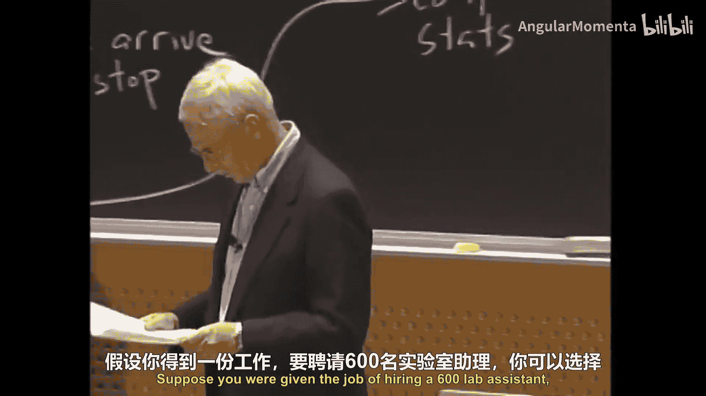

And you had a choice between hiring an M I T student at $15 an hour。Or two Harvard students at $7。

50 an hour。Suppose further that the M I T student could deal with twice as many problems per hour as the Harvard students。

Does it matter which you hire？Well， you could build a simulation。

 and you would discover that in your queuing network， it didn't matter。On the other hand。

 when you ran it in real life， you would probably discover that it mattered a lot because the M I T student would answer questions correctly。

And the moral is， thequeuing network does never tells the whole story。

 You've really got to think about the thing in more detail。 All right， one more lecture。

 See on Thursday。

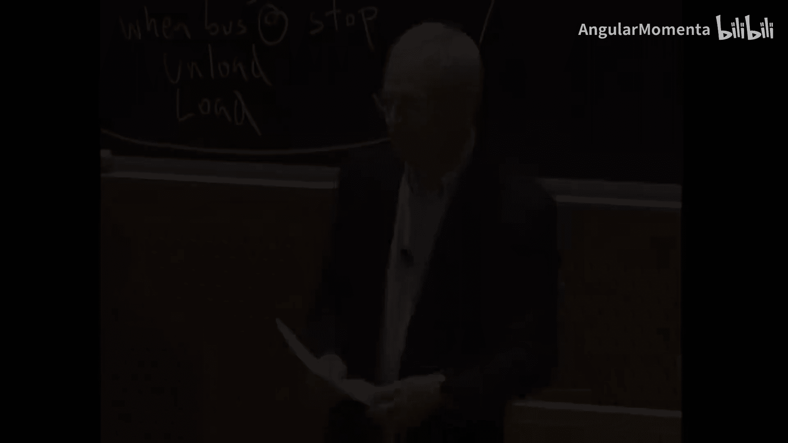