# 【麻省理工】计算机科学与编程导论 ｜ MIT 6.00SC Introduction to Computer Science and Programming p38 38 -BV1a5BZBkEP6_p38-

The following content is provided under a creative Commons license。

 Your support will help M I T Open Coseware continue to offer high quality educational resources for free。

To make a donation or view additional materials from hundreds of M T courses。

 visit M I T OpenCseware at O C W。t M I Tt E Du。

Now， today's lecture。

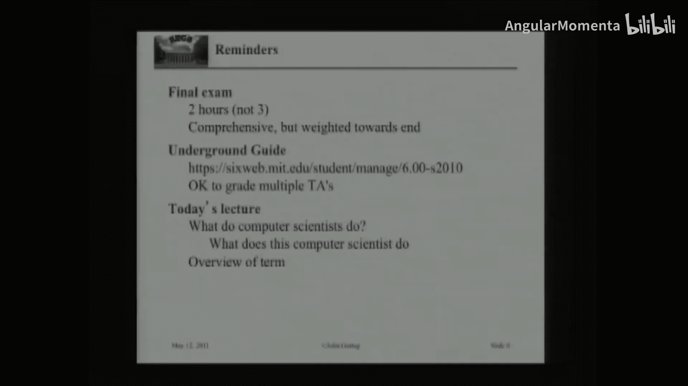

First， I want to talk a little bit about what computer scientists do。

 This whole course has been about computer science。And I hope that at least for many of you。

 it might have persuaded you that there's an interesting career out there for you as a computer scientist。

 and then I'll finish up with an overview of what I think we covered this term。

So what do computer scientists do， Well， they look a lot like that， as you all know。嗯。In fact。

 it's amazing。Theres almost nothing that computer scientists don't do。 So here。

 I've just collected a few of the different pictures related to what computer scientists。In E E C。

 S are doing these days， things like working on the software that keeps airplanes from falling out of the skies。

Quite a few people working in the movie industry these days。

 doing animations and 3D and that sort of thing。 These days。

 the computer scientists don't get paid as much as the actors。

 but they get paid a lot to produce movies。Robots， of course。A lot of medical work。

 particularly medical imaging。 This is a picture where someone has written software to try and identify the tumors in the human brain。

 and then we'll draw little lines telling the surgeon where to cut so as to do the least damage in the most good。

A lot of work in genetics and， of course， core things like making the Internet actually。Not crash。

Fundamentally， what computer scientists do is they， they think computationally。And， I hope。

That you've understood that that's when the theme was 600 is how to formulate problems and think computationally。

This will be， I think， the most important skill used by。Certainly scientists and engineers。 But。

 in fact， everybody by the middle of the 21st century or sooner。

 people will just do everything computationally。And just as once upon a time。

 maybe it's still important。 Everyone learned to read and write and do a little arithmetic。

 People will think that computation is exactly as important。

And that you will have to know how to formulate problems computationally to survive in society。

The process， and this is what we've been doing all term is not an easy one。

But it's not an impossible one， either。We begin by identifying and inventing useful abstractions。

Everything we do is an abstraction of reality。And。As we've gone through the second half of the term。

 almost every interesting computation we've designed starts with inventing classes that give us useful data abstraction。

Or functions that compute useful things。And that's sort of what we start with。 We start with some。

Existing set of abstractions。 And we invent use new ones that will help us think about the current problem。

We then formulate the solution to the problem as a computational experiment。

And then design and construct and sufficiently efficient implementation。

It doesn't have to be the most efficient one possible。

It just has to be efficient enough that we can run it and get an answer。Of course。

 before we trust the answer， as with any experimental apparatus， and it is an experimental apparatus。

 a program， we need to the experiment。Convince ourselves that when we run it。

 we should believe the answer。That's the process of debugging。

And I'm sure it's a process that all of you have spent more time on this term than you might have liked。

I hope by now， you feel you're a little bit better at it than you used to be。

Once we think we've got the experiment put together properly， we run it。We then evaluate the results。

 and then we repeat as needed， the classic， iterative。

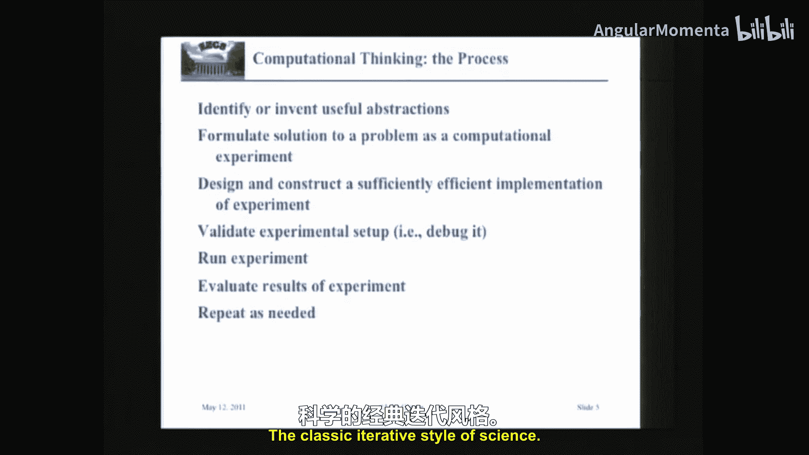

Style of science。And a lot of this， of course， is。What you would have learned in your chemistry lab or your physics lab or the bio labb in designing any experiment。

 You have to go through a lot of these steps。 And the difference is。

 these are all computational experiments。

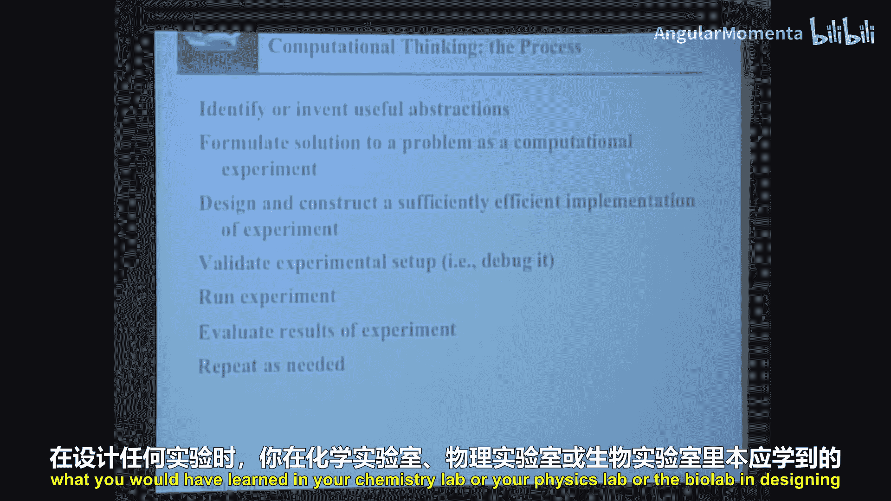

So we think of their two a's of computational thinking。 There's abstraction。

You have to choose the right abstraction。嗯。Typically。

 we operate in terms of multiple layers of abstraction simultaneously。

And this is an important part of。Thinking computationally， we have to be able to。Not worry about。

 say the details of how floating point numbers are implemented。

 but just assume it's a good approximation of the real numbers。That's one level of abstraction。

And another level of abstraction， we think about bus stop queuees。

And maybe we have to implement those ourselves。And then we have to think about the relationships among the layers。

A key thing that makes computational abstractions different from so many others。

Is we can automate them。So we often think about abstractions as we go through life and think about how to。

Cope with things that are too complex to understand。And we have these various abstractions。

 Newton gave us some good abstractions of the physical world that let us understand how things like levers and such almost how they work。

嗯。But here we get the big advantage that we not only can invent an abstraction， we can mechanize it。

We can do this for two reasons。 One， we have a precise and exacting notation for expressing the abstractions。

 for building our computational models。

This term that has been Python and P labb and nup。 But it could have been Java。

 It could have been C plus plus。 it could have been Matlab。Does't matter very much。

What matters is that we have a notation that's precise enough that we can actually describe a computation。

 and we have some machine that can take。A computation written in that notation or a set of computations actually written in that notation and execute them。

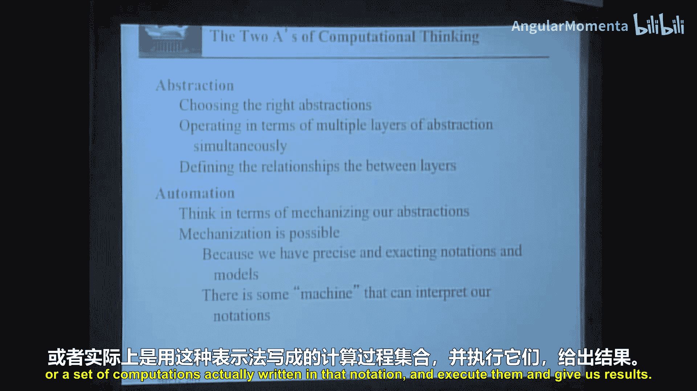

And give us results。And that's been the big transformation that has made computation so important。

We've had the notion of computation long before we had machines that could execute them。 The Greeks。

 the Egyptians understood notions of computation。As we've seen before。

 when we looked at some early algorithms， Alriths have been around a long time。

 but nobody cared very much。Until we had machines and notations。

That would let us actually run the algorithms。That came along in the late 40s。

 and then the world changed dramatically。So some examples of computational thinking。

 How difficult is this problem。And how best can I solve it？

And that's what theoretical computer scientists spend their time thinking about。

They try to give precise meanings to these kinds of questions so that we can ask them in the context of。

 say，Random access machines or parallel machines， or more lately quantum machines。

How do we formulate those questions precisely and how can we answer them。And of course。

 thinking recursively is very important。Fundamentally。

 it's the key in that what we try and do is we try and reformulate a seemingly difficult problem。

Into one， we already know how to solve。This is what we talked about before reduction to a previously solved problem。

And we've looked at different ways of doing this。 There's reduction。 As I've mentioned。

 there's embedding。Where， okay， our problem is complex。 We can't reduce it to a different problem。

But we can embed a different problem。 And it is at least part of the solution。

We can do some transformations。Take one problem and transform it to a different problem that usually a simpler problem that we know how to solve。

We've seen a lot of that。 That's， of course， what you've seen in the bus simulation you're studying。

 I hope， as I hope not as I speak。 But as soon as I finish speaking， you'll be studying it。

We taken a complex problem， and simplified it。By transforming it into a simpler problem that we can then attack。

And we've used a lot of simulation。As a mechanism for dealing with problems。

 So here's a little recursive picture。 Here's one of my favorite illustrations of recursion。😊。

I don't know how they did that， but I think it's pretty cool。All right， that's a very。

Quick introduction at a very abstract level。 What computer scientists might do。

I'm going to spend some time now on what one particular computer scientist does。 And that's me。

Why did I choose me？ Well， not because I'm the most interesting because I'm the 1 I know the best。

So it's kind of easier for me to talk about my work than about somebody else's。And the truth。

 be told， it's not actually my work。Like all professors。

I claim credit for the work that my students do。So all of the work you're gonna to see is actually work that my students have done。

 mostly graduate students， but also some very productive Uops。

 So I won't give them as much credit as I should， but you should know in your heart that I didn't do any of this actually myself。

 Allright， what do we do。The goals of our research group is the rather modest one of helping people live longer and better quality lives。

Other than that， we don't intend to accomplish anything。

And we do this mostly in the medical area by collaborating with clinical researchers and practicing clinicians。

Along the way， we have a lot of fun pushing the frontiers。

 the state of the arts and computer science， electrical engineering。😊，And certainly， medicine。

We use a lot of the technical kind of ideas you've seen this semester that you'll see in almost every any computer science course you take。

We do a lot of machine learning and data mining。 I'll explain why shortly。

We do a lot of algorithm design because a lot of the problems we're trying to solve are too complex to solve if you're not clever about how you solve them。

We do some signal processing。 I'll explain why we do that。

And a lot of just plain old software systems are needed。 We use databases。

We build software that injects electrical signals into people's brains。

 So we spend a fair amount of time trying to convince ourselves that actually works。

Doesn't inject the wrong signals at the wrong time。 So that might be fun， too。

And these are just the logos of some of the hospitals we work with。

 So what are some of the problems we try and deal with。

Probably our longest standing project has to do with medical telepresence。

These hands do not belong to a basketball player。 These are normal sized hands like yours or mine。

 That is not a normal sized baby。This is not a photoshop photo。 This is a real photo。

 This is a very small， premature baby。And we have spent a lot of time working with groups。

 figuring out how to provide better outcomes for these tiny little， very delicate。People。

A problem is that a lot of these babies are born。 If these babies are born in the right hospital。

 Brigman Women's Hospital or something close to Children's Hospital or M G， H。

They have very good outcomes。 They tend to survive， and they tend to survive to grow up。

 to be relatively normal。If these babies are born in a community hospital that does not know how to take care of these kinds of babies。

 they have very bad outcomes。A lot of them die。 Many of them who survive end up being permanently disabled。

Very sad。嗯。It's a。One of the shocking statistics is that globally a。

 there's a neonatal death every 10 seconds。Shocking number， I think it's， it's tragic。

And many of these are unnecessary and they occur because there's not adequate care at the point where the baby is born。

 and so we've been trying to use technology to link places where these babies might be born to places where people can advise how to take care of them。

And it turns out to be a very interesting set of computer networking communications problems。

 You can't just use Skype for reasons I， I won't have time to go into， but it's very exciting。

 uses a lot of computer science， a lot of medicine， but mostly computer science in this case。

 and we're actually currently running some trials in conjunction with children's Hospital， Boston。

 where they're actually trying to work look at babies born elsewhere。😊。

Another problem we've been looking at is healthcare associated infections。

Approximately 1 in 20 hospital visits。Results in the patient contracting an infection。

 totally unrelated to the reason they entered the hospital。And today。

 it's among the top 10 leading causes of death in the United States。

Somebody enters the hospital for a reason。 X picks up an infection unrelated to X and dies。

Not a very good outcome。And it's particularly discouraging because in principle。

 these infections should be preventable。You shouldn't acquire a life threatening infection while you're in the hospital。

But people do。 We've been trying to understand why。We've been working on this project with Microsoft。

 which has provided us with data from  four and a5 million different hospital visits。

And about 2000 pieces of information per visit。Lab tests， drug tests， who the doctors were。

 who the nurses were， what rooms they were in。And we're trying to study。

 These are pictures of some of the。Most obnoxious of these infections。And we've been trying to use。

 figure out。What's causing them and what could be done not to cause them。

This has been primarily a machine learning project。We've been。Struggling with it。

 We've been dealing with exactly the some of the issues we talked about in class。

 Which features are most important。 How should you weight the different features。

How can we reduce the number of features so that we can actually finish our computations。

We've been using different kinds of clustering， different kinds of。Supervised learning。

 many different techniques。And we're beginning to get a handle here on， in fact。

 what are some of the causes。Of these infections and what could they be done。

Some of the things are very disturbing。Some of them。

 a lot of them seem to be caused by drugs that are given in the hospital。

And maybe we can substitute one drug for another if we understand that， At least in some cases。

 they seem to be related to things like。What room you happen to be placed in。

Suggesting that maybe they're not cleaning the rooms adequately， things like that。All right。

Another project。Probably our biggest sets of projects have to do with extracting information from physiological signals。

We've been focusing on the heart， the brain and the connected anatomy。

 for those of you who don't happen to be biology or or of course，20 majors。

 here's where the heart and the brain are located and what they look like。Some of the examples。

We're interested in our predicting adverse cardiac。Events。And for that。

 you can think about death from a heart event， heart attack。

 And we spent a lot of time dealing with epilepsy。So let me give a little bit more detail about these two examples。

 because each of them relate to things we've covered in 600。So epilepsy， an interesting disease。

Surprisly， it affects about 1% of the world's population。This， when I first heard this。

 I was astounded。Because I said， gee，1 out of 100 people that I know have epilepsy。And the truth is。

Yes， I just didn't know it。I've been amazed since it's become known that I do research in this area。

 The number of people I've known for years who come up to me and say， you know。😊。

I never mentioned this before， but I have epilepsy， or my kid has epilepsy， or my parent is epilepsy。

And I have some questions now that you're supposed to be an expert on this。And。

I give them the usual caveat。 You know， I'm not a doctor。 I just play one on television。

 but then I tell them， go talk to one of my students。 They're not doctors either。

 but they're really smart。Probably smarter than your doctor。 All right。Why， why don't。

 Why is it underestimated when we do it ourselves， Well， because there are still some stigmas。

You know， a few hundred years ago， they burned women in sale in Massachusetts who had epilepsy because they thought the seizures when they were possessed by the devil。

Today， if you tell the registry of motor vehicles that you have epilepsy。

 they won't let you drive an automobile。So people tend not to announce it。

What's characterized by is a recurrent seizures。 A seizure is abnormal electrical activity that。

Origs and persists in the brain。 numberumb of course， causes that can be acquired。

 It can be inherited。There's manifest different symptoms。

 Most of them do not look like what's portrayed on the Simpsons。Slightly more realistically。

 and maybe more horrifying。嗯。Here's a picture of a young girl。

 a movie who you're going to see a seizure。It's not pleasant。 I'm going to warn you。

 What I want you to notice is。2 things， One， she's all happy。

 and the seizure seems to come out of nowhere。She doesn't expect it。

 She doesn't know she's going to have it。 It just hits。That's very important。2。

 she happened to be in the clinic at the time。Wearing this funny looking cap where it has electrodes in it。

 just sits on the scalp。And here is a record of the electrical activity at the surface of her scalp。

And what you'll see is a quick， slight change on it just before the seizure hits。

And then enormous changes during the seizure。Turns out the enormous changes during the seizure have nothing really to do with the seizure。

 They have to do with muscle activity。As you'll see， once the seizure hits， there's a lot of。

Ugly muscle activity。 Allright， let's look at it。Oh oh， all right。This。Let's look at it。

I thought I had put the links in here that should have done it。But。Who knows。

I know where to find them。明的见。で。即平熟。得佢觉得。系呀你。那推哦。可意写复责时上啊时工节。She's very much fake。喂加样。

You wish you your with on both。So。Kind of scary。 Certainly。

 when I've been seeing them actually happen， I've found it terrifying to watch that kind of it's called a tonic clonic seizure。

😰，啊。They seem， and I emphasize the words， seem unpredictable。

 The interesting thing about these seizures or aninteresting thing is they're self limiting。

In a few minutes， that young lady or young girl， seizure will be over。

 not because anybody intervened， but because the brain reset itself。Then it will take， in this case。

 probably took her about an hour to recover。And get back to normal， which is not good。

 But after that， everything was as before the seizure。

 The difficulty is because they're unpredictable。

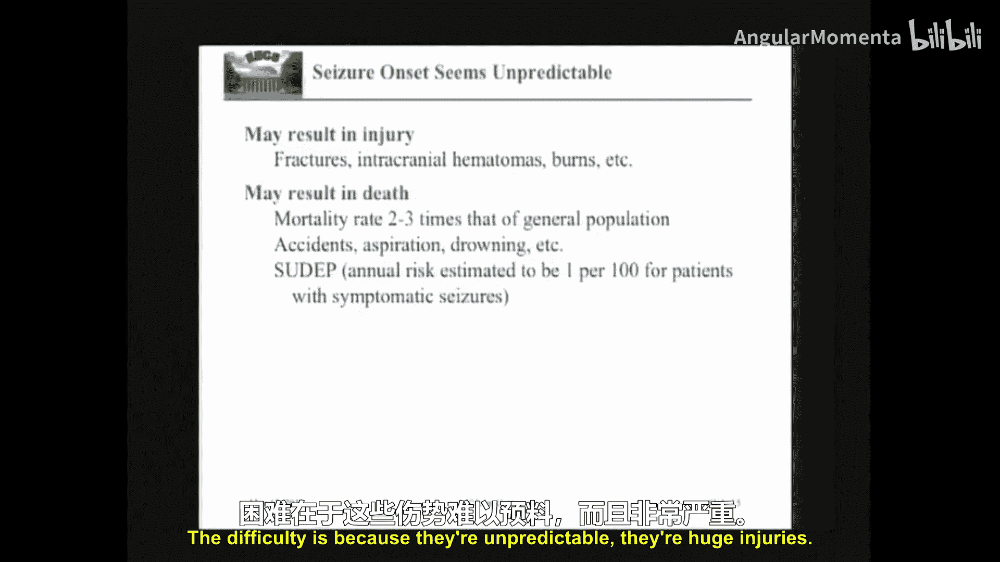

Theyre huge injuries。 Imagine she'd been riding a bicycle when that hit。Well， something catastrophic。

 or more simply， imagine she'd been going down a flight of stairs。Or in a bathtub。

Any one of a number of things would have resulted in potentially catastrophic collateral damage to the sea。

After the seizure or during the seizure。And indeed， people who have epilepsy。

 you can see their scars。They're， you know， they don't。 It's awful。It can result in death。

About 1 per 100 patient years。

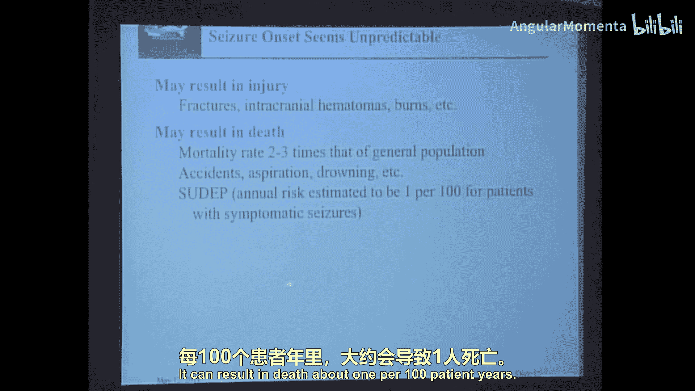

It was called a sudden unexpected death in epilepsy patients。

So what we wanted to do is see whether we could detect the seizures。And give a little warning。

The notion being that even if you couldn't do anything about the seizure。

 if you could give somebody say even 5 seconds warning， they could sit down before they fell down。

 They could get out of the tub。 They could back away from the stove， all sorts of things。Furthermore。

 if you could use technology to signal to someone else that there was about to be a seizure。

 help could arrive， also potentially a good thing。Turns out there are now some fast acting drugs。

That if you put under the tongue can ameliorate the seizure。

 These have not yet been approved by the FDA， but soon。

And we were particularly interested in neural stimulation。

That if we ejected electrical current into the brain at exactly the right moment。

 could we offset the， essentially the effect of the seizure and do a reset。

And maybe stop the seizure， abort it， prevent it。Or at least reduce the long term the recovery time。

The thing to keep in mind for the seizure is there were two distinct onset times。

What you saw if you were looking at the girl was what's called the clinical onset。

When there's some clinical event。If you were able to not look at the person and instead look at the EE G。

 not so easy， you would have seen that there was an electroographic onset that preceded the clinical onset。

We know， in fact， since the clinical effects are caused by the electrical activity。

 there will always be abnormal electrical activity prior to any abnormal clinical activity。

And so the hope was that we could detect the electrical activity early。Now， that's not so easy。

 what makes it hard。Is that the E，E G， the electroencephphaalgraph。Ds greatly across patients。

First of all， people with epilepsy have abnormal baseline E， E G。

Even when they're not having a seizure， bizarre things are going on in their brains electrically or unusual things。

And so they don't look like people who don't have epilepsy。

And it varies tremendously across patients。😊，So for about 35 years。

 people attempted to build generic detectors that would detect seizures in everybody。

And they've not worked well at all。Every time a hospital buys an E E G machine。

 It comes with a detector built in。 And usually the first thing they do is they turn them off。

Because the false alarm rate is so high that it's like the boy who cried Wolf。

They're just saying seizure， seizure， seizure， and people start ignoring it。

The good news is it's pretty consistent seizure onset for a particular individual that suggests you should build not generic detectors。

 but patient specific detectors。😊，And we've been working on using machine learning to do that。And。

 in fact， it's been highly successful。We've done several retrospective studies indicating that it。

 it works really well。 And we're now doing a substantial prospective study in progress at M GH。

And as part of that， we're actually working at turning on a neurotimulator that we hope。

Will attenuate the effect of the seizure。 And I emphasize hope because we don't have enough data to know if it works。

It's part of what goes on in this business。 but it's certainly been an interesting project。All right。

 heart attacks。Let's look at that， and I'll go to the easy way to show them。

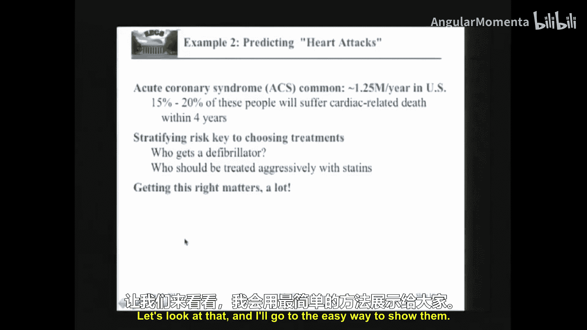

I should warn you， if you have a。You're going to see something that's not very pleasant。

 You're actually going to see somebody die。啊。This is。

Was actually an person who was playing in a soccer game and died during while the game was being televised。

All right， but what I want to show you。Is this didn't have to happen。

We're now going to see another televised soccer game。Where the player had exactly the same event。

But with a rather different outcome。So look at the upper center of field and you'll see the person has collapsed。

Much the same way it happened before。Now， watch the body convulse。

 You'll see the knees kick up there。And now comes the miracle。He sits up。嗯。

He leaves the field。 And， in fact， he later asks if he can reent the game。

The coach to the coach's everlasting credit said no。Clearly， the right decision。So。It's amazing。

 really， that that this happens。So what was the difference between the two。Well， we see this here。

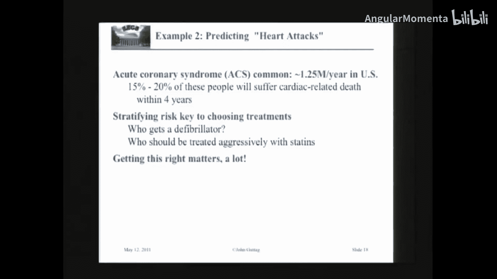

There are things you can do。So， an acute coronary syndrome。

EThink of it as as some sort of a heart attack。 They're very common。

 About  one and a quarter million per year in the US。

15% to 20% of these people will suffer a cardiac related death within the next four years。

If you could figure out who were the people at highest risk of different events。And。

Choose the treatment properly。 for example， implant， an implantable cardiac defibrillator。

 You could save these lives。

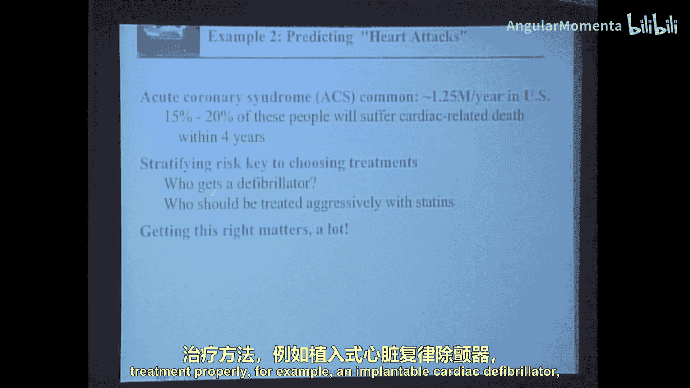

And that was what we saw in our movies。That the first patient。First person， the one who died。

 did not have a defibrillator。The second person， the one who survived， did。

So he collapsed in the field。The defibrillator。Sensed that his heart had stopped。

Gave it an electric shock。 You've all seen this in television where they put the paddles on。

 and they say clear。And then there's this moment of drama where everyone stares at the E K G machine。

 and it goes from a flat line to suddenly up and down。 And everyone goes，Well。

 that's exactly what happened here。 And that convulsion was this huge electrical shock getting sent through the person's body。

 which restarted the heart。Saaved his life。Probably if the other player had had an ICD。

 he would not have died either。So。Great technology。 Well， yes and no。

This was a study in the New England Journal of Medicine。 Not so long ago， a very good control study。

Where they matched patients with ICDs and patients without ICDs。In over 72 months。

 tracked which ones lived and which ones died。Well。

 the disturbing news is there isn't much difference between the red line and the blue line。

So these people had what was essentially a， well， which was about a $50000 implant。

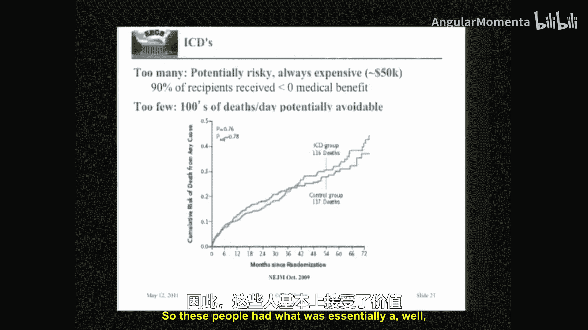

And various kinds of risks and inconvenience and discomfort， etcter。 And on average。

 it didn't save lives。Oh， dear。In fact，90% of the people who got them。

 and this is not just in this study。 This is in every study， receive 0。

 actually less than 0 medical benefit from the ICD。How do I know that？ Well， remember。

 it only turns on when it sense the heart is in trouble。For 90% of the people who get it。

 it never energizes because the heart doesn't get in trouble。Or detectable trouble。So。What we see。

 if we look at a little more detail in this study。Is that。For。Sudden cardiac death。

 the kind of death we saw in those in those videos or non death。The ICD reduces that。Unfortunately。

 it increases other causes of death。For example， infections related to the surgery， etca。

Those unfortunate hospital acquired infections， for example， we talked about earlier。

So what we see here is we have a technology。That if we knew。

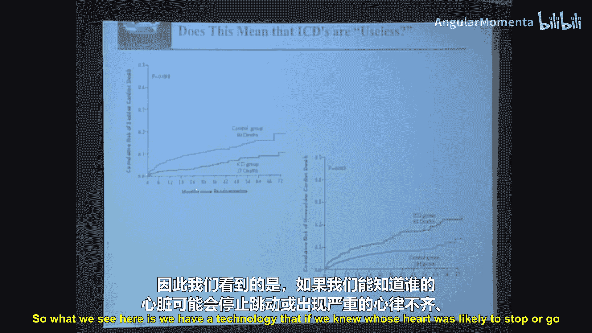

Whose heart was likely to stop or go into serious fibrillation beating uncontrollably。

 And we only gave those people I CDs。We could save an enormous number of lives。But currently。

 we don't know who's in that population。 And therefore， we don't know who should get them。

So we use other mechanisms deciding who should get them， And we're wrong most of the time。

 doing more harm than good on those patients for whom were wrong。Okay， well。

 how do people predict it today。The usual things， you know， are you male or female。

 Do you have high blood pressure， You have diabetes， What's your cholesterol level， B NP。

 various other kinds of things， electrocardiograms。

 which look at it's an echocardiogram that looks at the activity of the heart。

 It's the blood flowing through it， okay。E K Gs， many different methods for analyzing the electrical activity。

 etc。We played with many of these techniques。 The 1 I want to tell you about today because it's the most closely related to 600 material is what we think of the tolstoy approach to risk gratification。

So Tolstoy is famous for saying that happy families are all alike。

 but every unhappy family is unhappy in its own way。So we generalize that。

Or specialized it maybe to say that happy hearts are all alike， but every unhappy heart is different。

And then did some fairly simple work to quantify the difference。Between。

Electrical activities in different people's hearts。

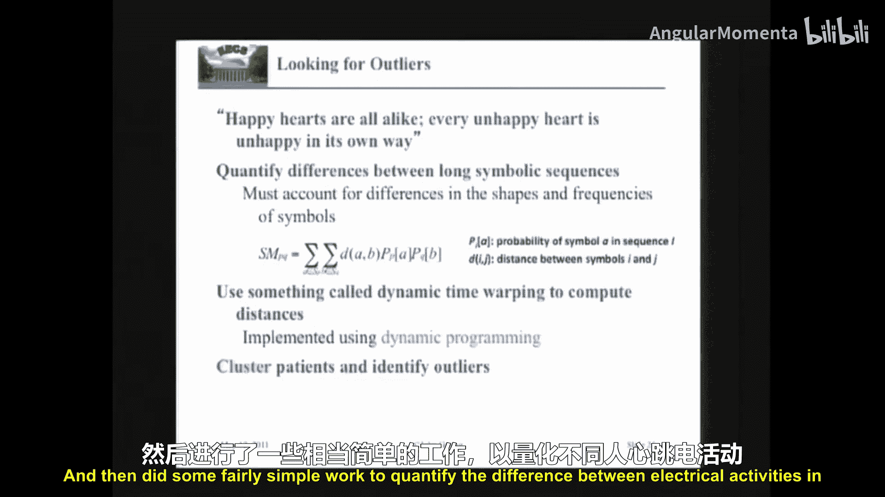

。Converting it to symbols。 you don't have to worry about that。

 We use dynamic programming as an important part because we were looking at roughly a billion heartbeats。

 And so we needed to make it run fast。And then we used clustering to identify patients whose hearts we thought were similar to one another。

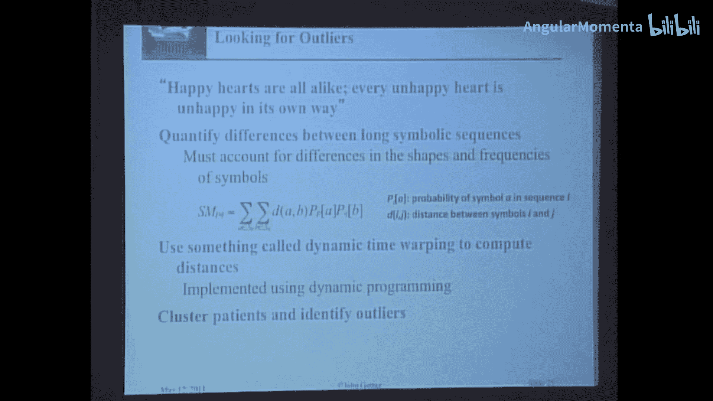

Here are some results。These are people who had an acute coronary syndrome。 So the dominant group。

 the biggest group。

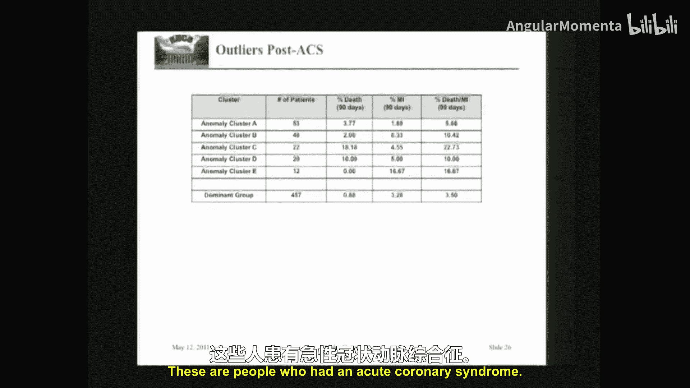

The quote people who we thought were most likely to be fine， because remember。

 most people are fine after a heart attack。457 patients in this， this particular data set。

And you can see that they did pretty well， you know， very small fraction of them died。

Can't see it from this angle。 but come out here。 Yeah， less than 1%。

But then we looked at people who were in these other clusters。 And， in fact。

 we used a gllometer of hierarchical clustering to do this。And in cluster A， which had 53 patients。

 Well，3。77% died。If you happen to fall in cluster C。You were at very high risk。

And we can just see that there's a big difference here。And so the notion is。

 could we have used this to predict in advance who was at most likely to benefit from various kinds of treatments。

 Allright， again， very quick， just to give you the details， not the details。

 the overview that the kinds of things we cover in this course are actually quite useful in solving real practical problems。

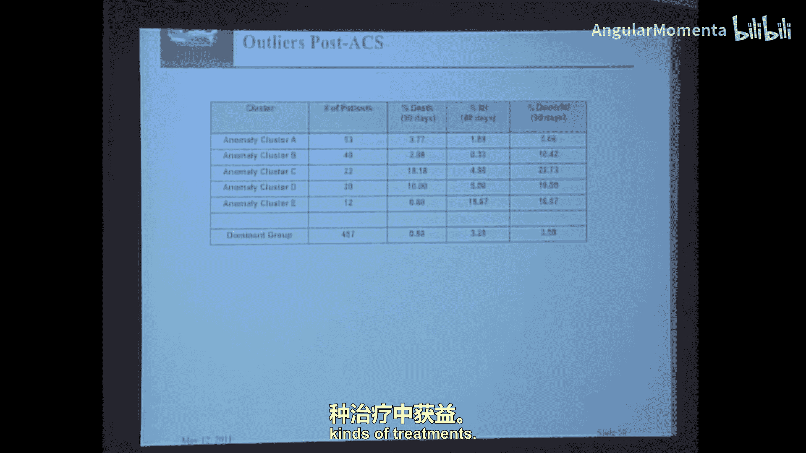

All right。Let me wrap up the term。So I hope most of you feel that you've come a long way。

If maybe you prefer this picture。嗯。That if you think about the kinds of problems。

And struggles you had。3 months ago， in getting tiny little programs to work。

And think about how easy those would be for you today。

You should have some appreciation that you've really。T yourself a lot。

AndAnd you've really taught it to yourself by doing the problem sets in many ways， right。

 We've tried to help， but you need， you know， learning is very much up to the individual who's doing the learning。

But I'm certainly impressed in looking at the kinds of really pretty complicated problems you guys can now solve。

U。We looked at six major topics。Clearly， you learned a notation for expressing computations。

 and that was Python。And， I hope。You don't think that's the only notation you can use。

 And that if you take a course that uses Matlab， you'll say， oh， this is just the same。

 It's easy or Java or anything else。 Learning programming languages is easy。 Once you've learned one。

 the next one is much easier。Harder was learning the process of writing and debugging programs。

You've learned that， I think， largely through experience。You've learned about the process from。

 of moving from a problem statement， something as vague as should。

 should shuttle buses be bigger or faster to improve service。

To a computational formulation of the problem。And a method for solving the problem。

 And we've looked at lots of different methods。You've learned basic recipes， algorithms。

 things like dynamic programming， things like depth for search。

 things like decision trees that you'll be able to use again and again。

 The good news is there are only a really small number of important recipes。😊。

And once you've mastered those， you just use them over and over again。To to solve new problems。

Sp a lot of time on using simulations。To shed light on problems don't easily succumb to closed form solutions。

And I think that's really the place where computation is so important。

There are a lot of problems where you can turn them into a set of differential equations。

 maybe solve the equations。And you're done。 Well， we'll write programs to do those because we're lazy。

 But in principle， you could solve those without a computer。But， in fact。

 the thing you can't do without a computer is these messy problems that are most of what goes on in the real world。

Where there's randomness and things like that。 And there is no simple formula that gives you the answer。

And what you have to do is write a simulation and run it。See what goes on。

 And that's why we spend so much time on simulation。

 because it really is increasingly the thing people use。

And we've learned about how to use computational tools to help model and understand data。

How to do grip plots。A small amount of statistics， machine learning， just dealing with data。

Why Python。It's pretty easy to learn to use compared to most other programming languages like， say。

 C plus plus or Java。 Python is easy。The syntax is simple。 It's interpretive。

 which makes debugging easier。 You don't have to worry about managing memory。 know， as you do in say。

 C， right， you get a big list or a dictionary and magically， it exists。

 And when you don't need it anymore， it's gone。It's modern。

 It supports the currently stylish mode of。Object oriented programming in a nice way with its classes and things like that。

 So indeed， what you would hear about in a Java class， we can cover all the。

 almost all the interesting things with Python。 And it's increasingly popular。

It's used in an increasing number of subjects at M I T。 A lot， of course，6 subjects。

 but also a lot of course，20 subjects， course，9 subjects over and over again。

 It's becoming probably the most popular language at M I T and at other universities。Increas。

 it's used in industry。 And as you've seen with P Laab， the libraries are amazing。And so P labab。

 random， etc。 There's just a lot of stuff you can get for free if you're living in the world of Python。

The main thing in writing， testing and debugging programs。

 I hope you've learned is to take it a step at a time。Understand the problem。

Think about the overall structure and algorithms separately of how you express them in the programming language。

Right， we can talk about dynamic programming conceptually without worrying about how to code it up。

Always break the problem into small parts， identify useful abstractions。

Code and test each unit independently。W about functionality first。 Get it to work。

 get it to give you the right answer， then worry about making it do that more quickly。

 But separate those things。 start with some pseudocode。Then， above all， be systematic。When debugging。

 think about the scientific method of forming hypotheses。

 forming experiments that can test the hypotheses， running the experiment， checking the results。

Don't try and do it too quickly。 Just be slow and careful。 Slow and steady。

 We win the race in debugging。And。When your program behaves badly and the sad news is。

 no matter how many years you spend at it， you will write programs that don't work the way you think they should the first time。

😔，Ask yourself why it did what it did， not why it didn't do what you wanted it to do。

It's a lot easier to debug from the how come it's behaving the way it is than why isn't it behaving the way I want it to behave。

And going from problem statement to computation， break the problem to smaller problems。

 try and relate your problem to a problem that somebody else ideally has already solved。 For example。

 is it an Apsack problem， Is it a shortest path problem， If so， oh， good， I know how to solve those。

Think about what kind of output you might want to see。 What should the plots be like。

 I usually design the output before I design the program。Often。

 you can formulate things as an optimization problem。Pull back say， well。

 can I formulate this as finding the minimum or maximum values satisfying an objective function in some set of constraints。

If I can， it's an optimization problem。 And therefore， I know how to attack it。

And don't be afraid to think about approximate solutions。

Sometimes you're just gonna not actually be able to solve the problem you want to solve。

And so you'll find a solution to a simpler problem。 And that will be good enough。

Sometimes you can actually solve the problem。By finding a series of solution that approaches。

 but may may never reach a perfect answer。Probably the third week in the course。

 we looked at Newton's method as an example of that kind of。Problem。And then there are algorithms。

 We looked at big O notation， various kinds of algorithms， a lot of kinds。

 You've already sent a list， specific algorithms。 and particularly。

 we looked at optimization problems。We spent a lot of time on modeling the world。

 keeping in mind that the models are always wrong， but nevertheless， they're often useful。

They provide abstractions of reality。 So we looked at two kinds of simulation models。

 Monte Carlo and Queuing networks。We looked at statistical models， for example， linear regression。

 and we looked at some graph theoretic models。 Those are not the only techniques。

 but they're very useful techniques。嗯。We looked at making sense of data。

 We talked about statistical techniques， how to use them well， how to use them badly。

We looked at plotting， and we spent some time on machine learning， supervised。

 unsupervised and feature vectors。 and spent a lot of time talking about how do you choose the features。

 Because fundamentally， that's typically the difference between success and failure in the world of machine learning。

Throughout it all。The pervasive themes were the power of abstraction and systematic problem solving。

So what's next。Many of you have worked really hard this semester。 We know that。 And the T As。

 the L As， and I all。Appreciate that。 And I I thank you sincerely for the efforts you put into the course。

Only， you know your return in the investment。 I hope it's， it's good。Remember。

 as you go forward in your careers that you can now write programs to solve problems you need to solve。

 don't be afraid to do it。If you like this， or are plenty of other C。

 S courses that you now could take， you're actually equipped probably to take any one of these four courses based upon what you've learned in 600。

You could major in course 6 or think about the new major in computer science and molecular biology。

And you're certainly qualified to go off and look for your ops that involve serious programming。

All right， wrapping up with some famous last words。

 These were words that some famous people said as they were about to die。An actress。

 Douglas Fairbank， Se， was asked by a family member how you feeling。 And he said， never felt better。

 And then that was the last thing he ever said。In contrast。

 the last thing Luther Burbank was reported to have said， the famous scientist was。

 I don't feel so good。He was a scientist rather than an actor。

 He had a better appreciation of the state of the world。Conrad Hilton。

 who you probably think of as Paris Hilton's grandfather。

 but actually is more well known in some circles for running the Hilton hotels。

His last words were his family asked him they knew he was dying。

 Is there anything you want us to know about running the business？ And he said， yes。

 leave the shower curtain on the inside of the tub。And that's advice I have to confess。

 My wife has given me on several occasions。um。Arimedes。Basically。

 before he was taken away and executed， asked， could he please finish the solving the problem he was working on。

You know， if I can imagine some poor 600 student who's about to be carted away by the police saying。

 can I finish my problem set first， please。Actually， I can't imagine that。 And finally。

 this civil War General， John Feddgewick。Wasputedly。 And this is， I believe a two story said。

Talking about the snipers from the other side who were quite far away。

 that telling his people don't be afraid they couldn't hit an elephant at this distance。

 And if you go to the site of the battle， you'll find this plaque describing the death of John Sedgwick who was shot and killed immediately upon saying this by one of said snipers。

嗯。Says something about generals that probably is still true today。 All right。Quick reminders。

 And then we're done。 There's a final exam。 If you haven't done the underground guide， go do it。

 These are things I said at the beginning of the lecture。 I' am just repeating them。 Thanks a lot。

 Good luck in the final，600， all your finals。 And then more importantly， have a great summer。😊。

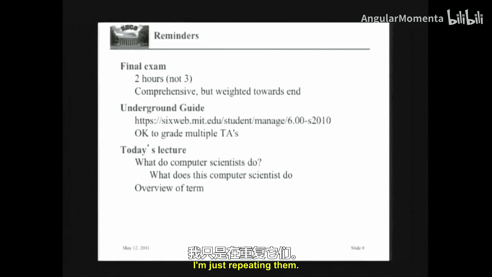

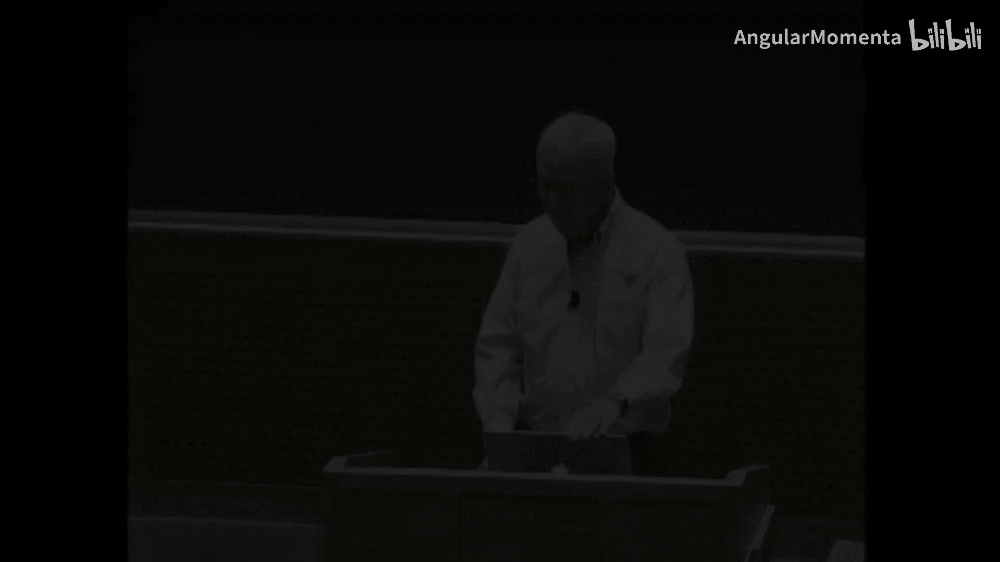

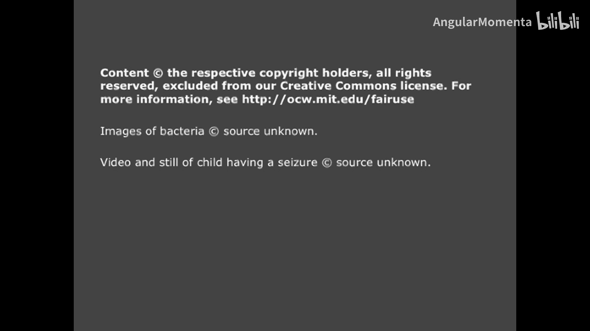