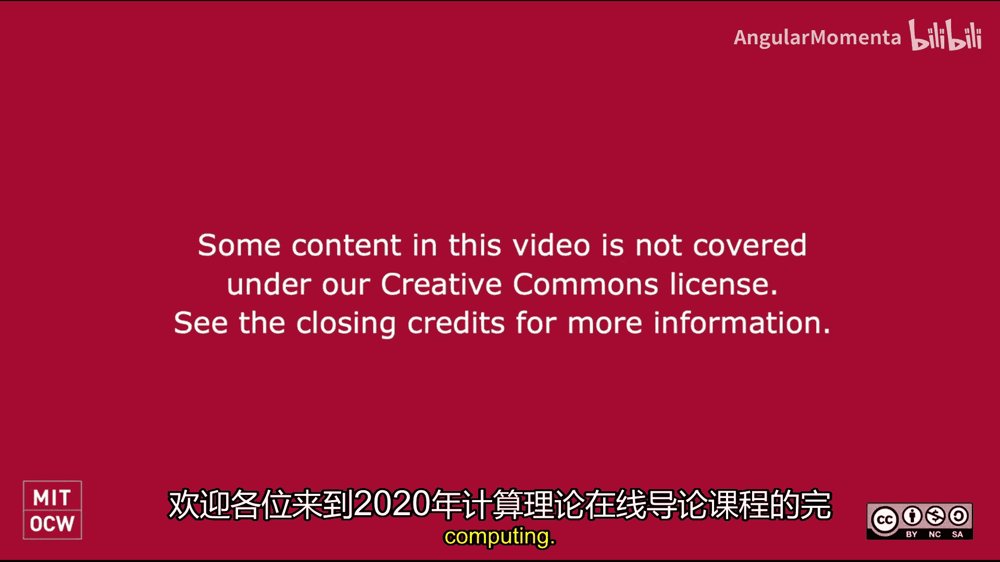
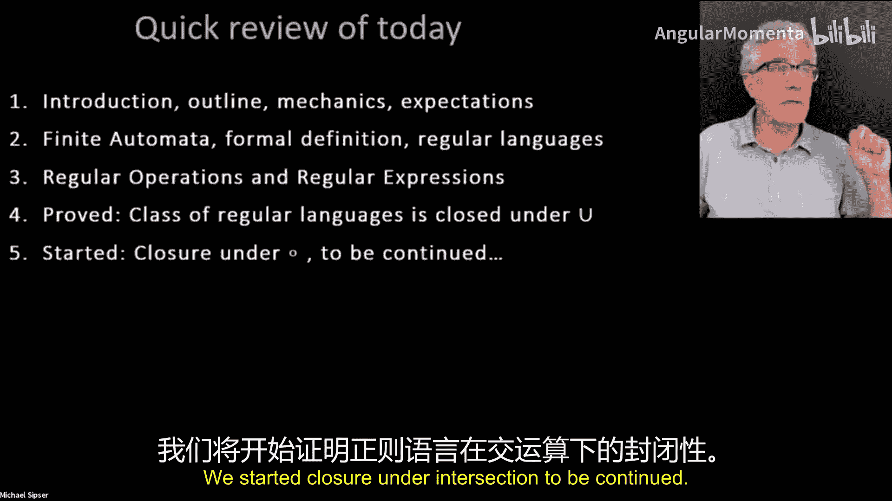
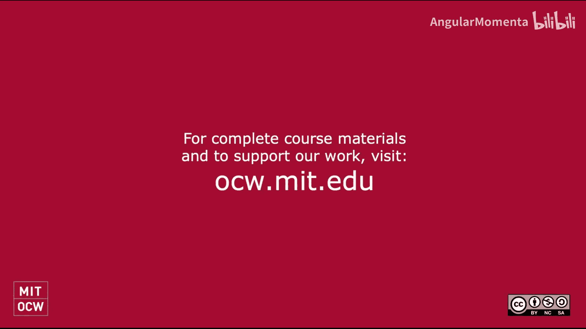

# 【麻省理工】计算理论  ｜  MIT 18.404J Theory of Computation, Fall 2020 p01 1. 介绍，有限自动机，正则表达式 -BV1pt7GzeEjb_p1-

So welcome everybody to。The full 2020 online。Introduction to the theory of computing， 18404-6840。

My name is Mike Siper， I'm going to be your instructor for the semester in this class。嗯。

So let me just tell you what the course is about。Basically it's going to be in two halves we're going to be talking about what are the capabilities and limitations of computers of computer algorithms really computation and the two parts of the course are more or less divided in half we're having the first half of the course is going to talk about a subject called computability theory which really asks what you can compute with an algorithm in principle that's was an active area of research and the earlier part of the 20th century it's pretty much closed off as a research subject these days mainly because they answered all of their big questions and so a mathematical field really only stays vital when it has problems to solve and they really solved all of their interesting problems for the most part not 100% but for the most part it's sort of finished off in the 1950s。

Just to say a little bit more about what we're going to talk about there you know when you're interested to know what kinds of problems you can solve with an algorithm。

 you know there are problems that you might want to solve that you just can't solve for example。

 if you want to given a specification for you know a computer problem you want to solve whatever that specification might be say you know your algorithm actually is a sorting algorithm for example。

 and you want to write down that specification and have an automatic verifier that's going to check whether a program meets a specification well that's just in principle impossible you cannot meet you cannot make a verifier which is going to answer in all cases whether or not a program meets a certain specification so things like that we will prove this semester you know questions about mathematical truth if you're given a mathematical statement is it true or is it false it'd be great。

If you can write a computer program that would answer that problem。

 well it would not be great if you' were a mathematician because that would put us all out of business。

 but if you you know you could imagine that might be a nice thing to have， but you can't。

 I mean there is no algorithm which can answer that question。嗯。Well， along the way。

 we're going to introduce models of computation like finite automa。

 which we'll see today touring machines and some other models that we'll see along the way。

The second half of the course， which is going to be after the midterm。

 we're going to shift gears and talk about complexity theory。

 which is instead of looking at what's computable in principle。

 you're going to look at what's computable in practice。

 so things that you can solve in a reasonable amount of time。And for example。

 I'm sure many of you are aware of the factoring problem。

 which has connections to the RSA cryptto system， cryptography， and asks whether you can。

Fact or big numbers quickly， that's a problem we don't know the answer to。

We just don't know how to factor big numbers quickly。

 but it's possible that there are algorithms out there that we haven't discovered yet that can do so it's connected with this very famous problem in the intersection of computer science and mathematics called the P versus NP problem which many of you may have heard of we'll talk about that we'll spend a lot of time on that this term and along the way we'll talk about different measures of complexity of computation time and space time and memory you know a theorist called memory likeical space that's going to be a big part of the course in the complexity theory part。

 introduce other models of computation such as probabilistic and interactive computation。

Talk about the expectations of the course， first of all， prerequisites。

You know there are a bunch of prerequisites listed you know 6042 18062 or maybe some other subject as well。

 the real thing is is that this is a math class， this is a class where I'm you know and it's not a beginning math class this is you know a moderate to advance math class and I'm expecting people to have had some prior experience。

You know of a substantial nature with mathematical theorems and proofs， you know。

 we'll start off slow， but we're going to ramp up pretty fast so if you haven't really。

you know got the idea or gotten comfortable with doing proofs coming up with proofs to mathematical statements you know that's going to be a concern you can you know I would just be monitoring yourself and seeing how you're doing because the homeworks and the exams are going to count on your being able to produce proofs and so。

You're going to be struggling if that's going to be a real something that you haven't had experience with。

So and let me talk a little bit about the role of theory in computer science， is this a theory class。

 as you know。So you know before we jump into the material I just thought it would be worth for you to give you at least my perspective on the role of theoretical computer science within the field。

 so you know I've been in computer science for a long time you know I go back I'm sure I'm getting to be a dinosaur here but I go back to the days when you had punch cards that's what we did when I was an undergraduate and obviously things are very different now and you can argue that in some you know that you know computer science as a discipline has matured and sort of the basic stuff has all been solved well I would say there's a certain truth to that but there's a certain way in which I would say that's not true I think we're still at the very beginning and at least in certain respects of computer science as a discipline。

For one thing， there are a lot of things that we do。

A lot of things relating to computation that you know we just don't know the answer to very fundamental things。

 you know let's take this example how does the brain work obviously the brain computes in a certain fashion but。

You know and we've made good progress you can argue with machine learning and all of those things which that are really doing very you know have very very powerful and doing very cool things。

 but I would also say that you know at some deeper level we really have you know the methods that we have so far don't allow us to understand creativity。

 you know we're not close to being able to create a computer program that can do mathematics or that can do many of the creative kinds of things that human beings can do you know there I think machine learning powerful as it is is really successful only for a very narrow set of tasks and so I think you know there's a lot I think there's probably something deeper and more fundamental going on that we're missing that would be my hunch now whether something like。

Theoretical computer science is going to give you an answer there and what this kind of theory or some kind of theory。

 I think some kind of theory as at least a decent shot at playing a role in helping us to understand computation in a deeper way and the fact that we can't understand something as basic as can you factor a big number quickly or not you know you can't really say you understand computation until you can answer questions like that。

So I would argue that we have a really very primitive understanding of computation at this stage and that there is a lot that has yet to be discovered。

 not just on the technological side but just on the very fundamental theoretical side that has a real shot at playing a role in affecting the practice of how we use computers and so I think for that reason again I'm not sure what kind of theory is going to be the most useful but the theory we're going to cover in this course is a particularly elegant theory and it has already paid off in many applications and in terms of our understanding of computation and I think you there is at least as a starting point it's a good subject to learn。

Certainly I enjoy it and I've spent a good chunk of my career doing that。

So let's move on then and begin with the。呃。Subject material。

 so we're going to talk about models of computation， as I mentioned。

 you know we want to try to understand computers and we want to understand what computers can do。

 but computers in the real world are pretty complicated objects and they're really not nice to talk about mathematically。

So we're going to talk about abstract models of computers that are much simpler， but really capture。

 just like models in general， capture the important aspects of the thing we're trying to understand and。

We're going to look at a several different kinds of models that vary in their capabilities and the way they approximate the real。

Computers that we deal with every day and start for starters we're going to look at a very simple model called a finite automaton and that's going to represent you can think of it as representing a computer that has a very small amount of memory and a very limited and small amount of memory and we're going to look at the capabilities of those kinds of machines and what's nice about them is that you can understand them very well and so more powerful models that we're going to look at later are going to be harder to understand in as deep way but for these we can we can develop a very comprehensive theory and so that's what we're going to do for the next lecture and a half。

So this is going I'm starting off with an example， I'm presenting a finite auto automaton as a as a diagram we call it a state diagram that has a bunch of He these circles and lines and labels on the lines and also on the circles so let what's going on here so this is a finite automaton i'm giving it the name M1 and it has。

These circles are called states so in this case there are three states Q1 Q2 and Q3。

 those are the labels there， there are arrows connecting states with each other so these are we'll call transitions and they're going to tell you how to compute with this device and theres going to be specially designated starting state which has an arrow coming in from nowhere and there are other specially designated states called accepting states and that's going to have to do with how the machine computes but those are the ones that have these double circles and so the're talking about the way it computes the idea is pretty simple the input is going to be some finite string of zeros and ones in this case we might have other types of symbols that are allowed for other automata but the example that I have here it's going to be zeros and ones and the way you compute what the thing is。

You first put your finger， which I can't do on Zoom， so I'm going use the pointer。

 you put your pointer on the starting state， the one that has the arrow coming in from nowhere。

 you put your first， you put your pointer there and then。

You start reading symbols from the input one after the next， so let's take an example here， 01101。

 so you start reading those symbols and you follow those transitions so you go zero this is and you go back to the same state then you go the next symbol is a one so you go over to this state from Q1 to Q2。

😡，Now you have another one that comes in so now you're starting at Q2 you have another one so you'll follow its associated transition so if you notice every state has an outgoing transition for one and another outgoing transition for zero so there's always somewhere to go every time you read symbols from the input so now you're a Q2 you read that next the third symbol which is a one that's going to take you over to Q3 and now you have a zero which looks you back to the where you were and another one which looks you back to where you were and because you end up at an accept。

That is an you say we accept that string so that's going to be the output of this finite out ofommpton for each string it's either going to accept it or reject it。

 so it's just a binary decision that is going to be made sort of like a one or a zero output but we're calling it accept or reject。

So this one here， because it ended up at the accepting state is accepted。

 but if you look at the second example，00101， so you can have 00101。Now we ended up at Q2。

 that's not an accepting state， so therefore we say we reject this input。😡，Okay。

 very simple and now for example， one of the questions you might want to ask given one of these things is well。

 which are exactly those strings that the machine accepts and。

A little bit of thought will help you understand that and the only strings which are going to take you over to Q3 are those strings that have a11 appearing somewhere along the way。

 two consecutive ones and you will end up at the accepting state you have to。

 I mean I encourage you to think about that for a minute if not immediately obvious。

 but those are the strings that are going to be accepted by this machine。😡。

And we call that collection of strings the language of the machine。😡，U that so that。

Set a of those strings that have a11 for this particular machine is the language of M1 we also say that M1 recognizes that language。

 recognizes a and and in terms of notation we write that a is L of M1 a is the language of M1 so the language of a machine is exactly the set of strings that machine accepts。

😡，Okay。😊，So one of the first things we're going to want to be able to do is take a machine and understand what its language is what's the set of strings that that machine accepts another thing we might want to do is give a language build a machine which recognizes that language so and then understanding what are the class of languages can you get any language from some machine or they're going to be some languages that you can do and other languages that you cannot do so those are the kinds of questions we're going to be asking about these finite autometer what kinds of things can those machines do and what can they not do？

😡，嗯。Okay。Here's our here' is our next check in。 So let me。 So wake up。

 everybody who's not paying attention。 A check in is coming。 So we have more questions。

 though I can't。Can keep are these three statements equivalent， what to be statements？

At the bottom of the slide。Oh oh yes， those three are equivalent A is a those mean the same thing not only of the equivalent。

 but they they're just different ways of saying the same thing that M1 recognizes the language is same as saying that's the language of the machine and that a equals that L of M that's that's all the same way of saying they will six of one half a dozen of the other two ways of saying the same thing Okay。

 so let's pop up our poll and get that started oops。Still showing the old one， now， here we go。

Mo it to the next question。Okay。Okay， so。嗯。You understand the question here。

 after read where do we end up after we read 101， what state are we in？嗯。Do we end up in state Q1。

 Q2， or Q3？Okay。Go fast。This is a。Okay， so I think we got the。Pretty much converged here。

I think almost everybody got it right the answer is indeed that you ended up in state Q2 because you go 101 and that's where you will ended up in state Q2 so is this string accepted no？

Because you didn't end up in an accept state， so this machine rejects 101。Okay。Let's keep going。

So now。い。Yeah。Okay， so now we gave it this informal idea of a finite automaton。

 we're going to have to try to get a formal definition now。

 which is going to be a more mathematical way of saying the same thing that I just said。😡。

And the reason for having a formal definition is for one thing it allows us to be very precise then we'll know exactly what we mean by a finite automaton and it should answer any questions about what counts and what doesn't count it also is a way of providing notation so it'll help us describe finite automata and sometimes there might be an automaton where you know the picture is just too big so you might want to be able to describe it in some mathematical terminology rather than by giving a picture or maybe you're going to be asked to give a family of automata where you know there is going to be a parameter n associated with the class of languages you're trying to describe with the automaton and then it'll be more helpful to describe it in this formal notation rather than as a kind of。

😡，Picture because it might be infinitely many pictures that are being needed。

So you mean maybe examples of that will come up with now so a finite automaton we call it a five tuple don't be put off by that a five tuple is just a list of five things so a finite automaton will in our definition is going to have five components。

😡，It's going to have a Q， which is going to be a finite set of states。

 so it's going to be a list you know finite which will designate as the states of the automaton Sigma is the alphabet symbols of the automaton。

 another finite set。Delta is the transition function that tells us how the automaton moves from state to state those gives describes how those transition arrows。

 those arrows which connected the states with each other。

 it describes them in a mathematical way instead of in terms of a picture and the way I'm doing that is with a function。

😡，So deelta is a function which takes two things so I'm hoping you've seen this notation before I'll help you through it once。

 but this is the kind of thing I would expect you to have seen already。

 so when you have Q cross sigma so I'm going to give deelta a state and an a state and and an alphabet symbol so Q state sigma is alphabet symbols so you're going to get a state and alphabet symbol and it's going to give you back a state。

😡，So more describing it， you know， kind of a little bit more detail， you're going to， you know。

 deelta， if you gave it state Q and symbol A equals R， that means Q， when you read an A， you go to R。

So that's the way this picture gets translated into a mathematical function。😡。

Which describes those transitions。And then now Q0 is going to be the starting state so there's going to be that's the one with the in arrow coming in from nowhere and F is the set of accepted accepting states。

 so there might be several there's only going to be one starting state but there might be several different or possibly even zero accepting states that's all legal when we have a finite out automaton and so in terms of using notation going back to the machine that we just had from the previous slide which I've given you here again let me show you how I would describe this using this notation that comes out of the definition so here is M1 again it's this five tuple where Q now is the set Q1 Q2 Q3 that's the the set of states。

😡，The input alphabet is 01， it might vary another autometer， and F is the set Q3。

 which has only the element  Q3 because this has just one except state 23。😡，Okay。

 so I hope that's helpful Oh， of course I forgot the transition function。

 which here I'm describing as a table。So the transition function says。You know。

 if you have a Q1 and a if you have a state and an input alphabet。

 you can look up in the table where you're supposed to go under the transition function。

 according to the the state and the alphabet's symbol that're you're given。

 so for example you know if we were in state Q2。😡，Here， getting a zero。

Then Q2 goes back to Q1 so that Q2 on0 is Q1， but Q2 on1 here is Q3。Okay。

 so that's how that table captures this this picture， okay。

 and it's just a function it's a rep wave representing a function a finite function。😡，You know。

 in terms of this this table here， so I realized for some of you this may be。Slow。

 we will ramp up in speed， but I'm trying to get us all together in terms of the language of the course here at the beginning。

Okay， so now let's talk about some more the computation a。So strings and languages。

 a string a string is just a finite sequence of symbols from the alphabet so don't whenever this class is not going to talk about infinite strings。

 all of our strings are going to be finite there's other mathematical theories of photoma and so on that talk about infinite inputs and infinite strings。

 we're not going to talk about that。You know， maybe rarely we'll make it very clear we'll talk about an inter string。

 but that's going to be an exception and a language is a set of strings。That's the traditional。

 you know way that people in this subject refer to a set of strings， they quote it a language。

 really because this subject had its roots in linguistics actually。

 and they were talking about they're trying to understand languages， you know human languages。

 so this is just a historical fact and that's the terminology that's stuck。Okay。

 so two string string a special string in a special language。

 the empty string is the string of length zero， this is a totally legitimate string that you were going to run into now and then and there's the empty language。

 which is the set with no strings。These are not the same。

 they're not even of the same type of object。😡，So don't confuse them with one another。

I mean you can have a set， a language which has just one element which is the empty string。

 that is not the empty set， that is a set， that is not the empty language。

 that is the a language that has one element in it with namely the empty string okay so those are separate things。

😡，Okay， so here's a little bit of a mouthful here on the slide。

 defining what it means for a an automaton to accept its input， accepts its input string W。

And we can define that formally and you know。It's a little technical looking。

 it's really not that bad。So if you have a your input string W。😡。

Wwhichch you can write as a sequence of symbols in the alphabet， W1， W2 dot dot dot WN。

 so you know like 01，001， I'm just writing it out symbol by symbol here。😡。

So what does it mean for the machine to accept that's that input。

 so that means that there's a sequence of states in the machine。😡，Sequence of states of members of Q。

 so these are a sequence from Q， these are the states of the machine。

That have a certain that satisfy these three properties down here。First of all。

 and I'm thinking about the sequence is the sequence that the machine goes through。

As it's processing the input W。😡，So when does it accept W？

If that sequence has the feature that it starts at the start state。

Each state legally follows the previous state according to the transition function。So that says。

 you know， the IF。Remember the sequence。Is obtained by looking at the previous one。

 the I minus first member of that sequence of the I minus first state in that sequence。

And then looking at what happens when you take the I input symbol。😡。

So as you look at the previous state and the next input symbol， you should get the next state。

 that's all that this is saying and this should happen for each one of these guys and lastly。

 for this to be accepted， the very last member here where we ended up at the end of the input so you only care about this at the end of the input。

 you have to be in an accepting state。😡，So you can mathematically capture this notion of going along this path。

嗯。And that's what I'm just trying to illustrate that。

 you know we could describe all this very formally。

 I'm not saying that's the best way to think about it all the time， but that it can be done。

 and I think that's something you know worth appreciating。😡，Okay， so now in terms of again。

 getting back， we've said this once already， but in terms of the languages that the machine recognizes。

 it's the collection of strings that the machine accepts。😡。

Every machine accepts it might accept many strings。But it always recognizes one particular language。

😡，Even if the machine accepts no stringoms， then it recognizes the empty language。😡。

So a machine always recognizes one language， but it may have many， many strings that it's accepted。😡。

And we call that language， the language of the machine。

s the and we say that M recognizes that language， these three things mean the same thing。😡，Okay。

 and now important definition， I try to reserve the most important things or the highlighted things to be in this light blue color。

 if you can see that， we say a language is a regular language if there's some finite automaton that recognizes it。

😡，ok。😊，So there are going to be some languages that have associated to them finiteatmata that actually solve those languages that recognize those languages。

 but there might be other languages and we'll see examples where you just can't solve them。

 you can't recognize them with a finiteatmaton those languages will not be regular languages the regular ones are the ones that you can do with a finiteatmaton that's the traditional terminology。

😡，Okay， so let's continue let's go on from there so a couple examples here again is that same getting getting to be an old friend that language that automaton M1。

Remember， its language here is the set of strings that have the substr 11。That is the。

That language A， now what do we know about a from the previous slide？😡，Stk with me。

 don't just listen。A is a regular language now because it's recognized by some automaton。

So all of the whenever you find an automaton for a language， a finiter automaton for a language。

 we know that that language is a regular language。😡，So let's look at a couple of more examples。

 so if you take the language let's call this one B。

 which is the strings that have an even number of ones in them。😡，So like the string 1101。

With that B inb？No， because it has an odd number of ones。So the string 1111 has four ones in it。

 that's an even number， so that string would be and B， the zeros don't matter for this language。

So that string of strings that have an even number of ones。That's a regular language。

And the way you would know that is you would have to make a finer automaton that recognizes that language and I would encourage you to go and make that automaton you can do it with two states。

 it's a very simple automaton but if you haven't had practice with these。

 I encourage you to do that and I actually there are lots of examples that I ask you to solve at the end of chapter one in the book and you definitely should spend some time playing with it if you're not。

😡，If you have not yet seen finiteratmaa before， you need to get comfortable with these and be able to make them so're going to start we're going to start making some of them。

 but we're going to be talking about it at a sort of a more abstract level in a minute。😡，嗯。Basically。

 the reason why you can solve this problem， you can make a finite automaton which recognizes the language B is because that finite automaton is going to keep track。

Of the parody of the number of ones it's seen before， this has two states。

 one of them remembering that it's seen an odd number one so far。

 the other one remembering its seen an even number of ones before。😡。

And that's going to be typical for these automata， finiter automata。

 there's going to be several different possibilities that you may have to keep track of as you're reading the input and there's going to be a state associated with each one of those possibilities。

😡，So if you're designing an automaton， you have to think about as you're processing the input。

 what things you have to keep track of and you're going to make a state for each one of those possibilities。

😡，Okay so you need to get comfortable with that， let's look at another example。

 the language C where the inputs have an equal number of zeros and ones。😡。

That turns out to be not a regular language。😡，So what in other words。

 what that means is there's no way to recognize that language with a finite automaton。

 you just can't do it。😡，That's beyond the capabilities of finite automaa and that's a statement we will prove later。

😡，嗯。Okay， and our goal over the next lecturer or so is to understand the regular languages。

 which you can do in a very comprehensive way， so we're going to start to do that now。

So first we're going to introduce these this concept of regular expressions， which again。

 these are things you may have run into in one way or another before so if we have a。嗯。

We're going to introduce something called the regular operations。😡。

Now I'm sure you're familiar with the arithmetical operations like plus in times。

 those apply to numbers。😡，Now， the operations we're going to talk about are operations that apply to languages。

😡，So they're going to take。Let's say two languages， you apply an operation。

 you can get back another language， like the Union operation， for example。😡。

That's one you probably have seen before the union of two languages here is a collection of strings that are in either one or the other。

😡，U。So but there are other operations which you may not have seen before that we're going to look at the concatenation operation。

 for example， so that says you're going to take a string from the first language and another string from the second language and stick them together。

And it's called concatenating them。And you do that in all possible ways。

 and you're going to get the concatenation language from this two languages that you're starting with A and B。

The symbol we use for concatetnation is this little circle。

 but sometimes we often we don't we just suppress that and we write the two languages next to one another with the little circle implied so this also means concatenation over here。

Just like this does。And the last of the regular operations is the so called star operation。

 which is a unary operation that applies to just a single language。

And so what you do is now you're going to take to look get a member of the star language。

 you're going to take a bunch of strings in the original language A and you stick them together any number of members of A。

 you stick them together and that becomes an element of the star language。

 I will do an example in a second if you didn't get that。😡。

But one important element is that when you have the star language。

 you can also allow to stick zero elements together。😡，And then you get the empty strip。

So that's always a member of the star language， the empty string。😡，Okay。

 so let's look at some examples。So let's say A is the language， these are two strings here， good。

 bad， and B is the language boy girl。Okay。😊，Now， if we take the union of those two， we get a good。

 bad boy girl。That's kind of what you'd expect。And。If now let's take a look at the concatenation。

Um now if you concatenate the A and the B language。

 you're going to get all possible ways of having an A string followed by all possible ways having a B string。

 so you can get good boy， good girl， bad boy， bad girl。嗯。Now， looking at the star。Well。

That applies to just one language so let's say it's the good bad language from a and so the a star that you get from that is all possible ways of sticking together the strings from a so for there are no using no strings you always get the empty string that's always guaranteed to be a member of a and then just taking one element of a you get good or another element bad but now two elements of a you get good good or good bad and so on or three elements of a good good good good good bad and so in fact a star is going to be an infinite language if a itself is。

Contains any non empty member， so if is the empty if a is the empty language or if a contains just the language empty string。

 then a star will be not an infinite language it'll just be the language empty string。

 but otherwise it'll be an infinite language。😡，I'm not even sure。Okay， I'm not。

I'm ignoring the chat here， I'm hoping people are getting。

 are you guys getting your questions answered by RTAs？How are we doing Thomas one question is。

 are the slide going to be posted？Are the slides going to be posted well the whole lecture is going to be recorded is it helpful to have the slides separately I can post the slides。

😡，Sure， I'll remind me if I don't， but I'll try to do that， yes， it is helpful。

 I will I will do that。Um。Yeah， yeah， I will post the slides just Thomas， it's your job to remind me。

 okay。All right， good， so regular so we talked about the regular operations。

 let's talk about the regular expressions。So regular expressions are just like you have the arithmetical operations then you can get it arithmetical expressions like you know one plus three time seven so now we're going to make expressions out of these operations first of all you have the more atomic and things the building blocks of the expressions which are going to be like。

😊，呃。Elements of sigma you know elements of the alphabet or the sigma itself as an alphabet symbol or the empty string or the empty language or the empty language or the empty string。

 these are going to be the building blocks for the regular expressions we'll do an example in a second and then you combine those those basic elements using the regular operations of union concatenation and star so those are these are the atomic expressions these are the composite expressions so for example if you look at the expression zero union one star。

So that we can also write that as sigma star because if sigma is0 and1。

 then sigma star is the same thing as zero union one Sigma is the same as zero union one and that just gives all possible strings over sigma so this is something you're going to see frequently Sigma star means all possible this is the language of all strings over the alphabet we're working with at that moment。

Now， if you take Sigma star1。That's going to you just concatenate one onto all of the elements of Sigma star。

 and that's going to give you all strings that end with a one。😡。

You know technically you might imagine writing this with braces around the one。

 but generally we don't do that we just single element sets single element strings we write without the braces because it's clear enough without them and it gets messy with them so Sigma star one is all strings at end with one or for example you take Sigma star one1 Sigma star that is all strings that contain one1 and we already saw that language once before that's the language of that other machine that we presented on you know one or two slides back。

Okay。Right， yes， so。Yeah， but in terms of readings， by the way sorry do。

 I don't know if it's helpful to for me to do these interjections。

 but the readings are listed also on the homework。So if you look at the post at homework one。

 it tells you which chapters you should be reading now， and also if you look at the course schedule。

Which is also on the homep page， it has the whole。Course plan and which readings are for which dates。

😡，So it's all there for you。Um。And so our goal here。

 this is not an accident that Sigma star 11 sigma star happens to be the same language as we saw before from the language of that finite automaton M1 in fact。

 that's a general phenomenon anything you can do with a regular expression you can also do with a finite automaton and vice versa。

😡，They are equivalent in power with respect to the class of languages they describe。😡。

And that's what we'll prove that。Okay。😊，U so you know it's got， you know。

 if you step back for a second and just let you let yourself appreciate this。

 it's kind of an amazing thing because find an automa with the states and transitions and the regular expressions with these you know operations of union concatenation and star they look totally different from one another they look like they have nothing to do with one another but in fact they both describe exactly the regular languages。

 the same class of languages and so it's kind of a cool fact that you can prove that these two very different looking systems actually are equivalent to one another。

嗯。Can we get。Empty string from empty set yeah， there are a bunch of exotic cases， by the way。

 so empty empty language star is the language that has just the empty string。

If you don't get that chew on that one that means， but that is true Okay， let's move on。

Okay let's talk about closure properties now we're going to start doing something that has a little bit more meat to it in terms of we're going to have our first theorem of the course coming here and this is not you know it's not a baby theorem this is actually there's going to be some meat to this and you're going to have to you know you know is not totally。

😡，This is not a toy， this is we're proving something that has real substance。

And the statement of this theorem says that。The regular languages are closed。

 really the class of regular languages are closed under union， closed under the Union operation。😡。

So what do I mean by that？When you say a collection of objects is closed some operation。

 that means applying that operation to those objects。😡，Leavs you in the same class of objects。😡。

Like the positive integers， the natural numbers。That's closed under the redition because when you add to positive integers。

 you get back a positive integer。But they're not closed under subtraction。Because， you know。

 two minus four， you get something which is not a positive integer。

So closed means you leave yourself in the collection。😡。

And the fact is that if you look at all the regular languages。

 these are the languages that the finite automa can recognize。

They are closed under the Union operation， so if you start off with two regular languages and you apply the Union。

 you get back another regular language。😡，Because that's what the statement of the theem is I hope you can hope that's clear enough in the way I've written it if a1 and A2 are regular then a1 union A2 is also regular that's what the statement of this is and it's just simply that that's proving that the class of regular languages closed under union so we're going to prove that。

So how do you prove such a thing？So you know the way we we're going to prove that is you start off with you know what we're assuming。

 so our hypothesis is that we have two regular languages。😡。

And we have to prove our conclusion that the union is also regular。Now。

 the hypothesis that they're regular， you have to unpack that understanding what does that get you？😡。

And them being regular means that there are finer automata that recognize those languages。

 so let's give those two finiter automata names， so M1 and M2 are the two finer automata that recognize those two languages A1 and A2 that's what it means that they're regular that these atmata exist。

😡，So let's have those two atomic M1 and M2 using the components as we've described。

 know the respective state sets， input alphabet transition functions。

 the two starting states and the two collections of s states here I'm assuming that they're over the same alphabet。

 you could have automata which operate over different alphabets。

 it's not interesting to do that it doesn't add anything。

 the proof would be exactly the same so let's does not overcomplicate our lives and focus on the more interesting case。

 so assuming that the two input alphabets are going to be the same。And from these two automata。

 we have to show that this language here， the union is also a regular language and we're going to do that by constructing the automaton which recognizes the union。

 that's really the only thing that we can do so we're going to build an automaton out of M1 and M2。

 which recognizes the union language A1 union A2。😡。

And the task of M is that it should accept its input if either M1 or M2 accept。😡。

And now what I'd like you to think about doing that。

 how in the world are we going to come up with this finite out automaton M？The way we do that is。

To think about。Um。How would you do that union language？You know， if I ask you。

 I give you two automata M1 and M2， and I say， here's an input W。😡，Um，R is W in the Union language。

 that's the job that M is supposed to solve， and I suggest you try to figure out how you would solve it first。

😡，I mean， this is a good strategy for solving a lot of the problems in this course。

 put yourself in the place of the machine you're trying to build。And so you know。

 if you want to try to figure out how to do that， you know natural thing is， well， you take W。

 you feed it into M1 and then you feed it into M2 and if M1 accepts it great then you know it's in the union and if not you try it out in M2 and see if M2 accepts it。

😡，Now you have to be a little careful because you want to have a strategy that you can also implement。

😡，In a finiter automaton。And a finer automaton only gets one shot at looking at the input。

 you can't sort of rewind the input， you feed it first into M1 and then you feed it into M2 operate in a sequential way like that。

 that's not going to be allowed in the way a finiter automata work。

 so you're going to have to be a little bit more take it to the next level be a little bit more clever and instead of feeding it first into M1 and then into M2 you feed them into both in parallel。

😡，So you take M1 and M2 and you run them both in parallel on the input W。😡。

Keeping track of which state each of those two automata are in。And then at the end。

 you see if either one of those machines is in an accepting state and then you accept。

So that's the strategy we're going to employ in building the finer automaton M out of M1 and M2 so heres in terms of a picture。

 here's M1 and M2。😡，Here is the automaton we're trying to build we don't know how it's going to look like it and yeah so kind of getting ahead of myself。

 but here is the strategy as I just described for M。😡，あ。We're going to keep track。

M is going to keep track of which。State that M1 is in and which state M2 is in at any given moment。

 as we're reading the symbols of W， we're going to feed it also into M1 and also into M2。😡。

And so the possibilities we have to keep track of in M are all the pairs of states that are in M1 and M2 because you're going to really be tracking M1 and M2 simultaneously so you have to remember which state M1 is in and also which state M2 is in and so that really corresponds to a pair of states to remember one from M1 and1 from M2 and that's why I've indicated it like that so M1 is in state Q M2 is in state R at some given point in time and that's kind of correspond to M being in the pair Q comma R that's just a label of this particular state of m that we're going to apply here okay？

😡，And so， and then M is going to accept if either M1 and M2。 So is an accepting state。

 So it's going to be if either Q or R is an accepting state。

 we're going to make this into a an accepting state， too。Okay。😊，Whoops， there we go。

So let's describe this formally instead of by a picture， because we can do it both ways。

 and sometimes it's better to do it one way and sometimes the other way。😡。

So now if we take the components of M now are the pairs of states from M1 and M2 again I'm writing this out literally explicitly here。

 but you should make sure you're comfortable with this course product notation。😡。

So this is the collection of pairs of states， Q1 and Q2。

 where Q1 is in the state of the first machine， Q2 is the state of the second machine。

The start state is you start at the two start states of the two machines， so this is Q1 Q2。

 probably I should have not reused the Q notation as should we called these Rs。

 not of them looking at that， but anyway I hope you're not confused by reusing this Q1 and Q2 here are the specific start states the of the two machines。

 these are just two other states， representative states of those machines。

Now the transition function for the new machine is going to be built out of the transition functions from the old previous machines。

 so when I have a pair QR。And I have the symbol A， where do we go。

 which new pair do we get where we just update the state from M1 and update the state from M2 according to their respective transition functions and that's what's shown over here。

😡，Now let's take a look at the accepting states for M。

The natural thing to do is look at the set of pairs of states where we have a pair of states the pair of accepting states。

 one from。😡，The first machine and one from the second machine。But if you're thinking with me。

 you realize that this is not the right thing。What is DFAs？呃。Did I recall them DFA somewhere？

Oh somebody else is probably doing that in the chat the DFA you careful what notation you're using we haven't introduced DFAs yet we'll do that next on Thursday but these are DFs these are just finite automata deterministic finiteatma that's why they're why the D anyway so this is actually not right because if you think about what this is saying it says that both components have to be accepting。

And you want either one to be accepting。So this is not good。

 this would be the wrong way of defining it that actually gives the intersection language and really kind of along the way it's proving closure under intersection。

 which we don't care about but might be useful to have in our back pocket sometime in the future in order to get closure under reunion。

 we have to write at this slightly more complicated looking way which says the。The pay。

 what you want to have is either the first state is an accepting state and then any state for the second element or any state for the first element and an accepting state for the second element。

That's what it means to have the union。To be doing the union okay， so let's let's do oh。

 isnt quick check in。So let's do another poll here， we thought we were done with these。Again。

 you know。Oh。Here we go， so it was too complicated to write it out in the poll so I actually put it up on the slide for you。

So all I'm asking is if M1 has K states， K1 states and M2 has K2 states， how many states does M have？

嗯。Is it the sum？The sum of the squares or the product？Okay。

 you have to think about what the states of M， what do they look like and。Come on， guys。All right。

 ending the poll， sharing results。Yes， indeed。It is most of you've got to correct。

 it is C the product because when you look at the number of pairs of states from M1 and M2 you need all possible pairs and so it's the number of states in M1 times the number of states in M2 so make sure you understand that and think about that to so that you're following and get this all right so let's move on here。

😡，So we have another five minutes or so， let's start thinking about closure under concatednation。

So if we have two regular languages， so is the concatednation language we're going to try to prove that we won't finish。

 but we'll at least get our creative juices going about it so we're going to do the same scheme here we're going to。

Take two machines for A1 and A2 and build a machine for the concatenation language out of those two so here are the two machines for a1 and A2 written down and here is now here is the concatenation language and I'm going to propose you a strategy which is not going to work。

 but it still is going to be a good intuition to have。

So what I'm going to do is I'm going to make a copy of okay。

 let's understand what M is supposed to do first。😡，So M should accept its input， so think about this。

 M is doing the concatenation language， so it's given a string and I just say answer。

 is it incate the concatenation language， A1a2 or not。

 so it should accept it if there's some way to divide W into two pieces where M1 accepts the first piece and M2 accepts the second piece。

😡，诶。So here would be the picture。Okay， and now we have to try to make a machine which is going to solve this intuition。

 so how would you do that yourself？😡，They're giving you W。And you can simulate M1 and M2。

So the natural thing is you're going to start off as simulating M1 for a while and then shift into simulating M2 for a while。

😡，Because that's what happens as you're supposed to be happening as you're processing the input。

 so I'm going to suggest that in terms of the diagram like this。

So we have here M1 and M2 copied here and what I propose doing is。

Connecting M1 to M2 so that when M1 has accepted its input。

 we're going to jump to M2 because that's perhaps you know the first part of W and now we're going to have m2 plus the second part of W so the way I'm going to implement that is by。

😡，Declassifying the start state of M2， having transition symbols from the accepting states of M1 to M2。

 and then removing these guys here as accepting states。

And we'd have to figure out what sort of labels to apply here。😡，Actually。

 this reasoning doesn't work， attempting but flawed。😡，Because what what goes wrong。

 what happens is that， you know， it might be that。When M1 has accepted an initial part of W。

 and then it wants M2 to accept the rest。😡，It might fail because M2 doesn't accept the rest。

And what you might have been better off doing is waiting longer in M1 because there might have been some other later place to split W。

😡，Which is still valid。Spplening W in the first place where you have M1 accepting an initial part may not be the optimal place to split W。

 you might want to wait later and then you'll have a better chance of accepting W of accepting W so I't sure if you quite follow that but in fact it doesn't work the question is way to split W and it's challenging because how do you know where to split W because it depends upon what might it depends on why and you haven't seen y yet。

😡，So when you're trying to think about it that way， it looks hopeless。But in fact， it's still true。

And we'll see how to do that on Thursday。So just to recap what we did today。

We did our introductory stuff， we defined finite artatmaa on regular languages。

 we defined the regular operations and expressions。

 we showed that the regular languages are closed under union。

 we started a closure under intersection to be continued。

