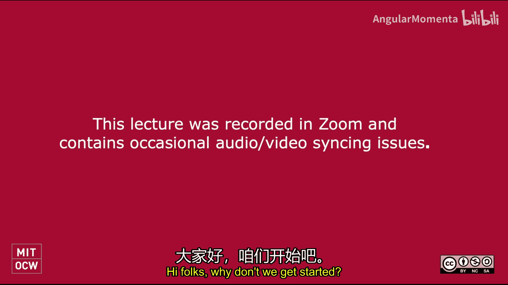
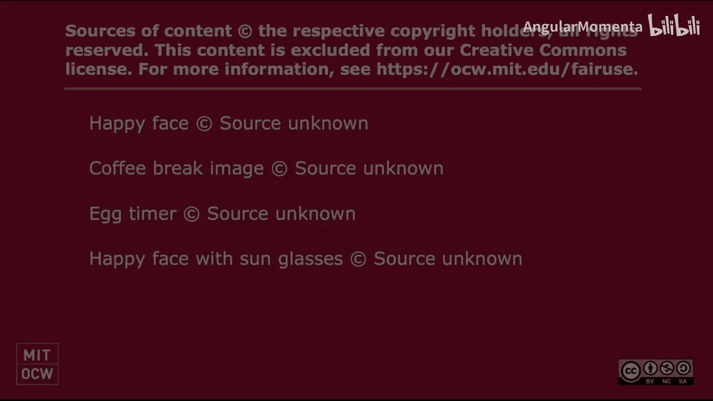

# 【麻省理工】计算理论  ｜  MIT 18.404J Theory of Computation, Fall 2020 p02 2. 非确定性、闭包属性、正则表达式到有限自动机的转换 -BV1pt7GzeEjb_p2-

。Hi folks， why don't we get started？Welcome back。Good to see you all here。So。I am going to first。

Well， we'll recap with what we did last time and what we're going to do today。

 I'll talk a little bit about the problem set。And we'll also have a break as requested halfway through。

So when we jump in， what we did last time was we introduced finite besides introducing the course。

 we introduced finite Atma in regular languages， which are the languages that the finite automata can recognize。

We talked about these regular operations。And and then building those allow us to build what we call regular expressions。

 these are ways of describing languages， so we have fine anatmata can describe languages and regular expressions can describe languages and one of our goals is to show that those two systems are equivalent to one another。

 even though they look rather different at first glance。So to move in that direction。

 we first proved we're going to prove closure properties for all of the for the class of regular languages over these regular operations。

 so we'll show that。Well we already showed that any two regular languages have their union also being regular and we'll show that for the other two operations as well。

 so let's just look ahead to what we're going to do today we're going to introduce an important concept which is going to be a theme throughout the course called nondeterminism。

And we having that as a tool that we can use will be able to show closure under concatednation and star。

Finishing up what we started to do last time。And then we'll use those closure constructions to show how to convert regular expressions to finite finite automa。

And that's going to be halfway to our goal of showing that the two systems are equivalent to one another and the following lecture we will show how to do the conversion in the other direction。

So I thought we would just jump in then and look at return to the material of the course。😡。

As you remember， we were looking at the closure properties for the class of regular languages。

We started doing that and if you recall， hopefully we did closure under reunion and then we tried to do closure under concatenation。

 which I have shown here on the slide， the proof attempt。That we tried to do last time。

 And let's just review that quickly， because I think that's going to be helpful to see how to fix the problem that came up。

 So if you remember we had a。You know， we're given two regular languages A1 and A2。

 and we're trying to show that the concatenation language A1 A2 is also regular。

And so way you the way we go about all of these things is， you know。

 we assume that A1 and A2 are regular， so that means we have machines finiter automa for A1 and A2。

 we'll call them M1 and M2。😡，That recognize A1 and A2 respectively。

And then what we need to do in order to show that concatenation is regular is to make a mis finite automaton what recognizes the concatenation。

😡，And we tried to do that last time。If you remember that concatednation machine M we calling it。

 what is it supposed to do， it's supposed to accept its input if it's in the concatednation language and that means that the input can be split into two parts。

 x and y where x is in the a language and y is in the B y is accepted by M1 and x is accepted by M1 and y is accepted by M2 sorry garbled that so x should be in a1 and y should be in a2 if you can split W that way。

 then M should accept it so M has to figure out if there's some way to split the input so that the first machine accepts the first part。

 the second machine accepts the second part。😡，And the idea that we came up with for doing that。

Was to take these two machines。Build them in to a new machine M。😡。

And then connect the accepting states for M to the connect the accepting states for M1 to the start state for M2。

Um， because the idea would be that if M1 has accepted an initial part。

 you want then you want to pass control to M2 to accept the rest。😡，But as we observed。

 that doesn't quite work because。😡，The first place to split W。

 after you found an initial part that's accepted by M1 may not be the right place because the remainder may not be accepted by M2。

 you might have been better off waiting。😡，Until you found another place that M1 accepted later on in the string。

 say over here。😡，And then by splitting it over there。

 then maybe you do get successfully find that the remainder is accepted by M2。

 whereas if you tried to split it， you know the first place。

 the remainder wouldn't have been accepted by M2 so all you need to do you know M has to know is there some place to split the input so that you know you can get both parts accepted by the respective machines。

😡，The problem is is that M might need to know the future in order to know where to make this split。😡。

And it doesn't have access to the future， so what do we do？

So what we're going to do is introduce a new concept that will allow us to basically get the effect of M1。

And it's sort of being able to see the future。And that new concept is going to be very important for us throughout the term。

 it's called non determinism。And so we're going to introduce a new kind of finite automaton called a nondeterministic finite automaton。

 and first we'll look at that and then we'll see how that fits in with the previous deterministic finite automaton that we introduced last time。

So here's an example， always good to start off with an example。😡。

Here is a picture of a nondeterministic finite automaton looks very similar at first glance to the former kind。

 the deterministic finite automaton， but if you look a little carefully you see that there are some key differences the most important difference is that。

嗯。The in state Q1， for example。Whereas in the machines that we introduced last time。

 there had to be exactly one way to go on each possible input symbol so you knew how how to follow along through the machine as it's computing。

 here there are two ways to go。😡，In Q1， you can either stay in Q1 or you can go to Q2。😡。

That's the essence of non determinism， there could be many ways to proceed。And furthermore， on Q1。

 if you get a B， then there's nowhere to go。😡，So。That's also possible within nondeminism。

 there could be， so let's just start looking at these features。There are multiple paths forward。

 but multiple paths possible， you might be able to have one as we had before or many ways to go at each step or maybe zero ways to go at each step those are all legitimate for a nondeterministic machine which doing a nondeterministic computation。

😡，Another difference， if you look carefully， is that we're allowing here the empty string to appear on a transition。

😊，That's perhaps a little less essential to the spirit of nondeminism。

 but it's going to turn out to be a convenience when we actually apply nondeminism to build machines。

😡，As you'll see very shortly。嗯。Now， if there are many different ways to go。

And some of those ways to go might have different outcomes。😡，As we remember from before。

 we accepted the input if you end up in an accept state and we rejected the input。

 if you end up not in an accept state in a non accepting state， then you reject。😡。

But now there might be several different ways to go。😡，So， and we'll do an example in a minute。

 But there might be several different ways to go， and they might disagree。Some of them might accept。

 other ones might reject， and so then what do you do？😡，Well， in that case。

Acceptance always overrules rejection， that's the essence of non determinism the way we're setting it up。

😡，You may ask why that is and you know， sort of the spirit of that will become clear in due course。

 but right now just take it as a rule when we're having a non deterministic machine。

 acceptance overrules rejection。😡，So as long as there is one accepting copy one of the possible ways to go ends up at an accept。

 we say the whole thing is accepted。😡，The only way could possibly reject if all of the possible ways to go end up at a rejection end up at a non accept state so what we'll see example I think we're go to do an example right now yeah so。

😡，We take， for example， this machine N one now on an input AB。

And we're going to process the symbols one by one， just like we did before。But now to follow along。

 there might be several different ways to go so if we take the。😡，The first。

Symbol A and we run the machine so the machine starts at the start state as before。

 but now when a comes in and there might be two now there are two different ways to go so we're going to keep track of both of them。

😡，After the machine reads an A， you can think of it as being in two states now simultaneously。

 it can be in state Q1 and it can be in state Q2， so those are two different possible places it could be at this moment。

😡，Okay。Now now we read the next symbol。The B and from a B。

 you take all of each of the places where the machine could be at the end of the previous symbol。

 and you then apply reading a B， the next symbol to each of those from each of those states where the machine could be from the previous symbol。

😡，So the machine could be in Q1 and Q2 after reading an A， now we apply a B。

 well Q1 on a B goes nowhere。😡，So you think of that branch， if you will。

 of the computation as just dying off， it has nowhere to go， it just vanishes。😡，However。

 when youre the other possibility which was state Q2 on a B does allow does have a place to go。

 so that the machine is now going to go from Q2 to Q3 when on that branch of the computation which on reading a B and then。

😡，It has。呃。嗯。Coming out of Q3， there are two symbols， there's an A and an empty string symbol。😡。

Now on an A， the machine would have to read an A in order to transition along that arrow。😡。

But when there's an anti symbol on the arrow， that means the machine can go along that arrow for free without even reading anything。

😡，As long as it gets to Q3， it can automatically jump to Q4。😡，And so。

Once it has read a B and gone to Q3。Now。It it can either stay in Q3 or it it can go along the empty transition and go to Q4 so again it is going to be a non deterterministic step at this point。

😡，The essence of having a empty transition is that there's going to be nondeterminism。

 that's why we didn't introduce that for deterterministic automata because you don't have to transition along an empty string transition。

 you can stay where you are or you can go along the empty string transition without reading an input and go over to the next state。

 which in this case is Q4。😡，So let's just see where we are after reading an A， we're in states Q1 Q2。

 but now after reading a B， we're in states Q3 and Q4 as possibilities and and now we're at the end of the input and we look and see what we got。

😡，If any one of the states as possibilities that we are right now at the end of the string is an accept state。

 then we say overall the machine has accepted。😡，So that corresponds to what we' said over here before。

 except the input if some path leads to an accept。😡。

So if any way of proceeding through these you know。

 nondeterministic choices will lead you to an accept。

 then you will say we want to accept the input okay so this input here is accepted。😡。

Let's do another example， suppose we have the input AA。😡，Instead of AB。So AA， you know。

 after the first A as before we're in states Q1 and Q2 as possibilities， now we read an A again。

 now the one that's on state Q1， that possibility Q1 possibility after reading an A。

 it again branches to Q1 and  Q2。😡，Um so when we know after reading the second A。

 we're going to be in at least Q1 and Q2 now how about the the state that had been， you know。

 on Q2 on reading an A？Um the one from before after reading the first A you were in Q2。

 now reading the second A there's nowhere to go， so that one just gets removed。😡，So after reading AA。

 we remain in states Q1 and Q2 as possibilities。😡，Neither of those are accept states。😡，So therefore。

 on input AA， the machine rejects。😡，Okay。😊，Let's just do a couple more and then I'll ask you to do one。

So we have ABA as an input let's see what happens then， so we have a remember after reading AB。

The machine is in the two states，2，3，2，4 as possibilities。

 That's what we had from from the first example。So after reading AB， we're in states Q3 Q4。

 now we read another A， the Q4 on an A has nowhere to go， in fact， it has nowhere to go on any input。

 so no matter what comes in after you're instate Q4， that branch dies。😡，But on Q3。

 which is another one of the possibilities reading an A。

 it can follow along this transition because that's one of the labels on that transition is a。

 so you can follow along just the transition from reading an A。

 which is the last symbol in the string and so now after ABA you are in only state Q4 as a possibility。

 but that happens to be an accept state， so the machine accepts。😡，U。Okay， and now lastly。

 what happens， let's take our final examples， what happens if we have ABB？So， you know。

 as you remember before， when we were after reading AB。

 that was the first example we were in states Q3 Q4 as possibilities， now we read a B。

 will neither of those states have anywhere to go on a B。😡，So now all threads。

 all branches of the computation die off。😡，And at this point the machine is totally dead。

 it has no no active possibilities left， so certainly it's going to reject this input because none of the active states。

 there are no active states are accepting states and in fact。

 if you looked at anything that came later they would anything that extended the string ABB would also be rejected because once the machine old。

😡，All possibilities have died off， there's no way for them to come back to life on any extensions。

So with that。Oh I has an important point before I'm going to jump to a check in on you。

 but I think one thing that you know might be on your mind about this nondeterminism is how do we actually that how does that correspond to reality well it doesn't。

嗯。We're not intending for nondeminism as we're defining it to correspond to a physical device。😡。

But nevertheless as you'll see it's a very mathematically useful concept this nondeterminism and it's going to be playing a big role throughout the subject as will as we'll experience it during the rest of the term so with that i'm going to have a little check in it's going to give i'm going to ask you to consider what happens on one of the inputs so here we go what does it do on input AAB so here's the machine you can look at it and i'm going to supposed hopefully there's a poll here for me to give it to you。

So you can give me your input。嗯。So what does the machine do on input A？A B。Most of you have answered。

Again， you're not going to be penalized for getting the wrong answer， but。Hopefully。

You'll get the right answer。Anyway， let's just take a look here， so time is up。Let's end the polling。

And share the results。So the majority of you， majority， have gotten the correct answer， which is a。

 the machine does accept AAB。Uh， because， you know， when you have a。

 so if you if you like I'll show you the path that corresponds to accepting you go a。A， B。

 and then empty strip。And so that。Sequence of steps。

Is one of the non deterministic possibilities that the machine can follow？

And that shows that the machine does accept the input AAB。

 you know you could think about it the way we did it before also you know if you read an A it's in the two possibilities Q1 Q2。

 you read a second A again in the possibilities Q1 Q2 now you read a B。

 it's into possibilities Q3 Q4 and that's it AAB， so now you read the B it's inossibility Q3 Q4 Q4 is an accepting state that overrules the non-accepting state and so the machine accepts。

You have to understand this， so if you didn't get it right。

Go back and think about where you slipped up okay， because this is。You know， you know。

 this is just getting， we're just getting warmed up。

Here it' going to get it's going to get a lot harder。Okay。

 so stop sharing the results and so let's continue。So now。Just as we did last time。

 we can formally define a non deterministic finite autometer， here's the picture again。Okay。

 so it looks a lot like the case we had before， the deterministic finer automato or DFA as we'll call them。

 it's a five tuple so I've sort of，Written down little reminders for what those components of that five tuple are。

 that list of five components， so they're all the same as before states。

 alphabet transition function start state and accepting states so that the formal definition looks exactly the same except the structure of the transition function。

So now， before， if you remember， you had a state and an input symbol and you got back a state。😡。

Now we have something more complicated looking， we have a state and an inputot symbol。😡。

But you it's instead of just Sigma， it's sigmas of epsilon。

 and that's a shorthand for Sigma union epsilon。And that's a way my way of saying that you're allowed to have on your transition arrows either an input symbol or an empty string。

 so the transition function has to tell you what to do when you have empty string coming in as well so that would be part of your table for the transition function now over here what's going on over here well now。

😡，Instead of just producing a single state。😡，You know， when you've read， for example。

 in A on from Q1， there's a whole set of possibilities。So here we have what's called the power set。😡。

That's the set of subsets of the collection queue， so here we're going to produce an entire subset of states instead of just one state coming out。

 there might be a subset of possible states that you can go to。😡。

So the power set of Q is a set of subsets of Q。That's what this notation means。Again。

 this is something that。I'm hopefully presenting to you as a bit of a reminder you've seen this somewhere else before。

 but please make sure you understand the notation going forward because we'll be doing less hand holdinging as we start moving forward。

😡，Um， okay。So just let's take a look at the N one example here。

 just to illustrate what's going on when you're in state Q1 reading an A。😡。

Now you get a whole set of possibilities， which in this case is Q1 and Q2。

UmWhereas if you're reading a B， what would be that set？😡，Coming out of Q1。

 what's the set of possible successor states？Well， there are none， so it's the empty set。Okay。

 so this is hopefully you're understanding the notation here， so now here's I think really important。

How do we understand non determinism intuitively speaking。

 and there are multiple different ways which each has their value under different circumstances。😡。

So one way is thinking about non determinism as a kind of parallelism。

So every time the machine has a nondeterministic choice to make where there's more than one outcome。

 you think of the machine as branching， forking new threads of the parallel computation at that stage。

 where it makes entire copy of itself when there's a choice of possibilities。😡。

And then each of those independently proceeds to read the rest of the input as separate threads of the computation。

 So if you're familiar with parallel computing， this should be reasonably familiar to you the only key thing to remember is that as this thing forks a number of possibilities。

😡，The acceptance rule is that if any one of those possibilities gets to an accept at the end of the input。

 it raises a flag and says accept， and that overrules everybody else。😡，So acceptance dominates。

So another way of looking at it is the mathematical view。

Where you can imagine and we're going to use all these。

 so it's you really need to understand them all the mathematical view。😡。

Is you can think of the computation as kind of a tree of possibilities。

So you start off at the very beginning， sort of at the root of the computation。

 which is when it really begins， but every time there's a non deterministic branching that occurs。

 the tree has that node of the tree has，Multiple children coming out of that node。

 and so the different threads of the computation correspond to different branches of that tree。

And now you're going to accept if any one of those branches leads to an accepting state。😡，Okay。

 Virginia， obviously somewhat similar to what we had before。

 but I think it's a little bit of a different perspective on how to think about nondeterminism。😡。

And the last one is going to sound a little weird。But actually。

 I think for people who are in the business。It's the one they use the most。😡。

And that's the magical way of thinking about nondeminism。And that is。

When the machine has non deterministic choices to make。😡，You think of the machine as magically。

Guessing the correct one at every stage and the correct one being the one that will eventually lead it to accept。

😡，Okay， so you can think of the machine as guessing。Which is the right way to go？

And if there is some way right way to go， it always guesses right。

 of course if the machine ends up rejecting because there is no right way to go。

 then it doesn't matter there is no good guess， but if there is some good guess。

 we'll think of the machine as taking that good guess and going that way。😡，Okay。

So now here is very important thing， we introduced this new model。The nondeminants ofatton NA。

It turns out to be， even though it looks more powerful because has this non determinism。

 it isn't any more powerful， it can do exactly the same class of languages， the regular languages。

 and we'll show that。😡，With the theorem here that if an NfaA recognizes a， then a is regular。

So we'll prove that by showing how to convert an NFA to an equivalent to DFA。

 which does the same language， so we can take an NFA that has the nondeterminism and find another DFA which doesn't have nondeterminism but does the same language。

 it accepts exactly the same strengths。😡，Even though it' lackx， that not determines the capability。

This is going to be extremely useful， by the way。 In， for example。

 in showing that closure under concatenation。Okay， so。You know， in this presentation here。

 I'm going to ignore the epsilent transitions because once you get the idea of for how to do this。

 you could figure out how to incorporate them and they just make things a little more complicated。

 so let's just focus on the key aspect of nondeterminism。

 which is that the machine could have several ways to go at any point in time。😡。

There could be several next states on an input。Okay， now the idea for the construction。

 so we're going to take， we're going to start with a non deterministic machine M。😡。

And we're going to build a deterministic machine M prime， which does exactly the same thing。😡。

And the way M prime works is it's going to do what you would do if you were simulating M。😡。

What would you do means this is what we were doing as I was explaining it to you？

If you are simulating M， every time you get an input symbol。

 you just keep track of what is the set of possible states at that point in time。😡。

That's what the DFA is going to do。😡，It's going to have。

It's going to have to keep track of which possible set of states the NA could be in。

At the point on that input， where we are right now。😡，And then。As you get the next symbol。

 the DFA is going to have to update things to keep track of the next set of states the NA could be in at this point。

😡，Just like you would do。Okay， and so here's a kind of a picture and。

How do we implement that in so here's the NFA that we're starting with M。

 and we're going to make here the DFA。😡，But。In order to remember which set of states that DFA could be in at a given point。

 so maybe it's the set of states that M could be in。

 do I say that're wrong which set of states the NfaA could be in at a given time。

 so maybe M the NfaA could be in at some point， state Q3 and  Q7。😡。

The way the DFA keeps track of that， it's going to have a state for every possible subset of states of the NFA。

😡，That's how it remembers which subset of states the NfaA is in， that's the way DFs work。

 they have a separate state for each possibility that they need to keep track of。😡。

And the possibilities here are the different subsets of states that the NA could be in at a given point。

Okay， so。Corresponding to this subset to these two possibilities Q3， Q7。

 the DFA is going to have a state with the subset Q3 Q7。

 and it's going to for every possible subset here there's going to be a different state of MP。😡。

So M prime is going to be bigger。嗯。Okay， so quickly， the construction of M。

 the states of M prime now， Q prime are going to be the power set。😡。

The set of subsets of states from the original machine M。Um， and。Yeah。

Now we have to look at how the transition function of the DFA mean the primed machines are the DFs。

 the DFA machines， so these are the deterministic components。

 so deelta prime when it has a subset that you know something like this one of its states which corresponds to a subset of states of M and a reason input symbol。

 you just have to do the updating the way you would naturally do。

 you're going to look at every state in R look at where that can go under a so there's a bunch of sets there and look at all the possible states that could be in in one of those subsets and that's the set of states that you could be in that's going to be the new set of states and that's going to be the new state of m prime。

😡，Okay， so it's going to be the subset corresponding to all of the states that could be in。

When you apply the transition function of the non deterministic machine to one of the states in the subset of states that the non deterministic machine could be in。

 okay？It's a little bit of a mouthful you。I suggest you look at this if you didn't quite get it after the fact。

 good to understand。The starting state for the NFA for the DfaA I'm sorry is going to be which subset now we're going to start off with it's going to be the subset corresponding to just the start state of。

😡，Of M and the accepting states are going to be of the deterministic machine are going to be all of the subsets that have at least one accepting state from the NFA。

Okay。😊，So I hope you got that because i'm going to be going to give you another little check in here。

 which is i'm going to ask you how big is m prime how many states does m prime have I told you what those states are so just go think about that。

So check in two， if M has N states， how many states does M prime have by this construction？Okay。

 so let's launch the next poll。嗯。嗯。Okay。Five seconds， and I think we're almost done here good。嗯。

All right， share results。I don't know if sharing results is a good thing I'm not trying to make you if you didn't get the right answer because most of the people did get the right answer it didn't get the right answer trying to make you feel bad。

 but I do think you should it's a little bit of suggestion you know that you need to review some basic concepts so the basic concept here is if you have a collection you have a set of states how many subsets。

Are there and the number of subsets is going to be exponential。

So if you have a collection of n elements， the number of subsets of those n elements is 2 to the n。

 that's the fact we're using here and that's why M prime has two to the n states if M had n states。

And that's， you know， you should make sure you understand why that is。Al right， so with that。

As requested， we're going to have a little break and that break is going to last us exactly。

Five minutes。嗯。So we we will return in five minutes i'm going to be prompt so I give you a little timer here so please。

呃。I'm gonna。Begin it， right when this is over。Okay。Almost， almost ready。I hope you're all refreshed。

And ready for the second half。So now now that we have non determinism。

We're going to use that as a tool to prove the closure properties that we were aiming for starting from last lecture。

Okay， so remember。We let's look at closure under reunion now we already did that。

 but I'm going to do it again， but this time using nondeminism and you'll see how powerful nondemin nondemin nondeminism is because it's going to allow us to do it kind of。

😡，Almost with no effort。We'll start off the way we did before。😡，We're going to start off with two。

DFAs， but actually these could be NAs even， but let's say we started with the two DFAs for the two languages A1 and A2 and we're going to construct the NFA now we're going to construct an NFA。

Recognizing the union。And that's good enough because we already know that we can convert NFAs to DFAs and therefore they do regular languages too。

Okay， so now here are the two DfaAs that do the languages A1 and A2。😡。

And what I'm going to do is I'm going to put them together into a bag of states。

 which is going to be M。😡，NFA that's going to do the union language so remember what what does M supposed to do M is supposed to accept its input if either M1 or M to accept。

😡，So how is it going to do that what it's going to do we're going to add a new state to M which is going to branch under epsilon transitions and now you can start to see how useful these epsilon transitions are going to be for us going to branch under epsilon transitions to the two original start states of M1 and M2 and we're done。

😡，Why？Well now non deterministically， as we get an input， W coming in to M。😡。

And at the very beginning， even just right after it gets going。

 the very first thing that happens is it's going to branch to M1 and also branch to M2 non deterministically as two possibilities。

😡，And then inside M1 and M2， it's going to actually start reading the input。

 and each one is going to be now following along， as it would have originally the states corresponding to reading those input symbols。

😡，And am。As a combination of M1 and M2 is going to have a possibility for one state and M1 and one state in M2。

😡，And so M is going to have those combined into one package and now if either at the end of the input。

 if either of these end up at an accepting state，😡，Then， M。

is going to accept as a nondeministic finite automaton because that's how nondeminism works。

 you accept if either if any one of the branches ended up accepting。

 which is just what you need for nondetermined for union。😡。

So we do it doing union and we want either one of these two would be accepting and the nondeminism justice built conveniently to allow us to do the union almost you know for free。

So you can again， thinking about non determinism as terms of parallelism。You could think of it。

 the non deterministic machine is running in parallel M1 and M2 on the input。😡。

And if either one of them ends up accepting， M will accept。

Or you can think about it in terms of that guessing that I referred to before。

 which means that as M is getting when it's just about to read these the first symbols of its input。

 it guesses。😡，Whether that's going to be an input accepted by M1 or an input accepted by M2 and the magic of nondeterminism is that it always guesses right。

😡，So that input happens to be some an input that's going to be accepted by M2 M is going to guess that M2 is the right way to follow and it's going to go in the M2 direction。

😡，Um， because non determinism， the magic is， you always guess right。IWish that was true in real life。

Would make exams a lot easier anyway， so now let's see how we can use that to do closure under concatenation。

Okay， so now we're going to actually have a picture very similar to the one we had originally。

 but now using nondeterminism we can make it work， so here we have the two machines doing the two languages A1 and A2 and we're going to combine them into one bigger machine M。

As shown。Remember， what M is supposed to do is accept its input if there's some way of splitting that input such that the first half is accepted by the M1 and the second part is accepted by M2。

😡，Way we're going to get that effect is by。Putting in。A呃。E transitions。

 epsilon transitions going from for the accept states of M1 to the start state of M2。

Just as I've shown here in this diagram。 So these were the original accepting states of M1。And now。

They're going to be declassified as accepting states， but they're going to have new transitions。

 empty transitions attached to them， which allow them to branch to M2 without reading any input。😡。

And so intuitively speaking， this is going to do the right thing because once M1 has accepted some part of W。

 then you can non deterministically branch to M2。😡。

And you're going to be start processing inside M2 and the point is as I kind of jumped ahead of myself is that the reason why it fixes the problem we had before is that the epsilon transitions are don't machine does not have to take them。

It can stay where it is。As one non deterministic option。

 or it can move along the epsilon transition without reading any input as another non deterministic option。

😡，So it's using this nondeterminism now to both stay in M1 to continue reading more of the input and to jump into M2 to start processing what might be the second half or the second part of the input。

 which M2 accepts。😡，And you can think of it in terms of the guessing is that the machine is guessing where to make that split。

Once it found an initial part that's accepted by M1。

 it guesses that this is the right split point and that passes to M2。

 but there might be other guesses that it could make corresponding to other possibilities。😡，And so。

With non determinism， it always guesses right if there is some way to split a string into two parts。

😡，Accepted by M1 and M2， the machine will make that good guess and then。

M1 will accept the first part and M2 will accept this with the second part and we'll get am accepting that whole string altogether。

 and so that is the solution to our puzzle for how do we do closure under concatenation。Okay。

 I hope that came through because this is， this is， you know。

 we're just getting going with nondeterminism， we're going to be using nondeminism a lot and you're going to need to get very comfortable with it。

Okay， now let's do closure understar and closure under Star works very similarly。

But now we're just going to have a single language of A is regular， so is a star。

 so they're not a pair of languages because a star is a urinary operation。

Applying to just a single language。So if we have a DFA recognizing A。

 in order to show that a star is regular， we have to construct a machine that recognizes a star and what the machine we're going to construct is as before and that an NFA。

Okay， so。Here is M， the DFA for A。😡，And we're going to build an NA M prime that recognizes a star。😡。

And let's think now， what does it mean to recognize a star so when should you if I'm going to give you an input。

 when is it in the star language， what does M prime have to do？😡，Um， so remember what star is。

 star means you can take as many copies of as you like of strings in the original language and that's in the star language。

😡，So to determine if something's in the star language， you have to see。

 can I break it up into pieces which are all in the original language？😡，So。So you want to see。

 can I take my input W and cut it up into a bunch of pieces for in this case。

 where each of those pieces are members of A， they're members of the original language。

 so that's what that's what M prime's job is。😡，Its it has its input and wants to know。

 can I cut that input up into pieces， each of which are accepted by the original machine？😡，Mm。

That's what impprime does。And if you think about it， you know。A little bit really。

 what's happening is that as soon as。M so you know M prime is going to be simulating M that's why I like to think about this as having M inside so you know you're going to run if you are going to be doing this yourself。

 you're going to take W， you're going to run it for a while， you'll see oh M is accepted。😡。

Now I have to start M over again。😡，To see if it accepts on the next segment。So every time M accepts。

You're going to restart M to see if it accepts another segment。

 and so by doing that you're going to be cutting W up into different segments。

 which are each of which is accepted by M。😡，Of course。

It's never totally clear whether you should for any given segment。

 you should cut it there or you should wait a little longer and find another a later place to cut。

 but that's exactly the same problem that we had before with concatenation and。😡。

We solve it using nondeminism and we're going to solve it again using nondeminism。

So the way we're going to get that effect of starting the machine over again once once it's accepted is by adding in。

😡，Epsilon transitions that go from the start states from the accept state back to the start state。嗯。

So now every time M has accepted， it has an option， not a requirement， but it has an option。

 it can either stay continuing to process or it could restart。😡。

Making a cut at that point and trying to see if there's second another segment of the input that it's going to accept。

And this is basically the whole thing with one little。Problem。That we need to deal with and that is。

We need to make sure that in prime。Acept the empty string because remember。

 the empty string is always a member of the starred language。And as it's written right now。

 we're going to be requiring there to be at least one copy。😡，Of one at least one segment。

 we're not taking into account the possibility of no segments， which is the empty strain。

And the way we're going to get that is， well， I mean， one thing。

One way to get to Ed so so you know we're missing the empty string right now so how do we fix it basically you know we're just going to take the construction we have we're you know on on the screen and we're going to adjust it to to Ed in the empty string because it's possibly missing one way to do that which is tempting but。

😡，Wrong。Is to。Make the start state of M an accepting state for m prime so we could have made this an accepting state too。

 and now M prime is also going to accept the empty string， that's the good news。😡。

The problem is that。嗯。The start state might be playing some other role in M besides just being the start。

 there might be times when M comes back to the start state。😡，You know， later on。

 and if we make the start state and accept state， it's going to start suddenly start accepting a bunch of other things too。

 which might not be intended。😡，So it's a bad idea to make the start state and accept state instead we'll take the simple solution alternative of adding a new start state which will never be returned to under any circumstances and make that a new start and accept state as well so here we'll have to make this additional modification so as I'm saying this is what we need to do and way will do that is by adding a new start state which is also an accept state to make sure it accepts the empty string。

And then that also can branch。To start off M。As before。

If the string that's input is not the empty string。

 and so then you know M prime is actually going to have to do some work to see if it can be cut up as it was doing before。

So that's the proof of closure under Star I'm not going to do it anything beyond what I've just described these proofs by picture are convincing enough I hope and if not you know you should they are explained in somewhat more detail somewhat more formally in the textbook but for the lecture this is where I'm going to stop with these two arguments and so now oh yeah one quick check in on this。

So if M has N states， how many states does N prime have by this construction？

So let's do really these are。I'm not intending these to be very hard more just to keep you awake。

So how many states does？M prime half。ok。Maybe a little too easy even for a check in。Yeah。

 everybody's getting this one because all you did was we added one new state so the answer is as you have I think should pretty much everybody is observing that it's just the it's number B so I'm going to end the polling and'm going to share the results。

And everybody got that one， and so let's continue on。

And so the very last thing we're going to do today and show you how to convert regular expressions to NFAs。

Thereby showing that every language that you can describe with a regular expression is a regular language。

😡，嗯。On Tuesday we'll show how to do the conversion in the other direction and show thereby showing that these two methods of describing languages are equivalent to one another。

 so here's our theorem if r is a regular expression and a is the language is instead of strings that regular expression describes。

 then a is regular。系い。😊，So we're going to show how to convert the strategy is to convert R to an equivalent NFAM。

And so we have to think about， remember these regular expressions that we introduced last time。

 these are these expressions that look like， you know， A B， union B star， something like that。

 so built up out of the regular operations from from the primitive regular expressions that don't have any operations that we're calling atomic。

So if R is an atomic regular expression， it just looks like either just a single symbol or an empty string symbol or an empty language symbol。

Or are can be a composite regular expression。Whoops。We're having a little。Yeah。

 so we have two possibilities here， R is either atomic or composite。

 and so let's look at what the equivalent expression is in each case。

So if R is just the single letter regular expression， that's a totally legitimate regular expression。

 just the regular expression one。😡，So that just describes the language of the string one。

So we have to make an NFA accepts which recognizes just that language。

 it accepts only the string one。😡，So it's a very simple NFA it just starts in the start state and on that single symbol it branches to an accept state and there were no other transitions allowed。

 so if you get anything else coming in besides that one that string which is just that one symbol the NFA is going to reject it。

Like if it goes， if it's too long you know， if it gets AA coming in， well。

 there's nowhere to go on from this accepting state on an A so the machine is just going to die。

 it has to be in an accept state at the end of the input。😡，嗯。Um。

 how about you want don you to think for yourself for a minute。

 how do we make an NFA which accepts only the empty string and no other strings？

You can do that with just one state with an NFA。Just this one here。

The machine is going to start off from the start state。

 which is also immediately an accept state so it accepts the empty string。

But if anything else comes in， there's nowhere to go when the machine does。😡。

So this machine accepts just the empty string or its language is the language with one element。

 the empty string。😡，How about the empty language？Well， here's an NFA which has no accepting states。

 so it can't be accepting anything。Um。Now， if we have a composite regular expression。

We're already finished because we showed how to build up we showed constructions which give us closure under union concatenation and star and those constructions are going to enable us to build up the。

😡，NFAs that do the language of these more complex。😡，Regular expressions built up out of the。

AnFphase that do the individual parts。😡，So if we already have NphaAs that do R01 and R2。😡。

Then the closure under Union construction gives us an NFA that does R1 union R2。

As a language so I'm going to do I hope that's clear。

 but I'm going to do an example which I'll help hopefully illustrate it and it's going to show you basically what I'm giving you is an automatic procedure for converting a regular expression into an equivalent NfaA。

😡，So let's just see if for that procedure in action。

 which is really just following this recipe that I described for you。

 so here is a regular expression a union AB。😡，Star。So this is a regular expression。

 it's some language， whatever it is， I don't care。😡。

But I want to make an NFA which recognizes that same language and the way I'm going to do that is first build NFA for the components。

The sub expressionions of this regular expression and then combine them using our closure constructions to be to be nFAs for larger and larger sub expressionpressions until I get the nFA that's the equivalent of the entire expression so let's just see how that goes so the very most primitive parts some of the smallest sub expressionpressions here are just the sub expressionpressions for a and for B。

So here's the one just for A。So this is the NA， which。Recognizes the language。

 which is just the one string a。😡，Heres the NFA whose language is just the one string B。Um and now。

I want an NFA which is which accepts only the string AB now of course you could just do that by hand yourself it's simple enough。

 but what I'm arguing is that we can do this automatically using the closure construction for concatenation because really there's a hidden concatenation symbol。

 this is you know a concatenate B。😡，So now for AB。I'm going to take the thing from A and the part from B。

So these two things that I had from before and use the concatenation construction to combine them。😡。

You see that， so now I have automatically an NFA which does the language whose string is just AB。

 just the AB string。😡，And it's not the simplest NfaA， you can make a simpler one。

 but the virtue of this one is that I got it automatically。😡。

Just by following the closure construction。So now I'm going to do a more complex one。

 just the inside here， a union AB。😡，so the way i'm going to build that is from the two parts the a part and the AB part you know the a part and the AB part so here's the a part here's the aB part aB part i've already got those from before it's really kind of a proof by induction here。

 but you know I think it's simple enough we don't have to use that language， so we have。😡。

You know the a part， the AB part and now we are going to apply the the。

Closure under union construction to combine those into one machine and remember how that worked。

We add a new symbol here， which branches under empty string to the previous mean we adding a new start state which branches to the original start states under empty transition and now this is a。

An NA for this language， A union AB。And lastly， now we're one step away from getting the star of this and how we're going to do that。

 we're going to take this thing here and apply the construction for the star closure。😡。

And that's going to be an NFA which does a union AB star， which is what we wanted in the first place。

First， we've got to。Bring that one down with because we've already built that one and now remember how we built the closure understar。

We made the accepting states return back to the start state。

 and we added a new start state to make sure we got the empty string in there that transitioned to the original star state under Epsilon。

Okay， so that's all I wanted to say for today's lecture。

 that's do a quick review very important concept， nondeterminism and nondeterministic finite automata。

 we proved their equivalent in power， showed the class of regular languages closed under concatenation in star。

 we showed how to do conversion of regular expressions to NFAs。

So I think that is it for today's lecture and。Thank you all for being here。I mean。

 I'll try to answer a few of these。啊。Why does concatenation have order well because it's an ordered construction is there a simple way to prove closure under concatenation without using nondeminism。

 no？m why are the empty strings at the accept state， can't they be at any state？

Doesn't Star make copies of any part of the input no it's only you have to you have to think about what's going on having you don't want to you have to branch back to the beginning only on and accept because that means you've found a piece that's in the original language。

嗯。Is there an automaton that can add some？Some are subtract。Memory automata well。

Depends on what you mean by all that， but certainly there are more powerful machines that we're going to study than find an automa。

U。But yes， there is and even finite automata can add and subtract if you present the input in the right way。

I refer you to the first problem on the homework。So I think I'm going to check out then。

Take care everybody， bye bye。

