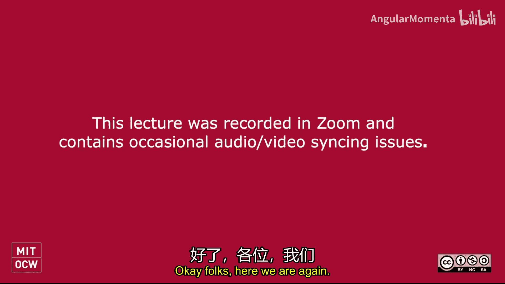
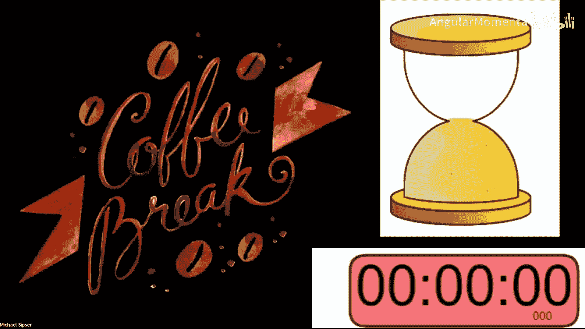
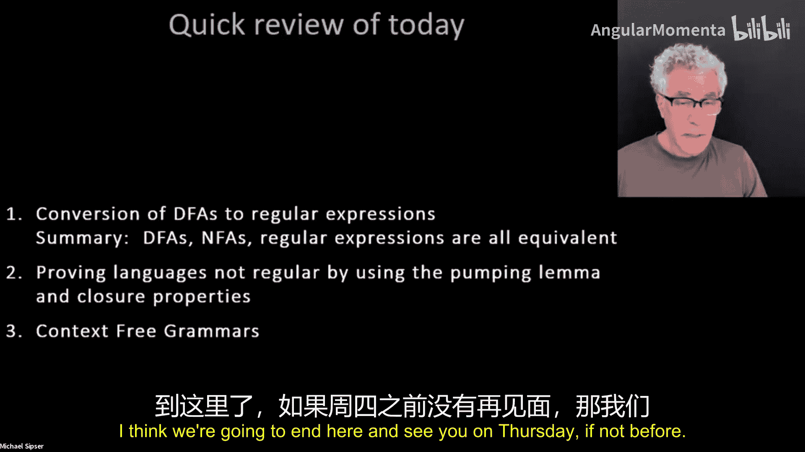
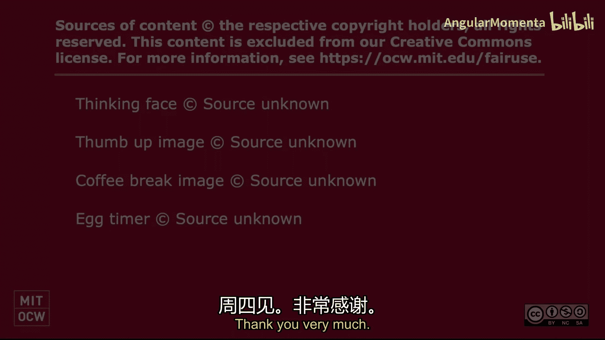

# 【麻省理工】计算理论  ｜  MIT 18.404J Theory of Computation, Fall 2020 p03 3. 正则泵引理，FA到正则表达式的转换 -BV1pt7GzeEjb_p3-

Okay， folks。Here we are again。Welcome back。For another episode of Theory of computationut。

 this is lecture number three。I am I'm going to review our what we've been doing。

 we've been looking at finite automa。And regular languages。

 those are the languages that the finiter automata can recognize。And we talked about non determinism。

 so we had non deterministic fineyatma and deterministic fineyatmata。

 we showed that they're equivalent。We looked at the closure properties over the regular operations。

 union concatenation and ST and showed that the regular language is really the class of regular languages is closed under those regular operations。

And we used the constructions that we developed in the proof of those closure properties to show that we can give way to convert regular expressions to finite anatmetera。

So that is was a partway toward our goal of showing that these regular expressions and finiteatmata are equivalent with respect to the class of languages they described namely the regular languages so regular expressions of finiteatma are interchangeable from the perspective of what kinds of languages you can do with them so we're going to finish that off today so let's take a look at what our next topics we're going to be covering we're going to reverse the construction we gave last time which allowed us to convert regular expressions to finiteatmata now we're going to go backwards we're going to show how to convert finiteatmata back to regular expressions and that those two constructions together show us that the regular expressions and finite automata can be interconverted from one another and they're therefore equivalent with。

Respect to the kinds of things they can do in language recognition。

Or generation then we're going to prove that we're going to look at how you prove certain languages are not regular。

 they're beyond the capabilities of finite automata and finally at the end we're going to introduce a new model of computation which is more powerful。

hen the finite automata and regular expressions， namely the context free grammars。

 those can do other kinds of languages that the simpler finiteatma regular expressions models can do。

 and I would also just like to note that a lot of what we're doing is a warm up toward the more powerful models of computation that we're going to be looking at later。

 well in a week or so， which are more kind of general purpose computation。

 but along the way introducing these models of finite automata and context free languages is interesting and helpful because many of those a number those models turn out to be useful in a number of applications。

 whether it's from linguistics to programming languages and a variety of different parts of computer science and other fields is。

Well use those notions so they're useful notions and beyond just in this course okay so。呃。

I just want a couple of administrative things to touch on。

 we are going to have additional check ins today， as I mentioned to you。

 we're going to start counting participation， not correctness。

 just participation in the live check ins。So with that， let us move on to today's material。

As I mentioned we're going to be showing how to convert finiteatmeter to regular expressions and that's going to complete our equivalentvalence of finiteatma and regular expressions。

 so just to recap what we did last time we showed that if you have a regular expression。

And it describes some language， then that language is regular。😡，So in other words。

 we have a way of we gave a way of converting regular expressions to finite automaa as kind of shown in this diagram。

That's what we did last time。Now we're going to go the other way we're going to show how to convert oh and just a reminder in case you just。

Getting yourself your memory your memory to work maybe they'll help you just to remember that we actually did an example of that conversion we looked at this regular expression a union AB star and we actually worked through the process of converting that oops I need to make myself smaller so you can see all that we went through the process converting a union AB star as an example of that of。

Mein a Mr。Okay， well we went through the process of actually doing that conversion and now we're going to show how to do it the other way around all right so。

So we're going to invert that。And go backwards the other way。

So today's theorem is to show that if a is regular。

 namely it's the language of some finite automadon then。

You can convert it to a regular expression which will describe that same language so basically we're going to give a conversion from finite automata to regular expressions okay but before we do that we're going to have to introduce a new concept so we're not going to be able to dive right into that conversion we're going to have to do introduce a new model first which is going to facilitate that conversion and that new model is called it's yet another kind of finite automaton called a generalized。

Non deterministic， finite automaton or a generalized NFA or just simply a G NFA。

Okay so this is yet another variant of the finite automaton model and conceptually it's very simple。

 it's similar to the NFAs， I'll give you here's a picture of a GNFA named G G1。

Very similar to the NFAs， but if you look at it for a second。

 you'll see that the transitions have more complicated labels。

For the NAs who' are only allowing just single symbols or the empty string to appear on the labels。

 now I'm actually allowing you to put full regular expressions on the labels。😡，For the automaton。

Now we have to understand how a GNFA process has its input and the way it works is not complicated to understand when you're getting an input string。

 feeding when a GNFA is processing an input string， it starts at the start state。

 just like you would imagine。But now to go along a transition。

 instead of reading just a single symbol or the empty string as in the case for the nondeterministic machine。

 it actually gets to read a whole string at one step kind of at one bite。

It can read an entire string and go along that transition arrow provided that。

Trunk of the input that it read is in the regular expression that that。Transition has as its label。

So for example。This， you can go from Q1 to Q2 in one step in this GNFA by reading AABB off the input。

😡，So it reads all of those four symbols all at once。😡。

It just swoops them up and then moves from Q1 to Q2。😡，In one step。Okay， and then when it's in Q2。

 it can read AAB and move to Q3 and Q3 happens there's nowhere to go。

 so this is going to be a nonterministic machine， there might be several different ways of processing the input and if any one of them gets to an accepting state at the end of the input。

 we say the GNFA accepts。😡，So it's similar non deterministic to NFAs in the way the acceptance criterion works。

So you know， you could do an example， but hopefully the concept of how this works is reasonably。

 you know， you can at least buy it that it processes the input in。Chs at a time。

 and those chunks have to be described by the regular expressions on the arrows as it moves along those transitions。

😡，Okay。😊，So。What we're going to do now is to convert。😡，Not。😡，DFAs to regular expressions。

 we're going to convert GNFAs to regular expression。

 that's even harder because GNFAs are allow you to do all sorts of other things besides just ordinary DFAs。

😡，So that's a harder job why am I making my life harder。

 well you'll see in a minute that it's going to actually turn out to be helpful to be working with a more powerful model in the way this construction is going to work。

😡，Okay， now before I dive in and do the construction from GNFAs to regular expressions。

 I'm going to make a simplifying assumption about the GNFAs。😡。

I'm going to put them in a special form that's going to make it easier to do the conversion。😡。

And that simpler form is。First of all， I'm going to assume that GNFA has just a single accepting state。

😡，And that accepting state is not allowed to be the start state。😡，Okay。

 so it has to have just a single accepting state， I've already violated that convenient assumption in this GNFA because I have here two accepting states。

 that's not what I want I want to have just one。😡，Well， the thing is it's easy to obtain just one。

 just to modify the machine so that I have just one by adding a new accepting state。

 which is branched to from the former accepting states by empty transition so I can always jump from Q2 to Q4 at any time without even reading any input just going along this empty transition。

😡，And then I declassify the former accepting states as accepting。😡。

And now I have here just a single accepting state and because it's going to be a new state that I added。

 it won't be the start state， and I have accomplished that one aspect of my assumption about the form of the GNFA。

But there's another thing that I want to do， too。I want to assume， as you will see。

 which is going to be convenient in my。😡，Construction that we will have。

Transition arrows going from every state to every other state in fact。

 I want transition arrows going from every state even back to themselves。

 I want there to be all possible transition arrows should be present with two exceptions。😡。

For the start state， there should be only transition arrows exiting the start state。😡。

And for the accepting state that's just one now， there should be only transition arrows coming in to the start state。

So it's kind of what you would imagine as being reasonable for the other states which are not accepting or starting。

 there should be transition arrows leaving and coming from everywhere else。

 but for the start states just leaving from the accept state just coming in and you could easily modify the machine to achieve that let's just see how to do that in one example。

 so from notice that from Q3 to Q2 there is no transition right now and that's not good that's not what I want I want that to be a transition from Q3 to Q2 well I'll just add that transition in but I'm going to label it with the empty language regular expression。

😡，So that means， yeah， the transition is there， but you never can take it。

So it doesn't change the language that the machine is going to be recognizing。

 but it fulfills my assumption， my convenient assumption that we have all of these transition arrows being present in the machine。

Okay， so anyway， I hope you will buy it， it's not going to be if you don't quite get this。

 don't worry， it's not totally critical that you're following all these these little adjustments and modifications to the GNFA。

 but it will be helpful to understand what GNFA themselves， how they work。So as I mentioned。

 we can easily modify GNFA to have the special form that we're assuming here。All right。

 so now we're going to jump in and start doing the conversion so we're going to have alemma which just like a theorem that really is just a local interest here it's not a general interest theorem it's going to be relevant just to GNFA which really just defined to help us do this conversion they really don't have any other independent value so every going to show that every GNFA has an equivalent regular expression are。

That's really my goal and the way we're going to prove that。Is by induction。

It's going to be by induction on the number of states of the GNFA。

Now you really should be familiar with induction as one of the expectations from being in this course。

 but in case you're a little shaky on it， don't worry I'm going to unpack it as a procedure it's really just recursion you know induction is just a proof that uses induction is really just a proof that calls itself it's just a proof that it's a recursive proof that's all it is so if you're comfortable with the recursion you'll be comfortable with induction but anyway I'm going to describe this as a procedure so if you're a little shaky on induction don't worry。

So the basis is so first I'm going to handle the case where the GNFA has just two states。Okay。Now。

 remember， I'm assuming now my GNFAs are in the special form。😡。

So you can't even have a GNFA with one state because it has to have a start state and it has to have an accept state and they have to not be the same。

 so the smallest possible GNFA to worry about is a two state GNFA。😡，Okay。

 now if we happen to have a two state GNFA， it turns out to be very easy to find the equivalent regular expression。

 why， because that two state GNFA can only look like this。😡，It can have a start state。

 it can have an accept state。And it can only have a transition going from the start to the accept because no other transitions are allowed。

😡，It only has outgoing from the start， only incoming from the to the accept。

 and so there's only one transition and it has a label with a regular expression R。

So what do you think the equivalent regular expression is for this GNFA it's just simply the one that's labeling that transition because that tells us when I can go from the start to the accept and there's nothing else the machine can do it just makes one step which is to accept its input if it's described by that regular expression so therefore the equivalent regular expression that we're looking for is simply label on that single transition。

😡，Okay， so two state Gphas are easy， but if what happens if you have more states。

 then you're going to actually have to do some work。😡，So we call that the induction step。

 that's when we have more than two states and what that the way the induction works is we're going to assume we already know how to do it for k minus one states。

And we're going to use that knowledge to show how to do it for K states。So in other words。

 we already know how to do it for two states， I'm going to use that fact to show how to do it for three states。

And then use the fact that I can do it for three states to show how to do it for four states and so on and so on。

All right。And the idea for how to do that is actually。Pretty easy to grasp。

What we're going to do is if we have a K state GNFA that we want to convert。😡。

We're going to change that K state GNFA to a k minus1 state GNFA and then use our assumption that we already know how to do the K minus1 state GNF。

😡，Yeah。All right， so。In terms of a picture， I'm going to take a case state to prove that I can always convert K state GNFAs to regular expressions。

😡，I'm going to show how to convert the K state1 into an equivalent k minus one state GNF。

 and then if you just like to think of it this procedurally。

 the K minus1 will gets converted to a k minus2， gets converted to a k minus3。

 and so on and so on until I get down to two， which then I know how to do directly。😡，Okay。

 so the whole name of the game here is figuring out how to convert a GNFA that has K states into another one that has one fewer state that does the same language。

😡，Okay so you have to hold that in your head， I mean I wish I had more blackboard space here。

 but you know it's very limited here so you have to remember what what we're going to be doing on the next slide because that's going to finish the job for us as long as I can show in general how to convert a K state GNFA to a GNFA that is one fewer state but it still does the same language。

😡，I'm good。Because then I can keep iterating that till I get down to two。😡，All right。

 so here is this is the the guts of the argument， so I have my case state machine。

 here's my start state， he is my accept state。Here's my K minus one state that machine that I'm going to be building for you。

 it's actually going to be look almost exactly the same。I'm just going to remove one state。嗯。

FromFrom the bigger machine。So I'm going to pick any state。

 which is not the start state or the accept state。Here it is pictured here。I mean。

 all of the states of the K state machine are going to appear in the K minus1 state machine。😡。

Except for one state that I'm going to rip out。😡，Okay。That's the state X， it's now here as a ghost。

It's been removed it's not there anymore， okay， but I'm just helping you to remember that used to be there。

By showing us shadow。 but it's a。I have taken my original machine that had K states。

And basically just ripped out of state。And now I。You know， one fewer state。So the good news。

Is that I now have a machine with k minus1 states， that's what I want。😡。

But the bad news is that it doesn't do the same language anymore。😡。

It's I broke the machine by rip just if you're just going to rip out a state。

 you know who knows what the new machine is going to do。

 it's going to be probably not the same as what the original machine did so what I need to do then。😡。

Is repair the damage。I've got to fix the damage that I caused by removing hex。Okay。

 and whatever role X was playing in the original machine。I've got to make sure that。

The new machine that I have， which doesn't have X anymore， can still do the same things。

That the original machine did。And so the way I'm going to do that is look at all of the paths that could go through x and make sure that they're still present even though I don't have X anymore。

And the way I'm want to do that is I'm going to take。Um。Consider。A part of a path that might use X。

So it starts， let's pick two states， QI and QJ。😡，In the machine that hit K states。Meddle here。

I don't know if this。Okay， we have if we have， we'll pick two states， QI and QJ。

In in the original machine， now QI might。Have the possibility of going to state X。

And then x might have a self loop。And then it might go to QJ。

The new machine doesn't have N X anymore。The way I'm going to fix that。Is by。

Replacing the label that goes directly from I to J。😡。

With a new label that adds in all of the things I lost。When I removed X。Okay。

 that's that's the whole idea here， so here is QI to QJ， but there's no x anymore。😡。

How could I get from QI to QJ？😡， you know， you know， what were the inputs？

That could have brought us from QI to QJ via X。😡，Well。

 they would have been an input that read a string described by R1。😡。

I might have self looked at X a few times， so I might have read several strings。😡。

That are described by R two。And then I would have read a string that was described by R3。

 and now I'm at QJ。😡，Okay， so the new label that I'm going to place over here is。Going to be。

The strings that I get from reading R1， you know， reading a string that described by R1。

 then multiple copies of a， multiple strings that are possibly described by R2。

 which is the same as R2 star。Or and then multiples and then a string that could be described by R3。

So that is a new addition to the transition that takes me from QI to QJ。Of course。

 I need to include the things that would have taken me from QI to QJ in the first place。😡。

So I'm also unioning in R4， what the direct route from QI to QJ that did not transit through X。😡。

Okay， so by making that。 you know， new。Regular expression。On the QI to QJ transition。😡。

I have compensated for the loss of X。For paths that go from QI to X and then out to QJ。

 now what I need to do is to do that same thing for every pair， QI and QJ。😡。

That are in the original machine。And so if I do that for every possible pair。

 I'll be modifying all of the transitions in the new machine in a way that。😡，嗯。

Compensates for the loss of x and now the new machine has been repaired from the damage that I caused by removing X and it does the same language。

😡，It's kind of thing you need to think a little bit about， I understand。

 but at least hopefully the spirit of what I just described to you comes through that we're going to convert this case machine with K states to one with k minus1 states by removing a state and repairing the damage and now it does the same language and then I can remove another state and do the same thing over and over again until I get down to two states。

Okay， so that's the idea， and that really completes the proof that shows that I can convert every GNFA to a regular expression。

Okay， and that really is the end of the story for this。

 and thus I claim that DFAs now and regular expressions are equivalent。

So let me going to give you a little check in here on this， really just to see。

High level if you're following what's going on。Alright。😊。

So just take a look so we just showed how to convert GNFAs to regular expression but we really wanted to convert DFAs to regular expressions so how do we go from converting GNFAs to converting DFAs that's in up the same obviously right so how do we finish that so there are three choices here first we have to show to convert DFAs to GNFAs maybe or show to convert GNFAs to DFAs or maybe we're already done so maybe better launch that poll're while you're reading that。

And there you go。Hopefully， you can。All right， why don't I end this it's a little worry worrisome because I would say we have a plurality who got the right answer。

 but not a majority so let us share the results I think。😊，So I sense not all of you were with me。

But you're going to have to。Either that or you you know you' playing you're reading your email while we're talking。

 I'm not sure， but whatever it is。You need to think a little bit about what's going on here because。

😡，The reason why we are done is because DFAs are a kind of GNFAs。😡，They're just。

 they have a very simple kind of regular expression on each transition。

They just have the regular expression， which is just a single symbol。

So old DFAs are automatically GNFAs， so if I can convert GNFAs。

 I can certainly convert DFAs because DNFAs include the DFAs。

 I'm done really was number C was the correct answer。😡，Okay， so's a good thing we're not。Cテ。

Correctness here。 So participation is good enough。 but I do think you need to think about what's going on and making sure that you're。

 you know， you're're， you're following along。 So anyway， that's a。You know， we'll carry on here。

 but makes me a little concerned。Okay， so let us now move on。

 so we're going to talk a little bit about non regular languages。嗯。

So somebody's asking don't we have to still make the DFAs into the special type。

 yes we do we have to make them to the special type。

 but we already showed how to make GNFAs into the special type and DfaA that is going to apply to DFAs as well you know they'll become GNFAs you know you can add the extra starts at a new start state at a new accept state add an older transitions with which you didn't have before with the empty language label and you'll have a GNfaA from a DfaA but that applies to GNFAs as in general so it's nothing special about DFAs there anyway I think you need to true on that and hopefully you know you'll be following going forward anyway let us look now at non- provinging non-regularity so we're finished with our goal of showing that regular languages that regular languages can either come from。

DFAs or from regular expressions， those are the same in terms of from the perspective of our course。

 they're interchangeable。😡，Okay， so now as we mentioned。

 there are going to be some languages which are not regular which can't be done by DFAs。

 they're actually DFAs are actually pretty weak as a computational model and so there's all sorts of very simple things that they cannot do though there are some fairly complicated things that they can do surprisingly enough。

But anyway， there are some simple things they cant do。

 and so we have to develop a method for showing that a language is not regular and that's going to be useful for your homework and in general for just understanding the power of DFAs。

So how do we show a language is not regular so remember if you want to show a language is regular basically what you need to do is give a DFA or you know you can use the closure properties that's another way of showing the language is regular but underneath that it's basically constructing DFAs。

😡，All right， to show a language is not regular， you have to give a proof。

Generally not a construction， it's a proof that there is no DFA or that whatever that it's just going to be impossible to make a DFA。

And we have to develop a method， what is that proof method？Now。There is a temp， you know。

 I've taught this course many times and there's a kind of attempting。

Approach that many people have it's not only going to apply for finiteatmata。

 but for other things too， and believe me it's not only people in this class。

 it's for people out there in who are trying to think about computation in general。Which is to say。

 well， you know。You know I have some language of trying to figure out if it's regular or not。

 and so I thought really hard how to make a DFA and I couldn't find one， therefore it's not regular。

😡，That not that's not a proof。Just because you couldn't find a DFA doesn't mean there is no DFA。

You need to prove。That the language is not regular using some method so I'm going to give you example where that kind of approach can lead you wrong and that is I'll give two examples of languages where you might try to prove their regular or not and you could be in trouble if you just follow that kind of informal approach。

So if you take the language B， where these are straight。

 well let's assume our alphabet is zeros and ones。B is the language of all strings that have an equal number of zeros and ones so you want to know you know if I have a thousand zeros I need to have a thousand ones。

 so basically the way you test that you'd have to count up the number of zeros。

 count up the number of ones and see if those two counts are the same。

And that's going to be really tough to make a DFA do because it know how are you going to remember such you know that really big number of zeros that you know。

 the DFA might have 50 states， but you might need to count up to 100 or a million to figure out to count up how many zeros you've seen。

😡，And it seems really hard to be able to do that kind of account when you only have 50 states so whatever number of states you have it it seems hard to count when have limb when you have a finite automaton so the intuition is it's not regular because a finite automaton can't count which。

In this case， you can convert that intuition into a real proof。

 I would say it's not a real proof yet。😡，But it can be made into a real proof。

 but compare that case with another language， which I'll call C。

Which instead of looking at its input to see whether it has an equal number of zeros and ones。

I'm going to look at the input and look at the substrs of zero ones and one zeros， those two substrs。

😡，And count the number of occurrences of01 as a substring and the number of occurrences of 10 as a substring okay。

 just to make sure you're understanding， let's look at some example two examples。😡，So the string0，1。

01。Is not going to be in sea。😡，Because if you count up the number of zero ones and the number of one zeros。

 not the same， so I'm even going to help you here， if you can see that。

 the number of zero ones is two， but there's only a single occurrence of 10。Okay。

 so those two counts are different， and so that's why this input string is not in C。😡。

Compare that with the string0110 Now if you count up the number of01 and 10 substrs。

 you're going to get the same value because here we have a single01 and a single10 and so now the two counts of those number of substrs are the same。

And so that's why you're in seat。Okay。😊，Now my question is， is C a regular language？Well。

 it looks like it shouldn't be regular for the same reason that B isn't regular because you have to count up two quantities and compare that。

😡，嗯。呃。Okay， so now。嗯。So if we。You knowSo that's our intuition that you just can't do it for with the finite out of timematon because you have to do the same kind of count that you would have had to do for language B。

 but here you would be wrong。😡，Because C， in fact， is regular。嗯。啊。It has a much simpler description。

Then the 1 I gave over here at the beginning。 There's there's the very same language C can be described in a much。

 much simpler way。 I'm not going to tell you what it is。 You can mull that over。

 You can try some examples to figure it out， But it has a much simpler description。

 It's not totally trivial description。 I there is some content there， But there is， you know。

 it is the kind of thing that a finite automain can do。 It wouldn't do the counting this way。

 So the moral is the punch line is that sometimes the intuition works， but it can also be wrong。

And so the moral of the story you need to give a proof when you're doing things like that。Okay。😊。

So what we're going to do next in the second half of the lecture。😡。

Is to give a method for proving languages are not regular and again you're going to need to use that on your homework so I hope you get it。

 but first of all， oh device。😡，Never stop sharing that poll， forgive me。And so with that。

 I think we'll take our little requested break and for five minutes。And。

We'll be back on five minutes。嗯。So great time。嗯。Alrighty， we are done here and。

Proving languages not regular， okay。The way we're going to prove languages that are not regular is by introducing a method called the pumping lemma。

The overarching plan at the pumping lemma without getting into the specifics of it is to say show that。

U。嗯。That lemma says all regular languages have a certain property。Which we will describe？And so。

To show a language is not regular， you simply show the language doesn't have that property。Because。

All regular languages have to have that property。 and so by showing a language fails to have the property。

 it could not be regular。Okay， that's the plan。Now the property itself is a little complicated to describe。

 but not too bad， I'll try to unpack it for you。But first， let's look at the statement of dilemma。U。

Which says that whenever you have a regular language， let's call it a。

 so for every regular language A。There's always a special value called a number P。

 we'll call it called the pumping length。Okay， it's a special number。It's and that。That length。

Um tells you that whenever a string is in that language and it's longer than that length。

Then something special happens。You can take that string and you can modify it and you still stay in the language so anything that's longer than that special length can be modified in a certain way and you still stay in the language。

 so let's look at the actual statement of the lemma。😡，So。There is a number P。

Such that if s is a string in the language and it's longer than P， or at least of lengths P。😡。

Then you can take S and you can cut it up into three pieces， X， Y， and z。

 so that's just breaking S into three pieces where you can take that middle piece。

Repeat it as many times as you like， and you still say in the language。😡。

That's the what the pumping luma is saying and there's a bunch of other conditions here too。

 but the spirit of the pumping luma says whenever you have a regular language。

There's some cutoff such that old strings longer than that cutoff。😡，Can be what do we call pumped。

 you can take that string， you can find a section somewhere in the middle of that string or somewhere you cut it up in three paste pieces。

 you take that center piece and you can repeat it， you can pump it up。😡。

And by repeating that string and repeating that piece， the string gets longer and longer。

But you're still saying the language。That's the special property that all regular languages have。

So kind of in an informal way and we'll do I'll try to help you get the feeling for this formally it says that you know。

 if you have a regular language， then every long string so I long was by inform my informal way of saying bigger than this value P。

 every long string in the language can be pumped。And this result still stays in the language and by pumped means I can cut the string into three pieces and repeat that middle piece as many times as I want。

 that's what I mean by pumping a string。Um。So。We'll do some examples in a second。

 but first we're going to see how to prove this and hopefully that'll give you some feeling also for why it's true。

And actually， maybe before I actually jump into the proof。

 let me let's look at these three conditions here just to。Understand it a little bit more thoroughly。

So condition one kind of says what I just was telling you I can break S into three pieces X Yz such that if I take X y to the I Z so that's repeating y as many times as I want so here's y to the I kind of defined if that's helpful to you it just Y I copies of Y so I can take X Y to the I Z and I remain in the language for every value of I even I equals zero。

 which means we're just removing y。Which is sometimes actually a useful thing to do。

 but you know let's not get ahead of ourselves you know， so if you know。

You know I can cut S can I'm guaranteed to be able to cut S up into X Yz so that the string X Y。

Yy is still in the language or XYYYYY， it's still in the language that's going to be guaranteed for every regular language that's that's a feature that's going to be true。

😡，And furthermore， and this is going to be turning out to be it's not really kind of part of the core idea of the pumping Lema。

 but it actually turns out to be very helpful in applying the pumping lemma。

 you can always cut it up in such a way that the first two pieces are not longer than that value pay。

😡，So this it restricts on the ways you can cut the thing up and that actually turns out to be very helpful。

 but let's first just look at the proof of this giving kind of a little bit the high level picture。

So。My job is to show if I have a string in my language， let's say' think of it as a long string。

 really long， so its length is more than P， but I think intuitively it's just a very long string and I'm going to feed that string into the machine and watch what happens。

😡，Something special happens when I feed the string and I look at how the machine proceeds on that string。

Because。S is so long。That as I wander around inside the machine。

 I have to end up coming back to the same place more than once。It's like you know。

 if you have a small park and you go for a long walk you're going to end up coming back to Wa what you've already seen。

 you just can't keep on seeing new stuff when you have a more small area of space to explore。😡，呃。

So so we're guaranteed that M is going to end up repeating some state when it's reading S because S is so long so in terms pictorially if you imagine here this wiggly line is kind of describing the path that M follows one it's reading S it ends up coming back to that state QJ more than once so it comes back here cycles around comes back again before it ends up accepting we know what it ends up accepting me because we're assuming we have a string that's in the language so we picked s in the language so it has to be accepted by M。

But the important thing is that it repeats a state。

Now how does that tell me I can cut S up into those three pieces well I'm going to get those three pieces here first of all let's observe that here is I'm processing you know as processing S here is thats written right on top of the string that state repetition occurring QJ more than once and now if I look inside the machine the part of S that took me to QJ I'm going to call X。

😡，The part that took me from QJ back to itself is I'm going to call Y。

 and the part that took QJ to the accept state， I'm going to call Z。

 and I'm going to mark those often in S， and that gives me the way to cut S up into three pieces。😡。

Now。If you're appreciating what's going on inside the machine。

 you will see why M will also accept the string X， Y， Y， Z。😡，Because。Every time。

 you know once you're at QJ， you know if you go around once。

 you come back to QJ and then if you go again you'll come back to QJ and as many times as you keep seeing that why you're just going to keep coming back to QJ。

 so it doesn't matter how many Ys you have， you're going to still。

 if you follow it by Z which is what you will do， you'll end up accepting the strength。😡，嗯。

And that's really the proof。 I mean， you have to do a little bit more here just to understand I should have mentioned why I want to forbid why being the empty string because if y is the empty string is not interesting。

 It doesn't change know， repeating， it doesn't actually changing thing So have to make sure it's not empty。

 But anyway， that's kind of a detail here， if you look at the string X， Y， Y Z。

 that's still going to be accepted。Okay， so that's the proof of the pumping lemma。All right。

 so let's have a little check in related to that this is not going to be again not super hard。

 but more just a curiosity。So the pumping alignment depends on the fact that if Emma has P states and it runs for more than P steps。

 then it's going to enter some state twice。So you may have seen that before it actually has a name。

 which some of you may have seen， so let's see how to just get a poll here。And。对。

I hope not too many of you are going to pick C， I say some of you are。Yes。

 I think this one most of you are you've seen this before this is I think youve pretty much all got it。

 this is what's known as the pigeonhole principle。😊。

So you know here sharing the results obviously I was having a little fun with this and you some of you are having fun back at me that's okay okay so let's continue on let's see how to use the pumping lemma to。

Prove a language is not regular so I put the pumping limb up here just so you can remember the statement of it so let's take the language D which is the language zero to the K1 to the K for any K so that's some number of zeros followed by an equal number of one。

We're going to prove that language is not regular by using the pumping lemma。Okay。

 and this is going to be just an ironclad proof， it's not going to say well。

 I couldn't think of how to find， you know， you know I couldn't think of how to find a to find an automaton。

 this is going to be， you know， this is going to really be a proof。Okay。

 so we want to show that D is not regular。啊。And we're going to give these things always go as a proof by contradiction。

 so proof by contradiction hopefully as a reminder to you。

 the way that works is you're going to assume the opposite of what you're trying to prove。😊，And then。

From that， something crazy is going to happen， something you know is obviously false or wrong。

And so therefore your assumption which is the opposite of what you were trying to prove had to be wrong and so therefore the thing you're trying to prove has to be right that's the essence of what's called proof by contradiction so first of all we're going to assume to get our contradiction that the is regular and which is what we're trying to show is not the case。

Now， if the is regular， then we can apply the pumping lamp up above here， which。

Gives us that pumping length P， which says that any string longer than P can be pumped and you stay in the language。

 that's what the pumping limit tells you。😡，So let's pick the string S。

 which is the string0 to the P1 to the P is sort of a picture of S off on the side here。

 so a bunch of zero is followed by an equal number one。And that string is in D because D is。

Strengs of that form。😡，And it's longer than P。Obviously， it's a blank 2p。

So the pumping limit tells us there's a way to cut it up， satisfying those three conditions。😡。

So how in the world could we？Possibly cut sS up well remember the three conditions and especially condition three is going to come in handy here say that you can cut S up into three pieces x Y and z。

Where the first two pieces lie in the first P symbols of S。😡，m，You know， at most。

P long so x and y together are not very big they don't extend beyond the first half of x in first half of s and in particular they're all zeros X and y are going to be all zeros Z is going to perhaps have some zeros and we'll have the rest of the ones we'll have the ones。

😡，Now。The pumping limit says if you cut it up that way。

 you can repeat why as many times as you like and you're saying the language。

 but that's obviously false。Because if you repeat y， which is now has only zeros。

 you're going to have too many zeros。😡，And so the resulting string is no longer going to be of the form zero to the K1 to the K it's going to be lots of zeros followed by not so many ones。

 that's not in the language and that violates what the pumping limit tells you is supposed to happen and that's a contradiction。

😡，So therefore， our assumption that D is regular is false， and so we conclude that D is not regular。

So that's a fairly simple one I thought I would do another couple of examples because you have this on your homework and I thought it might be helpful。

 so here's a second one slightly harder but not too much。Let's take the language F。

 which looks like the strings WW。These are strings that two copies of the same string。

For any string that might be in Sigma star， so for any string at all。

 I'm going to have two copies of that string and so F is those strings can which can be which are just you know two copies of the same string。

呃。Okay， we're going to show that F is not regular。These things always go the same way。

 it's the same pattern， you po by contradiction， so we assume for contradiction that oh D。

 that's bad。嗯。That was copied from my other slide that's wrong。

 let's see if I can actually make this work here。嗯。Good， assume for contradiction that F is regular。

The pumping limitma gives F as above， and so now we need to choose a string S that's in F。😡，Okay。

 to do the pumping and show that the pumping lemma is going to fail。

 you know it's you're going to pump and you're going to get something which is not in language。

 which is you know， shows that the something has gone wrong。

 but which has to choose and sometimes that's where the creativity in applying the pumping lelemma comes in。

Because you have to figure out which is the right string you're going to pump on so you know you might try the string well。

Z to the P，0 to the P。 that's certainly in F。It's two copies of the same string。

Here it is I've written。Lots of zeros followed by the same number of zeros。The problem is。

 if you use that string。It actually is a string that you can pump。

 you can break that string up into three pieces and then if you let y be the string00。

 actually you have to be little careful just the string just zero it doesn't work because there's an even as oddness phenomenon going here so you might don to just think about that。

 but if you let this y be the string0 zero。Then if you have the string X， y，x， any number of y's。

 it's still just going to be a bunch of zeroes and you're going to be able to see that that string is still in the language。

 so you haven't learned anything。😡，If the pumping lemma works and you're satisfying the pumping lema。

 you haven't learned anything。😡，So what you need to find is some other string。

So that was a bad choice for S to find a different string， so here's a different choice。

 zero to the P1， zero to the P1， so that's two copies of the same string。

And you're going tot we're going to show it can't be pumped， so here's a picture of that string here。

So zero is followed by one， zero is followed by one， and now it's very similar to the first argument。

If you cut it into three pieces in such a way that it satisfies the conditions。

 the first two pieces are going to be residing only among the zeros and so therefore when you repeat why you're no longer going to have two copies of the same stream and so won't be in the language so therefore you've got a contradiction and F is not regular so you have to you have to play with the pumping lemma a little bit if you haven't seen that before it's going to be you know it takes a little getting used to but you have a few homework questions that need to be solved using the pumping lemma all right so now let's look at lastly there is another method that can come in which is combining closure properties with the pumping lemma。

So closure properties sometimes help you。So let's look at the language B。

 which is actually we saw earlier in the lecture where we have an equal number of zeros and ones。

Now we could prove that directly using the pumping lemma as not being regular。

 but it's actually even easier what we're going to prove that it we're going to prove that it's not regular in a different way first we're going to assume for contradiction as we often do that it is regular and now we're going to use something we're going to use some other knowledge。

 we're not going to use the pumping lemma here because we're going to take advantage of an earlier case where we use the pumping lemma。

And so now we know that the string， the language， zero star one star is a regular language。

Because it's described by a regular expression if you take the B。

Wwhich is the equal numbers of zeros and1s， and you intersect it with zero star1 star that's going to be a regular language if B was regular using closure under intersection。

😡，But this language B intersect0 star one star is the language of。

Equal numbers of zeros and ones with the zeros come first。

And that's the language D that we showed two slides back。😡，That we already know can't be regular。

So that intersection cannot be regular， and so it violates the closure property。😡，And again。

 we get a contradiction。 So that's a different way of。

Sometimes making a shortcut to prove a language is not regular。Okay。

 so we have in our last 10 minutes or so we're going to shift gears totally in an entirely different way and consider a new model of computation。

 which is more powerful that can actually do things that we can't do with finite automata and these are called context free grammars。

So with this is really just a kind of an introduction。

 we're going to spend all of next lecture looking at context formars and their associated languages。

 but let's just to kind of get our。Get a preview。So a context free grammar looks like this。

 you have a bunch of these。What we call substitution rules or rules。

 sometimes which just look like a symbol arrow， a string of symbols。All right。

 that's what a context free grammar looks like at high level， let's define some terms。So a rule。

 as I just described， is going to be， look， it's going to be a symbol。

 which we're going to call a variable。And that's going to have an arrow to a string of other possibly other variables and symbols called terminals。

So a variable is a symbol that appears on the left hand side of a rule。

Anything that appears on the left hand side is going to be considered to be a variable。Okay。

 so S and R are both variables。Now， other symbols that appear in the grammar。

 which don't appear in the left hand side， those are going to be called terminals。

So here zero and one are terminals。Now you may think that empty string should also be a terminal。

 but that's not a symbol， empty string is a string， it's just a string of length zero。

 so I'm not considering empty string to be a terminal。呃。

So and then there's going to be a special variable。

 which is going to be considered the starting variable just like we had a starting state。

 and that's typically going to be written as the top left symbol。

 so this symbol S here is going to be the starting symbol。😡。

And grammars can be used to define languages。😡，And to well to generate strings and to define languages。

 so first of all， let's see how a grammar using this as an illustration can generate strings。Well。

 actually， just to emphasize this terminology here， in this particular example， we had three rules。

The two variables were RNS。The two terminals were zero and one。

And the start variable was this top left hand symbol as I mentioned the S。Okay。

 so grammars generate strengths the way they do is you follow a certain procedure。

 which is really pretty simple。You write down， first of all， the starts variable。

 and I'll do an example in a second。😡，You write down the start fair。

And then you take a look at what you've written down， and if it has any variables in it。

 you can apply one of the corresponding right hand sides of a rule。😡，嗯。

To as a substitution for that variable。And so like， for example。

 if you have an S in the thing you've written down， you can substitute for that S a0 S1。

Or you can substitute for that S and R， but if you have an R。

 you can substitute for that as an empty string。So you're just going to keep on doing that substitutions over and over again until there are no variables left。

 so there's nothing left to substitute。😡，Only terminals remain at that point you have generated a string in the language。

😡，Okay， so the language then is the collection of old generated strengths。

Okay let's do an example here' is an example of G1 generating some string so as I mentioned first of all you're going to write down the start variable and I'm just going to illustrate this in sort of two parallel tracks here on the left side I'm going to show you the tree of substitutions and on the right side I'm going to show you the resulting string that you get by applying those substitutions。

Okay so over here I'm going to substitute for s the string0 S1 so on the right hand side I just have0 S1 because that's what I substituted for S but you'll see it's not going it's going to look a little different in a second here I'm going to again I still have a variable so I'm going to substitute for S0 S1 now I have the string resulting string00 S11 because I've substituted0 S1 for the previous S but the0 and1 stick around from before they don't go anywhere so I have at this point00 S11。

Now。I'm going to take a different choice， I'm going to substitute s。

 you know I could have gone either way this sort of something almost like non determinism here because you have a choice。

I'm going to substitute for S instead of0 S1， I'm going to substitute R because that's also legitimate in terms of the rules。

😡，And so I'm going to have zero，0 r11。And now R， there's no choices here。

 R can only be substituted for by empty string。 So I get to R becomes just empty string。

 And in terms of the string generated， empty string doesn't add anything。 It just really is。

Nothing it's a nothing， so I get the string 0011 and this is a string just of terminal symbols and so that is a string in the language of the grammar G1。

Okay。😊，If you think about it。G1's language is that language that we saw before。

 which I think we called。D0 to the K1 to the K for K greater than or equal to 0。

 So this is an example of a language that a context free grammar can do。

 but I find out automaton cannot do。Okay， so that is our little introduction to K oops there's one more check in here oh yeah。

 so I'm asking you to actually look at let me get myself out of this picture so you don't see me blocking things。

And we will do one last check in。Make sure you're staying around for the whole thing。

Now you can now there could be several of these strings that are in the language。

 you have to click them all， all the ones that you have found that are in the language of this grammar that can be generated by grammar G2。

 you have to click those I'll give you a little bit more time on this one to see which ones G2 can generate。

😡，I'll give you a hint it more than one。But， not all。So I see you're making some progress here。

Trusting， so please we're going to wrap this up very quickly you can click somebody's telling me you can unclick thank you Good to know。

Okay， so still things are coming in here， so。Let's not we're running toward the end of the hour here I don't want to go over。

 so I'm going to end it in five seconds， click away and don't forget。

We're not going to charge everybody if you get it wrong。

Sharing results I don't know why it has an orange one there because there are several correct answers here so it's A B and D are correct you can get any any of those it's really sort of two copies of the language we had before。

😊，Next to one another。And so the only thing you cannot get is10，10。

So I encourage you to think about that and I will。Come to our last side of today。

 which is just a quick review。嗯。I can put myself back。

So we show how to convert DFAs to regular expressions。And the summary is that DFAs， NFAs， GNFAs。

 even and regular expressions are all equivalent in the class of languages they can describe。😊。

The second thing we did was a method for proving languages not regular by using the pumping lemma or closure properties。

And lastly， we introduced context free grammars and we're going to see more about those on Thursday。

So with that， I think we're out of time and other thank you for the。Notes of appreciation and。I will。

I think we're going to end here and see you on Thursday， if not before。

