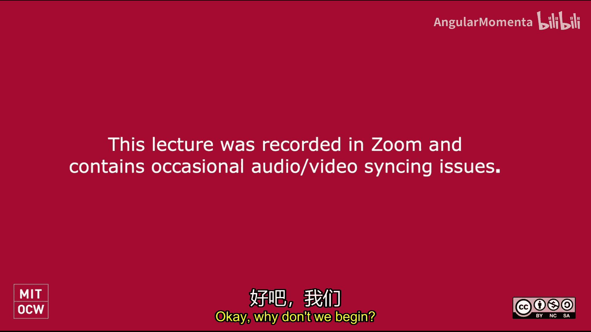
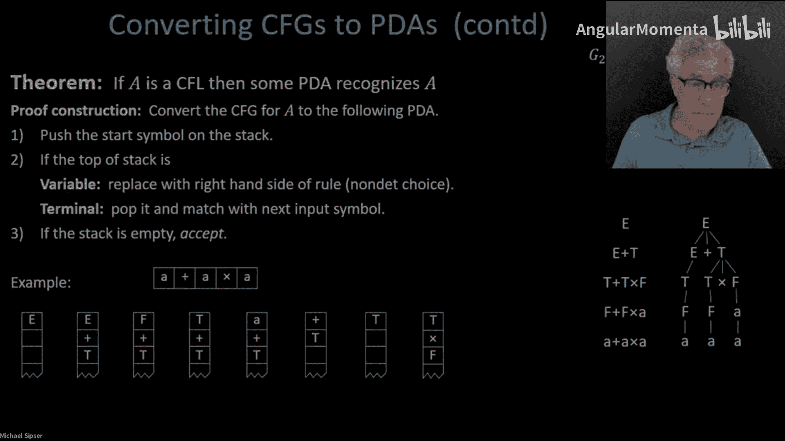

# 【麻省理工】计算理论  ｜  MIT 18.404J Theory of Computation, Fall 2020 p04 4. 下推自动机，CFG到PDA的转换和反向转换 -BV1pt7GzeEjb_p4-

Okay。Whenhy don't we begin？Hi everybody， see how many we got here。Most of you。

I'm sure the others will show up， hopefully soon enough。So welcome back。

We have today's lecture for and let's just remember what we've been doing in the。

Last few lectures we were exploring the regular languages as described by finiteatmaa and regular expressions。

We showed how to convert them back and forth， those two models to one another。

And we also showed how to prove certain languages are not regular now remember finite automata are a very weak model of computation。

 they only have a limited memory a finite memory and they still are able to do certain things with their finite memory。

 but they are you know。If you compare them with a general purpose computer。

 at least the way we think about it is their capabilities are just extremely limited and so。

We're going to over the next few lectures explore some more powerful models we started doing that last time the context free grammars and as we'll see there are certain things that you can do I think we saw that last time as well there are some things you can do with context free grammars that you cannot do with finite automata and but they still have their limitations as we state so。

Today， what we're going to do， we're going to continue that discussion by looking at the definition of context free gramars in a more formal way。

 one of the things that we do in this course is develop a practice with formalism and so that's going to be in the spirit of that。

We also are going to look at their associated languages called the context free languages。

 so they're going to be the counterpart for context free grammars of what the regular languages are for the finiter automa of regular expressions。

And then we're going to look at an automaton based model。

 which is the counterpart to the grammars called the pushdown automata and we'll see that those are equivalent in power and finally。

 well and it's part of that we will show how to convert the context three grammars to the push down automata。

And that's that's that's what we're going to do today so we're going to move on then and return to our topic of context free grammars that we began last time and just to refresh your memory so here was that example of a context free grammar that we gave last time and it has the way we're going to be writing context free gramars is using a bit of a shorthand which looks like this when you have multiple rules that have the same variable on this on the lefthand side you can combine them into one line so these two rules over here。

 S goes to zero S1 and S goes to R can be written in one line as a little bit more compact way。

 this is standard as S goes to zero S1 or R that's where you would read this this is really two rules but written on one line。

Okay so as you recall from last time a context re grammar has terminals， variables and rules。

 those are the parts that we speak of as well as one of the variables being designated as a starting variable which gets the whole thing going so I'll remind you about how that computation goes。

 but so the variables are the symbols that appear on the lefthand side of the rules。

The terminals of the other symbols that appear in the grammar and the。

We take the grammar and we use it to generate strings according to a certain system and the system is that you start by writing down the starting variable。

 and then once you've written down that variable or whatever variables you have written down。

 you're allowed to substitute them according to the rules。

 the substitution rules that are in the grammar， so you can keep on replacing the variables that you have with the corresponding righthand sides。

 and then you do that over and over again until you don't have any variables left。

 only terminal symbols remain。And at that point， you have generated a string that's in the language of the grammar。

😡，All right， so the。Grammar's language is going to be a language over strings whose alphabet are the terminal symbols。

😡，So the terminal symbols in a certain sense play the same role as the input alphabet。

 say for the finite automa。Okay， the variables are kind of internal working symbols for the grammar。

 the terminals are sort of are the。Sybols of which the language is written。Okay。

 we'll make them more precise in a minute wearing when I give the formal definition。

So the result is the generated string and the language of the grammar is the language of all generated strings that you can get using that grammar so and the important thing is that we call that language a context free language。

Okay， so the that's like what we get from that's the analogous thing to the regular languages。

 but here we call them context free languages the things that you can get from a context free grammar again。

 just a quick recap of that example we did last time so you start out by writing the。

Start variable and then I'm going to give you kind of two views of that either in terms of the tree of substitutions which we call the parse tree or in terms of the resulting string as you do the substitutions so here is the parse tree here is the resulting strings here are the substitutions that you make and now we have R coming from S and we have 00 r11 and now we have R in turn becomes an empty string and then the string that we generate is 0011 that's in the language of the grammar。

And now if you play with this a little bit， you'll see that the language of the grammar is all strings that look like runs of zeros followed by runs of ones。

All right， so is that clear I think we're going to have a I think the next slide is going to have a。

Check in and so hopefully that'll get us all together on the same page with this anyway so here's our formal definition anyway we have a context free grammar is a four topple there are four parts to a context free grammar these are the parts we've already been discussing。

The variables， the terminal symbols， the rules， the rules are always of the form。

 a variable followed by， you know， with an arrow to a string of variables and terminals。😡。

That's way we just write that down so this is the form of the rule and then we have the special start variable and we all wrapped that up into a package。

 this four tuple， that's what the context free grammar is。

UNow we have here Ed now maybe a little bit overkill， but let's talk about what formally speaking。

 what the the way the grammar actually processes。And produces strings。

 so we're going to write the standard notation for this is that if you have two strings of variables and terminals。

So imagine you have an intermediate string that you've generated in the grammar so far。😡。

You know which might be like00 s11 from the previous slide so that's an intermediate string that is so far what you've generated you're going to say maybe that's u and V might be the next line down。

😡，So that means we're going to write Uarrow V and that arrow is the word we're going to use is yields。

 we'll say U yields V if it can go from U to V just with one substitution step。😡，Um。

 and then we'll write u yields V in some number of steps or actually we say u derives V。😡。

If it can go to U to V with some number of substitutions instead of just one。

 and that's used with the the yields arrow with a star above it to mean some number of。😡。

Another way of writing that is you can say U goes to V if there are a bunch of one step moves that you can make。

 which take you from U to V。And that whole sequence is called a derivation。A V from you。

That's a sequence of steps that you go through。Doing these substitutions one by one to take you from U to V。

 according to the rules of the grammar。😡，Lastly， if you was a starting variable。

Then we call that sequence just the derivation of V。

 it could be the derivation from the start variable， but that's kind of the assumed。

 if you don't say it's a derivation from anything， the derivation of V in the grammar is the derivation of V from the start variable。

 it's just the sequence of substitutions that you make kind of the you know what you what I think you would expect。

😡，And now the language of the grammar is a set of all strings that of terminal symbols。

That you can get from starting at the starting variable of the grammar。Okay。

 and that's called a context free language as I mentioned before， so it's a context free language。

 it's the language of the grammar for some grammar。Okay。

 so let's have a little check in here again nothing too hard。

 nothing to get worried about anyway we're not counting correctness here。

 so let's just see I'm going to give you two things that look like grammars。😡。

Which of them are actually grammars and and let me just pull that poll up here。Okay。

 so which of these are valid？Grammars here， tell they both neither。I mean。

 you could kind of make an argument either you know， either way for both of them。

 but both of them are kind of a little have their own a bit of weirdness to them in a way if you study them for a second。

Okay， that's pretty much converged。Share the results。Okay， so so in fact。The correct answer is B。

And why is only C2 well first of all， you know， well what's wrong with C1 C1 problem with C1 is that the rules have things besides a single variable on the left hand side。

😡，So having a B1 on the left hand side is not legal in a context free grammar in fact there are other kinds of grammars there's a kind of grammar called a context sensitive grammar the term context free means you can replace the variable independent of its context in the intermediate string so independent of what's around it。

 but here this substitution is going to you can replace B。

 but it depends on there being a one next to it。😡，嗯。This is called a context sense of grammar。

 but it's not the kind camera grama we're going to be using which are only context free grammar so C1 is out that's not a legit contextfree grammar C2 the thing that's a little weird about C2 is if you try to generate a string in C2 you'll see that there's no way to get rid of the variables that you're always going to be stuck with the variable now that doesn't violate the definition of a contextfree grammar so this is a contextfree grammar but but it's not going to be able to generate any strings of only terminals。

So this is a context free grammar whose language happens to be the empty language。

 but that's totally okay。😡，So the correct answer here is B that only C2 here is a valid context free grammar。

Okay。Comment， let's just see， common question does a string you derive itself？Yes。

 a string U derives itself， that's a little bit of an esotere questionnaire for us right now。

 but yes， a string you in this definition here， youarrowstar U is legal， maybe it isn't。

According to the way I've written it down here， but it is it is a legal thing it's not going to really matter for you anyway。

 but but it is legal Okay， let's continue。Let's do another somewhat interesting example of a context free grammar this is a grammar that is。

Can generate arithmetical expressions involving pluses and times。😡。

So here it is it has how many rules well there are six rules here each line represents two rules so E goes to e plus T or t T goes to t times F or F and F goes to parenthesis E parenthesis or A and now so the variables are going to be the symbols that appear on the left hand side E T and F。

 the terminal symbols which are going to be the symbols of the language that you're going to be generating is going to be the plus the time symbols。

 the parentheses are just terminal symbols here， so they're nothing not playing any special role besides that。

 and then you have the a which is representing kind of the opera end on which those operators would be working if there was actually an expression you would use but they're just symbols from the perspective of the grammar。

And lastly， the start variable is going to be as normally appears on the upper left hand side of the grammar in terms of the way you write it down。

 so sometimes you might specify a different start variable。

 but otherwise if not specified that it's the one in this corner here。Okay。

 so let's just see some examples of using the grammar to generate。😡。

A string so here is a string in the language a plus a times a and this example will kind of reveal some other interesting features of the grammar。

 but let's just see it in operation first so again I'll try to write it to you in both ways in terms of the parse tree and the resulting string as you're doing the substitutions so so first we start with the E that we substitute E plus T and we see the resulting string z plus T but now we as we're doing additional substitutions the resulting string that you get is going to evolve accordingly。

And so I hope it comes across that this tree here picture on the left shows you the structure of the various substitutions。

 whereas on the right， it just shows you the strings that you get as a result of those substitutions。

嗯m。So now you can generate this particular string which is now in the language of the grammar。

 you could generate all sorts of other strings as well such as you know parenthesis A plus say parenthesis times a and so on。

 and in fact this might be a piece of a programming language that you're trying to describe and one application of contextfr grammars is to describe the syntax of programming languages。

 you know what are the legal programs that you can write with in that programming language。

 and not only that the grammar can be used to automatically generate the part of the compiler for that programming language which will which which will interpret the structure of the input。

 the so-called parser。which will figure out the meaning of the input to the compiler so that the compiler then can generate the code or if it's an interpreter。

 it can interpret the resulting code that you've given it。

 but the very first step in both of those is to figure out the meaning and the meaning is embedded within the structure of the parry。

Now in the case of this particular tree， just to give you some sense of what meaning I have in mind。

 this parse tree due to the structure of this grammar has the precedence for times over plus so normally when we write down a plus a times a you assume you're going to do the multiplication before you do the addition even though it appears second that's just the way we tend to write things and and this grammar has grouped it that way for you it groups the times lower down in the tree than the plus so the times is going to be done before the plus if you imagine doing this in terms of the way the tree is guiding you so the tree as you can see has a certain amount of meaning built into it now we're not actually going to be using that in this course but I just want to describe that as an illustration of how this material can get applied。

😡，Now so you know here is what i'm saying that the tree contains additional information now that's also relevant if。

You happen to have a grammar which might allow multiple parse trees for the same string。😡。

Okay that can happen in this particular grammar does not allow that。

 but you might write other grammars that as we'll see in a minute that could generate the same string in multiple ways with multiple different parse trees。

😡，Now that might be undesirable。When you have a programming language。

 because typically you want it to be only a single meaning for your code。

 you don't want it to be ambiguous and have multiple meanings。😡，But。呃。

Abiguity is does occur and it's not necessarily something we're always going to see is a bad thing so you know I think as I mentioned last time a lot of this subject originated with linguistics and that's where the terminology comes from grammar and。

😡，Languages and so on the terminology for the subject really comes out of linguistics in fact one of the key players for that is an emeritus faculty member at MIT Noam Chomsky he was instrumental in setting a lot of this stuff up but。

You can think of grammars as applying to natural human languages as well。

 so let me give you a little example as a pop up this not directly pop up check in not directly relevant to the material I just presented。

 but just sort of a curiosity。😡，If you take the English sentence， the boy saw the girl with a mirror。

You know does that is there only one natural interpretation for that sentence or are there perhaps other natural interpretations for that sentence so let me oppo that to you as another poll here and。

So I ask you to think about how many different meanings you might find for。

Reasonable different meetings， I mean you can you know。You're going to go wild。

 you can think of a zillions of meetings， but I think in terms of reasonable meetings。

 how many meetings might you get for the sense， people have seeing meetings that I'm seeing。

 but that's okay。So this is。😊，Quick， why don't we just give this another。10 seconds here。嗯。And then。

Most of you are in agreement with me。I can see here that you are。Seeing that there were two meanings。

 the two meanings that I see here for the sentence are when you say the boys or the girl with the mirror is who has the mirror？

Is it the boy seeing the girl through the mirror or is it the girl that has the mirror and the boy just happens to see her so two very different meanings for the same sentence and that's the nature of English is just the way it's an ambiguous structure there and often we resolve that ambiguity in English with other information that we might have。

 but typically you don't want there to be ambiguity when you have this a grammar say describing in programming language。

😡，Okay， so let's continue on that。So talking a little bit more about ambiguity。

 I promise you an example where you might have an ambiguous grammar。

 so if you take these two grammars G2 and G3， the G2 from the last slide and G3 is a similar grammar。

 in fact， it's the grammar that has the very same language。That gives you the very same language。

 so L of G2 equals L of G3， both of them are describing these arithmetical expressions。

 but whereas G2 has a unique parse tree。😊，For every string that you generate。

 G3 can have multiple par trees for the same string。😡，Okay。

 so I'm just going to illustrate that here， so here is the same string that we generated last time a plus a times a in G3。

 the pars tree is actually even simpler here， so here I'm showing you the just the two substitutions that you need to make starting from E and then to get the string a plus a times a it's a simpler grammar in a sense。

But there's another parse tree that'll give you the same result。

 and I've written that down below here。😡，Upside down so the upper parse tree groups the times before the plus more inside than the plus。

 but the lower parse tree doesn't have that precedence built into it and can alternatively interpret the plus is being of higher precedence than times and so in that sense we have here a grammar which is has two interpretations for this same string and we thatop we call that an ambiguous derivation ambiguously derived string and the grammar itself is called an ambiguous grammar。

嗯。Okay， so let us continue on from that， by the way， I there's a question here that came in。Like。

 for example， a plus a is that ambiguous in G2 no？If you try to apply it。

 you'll see the way that G2 can produce a plus a plus a plus a。

Is going to group the first two and and then the second one then the last one you can't derive things in multiple ways I mean addition is associative but the grammar doesn't doesn't gram for the grammar it's going to have a prescribed order for the way things get interpreted。

Okay， so that's ambiguity， so let's introduce pushdown automata。

 which is going to be our automata counterpart for context free languages。All right。

 so the way I'm going to introduce push down automata sort of shifting gears here now is。By first。

 giving a new view of finite automa， remember before when we presented a finite automaton。

 we gave it in terms of a state diagram， which I've kind of shown here in miniature form on the picture。

😡，Um。呃。We could do that for push on automata， but the picture tends to be very complicated。

 so I'm going to take a bit of a higher level。😡，Description for pushdown automata which is I'm calling a schematic view or a schematic diagram and there I'm really not going to be showing you the individual states but I'm going to be showing you the individual components of the machine at a sort of more of an abstract from a more abstract perspective and so from that perspective a finite automaton has here what I'm going to call the finite control so I'm going to be suppressing the details of the states in this picture I'm going to represent that those states as the control of the DFA or the NfaA they're really going to be the same from this pictorial point of view the input is going to be appear on as a string that's written down on what we're calling a tape。

Again， this is somewhat of an anachronistic terminology back in my days people actually did feed their inputs into computers on a tape sometimes。

We don't do that so much anymore， but that terminology has stuck and it is going to be persisting later on in the course too so you might as well get used to it。

 so the input is going to appear on a tape or sometimes called an input tape and the way the machine actually will read that input whoops is going to have a head which is going to be starting at the left side and moving from left to right。

 reading the symbols on that appear on the input tape one by one。Okay。

 so this is our picture of a finite automaton just redone from last time just a different way of picturing it now that's going to be setting the stage for the picture of a pushdown automaton because a pushdown automaton is like a finite automaton but it has an extra feature has an extra device attached to it and that's called a stack。

😡，Okay， so here's a schematic diagram for pushdown timematon。And that's going to be a stack。

Which is going to be basically a form of auxiliary storage。😡，Now， remember。

 part of the limitation for a finite automaton was that we had a limited amount of memory。

so we were not able to do some very simple things like counting because we had a limited memory。

 so the putdown on automaton is going to be able to use its stack as a kind of unbounded memory。😡。

But in a memory that's very restricted in the way it can be used。

 so it's unlimited but still restricted， as we'll see。😡。

So the way the pushdown automaton uses this extra memory on what we're calling the stack or pushdown stack。

Is that you can write symbols。Instead of only reading symbols。

 but those symbols can only be read at the very。Written or read at the very top of this list of symbols。

😡，And every time you add a new symbol， the other symbols that are already there get pushed down hence the name people also often refer to it as a stack of plates in a cafeteria。

 if you've ever seen those things， or you can remember back to the days when we went to cafeteria。

 which get you further further away， but。😡，Even have a cafeteria。

 you had a stack of plates and you know as you remove plates from them they were on a spring and they kept coming up or if you add more they would go down and it's the same idea。

 imagine the symbols here are sort of on a spring and the more symbols you add the more they go down。

 or if you remove them by read and read them and remove them then they move back up， okay？

So a push on autobaton operates like a finite like a non deterministic finite automa。

 as we'll see pushed on automata for out for us are always going to be allowed to be non deterministic so we're not going to be studying the。

😡，Push on automata that are restricted to be only deterministic I'll say more about that in a second。

 but like they operate like an NFA except they can write or read symbols from the top of the stack。

And when they write， they're adding the symbol on， pushing down that stack， and when they're reading。

 they're removing symbols from the stack and thereby lifting up the stack。😡，Okay。

We give them special names， so those of you who have seen stacks already， this is， you know。

 I'm sure old hat for you， but。I'm sure not everyone have seen stacks before。

 so the special name for writing onto a stack is called a push operation so that you're pushing a new symbol down on the top of the stack and it pushes everything down。

 whereas when you're reading a symbol and removing it from the top of the stack that's called a pop。

 so that's reading and removing。we we always think of those as going together writing and adding and reading and removing are combined I mean you might wonder well。

 why can't I just read it and leave it alone and not just have remove it。😡，You no。

 you can get out of effect by reading it and then which removes it and then putting it back if you really wanted to stay there。

 but the way of setting it up，😡，Is that reading comes with removing， writing comes with adding。😡。

Okay， they're called pushing and popping。Okay， so let's do an example。😊。

So we have here a push anatmaton for a language we'll call D。It's we've seen that language before。

 it's this it was actually we use the same letter for it。

 strings of zeros followed by ones with the numbers of the same of the two。

 so zero to the K1 to the K。We couldn't do that with a finer automaton。

 we will be able to do that with a pushdown automaton。😡，Um。And here I。

I thought I wrote down the input here， but okay， so the basic idea is I'm going to give you a an input。

No， and the pushdown of Ti Baton is supposed to test whether that input is in the language。

 whether it's of this form。😡，Now it has the ability to use the stack。

Because you know it's going to have to count how many zeros it has and so the way it's going to do it is that you know have a bunch of zeros hopefully and then a bunch of ones and you want to see that they're of the same number。

 it's going to take the zeros and store them on the stack。😡，Until it's season one。

And then one's going to start to read the ones and it's going to remove the zeros。

 matching them off one to one with the ones that it' see。😡，Okay。

 so you initially first read the zeros and push them onto the stack until you read a one and then you read the ones while popping zeros from the stack and you enter the accept state if the stack is empty。

😡，Just like with a finite art automaton， the entering the accept state only counts when you're at the end of the input。

😡，Okay， so without needing to say anything， it's really saying you want enter the accept state if the stack is empty at the end of the input string。

 but that's kind of implicit because it only takes effect at the end of the input string if you enter an accept state alone in the middle of somewhere。

 doesnt matter it doesn't affect anything。😡，Um。Okay， and with that。

 I're going to take a little break and then we'll be back shortly to look at pushdown andtmina again in more with a more formal definition。

Let me put it's going to be five minutes if I can figure out how to get my timer screen up here， yes。

And we will。Oh。When the candle burns down to nothing， we will return and continue。嗯。Okay。

Our candle has。Burn down and has gone out。 I think I never actually watched to see what what happened at the end。

 So we're good to go。 Let's continue。嗯。呃。Good， and let me put myself back in there。Alrighty。

So we were doing push down automaa， and we just did that example of zero to the K1 to the K。😡。

Now that you have a stack。We can do all sorts of fancy things that find out a time that I could not do just with their limited memory。

Okay， so let's take a look at how we define。Push down ameter。嗯。

So now push on the toma is actually going to be a six tu。

 so it's a little bit got some fancier stuff here to deal with， not too much， but a little bit。

Um and u so it has。Let's look at these a little bit more carefully since there's some novelty here。

We have the input alphabet just as we had before。Sigma， but we also have gamma。

Which is the alphabet for using the stack。Now， you might ask。

 why don't we just use the same alphabet？ Well， it's really a matter of convenience that we would like to be able to have。

Other symbols that could include the input alphabet， but could include other things as well。

 so it just gives you more flexibility in terms of what you're going to be writing on the stack。U。

Okay， the transition function more complicated so I think I don't know if I'm going to even say what the other things are。

 but you know these are the accepting states， this is the starting state so that's the same as before。

 but the transition function is a much different animal here in a pushdown automaton so let's just try to unpack that and understand what it's saying。

So the transition function tells us how the machine operates， how it goes from state to state。

 how it's going to read the input， how it reads from the stack。

 and what it might write on the stack too， because that's going to all happen under program control。

So what this means here is that。You knowWhen the machine is in a particular state。😡。

reading a particular input symbol， let's ignore the empty string subscript for the moment。

 so it's in a particular state reading a particular empty input symbol and with a certain stack symbol appearing at the top of the stack。

So that's all information that's available to the controller of this pushdown automaton。😡。

The transition function。The current state。The next input symbol and the symbol at the top of the stack and once we have that。

😡，We know what new state we can go into and what new symbol we can write on the top of the stack。😡。

Okay so that's what the right hand side of this function specification means。

 so this is where kind of the input to the function this is going to be the output of the function state and new symbol to appear on the static so this is the popping symbol。

 this is the pushing symbol。So now there are two things that bear explanation here， first of all。

 now this is a power set。So this is going to be representing， as we did before。

 a non deterministic machine。😡，We may have several possibilities and we're going to represent that as a set of possibilities for the machine that it could go to at any point。

😡，I will give an example of how a pushed out a Toppeton uses its non determinism in a minute。😡。

The other thing is is these epsilons， so we have to understand why they are there。

And we remember we had them for the NFAs corresponding to when the NFA had an epsilon transition。

An empty transition， so it could go along that transition without reading any input。😡。

So this is going to play the same role here。😡，So if you have instead of an input symbol from Sigma appearing in this part of the。

😡，You know， for the transition function instead you have an epsilon appearing。

 that means that the transition， that move of the machine can happen without reading any input symbol。

Just like for the NAs。Or if you have an epsilon appearing for the stack symbol。

 that means you can make that transition without reading any stack symbol。😡。

So any whatever sitting on the top of the stack， it's it doesn't matter。

 The machine can make that move and it won't read anything either。 It one' not gonna to pop anything。

 It's just going to be proceeding without looking at the stack at all。Or it might have both of them。

 which case it's going to go from one state to another state without looking at the input or at the top of the step。

😡，So that's what the possibility of epsilon means。😡，For the transition function in those places。

The epsilon appearing over here means something a little different but very similar what that means is that。

😡，We won't write anything on the top of the stack that's going to be we will go to a new state but without doing any writing。

 so we'll leave the stack alone。😡，So here means we're not going to read anything if it's in this position。

 and this position means we're not going to write anything。Okay。

 so all of those things are valid and legal from the perspective of you know。

 constructing a push on automaton。And I've kind of illustrated here， you know。

 just with a little bit of an example， if you have deelta that applies to some state Q reading an input symbol A and popping a C from the top of the stack。

😡，Then you might have， let's say in this case， two possibilities that you might end up going to。

 you might end up going to states R1 or to states R2。

 and in the former case you'll end up writing a D pushing a D onto this top of the stack and in the latter case you would be pushing an E onto the top of the stack。

😡，Okay， so this is I'm trying to help you look at this notation you're you know。

You know I hope this is clear to you， I'm sure for some of you it's too slow。

 but others of you I'm trying to help along， but if you're really struggling with this notation at this point。

 you know you really have going to have to dig in and make sure you follow it because it's only going to get harder from them I'm going to stop being going over these kinds of points and if you're still struggling you can't get it。

 this is not the right class for you I'll I'll be honest。嗯。

Because we're just going to be taken off like， you know。

 we're going to start to accelerate fairly quickly。Okay。

 so it's a non deterministic machine we accept like we did before。

 there might be several different threads of the computation。

 you're going to end up accepting if some of the threads，😡。

Or at least one of the threads ends up in an accept state at the end of the input string。😡。

Okay that's when we machine overall accepts it's just the way we normally think of nondeterminism again you can use the models that we had before in terms of guessing or parallelism whatever works for you and sometimes different things work in different different at different occasions but that's how nondeterminism works we'll do an example now okay here's a。

😡，Push on automaton for a different language we haven't seen before， I don't think。

 well maybe we have。Which is。Going to be using its non determinism in an essential way， this is a。😡。

Language that is going to where not determinism is going to be critical without it you can't a deterministic push on auto timematon which is something by the way that people study and there's a section of my book about that section 2。

4 because it has relevance to applications， we're not going to address that in this course so you can just skip section 2。

4 it's pretty technical I'll have to say but still quite interesting and beautiful if you like that stuff but it's technical we won't do it。

So here is this input string。Ww reverse for all possible Ws over our alphabet01 and what W reverse。

 by the way means is writing W backwards。So this is all strings followed by a reversal of the same string。

Okay， the string written backwards really you can think of these as but you know。

 so these are strings that well here's an example like 011，110， the string written backwards。

 so this is a string in the language appearing on a tape as as I described。Okay。

 so how is the machine going to recognize this language is kind of similar。

 somewhat similar to before， but with one important difference？And if you imagine， I think， again。

 I like to use this kind of anth frompromorphizing these things。

 putting yourself in the place of the machine and thinking how you would do it。

So if you imagine getting these symbols one by one0 one one you don't know what's coming next as you're getting the symbols you have to figure out how to match off the second half with the first half so you're going to put the first half on the stack and then you're going to remove the first half and match it off with the with the with the second half conveniently the first half comes out backwards the stack is a first in last out kind of thing so。

😡，It comes out in reverse order， so that's perfect for matching off with the second half。

But the tricky part with this language。😡，Is how do you know when you're at the middle because you don't get to see？

Um the rest， you only get to see what you've seen so far， you don't know what's coming。So， you know。

When you read that second one at this point， you read with01，1， now you're reading that second one。

 you don't know that perhaps there's just going to be a zero following that and it's going to be all。

😡，So maybe you should be deciding to that this point here that I've marked is the。😡。

Midpoint and you put zero1 on the tape and then start popping the second the second one and matching enough for the first one that might that would be a tempting thing to do。

 but you just don't know。😡，And that's where the nondeterminism is going to be essential so let me let me write down more of this so what you're going to do is you're going to read and push input symbols。

 but nondeterministically guessing that you're at the middle so you're going to nondeministically either repeat that and continue to read and push symbols onto the stack or you're going to go to two deciding that or guessing that you're at the midpoint and now it's time to start reading and popping instead of reading and pushing。

😡，So you're going to read input symbols and popping the stack symbols， comparing the two。

 the symbols yet you're reading with the symbols you're removing from the stack。

 if they ever disagree， then this thread of the nondeterminism rejects。😡，Because。

Either the input is not in the language or at least you've made a wrong choice as to way the midpoint is。

😡，U。And then you're going to enter the accept state if the stack is empty。😡。

And ignore this part for the moment of this software reference， let's just。

 I'll speak to that in a second， but I just want to make sure we understand that at intuitive level how this machine is using its nondeminism。

To recognize this language because the nondeminism is critical and it's important that you understand it。

😡，So let me just make some side comments， and then we'll come back to this software remark。 So。

 first of all， one question that comes up a lot。Well I'm not paying attention to the chat here sorry so if you're not getting answer from me try the Ts。

 but one of the。One of the questions that comes up a lot when they're thinking about non determinism for pushdown automata is what happens to the stack。

The stack gets replicated。In the nondeterminism， every time the machine forks。

 just like everything else gets replicated， so an entire every time there's a fork in the nondeterminism and the machine branches into multiple possibilities。

 the entire machine replicates the current state， the current position of the head。

 the stack and its contents， all of that gets replicated and the two sides of the the two branches or the two sides of the fork each go on independently in their merry way。

😡，Okay， doing their own thing independently， and then if any one of them accepts。

 that's the only way there's sort of kind of a communication because the one that accepts raises the flag and then the overall machine is set to accept。

😡，Okay， so the nondeterministic forks replicate the stack of saying it just want to make sure you got that and then this language requires nondeterminism that I said earlier。

 so our PD push down a time time model is going to be nondeterministic I mean you might have examples which are deterministic but the model is going to always allow nondeterminism okay what's this bit about the software。

So if you look at this formal definition here， it doesn't have anywhere in it。

 the ability to test if the stack is empty， that's not part of the hardware specification。

 at least as we are describing it for a push on automaton。

 you can might imagine some somebody else describes push on automain some other way which gives that as a primitive。

 but we're not going to do that why because we don't need a primitive for that。

 you can get the effect。😡，Of testing if there's an empty stack。

Even if you don't have that as a primitive for the machine。😡。

Because what you could do is you could start the machine off when at the very first thing it does is it writes a special symbol to mark the you know what's going to eventually be the bottom of the stack there's going to be some special symbol。

 maybe a dollar sign symbol， that's the very first thing in the machine does and then it proceeds as before。

 it if ever sees that dollar sign symbol again， it knows the stack is effectively empty。😡，Okay。

 so you could get the effect of testing for the stack being empty even if you don't have a primitive for that and we're not going to actually fuss about some details like that so you can use when you're writing your homework sets you can just use the assumption that you can test for empty stack which is what I'm going to do myself。

😡，Okay。嗯。So let's continue on。All right， so yeah， so now what we're going to do we're going to prove our one so far we really haven't proved anything we've just given some definitions and some examples today was going to now we're going to come to our big theorem which actually is important and has some meat to it and that is。

How do we convert， you know， I claim that to put context free grammars and push down atmata are equivalent。

Well， we're going to prove that equivalence in one direction。

 converting the grammars to pushdown automaa。😡，Okay， so。Let me show you how that goes in some ways。😊。

And it's a nice proof， not super complicated， but it has some meat to it。あ。

So if I give you a grammar here， what I'm going to tell you how to do is convert that grammar into push down tomaton。

 which does the same language。😡，Okay， so if you're。Checked out for a minute。

 please come back because we're sort of starting this topic now that you can think a bit about this good good reentry point if you've sort of been doing something else。

 which I can't tell good thing so all right， so converting a given grammar to a pushdown automaton hows that going to work？

So the idea is， okay。Actually， before I tell you the idea， let's just think about it together。Again。

 I like to think about the push on automaton， building a push on automaton the way you would do it。😡。

So。A grammar is a generation device， It generates strings。

 a push on automaton or thinking about it as you， you're a recognizer。

 you're given an input and you want to know is it in the language So you want to know is it possible for that。

😡，Grammar to generate that input you're given。So how you going， How are you gonna。

 How you gonna do that and。He He， how are you going to test if the input is in the language of the grammar？

Well， the thing that you would naturally do is you say， well。

 can I derive that string using the rules of the grammar， let me start with the start string。😡。

And try to do substitutions and see if I get the string I'm given。😡，And if I can get it。

 then I know it's in the language。😡，Right that's a natural thing to do you're just going to try try to do you know try to do the substitutions if get to the string now the thing is there are many there might be many different substitutions that you could make and you know that seems like a really challenging hard thing to figure out which substitutions to use among the many possibilities that's where not determinism is going to come in。

😡，Because you can of yourself as guessing which substitutions to make and you're always going to make the right guess。

😡，So the choices of which substitution to make， that's not going to be。Problemview view。

 that's going to be managed by the nondeminist。So imagine you're always going to make the right substitution。

 but now the challenge is how do you keep track？😡，Of the intermediate results as you're doing those substitutions。

😡，嗯。And that's where a stack is going to come in， the machine is going to write down those intermediate results on the stack。

😡，But even there， there's a subtlety That's an important subtlety that you have to look at。

 So let's try pulling that together so far before I get to that subtlety。Okay， so as I mentioned。

the pushdown automaton is going to start out with a starting variable and is going to be guessing the substitutions to make。

 it's going to keep the intermediate results on the stack。😡。

When it's done doing all the substitutions and it has only terminal strings on the stack。

 it can compare it with the input and see if it got the right thing。😡。

So if it made all the right guesses， so you think of it as guessing， doing the right guesses。

 but in the end you have to check to make sure that you got the right that you did all the right thing and you accept when when things have matched up you and you made all the right guesses。

 so you have to in the end you have to check that you actually got that input from doing those substitutions。

Okay， so let's let's try to see this operating in action and then you'll see the subtlety。

 the delicacy， a problem that's going to arise hopefully you're following at least in part what I'm just saying so far okay。

 so here is the input。😡，We do know that that's an input in the language of the we've been seeing this example multiple times。

 so here is the input appearing on the input tape a plus a times a。😡，嗯。

Now the push on automaton is supposed to be accepting that input because it's in the language of the grammar。

😡，Okay， so it's going to operate by first writing to start off the starting variable on the stack。😡。

And then doing the substitutions as what' going along。We're going to substitute E goes to E plus t。

 so we do that first substitution and then we do the next substitution here。

 the E so if you're looking at this tree here that mean this is the right tree for that for that input so we substitute E by t so far so good。

 the autoton can do make that substitution， and the next substitution is going to be a little where E plus t we substitute here we got t plus t。

 and now we're going to substitute the t times F， which is this t over here。

 we want to substitute that and that appears as t times F now on this step。Now。

 if you're following me， you should be suddenly getting nervous。Because we just cheated。😡，It's okay。

m doing doing these replacements at the very top of the stack because the pushed on automaton has access to the top。

 that's how stacks work。😡，But it does not have access deep down within the stack that is。😡。

not hows that is not how stacks work， so that's cheating。But。Ignoring the cheating for the minute。

 if you could replace those。Do those substitutions deep down within the stack This would all work we would be good。

 you would do the substitutions one after another until you ended up with no variables and then you have the string here and you're going match it off and compare it with the input it's all done in the right way so that the things are in the right order so the you know the after all the substitutions you'd have a plus a times a sitting here on the stack you match you compare that with the input it's going to match up and you'll end up accepting all good so how do we deal with that problem here problem access blow that stack top of stack is cheating what are we going to do instead。

So the idea is actually pretty simple if you understood what I've said so far。

 you know fixing that is actually not too bad。呃。Sort of fading out here。呃。

putut some more light on the on my image so how do we do that。

 how do we get the effect of the access below the top of the stack？

And the way we're going to do that is。😊，By making the what we're going to do we're only going to do substitutions that we can make at the top of the stack。

 so whenever there's a variable at the top of the stack we're going to do the substitution because the top we can access。

😡，Now what happens if we have a terminal symbol sitting at the top。

 blocking our way from accessing variables below？😡，Well。

 actually that's an easy case to handle because if we have terminal symbol sitting on the top。

 they're never going to change anyway， so you might as well match them with the input at that time。😡。

So when you have a terminal sitting at the top， we'll just read another input symbol and match it off there。

😡，Um， and we just keep reading the terminal symbols off until we have a variable sitting on the top。

 then we do a substitution。😡，And we keep substituting variables until we have a terminal。

 then we read it， then we compare it with the input。And in so doing。

 we will end up getting the same effect that I described before without ever needing to dig down into the interior of the stack and doing substitutions there。

 they're all going to rise up to the top and we can always do them at the top。😡，Okay。

 so anyway you know I forgot to do that here so instead only substitute variables when they're at the top of the stack if it terminals on the top pop it and compare with the input rejected if they're not equal so if you ever have something which is not matching the way it's supposed to that I mean that threads just going to fail you know then it was not a bad。

No deterministic choice was made or maybe the input was not in the language anyway and there are no no good choices so here my animation broke here so let me just put the whole thing up in front of you so here is the actual construction。

Push the start symbol on the stack， if the top of the stack is a variable。

 replace it with a corresponding righthand side， doing a nondeterminative choice among the various possibilities。

 if it's a terminal youll pop it and match it with the next input symbol and if the stack is empty you accept。

😡，So here is how the stack would actually look for this particular input。😡。

You know it would start off the same you'd have E and then substitute with E plus T and then we're going to always do the substitutions at the top。

 so E gets substituted by F is that right no？😡，This slide I messed up。

 I apologize so E gets substituted by T which gets substituted by F and the point is is that when you get to an A sitting at the top forgive give the typos here。

 now we have a terminal symbol and that's going to get matched off with the next input symbol。

And get removed and now we have just the plus and the T left。😡。

And then the plus is also a terminal symbol that's going to get matched off with the next thing。

 we just have a T sitting on the top and now we can do a substitution。Okay， so that's how it works。

Okay， that's all I wanted to say I think oh yeah there's one just remark so this is not we're not going to prove this。

 but I think it's I do need to say this that actually you can do the conversion in the other direction to you can convert a。

😡，So a is a context free language if and only if some push on automaton recognizes a。

And if you haven't seen if and only if it's an expression I'm going to use again over and over。

 so you should get used to it， it stands for if and only if and which just means the implication goes both ways。

 so a is context for language implies that some push on of time time recognizes a and vice versa。

So there's really two things you need to prove whenever you have an if and only if you have to prove both directions。

 so thinking about that way， splitting them in half。

 the forward direction we've already proved converting a push context free grammar to a pushdown an automaton。

 the reverse direction we're not going to prove， it's in the book if you're curious。😡。

And youre responsible knowing that the fact is true， but you don't have to know the proof。😡。

Which is somewhat a little bit complicated and you know I think it would take us too long to go through it so you're not responsible for it。

So there's a last check in here that I have for you， which is just a question。

 which you can answer based on the material that we presented so far。

 is every regular language also a context free language？😡，Just yes， no or you're not sure。

 so let me launch that as a poll here。Okay， about to close。mEn polling。And sharing results。This one。

 I think you pretty much most of you got， some of you are not sure。Every free language is in fact。

 a context free language。And the way to see that is that every regular language can be done by a DFA or an NFA。

As we already showed。And DFA or an NFA is really just a push on automaton that never uses its stack。

So you can always think of DFA as a push on automaton and we already argue that push on automata are equivalent to context free grammars。

 and so they do the context free languages。So anything that you can do with a DFA。

 you can also do with a pushdown automaton， and so is therefore all the regular languages are also context free languages。

Okay， so with that let's just kind of pull things together a little quick recap of so what we've been doing so far in the class。

 we have the regular languages and the context free languages。

 we had the two forms of sort of getting at them， the recognizer form。

 which is like the automata-based perspective， like either a DFA or an NFA in the case of the regular languages。

 the pushdown automaton for the context free languages and for the generators。

 we had the regular expression， for the regular languages and the context free grammars for the context free languages。

 okay。And as we just pointed out in our in our last check in。

 the regular languages form a subset and in fact， a proper subset of the context free languages as shown in this Venn diagram because we have already exhibited languages that are context free but not regular。

All right， so quick review， we've defined the context free gramars and their associated languages。

 the context free languages， we defined pushdown automa and we showed how to convert context fors to push down automa and that's all I have for you today。

😊，Okay here's a question I'll answer to everybody why do we restrict ourselves to a stack。

 why don't we use random access memory， we will use random access memory for the next model called the Tring machine and we're going to introduce that I think next lecture so that's going to to be the model that we're going to stick with throughout the term。

But we have not we will kind of use introducing weaker models as a kind of a prelude to the more general purpose computational model。

Really to get ourselves warmed up and also because。So the weaker models， you can fully analyze them。

In a way that you cannot foruring machines， we'll be able to， as you will see。

 you can determine properties of languages for the weaker models that you cannot for the more general models and so I think that's helpful to have that perspective that。

You know for some cases you can get to full analysis and some other cases you cannot， but anyway。

 that's the reason why we restricted to the stack besides the fact that these models have applications that I think worth people seeing。

Why， yeah， some reason we chose a stack。Well， why did we choose a stack and not some other data structure for for our extra storage and the reason for a stack for one thing。

 the stack is what is exactly what you need to get you the correspondence with Con free grammars。

If you use some other storage like a queue， for example， instead of a stack， in fact。

 you get a very different outcome and it's an actually interesting exercise to see what happens。

 what do you get if you use a queue as an external storage instead of as a stack。

It's a good homework problem， maybe I'll sign it。Let's see。😊，In if a。

Okay we showed so we showed that nondeterminism can be eliminated for finite automaa so NfaAs and Dfas are equivalent what about for pusheddown automata the answer is no they're not equivalent I think I mentioned that earlier but I don't mind repeating it there are certain languages that can be done only with nondeterministic push down automata and cannot be done with deterterministic push down automaa for example。

 that language Ww reverse that requires the nondeterminism in order for the machine to be able to guess where the middle is。

So okay， I'm going to head off， thank you guys and see you on Tuesday。

