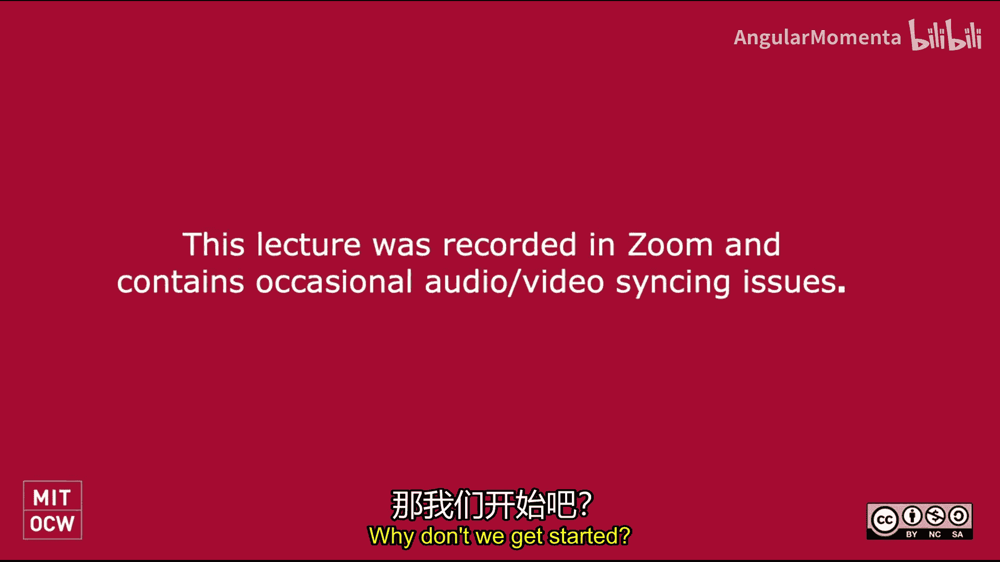
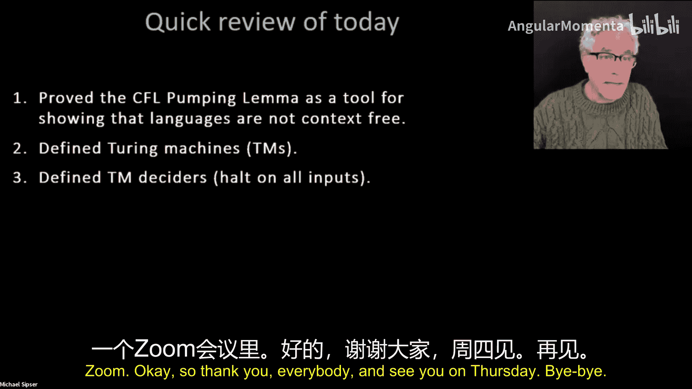
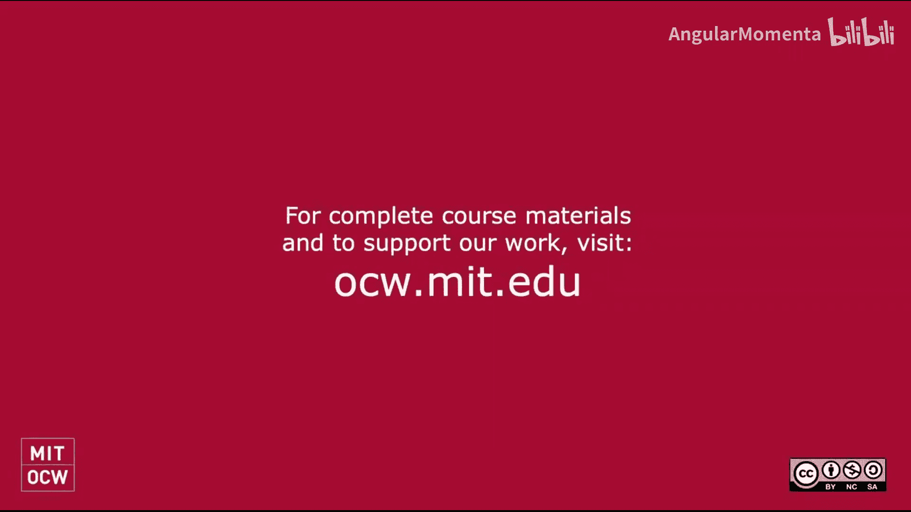

# 【麻省理工】计算理论  ｜  MIT 18.404J Theory of Computation, Fall 2020 p05 5. 上下文无关泵引理，图灵机 -BV1pt7GzeEjb_p5-

Why don't we get started？So as I like to do， let's just review where we have been recently。

 which is to。嗯。Discuss contextfr languages， we talked about the contextfr grammars and the pushdown automata as a way of describing the context free languages as you remember the context free languages are a larger class of languages than the regular languages which is where we started。

 the languages of the finite automata so when you add a stack you get more power you get more languages that you can do。

U。And we're very rapidly going to be moving on today to our main model for the semester。

 which is called the turing machine， so let's just take a look at what we're going to be covering today and that is。

First， we're going to show that a technique analogous to the one we use for。

Proving that languages are not regular， but this time for proving languages are not context free so the。

Push on the toud and the grammars still have their limitations in terms of what we normally think a computer can do and with that we're going to use that as a kind of a lead into our general purpose model。

 which is the Tring machine and。So we're going to talk about Turing machines and aspects of that。

And I do I would want to comment so I have posted the solutions for the first problem set。

 I know you're starting to think about the second problem set now which I have posted as well。

 if you want to get a sense of what I'm looking for in terms of the level of detail you can look at the solutions to problem set one because I consider those to be model solutions that's part of the reason why I post them just to give you a sense of the level of detail that I'm looking for。

 which is not a whole lot but I do want to make sure you're capturing the main ideas of of what's involved in solving the problem。

So have a look at those and for problem set two which i'll talk about in a second。

 so i'll just say a few words if you want to pull that up you know you can do that but just to get you started on a few of the problems if you're finding some challenges there I don't want you to get stuck really before you even understand what the problem is saying so for problem number one if you looked at that so that's a problem where your asked approve a certain language is not context free so that's and by the way all of the problems in this problem set except perhaps for the last for number six you'll be able to solve we'll have enough material at the end of today's lecture to solve all of them I believe that's right。

Yeah， so number six， you should have enough as of Thursday's lecture to solve that。So。

Problem number one it's proving a language is not context free。

 so we're going to introduce a method for doing that that method is going to come in handy for parts B and C。

 if you look at the problem set it has this strange looking thing。

 sigma sigma sigma and parenthesis star， it's really just a regular expression that's very simple。

 you know。You should just make sure you understand that that's a way of representing all strings whose length is a multiple of three。

And if I stick a sigma in front of that， it's all strings whose length is one plus a multiple of three so。

Once you understand that， and if you think about what kinds of strings are in the language C2。

 it'll help you to understand what happens when you take those unions and。

Parts B and C are not intended to be very hard， but you just have to understand what's going on。

Problem number two is about ambiguous grammars I touched on that briefly in lecture it's enough to solve the problem the book has a little bit more detail about ambiguous languages。

 ambiguous grammars ambiguous grammars， I should say and。

So this is a grammar that's supposed to represent a fragment of a programming language。

 you know with if thens， and if then else's， you know。

 I'm sure you're all familiar with those kinds of constructs in programming languages and there isn't a natural ambiguity that comes up in a programming language if you have。

You know， if some condition then statement one L statement two。

 I presume you understand what the semantics of that is what that means and the tricky thing is that if you have a you know those statements can themselves be if statements and so if you have the situation where you have if then。

And if then else is the what follows that the question is where does the else attach is it to the second if foot to the first if so that's kind of a big hint on this problem。

 but that's okay， I think you should。You know， you need to take that and figure it out how to get a an actual member of the language which is ambiguously generated and then show that it has that show that it is by showing two parse trees now or two leftmost derivations if you read the book you'll see that's an alternative way of representing a parse tree。

So and then what you're supposed to do is give a grammar for the same language which is unambiguous you don't have to prove that it's unambiguous because that's a bit of a chore but as long as you understand what's going on you should be able to come up with an unambiguous grammar which resolves that ambiguity and I don't have in mind changing the language by introducing new programming languages constructs like a begin end that's not in the spirit of this problem because that' grammar for a different language so you need to be generating the same language without any other extraneous things going on that are going to resolve the ambiguity the ambiguity needs to be resolved within the structure of the grammar itself so keep that in mind。

For problem number three about the Q automata you know that came up actually as a suggestion of last lecture I believe or two lectures back what happens if you take a pushdown automaton but instead of a pushdown as a instead of a stack you add a Q what happens then well actually it turns out that the model you get is very powerful and turns out to be equivalent in power to a Tring machine so you'll see arguments of that kind today how you show that other models are equivalent no not today that's going to be on。

That's going to so I apologize this is going to be something that you'll also you know I'm confusing myself here for problems number problem number three actually need Thursday Thursday's lecture as well to really at least see examples of how you do that kind of thing and so Thursday。

Yeah， so I'll try to send out a note clarifying this by the end of Thursday you'll be able to do everything except for problem six and for problem six you'll need Tuesday's lecture a week from today's lecture to do。

嗯。So all right so problem number four that one you'll be able to do at the end of today will that's also gonna you know the problem is I'm working on preparing Thursday's lecture two so I'm getting a little confusing myself problem number four you'll be able to do after Thursday's lecture maybe we should talk about that next lecture problem number five you can do today but maybe I'm not going to say anything about that and problem number six I won't say anything about either okay so why don't we just jump in then and look at today's material what about seven seven is oh seven is an optional problem I should have mentioned that whenever there's seven is always going to be an optional I indicate that with a star I should have made that clear on the actual description here but seven is optional it's just like we had for problem set one。

Okay let's move on then to what we're going to talk about today and just a little bit of review。

 so we talked about the equivalence of contextfr grammars and push down automata as you remember oops let me get myself out of the picture here as we mentioned last time we actually proved one direction but the other direction of that you just have to know it's true but you don't have to know the proof because the proof is a little bit lengthy I would say it's a nice proof but it's pretty long。

Um， and。There are two important corollaries to that if you know what a corollary is just a simple consequence which doesn't need much of a proof sort of a very straightforward consequence。

 first of all， as I think we point out at last time one conclusion one corollary you get is that every regular regular language is a context free language because a。

Fr automaton is a push on automaton that just happens not to use its stack so immediately you get that every regular language is context free and second of all。

You also immediately get that whenever you have a context free language and a regular language and you take their intersection。

You get back a context free language。So context free， intersect regular is context free。

Okay that's actually mentioned in your homework as well as one of the0 point x problems which I give to try to get you then not you don't have to turn those in but I suggest you look at them I don't know how many of you are looking at them but this is a useful fact and some of those other facts in0。

 x problems are useful so I encourage you to look at them but anyway intersection of contextfr and regular is context free you might ask what about intersection of context free and context free do we have closure under intersection the answer is no we do not have closer closure under intersection we'll talk about that shortly so here's the proofketch for I want to say that the intersection of context free and regular why do we know that still contextfr because the pushdown automaton for a。

Can be simulating the finite automaton for B。😡，Inside its finite control， inside its finite memory。😡。

The problem is if you have two context three languages， you have two push down automata。

 you can't simulate that with one push down automaton because it has only a single stack。

So if you're trying to take the intersection of two context free languages with only a single stack。

 you're going to be in trouble because it's hard to do anyway， I mean， it's not a proof。

 but at least it shows you what goes wrong if you try to do the obvious thing。嗯。Okay， so。So if。

just here's an important point that I was trying to make before if A and B are both context free and you take the intersection。

 the result may not necessarily be a context free language。

 so the class of context free languages is not closed hundreds of intersection we'll comment on that in a bit。

Um。The context free languages are closed under the regular operations however union intersection union concatenation and star so you should feel comfortable that you know how to prove that it's in the again it's one of the I think it's problem 0。

2 and I think the solution is even given in the book forward so yeah you just should know how to prove that not very pretty straightforward okay so let's move on then。

To。To basically conclude our work on context free languages and to understand the limitations of context free grammars and what kinds of languages may not be context free and how do you prove that so how do you prove that for some language there is no grammar？

Again， you know， it's not enough just to say， you know， given an informal。

A comment that you I couldn't think of a grammar that or some things of that kind that's not going to be good enough。

 we need to ever proof。So if we take the language here zero to the k1 to the K2 to the K。

 so those are strings which are runs of zeros followed by an equal number of ones followed by an equal number of twos。

 so just zeros then ones then twos all the same length。

That's a language which is not going to be a context free language and we'll give a method for proving that。

You know， if you had a stack you can match the ones with the zeros。

 but then once you're done with that， the stack is empty and how do you now make sure that the number of twos corresponds to the number of ones that you had so again that's an informal argument that's not good enough to be approved。

 but it sort of gives an intuition so we're going to give a method for proving noncontext-free languages are not contextfr using again a pumping lemma but this is going to be a pumping lemma that applies to context-fr languages not to regular languages okay looks very similar but it has some extra wrinkles thrown in because the other older pumping lemma was specific to the regular languages and this is going to be something that applies to the context free languages。

Okay， so now let's just read it and then we'll try to interpret it again。

 it's very similar in spirit， basically it says that whenever you have a contextfr language。

 all long strings in the language can be pumped。In some kind of way。

 so it's going to be a little different kind of pumping than we had before。

 and you stay in the language。Okay， so。Before we broke the string into three pieces where we could repeat that centerpiece as many times as you like and you stay in the language here we're going to end up breaking the string into five pieces。

 so S is going to be broken up to U V X， YZ。😡，Um， and the。

And the way it's going to work here so here is a picture。

 so all long strings again there's going to be a threshold for whenever you have a language is going to be a some cutoff length so that all the longer strings in that language can be pumped and you stay in the language but the shorter strings is no guarantee so if you have a long string in the language length at least this pumping length P then you can break it up into five pieces。

 but now it's thats。Second and fourth string that are going to play that special pumping role。

 which means that what you can do is you can repeat those。😡，And you stay in the language。

And it's important that you repeat them both that V and that y the same number of times。

 so you're going to have a picture that looks something like this。😡，And that is going to you repeat。

So you can get if you repeat the V and you repeat the y， you get U VV X， Yy Z。

 or if you look at over here， it would be U v squared Xy squared to z。

 and that's going to still be in the language。😡，And then we have so that's one condition we'll have to look at all of these conditions when we do the proof。

 but we just understand what the statement is right now。

 so the second condition is that V and y together cannot be empty and really that's another way of saying they can't both be the empty string because if they were both the empty string then repeating them wouldn't change S and then of course it would stay in the language so it would be kind of meaningless if they were allowed to be empty。

And the last thing is again， going to be there as a matter of convenience for proving languages are not context free because。

You have to make sure there's no possible way of cutting up the string when you're trying to prove a language is not contact3 you have to show the pumping fails and then you。

😡，It's it's going to be helpful sometimes to limit the ways in which the string can be cut up because then you have it's an easier job for you to work with it so here it's a little different than before but sort of similar that VxY combined as a substr so I think I show that over here Vxy together is a is not too long so the Vxy maybe it's better seen up here is going to be is going to be at most peak we'll do an example in a minute of using this okay so again here's our pumping lu i've just restated it so you know we have it in front of us。

😡，And we're going to do a proof， I'm just going to give you the idea of the proof first。

 and then we'll go through some of the details， the idea is actually pretty simple。😡，Okay。😊。

They give it a call proof by picture。Again， remember what we're trying to do。

 we're trying to show that we have this context free language A。😡。

And now all long strings in a have this pumping quality that you can break them up into five pieces。

😡，So that the second and the fourth piece can be repeated and you stay in the language。😡。

So how do we know that that's going to be true？Let's take a look at the proof here and why is that going to be true？

So first of all。😊，I'd like to do it qualitatively rather than quantitatively。

 so let's just imagine instead of what thinking we'll calculate what P is later。

 but just imagine S is some really， really long string。😡。

That's the way I like to think about it so answer is just really long， what is that going to tell us？

😡，It's going to tell us something important about。😡，The way the grammar produces s。

Which is going to be useful in getting a way of pumping。Pumping us。So if is really long。

We're going to look at the parse tree for us， and we're going to conclude that the parse tree has to be really tall。

😡，Because it's impossible for a very shallow parsy to generate a very long string。😡，And again。

 we'll quantify that in a second， but intuitively I think that's not too hard to see why that ought to be true。

 so if you have a long S the pole the parry has to be really tall because the parry can generate very many it can't expand by very much at each level。

😡，So we'll look at how much it can expand， but it depends on the grammar。

 how much expansion can we have at each level and it's going to be。

 you cant have just in three levels， you know， some small grammar generating a string of length a million just。

 you know， you'll see that that's just impossible。😡。

So once you know that the parse tree is really tall here。😡，Then you're actually almost gone。

Because what does it mean to be really told， it means that there's some path starting at the start variable E。

 I'm calling it in this parse tree。😡，whichch goes down to some terminal symbol in S。

 which goes through many steps， that's what it means for the tree to be very tall and each one of those steps is a variable until you get down to the very end。

😡，Okay， so that's the way parse trees look， you keep expanding variables until you get to a determine。

😡，So here you get some path that's really a long path。And once you have a long path that have many。

 many variables appearing on here， well， the grammar itself has only some fixed number of variables in it。

😡，So you're going to have to have a repetition。AComing among the variables that occur on that long path。

😡，假得。So a long string forces a tall parsse tree， forces a repetition on some path coming out of the start variable。

Of some other variable that comes out。Now， that's going to tell us how to cut up S。

Because if you look at the subtes of S， that those two are variables are generating。😡。

Shown like this。😡，I'm going to use that so if you have to follow what I'm saying here so you know the R here is generating this portion of s and the lower R is generating a smaller portion of s just looking at the subte that you get here and that's going to tell us that we can cut a s。

😡，Accordingly。So you was that very first part out here。😡，generatedrated by E。

 but not by the first R R is generated V is generated by the first R， but not by the second R。

 the second R generates exactly x， and then we have Y and z similarly。😡。

So that all follows from having a tall parory。😡，And now we're finished。

Now we know how to cut our best， how do we know we can repeat？

V and y and still be in the language well i'll actually show you and show you that you're in the language by exhibiting a parse tree for the string U V V X Y Y Z here it is。

😡，What I'm going to get that parse tree by when I expand this lower R。

 instead of expanding it to get x， I'm going to follow the same substitutions that I had when I expanded the upper R。

😡，So it's as if I took this larger subt here and I substituted it in for the smaller subt under the second R。

 and so that I get a picture that looks like this。😡，So here I'm substituting under the second R。

 the same sub that I had originally coming out of the upper R， the first R。😡。

And so now this parory is generating the string U VV， X， Y， Y， Z。

Whi is what I'm looking for and of course you can do that again and again。

 and you're going to keep getting higher and higher exponents of V and Y。😡，And in fact。

 you can even get the zero exponent， which means that V and Y both disappear altogether。And for that。

 you do something slightly different， which is that you replace。

The larger subre by the smaller subre。Okay， so here。

 which was originally that larger subte generating Vxy， I stick instead the smaller subte。

 I do the substitutions from the smaller subtree and I just get X there。

 and so now the string I generated is UXz， which is the same as U v to the zero xy to the zero z。😡。

Okay， that is the idea of the proof。Now I think you could work out。

The the quantities that you need in order to drive this proof I'm going to do that for you。

 I actually hate writing down lots of inequalities and equations and so on on the board because I think they're just almost incomprehensible to follow at least they would be for me but I'm going to put them up there just for completeness sake so here we're going to give the details of this proof on the next the next slide here oh yeah so I just want to give a name to this I'm going to call this the cutting and pasting argument because I'm cutting apart pieces of this parse tree and I'm pastcing them in to other places within the parse tree to get new strings being generated。

😡，So this is a cutting and pasting argument so okay let's let's take a look at the details here just so we have to understand。

 well how big does P actually need to be in order for this thing to kick in。嗯。Well， first of all。

 we have to understand how fast that par tree can be growing as we go level to level and that's going to be dependent on how big the right hand side sides of rules are。

 I mean that's that really tells you how many what's the fan out you know of each node。😡。

What's the maximum fan out and that's going to be the maximum length of a right hand side of any rule。

😡，So for example in that other grammar we had seen last time for asthmatic expressions。

 we had this e goes to e plus T and this rule here and in terms of the parse tree that would look like a little element like that and that's actually the longest right hand side that you can get and so the parse tree can be growing by a factor of three each time。

Now that's going to tell us how big the string needs to be that's being generated。

 what is the value of P in order to get a high enough parse tree so that you're going to get a repeated variable。

😡，Okay， let's call the height of the parsh tree for S H。Okay。

 so now if you this is just repeating what I just said。

 if you have a tree of height H and the maximum branching is B。

 then you get it most B to the H leaves because each level you get another factor of B coming up because that's how much branching you have。

😡，So each node at one level can become B nodes at the next level down。

 so you're multiplying by B each time， and if you have H levels。

 you're going to have v to the H leaves。😡，So the length of S。

 which are really the leaves here that it is at most B to the H。

 so reason why it's most and that exactly is you might be doing some substitutions which are shorter right hand sides。

😡，Okay， so to try to show this as a picture here， pulling that same picture we had before we want。

Hge。The height to be bigger than the number of variables。😡，To force a repetition。

So the number of variables is going to be written this way， V is the variables。

 V with bars around it is going to be the number of variables and we want that height to be greater than the number of variables。

😡，So once you know how high you want that tree to be in order to force the repetition。

 then it tells you how big S has to be。😡，So V has to be bigger than b to the V， b to the size of V。😡。

Because then the height that you're going to get is going to be greater than。

The size of V which is so that's what you want you want H to be greater than the size of V so you're going to set p to be one more than B to the V。

And so answers is at least at length。This whole thing is going to kick in and you're going to get that repeated variable so it let p to be that value where V is the number of variables in the grammar and so if。

S is at least P， which is greater than B to the V than the length of S is going to be greater than B to the V。

 so H is going to be what you want to make this thing work。😡。

YouIf you don't follow that those inequalities I sympathize with you。

 I would never follow that either in a lecture。😡，But I hope you get the idea， but you know。

 we're not quite finished yet because what I want to now circle back as and look at these three conditions and make sure。

That weve captured them all because actually it's not totally obvious in each of those cases that we've got them so there's a few extra things we need to do okay so this is concluding the argument there were going to be at least v plus one variables in the longest path so there's going to be a repetition so now let's go back here and see now that we have this picture。

😡，With a repeated variable。😡，How do we know we can get condition one Well。

 that's just the cutting and pacing argument from the previous slide。😡，嗯。

How do we know that V and Y are not both empty？😡，Well， actually， that's not totally obvious。

Because it's possible。That when you generated V here and you generated Y。😡。

Maybe going from this R to that R， you got nothing new。😡。

You know it could have been that R got replaced by T， another variable with nothing new coming out。

 and then t got replaced by R you substituted you know T for R and then R for t and you got nothing new coming out and in that case V and Y would both be the empty string and that would violate what we want。

😡，嗯。The way you get around that and these are details here。

 if you're not totally following these points， don't worry but I just want to just try to it's easy they're easy to describe so I figure let me present the whole thing in full detail。

😡，呃。So if going from this art to that R doesn't generate anything new you're getting exactly the same things coming out V and Y just are the empty string how do we avoid that from happening well what there's a simple way to address that which is to say。

😡，啊。If you have。Dist stringing S， when you take a parse tree。

 make sure you take a smallest possible parse tree。😡。

You're not allowed to start off with an inefficient parse tree that can be shortened and still generate as I want the smallest possible parse tree。

😡，And that smallest possible parory can't have an R going to another R which is generating nothing new because then you could always have eliminated that step and you would still have a par tree for s。

 but it would be a smaller parory so that would be I want you to start off with the smallest possible par tree and then you're going to be guaranteed that V or Y is going to be something non emptyty。

😡，So， that takes care of。嗯。Condition two， condition three。

How do we know that V X Y together is not very long？😡。

And basically it's the same argument all over again you just want to make sure that when you're picking the repetition are the two R's here you pick the lowest possible repetitions that occur if you have many many choices and those lowest two those lowest repetitions there's not going to be any lower repetition here and then by the same argument that the。

😡，Since once you have that very first R， there's no more repetitions occurring below。

 the VXY can't be very long because that would again force another repetition to occur。😡，So anyway。

 those are the three conditions and that's the proof of the pumping lemma for context three languages。

 let's see how we use that。嗯。Okay， so let's do an example of proving a language not context free using the pumping lot。

How are you going to go about doing that because that's the kind of thing you， you know。

 at the very least， you need to know how to do this in order to do the homework。

I'd like to motivate you that the stuff is so interesting and fun， but doesn't work for everybody。

For you practical people out there， pay attention so you can do the homework。Okay。

 let's go back to that language we had a couple of slides back0 to the K1 to the K2 to the K it's not a context free language。

 we're going to show that now using the pumping lemma for context free languages。

So it's going to similar to the proofs using for non regular non regular languages proof by contradiction so your first you assume the language is context free and then we're going to apply the pumping lemma and then we're going to get a contradiction。

So the pumping lemma gives that pumping length as we described above。

 and now we just want to pick a longer string in the language and show that that longer string。

 which is supposed to be pumpable and stay in the language in fact is not pumpable。😡，Um。

So the pumping lemma says that you can divide it into five pieces satisfying the three conditions condition three implies that so now I'm going to work through the I'm going to show you get a contradiction so condition three implies that you cannot contain both zeros and let's pull up a picture here so here's s。

Zeros， ones and then twos all the same length condition three， so if you break it up。

Condition three says V X Y together cannot be too long well the Vx Y together is not too long you know。

 how could it be that when you're repeating V and Y you stay in the language？😡，For one thing。

 you can't have zeros， ones and twos all occurring within Vx and Y some symbol is going to get left out。

 so then when you pump up you're going to have unequal numbers of symbols。😡。

And so you're going to be out of the language。嗯。Okay， so no matter how you try to cut it up。

Following condition three， which is one of the things that restricts the the ways to cut it up。

 you're going to end up when you pump up。Going out of the language and so therefore it's not in。D。

 he is wrong， B shouldn't say B。Can I can I。Nice here。嗯。Itupposed to be allowed write on this thing。

 I guess not。I didn't test that。Oh， well， that's supposed to be a Be。嗯。

So B is a context free language we so that's the assumption that B is a context free language that's false so when we conclude that's not a context free language Okay。

 let's do oh yeah。I have a check in here。So let's see what we're going I'm going to ask you to think about。

嗯。Okay。My head is blocking part of the text。Oh， that was a while ago okay。Yes。

 so with just one question by the way， in terms of applying in the pumping dilemma。

 either V or y can be empty but not both， but anyway， let's get to this check in here。😡。

So let's look at these two languages a1 and A2 which look very similar to B， but a little different。

 so it's a1 is0 to the K1 to the K2 to the L。Where K and L can be any numbers。

 any positive non negative numbers。So basically what this saying is that the number of zeros and ones are going to be equal。

 but the number of twos can be anything。😡，Whereas A2 similar。

 but here we're requiring the number of two ones and twos。To be equal。

 and the number of zeros can be anything。Okay。😊，Now you can easily make， I hope。

 you should make sure you can push down automata that can recognize A1 and A2。😡。

Because let's just take a1。The push on automaton can push the zeros。😡。

As it's reading them pop them as it's reading the ones to match them off and make sure that they're the same number of them and then the twos。

 it doesn't care how many there are， it just has to make sure that there are no strings。

 there are no letters coming out of order， but any number of twos is fine。

 so you can easily make a push on the tomaton recognize A1 similarly for a2。😡。

So what can we conclude from that？Here are the three possibilities let me so look at that the class of contact languages closer intersection。

 you know you can read it so I want to pull up the poll。And launch that。嗯。Please fill that out。

10 seconds。Again。Just if you don't know the answer。

 just give any answers so that because we're not counting correctness。嗯。Still a few dribbling in。

 okay。诶。Five seconds。Okay， and polling， most of you got that right。嗯。

And was it okay to share these things I don't want to make people who didn't get the right feel bad you know。

 but you should understand， I think you know if you're missing something you should understand what is what you're missing the pumping lemma shows that a1 union A2 is not a context free language no as I mentioned at the beginning the context free languages are closed under union。

So the pumping limb had better not show that these。

 we already know that these two languages are context free because we get them from pushdown autoba。

😡，And we said at the beginning that context free languages closed under union。

 so we know that these two are context free so the pumping limit be and not show it they're not context free something would be terribly gone have gone terribly wrong if that were true and also。

We know also from a little bit of further reasoning that the context free languages is not closed under compliment by what we've already discussed because they are closed under union and as I pointed out。

 they're not closed under intersection。And so if they were closed under compliment。

 the Morgan's laws would say that closure under union and closure under complement would give you closure under intersection。

😡，But we don't have closed in， so in fact， they're not closed under compliment。Okay， so in fact。

 this does show us that the class of context free languages not closed under intersection because the intersection of A1 and A2。

 two context free languages is B。And B is not context free。

 so shows that this is the close under intersection does not hold。Okay。

 so let us continue then we have one more example then we'll take a break。

So the pumping Lemma for context free languages again， here's a second example。

 here's the language F， we have actually seen one before， WW， two copies of a string。

 that two copies of any string and we're going to show that's not a context free language。呃。

Assume that it is context free， the pumping lemma gives the pumping length now here you have to do a little bit more often the challenge in applying the pumping lemma in either case that we've seen involves choosing that string that you need to pump that you're going to pump so you have to choose s in F which is longer than P which S to go with so you might try this one first glance。

😡，Here is a string that's in the language because it's two copies of the string zero to the P1。

 zero to and then zero to the P1 that's in the language。😡，But it's a bad choice。

's' before I get ahead of myself let's draw a picture of this which I think is always helpful to see。

 so here is runs of zeros and then a one runs of zeros and then a one。

 why is this a bad choice because you can pump that string and you remain in the language？

There is a way to cut that string up。Um， and you'll stay in the language and the way to cut it up is to let the x be just that substream。

 which is just the one。😡，And the V and the y can be couple of zeros or a single zero on either side of that one。

 and now that's going to be a small VxY。😡，But if you repeat V and y， you're going to。

If you repeat V and Y you're going to stay in the language because you'll just be adding zeros here。

 you'll be adding same number of zeros there and then you're going to have a string which still looks like WW and you'll still be in the language so that that means of cutting it up doesn't get you out of the language under pumping and the fact is that that's a bad choice for s because there is that way of cutting it up so you have to show theres no way you can't you don't get to pick the way to cut it up you have to show that there is no way to cut it up。

In order to violate the pumping lema。If instead you use the string zero to the p1 to the p0 to the p1 to the p。

 so this is zeros followed by ones followed by zeros followed by ones。

 all the same number of them that can't be pumped satisfying the three conditions and just going through that。

Now， if you try to break it up， you're going to lose。

the limb is going to lose you're going to be happy but the lamb is not going to be happy because it's going to violate the conditions condition three says VxY is not doesn't span too much and in fact can't span two runs of zeros or two runs of ones it's just not big enough because they're more than they p things apart。

And this string Vxy is only p long。And so therefore， if you repeat V and Y。

You're can have two runs of zeros or two runs of ones that have unequal length and now that's not going to be the form WW and you're going to be out of the language。

😡，Okay， so I hope。You know that's you've gotten a little practice with that I think we're at our break and I will see you back here in five minutes I can get my。

Timeimr launched here。Okay， so see you soon。You can this is a good time， by the way， to。

Message me or the TAs， and I'll try to be looking for if you have any questions。

In the pumping lema can x can be epsilon in the pumping lemma， buts not possible x can be epsilon。

 y can be epsilon， but x and y cannot both be epsilon。Because then when you pump。

 you get nothing new。Teechnically， V and Y can include both zeros and ones。Yeah。

V andY can conclude both zeros and ones。嗯。So。Let me。Try to put that back if that's what will。嗯。啊。

So V and y can have both zeros and ones， but they can't have zeros from two different blocks。

And you can't have ones from two different blocks， so what's going to happen is either you're going to get things out of order when you repeat like a V has both zeros and ones in it when you repeat。

😡，V， you're going to have zeros and ones and zeros and ones and zeros and ones that's clearly out of the language so that's so that's no good your only hope is to have V to be sticking only inside the zeros and why to be sticking only inside zeros or only inside ones。

 but now if you repeat that if just look at what you're going to get。

You're going to have a string which is going to be。If you try to cut that string in half。

 it's not going to be of the right form， it's not going to be two copies of the same string because you know it's going to have a run of zeros followed by a longer or shorter run of zeros or one of ones followed by another run of ones of unequal length。

 so there's no way this can be two strings。😡，Two copies of the same string。

Because that's what you required， F has to be two copies of the same string to be in the language。😡。

Okay， let me just see we're running out of time here， let me just put my。My。系。Timer here。

We've only got 30 seconds。Sorry， I'm not getting to answer all the questions here。Okay。

 we are done with。Our break。It's going to come back。And now we're shifting gears in a major way。

Because in a sense， everything we've done so far has been kind of a warm up。

These limited computational models。U。Really a kind of helping us to set our understanding of automata and the definitions and the notation。

 and they're also going to be helpful in providing examples later on in the term。

 but really in terms of a model of computation， they don't cut it because they cannot do very simple things that we normally think of a computer as being able to do。

So here we're introducing another model of computation called the Tring machine。

 and that's really going to be the model that we're going to stick with for the rest of the semester because that's going to be our model of a general purpose computer the way you normally think about it。

U。So let's we'll spend a little time introducing it and then we will you know well we'll continue that discussion next time so in terms of a schematic actually the Turing machine model is pretty simple。

It has a has it's going to have states and all that stuff。

 but you know though so there's going to be a finite control here。

 which is going to include states and transition function as we'll describe in a minute。

 the point is is that you know it's going to have the input appearing on a tape。

The key difference now is that the machine is going to be able to change the symbols on the tape and so we think of the machine as being able to write as well as read the tape okay so that's really the key feature。

Of a turing machine is the ability to write on the tape。

 Everything else in a sense follows from that。A few other differences。

 but so the fact that the head can read and write so we can use the tape as storage much as we use a stack as storage。

 but it doesn't it's not limited in the way we can access it the way a stack is so that we can of have very flexible access of the information on the tape。

Now being able to write on the tape doesn't do any good if you can't go back and read what you've written later on。

 so we're going to make the head to be able to be too way。

 so the head can move left to right as before， but it can also move back left and that's going to be under control of the transition function so under program control essentially。

😡，The tape is going to be oops。Sorry， the tape is infinite to the right。

And so we're not going to limit how much storage the machine can have。

 so the tape is going we'll think of as having instead of just having the input on it。

 it's going to have the input， but then the rest it's going to have infinitely many blanks blank symbols following the input。

 so the tape is infinite in the right right hand direction。And so there's infinitely many blanks。

 I you going to use that symbol for the blank to follow the input， you can accept or reject， oh yeah。

 so that's another thing that's important。Normally we think of in the previous machines。

Finally Tamata put down to Tamata， when you got to the end of the input。

 that's when you the acceptance or rejection was decided if you were in an accept state at the end of the input。

 then you accept it， but you have to be in that location at the end of the input in order for that to take effect。

That doesn't make any sense anymore because the machine might go off beyond that and still be computing and come back and read the tape later on。

 so it only really makes sense to let the machine accept or reject。😡。

Upon entering the accept or the reject state so we're going to have a special accept state and a special reject state which is also a little different than before and when the machine enters those states then machine then the action takes effect the machine those machine halt。

And then accepts or holds and then rejects， so we'll make that absolutely clear in the formal definition in a second。

 but just to get the spirit of it。so I'm going to give you an example of the thing running。

 sorry need to again my PowerPoint is having issues。诶。Okay。

 so here is a tuuring machine recognizing that language B。😡。

Actually I switched gears on you instead of zeros ones and twos， I made them A's B's and C's。

 but same idea。So I'm going to show you how the Turing machine operates and then we'll give a formal definition。

 I hope that's on here I think it is in a second， but let's this is an inform discussion of how the machine is going to operate to do this language A to the K B to the KC to the K using its ability to write on the1 as well as read and move its head in both directions。

Okay， so let me just first describe in English how this。

Machine operates and then we will see it in action on this little picture I have over here Okay。

 so the way the machine is going to operate is the very first thing is the head is going to start here and the head is going to scan off to the right。

Making sure that the symbols appear in the correct order。😡。

So it's seeing that that there are A's and then b's and then C's without checking the quantities just that the order is correct for that you don't need to write a finer automaton can check that the input is of the form a star B star C star so。

😡，Writing is not necessary。The machine， if it detects symbols out of order。

 it immediately rejects by going into a special reject state。

 otherwise it's going to return its head back to the left end。😡，And。Let me just show that here。

 so here is it， oh no。I bit of。Before I illustrate it over here let's go through the whole algorithm so the next thing that happens is you're going to scan right and now you want to do the counting so you're going to scan right again。

 but this time you're going to make a bunch of passes over the input a bunch of scans and each time you make a scan you're going to cross off。

😊，One symbol of each type， so you're going to cross off an A， you'll cross off a B。

 you'll cross off a C on a single scan， and then you repeat that。😡，Crossing off the next day。

 the next be the next C and you want to make sure that you've crossed off all of the symbols on the same run and not crosssing off some symbols before other symbols while other symbols will remain because that would mean that the counts were not equal if you cross them off they're all。

You know run out on the same scan same pass then we know that the numbers had to be start off being equal sort of I mean this is sort of baby stuff here but I hope you get the idea and we' kind of illustrate in a second so at least one of if you have the last one of each symbol so what I mean by that is you just crossed off the last A the last B in the last C then you know that you were originally had an equal number and so you accept because you're crossing off one of each on each scan so cross on the last scan each one of them gets crossed off then you accept。

But if it was the last of some symbol， but not of other symbols。

So you know you crossed off the last A， but there were several B's remaining。

 then you started off with a nonequal number of A's B's and C's。

Then you can reject or if all symbols still remain after you've crossed them one of each off。

 then you haven't done enough passes and you're going to repeat from stage three and do that again another scan Okay。

 so here's a little animation which shows this happening on this diagram So here is。

The very first stage， we you scanning across making sure things are in the right order。

m didnn't have to write on the tape， and now you're going to reset the head back to the beginning。

This is the， by the way， not the most efficient procedure for doing this so。呃。

Now now we're going to do a scan crossing off a single A， a single B and a single C。

 so here I'm going to show that here， single A， single B， single C。

And now as soon as you've crossed out that last see， we can return back to the beginning。

 so scan right cross。So if all symbols remain， so there are still symbols remaining of each type。

 we're going to return to the left and repeat and repeat。Now we're getting another pass， single A。

 single B， single C get crossed off， we haven't crossed them all off yet。

 no is of each type there still are remaining ones。

 so again we return back to the beginning now we have a last pass crossed off the last A the last B。

 the last C， the last one of each type was crossed off so now we know we can accept because the original string within the language。

Okay， so that's。To give you at least some idea that how the Turing machine can operate。

 you know more like the way you would think of a computer operating you know maybe it's very primitive you know you could imagine counting also and the Turing machine can count as well。

 but this is the simplest descript procedure that I can just describe on you know。

For you without getting it too complicated Okay， so let's do a little check on that。Okay， so。

The way I'm describing this， how do you think？And in a sense， you don't quite know enough yet， but。

How do you think we're going to get this effect of crossing off with the Turing machine？😡。

Are we going to get that by？Changing the model and adding that ability to cross off to the model。

 we're going to use a tape alphabet that includes those crossed off symbols among them。😡。

Or we'll just assume that alter Turing machines come with the eraser and they can always cross our stuff。

 So what do you think is the nice way So of mathematically to describe this。呃。

Thisis ability to cross things off。Yeah， again， most of your， again， I think are getting this。So。

Like10 laggards here so please wrap it up so we can close the poll five seconds to go。Um。Okay。

Polling ending， get your last call。All right， she had the results？So most of you got that right。

Old term machines come with the erar， I don't know， that was thrown in there was a joke。

 but a got came in second so。Don't feel bad if youve got it。

 but that's not what I had in mind the way the Turing machine is going to be writing on the tape is to write a crossedoff symbol instead of the the symbol that was originally there so we're going to add these new crossoff symbols and that's going to be a common thing for us to do in you know when we design tuuring machines we're not going to get down to the implementation level for very long we're going to very quickly shift to a higher level of discussion about the machines but anyway that's how you would do it if you were going to actually build a machine。

Okay， so let us then look at the formal definition and of course you maybe I should have done that check in after the formal definition that might have been clear but oh well okay here's the formal definition this time a tuuring machine is a seven tuple and there is a。

诶。Now here we have sigma which is the input alphabet gamma is the tape alphabet so now you're sort of a little bit analogous to the stack from before where gamma was the stack alphabet but these are the symbols that you're allowed to write on the tape that are allowed to be on the tape so obviously all of the input symbols are among the tape symbols because they can appear on the tape so you have sigma is a subset of gamma one thing I didn't mention here is that the input alphabet we don't allow the blank symbol to be in the input alphabet so that you can actually use the blank symbol as a delimiter for the end of the input。

A marker for the end of the input so in fact and the blank symbol is always going to be in like tape alphabet so we have you know the this is actually always going to be a proper subset because of the blank symbol but we're just allowing doesn't really matter we're allowing the tape alphabet to have other symbols for convenience so for example。

 these crossed off symbols。Now let's look at what the transition function how that operates so the transition function remember tell us how the machine is actually doing its computation and it says that if you're in a certain state and the head is looking at a certain tape symbol。

Then you can go to a new state。You write a new symbol at that location on the tape。

 and you can move the head either left or right。So that's how we get the effect of the head being able to be bidirectional。

嗯。And here's the writing on the tape。Comes up right here so you know just an example here。

 we says that if we're in state Q and the head is looking at an A currently on the tape then we can move the state R。

 we change it a to a B and we move the head right once one square。😡，Okay。呃。Now this is important。

On when you' given a certain input here to the Turing machine。

 it may compute around for a while moving its head back and forth as we were showing。

 and it may eventually hold by either entering the Q accept state or the Q reject state。

 which I didn't。Bring out here， but that's important these are the accepting rejecting special states of the machine or the machine may never enter one of those it may just go on and on and on and never halt。

We call that looping。A little bit of a misnomer because as the looping implies some sort of a repetition for us。

 looping just means not halt。And。So therefore， M has three possible outcomes for each input W。

 It might accept W by entering the accept state。It could reject W by entering the reject state。

 which means it's going to reject it by holding。😡，Or we also say we can reject by looping。

 you can reject a string by running forever。😡，Okay。

 that's just the terminology that's common in the subject。

 so you either accept it by halting and accepting or rejecting it by either halting and rejecting or by gus going forever that's also considered to be rejecting sort of。

Sot of rejecting in a sense by default， if you never actually have accepted it。

 then it's going to be rejected。嗯。Okay， check three here， all right。

So now our last check in for the day， we say this T machine model is deterministic。

I'm just saying that， but if you look at the way we set it up if you've been following these formal definitions so far you would understand why it's deterministic so let's just as a way of checking that how would we change this definition because we will look on at the next lecture at nondeterministic tuuring machine so a little bit of a lead into that how would we change this definition to make it a nondeterministic touring machine which of those three options would we use so here i' launch that poll。

呃。嗯。Got about 10 people left， let's give another 10 seconds。嗯。Okay。

 I think that's everybody who's answered it from before。So here。

 I think pretty much almost all of you have gotten the right idea， it is B， in fact。

 because when we have the power set symbol here， that means there might be several。

 there's a subset of possibilities， so that indicates several different ways to go。

And that's the essence of nondemin is。Okay， so I think we're。Ohoops。ok。嗯。All right。

So look this is also kind of setting us up for next lecture。😡。

And where we're going to be going with this， so these are basically two in a sense two or three important definitions here。

One is we talked about the regular languages。😡，From Find a autometer we talked about the context free languages from the grammars and the pushdown autometer what are the languages of that the Turing machines can do those are called in this course anyway touring recognizable languages is very or t recognizable so those are the those are the languages that the Turing machine can recognize and so just to make sure we were on the same page on this。

The language of the machine is the collection of strings that the machine accepts。

So the things that are not in the language are the things that are rejected。

 either by looping or by halting and rejecting。So only the ones that are accepted are is the language。

 every machine has just a single language， it's a language of all strings that that machine accepts and we'll say that M recognize that language if that language is the collection of such strings that are accepted。

And we will call that language a Tring， recognizable language。Okay， if there's some touring machine。

 they can recognize it。嗯。Now。This feature of being able to reject by running forever is a little bit weird。

 perhaps。From the standpoint of practicality， it's more convenient if the machine always makes a decision to accept or reject in finite time。

And doesn't just reject by going forever。And so we're going to bring out a special class of tuuring machines that have that feature that they always halt。

 they always go to the holding states， by the way， maybe it didn't say this explicitly are the Q accept and the Q reject states。

 accept and reject states are the holding states。So if the machine halts。

 that means it ends up in one of those two， so it has made a decision of accepting or rejecting at the point in which it has halted。

So we'll say a machine is a decider。If it always halt on every input。😡，So for every W feed in。

 the machine is eventually going to come to a Q accept or Q reject。We call such a machine a decider。

And now we're going to say a language。Is itSo we will say that the machine decides a language。

If it's the language of the machines the collection of accepted strings and the machine is a decider。

 we'll say that instead of just recognizing the language， we'll say that it decides the language。

And a Turing decidable language is a language that the machine of all strings the machine accepts for some Turing machine。

 which is a decider， which a Turing machine that always holds。

So if a tuuring machine may sometimes reject by looping， then it's only recognizing its language。

 if a tuuring machine is always halting， so it's always rejecting by explicitly coming to a reject state and halting。

 then we'll say it's actually deciding the language。😡，So then a sense that's better。

And we're going to distinguish between those two because they're not the same。

There are some languages which can be recognized but not decided。And so in fact。

 we're going to get the following picture here the tuturing recognizable languages are a proper subset。

 they include all the everything that's decidedtable certainly is going to be recognizable。Because。

You know， being a decider is an additional restriction to impose additional requirement。

 so everything that's decidedidable is going to be automatically recognizable。

 but there are things which are recognizable but are not decidable as we'll see。嗯。

I'll actually give an example of that， but not prove it next lecture。

And just for just to complete out this picture， I'm going to。

Also point out we haven't proven this yet， but we will prove it that the decidable languages also include all the context free languages which in turn include the regular languages as it was already seen so we haven't shown this inclusion yet but actually this is the picture we get so there's actually a hierarchy of containments here regular languages are a subset of the context free languages which are in turn a subset of the decidable languages which are in turn or a subset of the recognize turn recognizable languages and so with that I think we're going to move to our little bit of a review of what we've done today。

So we proved that pumping lemma as a tool for showing that languages are not context free languages。

We define touring machines， which is going to be our model。

Uh that we're going to be focusing on for the rest of the term。

 not forgetting the other models because they're going to be useful examples for us。Um。

 and we define Turing deciders， Turing machine deciders that halt on all inputs。Okay。

 so I think with that， we have come to the end of today's lecture。

 I will stick around a little bit and answer questions in the chat I will try to share them with everybody as I'm answering them so I'm not just talking to one person。

How is the concept applied in so I'm getting one question about the practicality of all this bunches of questions are coming in。

呃。So look。Is this stuff all practical I would say？Yes and no。呃。

I don't know which concept you have in mind what's going to introduce lots of concepts in this course and you know the concept of。

嗯。Of you know the finiter automata and the pushdown automata and context free languages。

Definitely used in other subjects and other fields in computer science and elsewhere these are very basic and fundamental notions and so yes and tuuring machines。

 well I mean that's a model of a general computer if you want to understand computation you're going to need to understand some model and a Turing machine is a particularly simple model and that's why we use it as it turns out it doesn't really matter what model you use。

 but we'll talk about that next next time but yeah I would say there's a lot of applied material in this course as time has shown whether it's led to things like public cryptography。

 which is used on the internet or you know understanding various algorithms。I mean。

 that's not the reason I study it， I study it because I'm more coming at it from more of a mathematical perspective。

 I just find the material very beautiful and interesting and challenging but it does have applications。

Any other questions here， I think I'm going to sign off then to get myself set up for my office hours。

 which is in different on a different Zoommic。Okay， so thank you everybody and see you on Thursday。

 bye bye。

