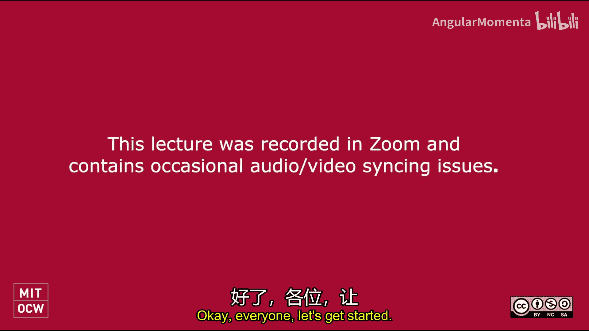
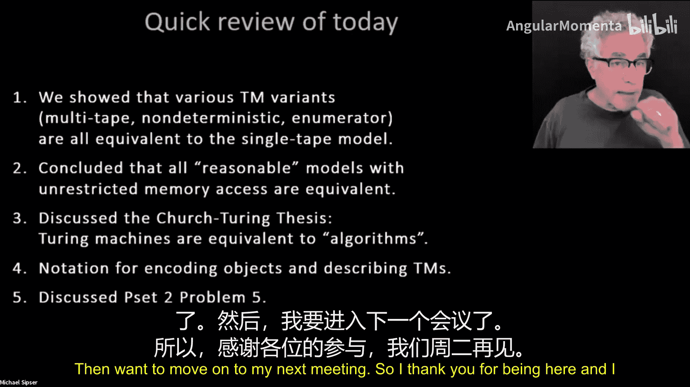
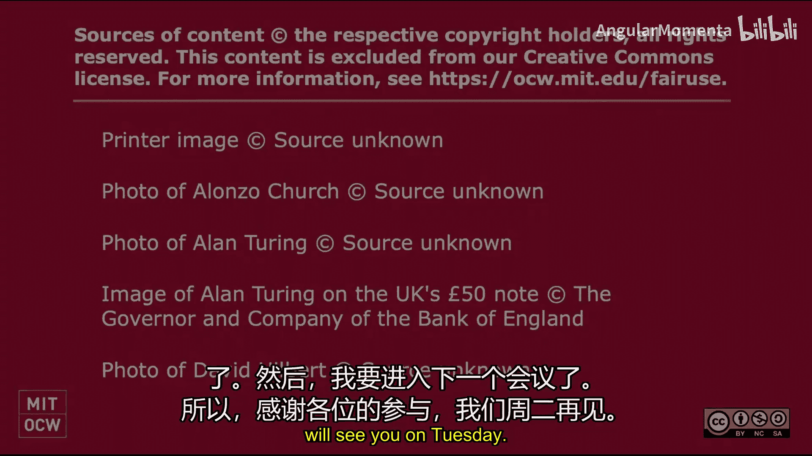
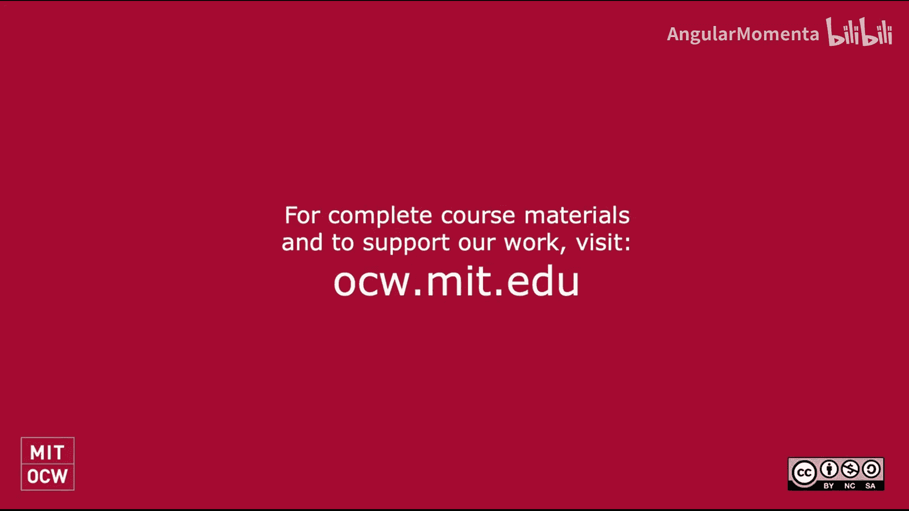

# 【麻省理工】计算理论  ｜  MIT 18.404J Theory of Computation, Fall 2020 p06 6. TM变体，丘奇-图灵论题 -BV1pt7GzeEjb_p6-

Okay everyone， let's get started， welcome back to Theory of computationut lecturec number six。so。

We have been。嗯。Looking at。A number of different models of computation。

And last lecture actually was an important one for us because we shifted gears from our restricted models。

 finite automata， pushed down automata， and they're associated。Gerative models。

 regular expressions and context remars to tuuring machines。

 which are going to be the model that we're going to which is the model that we're going to be sticking with for the rest of the semester。

 because that's going to be our model as we're going to argue today for a general purpose computer。

So in a sense， everything we've been doing up till now has or up until that point has been kind of a warm up。

 but it's been nevertheless has gotten a chance for us to introduce some important concepts that are used in practice and also will serve as good examples for us moving forward and also just to get our。

You know， get kind of。You know， in a sense， on the same page。So。

What we're going to be doing today is。诶。Looking at the Turing machine model in a little bit more depth。

 one can define Turing machines in all sorts of different ways。

 but it's going to turn out not to matter because all of those different ways are going to be equivalent to one another and so we are going to stick with the very simplest version。

 the one we've already defined namely the simple one tape Turing machine。

 but we're going to basically justify that by looking at some of these other models improving equivalent so we we'll look at multitape Turing machines。

We'll look at non deterministic tuuring machines and we'll look at another model which is slightly different。

 but is's still based on tuuring machines called an enumerator。And we'll shut those all in the end。

 give you the same class of languages and so in that sense they're all equivalent to one another。

And that's going to be served as a kind of a motivator， kind of to， in a sense。

 recapitulate some of the history of the subject and going to lead to our discussion of what's called the church Turing thesis。

 so we will I'll get to that in due course。And we'll also talk about some notation for。嗯。

Languages and notations for Tring machines and for encoding objects to feed into Turing machines as input。

 but we'll get to that shortly as well。So let's move on， then we will next go into。

A little review of what we did with for Turing machines and just want to make sure we're all together on that the very important concept for us this term。

 so the Turing machine model looks like there's going to be this finite control there's a tape with a head that can read and write on the tape can move in both directions the tape is infinite to one side and so on as I've mentioned last time。

The output of the Turing machine is either going to be a halt。

 accepting or rejecting or loop that the machine may run forever with three possible outcomes for any particular input。

 the machine may accept that input by entering Q except， make hold and reject by entering Q reject。😡。

And it might reject by looping， which means it just never gets to the accept state or it never gets to any holding state。

 it just goes forever， but we still consider that to be rejecting the input just it's rejecting by looping。

😡，Okay， and as we defined last time， a language is tuuring recognizable as or as we typically write T recognizable。

 if it's the language of some Turing machine， the collection of accepted strings from that Turing machine。

 again， just as before a machine may accept。Zero strings， one string， many strings。

 but it always has one language， the collection of all accepted strings。😡，Um， now。

 if you have a decider， which is a machine that never loops， which always holds on every input。

Then we say its language is a decable language， So we'll say language is turning decdable or simply decidable if it's the language of some。

😡，Deidder， which is a Turing machine that always holds on all inputs。

So we have those two distinct notions， touring recognizable languages and Turing decidable languages。

😡，Um。Now as we're going to argue this lecture， Turing machines are going to be our model of a general purpose computer。

 so that's the way we're going to think of computers as Turing machines。

And why touring machines why didn't we pick something else Well the fact is it doesn't matter and that's going to be the point of this lecture all reasonable models of general purpose computation you know unrestricted computation in the sense of not limited memory are all going to be are all have been shown all the models that we've ever encountered have all been shown to be equivalent to one another and so you're free to pick anyone you like and so for this course we're going to pick touring machines because they're very simple to argue about mathematically and also they have a sort of some element of familiarity。

In that， you know they feel like， well， they're more familiar than some of the other models that have been proposed that are out there。

 know such as rewriting systems， lambda calculus and so on term machines feel like a primitive kind of computer。

 and in that sense they have a certain familiarity。Okay。

 so let's start talking about variations on the Tring machine model。

 and we're going to argue that it doesn't make it doesn't make any difference。

And then this is going to be kind of a precursor to a discussion of a bit of the history of the subject that I will won get to in the second half of the lecture。

So a multi tape Turing machine is a Turing machine。

 as you might imagine that has more than one that well has one or possibly more tapes。

 so a single tape tuuring machine would be a special version of a multita Tring machine that's okay。

 but you might have more than one tape， as I've shown in this diagram。

Now how do we actually use a multitape touring machine while you present the and we're going to see these coming up for convenience sometimes it's nice to be working with multiple tapes so we're going to see these later on in the semester a couple of times as well。

 but for now you know we're setting the model up so that the input is going to be presented on a special input tape so that's where the input appears and it's going to be followed by blanks just as we had before and now we have these potentially other tapes possibly other tapes which we call them work tapes where the machine can。

😡，Write other stuff as it wishes and those tape are going to be initially blank。

 so just all blanks on them。All of the tapes are going to be read and write。

 so you can write on the input tape， obviously you can read on from the input tape and you can read and write on the other tapes as well。

Um。So what we want to first establish that by having these additional tapes。

 you don't get additional power for the machine in the sense that you're not going to have。嗯。

You won't have additional languages that you can recognize by virtue of having these additional tapes I you could imagine that having more tapes will allow you to do more things you know。

 for example， if you have a pushdown automaton with tube stacks。😡。

You can do more languages than you can with one stack。So it's conceivable that by having more tapes。

 you can do more languages than you could with one tape。But in fact， that's not the case。

One tape is as good as having many tapes and we're going to prove that you know we're going to quickly sketch through the proof of that fact。

So the theorem is that Turing machine， a language is Turing recognizable and when we say Turing recognizable for now we mean just with one tape。

 so that's the way we've defined it， so a language is Turing recognizable if and only if some multitape Turing machine recs that language。

😡，Okay， so really another way of saying that is if you have a language that you can do with a single tape。

 you can do it with a multita and vice versa。So one direction of that is immediate because a single tape touring machine is already a multita touring machine that just happens to have one tape。

😡，So the forward direction of that is。Is there's nothing to say， that's just immediately true。

But if we want to prove the reverse， then we're going to have to do some work。😡。

And the work is going to be showing how do you convert a multita tuuring machine to a single tape tuuring machine。

So if we have something that's recognized by a multita tuuring machine。

 it's still tuuring recognizable and what that means is that you can do it with a single tape tuuring machine。

 so we have to show it to do the conversion。And I'm kind of， you know， I'll show you that。

 I think in a convincing way， but know without getting into too much detail。

 so here is an image of a multita Turing machine。In during the course of its input。

 so it has already we've already started it off。😡，You know。

 initially it starts off with the other tapes， the work tapes being all blank。

 but now it's processed for a while and you know the head on the input tape is now has moved off from its starting position at the left end it's somewhere in the middle。

 it's written stuff on the other tapes。And what we want to do is show how to represent。

That same information。On a single tape touring machine。

In a way which allows the single tape Tring machine。To carry out。😡。

The steps of the multi tape Turing machine， but using only its single tape by virtue of some kind of a data structure which allows for the simulation to go forward。

😡，Okay， so how is the single tape tuuring machine going to be simulating。

 going to be carrying out the same effect of having these multiple types on the multita tuuring machine？

😡，So here's a picture of the single tape turn machine， it just has one tape。By the way。

 I should mention that all of the tapes are infinite to the right in the multita tuuring machine just as we had for the single tape tuuring machine。

And now with this single tape turningring machine， it's going to represent the information that was that's present on these multiple tapes。

 but using only the single tape and the way I'm choosing to do that is going to be particularly simple I'm going to just divide up so here I'm saying it in words。

 it's going to simulate them by storing the contents of the multita on the single tape in separate blocks。

😡，So I'm basically going to divide up the single Turing machines tape into separate regions。😡。

Where each one of those regions is going to have the information that was on one of the tapes。😡。

In the multi tape machine。So for example， here is on the first tape， it's got AA BBA， well。

 that's going to appear here in that first block on the single tape Tring machine。😡，ok。

Sort of seeing it flow down to suggest that it's coming from this multita tuuring machine。

 but that's really been developed by the simulation that the single tape tuuring machine has obviously the single tape tuuring machine doesn't have any direct access to the multita machine。

 but it's going to be simulating。So this is how we're showing the data is being stored on the single tape machines tape。

 so in the second block it's going to have the contents of the second tape of the Turing multita machine。

😡，And the final region of the single tapes， the final block so called of the single tapes tape is going to have single tape machines tape is going to have the rest of the。

InThe contents of the last tape of M and then it's going to be followed by the same infinitely many blanks that each of these。

Tapes are going to have following the portion that they may have written during the course of their computation。

Okay， so that's what the single tape Turing machine tape is going to look like during the course of its computation。

 it's going to have the information represented in these blocks。

cappturing all of the information that the multitape tuuring machine has in a perhaps somewhat less convenient way because the multitape tuuring machine。

 you know we didn't really make this explicit and in part because it doesn't really matter。

 we didn't say exactly how the multita tuuring machine operates what I have in mind is that the multitape Turing machine can read and move all of its heads。

😡，From all of its heads in one step。😡，So in a single step of the multita machine。

 it can obtain the information that's underneath each of its heads。

Feed that into its transition function， and then together with the state of the multita machine。

 decide how to change each of those locations and then how to move each one of those heads。😡。

So it's kind of operating on all of the tapes in parallel。😡，Okay。

 so now how how does the actual steps of the simulation of the single tape， you know。

 by the single tape machine how does it go so first of all。😡。

Besides storing the contents of each of the tapes in S's single tape。😡。

There's some additional information that it needs to record namely。

M has a head for each one of its tapes。But S has just a single head。

And each of M's heads could be in some different location， you know， in this case， as I've shown it。

On the first tape， its headeds in location three， on the second tape it's in location two。

 on the third tape， it's location on the last tape， it's in location one。Uh，So where were we。

 we were simulating the multi tape Turing machine with the single tape tuuring machine。😡。

And we have to keep track of where the heads are。And so we're going to do that by writing the locations on those blocks。

😡，Okay， so we're going to have。A special dot。As I've shown here to represent the location of the head in that very first block。

 so the heads on the B， I'm going to dot the B and I'm going to do the same thing。😡。

For the locations of the others heads。And how am I getting that effect。

 well we've had seen something like that before where we just expand the tape alphabet of s to allow for these dotted symbols as well as the irregular symbols。

 we also have expanded it to include the limititer markers that separate the blocks from one another which I'm writing as a pound sign。

😡，So we can just get that effect simply by expanding the tape alphabet of s， okay。

 a few more details of s that are just worth looking at just to make sure we're kind of all understanding what's happening。

So for every time M takes one step。😡，S has actually a lot of work to do because one step of M and it can move all of those read and move all of those heads all at one shot。

 S has to scan the entire tape。To see what those what's underneath those in effect， virtual heads。

 which are the locations of the dotted symbols， it has to see what's underneath each one of those heads。

😡，To see how to update the transition you know update its state to the next state and then it has to scan again to change the location change the contents of those of those tape locations and also to move the head left or right by moving the effectively now moving the dot left or right so that's pretty straightforward。

😡，There's one complication that can occur， however， which is that what happens if。

On one of the tapes， let's say M。Starts using writing more content than you have room in that block。

😡，To store that information。You knowSo if M like moves it has 101。

 suppose M you know after a few steps moves its head into the originally blank portion of the tape and writes another symbol there。

 we have to put that symbol somewhere because we have to record all that information and the block is like full so what do we do well in that case S goes to like a little interrupt routine and moves shifts all of the symbols to the right one place to open up a location here where it can write a new symbol for carrying continuing the simulation。

😡，So with that in mind。S can maintain the current contents of each of them's tapes。

 and let me just note that here， shift to Ed Room is needed。

And that's all that happens in this during the course of the simulation， Okay， and of course， if S。

As its simulating M observes that M comes to an accept or reject state。😡，S should do the same。Okay。

 so that's our description of how of the single type simulation of the multita machine works。Right。😊。

Okay， let's turn to not a determin machines。Now。If you remember for finite and I hope you do for finite automata。

 we had equivalence between nondeterministic and deterministic finite automata for pushdown automata we did not have equivalentvalence we didn't prove that but we just stated it as a fact there are certain languages that you can do with nondeterministic pushdown automata which is the model we typically hold as our standard so that some things you can do with nondeterministic pushdown automata that you cannot do with deterterministic pushdown automata you really need the nondeterminism they're not equivalent for Tring machines。

We're going to get the equivalence back。So we'll show that anything you can do with a nondeterministic turing machine in terms of language recognition you can also do with a deterterministic turing machine。

 so remember we kind of mentioned this briefly last time the nondeterministic turing machine looks exactly like a deterterministic turing machine except for the transition function where we have this power set which allows for multiple different outcomes at a given step instead of just a single outcome that you would have in a deterterministic machine so we represent that with this power set。

Here apply to the possibilities that the machine would have as the next step。Okay。

 so we're now we're going to prove a very similar theorem that a is tuuring recognizable。

 but by an ordinary mont tuuring machine that kind of goes without saying so that's how we defined it。

 a is Turing recognizable if and only if some nondeterministic Turing machine recognizes that language。

Okay。Again， remember， we're using nondeminism in the way we always do。

 namely that a non deterministic machine accepts if there is some branch or some threat if it's not a computation ends up at an except。

😡，Other branches might go forever or might reject part of the way through。

 but acceptance always overrus then if any branch accepts， that's how nondeminism works for us。Okay。

 so now。The forward direction of this is again， just like before immediate because a deterministic tuuring machine is a special kind of nondeterministic Turing machine which never branches non deterministically on any of its steps。

 so that forward direction is immediate。😡，The backwards definition is where we're going to have to do some work converting our nondeterministic Turing machine to a deterterministic tuuring machine and we'll do so as follows we'll take a nondeterministic Turing machine here's our picture and we're going to now imagine its computation in terms of a tree and so here is a nondeterministic computation tree for n on some input W so n for nondeterministic。

Here is the tree somewhere down here it might end up accepting and as I mentioned that is going to be defining the overall computation to be accepting if there is some place here that's accepting。

 and the only way it can be non accepting computation， if there is no except that occurs anywhere。😡。

And somehow， if you're going to convert this non deterministic machine to a deterterministic machine。

 the deterterministic machine is going to have to get that same effect。

Though it only has determined you know， it doesn't have the nondeminism， so how does it manage that？

Well， it's really going to be carrying out the simulation， you know。

 kind of as you would imagine doing it yourself， if you were told you had the simulating nondeterministic Tring machine。

 which is you're going to search that tree of possibilities looking to see if you find and accept if you do then you accept if if you don't。

 well maybe you'll go forever or maybe you'll manage to search the entire tree and then you will say。

😡，No， I accept， no I reject。Okay， so let's just see again。

 what the data structure of that deterministic machines tape is going to look like。😡。

So the way this simulation is going to carry out and you know you could program this in a host of different ways and in fact the textbook has a somewhat different simulation。

 but I think this one here lends itself a little bit better and maybe it's a little simpler for description in this setting。

😡，But there's lots of different ways of improving these things。

 so we're going to M is going to simulate n kind of a little bit similar to the previous simulation。

 it's going to break the tape up into blocks。😡，And it's going to now store in each block。

A different thread。At a particular point in time of end's computation。

So you imagine word M is going to be simulating n sort of。😡，Doing the same parallelism。

But getting the effect of the parallelism， not through the nondeminism。

 but by maintaining copies of each of the threads on its tape and then updating them accordingly。😡。

So the idea is， I think， not too complicated。So let's just see some of the details here。

 so here we populating those blocks with the contents of ends tape on different threads at a sort you know maybe that corresponds to ends tape you know。

 after the fifth step of N， you know on each of those threads， you have these three possibilities。

 let's say written down as three different blocks。😡，Now。Remember。

 in the case of the multita simulation， we needed to record some extra information， in particular。

 we had to record the location of the heads。😡，By using those dotted symbols。

 we're going to do that again because each one of these threads might have their head in some different location。

 but we're going to have to do more。 But let actually， So let's say one one thing at a time。

 we're going to store the head location。Here they are all written down as dotted symbols。

But now there's something that goes further because in a multita case。There was one global state。

That the multi tape machine was in， of course， at any given time。

 it's just one has one finite control it's in one state and。

But but in the case of the non deterministic machine that we're simulating now。

 each thread can be in a different state。😡，so whereas before we could keep track of the multi tapes during the multita machine state inside the single tape machine's finite control。

 now there could be many， many different states to keep track of。😡。

So you won't be able to store that in a finite control anymore because there could be some huge number of threads active at any given stage and some of them can be in one state。

 others can be in different state and you know how do you keep track of all that so we're going to have to use the tape we're going to actually write down which state a given thread is in on that block。

😡，And we'll do that， I'll show it like this， so write it down the state we in the block。

By writing down symbols which correspond to those states。😡，So we're actually in a sense。

 writing the states down right on top of the block using symbols that correspond to those states so again。

 we're doing getting that effect by increasing the tape alphabet of M to include。😡。

Symbols that correspond to each of its states。And I'm going to write those symbols down。

 so here's a symbol for state Q8 that says well， one of that very first thread of N's computation is in state Q8。

 it's in this third position of on its tape， the head is on the third position there and the tape contents is AABA。

That's how we represent that thread of the computation。Including the state。Okay。No。

So am is going to carry out that step by step maintaining that information on its tape there agains to before there might be some special situations arising so for example。

 n is not non deterterministic so a thread might fork。😡，Into two threads。

What do we do then well sort of the。You know， the reasonable thing， if there's a forking thread。

 M then copies that block， makes two copies of the block to correspond to the two or however many copies you need to correspond to the possibilities that that thread is branching into so you want to represent them all on different blocks of Ms tape。

😡，All right， and then if Am ever finds out that on one of the threads。

 it's entering the accept state， it can just shut down the whole computation at that point and say accept。

😡，起叔。😊，Perhaps a little elaborate， but I think conceptually hopefully。Not too bad now。

Let's move on then to talk about somewhat of a different looking well sort of a different model in a way。

 which has some historical significance and sometimes is a helpful way to look at touring recognizability and incidentally you have a homework problem on this model。

Called an enumerator or turning anumerator。Um， so。Here it's going to operate somewhat differently。

 first of all， we're going to enhance the touring machine model it's going to now have just a single tape。

 but it's going to also have a printer。Okay， so we're now adding in this new device into the Tring machine called the printer。

And。The Turing machine has tape as before except we never provide any input to the machine the tape always starts out fully blank it's only used for reading and writing only used for like keeping for work it's not where you present the input so how do you talk about the language of the machine。

😡，Well， the way you work this machine is you take this enumerator。

 it's a determinative determination with a printer as I mentioned。

 you start off in blank tape and it runs and runs and runs and periodically it can print a string under some sort of program control。

 which I'm not going to spell out for you， but you can imagine you might have to define the machine in such a way that when it goes into a certain print state。

 we're not going to set that all up， then whatever string is in a certain region of the tape。

 maybe from the start point up into the head location that gets printed out。😡，On the printer。

And then it could print out other strings in due course and so periodically you think of this printer as printing out a string。

Under the control of the Tring machine enumerator。And so these print strings。

 these strings that could print out W 1， W 2， they appear。

And the machine might possibly go forever and print infinitely many strings or it might go forever and only print finally many strings。

 or it might stop after a while by entering a whole state accepting a rejecting is irrelevant but enters a whole thing state and then the number the strings that it's printed out the finite many strings that it printed out of just that's the output of the machine now the language of the machine is the collection of all strings that it ever prints out。

😡，So we defining language in a somewhat different way here， it's not the strings that it accepts。

 it's the strings that it prints。😡，So we think of this means she almost a little bit analogous to like the regular expression or the grammar in the sense that it's a generative model。

 it produces the language rather than accepts the strings in the language。😡，嗯。

So's not really a recognizer。 it's a generator and the language of the machine。

 as I'm writing over here for an enumerator here， we say that its language is a collection of strings edit prints。

Okay， now we will show that a language is touring recognizable in the previous sense， you know。

 recognized by some ordinary Turing machine， if and only if it's the language of some menummererate。

And actually this is kind of a little bit of an interesting proof， you have to do some work。

 it's an ifno if now neither direction is immediate。

 you're going to have to do some work in both directions one direction is a little harder then the other will'll start off with the easier direction let's say we have an enumerator。

Hopefully you got this concept of this touring machine。

 which periodically prints strings when you started it off on the empty tape。

So now what I'm going to construct for you is that Turing machine recognizer。😡。

Defined from the enumerator。 so this recognizer is going to be simulating the enumerator。😡。

So it's basically the recognizer are going to launch the enumerator。

It's going to start off simulating it。😡，Now if you want if it's convenient， we can use several tapes。

 we can use one tape to simulate the recognizer and you have other tapes available for convenience if you want。

 because we already showed multita and single tape are equivalent so if you want to think of M as having multiple tapes it's not going to really be that important relevant to my conversation but you're going to simulate E starting on the blanket put as you're supposed to。

And then you're going to see whenever E prints an x。

 you're going to see if x is the same as the input to the recognizer。😡，You get the idea。

 so we have a recognizer it has an input string， maybe like 1101。😡，And I want to know。

 I want to accept that string if it's one of the strings that。😡，The enumerator E prints out。

Because that's what the recognizer do it's supposed to accept all the strings that the enumerator prints out so I got this 1101 what do I do I launch I fire up that enumerator。

 I get it going and I start watching the strings that prints out。😡。

Comparing them with my input string 1101， if I ever see it print out of 1101， great。😡。

I know I can accept because I know it's in the enumerators language。

But if I compare and compare and compare， I never see the enumerator ever printing out my input string 1101 well。

 I just keep simulating E if E holds well then I can hold and reject if I've never seen that string coming out as an output if E doesn't hold。

 well， I'm just not going to hold either I'm going to go forever。

 but then I'm going to be rejecting my input by lu bit。😡，Okay。

 so that's the proof of converting in this backward direction。

 which is the easier direction now let's look at the forward direction。

 which has a certain wrinkle that in it that we're going to have to get to。

So now we're going to be building our en numerator to simulate our recognizer。😡，Okay。

 and the way we'll do that is。The enumerator has to print out。

All of the strings that the recognizer would ever accept。So you kind of do the obvious thing。

 you're going to take the enummerator is going to start simulating the recognizer M on all possible strings。

😡，Sort of you know one by one using doing them in parallel taking turns。

 you never not you know we maybe we didn't make this so explicit， but you don't have。

 you know you can sort of timeshare among several different possibilities you run you know it' sort of like having different blocks for the machine different you're going to run。

😡，The enumerator is going to run the recognizer on， you know， well。

 let's just say it does it sequentially， it runs it on the empty string。

 it runs it on the string zero， it runs it on the string1， runs it on the string00。

 these are all the possible strings in sigma star， you run on all of them and whenever the enumerator。

呃。哦哦。This is wrong。Whenever。Um。So whenever。And accept。Then， print。I can't write very well。Print。W。WI。

 oops。Okay， so let me just say it in words。You're going to simulate M on H WI whenever you notice。😡。

M accepting WI， you just print out WY。UBecause you want to print out all of the strings that M accepts。

Now what there is a problem here， so hopefully you're not confused by this typo doing it sequentially like I just described doesn't quite work。

 so let me just back that up here， doing it sequentially doesn't quite work。😡。

Because Emma might get stuck looping on one of the WIs。Like， you know。

 maybe when I feed w zero into into M， M goes forever。Because M is rejecting zero by looping。

 but maybe it also accepts one this next string in the list the string one。

 I'll never get to one by just feeding the strings into M one by one like this。😡。

What I really have to do is run all of the strings that am in parallel。😡。

And the way I'm going to indicate that。Is I'm going to simulate M on W1 to W for I steps for each possible I。

 so I'm going to run M。😡，On more and more strings for more and more steps。Okay。

 until and every time I notice an am accept something， I print it out。嗯。呃。

So I will fix this in the version of the file that I publish on the website。

 so if you're still not getting it， you can look there。

 but just to make things even worse I have would check in which is going to。

Be about this one little point here。Um so I got a question where do we get the WI strings。

 the WI strings are simply the list of all strings in Sigma stock。😡，So we can under program control。

We can make M go through every possible string like if you had an odometer。

 you're going to first get to the empty string then you go to the string zero then the string one。

 you can write a program which is going to do that and the Turing machine conly right code to do that to get to each possible string one by one and then that's what the enumerator is doing it's obtain each of those strings and then feeding them into M。

😡，Seeing what M does， what I'm trying to get at here is that it's not good to feed them in。😡。

Run M to completion on each one before going to the next one。

 you really kind of have to do the model in parallel。😡。

U to avoid the problem of getting stuck on one string that M is looping on all right。

 so this is relevant to your homework in fact。If I convert M to an enumerator in this way。

Does that enumerator always print the strings out in string order？😡，String water is this order here。

😡，Um， having them u the having the shorter strings coming up before the longer strings and within strings of a certain length。

 just doing them in lexiographic order。So hopefully you follow that， but since you're you know。

 these are not。Correctness doesn't matter for us， let me launch that polls i'll see how confused。

 how random the answer is here。So a fair amount of confusion， if you're confused。

 obviously you're in good company there， okay， about to shut this down five seconds to go。Okay。

 ending in out。诶。All right， so the correct answer as the majority of you did get is in fact。

 that the order is not going to be respected here when E prints things out。

It might print out some things later in the order before earlier things in the order what's going to control how when he is going to print it out it really is。

😡，If M accepts some strings more quickly in fewer steps。😡。

Then E might end up printing out that string earlier in the list。😡。

Then some other string that might be a shorter string。Because。

The order in which E is going to now identify that M is accepting those strings depends upon the speed with which M is actually doing the accepting。

😡，So you have to， this is relevant to one of your homeworks because if what you're going to be able to show is that if you start with a decable language instead of a recognizable language。

😡，Then can make then you can make an enumerator， which always prints out things in order。

 in the string order。😡，Okay， and and vice versa， so if you and if you have a string which an enummerator which prints things out in string order。

 then the language is decidable。Okay， so need to think about that。

One direction is a fairly simple modification of what I just showed。

 the other direction is a little bit more work， so anyway why don't we take our little coffee break here。

Okay， so that's an interesting question。 So one question is， if there's because， you know。

 Sigma has an infinite Sigma star is infinite。Um， if I understand this question quite correctly。

 which says you know， it's an infinite number of strings here。

 how how does the machine even get started because it has to go through and enumerate all of it。

 no it's not first writing down all of those strings。Because yeah。

 you can write down and you can't do with this infinite step of writing all the strings。

 what I had in mind is you're going to take each string in turn。

First you're going to take the first string on the list of Sigma star run on that string and then the next string in Sigma star run it on that string and so on string after string and so you're never going to have infinitely many strings to deal with it just going to be more and more strings as you're going along and the question I was trying to get at is whether you're going to。

Run each one to complete completion before you get to the next one or you're going to kind of try to do the mo in parallel which is what you need to do to prove this this there won't there be infinitely many WY yes so there are a similar question infinitely many WY there are infinitely many WY but you know it's just an infinite loop that we're in one by one you're taking care of more and more WY as you're going。

😡，Let's see here。Yes， so E is another question is， are we running it all on all the strings in parallel。

 Yes， we are running things on running all of the strings in parallel， but。You know。

 it's running them in parallel， but these are。You know it's we're not defining a parallel touring machine。

 it's running them in parallel using timeshare， you know。

 it runs a little bit in this block runs a little bit and that block and another block and sort of shifts around and sort of does a few steps of each and that's how it's getting the effect of the parallelism。

😡，呃。ok。嗯。Question is。With the enumerator essentially have a print tape and a work tape， yeah。

 you can think of it as having a print tape， you know however you want to formalize it it's it it。

It doesn't matter， I mean， I'm being a little whimsical， but attaching it to a picture of。

A real printer， but yeah， it just you think conceptually you can have it a print tape。

 however you like to think about as fine。How can we directly say that without knowing the program of the printer？

呃。The printer is just there's no。We don't have to get into the co the structure of the printer。

 the printer is just。😡，Something where you say print a string and a string comes out。

 that's all we know about the printer and that's all we need to know。

So there's no program for the printer， sorry if I。Not understanding your question。

 but the question literally says， how can we say that without knowing the program of the printer？嗯。

So if the machine is decable， why does it have to print all strings in order？For example。

 if one string is shorter and can it be decided later？WeWell， yeah， if。The reason why we want。

 so the question is， if the machine is decidable， why does it have to print all strings in order？😡。

Because that's what I'm asking you to do in the problem。That's what if you read the problem。

 I think if it's number five on the PSet， that's what I'm asking you to do that's why you have to print it in order otherwise you wouldn't have to worry about printing in order it just because I'm asking you to。

😡，Okay， so I think we're at a time， let's let us move back into our material。Okay， second half。

 church turing thesis。So church， this is going back into the bit of the history of the subject back to the 1930s。

Back then people were interested in formulating the notion of what do we mean by algorithm。

 they didn't even call it algorithm and those they call it some people call it procedures。

 some people call it effective procedure some people called it effective calculation。

 but you know people had in their minds， mathematicians have been dealing for centuries。

 thousands of years， with procedures for doing things that's a very natural thing and mathematical logicians in particular church and Turing Turing somebody you surely obviously have heard of church maybe not。

 a church was Turing thesis advisor in fact and。They both were coming out of the mathematical logic field of mathematics and trying to use mathematical logic to formalize this intuitive notion of what we have had for centuries about what a procedure is。

 what is an algorithm。😡，And back in those days， you know。

 they came up with different ways of formalizing it so you know here we have this notion of algorithm。

 which is kind of intuitive concept touring proposed touring machine as a way of capturing that informal way。

 mathematically precise way， other people came up with other ways of doing it。

And back then it wasn't obvious that all of those different formulations would end up giving you equivalent concepts。

 equivalent notions， and in fact they proved in fairly elaborate detail。

 that the different methods that people came up with， it was a lambda calculus。

 there was rewriting systems， there were several methods that were proposed for formalizing this notion。

 and they all turned out to be equivalent to one another in today that seems kind of obvious even though I went to some effort to prove that just to give you a feel and for how those things go。

 you know， that you know， if you have programs， if you have Pascal and Java say and thinking about what you can do mathematically in those I'm not talking about their ability to interface with。

😡，you know， windows and so on， but just the mathematical capabilities。

 the capability of doing mathematical calculations or functions with a Pacal program or a Java program。

You know， it would be absurd to think there's some program that you can write in Java that you can't write and pe out。

😡，Or Python。And the reason is we know you can compile Python into Java and you can compile Java back into Python and that tells you that the two systems of two programming language are equivalent in power that wasn an obvious that from the get go to these folks so they observed that all of the different efforts they came at formalizing algorithm all were equivalent to one another。

😡，That was that was a kind of a breakthrough moment when they realized that they're all。

Is that not all the ways that they've come up with and once they got the idea。

 they realize all reasonable ways of doing it are always going to be equivalent。😡。

And so that suggested that。They've really captured this notion of algorithm by any one of those methods。

 say a touring machine。And that's what they took， then you can't prove that because algorithms are an intuitive notion。

But the fact that we're able to capture that in a formal way。

 that's what we call today the church Turing thesis。😡，Okay。

 so that is so any of these methods capture the notion of algorithm as we described。

And that has had a big impact on mathematics。I just want to。Just give me one second here。All right。

 here's a check in on this one。 So you know， Alan Tring， So heres some。Facts。

 which may or may not be true about Alanur。So now you get to pick all the ones that apply based on your knowledge。

 obviously this is not something this is more for fun， but or historical interest。

 but here is let's launch that poll， see what how much you know about。Mr。 Tin。Check all that apply。

Okay， almost done。Please。Let's wrap it up， I think that's everybody。ok。Two seconds。

 please get credit for doing this and polling。 In fact， it's kind of interesting here。呃。嗯。呃。

You all do know that he was a code breaker， he was worked in fact did was part of a team。

 I think led the team， which broke the German code and during World War II。

You know the Tring test is a famous thing for how do you characterize when you have an intelligent machine。

 so he definitely worked in AI。He worked in biology as well。

 he has a paper that less well known to computer scientists。

 but if you look him up on Wikipedia where I get all my information。

He actually and I knew this anyway， he has a very famous paper， an influential paper on how。

For example， spots arise on leopards and stripes on tigers and so on。

 he gave a kind of mathematical model for that， which actually proves actually is quite does capture things in an accurate way as was shown subsequent to that。

Was imprisoned for being gay， in fact as far as I know from his history he was not imprisoned for being gay。

 he was convicted。Of being gay and was given a choice to go to prison or to take chemicals to cure。

Him from being gay。And he opted not to go to prison and take the chemicals。And sadly。

 he committed suicide two years after that。So he was。

reTreated very badly by the British society and British government despite having the greater work that he had done。

 and you might think that he has been honored by appearing on a British bankote。

 that's also not true but the good news is he's not currently on a British bank noteote but he's going to be on a British bank noteote starting next year。

 so that is。So that's。You know， along with Winston Churchill and a number of other notable ririts。

 he's going to be on the 50 pound bank dump。Okay， so let us continue。So as I mentioned。

 the church and thesis is important for mathematics and it has to do with these Hilbert problems。

 I don't know how many of you have encountered that David Hilbert was widely considered to be the perhaps the greatest mathematician of his day and you know every four years mathematicians get together for an international Congress well the International Congress of mathematicians。

It was email that's been going on for over 100 years and he was invited to the 1900 meeting to give a talk about anything he wanted and what he decided to do during that presentation is present 23 problems。

😡，That would be a challenge for mathematicians for the coming century。And， you know。

 we're running a little short on time so I'm not going to go into them。

 some of these we'll talk about later， but the10th problem here is about algorithms。

 the1 problem on Hilbert's list called called Hilbert's10th problem is a problem about algorithms and it says given algorithm for solving what are called diahanine equations。

He didn't call it an algorithm， he call it some finite procedure or something like that。

But you know what are diahanantine equations， I'm glad you asked。Diaantine equations。

What are they well they're very simple they're just polynomial equations like you know does this polynomial equal some constant。

 for example， but where you're looking for the solutions。

You know the polynomials are variables so you're looking for the solutions。

 but you're only allowing those solutions to be integers。So here's an example。

 so I give you this polynomial here I'm setting it equal to seven and I want to solve that equation。

So it has these three variables x， Y and z， so you have to find a solution there。

 but I'm only going to allow you to have plug in integers and in fact there is a solution in integers one2 and minus two if you plug it and you'll see it works。

All right， now the general problem that Hilbert was addressing is， suppose I give you a polynomial。

Let's say it set to zero so we're looking for roots to the polynomial。

 but just some polynomial equation， you can always put it in this form。And I want to know。

 does it have a solution in integers？And what I want， what I'm looking for is a procedure。

whichch you tell me yes or no， I want to know give an algorithm to answer that question for a given polynomial or using the language of this course。

 defining this in terms of a language。😡，Decide this language。

 give a turing machine which will decide yes or no for any given polynomial， yes。

 there is a solution in integers， no， there is no solution in integer。😡，Okay。And that is a。呃。

That was what Hilbert asked in his tenthth problem。Given an algorithm Now， as we know now。

 we took 70 years to get the answer that that there is no such algorithm。

 It's an undecidable problem。 And we'll talk about that a little bit later in the term。

 but there is D is not a decidable language。Now。There was no hope。Of coming up with that answer。

In 1900 or even in 1910。Because we didn't have a formal idea of what an algorithm is。

Then had to wait until the church during thesis。Told us that algorithms really are turing machines。

 that there is a formal way of saying what an algorithm is。😡，And once you had that notion。

 then you could prove that there is no Turing machine。

 but before that you had only this vague notion intuitive notion of what an algorithm is。

 and so there was no hope of ever answering that because the in fact the answer is there is no such algorithm。

😡，Okay， now I'll give this as a little exercise to you， we're a little bit running short on time。

 but this language D is in fact a recognizable language。

So I would suggest you think about that offline， but basically you know you can try plugging in different values for these variables and if you ever find you know that it evaluates a zero。

 then you can accept， but otherwise you just have to keep going and looking so showing recognizability is very simple。

 but decideidability is false。Okay， now。Let's talk a little bit about encodings for tuuring machines so we're going to be working encodings and touring machines so we're now going to be working with tuuring machines going forward we're going as I you know we're going to。

The input to those Tring machines might be polynomials， might be strings。

 they might be other things too， we might want to feed automata into the Tring machines so the Tring machine can answer questions about the automata。

😡，Well， don't forget， touring machines take as their input just strings。😡。

So we have to think about how we're going to represent。Something more complicated。

 like an automaton as a string。And I'm not going to get into the details of that。

 you could spell it out in detail， but I think that's not too interesting to get into that。

 we're just going to develop a notation that says if you have some object，Oh。

It could be a polynomial， it could be an automaton， it could be a graph。

 it could be whatever you're working with a table I'm going to write。😡。

That O in these brackets to mean an encoding of that object into a string。

And then you can feed the string into the Tring machine。Okay。

 so that's how we're going to be thinking of presenting Turing machines with more complicated objects and strings as input because we're just going to represent them as strings using ways in which i'm sure you're all familiar I and that's how you deal with representing stuff when you're you know write your programs anyway but just to make it formal and that's the way we're going to write it down in these brackets and if you have a list of several objects that you want to present together to a Turing machine we'll just write them together within brackets like this。

Now for writing tearuring machines down。We're going to going forward we're going to be using high level English descriptions we're not going to be worrying about managing the like the stuff we've been doing up till now I'm not going to ask you to do it we're not going to do that anymore and I'm not going to ask you to do it managing where stuff goes on the tapes and all that stuff that's too low level because really now that we have the church Turing thesis we really interested in talking about algorithms we're not that interested in talking about Turing machines per se with ancient algorithms and what the power of computation is。

😡，So we're going to only be talking about Turing machines now in a higher level way。

 and only when we need to prove something about capabilities。

 we're going to come back to touring machines and'm going to be proving things about their limitations and so on。

So our notation for running Turing machines is going to be。

We're basically going to put the Tring machine inside these quotation marks and we're going to know that we could。

 if in principle write out the Turing machine in a precise way in terms of states and transition function and so on。

 but we'll never actually go ahead and do that lengthy exercise。😡，So quick check in here。

So one of the features， well， okay， let me not give this way so if x and Y are strings。You know。

 I want to now have a way of presenting two strings as a single string as input to my machine。

 because I always think of my machine as getting a single input。😡。

So would you suggest one way of combining two strings into one， which we would be a good encoding。

 is just to concatenate those two strings together。😡，你你。

Its would it be that would would that be the way you would do it is that a good way to do it or not such a good way to do it so let's。

😡，嗯。Let's see here。I can get to that， next。And think of what you would want to have happen in a good encoding。

😡，ok。Ready set， sold。Share results。Yeah， I think most of you got the idea that this is not a good way of combining two strings into one。

 because the problem is it's kind of ambiguous in a sense， you know that you could。

If you combine two strings this way， what's important in an encoding is that the machine。

 when it gets encoding， it can decode them back into the original objects。😡。

And if you're just going to be sticking the two strings together。

 you don't know where one string ends and the next string begins。

 and so it's not going to be a good way of combining things you should find a little bit more clever way of either introducing another symbol or doing something a little bit more sophisticated。

 which would allow you to be able to do the decoding as well as the encoding in a unique way。😡，Okay。

 so getting back to that notation for Turing machine。

 so here is the machine we've already seen once before for A to the K B to the K C to the K。

I would write it now more simply than managing all of the tapes that we had the first time around which we did last lecture。

 I would just say given an input W check of ws of the right form with the things in the right order rejective if it's not count the number of As Bs and Cs W except the the counts are equal and reject if not we're not going to be that's going be good enough to be writing things at that higher level when you're going to be writing your algorithm descriptions you just have to make sure that whatever you're doing you can implement you know you can't make you don't want to be doing tests which are impossible or doing infinite infinitely much work in one stage that's not good but as long as it's clear that what you're doing doing only a finite amount of work in every stage and it's something that you could really implement。

 you can write it at in a high level。😡，Um， okay。I wanted to spend a few minutes talking about problem set two。

 but we a little bit running out of time here， particularly there was this problem number five where you show that a language is turninguring recognizable if and only if there's a decidable D。

Where C is touring recognizable， where D is now a collection of pairs。

 we've got some questions about the notation， which I've hopefully answered now。So C。

Is a set of x's such that there exists a string you can pair it with so that the string X Y is in D。

嗯。Let me trying to give you a picture of that。So I'm going to think of D as a collection of pairs or strings。

 and it might be helpful to think of D kind of。You know， on the axes here。

 So if we have a pair of strings， X Y， which I have not yet packaged into a single string。

 I'm thinking of them as a pair of two objects at this moment。Think of D as so， you know。

 just the X part is just below here on the X axis D。

 you might want to think just conceptually want to think of it as a collection of pairs。

So it's like a subset of all of these pairs and C is all of the x's that correspond to any pair in here。

😡，Sometimes we call that the projection because there's all the things that are below or the shadow。

 if you had a light sitting up here， it's all the things that are kind of underneath a D so I've written C here kind of a little thicker if you can see that so that's the C language。

😡，And。What you're going to there's a two directions here。

 one is a lot easier than the other if I give you a decable D。😡。

And I want to test whether something's in sea。😡，So I give you an x， I want to know， it is X in C。

Well， you now have to sett test， is there some y that I can pair with X where the pair is in D？😡，嗯。

So， you know， you can start looking for that w if you ever find one。You know that x is in C。

There are infinitely many ways to look for， but don't forget， you know。

 you're only looking for a recognizer for C。😡，So， you know， on the rejecting side。

 you're allowed to go forever。So I've kind of given you a way to think about the easy direction。

 the hard direction。You need to think about how are you going to come up with that decidable D if I give you C。

 you have to find a decidable D and now you're bringing something down lower。

 you're starting with a recognizing recognizable language and a decidable language which is going to sort of be counterpart to that in his sense is a simpler language and way it becomes simpler is that why is going to help you。

😡，Determine whether x is in C。And I guess the thing that you should I'll leave you with is maybe we can talk about this a little bit more on Tuesday。

 I'll try to leave it a little bit more time。If you want to test if something's in C， X is in C。

 but I don't want to let you go forever anymore because I' want to be a decidable language。😡。

And I'm going to use why to help you。😡，What information would help you？😡。

Guarantee you get the right answer for X being in C， but that you would。😡。

Have to be sure you're getting the right answer so it's you know its why could just be the answer。

 but then you know you don't know that that's you have to be convinced it that you have the right answer you know why just saying what it is I mean you could Y could say that X is in D even when it's not true X is in C even when it's not true but so one information would allow you to check。

😡，That x is in C， what would be helpful information to check that x is in C where you would avoid ever having to go forever。

A littlettle bit too rushed here for that to be helpful anyway。

 let's just conclude what we've done just brief summary here and I don't want to。

I keep going to keep you over time， so i'll just leave this up on the board I will。

See if there's any， so the lecture is over and you can take off as you wish。

 I will stick around for a couple of minutes， I have another meeting soon。

 but I'll try to answer some chats。呃。All right。People are commenting about this movie about Turing the imitation game。

 you if you haven't seen that， I recommend it。And。Is it a good idea to make y to be equal to the？

Heated loop string。I'm not sure about that。Thank you for the you everybody for sending your kind notes。

Turchtoruring thesis， The question is， is it in the book。 Yes， it's in the book。

 kind of similar to what I've already said， but yes。嗯。Okay， this is a good question here。

 the church tuuring thesis somebody asked me is it proved in the book？There's nothing to prove。

The church touring thesis is an equivalence between the intuitive and the formal。

You can't prove something like that， you can just make， it's really in a sense， a hypothesis。

That the only thing you'll ever be able to compute is something that you can do with a Turing machine。

I mean， that has something to do with the nature of the physical world and I'm sure I don't really think that's what people had in mind。

 it's that you know the kinds of things that we normally think of being able to do rest with a procedure mathematically is exactly the kinds of things that you can do with a tuuring machine。

嗯。So somebody's pointing I will trying to be helpful here。

 maybe these folks are asking about equivalentence of various different computation models being proved in the book。

 not that church during thess itself well。I mean that's。

The things that we proved in lecture are also proved in the book about the equivalence of single tape machines multita machines。

 nondeministic machines those are all proved in the book we don't those I mean there's lots of models out there so we can spend a lot of time proving equivalences and there are books that do spend a lot of time proving equivalences I think。

You know。呃。YeahI think what we've given is probably enough。呃。So somebody， that's a good question。

 if you give an algorithm。Okay， if you give an algorithm。

 you don't need to give the actual machine going forward unless somebody unless you're explicitly asked to。

 but yes， you don't you don't have to give。The states and transitions anymore。嗯。Okay。

 so it's a little after four。 I think we're going。IT want to move on to my next meeting。

 so I thank you for being here and I will see you on Tuesday。

