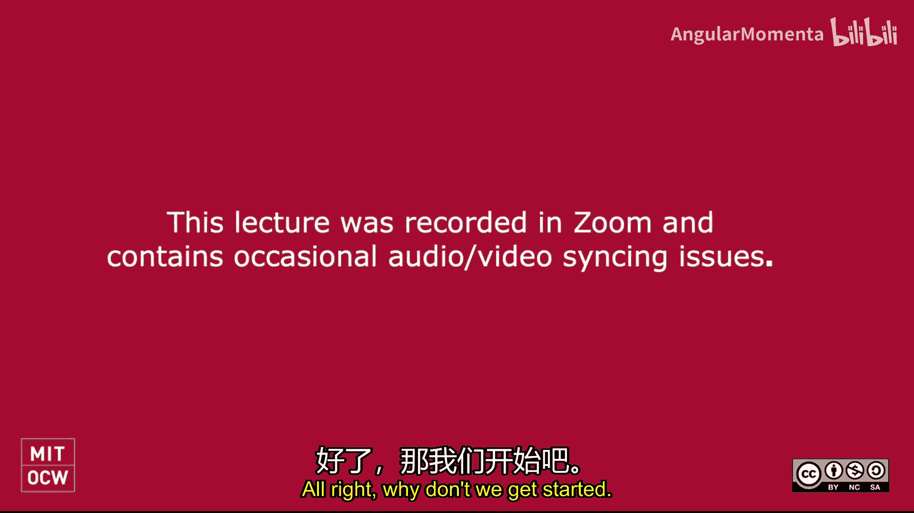
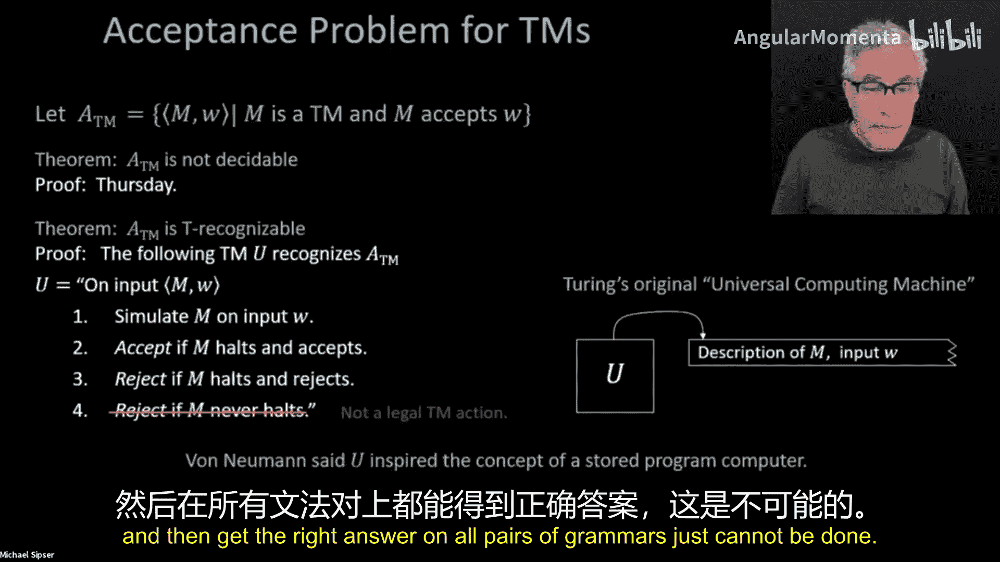
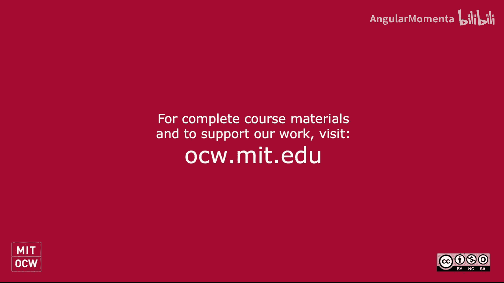

# 【麻省理工】计算理论  ｜  MIT 18.404J Theory of Computation, Fall 2020 p07 7. 自动机和语法的决策问题 -BV1pt7GzeEjb_p7-

All right， why don' we get started？235 time to begin。

So everyone welcome back good to see you all and well Lisa see a few of you glad that you're here。

Let's see， why don't I。Get layout as I usually do where we have been， where we're going today。

 I'll talk a little tiny bit about the homework because I've gotten a couple of questions on that。

And then we'll jump in so we have been talking about turninguring machines， which is going to be our。

preferredreferred model for the rest of the semester since Tring machines are the model which we use to capture general purpose computing。

And we looked at。Tururing machines and various。Variations oning machines， multi tapes。

 non deterministic and so on。It's a bit recapping the history of the subject， when people looked at。

A variety of different ways of formalizing the notion of algorithm。

 and they showed that all of those。Different formalizations were equivalent to one another。

 which led to the church Tring thesis that all of these models。

 each of these models really capture our intuitive idea of what we mean by a procedure or an algorithm。

For at least for addressing you know things like mathematical problems and precise problems of that kind so we talked about the church tuuring thesis we also talked about a notation for encodings and tuuring machines we'll review that briefly。

So today we're going to give a bunch of examples of。

Tururing machine algorithms for solving a variety of different problems。

 I should just say algorithms are really nothing special about tuuring machines tuuring machines is just going to be our formal counterpart。

 but from now on we're going to use our touch tuuring thesis in a way to just to talk about algorithms in general because that's really our interest tuuring machines is just you know our way of。

Reasoning about them mathematically， but we're really ultimately interested in understanding algorithms。

I'm going to in terms of the format of today's class， I'm going to try in a little experiment。

 we're going to have little breaks along the way and and as well as the big coffee break in the middle we're going to have a little mini breaks because I sometimes feel that there really isn't enough time for people to be writing chat you know questions in the chat because things just are racing on and so this way well have a little break after the pretty much after each slide。

 some of them going to be a little longer than others for in case you have questions you can pose them to me or to the TAs and we'll try to get back to you on those。

So moving on， then so today just as a quick review， touring machines as we set them up。

They have on any input W， they have three possible outcomes， the T machine can hold and accept W。

 can hold and reject W， or it can go forever on W， which is rejecting by looping in our language。

A touring machine can recognize a language， the collection of all strings that it accepts。

And if the Turing machine always holds， we say it decides the language and it's a decider。

 and so therefore that language is a decidable language or tuuring deccidable。

 often we just say decidable because we don't really have a notion of deciding in other models。

 so we often talk about Turing recognizable or just deidable or we'll sometimes just say recognizable when we understand that we're talking about Turing machines。

We briefly talked about encodings， when you write it inside brackets， some objects。

 whatever they are it could be strings， could be machines， could be graphs， could be polynomials。

 we're representing them as strings and maybe a collection of objects together represent it as a string in order so that we can present that information as an input to a machine。

And we talk about our languages our collections of strengths。

and a notation for writing a tu machine is going to be simply that English description put inside quotation marks to represent our informal way of talking about the formal object that we could produce if we wanted to。

 but we're never going to ask you to do that。Okay， so now。Let me see。Let's just take a quick break。

 as I promised。If there's any quick questions here， you can ask。もっとと。嗯。Let's see。

We get a lot of questions here。😊，All right， why don't we move on and some of these things are good questions if there was something。

 you know， somebody asked， can you how do you tell if the machine is looping or if it's really just taking a very long time。

 you can't。That's what we're going to prove not in today's lecture but we're going to prove that on Thursday and so that's you just can't tell so you're going to if that's in reference to problem five。

 you're going to have to find some other way of doing solving that problem without knowing whether the machine is actually ever going to hold。

诶。And somebody asked how can we tell if an English description is possible for a Tring machine。

 well I mean you can always。Write down an English description for any machine its might be very。

Technical looking， but if you can write it down in a formal way as states and transitions。

 then you can simply write down a English description， which would just be follow those states。Okay。

 let's move on。Okay， this is going to be our first example。😡，Of a。

Algorithm that's going to answer a question about automata。And it's a very simple problem。

 it's a very simple problem to solve because we want to start out easy。

And it's problem the name of the problem is the acceptance problem for deterministic finite autoome。

 acceptance problem for DFAs。😡，And I'm going to express it， as I always do， as a language。

So with this language here， I'm calling it A DFA， which stands for the acceptance problem for DFAs。

Is the collection of pears。B and W， B is a DFA W is。

Considered to be some other string which will be an input to be will me thinking of it as an input to be I put the two of them in brackets to represent the pair of them as a single string。

And it's the you know we're not going to make explicit what the form of the encoding is。

 the only important thing is is that the encoding should be something simple。

 but that the Turing machine can decode back into the DFA and this input string to that DFA。

 so anything reasonable is going to be a satisfactory encoding from us for us。😡。

So this is an encoding of the two of them into a string and where B is a DFA and B accepts W so now if you want to test if something's a member of ADFA。

Then first of all， you want to make sure that the string itself that you're getting really encodes a DFA and a string。

 so it has to be able to write form。😡，And once you know that， then you have the DFA。

 you have the string W， and you're then going to do the obvious thing。

 which would be to simulate B on W and see if it's actually accepting W。😡，Okay， so that's。

 that's what the content of this slide is。 I'm just going to write it down for you。

 So I'm going to give a Turing machine， which I'm gonna call。

 I'm gonna to give the name of that Turing machine。 It's going to be D A DFA。

To help you remember the function of this machine， this is a decider。😡。

For the language below the ADFA language， there's just a name， but so nothing fancy going on here。

 but just to help us remember because I'm going to refer to some of these stirring machines later on。

😡，So this is the decider for ADFA and I'm going to describe that machine for you and that machine decides the ADFA language。

😡，So what does that mean， so that machine I'm describing now in English as I promised。

We're going to take an input string S。😡，And first it's going to check that S has the right form。

As I mentioned， has the form， which is the encoding of a DFA in a W。😡，If it's not of that form。

 the Tring machine should reject that input right away。😡。

Now I'm not going to go through the details of how that tuuring machine is going to work。

 though I'll say a little bit more this time this time only just to give you a sense of how it actually might carry that out。

 but you shouldnt believe that if you don't believe it you can do it with a Turing machine。

 believe you can do it with your favorite programming language。

 that's good enough because that's going to be that's equivalent to a tuuring machine。😡。

So if first you check that inputs to the right form。

 then you're going to simulate the computation of B on W， and then if B ends up in an accept state。

 then we know B is accepting the input and we should accept and we do。😡。

If B does not end up at an accept state at the end of W。

 then we should reject because B is not accepting W。Okay， that's my description of this machine。Yeah。

Let's just turn to a little bit of details just to make sure we're comfortable with this。

 so here is our touring machine D， the decider for ADFA。😡。

The input to that T machine as I mentioned is going to be B and W provided itself's of the right form。

 so that's what the string S is supposed to be of that form and what does that mean it's just an encoding of the machine W and the machine B and the string W。

So here is， let me just write it down， here is B written down in some just completely explicit way where you're just listing the state of B。

 the alphabet of B， the transition function as a table。

 the start state and the set of accepting states， just writing it down explicitly as you might do it。

 if you would just want to describe that machine in a completely formal way。

 and then writing down with the stringers。😡，Whatever it is。Once。

DADFA has that as its input it can then go ahead and do that computation and you know just to try to make it a little bit more explicit。

 I'm going to capture that here by saying let's give that Turing machine an extra tape because we already know that the multitape model is equivalent to the single tape model make it or life perhaps a little easier and in the course of doing that simulation what do we want to keep track of well what is the current state of B the DfaA as we're reading the symbols of W and where in W are we at right now so I'll call that K which is the input head location on W how many symbols of W have we read。

😡，Okay， and that's all I'm going to say about what this touring machine D looks like。

 but I'm happy to， oh there's one more thing I do want to say further that's coming up because。

Pretty much all of the Turing machines that we're going to talk about today and going forward are going to often want to check that their input is of the correct form。

 I don't want to repeat this every time because that's going to be kind of assumed so my shorthand for that is to say my input is of the form I'm looking for。

😡，And that has built into it， the check that the string， the input string is of that form。

 and we going to reject if it is not。😡，So all of our tuuring machines are going to start out。

On input， the string is of a certain form and then go out and do something with it。😡，Okay。

 and I thought this is a good way to。Okay， so let me try to answer a few of the questions that I've gotten here。

嗯。Because I think this is important as a way of getting us all started now somebody asked me can we use arguments of this form？

😡，Can somebody asking， can we use， can we？Give our description of a procedure if i'm understanding this correctly as using some other programming language well typically you just want to make sure you're understood if you want to do that on homework I wouldn't advocate writing your algorithm in Java because it's just going to be hard to read but to write it down in some pseudo programming language if you want just to make sure it's clear that what what you're doing probably English is going to be the easiest for you。

嗯。Even though this person says it feels it would be easier to do it in terms of a formal language。

 well， whatever's easier as long as we can understand it。

Now what another this is a good question here that I got asked， what if B？

Here's our B gets into a loop on W。Well that's not going to happen V is a DFA DFs on an they move from from state to state every time they read a symbol of W when they get to the end of W it's the end of the story there's no more computation to be done so we know in exactly how many steps be is ever going to take on it's going to take the same number of steps is the length of the input。

😡，That's how many moves it gets to make so this never be as a DfaA never loops。

 so that would be a problem if it did loop， but it doesn't the input never does loop。😡。

So have we verified that D as a decider， well I think I just did D is never going to be this D from my standpoint。

 we've said enough。😡，To be sure that D is a decider。

 there's never any reason for D to be that DADFA Tring machine to be getting into a loop。

The input head location is referring to where we are on the string W yes。诶。And somebody's asking me。

 is this a level of detail for the homework， yes， that's all I want，'s all I'm looking for。Okay。

Let us move on， I'm going to have to otherwise never get anywhere， a lot of questions here。

 they're good questions。Um so why don't we go on， some of these may get resolved as we're going to look at additional examples because that's all of today is pretty much examples let's talk about the similar problem。

 the acceptance problem， but now for NAs。嗯。So now， actually， N can loop。

 So we have to think about what that possibly could look at。

 But let's before we get ahead of ourselves。 So now the acceptance problems for N phase looked very similar。

 except B is going to be an N。That's going to be a decable language too。

 and now we have Turing machine A D A NA， the decided for A NA that decides A NA。Okay。

 so now as promised， here is my new form for writing our tuuring machine on input BW were we're assuming that B you know。

Based on the context， sometimes you may want to say at this point what B and W are。

 but from the context we know what they are， theyre going to be an NFA and an input W for that NFA。😡。

Oh so I don't want to jump into the solution first before we actually look at the solution of this。

 we could you know the Turing machine could simulate the NFA on inputW and you have to be careful on that simulation that you don't end up looping because don't forget an NFA could have epsilon moves and could be looping on those epsilon moves and so that would be a problem if you're not careful about how you do that simulation。

Com。Now， I think if you were going to simulate an NA。😡，You would be。

You wouldn't follow around loops forever and I think you can without getting because this is not the way I'm going to solve the problem。

 you could find a way to avoid getting caught and getting stuck in loops for an NA so even though，😡。

That looks like it could be a problem in terms of looping forever。

 it turns out that it won't be a problem， it wouldn't be a problem if you're careful。

 but I'm not going to solve it that way anyway because I'm going to illustrate a different method for solving this problem and that is we have exhibited before a way of converting NFAs to DFAs。

😡，So my Turing machine is going to solve the A NFA problem by converting its input。

 which is an NFA to an equivalent DFA， I'm calling the NFAB and the DFA that I got converting it into B prime。

😡，And what's nice about that is that first of all， we already know how to do that conversion because we essentially went over that in lecture a few lectures back and it's spelled out in full detail in the textbook so that is a conversion we know how to do。

 we'll assume we know how to do。And we can implement that conversion on a turing machine。

Then once we have the equivalent EFA， what do we do with that？Well， in the previous slide。

 we showed how to solve the problem for DFAs。😡，So if we can convert the NA to a DFA and then we already know how to solve the problem for DFAs。

 then we're done， so that's how I'm going to say we're going to convert the NA to a DFA and then I'm going to run that DDFA problem on the new machine that I produced。

So remember that this machine here decides the ADFA problem。

And now I'm going to accept if that new machine， if that previous turning machine accepts the DDFA problem machine accepts。

 and I'm going to basically do whatever it does， if it accepts， I'll accept if it rejects。

 then I'll reject。嗯。Now this is。呃。So I guess the thing that this illustrates is this idea of using a conversion construction inside a tuuring machine。

 and then I previously constructed Turing machine basically as a subroutine。😡。

all this is perfectly legal and it's the kind of thing we're going to be doing a lot of and that you should be used of doing that。

 get ready to be doing that on your homework too。😡，Um， and in fact。

 I'll give you another little extra hint that problem six can be solved in this way。Okay。All right。

 so here， let's pause briefly。呃。Okay， got some interesting questions here coming up。呃。嗯。You know。

 do somebody asked me do， do we need to be explicit about how we're going to simulate that NFA or the DFA because we don't know how many states it has？

😡，Not knowing how many states you do know how many states it has once it's presented to you on the input。

You can see， oh， this is a machine that has 12 states。

Because you're given the machine and then you can do the simulation。😡，呃。嗯。Let's see。

And someone is asking me about limits on the simulation power tuuring machine。

 that's a question that i'm going to postpone to later because you're asking if a tuuring machine can simulate itself and we'll talk about things like that。

 but that's you know in a few weeks from now so I'll going to hold off on that one。

Decidable languages， the collection of decide somebody is asking me a good question about closure properties of the class of decidable languages。

 are they close under intersection union and so on， yes。😡。

And the decidable languages are also closed under compliment。

 that should be something you should think about， but yes that is true。

 the recognizable languages however， are closed under union and intersection。

 but they are not closed under compliment。😡，So with that we will prove on Thursday's lecture。嗯。

So another question is， could we have just run beyond W in this and solving this problem instead of using reduced converting into to a new Turing machine。

 a new machine the B prime， well you know yes， we could have just done that。Okay。

I think we better move on， I don't want to get too bogged down here。Got a lot of questions there。

 so sorry if I'm not getting to all of the questions。Okay。Or you can write to the TAs too， obviously。

 I'm sure you are。Okay， so let's talk about a different problem。😡，Enmptiness problem for DFAs。Okay。

So now we have here， I'm going to give you now just a DFA。😡，B。And no input。And I'm going to ask。

 is the language of that the FAA， the empty set， the empty language？

Because you understand the problem first of all， i'm just handing in a dfaA and I want to know does this DfaA accept any strings at all or is it there some。

Dumb DFA， it's just always very negative DFA， it just rejects everything。😡。

And has the empty language。Okay， how do you tell？Not super hard if you think about how you would write a program to do that。

Or how you do it yourself so that's a decidable language again。

 so we're going to give now a touring machine decider for that language。That decider says， well。

I'm given that DFA， I want to know if its language is empty。

And the idea is just kind of what you would think， I'm going to see is there a path from the start state of that DFA to an accept state of the DFA。

 if there is such a path， then that DFA is going to have an input which goes along that path and will be accepted。

😡，And so the language won't be empty。If there's no such path。

 then clearly this DfaA can ever accept anything， and so the language will be empty。Okay。

 now there are many different。You know。There are many different path algorithms I think would be a little bit sparse of me just would you know。

 some of you know path algorithms， some of you who don't know path checking algorithms I would like you to just to if you were giving this kind of an answer on a homework to give me some sense of how that algorithm is going to work don't be too high level about it。

😡，So the one I have in mind is kind of breadth for search， if you've heard of that。

 but it's a very simple algorithm， what I'm going to use is I'm kind of a marking procedure。

 so I'm going to start off by coloring the here is this I should have indicated， this is my DFAB。

This is B over here。Should I try？Taking a chance of writing on this thing。Oops。This is B。Great。

That didn't help。So this is B here and the way I'm going to test if it has a path。

 if it accepts any input is by seeing if there's a path from the start state to any one of the accept states and I'm going to start it by marking the start state and then marking all states that I can get to from previously marked states and keep doing that can until I can't get to anything new。

Okay， so here there's going to be like a series of iterations here marking more and more states until there's nothing new to mark and then I say。

 did I mark any exception states？😡，Okay， so let's just see how I write that down in English。

 so I started marking the start state， I repeat until no new state is marked and that I'm going to say mark every state that has an incoming hour from a previously marked state。

Except then once I'm done with that repeat loop， except if no accept stage is marked because that means don't forget a little bit inverted from what you might think I'm going to accept that there's no。

😡，Marked except state， because that means there's no path。To an accept state from the start state。

 which means the language is empty。😡，And EDF is the DFAAs that have empty language。

 so I should be accepting those。😡，So except if there's no way to get to an accept state。

 no accept state is marked and reject if some accept state is marked because then language is not empty。

Okay， so that's all I wanted to say about that。嗯。Can you somebody's essay can you just say it something like Bth search。

 as long as you know the sketchier you are， the more chances that you're going to get caught by the greater not who's going to be you know。

 we have an army of people grading these problems and just to stay on the be on the safe side of sketchiness and say don't cut too many corners because you might miss something chances are would be okay just to say breathth search。

 but you know I would prefer if you you'd be safer if you said a little bit more than that， okay。Oh。

This is a good question here somebody ask can we just run the DFA on all shorts on all strings well first of all。

 you know one thing to say something bad would be well just feed in all possible strings into the DFA。

And any one of them if it accepts any one of them， then we know its language is not empty。😡，Well。

 that's not a good algorithm because that's going to potentially run forever。😡。

Because you know there's lots of strings， there's infinitely many strings to feed in that to that DFA and so a tuuring machine。

 you know， if it's trying to be a decider， had better not do any infinite operations that are potentially going to go forever。

Now this to be fair to the proposer here， the questioner here didn't ask that says， well。

 can we feed in old strings up to some bound？😡，Which would be the number of states of the machine in this case and yes。

 that would work， but then you would have to argue。That that's enough。And yes， it is enough。

 but it wouldn would not be enough in answering the problem just to say feed it in that number of them and you know we're done。

 you would have to say what。嗯。U。Okay。呃。A lot of questions here I'm going to move on。

Let's see equivalentvalence's problem for DFAs。Now we're going to take things to the next level， ask。

 are there two， I'm going to give you two DFAs。嗯。And I want to know。

 do they describe the same language， do they recognize the same language？🎼Okay。

So how are we going to do that so that's a decidable language here's the decider。

My input now is going to be two DFAs。😡，Can represent it as a strength。

 because that's what Turing machines deal with as their inputs。😡。

But they can unpack that string into two DFAs。And there are several different ways to do this problem。

 and I'm sure I'm going to get suggestions with other ways to go。

 one thing you could do is just to feed in strings up to a certain length。😡。

Well because you can't just like before you can't feed in all possible strings and see if the machines ever behave differently on any of them because that's infinite an infinite operation and we're a decider we can't do that now if you if you want to talk about this being a recognizer instead of a decider then you might be able to do something like that just to make sure you end up。

😡，You have to be just careful let me not say more on that right now but。Certainly for a decider。

 you can't go forever， you can't have infinite operations。😡，So you would have to have a cutoff。

So you can feed in all possible strings up to some length。

 say into A and B and see if there's any difference now we actually had a problem on that and the problem set one。

😡，Whi said if two DFAs have unequal languages， then they're going to see a difference that there's going to be a string that acts differently on them。

 which is of length at most the product of the number of states of those two machines。😡，So， if。😊。

You know you can either reference that problem that would be an that would be an adequate solution or reprove it or whatever that would be fine in fact is you can do better than that as the optional problem showed you only have to go up to the sum of the number of states not up to the product。

 but that's actually very difficult to show。😡，But I'm not going to prove it that way。

I'm going to prove it an entirely different way， which doesn't require any analysis at all。

 no proofing proving something about bound， I'm going to take advantage of something we've already shown and which is I'm going to make a new fine art automaton。

 a new DF。😡，Built out of A and B， which accepts all the strings on which A& B disagree。😡。

And I'll show you how to that's easy to do。So first of all， let's in terms of a picture。

 let's understand what this is， so here we have this is the language of a， this is the language of B。

😡，Written as a Venn diagram and where are those places where they disagree？😡，Um well， they're。

 you know， either in A， but not in B or in B， but not in a。

 I'm showing to here in terms of the blue region。😡。

That actually has a name called the symmetric difference of these two of these two sets。

 these are this this all of the members which are an exactly one out of the two， but not both。

If you can make a machine C that would accept。All of the strings in the blue region。

 then what do we do with that machine？We test if its language is empty。

Which is what we've already shown how to do， because if the blue region is empty。

 that means that L of a equals L of B。😡，Okay， so I'm going to make a machine a DFAC where the language of C is exactly that symmetric difference it's all strings in a intersected with the strings that are not in B。

 so in A and not in B or in B and then not in A and take the union of those two parts。

And how do we know we can make see where we have those closure constructions？

Which we showed several lectures back， those closure constructions can be implemented on a Tring machine。

😡，So a term machine can build the DFAC and then use that test from a few slides back。

 the emptiness last slide， the emptiness tester for DFAs。

On C to see whether its language is empty and now if C's language is empty。

 then we know we can accept because that means the two the L of a equals L of B。😊，Otherwise。

 we can reject。Okay， so here's and now I'm going to ask you a check in。

You can also use that time to send me a few more questions if you want。Okay， here's my check in。Okay。

 now instead of testing equivalence finite of DFAs。

 I want to test the equivalence of regular expressions。So here R1R2。

 regular expressions I'll call it the EQ regular expressions problem。

 equivalentvalence of regular expressions， can we now conclude that this problem is also decidable？

Either immediately from stuff we've already shown or yes。

 but would take some significant extra work or no because intersection is not a regular operation so let's see if I can pull that out here launched the polling。

嗯。Here we go。Okay， I think we're just about done here。Um， five0 five seconds more。Okay， ready。

 set end。All right。😊，Yes， the answer correct answer is a， we have basically already shown this fact。

 because what why is that， because we have shown that we can convert。

 if you're given two regular expressions and we want to test whether they're equivalent and whether they generate the same language。

 we can convert them both to finite an automa。We can convert them to NAs and then the NAs to DFAs。

And then we can apply what we just showed about testing equivalentvalence of DFAs。So yes。

 it really follows immediately from stuff we've already shown the conversion number one。

 and then the testing equivalentvalence for DFAs。So there's not really any work to do here and in fact。

 what i'm trying to illustrate with this check。That once you've shown how to do some kind of a test for one model。

 it have going to apply for all of the equivalent models that we've shown to be equivalent because the Turing machine can do the constructions which show the equivalents。

😡，Okay， so let's move on。Somebody didn't get the poll， did most people not get the poll？Well。

 I think most of you have gotten it。Did you。I'm not seeing a lot of complaints。

 so if you didn't get the poll something is wrong with your setup and you're going to have to take the recorded check ins that are going to launch right after this lectures over sorry。

But you should figure out what's wrong with the setup there because I think most people are getting these。

Okay， and with that we're going to take a little break and then we'll continue on afterwards and let me know how this is is this slowing us to you know should I be speed a little speedier about the about the little mini breaks that we're taking or is this good for you？

You know， feedback is always， I'm trying to make this as good as I can for all of you。Okay。

 I think there's a mixture between people saying that these breaks are good sometimes they're a little a little over。

 so I'll try to。Tight them up a little some folks are saying what more people should be asking the Ts I don't know how the TAs are doing in terms of their I'll check with them afterward how well this is going for them in terms of questions but I think some amount of break is good so that we don't so there's time to be asking asking questions otherwise what's the point of having a live lecture。

So we will start promptly。When this timer runs down so。呃。Be ready to go in 55 seconds from now。

Just to confirm， to show the decability of the equivalentvalence of two regular expressions。

 do we need to show that we can use a Tring machine to convert them to two DFAs first？Well。I mean。

 any procedure that you can give， if you want to test whether two regular expressions are equivalent。

You can give any。Procedure for doing that deciding you want。

I'm just offering one one simple way to do it that takes advantage of stuff we've already shown。

 but if you want to dig down and do some analysis of those regular expressions to show that they describe the same language they generate the same language be my guest I think that's actually would be complicated to do that that way okay so we're just about ready to go here so let's continue。

呃。And let me take this timer off here。嗯。All right。Now。

We are going to talk a little about context free grammars。

So we talked about decision problems for finite Atmata， let's talk about some for grammars。

Okay now I'm going to give us an analogous problem I'm going to give you a the accept I'm calling it the acceptance problem。

 but just just for consistency with everything else。

 but it's really the generating problem so I'm giving you a grammar G see a context for grammar G and a string that's in string and I want to know is it in the language of G so does G generate deie。

I'm calling that the ACfG problem。So that's going to be a decable again。

 so now let's just think about how that these are getting slightly harder as we're moving along。

 so i'm giving you。😡，A grammar。And a string。 And I want to know。

 does the grammar generate that string。well， you know， it's not totally trivial to solve that。

You know， one thing you might try doing is looking at all possible things。

 all possible derivations from that grammar。😡，And see if any one of them leads to W。😡。

Leads you to generate W。Well， you have to be careful。Because as we've shown in some of our examples。

 you actually can have because you're allowed to have variables that can get converted to empty string。

You might have very long intermediate strings being generated from a grammar。

 which then ultimately give you a small string of terminals that get generated。😡。

A small string in the language that gets produced。And so it's not clear how， you know。

 you certainly don't want to try every possible derivation because there's infinitely many different derivations。

Most of them generating， of course， things that are irrelevant to the string W。

But you have to know how to cut things off。And it's not immediately obvious how you do that。Unless。

You have done。The Homer problems that I asked you to do。

 which I'm sure very many of you have not done the zero bot point x problems because there that's going to come in handy right now。

😡，And so I'll help you through that。嗯。Remember， I'm hoping you should remember。

 but you may not have looked at it， something called Chomsky normal form。

Which is four context free grammars。But it only allows the rules to be of a special kind。

And they have to look like this， they can be a variable that goes to two variables。

On the right hand or a variable that goes to a terminal。

Those are the only kinds of rules that you're allowed。This is a special case for the empty string。

 but let's ignore that， you know for if you you want to put the the start variable can also go to the empty string if you want to have a the empty string in the language。

 but that's that's a special case， let's ignore that。

These are the only two kinds of role that you can have in a Chmsky normal form ground。

Once you have a Chomsky normal form grammar， well first of all there's two things， first of all。

 you can always convert any context free grammar into Chomsky normal form。

 so that's given in the textbook。It's very， it's sort of the you do the obvious thing。

 I'm not going to spend time on it and you don't have to know it。

 it's kind of just a little bit tedious， but it's straightforward and it's there if you're curious。

But the second one is the thing that's important to us。

Which is that if you have a grammar which is in Chompsy normal form and a string that's generated。

Every derivation of that string has exactly。Two times the length of the string minus1 steps。

And it's actually， if you think about， I mean this ama very easy to prove。

 I think the homework problem asks you to prove that in the 0。

2 or whatever it was and problems at one or pubs at two。

 I don remember because you can in order to do， you know，有。

Rules of this kind allow you to make the string one longer and rules of this kind allow you to produce a new terminal symbol。

And so you're really going to end up having， you know， if the length of w is n。

 you're going to have n minus one of these and n of those， that's why you get two n minus one steps。

But the point is I don't really care exactly how many it's just that we have a bound。

And once you have that bound， life is good from the point of view of giving a Tring machine which is going to decide this language。

Um， because here's the Tring machine， what's going to do with the first thing is it's going to convert G into Chomsky normal form。

That we assume we know how to do。Now we're going to try all derivations， but only those of length。

Two， twice the length of the string minus1。Because if any derivation is going to generate W。

 it has to be this many steps。😡，mNow that we know the grammar is in Chosky normal form。Okay， so。

We have converted this problem of one that might be a very unboundedly lengthy problem into one where you know it's going to terminate after some fixed number of steps。

And so therefore， we can accept if any of those generate W and reject not。Okay， and so oh。

 so this is before moving on， so this answers the problem shows that this language is decidedidable。

The ACFG language。Okay， so that's something that， you know， make sure you understand。Umh。

 we're basically trying all derivations of up to of a certain length because that's all that's needed when the grammar is in that form。

Now we're going to use that to prove a corollary。Which is。

Which is important for understanding how everything fits together。

And that chirollary states that every context free language is a decidable language。

Every content free language is decidedidable， and why does that follow from this？Well。

 suppose you have a context free language。诶。We know that language is generated by some context for grammar。

Okay， that's what it means。So then you can take that grammar G and you can build it into a turing machine。

 So there's going to be a turing machine， which， which is。Con with the knowledge of G。

And that T machine is going to take its W and run the ACFG algorithm。

With W combined with the G that's already built into it。😡。

So it's just going to stick that grammar G in front of W。😡，And now run the AC of G decide。

It's going to say does yougene Wby？Well， that's going to be yes。Every time W is an A。

And so this machine here now is going to end up accepting。Every string that's in a。

Because it's every string that degenerates。Okay， so。That is， I think。

 what I wanted to say about this。I feel that this corollary here throws a little bit of a curve curveball and we can just pause for a moment here just to make sure you're。

Understanding this。So let me the tricky thing about this corollary。

Is that I often get a question I often get where is。You know。

When we start off with a context free language。Who gives how do we get G？

Because we need G to build the Turing machine， M subG。😡，So we know A is a context free language。

 but how do we know what G is？Well， the point is that。呃。We may not know what G is。

 but we know G exists because that's a definition。Of a being a context free language。

It must have a context free grammar by definition。And so because G exists。

 I now know my turn machine， MO G exists。😡，And that's enough to know that A is decidable because it has a decider that exists。

😡，Now， if you're not going to tell me the grammar for G。

 I'm not going to tell you the Turing machine， which decides A。😡，But I know that。

 but both of them exist。So if you tell me G， then I can tell you the turning machine。Okay。

 so it's a subtle tricky issue there certain little element maybe if sometimes people call it non constructive because we're just in a sense showing just that something is existing but。

You know， it does the job for us because it shows that A is a decable language。Okay。

 so not so many questions here maybe the Ts are getting them so let's move on here's another check in。

So now can we conclude that a instead of a CG， a PDA is decidable？你。

People have getting this one pretty fast。Another 10 seconds。Three seconds。Okay。

 I'm going to shut it down。In polling。Share results。Yeah， you know I。呃。So this。

Problem here is APD is decable it's really in a sense I was almost wondering whether or not to give this poll because it has it's true for the same reason as poll number one。

 because we know how to convert PDs or we stated we can convert PDAs to CFGs。

And you know that conversion is given in the book we didn't do in lecture but I just stated you have to know that fact but not necessarily know how to do it that's okay。

 but that fact is true the conversion is in the book and it could be implemented on a turn machine so if you want to know whether a PDs language is empty you convert it to a context for grammar and then use this procedure here to test whether it's a language。

So not empty， I'm sorry。The acceptance problem， I just want to not accept， I just want to know。

 does the PDA accept some input？I'm saying it wrong so I want to know does the PDA accept some input。

 I convert that PDA to a grammar。And then I see if the grammar generates that input because it's an equivalent grammar。

So again， this is using the fact that grammars and PDAs are equivalent and interconvertible from one to another。

😡，Just like regular expressions and DFAs from the previous poll。

So you need to be comfortable with that because we're going to not even talk about it anymore。

 we're just going to be treating those things going back and forth between them without sometimes without even any comment。

😡，Okay。So let's move on。Emptiness problem for CFGs hopefully you're getting comfortable with the you know the terminology I'm using。

 so now the emptiness problem for context three grammars。

 I'm just going to give you a grammar and I want to know if its language is empty。Okay。

 so remember we did this for finiter automata by testing a path。

K you know we don't really have paths here， you might think testing paths and push out a toma that's not going to really work because is stack is there so how are we going to do that test well is something sort of like testing a path just working with the grammar itself。

Kind of working backwards from the terminals now I'll kind of illustrate that here here's imagine I'm giving you that here's a very simple grammar and I want to know does it generate any strings。

 any strings of terminal obviously only care about strings of terminals because those are the things that are in the in the language？

So does this grammar generate any strengths？Of terminals。

So way we're going to answer that is by a marking procedure。

 but in a sense we're going to start from the terminals and we're backwards to see if we can get to the start variable so first we're going to mark all the terminal symbols。

And then we're going to mark anything that goes。😡，To a string of completely marked symbols。

 either terminals or variables。😡，Because anything that's marked we know can derive a string of terminals。

 that's what it means， anythings that's blue can derive a string of just terminals。😡。

And so now if you have a collection of those。That are all marked。They together can generate some。

 you， string of terminals。Together。And so then you can mark the associated variable so like T goes to a so that maybe over simple。

 but we're going to mark T。Here everywhere in the grammar。

 so all these Ts are going to get marked because we know that T can generate a string of terminals。😡。

Now let's take a look at R R is going to a string of symbols that are all marked。😡。

And that means those symbols can in turn generate the strings of terminals so we can mark R2 we can't yet mark s because we don't know yet whether S has some unmarked thing that it goes to so we don't know yet whether s can generate a string of terminals。

 but R we know right now， so we're going to mark R but done now that gets us to mark this R and so then we can go backwards and we can mark S。

😡，And we keep doing that until there's nothing new to mark and here we marked everything。

 so clearly there's nothing more you can mark， but you might stop before you marked everything。😡。

And then you see whether you've marked the stark variable or not， and if you have。

 you know the language is not empty。😡，Okay， so let's just go through this in text for mark all occurrences of terminals in G。

 then repeat until no new variables are marked， we mark all occurrences of variables。A。

 if a goes to a string of symbols。And all of those symbols were already marked。

Because those are the things that already have been shown to generate a string of terminals。😡。

And so now we're going to reject if the start state start variable is marked because that means that the language is not empty and except if it's not marked。

Okay。So。嗯。Let me just just I'll take a couple of quick questions here。Okay， somebody。嗯。

So may ask whether。If I understand are the regular languages also decable。

 well remember the regular languages are context free languages and the context three languages are decable。

 so yes， the regular languages are decidable。呃。Okay。

 I don't some of those are going to be too long to answer and they're trying to come up with alternative solutions。

 so I think we're going to move on。All right， we talked about just like we did for the finite time。

We talked about acceptance， we talked about emptiness， we talked about equivalence。😡。

So how about the equivalence problem for context free grammars？

It's going to give you now two context for your grammars。And I'd like to know。

 are those two context free gramars generating the same language？Okay。

 so how might you think about that？Well。You know， one thing。

 you know following some of the ideas that we've already had you could try feeding strings in to those grammars you know how to test whether those individual grammars can generate those strings so you can just try feeding strings in。

to G and to H and seeing whether those grammars ever disagree or whether they generate some string。

 find some string that say G generates but H does not generate and we can test that string by string。

😡，Unfortunately， they've got a lot of strings to test。That's going to， you know。

 we would need to give some bound。If we were going to use that procedure。Not clear what the bound is。

嗯。Another idea might be to use the。Closure construction that we had from before so let's let's mu that over whether that might work。

 but in fact。呃。Let me give away the answer here。This language is not decidable。

There's no algorithm out there， no tuuring machine， but therefore no algorithm。

 which can take two grammars。😡，And test whether they generate the same language or not。

Seems at first glance， kind of surprising。Such simple things as context free grammars can nonetheless be so complicated。

That there's no procedure out there， which can tell whether gram those two grammars generate the same language。

 we will show that next week。A related problem which is related to your homework this that's due on。

Thursday is testing whether a grammar is ambiguous。So given a grammar。

 I'd like to know is is that grammar an ambiguous grammar or not。

 I mean does it generate some string？You know， in the language of that grammar in two possibly different ways。

 two or more different ways， so is there some string that can be generated。You know。

 with two different parts trees。So the problem of testing with grammar is ambiguous。Not decidable。

So I'm asking you to do something hard， something hard。When you have to produce。That grammar。

 which is unambiguous for that language in general， testing。

 whether grammar is ambiguous or not is not a decable problem。 Now。

 hopefully that the grammar that you'll produce。To show that。

 you know to get that unambiguous grammar for that language that I'm asking you to produce is not going to require our graders to solve some undecidable problem that it'll be clear based on the construction of that grammar why it's not ambiguous so you'll have to hopefully say some some explanation of you're thinking there。

😊，呃。Okay， so that's and we will prove that the problem of testing ambiguity is not decable。

 that's going to be a homework problem in problem set three。Okay。

 last check in here kind of something that I alluded to but didn't quite didn't want to give away why not use the same technique that we use to show equivalence of DFAs is decable to show that equivalence of context free gramars is deable obviously something goes wrong because EQCfG is not decidable。

 why doesn't that same technique just work。Well。What's the answer？Oh this。Got a real race here。

Another 15 seconds， this one。It givesive you something to mull over。嗯。All right。Let's end it。Okay。

 you're good to go at least click something okay， at of ending polling。Sharing results。Okay。

 a bunch of you have thought， well， CFGs are generators and DFAs are recognizers and that's the issue well not really。

Because， you know， you can， we could test。Equivalence of regular expressions。

 those are generators it's nothing to do with being a generator or not。

Because you know we can convert regular expressions to dFAs and then test equivalentence for the DFAs so that it's not really a matter matter of being generated that's not the issue the issue is that we can't follow the same construction that we did to show EQDFA is a soable because the context free languages are not closed under those operations we needed to make that symmetric difference machine。

If you remember how that worked。So they're not closed under complement and they're not closed our intersection。

 we needed both。In order to build that machine C， which accepted all the strings that are sort of in the difference。

Okay。😊，So let's continue on。Let's move now to touring machines。

This is where stuff is really going to start to get interesting hope it's been interesting all along。

 but maybe even more interesting so let's talk about the acceptance problem for Turing machines ATM。

This is going to be because this language is going to become an old friend。

But we're getting just getting to know it。So this is the problem you' given a Tring machine now in an input。

And I want to know， does M accept that input？Does that term machine accept its input？嗯。Okay。

 so that's。Couldn't it not be a decidable problem either。

 So it kind of shifted gears from a bunch of decdable things to a bunch of undecidable things。

So this is not a decidable language， we will prove that on Thursday。

 that's going to be the whole point of Thursday's lecturers proving that ATM is undecidable and that's going to be really a jumping off point for showing other problems or undecidable。

So that's going to be our first proof of undecidability。嗯。But we do know that ATM is recognizable。😡。

And that's worth understanding。For multiple reasons。

 but for one thing it's going to give us an example of a problem which we know is recognizable but not deccidable as we as we prove undecidability。

 but it's also I think have of historical importance this algorithm for showing it recognizable so let's go through that algorithm for it's very simple sort of doing the obvious thing。

The following turning machine I'm going to call it you for a reason that I'll make clear in a second。

 that's going to be a recognizer for ATM so it takes us input。An M and a W。

And it's just going to simulate M on W pretty much the way the。Algorithm， the decider for ADFA work。

😡，But now the machine， instead of being a DFA， it's a Tring machine and the Tring machine might go forever。

And so the simulation may not stop。And that's the key difference。

 which makes it from a decider into a recognizer。So that simulation。

 so you're going to be simulating， just keeping track of the tape of M。

 the current state of M where you know and。Proceeding to modify the tape as M modifies it and then。😡。

If M enters an accept state。😡，Then you know M is accepted input。

 so you also will enter an accept state， so the machine U enters the accept state if M observes during the simulation that M enters an accept state。

Furthermore， if NM enters a reject state。Then you also enters a reject state。ok。

Now I want to say something beyond that， which I want you to。Pay attention to。嗯。

Which is the kind of thing I do see sometimes people saying。We want you to reject if M never holds。😡。

I mean， that's also seems like what we want。Because if it never holds。

 then M is rejecting by looping， so you should also reject。But I don't like that。

I don't like that line here。Step four of the Turing machine。

Because there's no way for a Turing machine to determine， or at least as we no obvious way。

 and in fact it will not be anyway， but certainly at this point。

 no obvious way M to even tell for you to tell whether M is holding or not。

Well certainly tell that is to say it never holds how can you make that determination。

 so this is not if I saw this on a on a solution either on an exam or a homework I would mark you off。

This is no good。It's not a legal territoryuring machine action。If M does not hold on W。😡。

Then you should reject。That is correct。 And you can make that reasoning external to the。

Algorithm of you， but you is going to end up rejecting because it never holds either。

It never actually knows that M is rejecting W in that case， if M is rejecting by looping。

 it's just blindly going along and doing the simulation of M on W。😡。

And we'll end up halting rejecting by looping if families is rejecting by looping。

 but that's something that you can argue。😡，If you need to make a proof。

 we'll make some sort of reasoning about the machine。

 but it's not part of the algorithm of the machine。😡，嗯。Okay。

 now what's I think from a historical standpoint， that's interesting about this machine you and why I'm calling it you is because this appeared。

 this this machine U appeared in Turin's original paper where we laid out Turing machines。

 he didn't call them Turing machines by the way he called them computing machines。

 people afterward called them Turing machines。😡，but Turing called this the universal computing machine。

 that's his language actually I just looked at the paper yesterday just to refresh my memory of it and he gives the description of the operation of you in gory detail with all of the transitions and the states。

 he nails the whole thing that takes pages and pages and pages。So he gives it there。

So this is the original universal computing machine universal Turing machine， and this。

 it's more than just an idle curiosity that disappeared in Turing's paper because this actually turned out to be profoundly influential。

InIn computer science。Because it really was the first example of a machine that operated based on a stored program。

😡，It really was a revolutionary idea in those days。

 if you wanted to make a machine that did something different， you had to rewire the machine。😡。

But here's a machine that operated based on instructions。😡，嗯。And the instructions， in a sense。

 are no different than the data。So this is what's been。

come to be known as the Von Neumman architecture， but Vanon Neuman himself gave credit to Tring machine for having inspired him to think of this。

😡，And some people argue that it's really calling it the Vomeman a bunch of people came up with this concept around the same time。

 maybe other people too， you know， there's babbage and so on and others who you know out of love life。

 also who came up with notions of programming， but I think is a little different than than in concept。

 but anyway， this nevertheless played an important role in the history of the subject。

So with that I think we're out of time I'm going to quickly review where we've been so we just showed the decidability of various problems。

 these are all languages that we showed are decable we showed that ATM is touring recognizable and I think that was all we had for today so I will we。

Stop right here。I will stick around take a few questions and our TA committee can take a few questions if you want by chat。

And then I also have my office hours， which will start in like five minutes or so once I get everything set up on my end。

Okay。Somebody wanted me to review this point here， which I'm happy to do。嗯。啊。You know。

This code here that I'm describing in English。嗯。Needs to be something that you can。Implement。

On a tuuring machine。You know， we're never going to go through the effort of。

Building the transition functions and the states and so on。

 but we need to be sure that we could if we had to。And。How could you make？

The tuuring machine do the test。That M doesn't hold。

That's something we don't know how to do I mean I can see if M holds enter I mean I can during the simulation。

 I can see that M has entered the Q reject state or the Q accept state so I can tell while I'm simulating that it has halted。

But。How would the machine or how would you know that M is now how would you you know someone says。

 well， do X if M never holds， but how do you know him， how could you do that test？

That M is not holding。嗯。那。😊，There's no obvious way to do that， in fact， there is no way to do that。

 but you know as it stands right now， you know the proof would be on you to show how to implement that on a machine and there's just no obvious way to do that so I think that's why you should you should only put down things here which you're sure you could implement。

Um， you know， even if it might take a long time， so you don't have to worry about how long it would take。

 but you have to put things down that you are sure you could at least implement in principle。嗯。Okay。

 so someone has asked me about。The equivalent's problem for context free grammars being unsolvable。

Why couldn't the machine be a human level system of logic？So that。

The computer could logically deduce whether or not it was decable。Um。Well。それで。You know。

 we're taking a turn into the subject of mathematical logic， which is supposed to kind of。

Formalize reasoning in a way and。In the end， what it really is kind of come down to that there are certain。

Grammars， which are。Equivalent。To one another。But。There's not going to be any way to prove。

That they are equivalent in any reasonable system。嗯。Any equivalentvalence you can always prove。

You can exhibit a string that one you can show that this grammar is generating it。

 this grammar is not generating thats the other one is not so in equivalence you can always prove but equivalence。

There are going to be certain pairs of grammars， which are going to be。

Beyond the capability of any reasonable formal system。

 to be able to prove that they're equivalent because you can even convert。

 make those grammars into something which talk about the system itself。😡。

Ultimately you're going to end up you know with a Russell paradox kind of thing that's maybe going beyond more than you want to know and I'm happy to talk about it offline。

 but you know there's just no way to make a turing machine which is going to implement sort of human reasoning and then get the right answer on all pairs of grammars just cannot be done。

By bye， youm kind of shut down the。

一 meeting啊。

