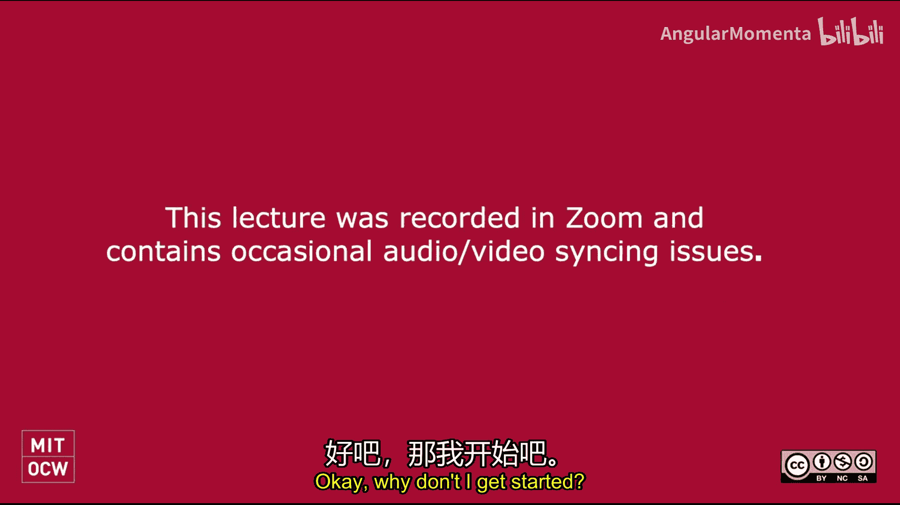
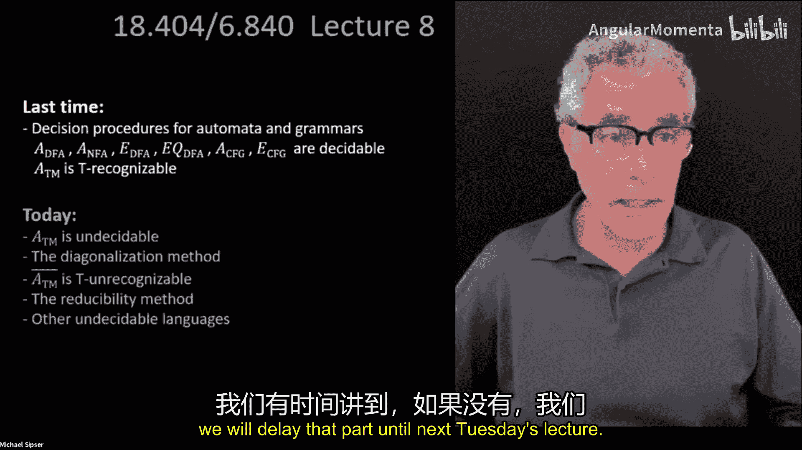
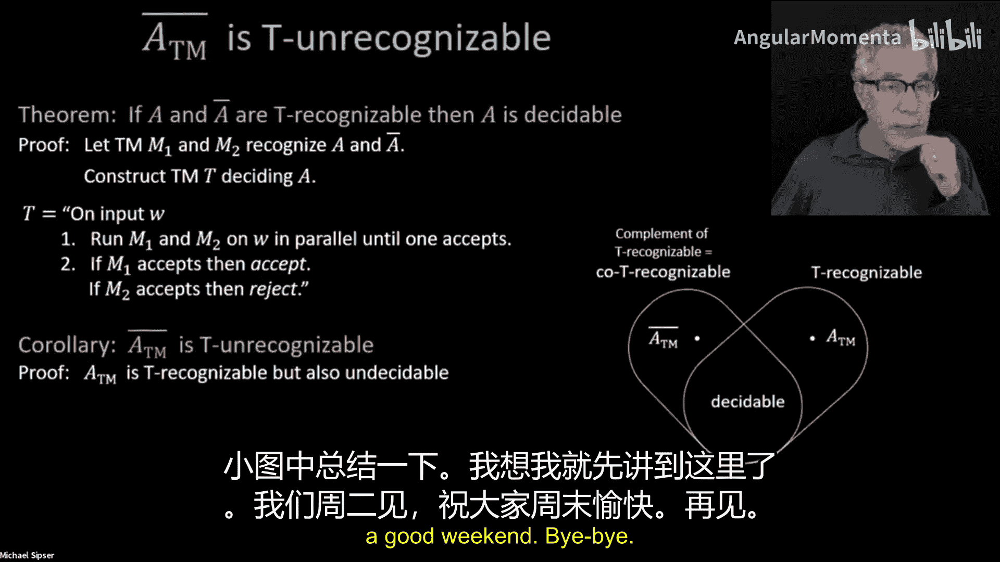
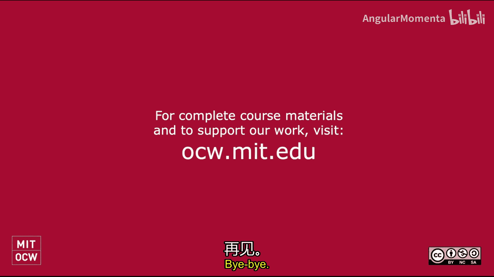

# 【麻省理工】计算理论  ｜  MIT 18.404J Theory of Computation, Fall 2020 p08 8. 不可判定性 -BV1pt7GzeEjb_p8-

Okay， why don't I get started？Okay， what have we been doing so last time we considered a bunch of procedures for testing properties of various automata and grammars。

The acceptance problem for DFAs， for NFAs。The acceptance problem。

 which is really the generation problem for context free grammars。

And emptiness problems for DFAs and context free grammars。

And also we looked we showed that ATM is turninguring recognizable there's a question here in the chat already about that。

 yes， we did show that that was the universal Turing machine that we presented at the end that's what shows that ATM is turninguring recognizable we mentioned that it's not ATM is not decideidable which we promised we will prove today and we will do some okay so that is the plan proving ATM is undecidable and we'll introduce the method for doing that called a diagonalization method。

We'll also show the complement of ATM is touring unrecognizable。

 even though ATM itself is recognizable， the complement is not。

And then we will introduce another method called the Reducibility methodod for showing other problems are not decidable。

And give one example of another problem， which is not decable， assuming we have time to get to it。

 if not， we will delay that part until next Tuesday's lecture。

All right， acceptance problem for touring machines so just as I mentioned， we showed that ATM。

 which is the language of Turing machines and inputs where the machine accepts the input。

 we showed that was recognizable， we claimed it was decable。

 today we're going to prove it's not decable。All right， now the method that we're going to use。

 which is really the only method out there for proving。

Some you know problem is undecidable is called the diagonalization method I mean ultimately we're going to show the Reducibility method as well。

 but it really depends on having already shown some other problem undeciable via the diagonalization method。

 so ultimately everything hinges on the diagonalization method， which is really what we have。And so。

To introduce the diagonalization method， I'm going to make a bit of a digression into a branch of mathematics called set theory or it's a part of mathematic logic where the method of diagonalization was first conceived of back in the late 19th century by a mathematician called Gayorg Cantor。

 and Cantor was considering the problem of how do you compare the relative sizes of infinite sets。

You know for finite sets， the problem of comparing， somebody said that Cantor went crazy。

 that is true and maybe I don't know why he went crazy but he did go he had some mental problems。

 unfortunately and so。So how do we compare the sizes of sets in general if they're finite sets we can just count them up we can say oh this set has 11 elements and the other set has 10 elements so the 11 one with 11 is bigger or if they both have 11 theyre the same size well that's not going to work for infinite sets because you can't count them up and so he had Cantor had the following idea for comparing the sizes of infinite sets and that was。

Basically， to see whether you can have a function。That would map from one set to the other set with certain properties。

😡，And those properties are called traditionally well。

In the past have been called the one to one and on properties for the function。

 I'll tell you what that means， but the concept is very simple。

 so a one to one function is a function that's mapping from a to B。

 those are the two sets whose sizes we're trying to compare。

And the function being one to one just means that there are no collisions if you have two different elements of a they're never going to map onto the same elements of B。

 so two different elements of a always map onto two different elements of B so that's the one to one property it's also called injective and the other property is called onto or serive which is that the range of f has to be all of B so you're not allowed to miss any elements of B you have to hit everything。

😡，and when you have both of those properties， the function is called a one to one correspondence or a byjection also。

Okay， now another way of looking at I don't want to make this overly more complicated than it needs to be。

 it just simply means that two sets are considered to be the same size if we can match up the elements with one set with elements of the other set。

 if you just pair them up。😡，You know， for example， well。

 if you look have finite sets that into that idea， that informal idea just works exactly as you would expect。

 you know， for example， if we have two sets， here's a set of puppies， here's a set of kittens。😡，Um。

 now。We want to show that those two sets have the same size， we could count them up， as I mentioned。

 and see that there are six elements in both。😡，But it's counting up does not work for infinite sets。

We can just match up the elements of the puppies with the kittens。

And then we know we have the same number of puppies as kittens。Okay。

 now that has the advantage of it making sense when you have infinite sets。

 so we're just going to extend that idea and apply it to infinite sets too and then we'll have a notion of what it means for two infinite sets to have the same size。

😡，And you might wonder what do you get you know are all infinite sets of the same size when you use this notion or or not what happens well some strange things do happen。

 but there actually are quite some interesting structure there that that emerges so。😡，So anyway。

 I don't want to rush on questions on any of this if you want to quick question。

 this hopefully was not too hard， but I want to make sure everybody's together with me on it so we can pop in I'll give a few seconds for a chat if you have any questions。

嗯。The the range of the set is all of the elements that you hit as you look at the different possible elements of A so all of the things that f hits the standard notion of a range of a function。

So the range of s F has to be equal to B， you have to hit everything。嗯。All right。

Can you think of a one to one correspondence as a relabeling yeah I'm not sure that's helpful。

 but yes you can think of as a relabeling of the elements in a sense about that yeah。

I just think of it as a matching up。All right， so let's move on。😊，So。

Coming out of this notion of sets of being of the same size， there was this notion of countable sets。

 as we'll see in a minute， so let's do an example。😡，Let's take the set of natural numbers。

 you know one， two， three， four， dot dot， dot dot， and the set of integers。

Which includes the natural numbers， but also the negative numbers in zero。

So the natural numbers are typically referred to as n。

 the integers were typically referred to as Z and。How do we what do we think of the relative sizes of？

😡，N and Z well n is a subset of Z it's a proper subset of C so you might at first glance think that Z is larger and they're not really going to be of the same size。

 but actually it turns out that there's a very simple way you know the arithmetic and the properties of infinite sets can be a little bit surprising and there is a way of matching up all of the elements of Z with elements their own elements of n and so you can show that as following that definition that these two sets are in fact of the same size so let's just quickly go that go make sure you see that。

So here is n， here is Z I'm going to write down a table which shows how they match up。

 you know here's the function F of n that I'm going to be describing that's the one to one correspondence。

😡，And so here are the natural numbers。Dot dot dot one through7 dot dot dot and here are the elements of z that I'm going to be matching up This is how the function is working So one i'm going to you know F of one is going to be zero F of two is going to be minus1 F of three is going to be one。

😡，And I'm just giving you a way to match up each of the natural numbers with integers。😡。

So that every single integer has its own natural number and vice versa。😡，Um。So four goes to minus2。

 five goes to two， six goes to minus3， seven goes to three。

 and then minus4 and then four and minus5 then five and so on you're clearly going to cover all of the integers in this way and each of the natural numbers is going to have its own integer and there's never going to be any collisions there's never going to be two natural numbers assigned to the same integer so this meets the conditions of a one to one correspondence and shows that the natural numbers and the integers have the same size。

Following this definition。Okay， let's do one that's slightly more。

Complicated and perhaps slightly more surprising。Which is that if you consider all of the rational numbers。

And then they have the same that as a collection， even though the rational numbers seem to be much richer and more numerous than the integers from this perspective they have the same size。

 and for the simplicity of my presentation， I'm going to consider only the positive rational numbers。

 which I'm going to write as Q plus。😡，So those are all of the positive rational numbers that can be expressed as a ratio of two natural numbers。

 and I'm going to show that there is a one to one correspondence between these positive rational numbers and the natural numbers。

Okay， so here I'm going to again make a table just as I did up above。

 so comparing the natural numbers and the positive rationalion numbers and to do that I'm going to write down over here on the side just to help you see how I'm getting this table。

 a table， a separate table that has all of the rational positive rational numbers appearing。

 you know in kind of a nicely organized way， here are all of the rational numbers here that have one is a numerator that have two is en numerator and so on and going through across the columns。

 the different denominators。So it's the numbers inside here represent all of the different rational numbers and so whatever rational number you have M over n。

That's going to appear down the and throw in the end column that number is going to appear so they're all going to show up。

😡，And I'm going to use this table here to fill out this function。😡。

U so u here are all the natural numbers and the way I'm going to assign the rational numbers to appear over here is I'm just going to work my way in from the corner。

😡，And I'm going to do that by kind of doing layers。

So first I'll take the one in this number here in this corner。

 then I'll do these three that surround it， and then these guys that surround that and these guys sort of in shells going around the previous ones that I've already covered。

😡，Okay so let me illustrate that so here's one over one my first rational number that i're going to enter them to the table appearing right over there so next i'm going to go two over one。

That's going to appear in the table over there。Now we have two over two now that's actually a little bit problematic because two over two has already been done and if we put that in because two over two equals one over one。

 they're both the equal to the rational number one so if we put two over two in this table over here。

 then we would no longer have the one to one property because both one and three would be mapping to the same point so we're just going to simply skip over two over two。

😡，I'll show that as kind of graying it out so're not going to we're not going to add that one onto the table onto my function so but so we'll skip over that we'll go to one over two。

 which is has not been seen before。And then we're just going to continue doing the same thing now going to this next shell out here。

😡，So we have one。Three over two。Three over three， same thing， I'm going to skip over that one。😡。

2 over three， one over three， I hope you're getting the idea so I'm not going to fill this every ran out of room to fill out this table some more but just to look at how the process is going to continue here we get four over one now four over two again is the number we previously seen because that's the that's direction rational number two we saw that up here when we had two over one so we're going to have to skip that one four over three four over four that was going to skip。

Three or four and so on。Okay， so by following this procedure I'm going to be able to define this function now this function is not particularly nice in terms of having an elegant closed form。

 but it is the totally legitimate function in the sense of being a mapping from natural numbers to the positive rational numbers。

😡，And it has the one to one correspondence property。

So it pairs up each of the natural numbers with each of the positive rational numbers。

 they each get their own。Mate in a sense and so that shows that the rational numbers despite the fact that they're dense and they have all sorts of very sort of more much bigger seaing they really and from this perspective of the sizes of the sets they have the same size as the natural numbers do and so with that it suggested the following definition that a set is countable。

If it has the same size as the natural numbers or it's finite from this perspective we're going to be focusing on infinite sets。

 but yeah countable or countably infinite sometimes people say if it has the same size as the natural numbers or otherwise you have to include the finite sets as well and countable means you can just sort of go through then the sets the elements of the set kind of。

As a list。So you can count them the first one， the second one， the third one the fourth one。

 dot dot dot and once you can do that and that counting is going to hit everything。

 then you know you can match them， you can pair them up with the natural numbers and so therefore you have countable set okay。

So as we've shown， both Z， the integers and the positive ratio numberss are countable sets。😡，Okay。

 now。You might think that well since we're allowing ourselves to do something as arbitrary in a way as this kind of a function to match up the natural numbers with whatever set you're trying to to measure that every set is going to be countable if you think about it that way because it seems like you're allowing too many possibilities and that all the infinite sets are going to end up being the same size as the natural numbers well that is in fact is not true and I don't know can'ttor as the one who discovered that I don't know if that was surprising or not but it is kind of interesting I think that there are different sizes of infinities and so we're going to now take a look and see that but I want to again。

😡，I want to stop and make sure we're all together can we always find a closed formula for if somebody's asking me I don't know for this particular F。

You probably could， but it would probably be very messy。😡，But in general。

 that's not a requirement having a closed form for the for the mapping function。

 any function is allowed as long as a one to one correspondence。

Are we all together on this is this are we comfortable with the notion of some infinite sets having the same size as the natural numbers and therefore we're going to call them countable sets and we're going to show some other sets are going to have more elements they're going to be uncountable they're going to be beyond strictly speaking strictly larger sets in the sense that we won't be able to put them into a one to one correspondence with the integers so' in the smallest infinity yes n is the smallest smallest one so any infinity is going to have you know you're going always I don't think you even need it in any special you know youre can always。

And whenever you have an internet collection， you can always find a subset。

 which is going to be accountable subset so its。And it going to be the smallest of the infinities。

 but there are bigger ones all right， why don't we move on？Okay。

 so the example of a set that we will show is not countable， an uncountable set， as we call it。

 is the。🎼A set of real numbers， which you know we all know what these are。

 I hope these are all of the numbers that you can express by possibly infinite decimal representations like pi or E squared of two or on any of the other familiar ones you know rational numbers are also members of are also count as real numbers and integers2 and so。

But you know， there are these additional numbers that you can get by decimal expansions。

 which may not be rational。And that collection， even though in some ways it looks somewhat similar to the rational numbers。

 the real numbers I hope I said that right， the real numbers the which is the set I'm considering here。

 the ones with the infinite decimal expansions， they actually are much larger so。

The theorem is and this was discovered by Cantor that R is an uncountable set and the reason why I'm introducing this is besides that I think it's interesting。

And has some relation to the kinds of things we're doing， but it's really for the purposes right now。

 it to introduce this method called diagonalization。嗯。Okay。

 that's what we're going to use later on again， but this is the first time it appeared。

So we're going to use a proof by contradiction in order to show that R。

 the collection of real numbers is uncountable and we'll assume for contradiction that R is countable。

😡，Okay。So if we assume that R is countable， it means we have by definition。

 a one to one correspondence from the natural numbers to the real numbers。😡，Okay。

 so we can match up all of the natural numbers with the real numbers in one to one and on fashion。

 so we can pair up the natural numbers with the real numbers and we will cover all of the real numbers by doing that。

And we can make a table。Just like I did before， here it is。

And you can fill this out with all of the real numbers。

And that was what the assumption means and I'm going to show you that that's impossible something is going to go terribly wrong if you do that。

Now， you might disagree， you might be surprised， you might think， well。

Professor Siper is wrong you know that I'm going to work on this overnight and forget the rest of my classes and I'm going to come up with a list of all the real numbers I'm going to fill them out here and show that that's impossible so let's say hypothetically just for my example's sake here is the list that you came up with so you know you have to match up something with one let's say that was a special case so you're going to stick that with one and then Pi came out to be the number that you connected up with two you want to see what I'm doing here I'm making a list I'm trying to make my correspondence my matching up between the natural numbers and my real numbers that I'm hypothesizing to who exists for contradiction。

So three， I don't know three gets connected to zero， I'm making this up obviously， not on the spot。

 I wrote the slide you know， yesterday， but here's a squared of two showing up for whatever reason。

 here is 17。Here is some other number which I'll be interested if you recognize that one。

 that's a subtle one。This is 1。23411。 yeah， some familiar looking sequence here and whatever it is。

Whatever it is， this is what you came up with， you claim that this is going to work as very good you somebody got it。

 it's eye to the eye power but let's not get hung up on that please eye to the eye power oddly enough can be seen as a real number under you know。

If you。Define the imaginary expmanentiation。Which is weird。

 but anyway let let's not get too distracted so here's my list of numbers my real numbers that I've matched up in my table here with the natural numbers。

Now something is I claim something goes wrong， What goes wrong。

 I'm going to show you that you actually。Did not do as you clean。

That is actually at least one number that's missing from this list。 And I'll exhibit that number。

 I'm gonna show you what that number is。 I'm going to explicitly come up with a number and show you that there's that number it's missing from the list。

 So here it's it's gonna be a number X。 X is X is the one that's missing。So how am I going to get x？

So x， well I'm going to start it off with zero point and then I'm going to fill out the rest of the places and how am I going to get those places。

 I'm going to look at the table here。😡，嗯。So I'm going to look at to get my first digit after the decimal point of x。

😡，I'm going to look at the first digit after the decimal point of the very first number。

So I take the first number， look at the first digit after the decimal point。

 and which happens to be a seven。😡，And the number I'm going to put in for x is not going to be seven。

 it's going to be anything except seven。😡，It's eight。For my next digit of x。

 I'm going to look at so my second digit of x， I'm going to after the decimal everything's going to be after the decimal point now so I'm not going to keep saying that I'm going to look at the second digit of the second number。

Which is a four。After the decimal point， there it is。And for the second digit of X。

 I'm going to use something， which is。Anything besides for。5。I have some flexibility here。

 so I could have used six， I could have used seven。

I'm going for those of you who have seen this before who are going to nitpick on me。

I'm going to stay away from nine and zero just because there is some little edge cases that arise there which I don't want to get into because I don't think it's interesting for this argument。

 but since I have some flexibility I'm going to avoid zeros and nines probably just nine is all I really need and then the argument is just going to work fine。

Okay， so the next digt is a 0。For the third digit or the third number is a zero。

 the third digit of x is going to be anything except for zero the one。Then I have a two here。

Anything except the two？Six。Then five， anything except a five， a one， a nine， anything except a nine。

 and eight。And so on， is an eight。These are two and dat， I just going to keep doing that。

And I'm going to say。You missed。That number， whatever it is。

 but that number it's that's a number after I'm all done。

 it's going to be the decimal representation of something。And that number， I claim。

Is absent from the table？And you might say， well， you know it's really there。

 it's just on the 23rd row you just didn't get to it in your slide but it's there well I'm going to say I know it's not in the 23rd row because it differs from the number in the 23rd row at the 23rd digit。

Because I constructed it that way。This number is designed explicitly to be different from each of the numbers that's on the list。

😡，Okay， so it can't be on the list because it's been constructed to be different from each of them in at least one place。

😡，嗯。So it's I think this is a beautiful argument and it shows that no matter how you try to come up with a one to one correspondence。

 you're going to fail， you know， you might say oh like you know。Just one number， you know。

 I did so much hard work and Im missing just one number can I get partial credit you know and put this one on the list now I fix it no obviously there are many。

 many numbers that are missing if you put this one on the list I was going to construct another number that was missing。

So。This is， you know， there's just not no possibility of fixing this and in fact。

 you know the real numbers are uncountable， cannot be matched up with the natural numbers and there's nothing it can't even it doesn't even come close。

So here summary what I just said， F is not a one to one correspondence， no matter what you try to do。

 you can't come up with a one to one correspondence， so that's the contradiction。Okay。

 so that proves that R is uncountable。Okay， and that's why， by the way。

 we call this a diagonalization because we're going down this diagonal here。

 that's the term that's where the name has come from。Okay。So I'm happy to。M。😊，Okay， that's it。呃。

Somebody's asking me， I'm actually， I have a。😊，Is it here I can't remember it's here I have a check in coming about this and somebody is kind of anticipating that by asking the the actually a rather famous question about there being a possible infinity in between。

The natural numbers and the real numbers。We know the real numbers now are bigger than the natural numbers。

 but is there something that's in between I mean this is a very very famous problem。

 which I'll talk about you know when we get to our check in which is coming up。Well。

 somebody is objecting just the way I've defined X using this procedure that really can't in a sense state。

You know， but X is a number x is the result of what this procedure is it's you know following this procedure we're converging on some particular value and so that is a value if you want you know we can make a more precise way of determining I mean so we don't have the flexibility of choosing the way I did in my example we can make a precise procedure for coming up with these digits but I don't think there's anybody thinks is' anything that's。

There's any shortcoming in this argument in terms of the way we're defining X I think it's worth understanding this because it's really going to set the groundwork for our proof that ATM is undecidable。

 which is a little I think perhaps slightly more abstract in a way in the way sort of comes across I'm going to try to make connected to。

 but I think it's helpful to understand at least this argument because this argument is kind of diagonalization in its kind of most raw form。

嗯。All right， I think we're good， so why don't we continue then？

So there are a number of corollaries that follow from the statement that the real numbers is uncountable。

First of all， if you let script L be the collection of all languages。

 if you want to consider it over some particular alphabe but that's fine。

 but that's not going to be really。You know， important for this。

Point that I'm going to make so L Scl is the collection of all languages。So every subset。😡。

Of Sigma star。Every subset of Sign star is a language。😡，So look at all those possible subsets。Um。

 so that includes， you know， zero to the K1 to the K plus every other language you can ever think of and more。

 all possible languages。So that the collection of all languages is uncountable。😊。

There's uncountably many different languages out there。I don't want to belabor this point。

 you can just take this if you don't quite follow the quick argument I'm going to make here。

 but you can make a correspondence one to one correspondence from all languages to the realels。

So that each language gets its own real number。😡，And the way I'm going to think about that。

 let's put the real numbers into binary form。😡，And if you imagine here being Sigma star。

 all of the possible strings of Sigma star。😡，You know， written out in their standard order。

And now if you have a language here， A。😊，It's just some arbitrary language。

 so that's going to have some of the strings of sigma star appearing like zero was appearing。

 but one is not appearing，00 was appearing and 01， but not these three。😡。

Um and I'm going to associate to a my language some real number in binary by putting in。😡。

A zero in the decimal representation。 Well， the binary representation， I should say， for that string。

 if it's not there and a one， if it is there。And so a real number because there's infinite many infinitely many yes nope choices in the binary representation can represent a language because of each of the yes no choices of a string being present or not i'm going to put every one for when the string is present zero1 if not present so each language has its own real number and each real number is going to be associated to its own language here i'm restricting myself to real numbers between0 and1 that's not going to be an essential point so let's not get hung up on that。

😡，So the fact that the languages can be。呃。Putting it into a one to one correspondence with the real numbers shows that the collection of old languages is also uncountable。

Now another observation here， another point worth noting is that if you look at Sigma star itself。😡。

The strings。All possible strings， that's accountable set。😡。

The collection of all possible languages is uncountable。

 but the collection of all possible finite strings is countable because I can just list them。😡。

Here is my list of all possible strings， which you can put into a table。

 if you like to think of it matching up with the natural numbers in that way。

Now I'm trying to make a point here， which is that if you take M。

 which is all possible Turing machines， script M is all possible Turing machines。

 the collection of all possible Turing machines is countable。😡。

There are only countably many different Turing machines。😡。

And you can argue that in all sorts of messy different ways。

 but I think the most simple way to see that is to think about each Tring machine as having a description。

😡，嗯。Which is a string。😡，So the collection of old descriptions of Turing machines is just a subset of Sigma star。

 which we already know is countable， and the subset of any countable set is going to be countable。

So anyway。呃。I think it's worth。Remembering that the collection of old Tring machines is countable。

Whereas the collection of old languages is uncountable。

 and that tells you right there that some language is not societal。

Because there are more languages than touring machines。We have uncountably many language。

 only countably many toring machines， so that's fewer touring machines than languages。

 there's no way to map all the languages onto Tring machines。

 so there's going to always be some languages that got unmapped。And so in particular。

 there are going to be some languages which are undecidable。

 there are going to be some languages which are not touring recognizable and anything based on some automata kind of definition process is going to be some languages that they're going to be not going to be defining。

嗯。Okay， now what this colorroll shows you that there is some language out there。

 which is not decideidable， what we're going to show next is that there is a specific language ATM。

 which is not deidable。😡，Okay， and but first I think we have a check in coming up。And。

Let me give you a little bit of background here because this is relevant to this question that I got about intermediate size sets。

 so the question of whether there is a set of size between the natural numbers and the real knit numbers strictly in between。

 so bigger than the natural numbers not the same size as the natural numbers but not the same size as the real numbers either。

 but in between in size， that was Hilbert's question number one out of his list of 23 that I talked about a few lectures back。

😡，It's interesting that he put it as number one in that very privileged special place because I know Hilbert was very。

 he felt that the understanding infinity was a really central issue in mathematics and that if we can't answer a question like this。

 we don't really understand infinity。嗯。You want to understand what kind of sizes of infinities are there we know there's the real numbers bigger than the natural numbers is there something in between so fundamental really but it was shown during the course of the 20th century really in two separate steps one in the 1930s by Gerdle one in the early 1970s by Cohen。

That we can't answer this question by using the standard axioms of mathematics。😡，You know。

 it's the answer can go either way。And it's both of them are consistent with the axioms of mathematics so you're never going to be able to prove that there is a set whose size is in between or that you or that there is no such set it's just impossible to prove either either way using the standard axiomism mathematics which actually is kind of remarkable。

😡，And so my question for you is and this is really a philosophical question。

 not one that is directly unique need to know about material in the course。

 just I think it' just a matter of your own interest。

 I hope you find it interesting if you don't you pick a you can just answer it randomly but。

What's going on here that we can answer that question about whether there is a set of intermediate size。

 is it because our axioms for mathematics are inadequate？😡。

Or maybe there is no such thing as a mathematical reality， you can talk about， you know。

 you know what's real here， what's the reality， either there is a set in between or not。😡。

If you imagine all of these things have their own reality to them well then there's going to be an answer and then you would expect well maybe we could find better axioms which will actually give us that answer or you can say well there is no reality and you know infinite sets are kind of human constructs anyway so we can make them kind of play out any way we like mathematicians argue about that to this day and it is as I say really it's a philosophical question but just out a curiosity let's see how you guys end up deciding on that one so here's the poll。

😡，Five seconds to go， please vote。And we're going to end the polling one， two， three now。All right。

 here we go。So there's no right answer。I think if most mathematicians were to I think the instinct that most logicians。

 especially， I'm not sure general mathematicians really even care about this question。

 but logicians would probably have an instinct that，Probably there are sets in between。

 there's no reason that there shouldn't be， you know。

 it seems kind of stranges that there should be this sort of jump。

From the natural numbers to the real numbers and why nothing in between。But。

It'sI don't think that question is really settled so。All right， let's continue on I think we are。

Okay， so we're going to。U。Our coffee break is coming in case you're wondering so this is on my last slide before then but this is an important slide so please hold hold hold out。

So here is our promised theorem of the day， I'm going to show that ATM is not decidable。

 the acceptance problem for touring machines。😡，And it's all going to be contained on this one slide。

 we're going to give a proof by contradiction using diagonalization。

And we're going to assume some Tring machine H decides ATM。😡，And we're going to get a contradiction。

对。So let's first of all， make sure we understand what H is doing。😡，So H gets an input。

 a Tring machine and an input。😡，And H is going to be a decider， so it always halt。😡。

With an accept or a reject。It's supposed to accept if M accepts W。😡，And reject if it doesn't。

 so in other words， it's going to reject if M rejects W either by by halting or by looping。😡。

That's the job of H。😡，And we're assuming we can do that。But we will see a contradiction occur。

So the way we're going to do that。I really kind of just one step here in a way and we're going to use H to construct another Turing machine D H is going to be a subrtine to D we've already seen us doing that in the past。

😡，D is going to do something a little strange just to warn you。These input is just a Turing machine。

 no W。And what？D is going to do using its subrtine H is going to simulate H on input。😡，M comma。

 the description of M， now what is that？😡，Well， the description of M is just some string。

So what H is trying， what it's asking H to tell to answer is does M accept？😡。

The string representing M's own description。😡，It's as if we're feeding M into itself。😡。

Which seems like a totally twisted thing to do。嗯。You might say。You know。

Why would you ever feed a program into itself？😡，Somebody's written cannibalism here。Yeah， kind of。

 I said it's worse。Because it's not eating somebody else， it's eating yourself。Okay。

 but I claim that we actually， there are actual cases in practice。Where we do this？

We feed programs into themselves。😡，嗯。And the example that I know of where this is done is when you're making a compiler。

You might want to make a compiler and then written in the same language that it's compiling。

 and then you feed the compiler into itself。😡，It me say why why even bother because it's already obviously if once it's running。

 you don't need to。Compile it again， but actually， you know an example where this was really used。

Was when there was an optimizing compiler， I think for C， written on early UniX machines。

And the optimizing compile for C was written in C。So you would feed the optimizing compiler into the regular compile。

 first of all， now you had the compiler running， but it was unoptimized。😡。

But now that if the optimizing compiler is running， you can feed the optimizing compiler into that。

 which is itself， now you have an optimized optimizeimizing compiler。😡。

So it really makes some there is at least one case where this has actually been done in practice。😡。

 not though that we really care， this is a theory class， but just for fun to observe that。

So here H is trying to say， well， does NAM end up accepting when it's fed the description of itself？

😡，Yeah， at least mathematically speaking， that's a reasonable thing to ask。And then what？

D is going to do when it gets the answer back from H， H is a decider， don't forget。

 is D is going to do the opposite who whatever H does。

 it's going to accept if H rejects and reject if H accepts。😡，UmSo let's just summary。

 let's pull this together so so， you know， it's easy to understand in the end， what is D doing？😡。

D is going to accept D is also going to be decided， by the way。

 so D D is always going to either accept or reject。😡。

Just the opposite of what H should tell her to do so D is going to accept。😡，M。

Exactly when M doesn't accept M because when M doesn't accept M， H is going to reject。😡。

And so then D is going to accept。So D accepts M， if and only if M doesn't accept that。

 that's exactly the condition in which D accepts M。

I think it's important to just step back and make sure you understand this line because we have only one line left。

😡，To get our contradiction。A we together D accepts M if and only if M doesn't accept M。

 that's just by that way we've defined setup date。😡，Now。

What we're going to do is feed in instead of M to D， and also arbitrary feed。

 we're going to use feed in D into D。😡，And that is going to be our contradiction because D is now going to accept D if and only if D doesn't accept D。

 and that's certainly impossible。Okay， that's our contradiction。

 which proves that H cannot exist and therefore ATM is undecidable。Okay。

 so we're done except for the one point， which is that why is this a。Diaagonnalization。

 and I think you can get that from the following picture。

If you imagine here writing down all possible content I'm making， I'm going to make a table here。

 here is a list of all touring machines。😡，Okay， including D。

 which is a machine which I built under the assumption that H exists。So D appears here somewhere。

 but here are the all the other Tring machines， and here are all the descriptions of the Turing machines along the labeling all of the columns。

Okay， so these are the rows labeled， these are the column labels。

 and inside I'm going to tell you the answer for whether a given machine accepts a given input。

So for example， M1 accepts its own description， but rejects the description of M2。

 but accepts the description of M3， I don't know you know， obviously I'm making this up。

 I don't know what M1 is， but just hypothetically， that's what the machine M1 does。

So I'm just filling out this table and you know this is the the。

H could get the answer to any ofD elements in this table because it can test whether M4 accepts the description of M3 so could H could fill out this table。

So maybe M2 is a machine that always rejects， it's a very unfriendly rejecting machine。

 M3 is a very friendly machine， it accepts soil inputs and therefore it rejects some and accepts other dot dot dot。

Now I want to look and see what does D do？😡，Now， based on the information that I've already given you。

 we can understand what D does。😡，So for example， what does D do when I feed it the description of M1？

😡，What does he do？Well we can look over here D accepts M if and only if M doesn't accept M。

 so D is going to accept。😡，M1， if and only if M1 does not accept M1， well M1 does accept M1。😡。

So D does the opposite D rejects， so okay I'm highlighting here D rejects because it's going D is going to do the opposite of what the machine does on its own own input。

😡，So M2 on so D on M2， you have to look what M2 does on M2， it rejects。

 so D does the opposite of that， it accepts。And similarile。呃。You know， all each one of these things。

These answer is going to be the opposite of what the machine does on its own description。

 just by virtue of the definition of the。Okay， and so on， so far， so good。

But the problem is what happens when the is Fedex itself？Because as you can see。

 we'rere heading for trouble because this is a diagonal down here， D is just one of the rows。

 that diagonal is going to intersect that row at this point。😡。

And D is defined to be going to be doing the opposite of what that element is。

 but it can't be the opposite of itself。😡，Okay， and so that's the contradiction。

So I think you know where I'm going to call us give us a little break here。

 and then we can also text me in the meantime， we'll be happy to answer some questions during that。

Little over four minutes to go， so let's see let me see if I can answer your questions。Okay。

 what's so special about ATM that enables us to do this why can't we do this on aFA for example so that's a good question and the answer is that。

嗯。You know。You know， in a sense， you know， we can do this on DFA， I mean。

 I think this is perhaps a bit of a stretch， but you know DFAs could not answer ADFA。I mean。

 we could prove that in other ways as well you by because you know we could use things like the pumping lemon。

 it's not clear even how you'd formulate ADFA， but what's important here is that the it's really the model talking about itself that really is where the problem comes up。

So if you try to push this argument through to show that ADFA is not theable by touring machines。

 you're going to fail。😡，嗯。Because you know， we're starting off with a Tring machine and mean。

 I think I'm going to confuse myself if I try to just repeat it。

 but you won't get a contradiction because a Tring machine is not a finite at automaton。嗯。Okay。

Will this argument get into self loops I don't see why there was there is some self referenceence perhaps we're going to talk about that a little later of course we're going to come back and revisit this argument you know in a week or so when we talk about the recursion theorem which talks about machines that can refer to themselves。

 but this is a little bit of a head getting ahead of ourselves so。

Somebody's commenting on this reminding them of the barber paradox。

 if you remember that the which had some similarity， you know the。

Theres a town in which there is a barber which shaves every man who doesn't shave themselves。

Whi seems， you know he's a very good barber， so theres some people who shaves themselves。

And all the rest the barber shaves， the question is does the barber shave himself because he shaves only those men who don't shave themselves。

 so you got the same kind of a contradiction there is a relationship there。嗯。

So somebody wants to know where did we use a decidability。

 so we used the decidability to come up with H。😡，You know， once we know that ATM is decideidable。

 then we have that H function and then we can build D so that's where that's the the chain of that's the chain of reasoning。

So you assume8TM is decable， then you have the decider and then quote H and then you can build D。

Somebody wants to see the previous slide。What part of this one do you want？呃。

So I'll leave that up there can we why can we apply the proof that all touring machines are accountable to all languages well because touring machines have descriptions。

 languages， general languages don't have descriptions。And so that's why okay。

 the candle has burnedt to the bottom and it's time to move on。

So now let's look at the acceptance problem for Qoma。I'll give you a Q automaton and input。

 and I want to know， does it accept the input， is that going to be decidedidal？

And you have your choices，'s either yes。It is aable because these are similar to put on automata and APD is assignable。

Or no， because yes， would contradict results that we know at this point。

 or we don't have enough information to answer the question。Okay， let's put that up。One second。

All right。That's it ready going gone。So yes， the answer is， well， no， answer indeed， the answer is B。

True that Qatmata is similar to put on automata， but all these automata are kind of similar to each other and that's not going to be good enough。

Well， the homework has asked you to do is to show that you can simulate Turing machines with Qometer。

 so if you can answer the question about whether cuoma accept their input。

 that would allow you to be able to answer questions about whether Turing machines accept their input and we just proved that's not possible。

😡，So。It would get be a contradiction if we could answer if we could decide A QA。

Now we have an example of an undecidable language， let's look at an example of an unrecognizable language。

😡，No， ATM is not going to serve that purpose because ATM。Is。诶。

Recognizable is Turing recognizable as we pointed out by the universal Turing machine。😡。

So ATM is undecidable， however， how about an unrecognizable language for that。

 we will see that the complement of ATM will serve。

 so the complement that ATM is neither decable nor even recognizable。😡。

Now it's not touring recognizable。And that's going to follow from a pretty basic theorem that connects recognizability and decidability that I' put up here on the screen。

Which is that if you have a language where it and its complement are both recognizable。

 then the language turn out， turns out to be decable。 In fact。

 the language and its complement are decidable but being decideidable is closed under compliment。

 So that's something you should be aware of。But being okay。We'll get to that in a minute， but if。

So anyway， so if you have a language and it's complement both recognizable how do we know the language is decidable so first of all let's take the two tuuring machines m1 and M2 that recognizes A and A compliment。

And we're going to put those together to get a decider for A。嗯。And that's going to work like this。

 it's going to be called T。So T says on input W， what it's going to do。

 it's going to feed W into M1 and M2 both。😡，🎼A is a language， by the way。

 yes a is when I'm when I say it touring recognizable you know touring recognizable only applies to languages so yes。

 a is often this symbol I'm going to use for languages sometimes for an automaton。

 but a is typically going to be a language。So。If so now I'm trying to make T be a decider for a。😡。

From the recognizers for A&A compliment。So I'm going to。

Take an input to T and feed it into both recognizers， M1 and M2。😡，Okay。

 I'm going to run them in parallel。What's nice？Is that because。

M2 recognizes the complement of what M1 recognizes。

Every string is going to be accepted either by M1 or by M2。😡。

Because every string is either an A or an a complement。

So if I run M1 and M2 on W until one of them holds， one of them accepts。😡。

I know I'm not going to run forever because eventually one of the other one have to accept。

So and then I got my answer because if M1 accepts and I know I'm in the language， but if M2 accepts。

 I know I'm in the complement of the language， so matter the line。😡，So if M1 accepts。

 then T should accept， if M2 accepts， then T should reject。Um。嗯。Now。

 so that proves that nice little theorem written at the top in blue。

So I got my decider for A built out of the recognizes for A and A compliment。Now。

 immediately it follows that the complement of ATM is not touring recognizable。😡。

Because we know that ATM itself is recognizable， but it's undecidable。😡。

If its complement were also the complement was also recognizable， then ATM would be decable。

 but it isn't。😡，So when something is undecidable， either it or its complement have to be unrecognizable。

 and in the case for ATM， it has to be the compliment because we already showed that it is itself is recognizable。

😡，U。So that's the proof of that so here is a little picture of the way the world looks right now。

 if you have here in the middle are the decidable languages see these are all languages here。

 this Venn diagram of languages kind of we showed earlier you know like the regular the context free decidable recognizable。

😡，Here I've got the recognizable and what I'm calling the co touring recognizable。😡。

This is the collection of all complements of recognizable languages。

 so ATM bar ATM complement is the complement of a recognizable language this。😡。

A region here is are all the complements of the recognizable languages or the so called co。

A touring recognizable language is complement of。Um， so ATM is on this side。

 ATM compliment is on that side， but if something's in both。By virtue of this nameme here。

 then it's decable。Okay， last check in for the day， from what we've learned so far。

 which closure properties can we prove for the class of the touring recognizable languages？

Choose all that apply。Well， as I say。You don't have to get it right。

 let's not spend too much more time on this because we'll talk a little bit about it。嗯。Almost all。

 it's closed under almost all of them， but not all of them。U。Because you know。Are we done here。

 I think we're done。Five seconds。Okay， here we go， ending polling。啊。I'm not sure what the meaning of。

Thelet answer is here everybody likes union I guess they're closed under all of these operations except complement so。

😊，But we just proved it's not closing on the copper so a little。You know。

 a little puzzled by why we have so many votes for closure under compliment。

h we have here ATM is touring recognizable， but ATM complement is not touring recognizable right here on the slide。

So I'm not trying to make you feel bad， but I'm trying to just point out that you think please。

Now closure under union and intersection， I mean you could kind of get those answers just by running things in parallel the way we did the proof here you just run both machines and。

If they both give I mean it's a little tricky I suppose you know if either one of them accept then you can accept or if they both accept you just wait until they both have accepted otherwise you just keep running so the first two are pretty straightforward close under concatenation is also going to be similar you just try every possible way of cutting the string up into two pieces and run in parallel on and if you ever find a way。

Of cutting it up and you run those two those two sides in parallel and if they both accept then then you can accept and star were again very similar so there these are not too bad but I admit you know it's not a whole lot of time to have to contend with something that you're just getting used to so let's。

Let's talk about the very last topic of the day， which is really going to be setting ourselves up for Tuesday's lecture next week。

 and that's how we are going to be showing other languages are undedecidable。

 which is something that。I'm going to be expecting you guys to be able to do this is。

The standard procedure for showing languages are undecidable using what's called a Reducibility method。

And what that does is it takes as a starting point， a language that we already know is undecidable。

Typically ATM。Or it could be another one that you've previously shown to be undecidable and leverages that information to show other languages are undecided。

And。It's using what's called Reducibility， we're going to go into this more carefully next time。

 but basically Reducibility is a way of using one problem to solve another problem。

And so we' are going to show， for example， let's take a look at the problem called the holding problem。

 which is like the famous problem for touring machines。You just want to know whether it holds。

 not necessarily whether it accepts。So it's very similar but not exactly the same。Um。

And we're going to show that。This halt problem is similarly undecidable now we could go back and do the whole diagonalization。

 but that seems like well that's more work than necessary now that we already know ATM is undecidable because we're going to show that we can reduce the ATM problem to the whole halting problem。

And we'll explain what that means again later。 But the idea is。

 and as as will show in an illustration shortly that。By proving by contradiction。

If HoltTM were decidable， then ATM would be decable。😡，And we know ATM is not sociable。

 and so that's our contradiction。Now。呃。The way you were going to show that if wholeTM is decable。

 then ATM is decable is use a decider for wholeTM to decide ATM with a suitable you know。😡，呃。

Modification。So basically， we want to turn。A whole TM decider into an ATM decider。

And that's how we are going to reduce the problem of solving ATM to the problem of solving qua TM。

Let's just do it an example， like you if you've seen it before。

 obviously this is not going to be hard， but for the many of you who have not seen it before。

I'm partly doing it this time just so we can do it again next time。

 and maybe it'll sink in by virtue of repetition。😡，So。So again， so as Andy said。

 we're going to assume the whole TM problem is decable and use that to show that ATM is decable。

 which we know is false。We showed it just earlier that it's not。

So assume we have a decider for whole team and we'll call it R。

And we're going this construct from our。Der for ATM will calles。Okay， so we're again。

 typical proof by contradiction， we're assuming the opposite of what we're trying to prove。

 and then we're going to get something crazy。Okay， so here my job now is I'm assuming I have R。

 which is a whole Tm decider So now I'm assuming I know how to。😡，诶。Decide。

If a turing machine and an input eventually halts。😡。

Not necessarily where it accept just whether it holds。You know， it's conceivable， you know。

 you have to bear with me here， it's conceivable that you could find a way to test whether you know。

 tuuring machines hold on their input， even though we now know that testing whether they accept their input is not decable。

😡，嗯。So you have to kind be open minded to the possibility that we can that the whole problem is decidable and we're going to show that that can't be。

 so we're going to show that if we could decide the Hton problem。

 then we can use that to decide the acceptance problem。Okay。

 so how do we how are we going to do that so imagine now we can solve the halting problem so。😡。

To solve the ATM， which is what my job is to do。 So as is supposed to solve ATM。

I'm constructing toing machine has to decide ATM。I'm going to use first， I'm given an M andW。

 I'm going to feed it into R since that's really all I got。😡，See if R tells me what happens。

 does M on W at least hold？😡，Well， if ours says no， it doesn't hold。

Well then then I'm actually done because if a M doesn't even hold on w。

 then it couldn't be accepting W， so at that point I know that M doesn't accept W and I can reject right off。

😡，So， you can see how it could potentially be helpful， but it's going to be helpful in either way。

 because if R says M does hold， well， then I'm also a good。😡，Because I don't know the answer yet。

 or what I do know is I can now simulate MW。😡，Until it holds because R has told me it holds。

So I don't have to worry about getting into a loop。

 so S can be confident in being a decider for whatever it's doing。

Because I'm running now M onW with a guarantee that it holds。

U and now that going to tell me now eventually the simulation of M and W is going to end up at an accept or reject and that's going to be the answer I need so if Emma is accepted then accept and Emma is rejected。

 then reject。And that's how S solves ATM using R， which solves wholetium。😡，But S can't exist。

And so therefore R can't exist and therefore wholeTM can't be decidedidable。Okay， so that quickly。ok。

I'm not sure which diagram you wanted me to show， but anyway maybe we can do that we're basically at the end of the hour or end of that 90 minutes。

 so let's a quick review and if you stick around I'm happy to go back and look at any of the other slides that you might have missed something on。

Okay， so just to recap， we showed that。The natural numbers of the real numbers are not the same size using that definition of one to one correspondence to introduce the diagonalization method。

 we use the diagonalization method to show that ATM is undecidable。

 we also showed that little theorem that if the language and its complement are recognizable。

 then the language is decable。And from that， we concluded that ATM complement is not recognizable。

 and then we showed at least by virtue of an introduction to the method。

 the Reducibility method to show that wholeTM is undecidable。😡。

Okay that's that was today's lecture and we're and we're at the end of the hour so why don't I you know we are finished you can log out and if you want I will stick around。

Okay， okay， this is kind of a good question here。So I'm getting a question about the ATM complement。

Which is， you know， since we have a。A recognizer for ATM。If I'm。Doing justice to this question。

 we have a recognizer for ATM， so why can't we just invert the answer？You know。

Flip the answer around and now we have a recognizer for the complement of ATM， ATM compliment。

So why doesn't that work？Well， the reason that doesn't work。Is because。The recognizer for ATM。

Might be rejecting some things by looping。And now if you just flip the accepting and rejecting。诶。

When it hits one of those holding states， it's going to give the reverse answer。

But when it rejects by looping， it'll continue to reject by looping。

 so you won't get the complementary language coming out。So， you know， if we want， you know。

 if it would be helpful， I can go back to that slide here。嗯。

Which proves that ATM complement is unrecognizable。Um， because。Maybe we should start with the bottom。

We know that ATM。Is recognizable and undecidable。Right we already approved those two facts。

 ATM is recognizable from the universal Turing machine。

And it's undecidable by the diagonalization argument。

Those two things together tell us that the complement has to be unrecognizable。😡，Because。

If a language and its complement are both recognizable and we already know the language itself is recognizable。

😡，So now if the complement is also recognizable， the language is going to be decidable by the upper theorem。

😡，So it must be the case that either the language itself is unrecognizable or its compliments is unrecognizable。

😡，We know the language is recognizable， that's what the universal Turing machine told us。

 so the only thing left is for the compliment to be unrecognizable。

You should review that if you didn't get it because this is a kind of。

 you know kind of reasoning we you know we're going to be building on things like that。

 so I think it's good to make sure you understand。Okay。嗯。Okay， the diagram on the right。

 so this is just a Venn diagram here。Kind of threw this in at the last minute here I was worried about being confusing。

You know， that part is。呃。You know， so， you know， I'm trying to show that the three classes that we've already talked about。

The languages which are decidable， the languages which are touring recognizable and the languages whose compliments are touring recognizable。

 those are three separate classes of languages。And those come up here in those three regions。

These are the decable ones， here are the recognizable ones。

And here are the ones whose compliments are recognizable。Now， if a language。

Is in both recognizable and as complement as recognizable。

 so it's in both of these bigger regions here。😡，Then this theorem tells you it's deidable。😡。

So that's why the intersection of these two regions is marked as being decidable because that means you're in both。

Okay。But we know that ATM is sitting out here as recognizable but not decidable。

 so ATM is in the recognizable side， but it's not on the complement of recognizable ATM itself。

 the complement of ATM is the complement of a recognizable but itself is not recognizable and。

Not decidable。 So you get this side of nice。You know， picked up hope it's you think it's nice。

 but it's a sort of a trying to summarize things in this in this ph Ven diagram。

So I think I'm going to then sign off。And。I'll see you all on Tuesday and have a good weekend。

 by bye。

