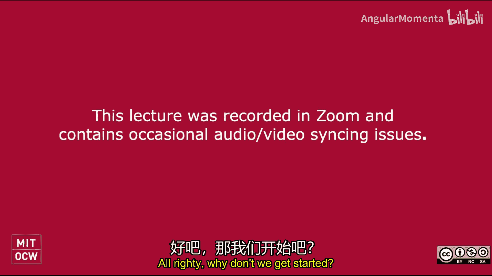
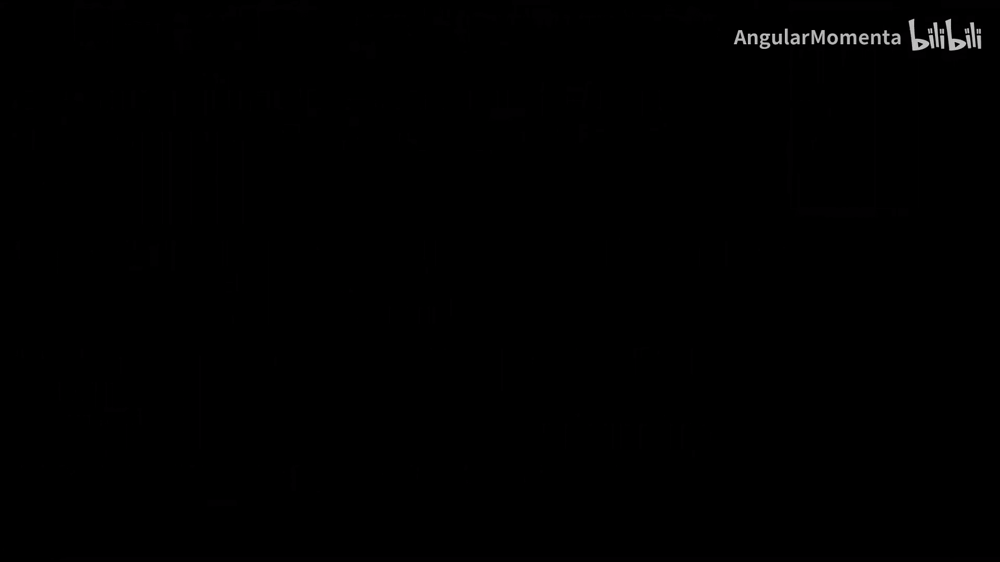
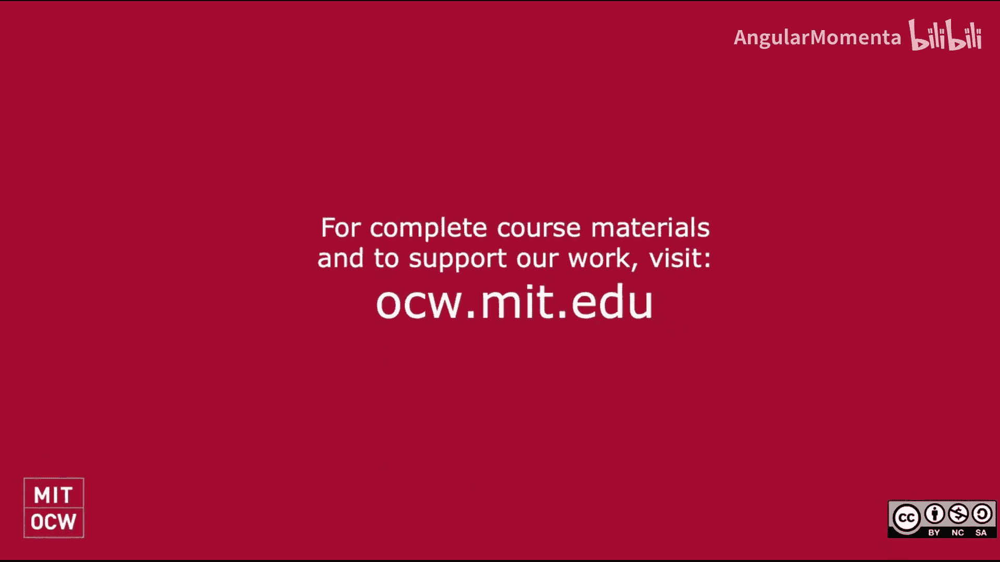

# 【麻省理工】计算理论  ｜  MIT 18.404J Theory of Computation, Fall 2020 p09 9. 可还原性 -BV1pt7GzeEjb_p9-

Alrighty， why don't we get started？U。So。Welcome back， nice to see you all。

And what have we been doing？In theory of computation。We have been talking about touring machines。

And about。The power of touring machines， we started at the beginning by showing a bunch of decideidability theorems that exhibit the power of touring machines to。

Calculate properties of。Fite automata， context free grammars， and so on in some cases。

And last lecture we talked about the limitations of the power of Turing machines by proving undecidability of theorems。

 so we showed that this language ATM， the acceptance problem for Turing machines itself is an undecidable problem。

That was the first of many undecidable problems that we're going to encounter。

 and though we proved the undecidability of ATM using the diagonalization method。

 as you hopefully remember， we're going to introduce a new method。

 which we kind of basically previewed last time called the Reducibility method。

 which is the way other problems are typically shown to be undecidable。

And so we're going to stick with that for this lecture and also next lecture。

 we're going to be talking about undecidability and I think there's going to be a few additional discussions after that。

 but this is one of the important themes of the courses to understand kind of that threshold between decidability and undecidability or the limitations of computation。

Okay。So today， as I mentioned， we're going to talk about the Reducibility method for proving problems undecidable and also for proving problems nonturing recognizable touring unrecognizable we're going to introduce this notion of a reducibility in general and we'll also talk about a very specific kind of reducibility called the mapping Reducibility so today as promised we're going to talk about using reducbilities to prove problems are undecidable or unrecognizable。

So that's going to be our general method， oops， make myself smaller， thank you。I always forget。

 thank you for the reminder。So。呃。So using reduceucbilities to prove problems are undecidable or unrecognizable and the basic way that works is we're going to leverage another some problem we already know is undecidable say or unrecognizable to prove other problems are unrecognizable so we did a quick example of that last time we're going to go over that example again just to set set the stage and then we're going to talk about that in greater detail so。

As you recall from last time we had this problem Hol TM。

 which is the problem of testing for a given Turing machine and an input to that Turing machine。

 whether the Turing machine holds， either accepting or rejecting， but just whether it holds。

 which is a somewhat different problem closely related obviously。

 but somewhat different than the ATM problem which is just testing the Turing machine accepts。

You know， we already showed that ATM is undecidable。Now conceivably whole TM might be decidable。

 you know it's not exactly the same problem， but we're going to show that whole TM is likewise undecidable we did this last time but I'm just going over it again。

We're going to likewise show that wholeTM is undecidable we could go back to the diagonalization method and do it from scratch。

 but generally that's not what's done generally what people do is they use a reducibility from a known undecidable problem and so what we're going to show is a proof by contradiction which says that。

If。嗯。Halt TM were decidable then ATM would also be decidable and we know it isn't and that's by virtue of what we' call a reducibility from ATM to HTM and I'll explain what the terminology and we'll have a chance to play with the concept all lecture long so we're going to see it in all sorts of different variations so as I said we'll assume HolTM is deable and use that to show that ATM is decable which we know is not true。

😡，So quickly going through it because we did it already once before， we're going to assume， you know。

 their whole TM is aable， let's say touring machine R is the decider。

And now we're going to show that ATM is soidable by constructing the Turingring machine S。😡。

Which uses R to decide ATM。😡，That's going to be our contradiction。So here is the maches。

The machine is， you know， you have to keep in mind what the goal of S is S is we're going to design S to solve ATM。

😡，Which we know is not decable， so that don't get confused by that， we're aiming for a contradiction。

😡，So we're going to use s is typically， well， there might be other variations。

 but for now S is going to be used to decide ATM。So we can try to figure out how can we decide ATM and the way we're going to do it is use our Hol TM tester that we assumed to have。

And we'll first take our。M and W， where we're trying to determine does M accept W？😡。

And we'll first test whether M holds on W。If it doesn't。

 were done because it couldn't be accepting W， M couldn't be accepting W if it's not even this whole thing on W。

😡，嗯。So if it our reports doesn't hold。😡，We can reject right off。不。😡，Even if our says it does hold。

We're still in good shape because now we can run M on W until completion。

 because R has promised us that it's going to hold。😡。

Our R is stated and our is assumed to be correct R is stated that M holds on w。

 so now we don't have to worry about getting into a loop which we're not allowed to do since we're making a decider。

😡，We're trying to cite ATM here so but now we can run them onW to completion。

 we can find out what what M does on W and then we can act accordingly。

So we're using the whole TM decider to decide ATM that's the name of the game here okay。

 and that's a contradiction and so therefore our assumption that wholeTM was decable had to be false so it's undecidable。

Okay， important to understand this because this is sort of the prototype。

For all of the other undecidability proofs that we're going to do going forward。Okay。

 so we can just take a few seconds here if there's something that you're not getting about this。

It's a good time to ask。Not seeing many messages here or any so why don't we go on。

 but if you know if you ask I can get to it next slide too。All right， here we go。

 so here's the concept of reducibility。And I know I've talked this course many times I know where the bumpy places are in terms of people struggling with material the concept of reducibility is。

Is it bit tricky？So don't feel bad if you don't get it right away， you know。

 so that's why I'm going to try to go slowly in this lecture to make sure we're all together on understanding how Reducibility works。

Okay， so the concept of reducibility is that we say one problem is reducible to another。

 say a reducible to B， it means that you can use B to solve A。😡。

That's what it means for A to B Reducible to B。Okay， so I'm going to give a bunch of sort of。

Informal examples of that or easy examples of that， and then we'll start to use it for R。

So example one， this is sort of you know， really outside material from the course。

 but I think it's something you can appreciate。You know。

 everybody knows you can measure the area of a rectangle。😡，By measuring the lengths of the two sides。

Measuring the length of it's measuring the length and width。Of the rectangle。So in other words。

 if you had the problem of determining the area。😡，You could reduce that problem to the problem of measuring the length and width。

😡，Of the rectangle。So here you know， we're taking one problem and reducing it to another problem。

 you know， it's conceivable that measuring the length and width。

Is easier than it would be to measure the area directly by somehow covering the space with。😡。

You know， tiles as one way of measuring it， but tells you you don't have to do that。

The problem measuring the area is easier than covering with tiles。

 you can just measure the length and width and you're done。😡。

So reducibility is a way of making problems easier。😡，By by。

Translating them into some easier a problem。😡，So here's another example that we've already seen we didn't we didn't call it a Reducibility but。

If you remember back a couple of weeks ago， we were talking about the languages ANFA and ADFA。

 the acceptance problems for NFAs and DFAs。And we gave way of solving the AD of a problem。

 as you remember， you know， the Turing machines simulated the finite automaton。

And we solved the ANFA problem， not by doing it directly。😡。

But by converting the NA to a DFA and then using the solution for a DFA。😡，fact in effect。

 what we were doing was we were reducing the ANFA problem to the ADFA problem。😡，嗯。呃。So。

Let's do another example。Here's a problem， you know， here's an example that。You again。

 probably didn't think about it this way， but from your homework。嗯。We had this pusher problem。

 the problem of determining whether a。Push down automaton ever。Pushes on its stack for any input。

I know a bunch of you are struggling with that problem， working on it。

 hopefully solving it one way or another， so there's one way to solve it is an effect by reducing the pusher problem to the ECFG。

 the emptiness for CFGs。Which is equivalent to the emptiness for PDAs。😡，Because。Um。

 you can take your， I mean， this is the the solution I had in mind。

 which is a particularly simple and short solution， of course， not the only solution。

You can take your push on automaton where you're trying to determine if it ever pushes。😡。

And you can take the states that are about to make a push。And instead of making them make a push。

 you make them accept states and you get rid of the original accept states。😡。

So now you've converted this automaton。😡，To one that。

Except every time the original push on automaton pushes。

And it accepts you know then has to move to the end of the input， of course。

 so it goes into an accept state and moves to the end of the input。

 so every time the original machine was about to push the noble machine that you're just creating here。

It's going to go into an accept state at the end of the input。😡。

Now to test whether the original machine ever uses stack。

 it's enough to test whether the new machine ever accepts an esstrin。😡。

Okay so that's a way I don't want to overcomplicate this right here and get you thinking about the homework again。

 but this is a way of reducing one problem to another problem and you know if you you don't quite get this one just focus on the other two examples I don't want to spend time on the homework set too right now so we can address that off line and know separately if you want。

😡，It's also the solution that's written up in the solution set that's posted on the homepage。

 by the way。Okay。So getting back to let's say， thinking about reducibility。What I have in mind。

 again， this is sort of rephrasing it， but I'm trying to hammer it in。😡，That if a is reducible to B。

 then solving B gives a solution to A。😡，Okay， that's what happens in each of these examples。

NowNow how are we going to use that？We're going to use that in the following two ways。

One is to observe that if a is reducible to B and B is an easy problem。😡。

Then a is an then a must also be easy because we have a way of converting a problems into B problem you know we have a way of solving a using B。

😡，So B as easy， then now you can solve a2 easily。Because you can solve a using B， which is easy。

Maybe that's the clearest up here in example one。😡。

Where measuring the area might seem at first glance hard。

 you because they have to walk out over the whole area。

 but it's not hard because you only have to measure the length and the width。😡，U。

So the fact that B is easy tells you that a is easy。

 but actually this is not the way we're going to be using it most typically。

 we're going to be most using it most typically using it in the second version。

 which is a little bit more a little bit more convoluted。😡。

But this is what you're going to have to get used to this。So if a is reducible to B。😡，And you know。

 a is hard。Uncidable， unrecognizable， whatever the form of hard you care about。😡，If you know。

 A is hard。And A is reducible to B。Then that tells you B also has to be hard。What。😡。

Because if B were easy， then a would be easy。But we know by we're assuming that a is hard。

 so B also has to be hard。😡，Okay， so there's a， you know，I'm inverting the logic here。

 but this is logically equivalent。😡，So you have to mull that over a bit。

And we will so why don't you think about that and let me just take a few questions on the chat and don't get the Ts are there too。

 so you can they're happy to answer your questions don't make them sit there lonely。All right。

So somebody's asking， is it possible that a is reducible to B and that B is also reducible to A？

So that's a good question that can certainly happen in that case in a certain sense。

 A and B are going to be equivalent。So solving one is going to be just as easy or hard as solving the other one。

😡，Okay， so they're going to be equivalent from the perspective of the difficulty of solving them。

So someone is asking， and this is a perennial confusion。Somebody's asking， so you know。

 in the case in the previous slide here， I I'll just flip back to it here。

So which direction are we doing， are we reducing ATM to wholeTM or wholeTM to ATM？

The way it's written on the slide is what I have in mind， here we're reducing ATM to Htia。

Because we're using wholeTM to solve ATM。😡，And that's reducing ATM to Holia。Just like。You know。Here。

 measuring the area。😡，Is reducible to measuring the length of the sides。

 we're using measuring the length of the sides to solve the area。😡。

So we're reducing the area to the length。To the area to the length of the sides。But， you know。

 I know it's。You're going to have to play with it， digest it， get used to it。All right。Okay。

 so let's continue。Okay， so as I said。This latter one。

 because were the focus on this course is mainly on the limitations of computation。😡。

So we're going to be looking at ways of showing problems are difficult。😡。

It could be difficult in principle like undecidable or it could be difficult in terms of complexity。

 which is what we're going to focus on in the second half。

 but in both cases we're going to be using the concept of reducibility so reducibility is going to be a theme you've got to get comfortable with reducibility。

😡，Okay， so we're going to be focusing more on the notion that if you reduce A to B and you know a is hard。

 that tells you B is also hard。Okay， so I'm going to try to I'm going to say that a few times during the course of today's lecture to try to help you get it。

All right， here's a check in。A little bit of sort of off to the side。

 but I thought it was a fun check in more。The question is some people say biology is reducible to physics。

 or maybe everything is reducible to physics since physics is tells you about the laws of the universe。

And biology is。In know， part of the universe。 So my question to you is， do you think？

And there's no right answer here。Do you think， in your opinion， is biology reucible to physics？

Maybe yes。Or maybe there are some things like let's consciousness。Which cannot be reduced to physics。

Or maybe we don't know。So。Cious to know your thoughts。But it does kind of use， in a sense。

The notion of reducible in the spirit of what I have in mind here。😡。

In the sense that if you could fully understand physics。

Would that allow you to fully understand biology？Okay， here we are。Almost。Kind of interesting。

 though not too unexpected， I suppose。So we are， I think， just about done。Five seconds。

 pick anything of you。Want to get credit for this and you dont haven't selected yet。

Read to go ending polling。Here are the results。And as I say， there's no right answer here。

 but if I had been in the class， I would have picked B。Um， but I'm not surprised u that。

 especially in an MIT crowd， that A is a winner。All right。Let's continue。嗯。Okay。

 so now we're going to use Reducibility again， this is going to be yet another example like the whole TM example。

 but a little bit harder。😡，And we're going to be doing this， you know， next lecture。

 we're going to be doing more reucibilities but much harder。😡，So we really got to get。You know。

 really comfortable。U。All right， going to show ETM。

 so ETM is the emptiness problem for tuuring machines， is this language empty？

I'm just going to give you a machine I want to know， is this language empty or not。

 does it accept something or is its language empty？That's going to be undecidable， no surprise。

 proved by contradiction， and we're going to show that ATM is reducible to ATM。

So these things often take a very similar form and I'm going to try to use the same form。

 so if you're feeling shaking on it at least you'll get the the。

The form of the way the solution goes， and that will help you maybe plug in to solve problems。Okay。

 so。Pro by contradiction， assume that ETM is decable opposite of what we're trying to show and then show that ATM is deable。

 which you know is false。😡，So let's say we have a decider for ETM R。Using the same letters。

On purpose here， just to try to get the pattern for you。So our deciding ETM。

 construct S deciding ATM。😡，Okay， so now。Let's think about it together for a minute before I just put it up there。

嗯。So as I'm trying to make a decider。😡，For ATM。Using my decider。😡，For the emptiness problem。Okay。

 so we have R， which can tell us whether M's language is empty。😡，So why don't we just？I don't know。

 stick M。Into that emptiness tester。See what it says。I just I'm not saying this is the solution。

 but this is how one might think about coming up with the solution。So are you with me。

 we're going to take M。We have an emptiness tester。Let's take M and plug it into R， see what R says。

😡，R is going to come back and tell us whether M's language is empty or not。😡。

Now one of those answers。Will' make us happy。Why。😡，Suppose。A。Tells us that M's language is empty。

Why is that good？Well， then we're done。Because with S is trying to figure out。

 we're trying to figure out。😡，Exactly， somebody told me the answer， which is correct。

 because now we can reject。If M's language is empty。

 it's clearly not accepting W because it's not accepting anything。😡。

So if R says ement language is empty， then we're good。😡。

The only problem is R may also say M's language is not empty and then what do we know， well。

 not much， not much that's useful。😡，For testing whether M accepts W。

 we just know M accepts something， but that something may or may not be W。😡，Okay， so what do we do。

Well， the problem is that M is possibly accepting all sorts of strings besides Duubling。😡。

Which are kind of mucking up the works， they're making they're interfering with a solution that we'd like。

😡，We'd like to be able to use R on M。😡，To tell us whether M is accepting W。

 but M is accepting other things and that's making the picture complicated。 So what I propose we do。

 why don't we modify M。😡，So that it never accepts anything besides W。😡。

The very first thing M does in the modified form。😡。

Is it looks at its input and sees whether it's different from Deby。😡，If it's different from W。

 it immediately rejects。Now we take that modified machine。😡，And we feed it into the emptiness tester。

Now the emptiness tester is going to give us the information we're looking for。Because if。

The emptiness tester says the modified machine language is empty while we know that M is not accepting W because we haven't changed how M behaves when it's given W。

Butれ。R says M's language is not empty。Well， then it must be that M is accepting W because we've already filtered out all of the other possibilities in the modified when we've modified the machine。

😡，So let me repeat that on the slide and write it down a little bit more formally。😡。

So what I'm going to do is I'm going to transform M to a new touring machine。

 I'm going to call it M subw。😡，To emphasize the fact that this new machine depends on W。

 it's going to actually have W built into as part of the rules of the machine。😡。

So for a different W we're going to end up with a different machine here。

 so this is a machine whose structure is going to depend on knowing W。😡。

And that machine is going to be very much like the original machine M。

 except that when it gets an input， let's say it's called X now。

That machine is going to compare X with W。😡，And reject if it's not equal。嗯。If otherwise。

Effectex is equal to WM it's going to run M on W as before， so it's not going to change the behavior。

😡，When the input is w， it's only going to change the behavior when the input is something different than W。

 and then it's going to reject。😡，All right。So let look。Let's just。

 I'm going to look at two aspects of this first to make let's just understand the language of this new machine and then we'll also talk about how we go about doing this transformation。

😡，So first of all。Just for emphasis， so MW works just like M， it has all the rules of Mminent。

 except some extra rules。😡，It always at the very first step。It tests whether X。Is equal to W or not？

And if it's not equal to， it rejects。Not equal to w reject。

 so the language of that new machine is either going to be just the string W。😡。

One M accepts W because everything else is filtered out。😡，Or the empty set， if M rejects up you。

God it it's important that you understand how the behavior， at least of this new machine。

They're just like M， except filtering out all of the inputs which are not W。

 those are going to be automatically rejected。😡，Now you so it's also important that S。

Be able to make this transformation。But I claim that。

You'll have to accept this if you don't totally see it。

 but the transformation is simply taking M and adding some new rules， some new transitions in states。

😡，So that the very first thing that M subw does。Is it you know just has a sequence of moves。

Where it's checking that the input string is equal to W or not， and if it's not equal to W。

 it just just rejects。😡，So it's easy to modify M， you could easily write a program which would modify you the states and transitions of M。

😡，To make it do that test at the beginning。😡，So I'm not going to elaborate on those kinds of things in the future。

 but just for the very first time， I just want to make sure you understand that we're not doing anything fishy here。

 this is completely legitimate thing for S to be able to do。😡，So S can modify M。

To this new machine MW。Which filters that new machine， filters out old strings except for W。

 and rejects them。😡，Now we so S takes that new machine and what is it going to do with it。

 Is it ever going to run that machine， no。This machine is built not for running。😡。

This machine is built for feeding into R。😡，Because as you remember。

 feeding M into R had the problem that M might accept thingss besides W。

 and that confuses the result that we get from R in the sense that it's not useful。😡。

But if we feed MW into R。😡，Now we're good because if the information about whether MW's language is empty from over here tells us whether or not M accepts W。

😡，If MW's language is not empty， then M accepts W， if M's language is empty， MX W。😡，嗯。Okay。

 so let me starting to get some good questions here， let me just finish the description of S。

So somebody's asking here， so again this is an excellent question。How do we know that MW holds or？

You know， on W or whatever， we don't。MW may not hold on W， we don't care。😡。

We're never going to run MW on anything。We're going to take MW as a machine and we're going to feed it into R as a description。

 if we're going to take the description of MW and feed it into R， then it's R's problem。😡。

But R has been assumed to answer emptiness testing。😡。

So we're going to just take just we just took the original machine。

Modified it so that the only possible thing it could accept is W and now feed it into the emptiness tester to see whether its language is empty or not。

😡，Now all if its language is not empty， it has to be accepting W because it's built not to accept anything else。

😡，So we don't care whether MW might end up looping。😡，We're never going to run MW。I acknowledge。

It's a leap for many of you， so you're going to have to mull it over。😡。

So I'm going to use art to test whether MWs language is empty。😡，If yes， that means an M rejects W。

 so then we're going to reject if we know that MW's language is empty。😡。

That must have been that M rejected W so now as an ATM decider。

 which is what S is M S is supposed to reject which is what we have here in the description and if no that means M the language is not empty so M accepts W and so therefore we are accepting so there's a little bit of a twist here also。

😡，Okay， so let's take some more。嗯。I'm expecting some questions here。So somebody's asking。

How do you determine if the language is decidable？I mean， that's what we're doing。You know。

 you can show a language is decable by exhibiting a Turing machine which decides it。

And you can show a language that is not decidable， which is what we're doing here by proving that no。

 it's not possible for a Turing machine to decide it。You know， we did that first with ATM。

 we got that contradiction by diagonalization。And here we're doing a reducibility to show as a method of proof。

嗯。All right， lets let's let's continue so now we're going to talk about a special kind。

 so so far we talked about reducibility。We didn't define it in a precise way because there are several different ways to get at the notion of reducibility precisely。

 and I'm going to introduce a one version which is a little bit more restrictive I mean you know somewhat more restrictive and a little bit different way of looking at it than we have been doing so far。

😡，But there are going to be some benefits to looking at this particular kind of reducibility。

 which we're calling mapping Reducibility。😡，It's going to have several benefits for us immediately and down the road。

But it's a little this is also。You know， a little technical， so you're going to have to。t don't。

 you know。Dont。DonDon't get scared off。You know it might look complicated at first。

 we'll try to unpack it for you。Um， okay。So first of all。If we have here a。We have to first of all。

 talk about the notion of a computable function。😡，So you know。

 generally when we've had touring machines。You know they're they're doing yes no they're doing except reject kinds of things so it like a function just sort of a computing because sort of a binary function you know for here we're going to want to talk about throwinguring machines that are computing。

ItIt's a function which converts one string to another string。

So it's a mapping from strings to strings。And。You know。

Could be like the function which reverses the string， for example。

That's one possible function you could be having here。

 but there of course met zillions of possible functions here and we're going to talk about functions that you can compute with the Tring machine and that basically means you provide the input to the function as input to the Tring machine and the output of the function。

 the value of the function comes out as the output of the Turing machine。

Which let's just say it leaves that value on its tape when it holds。

 it holds with the value of the function on the tape。嗯。But just， you know。

 we're thinking about algorithms here。Come up with your favorite method of thinking about algorithms。

 it has an input and an output and the algorithm just computes the function by taking as input W and the output is F of W doesn't have to be touring machines。

 just any algorithm that can compute something is good enough。😡，Yeah挨 the rollqui。

And now we're going to use this notion of a function that you can compute。

To define a kind of reducibility called mapping Reducibility。

 I'm going to say that a is mapping reducible to B。

Written with this less than or equal to subm symbol。

 and you're going to see that a lot it' so on the homework also by the way。

If there is some computable function， as I just described。😡，Where whenever W is an A。F of W is in B。

And the way to think about it is with this picture。So A and B are languages。Britain。

 like here's A and here's B。And now there are strings。So W might be。In A it might be out of A。

And you think if you are trying to solve a， you're trying to have a。え。You're trying to decide。

Membership in A， so you want to test whether W is in a or not。😡，A mapping reducible is a function。

Which。Maps things from this space over to that space in a way that strings that are in A get mapped to strings that are in B。

😡，So if you start out with W and A， F of W was in B。😡，And if W is not an A。Then F of W was not in。

It's a， you know pictorially， it's a simple idea。We'll have to make sure we understand why this fits with our concept of a reducibility。

 but we'll do that， but anyway let's first understand just what we're doing here。

 we're just coming up with a function。That can do this kind of a mapping， it sort of translates。

Problems which you inputs， which may or may not be an A。

Into other strings which may or may not be in B but sort of maintaining that the same input of property that's the same membership property so if you start out with something in A when you apply F。

 you're going to end up with something in B and conversely if you're not in a then you won't be in B。

Okay， somebody's asking， so just a couple of questions here， not necessarily one to one， no。

 so the function doesn't have to be one to one， there could be multiple things that map at the same point。

呃。And is there any restriction on alphabet now？Um。So。哎有。Before we actually get into the example。

 let me try to give you a sense about why we call this a Reducibility。😡，And the reason is。

Suppose we have。Such an F。Which can do the mapping as I described。And we also have a way。

Of deciding membership and B。So we have so be as deidable。

So that's going to tell us right away that A is decable。

Because if you have some input and you want to know， is it an A or not？You can now apply。F。

And test whether FW was in B。So the test of W is an A。

You you're going to instead test whether Fw was in B and we're assuming have a that that shows that a is reducible to B so if you could solve。

The B problem that allows gives you way to solve the A problem。Again。

 we're going to say this several times in several different ways， so if he didn't quite get it yet。😡。

You know， don't， don't panic。So here's going to be an example。

Sort of building on what we just showed last time in the previous slide， ATM。

 we're going to show how ATM is actually mapping Reducible to the complement of ETM。

And the complement is necessary here。The computable function that we're going to give。

 which is basically if you're going to the computable function is going to translate。

Problems about ATM to problems about ETM， because we're mapping。

 reducing ATM to the complement of ETM。So what we're doing here is with mapping M and W。

To the machine MW。Kind of in a way， we're boiling out the essence。

 boiling down to the essence of the proof that we gave in the previous slide。

This is really the core of the proof， this translation of MW。

 where you want to know is M accepting W to a new machine MW where you're testing whether MW's language is empty。

And so this is， you know， so remember MW from before。

 it's the machine that filters out all the nonWs and rejects them。

And the reason why this reduction function works is that。MW is in ATM。

 if and only if M subW is in the complement of ETM。😡。

So M accepts W exactly when MW's language is not empty。Okay。

 so M accepts W if and only if the language of MW is not empty。So you have to mu us over a bit。

 realize it's， you know， I know this is。诶。Can be a little tricky。

But I think what we're going to do here I think we're at the break the time for the break so oh no there's one more slide apologize so let's let's talk about this and then we're going to have our coffee break。

呃。呃。So there are。The reason why so these properties are really going to be getting at what makes mapping Reducible。

😡，Mapping Reducibility fit with our understanding of what a reducibility should be。😡。

So if A is mapping reducible to B and B is decidable， then so is A。😡。

So that fits with what we want because if a is reducible to B and b is easy。

 then a is easy so here easy means deable。And here is the proof。

 let's take a touring machine that decides B and construct a touring machine that decides A。

As claimed。S operates like this。It takes its input。Compututes F of that input。Tests。Um。啊。

Whether that whether F of W was in B using the R machine that we're assuming， we have R deciding B。

And if our holds， then output the same result。So if R accepts。

 we're going to accept if R holds and rejects will reject。

 and of course we're going to be s running R， so if R is not going to be halting。

 we're not going to end up halting either。Okay， so the corollary is。

 and this is the way we're going to be using it。Um。If A is reducible to B and A is undecidable。

 then so is B。😡，So this is， as I mentioned， we're going to be the focus for us is going to be on undecidability and you may want to think about a is like the ATM problem。

Whi we know is undecidable， we're going to show the ATM is mapping reducible to some other problems to show that that other problem is undecidable。

😡，嗯。And the important thing about mapping reucibility is that it also applies to recognize to recognizers。

 so if A is mapping Reducible to B and B is touring recognizable， then so is A。

So if you you're reducing A to a recognizable problem， then A is also recognizable。

Same proof because you can just。Map your W to F of W and feed it into the recognizer。😡。

That's going to give you a recognizer for the original language。嗯。

And the chirollary is that if a is mapping redducible to B and a is unrecognizable then so is B。

 so this is again that sort of inverted logic。Okay， so now I think we're oops。

 I meant to put this picture up earlier。Okay， so here's a check in。

Be more of a check for me to see how well you're following me。

So these are some properties of I'll give you a minute here to think about this。

 some properties of mapping Reducibility suppose a is mapping Reducible to B what can we conclude？

Does that mean that？We can flip it around。If A is mapping Redducible to B。

 does that mean that b is mapping redducible to A？What about this one if a is mapping Reducible to B。

 is the complement of a mapping reducible to the complement of B or maybe neither so you can check all that apply？

嗯。Multiple choice。Five seconds。Sorry to pressure you。We have to move on here。Pick anything。

If you don't know， okay。One， two， three， the end。嗯。Okay。So。Well， the majority is correct。In fact。

 it's only that。Only be。Now。A really is not in the spirit of reducibility because as suggested even by the inequality sign there。

A being Reducible to B is really a rather different thing than B being Reducible to A。嗯。

So that's something to we're not going to prove that right here。

 but that's something that you could think about and but part B。

 I think you know if you just look here at the definition of mapping reducibility。

 it map strings in to in and out to out。Well， that's just going to be if you exchange in and out。

 as you do when you're flipping compliments on both sides。

 it's still by the same F going to still work as a mapping reduction。Okay， so now we're at our break。

 so we're going to take five minutes here and。呃。And I'll be happy to。Take questions here。

 don't get the TAs， they're here too。Okay。Okay so this is a fair question here you know so we had this notion of a general reduction and a mapping reduction they're not the same so anytime you have a mapping reduction it's going to be an example of a general reduction but not not the other way around so know if you go back and look at the reduction that we offered for halt TM that where we showed ATM is reducible to whole TM the way we started it's actually not a mapping reduction because we're doing something more complicated than that's translating than ATM problem to a whole TM problem we're kind of using it using the whole TM a decider in a more complicated way and there are cases where that that's actually necessary so we won't。

Not going to discuss that here， but it's actually kind maybe be an interesting homework problem。

 perhaps or some kind of problem to think about。Um。

So touring machines for Fs does does F have to be a， it's not really a decider。

 but it has to be well yeah， I guess it does have to be a decided in the way it's always holds the touring machines for F has to always hold。

 so always has to have an output so F for the computing the function always always has to always has to hold。

嗯。So someone is asking me， can I explains the statement that if error holds then output the same result。

 I just mean that in that previous slide or two slides back， if R accepts， holds and accepts。

 then we're going to hold an accept and if R holds and rejects then we hold and reject so I can I don't know if this is a good idea but we can just pull that back here。

 just that was this statement here， if R holds and output the same result。

 I just mean that S is going to do the same， you know we're translating an A problem to a B problem。

And then answering the B problem。And we're going to give the same value， the same answer there。

 so whatever R says we're going to say too。that's。helpfull我。あ。Alright。Ho。

 that' is a good question here。You know if a is reducible to B。

 why can't we just get B reducible to a by inverting the function that's a great question I like that question。

嗯。The reason is is because the function that's mapping onto B doesn't have to be onto subjective I guess。

 so you can't always you're not going to be able if it was you know onto so if it covered all of B then I think then you would get an invertible function and would you would get the reduction going the other way as well。

 but I'm not sure what happens when you have it doesn't matter if you have collisions。

Turns out that's not going to matter， but anyway， let's not get it too complicated here。

 but the problem with inverting it is that it's not necessarily on you know onto the whole range of B。

呃。Okay。So we're kind of out of time here。Is a reducible to a complement。

 Let me just handle that no not necessarily it's reducible to a Okay that's what we'll get there it's reducible A is reducible to a complement。

 but not mapping Reducible to a complement， but a and is general reducible to a complement So we'll talk actually we'll talk I have a slide on that so let us。

😊，Move on。Okay， mapping， I think it's actually this slide， mapping versus general Reducibility。

So we'm going to kind of contrast it to a bit。So mapping Reducibility。

 which is what we've just been talking about， has this picture。

 which is I think a very useful picture to remember。And。Because。

The way I like to think of a mapping reduction as a problem translator。😡。

You have a problem sort of in the A domain and the mapping reduction allows you to translate that problem into the B domain。

😡，Okay， and then if you have a way of solving it in the B domain。Combining that with the reduction。

 you get a solution to the problem in the A domain。So that's why if A is mapping reducible to B。

And be a solvable。The egg is also softvable。嗯。So mapping reduction is a special kind of reducibility as opposed to the general notion and general Reducibility that where we started。

And it's particularly useful to prove touring unrecognizability。

 so when you want to prove touring recognizable unrecognizability， as we'll see。

 the general Reducibility is it's not fine enough in a way doesn't sort of differentiate things as well as mapping reducibility does and for that reason it's not always going to be useful to prove touring unrecognizability。

 it's better for proving undecidability。嗯。So what we call in reducibility or general Reducibility is where we just use a solver for B to solve a in sort of a most general possible way。

So I'm writing that as a picture here， you want to solve a。

 you're going to use the B solver as a subty。To saley。

That's the way we did the whole T of reduction at the beginning。

But we didn't necessarily translate an ATM problem to a whole TM problem。

It's a little slightly different， so you can go back and look at that。

So I find that people struggle more with the mapping Reducibility concept and that the general reducibility is what people naturally gravitate towards and so in some sense it's conceptually simpler。

And it's useful to proving undecidability but you really have to be comfortable with both and especially in the complexities part。

 we're going to be focusing on mapping reucibility。

So one noteworthy difference here as sort of foreshadowed by a person who made this question。

 which is a good question， is that a is O is reducible using a general reduction to a complement。

 which kind of makes sense。I mean， if I can solve a you know。

 if I can test whether things are an A complement， well， I can test whether things are an A。

 you just invert the answer。But。A may not be mapping reducible to a complement because there it's a very special kind of reduction。

And you just't you can't， you have to just translate things in the language to things in the language and things out of the language to things out of the language。

 and they don't necessarily allow you to do that in version。So for example， ATM complement。

Is not mapping reducible to ATM？Because as we pointed out。

Anything that's reducible to a recognizable language is going to be recognizable。😡。

Anything mapping reducible to a recognizable language is map is going to be recognizable。

But we know that ATM complement is not recognizable， we showed that before。

 so it couldn't be mapping reducible to ATM。这く。You know， coming a little fast。

 I realize you're going to have to。Digest it， so here's the last check in。We today。Um。Okay。

 we showed that if a is mapping reducible to B and B is turning recognizable， then so is A。

And so let's just say that again carefully。 if a is mapping Reducible to B and B is touring recognizable。

Then so is a and here the differences on the emphasis on touring recognizable as opposed to decidable。

Is the same true if we use general reducibility instead of mapping reducibility？So you got it。

 so we're saying A is mapping Reducible to B using this picture over here。

And we're going to assume that B is touring recognizable。😡，Okay。

 so that we have a machine which Holton accepts when you're inside B。And， you know。

 it's going to reject possibly by looping when you're not inside B。Now that allows you to get。

A recognizer。For A， if you have a mapping reduction。

Does it always work to give you a recognizer if you have just a general reduction if you just have a if you just had now assume you have a B solve？

😡，And you're going to build an a solvever out of that。嗯。Okay。

 so mu that over while I'm setting this thing up。Well， the right answer is winning， but not by much。

I suppose I shouldn't be。😊，Laughing about it， but I knew that this is going to be challenging。

 so I think it's the kind of thing you're going to have to work at。

So let's see we're almost done here。嗯。Five seconds to go。Better answer it， I could see a few of you。

 either you've left the room or your。😊，Okay， two seconds。1，2，3。Somebody hasn't answered it。

There we go， so this is the correct answer is B， it's not the same。

You're not going the reason is that in a general， I mean， the picture is right here。I mean。

 so I mean you know， this is。诶。Let's see。诶。You know。How do I explain this？呃。

We know that a language is going to be。Okay， if we're using general duibility。

And A is just reducible to B。嗯。呃。So。We know that。A language is always reducible to its complement in that using general reducibility。

So if this were true， then。Then we would have here。嗯。So if this were true。

 when a language is reducible to its complement， if the complement were recognizable。

 the language would also be recognizable。That clearly is not going to be the case because。

ATTM is the ATM complement is reducible to ATM using general Reducibility but。

ATTM compliment is not recognizable， even though ATM is recognizable。

 so we kind of have a proof that this has to be no。

But as you can see I'm even getting myself confused。

 so you have to stare at it so let's let me see we can try to take a couple of questions see if I can clear up people's confusion。

Why again， okay， so why again is a reducible to his complement in the general sense？😡。

So I'm saying if you have a solver， if you have a decider for a complement。

 it gives you a solver for a。😡，You just asked the solver。You know。

 is the string in the language or not？😡，And now。You just give the opposite answer if you want to solve the complementary problem。

 so the a complement is general reducible to a， you just invert the answer for whatever the solver is doing for a。

 but you can't just do that inversion when you have a mapping reduction。

It's a much more kind of specific translation that's allowed。嗯。

I mean the fundamental difference between general reducibility mappingucibility I'm trying to bring it out here it's just a difference in the nature of the way things are used mapping Reducibility is a special kind of general reducibility so you know to answer the question about what's the fundamental difference you know one is using the the problem as a subrtine and the one is using it as a as a transformation。

嗯。Anyway， I think we're going to have to move on here and I'm going to have a couple of examples which may help。

 and then there there's office hours too after the lecture。嗯。Okay。

 oh yeah so I wanted to again to help you。You know。

 I'm putting these down as sort of templates for how do you use reducibility I'm not saying you should just。

Apply things blindly， but I think it's sometimes good just to see the pattern and then to understand how the pattern works once you see that once you just start to understand the pattern of how things are used。

So to show a language is undecidable。To prove a language B is undecidable。

 show undecidable languages reducible to B。😡，Using just a general reduction is going to be good enough。

And the template for that is assume we have R deciding B。

Wwhich you then can use as a subrtine when you make a machine term machine or S deciding A。

 and that's going to be your contradiction if A was originally shown to be known to be undecidable。

Um。But now to prove something unrecognizable。This kind of reduction is not going to be is not in a sense。

 it's not as。Restrictive enough。Because this kind of reduction allows for complement。

Which is not going to be satisfactory when you're trying to prove touring unrecognizable。

 so you're going to have to prohibit。That complement。

 that's really one of the effects of the mapping Reducibility if that's sort of getting at the essence of it。

Um， so you're going to show an unturing unrecognizable a is mapping Reducable to B often you start off with the complement of ATM。

 which is a language we know is touring u unrecognizable as we showed before。嗯。Okay， here。

 the template is you give the reduction function F。That computable function。Um。Okay， so。

So here are going to be two examples， one showing that ETM is touring unrecognizable。

 we showed it was undecidable before。Now we're going to show it。Even in a sense worse。

 it's not even recognizable。对。And the way we'll do that is to reduce a。

A known unrecognizable language to ETM。Again， the emptiness language。嗯。So here is the picture。

That we have when we're doing mapping reductions。We're going to map strings that are in。

The complement of ATM， so strings that are outside of ATM if you wish。

 to strings where the language is empty。To machines where the language is empty and here。

 strings describing machines which are where the language is empty and here we're going to take。

ATM problems so and map them to machines where a language is not empty。

And the thing that's going to do the trick is going to be that same reduction function that we saw earlier。

You know， we're going to take that machine W from before the machine that filters out all the nonWs。

And we're going to take MW， which is。up。You know。An ATM complement problem， so if M rejects W。

 then it's in the complement of ATM。And that's supposed to map to a string， a machine， which is。

Where。嗯。Yeah。The language is empty。Okay， so if MW is in the complement of ATM， so M rejects W。

 then MW's language is going to be empty， which is what。You want to have happen。Um。

Let me move on to my last I mean， this example is in a way kind of similar to the one we did before。

 and I really want to get to my the last example here。Okay。

 so we'll have to just talk through this rather than having it build。Let's take EQTM。

Let's say equivalence。Problem for tuuring machines。Do they recognize the same language？

So this is a this is a an。A language of a new kind for us。

 This is a language where neither it nor its complement are going to be recognizable touring recognizable。

嗯。So the way we get that is。Um， we're going to reduce the complement the way we show problems are not recognizable is remapping。

 reduce。A non recognizable language to a typically the complement of ATM。

 So we're going to map and reduce the complement of ATM to。

Both EQTM and to the complement of EQTM to show that both of those are not recognizable。😡。

And here we're going to introduce a new machine that we're going to be building inside the reduction function。

😡，And that's going to be a machine I'm going to call Tw and TW is a machine that。

Always behaves the way M behaves on W for every input。So if M accepts W。

 T is going to accept everything。😡，If M rejects W， T is going to reject everything。

So it copies the behavior of M on W onto all inputs。

 and the way I describe that machine TW is it ignores its input， whatever the input is。

 it just simulates M on W。😡，You can easily give an M andW， you can build a machine TW。

 it just always runs MMW， no matter what input it gets。😡。

And so now we're going to give a function which maps ATM problems which have the form MW ATM complement problem。

 so this is we want to test this if M accepts W or not， so that's an ATM complement type problem。

And I want to map that to an EQTM problem with a form。😡，You know。

 EQTM problems are pairs of machines now and where we're going to be testing equivalent so I'm just trying to give you the form of the output of the reduction function F。

😡，And specifically， what it's going to look like is when we have。M F is processing on MW。😡。

It's going to produce two machines， one of them is going to be TW。😡。

Which always behaves the way M behaves on W， but expand to all inputs。😡。

And then a machine I'm going to call T reject， which just is designed to reject everything。Now。

 just walk through the logic with me。If M rejects w。TW rejects everything。

And so will be equivalent to the machine to reject。That's what we want。If M rejects W。

So we're in the language ATM complement。Then these two machines that I produce for you are going to be in the EQTM language。

😡，That's what I want to have happen。For a reduction from an ATM complement to EQTA。Similarly。

To do part two。I'm going to use make here a different F。😡，Maybe I should call it that prime。

All and you know F1 and F2 for the two different parts， so these are two different Fs。

I'm going to make F here。On instead of generating TW and T reject， I'm going to have TW and T accept。

 which is a tuuring machine that always accepts its input。Now， if M rejects W。😡。

It's in ATM compliment。Then TW is going to reject everything and it's going to be different from。😡。

It's companion here he accept。And so it won't be an EQTM complement。But if M accepts W。

Then TW is going to accept everything and it're going to be equivalent to T accept and you will be equivalent so the here is where we're taking ATM complement and mapping it to the complement for EQTM。

Too many compliments here， I realize compliments are confusing， but anyway， why don't mold this over。

And just to summarize。Okay， yeah， you know we're out of time here。

 but why do we use reducing when we talk about reductions？It's because when reduce A to B。

 we kind of bring A's difficulty down to B's difficulty， that's where the reducing comes from。😡，嗯m。

Or we bring B's difficulty up to A's difficulty because it's really A's difficulty relative to B that we're talking about when we're reducing A to B。

 so that's why the term reducing seems a little out of place when we're proving things undecidable or unrecognizable。

 but that's where it's coming from。😡，Anyway， quick review， we introduce the Reducibility method。

We defined mapping Reducibility as a special kind of reducibility。

 we showed ETM is undecidable and unrecognizable and that EQTM is both it and its complement are unrecognizable。

So we're out of time， I will shut this down， but I'll take a few questions here actually。

 you know I'll stick around for a few questions and then I'll move to the other chat room for office hours。

Okay。So question to go over the case for the complement of EQTM。😡，So I will do that。

So that's in this slide here。ok。So this is proof part two。For the person who asked me to go over it。

 but I think it's。Helpful for those of you who might be a little bit shaky on this。

I want to map reduce the complement of ATM to the complement of EQTM。嗯。By the way。

 I don't know if this is going to be helpful， but as we pointed out in the check in a while back。

 that's completely equivalent to having a mapping reduction from ATM to EQTM。You can。

Complement both sides and you get an equivalent statement。

Maybe let's stick with the compliments here， though I hope that doesn't make it too confusing。Okay。

 we're trying to show the complement of ATM is mapping reducible to the complement of EQTM。

 what does that mean？So that means when M rejects W。😡，So you're in the compliment。

We want the two tuuring machines to be ineent。😡，No， yeah， so we're in the complement to be QTM。😡。

So in other words， we're in the complement of ATM， we want the result of F to be in the complement of EQTM。

So in other words， when M rejects W， the two machines should be inequent。When M accepts W。

 the two machines should be equivalent。Because when we're not in this language， so we're in ATM。

 we want to be not in that language so we should be an EQTM。So when M accepts W。

 we should be equivalent。When MA rejects W， we should be inequent， that's what we want。

Let's go down here。So if M accepts W。We we want them to so when M accepts W。

 you want them to be equivalent， so M accepts W。TW accepts everything and iss equivalent to T accept。

When M rejects W。TW rejects everything。And so it's not equivalent to the machine that accepts everything。

So this。I hope that's。Just go through it you go through the logic yourself。

 you'll see why it's working。All right， see， bye bye everyone。

