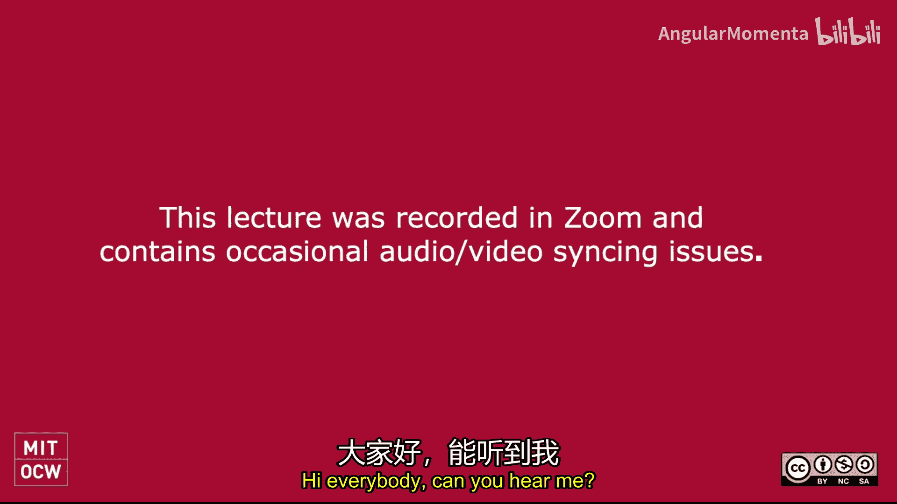
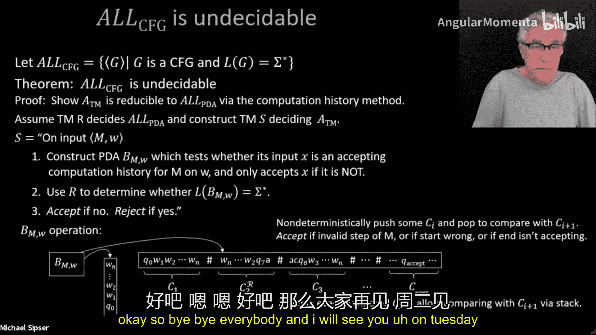
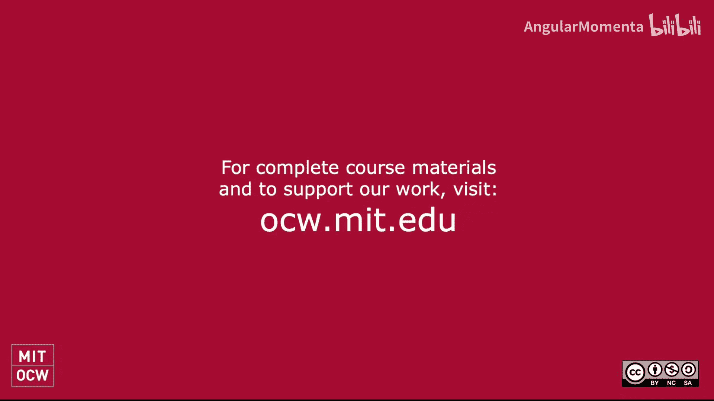

# 【麻省理工】计算理论  ｜  MIT 18.404J Theory of Computation, Fall 2020 p10 10. 计算历史方法 -BV1pt7GzeEjb_p10-

Hi， everybody。Can you hear me。Yes， it good。嗯。Welcome back。To to the course and。

So we are now at lecture 10 and。呃。I let's see what have we been doing。

 we've been talking about undecidability。So we introduced last time Reducbilities and mapping reucibilities for proving。

variarious problems are undecidable and this time we're going to and today we're going to introduce a more sophisticated method for proving undecidability using Redducbilities and that's called the computation history method and that's pretty much what's used in all of the you more serious cases where people have proved problems undecidable。

 it's pretty much a widespread method for especially you know it's not an active area of research these days。

 but at times when people were proving problems undecidable。

 this was frequently a method that was used。So we'll go over that today and we'll prove a few examples of problems undesable using that method。

All right， so why don't we get started？So first of all。Most importantly。

 you should remember how we you how we prove problems are undecidable in the first place。

 and that is by showing。Some other undecidable problem that we already know as undecidable is reducible to the problem of interest。

😡，So typically you might be reducing ATM， which is a problem that we started with and showed to be undecidable by the diagonalization method。

Or it might be some other problem that we've subsequently shown to be undecidable and you take that problem and you reduce it to the problem you're trying to show undecidable。

😡，Okay， whoops， let me fix that。U。So so this is the thing to keep in mind to prove a language is undecidable。

 show that ATM or some other known undecidable language is reducible to the problem B that you have at hand。

 that you're trying to show undecidable。All right， so we are now going to。嗯。First。

 I'm going to start off by remembering Hilbert's 10th problem。

 which we discussed briefly a few lectures back and as you may remember。

 so that's a problem where you're given， say some polynomial。You know， over several variables。😡。

You know， like three x squared y minus 15 z plus 2 xz equals5。And you want to solve that problem。

 you want to find a solution that solves that equation。

 but you require that the solution involves only integers。

So those are so called diahanine problems because the requirement is that the solution be in integers。

And。Hilbert's problem was to ask for an algorithm。Not the language that he used but doesn't matter。

 he essentially he asked for an algorithm to test whether a polynomial has a solution in integers。

 or whether a polynomial equation has a solution in integers。And as。呃。As we now know。

 that problem was posed back in 1900。It took 71 years to find the solution， but the answer is no。

 no there is no such algorithm， we talked about this when we were discussing the church Tring thesis。

😡，and。The method showing that there is no algorithm is bio a reduction from ATM to that problem。

So one can use exactly the method that we're using today to prove that problem is undecidable about polynomials。

 the only thing is is that the reduction that single reduction would take the entire semester。

And I know that's in fact correct because when I was a graduate student。

 there was a woman in the math department at Berkeley where I studied and she the whole course was to go through the proof of Hilbert's10th problem of the solution to Hilbert1th problem。

 the proof of the undecidability of the solution of the undecidability of testing whether a polynomial has an integral solution so。

The thing is that involves some fairly hairy number theory in order to come up with the right polynomials to basically simulate the Tring machine which so that's kind of getting ahead of ourselves that's what we're going to be doing today but we're going to instead of looking at that problem because we don't have whole semester to spend on it we're going to look at a toy problem instead where there's no number theory but it still has the same basic underlying idea that was employed in the solution to Hilbert's1t problem so that toy problem is called the post correspondreence problem and it's going to have some other utility for us well the main reason we're studying it is just to illustrate the method。

USo， and the method is going to be， as I' been saying， is this computation history method。Okay。

 so why don't we'll first talk about this post correspondence problem because that's very easy to understand。

 and then we'll spend a little time introducing that method。All right。So。

The post correspondence problem is as follows， you're given a bunch of pairs of strings。So here is。

One pair， T1 and B1。And I'm writing them as dominoes。

 I'm calling them dominoes because I'm writing one of the strings on top of the other string。In fact。

 I'm using T and B for top and bottom here， so this is T1 is the top string。

 B1 is the bottom string in the first domino。And then in the second domino。

 we have two other strings， to a top and a bottom and so on。嗯。So we have these here。

 this collection of dominoes。As sort of the legal dominoes and what the goal is to find a sequence of those dominoes。

So you want to pick from these dominoes here， you're allowed to repeat dominoes。

 so you want to pick a sequence of those dominoes。😡，Line them up next to each other。

And so that the string that you get by reading along the top。

 all of the T's together is going to be exactly the same as the string you get by reading along all the bottoms。

😡，I'll give you an example， so here to write it down a little bit more formally。

 so what I'm calling a match。Is a sequence of these dominoes？

So it's TI1 T2 as well it's it's I1 is the first domino i2 is a second domino and so on。

 and then you what you're going to have is。All the top strings concatenated together is exactly the same as what you get by concatenating together all the bottom strings。

So here's an example and I think it'll become clear if you didn't understand it so far。

 but it'll be completely clear from the example I hope so here is a bunch of dominoes。Four。And。

What I want to know is is there some selection of these dominoes again， you can repeat dominoes。

 otherwise it would be not an interesting problem so you can repeat these as many times as you like。

😡，And I want to pick these dominoes and line them up so that what you get by reading along the top is the same as what you get by reading along the bottom。

😡，So first of all， if you just stare at this。😡，And you try to make a match。

You'll see that there's only one possibility possible way to start this。😡，Um，You know。For example。

 if you started with the third domino here， BA over AA。

It would fail immediately because the B and the A are different。

And if you use the second domin as your starting point。

 that would fail to match as well because AA has to have to be the top string would start with AA。

 the bottom string would start with AB， and they could never be equal。Um， so by looking at this。

 you can see that the only possible choice that you have is to start with the first domino。

Okay so i'm going to start to build the domino for you just so you can see it so here's the very the match as so you can see the process so the match starts with the very first domino and the way i'm going to write it is i'm going to take the dominoes and kind of skew them so that you can see how the top and bottom strings are lining up。

But they're just mouth the same dominoes， they've just been I changed the shape。

 so this is the first domino AB over ABA。😡，Now the second domino in my match it's got to start with an a as the leftmost symbol on the top string。

 so that would rule out this one for example， but there might be several choices and so it's not exactly obvious which one you should take what I'm going to suggest is we take this one here。

😡，So we take AA over ABA， you see if AA over ABA is just。

writtenten I'm just skeing skewing it so that I can line up the A over a， the B over B。

 the A over a and so on， so I'm starting to build this concatenation of the top being equal to the concatetnation of the bottom。

😡，Following me so far， I hope。So now what's next， so I need to have something where the top string is going to start with a BA。

In fact， there's only one choice for that so it's clearly going to have to be this domino is going to be next。

 so it's going to put a BA up here， but then it's going to force an AA down below because that's what this domino does。

😡，So this BA matches with that now we have the AA to deal with。

So we're going to reuse this domino because that's the only one that starts with an AA。

 so we're going to reuse that one。Now we have AA and ABA， now we need something that starts with ABA。

 I see two choices。Could be this one because this is consistent with it it's at least it captures the AB。

 we could we could try putting this one over here， but a better choice would be to use this one because if we use this one we finished the match。

And therefore， we have found what we're looking for。

And this collection of Dominoe's here has a match。Now it's not always obvious。

Some collections of dominoes may not have a match。😡，And so the computational problem is。

Is there a match？And the theorem that we're going to prove today is that this problem is undecidable。

 simple as it is， simple little combinatorial problem of you know。

 trying to put together different different tiles like that to form a match。

 there is no algorithm for solving that problem。😡，And I think this is kind of interesting because it's the first example of a problem that we have where the underlying question does not really seem to have anything to do with computation。

You know， you might argue that ATM being undecidable is perhaps a little unsurprising after the fact because you know it's a problem about Turing machines so you can imagine Turing machines are going to have a tough time answering it。

 but here's a problem just about strings。😡，And we're going to show what's undecidable。

So just to formulate this as a language， I'm going to call the PCP language is the collection of these。

呃。PCP problems， PCP instances， which are just themselves each one is a collection of dominoes。

 so it's the language of all collections of these dominoes where there is a match。

So it's all of the PCP problems where you can solve them with a match。

And we're going to prove that it's undecidable by showing that ATM is reducible to that PCP language。

Um，Now， u before we do that，'m to have I'm going to explain to you what the computation history method is in the first place that we're going to be using。

So before we do that， here's our first check in for the day。嗯。呃。

Just to make sure you're following me about what this PCP problem is。

 I am going to give you a question to test， is there a match？With these three dominoes。

So I don' you to think about that？I mean， the main thing I want to make sure you understand is what a match is in the first place。

 this is not a super hard problem。To tell whether or not there's a match。Okay。Five seconds。Already。

Okay， closing it out。Okay。So for those of you who said there is a match。

I want you to exhibit exhibit the match because in fact there is no such there is no match and I mean you could get by fiddling around with it。

 I think if you try to find a match you'll pretty quickly see that it's you're going to get I think what happens is you kind of get into if you try to build build a match with this particular setup you're just going to get stuck sort of repeating yourself and。

😊，One point here that you may have missed is that a match has to be a finite sequence。😡。

So if you were thinking about there is kind of an infinite match that you can build with this set of dominoes。

 but that's not allowed， we're only allowing finite matches。

And so they might change your answer as a result， but too late。

And one way to see that you can't have a match in this problem is that you're going to have to start。

 neither of these two are possible starting points。

 so this one is going to be clearly the only chance that you're going to have is a match。

 the first domino here， but then once you put this one down， the bottom one， the bottom string。

 the bottom B's that you're going to get the bottom string is going to be longer than the top string。

And then the other two are going to be have the same length so you're never going to have the bottom the top be the same length as the bottom the bottom is always going to be longer no matter how many more domins you lay out。

 so there's no chance of there being a match here okay。剩那5个呢嗯。

Work our way up to introducing this computation history method。And。First。

Let me define something for a Tring machine that I'm going to call a configuration。

Configuration is just a snapshot of the Turing machine in the middle of its computation。

 so if you're running the Turing machine and you just stop it at some moment。

It's going to be in a certain state。😡，The head is going to be on a certain position and the tape is going to have a certain contents。

😡，And with that information， you can then continue the computation of the Turing machine。

 that's a full set of the information that you need about the Turing machine that tells you everything about its computation at that moment in time。

The state head position and tape contents and so that we're calling that that information together state head position tape contents。

 we're calling that a configuration。Fairly basic notion。

 I mean if you if you program if you have something。

 if you have like the states of all the variables and where the current execution of the program is at a moment in time。

 same idea。Okay， so in terms of a picture here， here's a Turing machine， imagine it's in state23。

The head position is in the sixth position on the tape。

 so P would be six because it's in the sixth position and the tape contents is going to be this bunch of A's followed by this bunch of B's。

 so I would write it down like this。States in Q3。Head position number six。

This is the contents of the tape Now what we're going to often do for convenience in using this notion in proofs。

Is that we're going to want to represent。A configuration as a string。嗯。

In a particular way that's going to be that's going to this is。

 this concept is going to come up kind of again and again during during during the course。

 And so it's going to be handy to have a particular way of writing down configurations， you know。

 for doing proofs about them。 And so the way we're going to write them down is I think it's just。

 maybe I can just put it right up here like this。 we're going to write down the the symbols of the tape。

But what we're going to do is stick in the middle of those symbols that the state。Of the machine。

Immediately to the left。Of the position that the machine is currently reading。So， you can imagine。

You know， the the head here， which is coming， you know。

 imagine the state is kind of where the head is， it's pointing at the symbol immediately to its right。

So this is just another way of writing down a configuration here's the tape contents which i'm sort of writing formally here i'm breaking the tape contents into two parts which i'm calling T1 and T2 this is the T1 part the T2 part and I'm。

😡，Putting the state。In between T1 and T2， where I have in mind that the machine's head position is right at the beginning of T2。

But maybe this picture just says it all and is clear enough。😡。

Um so just keep in mind that when we're going to be writing down configurations of machines。

 we're typically going to write it down this way。嗯。Okay。

 so I think this is a good moment to take a moment for questions。Oh。

 I see there's a lot of questions already。So one's question is。

 how does the encoding differentiate between the string and the state？

If I'm understanding you correctly， I'm going to be assuming that。

The state the symbols that represent states and the symbols that appear on the tape are distinct from one another。

 so you can always tell just like usually the way we write things down when you have a state symbol or whether you have a tape symbol。

😡，And so in a configuration， you're going to have a bunch of tape symbols and a single state symbol represent。

 you know in the position where the head is。嗯。Somebody says six here is just， you know， this is one。

 two， three， four， five， six where in head the head is in position six that's all I had in mind for six and that's why that six is appearing over there because that's the position of the head。

嗯。Good。All right， so why don't we continue？Now we're all to start defining computation histories。

 which themselves is not very difficult concept。😡，Computation history for a Tring machine M on an input W。

Is just the sequence of configurations you go through。😡，When you start the machine。

At the beginning with M on the tape with W on the tape， I'm sorry。

 and the head at the beginning in position one and the state in  Q0 or whatever the start state is of the machine。

 so that's going to be very the starting configuration here。

 and these are the sequence of configuration that machines go through that the machine goes through step by step。

 every step of the machine is getting represented here until it ends up at an accept。

That's what we mean by a computation history， or sometimes we're going to emphasize that by calling an accepting computation history。

Represent meaning that the machine has accepted its input and these are the sequence of configurations that the machine goes through。

That's what I mean by a computation history， you know。

 I'm sure in I mean I think the terminology changes over the years。

 but the there's a notion similar to that for any kind of， you know。

 if you're you know running a program and you just want to keep track of how the variables are changing as you're you in this particular run of the machine and you're writing them all down it's like a log of the history of the settings of the internal states of the machine and variables and so on。

嗯。So this is just all of the configurations the machinech goes through on the way to accepting its input。

😡，If the machine does not accept its input， there is no computation history。😡，Okay。

 so there is no accepting computation history， at least to emphasize that point because that can only occur。

 obviously if the machine is accepted its input。Okay。

 so just as we had with configurations we're going to want to be able to write down computation histories as strings and it'll be convenient to have a particular format for doing that as well and it's kind of the obvious thing we're just going to take。

😡，The sequence of configurations in the computation history and write them down as a string where each configuration is going to be the string for that configuration。

😡，I'll show you kind of a little example in a second， but just to you know focus on the concept here。

 we're just going to write down the string for this configuration， the starting configuration。

 and then the next configuration and so on until you get to the accepting configuration and separate each of those strings by some pound sign delimiter。

Okay， so here is a computation history for M on W。Where W is the string W andW2 dot dot wN so here is the。

Here is the first。Configuration。So this part here is that is the computation history encoded as a string I'm just I'm giving you this extra。

😡，Side information just to make it clearer what's what's going on there so this is the first configuration this is the second configuration and so on and i'm trying to even give you a little bit more you know detail of how it might look by kind of you know making the example a little bit more concrete so let's say that the Tring machine when it's in the starting stateq0 looking at the very first symbol of the of the input tape in this particular input say W1。

It goes from Q0 to  Q7 and writes an A on the tape and moves its head to the right。

So that's why the second configuration reflects that。See here it went from Q0 to Q7。

 now the head is in the second position， so that's why that state symbol has moved over one。😡，And。

The very first position now has become an A because the machine has changed whatever was on that input tape there in the first position to an A。

😡，And then the next step， it goes from Q7 reading W2， which is where the head is now。

 it's looking at the W2 and goes to Q8， writing a C and again moves right。Okay。

 so that's why I drew these in the way I did as you go through a sequence of those。

 you get to Q accept and that's the encoded form of the computation history。Allright。嗯。

I think that's that all I wanted to say yeah， so you can feel free to ask another question if you want。

 I'm just going to relaunch this。Yeah， good。So if we're all together on。Configurations。

Computation histories and how we're going to be writing them down to strengths。😡。

That's what we've done so far。No questions， so I'm going to move on。All right。So let me define a new。

Omaton。That we're going to mainly use。As just to provide an example。For us today。

I'm going to call this a linearly bounded automaton and all it is is a Turing machine。嗯。

Where the Turing machine is going to be restricted in where it can。😡。

The tape is not going to be infinite anymore， the tape is just going to be big enough to hold the input。

😡，So the machine no longer has the ability to move into the portion of the tape to the right of the input because there is no tape out there。

 it just has the tape sitting here that contains the input， which the tape itself can vary in size。

 however big the input is that's how big the tape is。😡。

So the tape adjusts to the length of the input。😡，But once you've started the machine with some particular input。

 that's as big as the tape is， there's no more。😡，The reason why it's called linearly bounded is because the amount of memory is a linear function of the size of the input because you can effectively get somewhat more memory by enlarging the tape alphabet。

 but that's going to be fixed for any given machine so that's where the linear comes from if that's helpful but if you don't get that。

It's sort of a side remark。But what's important to me is that you understand what I mean by an linearly boundary automaton or an LBA。

It's just like a turing machine， but is that portion of the tape that originally had blanks is just not there。

😡，When the machine tries to move its head of the right end of the input。

 it just sticks there just as if it tried to move its head off the left end of the input。

Doesn't go anywhere。Okay， so now going we're going to ask the same kinds of questions about LBAs that we ask for other automata。

So the acceptance problem。If I give you an input and some particular LBA， and I want to know。

Does the LBA accept that input？Well， you know and now the question is， is that decidable or not？

So it's。At first glance， you might think， well。An LBA is like a Turing machine and the ATM problem is undecidable so。

knowThat might be a good first guess。And also if you try to。To simulate them。

 if you try to figure out how you would go about simulating the machine。😡，You know。

 if I given B and W， if you actually try to simulate the machine to get the answer。

 so you run B and W， well of course， if you running it for a while and it eventually holds either accepting or rejecting。

 then you know the answer and you're finished， but you know this machine might get into a loop。Um。

 you know， nothing to prevent the machine from looping on that finite amount of on that limited amount of take that it has。

And then。You know。You might be in trouble， but in fact。

 that's not the case because when you start out with a limited amount of tape。😡。

If you run the machine for a long time。And it's not holding， it's going and going and going。 In。

 it's going to have to repeat。😡，Get into exactly the same configuration。That it did before。

 because there's only a limited number of configurations that the machine has。

And once it repeats a configuration， it's going to be repeating that configuration forever and it's going to be in a loop。

so。This problem in fact is decidable because the idea is if B onW runs for a very long time and an amount that you can calculate。

 then you know it's got to be cycling， you more than just looping。

 it's got to be repeating itself and so there for once it starts repeating itself。

 it's going to be going forever。啊。So and here's the actual calculation。

 which is something I'm sure you could do on your own， but just to spell it out。

 so if you have an input of length n。That you're providing to B， so if W is of length n。

the LbaA can only go for。This number of different can only have this number of different configurations。

 the number of states。Times the number of head positions， which is n。

 the number of head positions on the tape， times the number of different tape contents。

You know if the tape was only one long， you know this is the size of the top tape alphabet。

 so if the tape were too long it would you know the tape had two cells on it。

 the number of possible tape contents would be the square of the alphabet and if the tape is going to be n symbols long。

 it's going to be the tape alphabet size to the end power。So therefore。

 if a turning machine runs for longer， it's got to repeat some configuration and it'll never hold so the decider is going to be hopefully clear at this point。

You're given B&W so that this is the decider for ALBA。

It's going to run B onW for this number of steps， if it's accepted by then。

 then you accept and if it hasn't， if it's rejected or it's still running，😡。

Then you can reject and you know， if it's still running at this point， it's never going to accept。😡。

嗯。All right。Any questions on this？Okay， let's move on。All right， so now。

But what's different now or's perhaps interesting now is that even though the acceptance problem for LBAs is decideable。

 the emptiness problem is undecidable。And that's where the computation history method is going to come in。

 So this is where we're going to be starting to do something new in terms of a proof technique because。

嗯But呃。So we're going to reduce ATM to ELBA， the emptiness problem for LBAs so given an LBA does it accept anything or not and this is going to use the computation history method so this will be a chance to illustrate that method for the first time。

So the setup initially is just like before， we're going to assume we have a Turing machine that the size this ELBA problem out of interest。

And we're going to use that to construct Turing machine deciding ATM for our contradiction。Okay。

 so here is S。Supposedly deciding ATM。what is going to do and this is going to be the tricky part。

S is going to use M and W。😡，To design an LbaA。😡，嗯。That LbaA is going to be built。

With the knowledge of M&W， in fact， it's going to have M&W built into it。😡。

So that's why I'm calling that LBA B sub MW。😡，Because it depends on MW， as I'll describe。

 and what that LBA does。It takes its input。😡，It's called the X， the input to the LBA。

And examines that input to see if that input is an accepting computation history for MW。😡。

That LBA is just looking for computation histories for MW。😡。

And that's the only thing that's going to ever accept。If you feed it something which is not。

A computation history， you know， that sequence of configurations for MMW leading to an accept if you feed at something else。

The LBA is just going to reject it。It only accepts。The accepting computation history for MW。And now。

If you can build such a thing。Then you can。Use that machine in your emptiness tester to see if it accepts any strings at all。

 because the only thing it could possibly be accepting is in accepting computation history。

 you don't even know if there exists one。😡，Because you don't know if M accepts W。😡。

So you're going to build this LBA which is looking for accepting computation histories。

And then see if its language is empty or not， if its language is not empty。😡。

The only thing that could be accepting is this computation history， so you know M accepts W。

Whereas if the language is empty， you know that there is no computation history for M andW and so M does not accept W。

So that's the whole idea the trick is how do you build this this LBA so first you're going to make this LBA which tests its input to see if it's an accepting computation history for MW。

呃。And you have to build this。LBA， without even knowing whether there is a computation history。😡，Um。

 sounds like you can take that string and just build a string into the Lba because they don't even know if that string exists。

😡，But what you can do is you can make the LBA。Follow the rules of M， it knows W。😡，And it knows M。

 so it can take its input and using W and the rules of M。

 see if that input is a computation history for M on W。😡，And that's what it's going to do。So here is。

This machine i'm going to construct i'll give it to you written down with a little bit more details of its procedure。

 but just to kind of illustrate it， so here is a proposed input to piece sub mW this would be the x here this would be an x that would be accepted。

But anything else that was be provided would not be accepted。

So this is the sequence of configurations written down as a string。

 that would be the X that I'm providing to the B sub MW。

 and it's supposed to be checking this to make sure it's legit。😡，So on input X。

's the way it's going to proceed， it's going to first check to see whether X begins in the right way。

佢先 know。This LBA， it knows M and it knows W。😡，So the very first thing is it takes a look at the first part of the string up to the pound sign。

 you know， if there's no pound sign if if you're going to just feed junk in。

 it's going to be easily identifiable as junk。😡，嗯。So， you know。

 if you're going to feed something so it's going to the Lba is going to take everything up to the first pound sign and just confirm that that thing is。

😡，The first configuration， the starting configuration of M onW。

 which means it has to start with the start state and here is W。So' just going to check that。

Then it's going to check that each。Each one of these guys follows legally from the previous one according to the rules of M it's going to first check that this one is corrected then this one leads to that one。

😡，According to the rules of M， then this one leads to that one， according to the rules of M。

All of that， the knowledge of M andW is built in so it can do that。😡，嗯。And then it just。

Follows along checking this computation。😡，You know it's easy to check that a computation is correct。

 that's all that's really going on here。😡，Um it's going to check that the computation is correct until it gets to the end and then make sure that the last configuration that it's been given as input is an accepting configuration。

That there's an accept state in it。And if everything passes， it accepts otherwise it rejects。Okay。

And the point is that this is an LbaA you don't oh I just kind of jumped ahead of my so you don't need any additional information so how does it actually do this so you know how do you actually do this on the tape so I claim that the LbaA doesn't need any extra space to do this to do this check you know it's it's just kind to be zigzagging back and forth here on the the on the input。

Um， you know， checking that the corresponding symbols match up except around the head position where it gets updated correctly。

And it seems it may need to mark， it will need to mark on the tape。

 it's allowed to write on the tape， just to make sure it keeps track of where it is。

But this is a very simple， I mean， I'm not trying to， if you're not following it。

 I'm not trying to alarm you， but I'm just trying to help you understand that this is not a complicated procedure here to do this check that the actual computation that's written down of the Turing machine is valid。

But you know， we can deal with a question here。呃。Oh， good。Now we've got some questions。Shos。

You can be thinking about while I'm thinking about this。

 you can think about that check in over there。So here's a good question going from each configuration to the next configuration。

 is it a unique？Next step。Well i'm assuming that the tuuring machine we're starting with is deterministic so this should be only one way to go so the answer to that question is yes。

 this is going to be a unique string here there's really going to be only one。Comput history。

 not that it really matters in a sense， the answer to that question。

 as long as that accepting computation history corresponds to the machine actually accepting。Oh boy。

 we we're all over the place here Okay， are you ready to end this。😊，In this。In this bowl。All right。

Well， this is where we are。呃。Everybody who said they'd rather be in six six04 six。

 I know who you are， you're all going to be expelled。No， I'm joking I don't know who you are。Yeah。

 good so。So we are here at the break and I made this poll on purpose at this moment so we can spend a little time let me just start our clock going and I can try to help you。

 those of you who are who answered to see that you're baffled I can try to help you understand what's going on。

So this is a good question here。呃。Okay， well okay， theres several good questions here so。

Somebody asks， why don't we just test all possible strings for B。

 remember if we're trying to test emptiness。😡，For B's language。That's the ELBA problem。

No one did we just try all possible strings。And that would work if we had enough time。

 but there's infinitely many strings and so that's not going to be good if we're trying to be a decider。

So。So is that's why we don't just try all strings。So but here' is this other question here is。Okay。

So。嗯。TheQuest is， how do we find the input X？😡，So this is an important question because。

We don't find the input X。There's no， you know， the input X。

 at least the accepted input X would be the accepting computation history for MW。😡。

We're never going to find， you know， we're never going to find an X， we're building this LBA。

Not we're never going to run that LbaA， we're designing that LbaA not for the purposes of running it。

We're building that LBA only for the purpose of using the LBA language emptiness tester。

 we're going to build that end LBA and feed it into the machine term machine R。😡。

Which is going to tell us whether that Lba's language is empty we ourselves is not never going to run that machine。

 we're never going to come up with an X。😡，We're just having， we are designing a computation checker。

😡，And then。The emptiness tester for that that we assume to exist for。ELBA is going to say， yes。

 there is some computation which this machine accepts or no。

 there is no computation which this machine accepts and that's going to be a computation for M onW。

And so that's going to tell us whether or not M accepts W。

So we're never going to actually be finding Nx， we're never going to be running that LBA。😡。

We're just feeding using that LBA。😡，As。As an input。To R。嗯。

Does the computation history method always use LBAs no？😡，As you will see right after the break。

Because that's the LBS is just kind of an easy place to get started。

 but we're going to use the computation history method and computation histories next on the post correspondence problem。

😡，Yes， the computation histories and the input X are always going to be finite so that was an answer to a question about whether these histories or the inputs are going to be finite or not so theyre those strings are always going to be finite and the computation history is going to be finite so we are at the end of our five minutes let me just see if there was another question I wanted to answer。

嗯。Let let's move on。Okay， now getting coming back to the undecidability of this post correspondence problem so remember the post correspond you know this problem。

 you're given those dominoes， you want to know if theres a match here is a little mini version of the diagram if that helps you remember it and we're going to prove that this language is undecidable and so it's undecidable to test whether you have。

A match given a set of dominoes。Whether a match is possible。

And we're going to use we're going to reduce ATM to this language using the computation history method。

 so how in the world are we going to do that？诶。First of all。

 there's a little detail here I want to mention just。呃。Don't focus on this。

 but I'm going to assume the matches always start with the very first domino on the list the very first domino in the collection so there's going to be like a starting domino it is going to make my proof a little simpler to do it that way and then you can fix that assumption later and if we have time at the end I'll do that or maybe after the lecture is over there questions I can show you how to fix that assumption but for now to simplify the proof we're going to assume that there is a starting domino that the matches always have to start with that particular domino。

嗯。If you didn't follow that point， don't worry， you can just ignore it。

 you'll see where it comes up later。So now we're going to reduce ATM to the PCP。

 so assuming we have a machine that decides the PCP。

 we're going to use that to make a machine that decides the ATM。As before。

So here is the Turing machine S， which is going to decide ATM and the way we're going to do it it is like this。

We're given M and W， we want to know， as always， does M accept W？😡。

What we're going to do is we're going to build an instance。😡，Of the PCP problem。

 so we're going to build a collection of dominoes。😡，Um。

Which are going to and that collection is going to be built knowing M andW so that's going to affect the dominoes we're going to create so I'm this collection of dominoes is going to be called piece of MW depends on M andW。

😡，And。Finding a match for this set of Ws。😡，I is going to force you to simulate M onW because the match is going to correspond to a computation history for M onW。

😡，So we're going to use。Once we do that， once we build the set of dominoes who where a match corresponds to a computation history。

 we're going to use R to determine whether or not there is a match。Or in other words。

 whether or not there is a computation history， which is whether or not M accepts W。

So if there is a match， we're going to accept because we know M accepts W。And if there is no match。

 we're going to reject。Because we know M does not accept W。Okay。This is the plan。

 I haven't told you how to do this yet。😡，嗯。I mean I'm worried about the significant number of you who are feeling confused by the method。

 I mean you guys should be texting me in the TAs。To try to at least get a sense of how this is working I mean we're going to be going read we're going to be doing the method again。

It's just going to be a little more complicated because we have to also deal with these dominoes and all that stuff。

 and that's why I presented it to you the first time in the setting of the LBAs which where in a sense the method comes out perhaps more simply。

嗯。So a match is going to correspond to an accepting computation history。😡。

Sometimes I if I don't use the word accepting， you know。

 I'm just being a little sloppy computation history and accepting computation history for us right now they're the same I mean later on we may actually talk about rejecting computation histories but let's not get ourselves confused all except computation histories always have to end with the machine accepting。

Okay， somebody's asking， what does it mean for match to correspond to a computation history。

 you'll see that's going to be on my next slide。呃。Oh。

 so this is a good question is my step two trying to use R to determine whether Mxfs W， well yes。

 but I'm doing that by testing whether whether these dominoes have a match。😡。

Because if R decides PCP， I can only use R to test whether things have a match。😡。

Because someone asked should step two be to use R to determine whether M accepts W well in effect。

 that's what it's doing， but it's doing indirectly through testing whether this。😡。

PP whether these dominoes have a match because those dominoes are going to force you to simulate them on w okay。

 I think i'm repeating myself here so let's avoid getting into a loop on the lecture and see how we actually build piece of Mw so now you understand what you have to under have the plan in your mind。

We are given M and W， we're trying to make a set of dominoes。😡。

Where a match is going to be a computation history for MW so the string you're going to get in that match the top string and the bottom string which are going to be you have to have to match they're going to be computation histories but they're going to be a computation history of M onW so I want to figure out how to make my dominoes force that。

😡，Okay， so my starting domino， as I told you， there's going to be a special starting domino in my collection。

 so which is going to require the match to start with that domino， it's going to be this one here。

It's going to have these two strings in it。And you can see already it's starting to look like a computation history。

 the domino's going to have that feature。It's the pair of strings and I've written it kind of to help you see what's kind of going on。

 it's a pound sign on the top and the starting configuration for MW on the bottom。

And what I'm going to do for you here。Is at the bottom of the slide。

I'm going to take the dominoes I've written down so far and try to be building a match and you'll see how that match is forcing a simulation of the machine。

😡，Okay。So let's take at this as an illustration， let's assume the input to M。😡。

So I'm running M on W now I'm trying to see does M accept W W is a string 2，2，3。😡，So， the。

Start configuration for M on W is Q0， that's the starting state for M and then W following it is 223 that's what it's going to appear on the tape of the Turing machine to start off。

So this is the start configuration。For R&W。And。Assuming that I had this particular string is input string to W。

And so given the match， the dominoes that I've given you so far， just one。

 this is how the match is going to start。Now there's going to be more dominoes coming。

So for every possible tape symbol in state don't get confused by the language here。

 this is the important thing if if in the Tring machine。Um。

 and I'll just read this in English to you if the Turing machine when it's in state Q and the head is reading an A。

😡，It moves to state R， writes a B at that point， and its head moves to the right。😡。

I'm focusing on rightward moving Turing machine steps right now。But for every possible。呃。

State and tape symbol and looking at where what happens。

 I'm going to have a domino that's going to capture this information。😡。

And it's going to be this domino here。Q a。On top。BR on the bottom， So just a string Q A on the top。

 B R on the bottom。So let's see why was that sort of arcane looking。

 why is that a good thing to why is that a useful domino to put in here？Well， if you take a look。嗯。😊。

Let's assume my Turing machine when it's in state Q0， which is the starting state。

 and the head is reading a two， which it will happen to be reading because the string W starts with a two。

😡，If it goes into state Q4，  Q7 and writes a four and then moves right。😡。

I'm going to have in this domino， I'm going to have Q02 on top。And four， Q7 on the bottom。

Because four is what I write right here， that' you that's the B。

And the new state that I'm going into is Q7。So that's going to be the domino that I'm going to get and here it is。

 here's that domino appearing in the match。😡，So it's going to take matchup with Q02。😡，Which。

 you know， you know don't forget the top string has to equal the bottom string so and this is going to be the only choice that I have for extending the match。

😡，So Q02 is going to be on the top when I put that there。

 but that's going to force4 Q7 to appear at the bottom because that's what's going to be the bottom string corresponding to the Q02 on the top。

😡，Okay。So。If you're looking down here， this is the beginning of the second configuration of the machine。

 that's what I want to be happening。😡，I want to be for that match should look like a computation history。

😡，So now so this is going to be all possible right moves are going to be handled in this way and it's going to be a similar process for the left moves。

 but let me not you know， I'll leave that to your imagination。Now。啊。How do I continue on from there。

 what does the rest of this configuration look like？Well。

 that should just be a copying over of the remaining symbols that were on the tape because they don't change and things only change around the head。

😡，The rest of those symbols， which is the two and the three， those should just get copied over here。

 so I'm going to have two additional I'm going to have additional symbols in my a dominoes in my in my collection。

 so for every tape symbol i'm going to have AA。😡，Be a。Domino so for every tape symbol A。

 I'm going to have AA be a do domino in my collection。And so that says。

I can have so that there's going to be a two2 domino so I can match up this two over here。

 but that forces me to put a two down over there。There's also going to be a  three3 domino。

 which is going to match up with that three， but it's going to force me to push put a three down over there。

 that's the only way I can extend this match that I've built so far。😡，I have no choice。

Those are the only dominoes that I'm going to be given。And by in so doing。

 I'm forcing you to basically simulate the machine。

Now what I want to have happen next is a pound sign to appear here and that will conclude my second configuration。

😡，So there's going to be a pound sign pound sign domino as well， because there's a pound sign here。

 it's going to get matched with a pound sign at the top。

 forces a pound sign to come down on the bottom。And if you look at where we are right now。

 we're exactly like where we were at the beginning when we had just this first Domino appearing。

 but now we're one configuration later。😡，So if you understood that。And I admit it's it's， mean。

 you know， this is， there's just one idea here。嗯。And once you get the idea。

 it's all trivial it's all very simple， but there's just you have to get that idea and'm trying to figure out how to get that idea into your head once you get the idea you can write all this stuff yourself。

😡，So。So following this description of how the transition function of the machine works and copying over the symbols from the tape to the next configuration。

 I'm going to be able to get configuration after configuration going。

Until I get to a point when there's an accept。😡，And now from the machines's perspective， we're done。

The machine has accepted its input， this is our computation history， but is it a match？😡，Yeah。Well。

 you know， up until this this bottom thing is the computation history。

 but it's not a match because the top doesn't equal the bottom。

 there's still extra stuff at the bottom which the top is not you know。😡，It doesn't have。

So what I'm going to need to do now is add some additional kind of pseudoro steps of the machine。😡。

Where I'm going to allow the top to catch up to the bottom。😡。

And the way I'm going to be thinking about that， and this is not real for a termuring machine as much as the termr machine is real anyway。

 but you're going to imagine I'm going to add a new kind of move to the machine。

 which is going to allow the head to eat the symbols of the tape。😡，Like PACman。Okay。

 and the way I'm going to get that effect。On the top。

 if I have any tape symbol next to a Q except on either side。😡，On the top。

 what I'm going to get you to right on the bottom is just to accept with that tape symbol gone。😡。

And by repeating that， move after move， the actual tape is going to be shrinking。

 the symbols on the tape are going to be going down one by one。

 move by move until there's nothing left except just the Q except all by itself。😡，Okay。

 so I have this sort of packman idea of eating the symbols on the tape and then finally I get to a point when there's just the Q accept。

Alone on the tape， there's no as symbol left to consume。

And then I'm going to add one last domino here， which is Q except pound pound。

 matching with just pound， which just conveniently。😡，Finishes off the。The the match。

And so the match is completed。There's actually a little detail here。

 I hesitate even to bring it up because I think it's a kind of thing where if you understand everything up to this point。

 you could fill it in yourself， but just for completeness sake。

You have to deal with the situation when the head。Of the Tring machine might move into the blank portion of the tape。

😡，Which is not taken into account here and the way we get that effect is by having another a domino here。

 which allows me to add blank symbols at the bottom as needed。😡，That's just a detail。You know。

 I'm more worried that you understand the underlying concept so here's going to be。A check in。

Do remember。嗯。Okay， but you know， so okay， so what else can we conclude from this information？

So we know at this point we know that PCP is undecidable， that's what we just finished proving。

What else do we know？If anything。Or do we even know that？

UI see my picture is a little bit covering the check button， but it's still readable。嗯。So I mean。

 this is not an easy concept to get the idea， but once you get it。You know， it's。You know。

 you'll see it's not that bad。Okay。Another 15 seconds。So this portion doesn't。

 this question is not really relying so much on the computation history method。

 it's just relying on the fact。About。PCP being undecidable。嗯。Okay， everybody。Almost on five seconds。

All right。嗯。So I can see that there is。Some level of confusion。So the reason why。B is correct。嗯。

Is that we know PCP is undecidable。But。We also know that it's recognizable because you could try all possible ways of combining dominoes and one after the next and except if you ever find a match。

😡，So that might go forever， but if there is a match of possible， you'll find it eventually。

 so PCP is a recognizable language。😡，Uncidable and so therefore we know its compliment has to be unrecognizable because you know that's something we've shown before if a language and its complement are both recognizable。

 then it's decable， but we know PCP is not decable so they both both sides can't be recognizable。

Okay， so let's。Let me prove to you one last theorem that's going to be useful for your homework。

Involving the computation history method， so you'll have one last chance to get the way we're going to use this。

 though this one is going to be a little bit more similar in spirit to the LbaA version than to the PCP version。

 which has this extra kind of complication about。coding the computations of the machine into dominoes here。

 you know we're going to operate with another automaton which where it's going to be more straightforward but anyway okay getting ahead of myself。

So if you remember for context free grammars， we had the ECFG problem， the emptiness problem。

We showed that was decidable。So testing whether a context free grammar's language is empty is deable。

However， testing whether a context free grammars language is everything。

 whether it's equal to sigma star， that turns out to be。That turns out to be undecidable。Okay。

 so emptiness testing for context programmers decable。Sigmas are att testinging。Uncidable。嗯。Okay。

 so we'll show that ATM is reducible to old PDA via the computation history method。

And so assume we have same patterns， assume we have a decider for old PDA and make a decider for decider for ATM here's the ATM decider and now。

Similar to what we did for the。LBA case， but with a twist。We're going to make a pushdown automaton。😡。

That's going to check its input to see whether it's an accepting computation history of MW。

 just like the LbaA did if you think back to how that worked。😡。

Remember you know we the LbaA tested its input to see whether it's an accepting computation history accepted if it did。

 and then we test the LBA's language for emptiness to see if there are any computation histories。

 so we're doing the same kind of thing except now。The PDA is going to test its input to see whether it's an accepting computation history and if it is。

 it's going to reject。😡，It's going to do the reverse of what the LBA did。

And that's going to turn out to be necessary， but for the moment let's just go with it and maybe we'll see it in the proof why the proof needs it to be this way。

😡，So this push on automaton is going to accept its input if it's not。😡。

And accepting computation history from MW otherwise it will accept so you can think of this PDA as。

Accepting all the junk。It just。Doesn't accept。The good stuff， the accepted computation history。Okay。

 it just， it's accepting all the things which fail to be in accepting computation history。Okay。

 and then once we have that， we test whether R's language is everything。

 remember whether BMW's language is everything using R。😡，Because if that PD's language is everything。

😡，Then we know。There could not be an accepting computation history because that's the one thing that gets。

嗯。Not accepted， that's the one thing that gets rejected。So if it's accepting everything。

 there is not going to be an accepting computation history。

So if there is no if this is equal to sigma star then there couldn't be an accepting computation history and so we're going to accept Okay。

 so how is this going to work so what's different now about this case。

From the LBA case is remember the LBA got you know the computation history on its input。

 and it used its ability to write on the tape to check that each configuration followed the next one。

We don't have the ability to write on the tape and push out a timeton and by the way。

 I hope you're all comfortable with my using PDAs instead of grammars because we can interchange one to the other should have mentioned that when I did it but。

😡，Um。So the PDA is going to be using its stack to compare each configuration with the next one。😡。

Okay， so the way that's going to happen is it's going to non deterministically take one of these things so the very first thing it does is as before it checks to make sure that the beginning of the input is the start configuration。

 but then once thats that's the easy part but once we get going with that we we push each configuration well we first of all we non deterministically。

😡，Choose which configuration might be the one that fails。😡，Um。

 where where one fails to go to the next one because those are the ones you're trying to accept when there's a failure。

So we not deterministly look for the place that there's a failure， we push that onto the stack。

And then we pop it off the stack and compare it with the next configuration。

So that's how we're using the stack instead of being able to mark on the input now there's a so i'm kind of going to illustrate that here so you know we're going as we're going to read this thing here andm going to put it onto the stack so this thing moves over to here and。

This input here got put onto the stack。You know Q0 W1W2 it's Q0 W1W2 you see that that first configuration is now sitting on the stack now as we're going to pop it off。

 we're going to match it with the second configuration。Now， if you're following me。

You'll realize that there's a difficulty here because it's coming out in reverse。

You know it comes out in the reverse order that we put it in and that's not what we need it to do so the what we're going to do here and here's a little sort of a twist we're going to change the way we're writing down computation histories by making them by writing them reversing the even numbered ones so this one here is going to be written down in reverse。

😡，And that's perfectly okay， we can write down configuration computation histories in any way we want to meet our needs so' to reverse we're going to reverse the alternate ones and now when we push one。

 it's going to come off in the right order to compare with the next one。

And so that's how the procedure works， okay？We're running a little short on time you need to be a let's see so let me just go to。

Quick recap， the computation history method is useful for showing the undecidability of problems when you're testing for the existence of an object。

Each of those four cases that we show today involved testing whether something exists。

So is there an integer solution to the polynomial， is there some string in the language。

 is there a string that's not in the language or is there a match？

So that's a typical case when this computation history method comes up。And so as a quick review。

These are the things we show today。Okay， so why don't we we're just out of time and so I'm going to let you go。

 but I will stick around for another five minutes or 10 minutes。

 happy to answer any questions if you have them， but that's officially the end of the lecture。Okay。

So let's let me try to get to there's a lot of questions in the chat。

 don't forget you know write to the TAs too。嗯。嗯。So。If M does not accept W。

 what will happen to the computation history， So if M does not accept W。Then there is no computation。

 there is no accepting computation history， that's the only computation histories we're considering。

So if M does not accept W， there is no accepting computation history， there's no computation history。

And I don't know what means what will happen to it， it just doesn't exist。So。I hope that's helpful。

Don't we need to be able to add states to the end of the tape I don't know what that means。

It's taped to the end of the tape。I don't understand you'll have to repeat that one。

 sorry or explain that better。嗯。啊。So this is a very good question here。

 where does the previous proof fail when trying to reduce ATM to ECFG？

I it's got to fail because ECFG is decidable。So that's a very good question。

 maybe we can just go back to that last slide here。嗯。Because I was running a little short on time。

 I didn't really focus on why we have to accept。The non computation history strings we why are we accepting all the junk strings and only rejecting。

The strings which are the the computation histories， so you know we're looking for strings that fail。

You know， if string could fail because it starts wrong。

String it doesn't have the start configuration or' maybe doesn't end with the accepting configuration or maybe one configuration doesn't lead properly to the next one。

Any of those cases are a failure。And there are going to be reason to accept。

The reason why we can do that is because we're taking advantage of the pushdowns non determinism we don't know where the the failure。

Might occur， so we're going to not deterministically guess where that failure occurs。

If we were going to flip this around and say。Let's accept only the good ones and reject everything else we would have to test that each configuration led to the next one。

😡，So we have to check them all。So if something fails， it only has to fail in one place。

 and then you know we can accept。If it's a good computation history， it has to be good everywhere。

And so the push on automaton really， if you're going to get down to the nitty gritty。

 the push on automaton can check that this configuration leads to that configuration。

Using pushing on the stack and then popping it， but now by the time you get to here you want to check that this second configuration leads to the third one。

😡，You would need to push the second configuration onto the stack， but at this point you're already。

After the second configuration， so we can back up and push the second one on the stack。

So the push on time done is not able。To check。In the positive sense that you have a computation history。

 it's only able to and accept them， it's only to check in the negative sense that you don't have a computation history and accept all the ones that fail。

😡，And that's just because it only has to fail in one place。

I don't know I hope that helps so that's why we couldn't flip this around and make this proof work for the emptiness problem and only has to work for the the everything problem。

 the old problem。All right。Okay， so bye bye everybody and I will see you on Tuesday。

